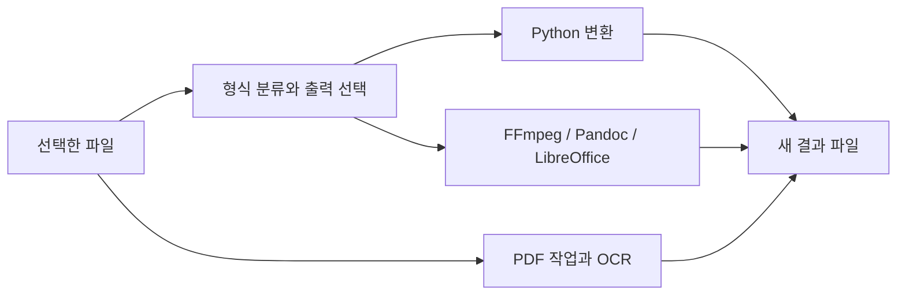

<div align="center">

# 🔄 FlipRing Project

파일 변환과 PDF 편집·OCR을 한 화면에서 처리하는 Windows 앱입니다.

**기술 분류:** 데스크톱 소프트웨어 › Qt·문서 처리 › 파일 변환·PDF·OCR

`Python`
`PySide6`
`Windows`

[빠른 시작](#quick-start) · [저장소 구성](#repository-structure) · [입출력 구성](#data-settings)

[핵심 구성](#input-processing-output)

</div>

<a name="overview"></a>

<a name="latest-changes"></a>
## ✨ 최신차수에서 달라진 점

**기본 구조** — 원형 메뉴·트레이와 변환·PDF 처리

원형 메뉴와 작업 큐를 중심으로 파일 변환과 PDF 처리를 연결했습니다.

- app.py는 Shift를 누른 채 파일을 끄는 입력을 감시하고 원형 메뉴·트레이·작업 큐를 연결합니다. 일반 변환과 PDF 작업은 각각 단일 작업 스레드이며 두 큐를 동시에 실행하지 않습니다.
- engine.convert는 파일 종류별 도구를 선택하고 같은 드라이브 임시 폴더에서 처리한 뒤 새 이름으로 이동합니다. 압축의 상위·절대 경로와 링크를 검사합니다.
- pdf_tools와 pdf_panel은 페이지 추출·삭제·회전·압축·OCR 출력 옵션을 처리합니다. PDF 결과는 배타적 생성으로 덮어쓰기를 피하며 OCR의 행·열은 글자 위치에서 추정합니다.
- studio_ui·ui_motion은 화면과 유한 애니메이션을 구성합니다. 최근 기록은 입력·출력·오류를 최대 200개 보관하므로 운영 파일 경로를 포함할 수 있습니다.

[🔍 최신 자료 자세히 보기](docs/versions/%EA%B8%B0%EB%B3%B8.md) · [🗂️ 전체 차수 의미 비교](docs/VERSIONS.md)

### 🧭 차수 바로가기

[기본](docs/versions/%EA%B8%B0%EB%B3%B8.md)

기본 문서에서 앱 진입점과 변환·PDF 모듈의 구성을 설명합니다.

| 관심 있는 내용 | 바로가기 |
| :--- | :--- |
| 코드를 먼저 보고 싶어요 | [최신 원본 폴더](%EC%86%8C%EC%8A%A4/) |
| 이전과 무엇이 다른가요? | [차수별 해설과 근거](docs/VERSIONS.md) |
| 어떻게 실행하나요? | [준비 조건과 실행 제약](#quick-start) |


<a name="preview"></a>

<a name="input-processing-output"></a>

## 🔄 입력·처리·출력

| 단계 | 이 프로젝트에서 다루는 내용 |
| :--- | :--- |
| 📥 입력 | 로컬 이미지·문서·미디어·PDF |
| ⚙️ 처리 | PySide6 UI, 변환 엔진·외부 도구, 페이지 편집·Tesseract OCR |
| 📤 출력 | 새 형식 파일·편집 PDF·인식 문서 |


---

<a name="introduction"></a>

## ✨ 프로젝트 소개

파일 변환부터 PDF 정리까지 한 화면에서 이어서 할 수 있도록 만든 도구입니다.

플립링은 파일 형식을 분류해 가능한 출력 형식을 보여주고, Python 라이브러리 또는 외부 변환 도구로 작업을 수행합니다. PDF 화면에서는 페이지 편집과 OCR 작업을 별도로 제공합니다.

| 기능 | 구현 내용 |
| :--- | :--- |
| 파일 변환 | 이미지·문서·오디오·비디오·표·자막·압축 형식 처리 |
| 원형 메뉴 | 지원 형식 선택과 트레이 중심의 Windows 인터페이스 |
| PDF 편집 | 병합·분할·추출·삭제·회전·압축 |
| PDF·이미지 변환 | 이미지를 PDF로 묶거나 PDF 페이지를 이미지로 저장 |
| OCR | Tesseract를 이용한 한국어·영어 인식과 문서 출력 |
| 결과 보존 | 기존 이름과 충돌하면 새 이름으로 출력 |



<a name="repository-structure"></a>

## 📁 저장소 구성

```text
.
├── 소스/
│   ├── app.py
│   ├── engine.py
│   ├── pdf_tools.py
│   ├── pdf_panel.py
│   ├── studio_ui.py
│   ├── ui_motion.py
│   ├── i18n.py
│   ├── requirements-lock.txt
│   ├── build.py
│   ├── package.py
│   ├── test_engine.py
│   ├── test_gui.py
│   ├── test_pdf_tools.py
│   └── licenses/
└── docs/VERSIONS.md
```

- [앱 진입점](소스/app.py)과 [변환 엔진](소스/engine.py).
- [PDF 처리](소스/pdf_tools.py)와 [PDF 화면](소스/pdf_panel.py).
- [고정 의존성](소스/requirements-lock.txt), [기존 라이선스](소스/LICENSE.txt), [버전 기록](docs/VERSIONS.md).

<a name="implementation"></a>

## 🧩 주요 기술과 처리 방식

파일 종류에 따라 처리 도구가 달라집니다. Pillow·pi-heif는 이미지, pypdfium2·pypdf는 PDF 읽기와 편집, python-docx·ReportLab은 문서 생성을 맡습니다. 표 형태의 OCR 출력은 글자의 위치에서 행·열을 추정하므로 복잡한 표를 완전히 복원한다고 보장하지 않습니다.

`engine.convert()`는 원본과 같은 드라이브의 임시 폴더에서 변환한 뒤 새 이름으로 이동합니다. 압축 내부의 상위 경로·절대 경로와 링크를 검사합니다. PDF 출력은 배타적 파일 생성으로 기존 결과 덮어쓰기를 피하도록 구성합니다.

### 🖱️ 트레이와 원형 메뉴

기본 조합은 **Shift를 누른 채 탐색기·바탕화면에서 파일을 끌기**입니다. 앱은 30ms 간격으로 입력 상태를 확인하고 10px보다 큰 이동에서 원형 메뉴를 띄웁니다. 메뉴에 실제로 전달된 로컬 파일을 확인하고 복사 동작으로 드롭을 받아 변환합니다. 중앙·지원하지 않는 영역에서는 변환하지 않습니다.

창의 닫기 버튼은 앱을 트레이로 숨깁니다. 종료는 트레이 메뉴에서 선택하며, 변환 작업이 남아 있으면 완료를 기다리도록 안내합니다. 일반 변환과 PDF 작업은 각각 단일 작업 스레드를 사용하고 두 큐를 동시에 실행하지 않습니다. 도움 도구 화면은 설치 명령을 클립보드에 복사하며 자동 설치하지 않습니다.

### 🎨 화면과 기록

화면은 PySide6와 QPainter로 그리며 앱 전용 SUIT Regular·Medium·SemiBold 글꼴을 읽습니다. 버튼·선택·상태 피드백은 유한 애니메이션이며 숨긴 화면에서는 멈춥니다. 도구팁은 파일명과 오류를 일반 텍스트로 표시합니다.

최근 변환 기록은 최대 200개이며 입력·출력 경로와 오류를 포함합니다. 기록 파일이 손상되면 오류 표시와 함께 기존 파일을 덮어쓰지 않도록 처리합니다. 기록의 결과를 더블클릭하면 해당 파일을 실행하지 않고 탐색기에서 선택합니다.

### 📄 PDF 작업과 인식 옵션

| 옵션 | 화면의 실제 값 |
| :--- | :--- |
| 페이지 선택 | 전체 또는 `1,3-5`; 삭제에는 명시 범위 필요 |
| 회전 | 90°·180°·270° |
| 이미지 품질 | 20~95, 기본 80 |
| 해상도 | 60~600 DPI, 기본 200 |
| OCR 언어 | 한국어+영어, 한국어, 영어 |
| OCR 배치 | 자동 PSM 3, 단일 블록 6, 흩어진 글자 11 |
| 인식 결과 | 검색 PDF·TXT·DOCX·XLSX |

검색 PDF는 페이지를 이미지로 재구성하고 인식 텍스트 층을 추가합니다. Word·Excel은 글자 좌표로 행과 열을 추정하므로 원래 배치나 병합 셀을 완전히 복원하지 않습니다. 이미지 재압축은 손실 방식이며 무손실 정리도 파일 크기 감소를 보장하지 않습니다. 취소 요청은 작업에 전달하고 이미 완성한 결과를 유지합니다.

<a name="quick-start"></a>

## 🚀 빠른 시작

Windows Python 환경에서 의존성을 준비합니다.

```powershell
cd "소스"
python -m venv .venv
.\.venv\Scripts\python -m pip install -r requirements-lock.txt
```

앱 실행에는 코드가 참조하는 `assets/`의 글꼴·화면 자산이 필요합니다. OCR에는 `vendor/tesseract/tesseract.exe`와 `tessdata/`가 필요합니다. 이 공개 사본에는 해당 실행 자산과 OCR 바이너리가 포함되어 있지 않으므로, 소스만 내려받아 바로 배포 앱처럼 실행할 수는 없습니다.

필요한 자산을 정당한 배포 원본에서 준비한 개발 환경의 진입점은 다음과 같습니다.

```powershell
.\.venv\Scripts\python app.py --settings
```

`--settings`는 작업 창을 표시합니다. 인자 없는 일반 실행은 트레이에 상주합니다. UI 글꼴 3종을 읽지 못하면 시작 단계에서 오류가 발생하므로 `assets/fonts/` 입력도 필요합니다.

빌드 스크립트는 PyInstaller와 Inno Setup을 사용하며 기존 출력 폴더가 있으면 중단합니다. `build.py`는 추가 배포 자산·고지 파일도 참조하므로 빌드 전에 해당 입력을 함께 준비해야 합니다.

<a name="data-settings"></a>

## 📊 입출력과 도구 구성

| 작업 | 사용 도구·입력 |
| :--- | :--- |
| 오디오·비디오 | FFmpeg |
| 전자책·일부 문서 | Pandoc |
| Office 문서·발표·표 | LibreOffice |
| RAR 처리 | 사용 가능한 UnRAR·7-Zip 등 RAR 백엔드 |
| OCR | Tesseract와 `kor`, `eng` 언어 자료 |
| PDF 페이지 선택 | `1,3-5` 형태의 1부터 시작하는 범위 |

PDF 작업은 암호화된 PDF를 거부합니다. 이미지 PDF에서 텍스트를 얻으려면 OCR이 필요하며, 일반 텍스트 추출과 OCR은 별도 경로입니다. 변환 결과의 레이아웃·수식·매크로 등 원본 특성은 형식과 도구에 따라 달라질 수 있습니다.

### ⚙️ 로컬 설정과 검사 코드

설정과 기록은 `%LOCALAPPDATA%/PUVKID/DragWheel/`의 `settings-3.ini`, `history.json`에 저장됩니다. `running.lock`으로 중복 실행을 막습니다. Windows 자동 시작을 사용자가 켜면 현재 사용자의 Run 레지스트리에 등록합니다. 이 설정·기록은 개인 운영 자료이므로 공개 코드와 분리해 보관합니다.

[변환 검사](소스/test_engine.py)는 생성한 파일과 사용 가능한 변환 도구를 다룹니다. [PDF·OCR 검사](소스/test_pdf_tools.py)는 페이지 편집·원본 해시·좌표 표·프로세스 시간 제한 및 취소를 검사하며, `--ocr`는 실제 Tesseract 검사, `--gui`는 Qt 화면·스레드·상태 복구 검사를 추가합니다. Windows 글꼴·운영체제 API와 선택한 기능의 실행 파일이 필요합니다.

<a name="troubleshooting"></a>

## 🛠️ 문제 해결

| 증상 | 확인할 내용 |
| :--- | :--- |
| 변환 도구를 찾지 못함 | FFmpeg·Pandoc·LibreOffice 설치와 검색 경로 |
| 실행했지만 창이 보이지 않음 | 트레이 메뉴 또는 `app.py --settings` |
| 종료가 거부됨 | 일반 변환·PDF 작업 완료 여부 |
| OCR 구성 누락 | Tesseract 실행 파일과 언어 자료 |
| 글꼴·화면 자산 오류 | 공개 사본에 없는 `assets/`의 필수 입력 |
| PDF 페이지 범위 오류 | 1부터 시작하는 범위와 실제 페이지 수 |
| PDF가 거부됨 | 암호화·빈 문서·손상 여부 |
| 압축 변환이 거부됨 | 절대 경로·상위 경로·심볼릭 링크 포함 여부 |

기존 MIT 라이선스는 [적용 범위 문서](소스/LICENSE.txt)를 따릅니다. 외부 구성요소와 글꼴의 별도 라이선스도 함께 확인하세요.

---

<div align="center">

**선택하고, 변환하고, 새 결과로 보관합니다.**

</div>
