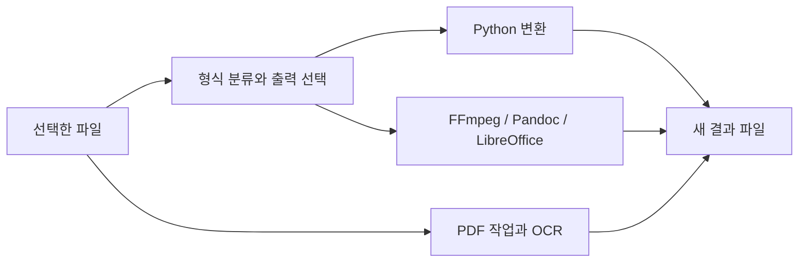

<div align="center">

# 🔄 플립링 파일 변환·PDF 도구

### Windows 원형 메뉴 · 로컬 변환 · PDF 편집·OCR

파일을 선택하고 변환 형식을 고르면 원본 옆에 새 결과를 저장합니다.<br>
원형 메뉴와 트레이, PDF 작업 화면을 연결한 Windows 데스크톱 앱입니다.


[빠른 시작](#quick-start) · [저장소 구성](#repository-structure) · [입출력 구성](#data-settings)

</div>

---

<a name="introduction"></a>

## ✨ 프로젝트 소개

플립링은 파일 형식을 분류해 가능한 출력 형식을 보여주고, Python 라이브러리 또는 외부 변환 도구로 작업을 수행합니다. PDF 화면에서는 페이지 편집과 OCR 작업을 별도로 제공합니다.

| 기능 | 구현 내용 |
| :--- | :--- |
| 파일 변환 | 이미지·문서·오디오·비디오·표·자막·압축 형식 처리 |
| 원형 메뉴 | 지원 형식 선택과 트레이 중심의 Windows 인터페이스 |
| PDF 편집 | 병합·분할·추출·삭제·회전·압축 |
| PDF·이미지 변환 | 이미지를 PDF로 묶거나 PDF 페이지를 이미지로 저장 |
| OCR | Tesseract를 이용한 한국어·영어 인식과 문서 출력 |
| 결과 보존 | 기존 이름과 충돌하면 새 이름으로 출력 |



<a name="repository-structure"></a>

## 📁 저장소 구성

```text
.
├── 소스/
│   ├── app.py
│   ├── engine.py
│   ├── pdf_tools.py
│   ├── pdf_panel.py
│   ├── studio_ui.py
│   ├── ui_motion.py
│   ├── i18n.py
│   ├── requirements-lock.txt
│   ├── build.py
│   ├── package.py
│   ├── test_engine.py
│   ├── test_gui.py
│   ├── test_pdf_tools.py
│   └── licenses/
└── docs/VERSIONS.md
```

- [앱 진입점](소스/app.py)과 [변환 엔진](소스/engine.py).
- [PDF 처리](소스/pdf_tools.py)와 [PDF 화면](소스/pdf_panel.py).
- [고정 의존성](소스/requirements-lock.txt), [기존 라이선스](소스/LICENSE.txt), [버전 기록](docs/VERSIONS.md).

<a name="implementation"></a>

## 🧩 주요 기술과 처리 방식

Pillow·pi-heif는 이미지, pypdfium2·pypdf는 PDF 읽기와 편집, python-docx·ReportLab은 문서 생성을 담당합니다. 표 형태의 OCR 출력은 글자의 위치에서 행·열을 추정하므로 복잡한 표를 완전히 복원한다고 보장하지 않습니다.

`engine.convert()`는 원본과 같은 드라이브의 임시 폴더에서 변환한 뒤 새 이름으로 이동합니다. 압축 내부의 상위 경로·절대 경로와 링크를 검사합니다. PDF 출력은 배타적 파일 생성으로 기존 결과 덮어쓰기를 피하도록 구성합니다.

<a name="quick-start"></a>

## 🚀 빠른 시작

Windows Python 환경에서 의존성을 준비합니다.

```powershell
cd "소스"
python -m venv .venv
.\.venv\Scripts\python -m pip install -r requirements-lock.txt
```

앱 실행에는 코드가 참조하는 `assets/`의 글꼴·화면 자산이 필요합니다. OCR에는 `vendor/tesseract/tesseract.exe`와 `tessdata/`가 필요합니다. 이 공개 사본에는 해당 실행 자산과 OCR 바이너리가 포함되어 있지 않으므로, 소스만 내려받아 바로 배포 앱처럼 실행할 수는 없습니다.

필요한 자산을 정당한 배포 원본에서 준비한 개발 환경의 진입점은 다음과 같습니다.

```powershell
.\.venv\Scripts\python app.py
```

빌드 스크립트는 PyInstaller와 Inno Setup을 사용하며 기존 출력 폴더가 있으면 중단합니다. `build.py`는 추가 배포 자산·고지 파일도 참조하므로 빌드 전에 해당 입력을 함께 준비해야 합니다.

<a name="data-settings"></a>

## 📊 입출력과 도구 구성

| 작업 | 사용 도구·입력 |
| :--- | :--- |
| 오디오·비디오 | FFmpeg |
| 전자책·일부 문서 | Pandoc |
| Office 문서·발표·표 | LibreOffice |
| RAR 처리 | 사용 가능한 UnRAR·7-Zip 등 RAR 백엔드 |
| OCR | Tesseract와 `kor`, `eng` 언어 자료 |
| PDF 페이지 선택 | `1,3-5` 형태의 1부터 시작하는 범위 |

PDF 작업은 암호화된 PDF를 거부합니다. 이미지 PDF에서 텍스트를 얻으려면 OCR이 필요하며, 일반 텍스트 추출과 OCR은 별도 경로입니다. 변환 결과의 레이아웃·수식·매크로 등 원본 특성은 형식과 도구에 따라 달라질 수 있습니다.

<a name="troubleshooting"></a>

## 🛠️ 문제 해결

| 증상 | 확인할 내용 |
| :--- | :--- |
| 변환 도구를 찾지 못함 | FFmpeg·Pandoc·LibreOffice 설치와 검색 경로 |
| OCR 구성 누락 | Tesseract 실행 파일과 언어 자료 |
| 글꼴·화면 자산 오류 | 공개 사본에 없는 `assets/`의 필수 입력 |
| PDF 페이지 범위 오류 | 1부터 시작하는 범위와 실제 페이지 수 |
| PDF가 거부됨 | 암호화·빈 문서·손상 여부 |
| 압축 변환이 거부됨 | 절대 경로·상위 경로·심볼릭 링크 포함 여부 |

기존 MIT 라이선스는 [적용 범위 문서](소스/LICENSE.txt)를 따릅니다. 외부 구성요소와 글꼴의 별도 라이선스도 함께 확인하세요.

---

<div align="center">

**선택하고, 변환하고, 새 결과로 보관합니다.**

</div>
