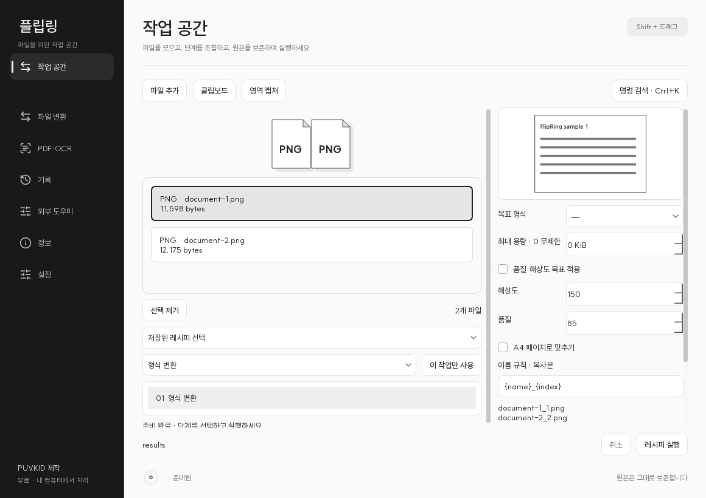
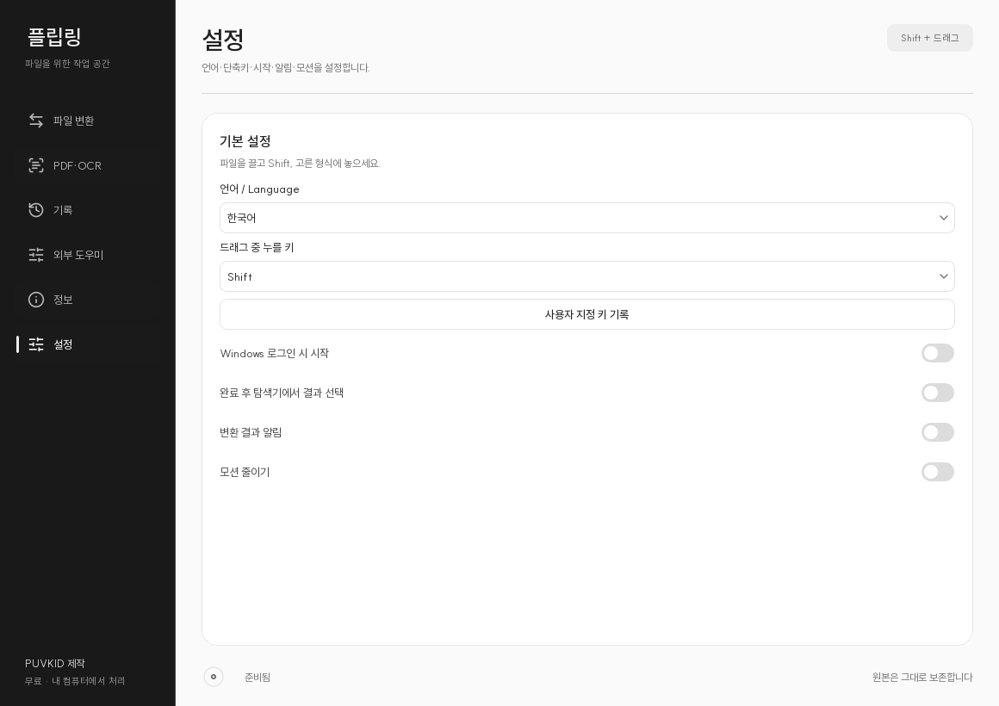

# 문서 읽기 레벨 구성 전체 비교

기준 커밋: `9321c7fa0360305faa086c55186abb5941248c30`

기존 Markdown의 모든 수정 줄과 새 수준별 안내 전문을 비교합니다. 줄바꿈·공백 차이는 원문 Git 비교로도 확인할 수 있습니다. 새 변경 기록과 이 비교 문서 자체는 비교 대상에서 제외했습니다. 코드·데이터·논문·이미지와 나머지 파일은 기준 커밋과 같습니다.

````````````diff
--- a/README.md
+++ b/README.md
@@ -3,6 +3,22 @@
 # FlipRing Project
 
 파일 변환과 PDF 편집·OCR을 한 화면에서 처리하는 Windows 앱입니다.
+
+<!-- project-levels:start -->
+## 읽는 수준 선택
+
+| 수준 | 이 안내에서 읽을 내용 |
+| --- | --- |
+| [LEVEL 1 - Beginner](docs/읽기안내/레벨1.md) | 낯선 용어를 풀어 쓰며 실제 동작·예시·오해하기 쉬운 범위를 읽습니다. |
+| [LEVEL 2 - Explorer](docs/읽기안내/레벨2.md) | 입력·처리·출력과 기능 사이의 연결, 차수 변화를 따라갑니다. |
+| [LEVEL 3 - Practitioner](docs/읽기안내/레벨3.md) | 준비 조건·사용 순서·설정·결과 및 실패 확인 방법을 읽습니다. |
+| [LEVEL 4 - Advanced](docs/읽기안내/레벨4.md) | 모듈 설계·상태 전이·검증 경계와 구현 선택을 검토합니다. |
+| [LEVEL 5 - Expert](docs/읽기안내/레벨5.md) | 실제 코드·프로토콜·설정값·전체 비교와 측정 근거를 대조합니다. |
+
+모든 안내는 같은 프로젝트와 전체 차수를 다룹니다. 기존 상세 본문은 아래에 계속 보존합니다.
+<!-- project-levels:end -->
+
+
 
 **기술 분류:** 데스크톱 소프트웨어 › Qt·문서 처리 › 파일 변환·PDF·OCR
 

--- a/docs/SOURCE_MATERIALS.md
+++ b/docs/SOURCE_MATERIALS.md
@@ -10,6 +10,187 @@
 [핵심 기능](#features) · [사용 흐름](#usage) · [자료 구성](#structure) · [준비와 실행](#setup) · [결과 읽기](#results) · [직전 변경](#changes)
 
 </div>
+<!-- reading-levels:start -->
+[LEVEL 1 - Beginner](#reading-level-1) · [LEVEL 2 - Explorer](#reading-level-2) · [LEVEL 3 - Practitioner](#reading-level-3) · [LEVEL 4 - Advanced](#reading-level-4) · [LEVEL 5 - Expert](#reading-level-5)
+
+프로젝트 전체의 설명은 [LEVEL 1 - Beginner](%EC%9D%BD%EA%B8%B0%EC%95%88%EB%82%B4/%EB%A0%88%EB%B2%A81.md)부터 [LEVEL 5 - Expert](%EC%9D%BD%EA%B8%B0%EC%95%88%EB%82%B4/%EB%A0%88%EB%B2%A85.md)까지 같은 범위로 연결됩니다.
+
+<a id="reading-level-1"></a>
+## LEVEL 1 - Beginner
+
+### LEVEL 1 · 이 자료가 하는 일과 달라진 점
+
+이전에 보강한 제품 코드·설정·사용법·설계·라이선스의 현재 공개 사본을 [보강 자료 파일 명세](source-materials/files.json)에서 확인합니다. [전체 차수](REVISION_INDEX.md)와 [공개 ZIP 멤버 대응](source-materials/archive-members.json)을 함께 제공합니다.
+
+### LEVEL 1 · 실제 동작을 따라 읽기
+
+이전에 보강한 제품 코드·설정·사용법·설계·라이선스의 현재 공개 사본을 [보강 자료 파일 명세](source-materials/files.json)에서 확인합니다. [전체 차수](REVISION_INDEX.md)와 [공개 ZIP 멤버 대응](source-materials/archive-members.json)을 함께 제공합니다.
+
+사적 운영자료와 이전 생성 설정은 공개에서 제외했습니다. [제외 범위·원문 보존·법적 조사 도구 정제](PUBLIC_EXCLUSIONS.md)에 크기와 해시를 기록했습니다. 과거 자료 수와 공개 범위를 현재 파일 수로 혼동하지 않습니다.
+
+
+
+입력 — 기존 차수에서 개별 보존한 작업 소스와 문서
+
+처리 — 원래 경로·출처·파일 대응을 찾아 읽기
+
+출력 — 기능 소스·개발 도구·설명 문서의 보존 목록
+
+### LEVEL 1 · 준비하고 확인할 것
+
+이 묶음은 서로 다른 시점의 작업 자료를 원래 경로로 보관합니다. 한 앱의 완전한 같은 시점 설치 환경으로 합치지 않습니다.
+
+아래 원본 목록에서 필요한 파일을 고른 뒤 해당 차수의 실행 안내와 대조합니다. 검증·캐시 정리·복구·배포 도구에는 원래 경로와 기존 증거가 필요할 수 있으므로 일괄 실행하지 않습니다.
+
+1. 보존 목록에서 원래 차수·경로를 찾습니다.
+2. 연결된 코드와 해당 차수의 설명을 함께 읽습니다.
+3. 보조 도구와 제품 실행 코드를 구분하고 필요한 입력을 확인합니다.
+
+### LEVEL 1 · 결과와 주의할 범위
+
+원래 위치와 파일 크기·SHA-256으로 보존 대응을 확인합니다. 같은 이름의 파일도 시점과 경로가 다르면 다른 자료입니다.
+
+| 상황 | 확인할 내용 |
+|---|---|
+| 한 폴더로 실행되지 않음 | 이 묶음은 여러 작업 시점의 보존 자료이며 단일 배포 제품이 아닙니다. |
+| 이전 파일과 내용이 다름 | 원래 차수·경로·해시와 전체 비교를 함께 확인합니다. |
+
+[자료 폴더](../%EB%B3%B4%EC%A1%B4%EC%9E%90%EB%A3%8C/%EC%9E%91%EC%97%85%EC%86%8C%EC%8A%A4) · [직전 비교·자료 범위](2026-11-02_%EA%B3%B5%EA%B0%9C%EB%B0%98%EC%98%81%EC%9E%AC%EA%B0%9C%EA%B2%80%EC%A6%9D.md) · [이 차수의 원래 전체 상세](#reading-level-5)
+
+<a id="reading-level-2"></a>
+## LEVEL 2 - Explorer
+
+### LEVEL 2 · 목적과 구성의 연결
+
+이전에 보강한 제품 코드·설정·사용법·설계·라이선스의 현재 공개 사본을 [보강 자료 파일 명세](source-materials/files.json)에서 확인합니다. [전체 차수](REVISION_INDEX.md)와 [공개 ZIP 멤버 대응](source-materials/archive-members.json)을 함께 제공합니다.
+
+이전에 보강한 제품 코드·설정·사용법·설계·라이선스의 현재 공개 사본을 [보강 자료 파일 명세](source-materials/files.json)에서 확인합니다. [전체 차수](REVISION_INDEX.md)와 [공개 ZIP 멤버 대응](source-materials/archive-members.json)을 함께 제공합니다.
+
+사적 운영자료와 이전 생성 설정은 공개에서 제외했습니다. [제외 범위·원문 보존·법적 조사 도구 정제](PUBLIC_EXCLUSIONS.md)에 크기와 해시를 기록했습니다. 과거 자료 수와 공개 범위를 현재 파일 수로 혼동하지 않습니다.
+
+### LEVEL 2 · 입력에서 출력으로
+
+| 단계 | 내용 |
+|---|---|
+| 입력 | 기존 차수에서 개별 보존한 작업 소스와 문서 |
+| 처리 | 원래 경로·출처·파일 대응을 찾아 읽기 |
+| 출력 | 기능 소스·개발 도구·설명 문서의 보존 목록 |
+
+입력·처리·출력은 위의 같은 자료 흐름을 다른 단계에서 읽는 기준입니다. 처리 조건과 출력의 의미를 함께 확인합니다.
+
+### LEVEL 2 · 설정과 처리 순서의 관계
+
+1. 보존 목록에서 원래 차수·경로를 찾습니다.
+2. 연결된 코드와 해당 차수의 설명을 함께 읽습니다.
+3. 보조 도구와 제품 실행 코드를 구분하고 필요한 입력을 확인합니다.
+
+이 묶음은 서로 다른 시점의 작업 자료를 원래 경로로 보관합니다. 한 앱의 완전한 같은 시점 설치 환경으로 합치지 않습니다.
+
+아래 원본 목록에서 필요한 파일을 고른 뒤 해당 차수의 실행 안내와 대조합니다. 검증·캐시 정리·복구·배포 도구에는 원래 경로와 기존 증거가 필요할 수 있으므로 일괄 실행하지 않습니다.
+
+### LEVEL 2 · 관측과 해석을 구분하기
+
+원래 위치와 파일 크기·SHA-256으로 보존 대응을 확인합니다. 같은 이름의 파일도 시점과 경로가 다르면 다른 자료입니다.
+
+| 상황 | 확인할 내용 |
+|---|---|
+| 한 폴더로 실행되지 않음 | 이 묶음은 여러 작업 시점의 보존 자료이며 단일 배포 제품이 아닙니다. |
+| 이전 파일과 내용이 다름 | 원래 차수·경로·해시와 전체 비교를 함께 확인합니다. |
+
+[자료 폴더](../%EB%B3%B4%EC%A1%B4%EC%9E%90%EB%A3%8C/%EC%9E%91%EC%97%85%EC%86%8C%EC%8A%A4) · [직전 비교·자료 범위](2026-11-02_%EA%B3%B5%EA%B0%9C%EB%B0%98%EC%98%81%EC%9E%AC%EA%B0%9C%EA%B2%80%EC%A6%9D.md) · [이 차수의 원래 전체 상세](#reading-level-5)
+
+<a id="reading-level-3"></a>
+## LEVEL 3 - Practitioner
+
+### LEVEL 3 · 이 차수를 준비하는 범위
+
+이전에 보강한 제품 코드·설정·사용법·설계·라이선스의 현재 공개 사본을 [보강 자료 파일 명세](source-materials/files.json)에서 확인합니다. [전체 차수](REVISION_INDEX.md)와 [공개 ZIP 멤버 대응](source-materials/archive-members.json)을 함께 제공합니다.
+
+이 묶음은 서로 다른 시점의 작업 자료를 원래 경로로 보관합니다. 한 앱의 완전한 같은 시점 설치 환경으로 합치지 않습니다.
+
+아래 원본 목록에서 필요한 파일을 고른 뒤 해당 차수의 실행 안내와 대조합니다. 검증·캐시 정리·복구·배포 도구에는 원래 경로와 기존 증거가 필요할 수 있으므로 일괄 실행하지 않습니다.
+
+### LEVEL 3 · 실제 사용·실험 순서
+
+1. 보존 목록에서 원래 차수·경로를 찾습니다.
+2. 연결된 코드와 해당 차수의 설명을 함께 읽습니다.
+3. 보조 도구와 제품 실행 코드를 구분하고 필요한 입력을 확인합니다.
+
+| 단계 | 내용 |
+|---|---|
+| 입력 | 기존 차수에서 개별 보존한 작업 소스와 문서 |
+| 처리 | 원래 경로·출처·파일 대응을 찾아 읽기 |
+| 출력 | 기능 소스·개발 도구·설명 문서의 보존 목록 |
+
+### LEVEL 3 · 결과와 실패를 확인하기
+
+원래 위치와 파일 크기·SHA-256으로 보존 대응을 확인합니다. 같은 이름의 파일도 시점과 경로가 다르면 다른 자료입니다.
+
+| 상황 | 확인할 내용 |
+|---|---|
+| 한 폴더로 실행되지 않음 | 이 묶음은 여러 작업 시점의 보존 자료이며 단일 배포 제품이 아닙니다. |
+| 이전 파일과 내용이 다름 | 원래 차수·경로·해시와 전체 비교를 함께 확인합니다. |
+
+### LEVEL 3 · 실행 전 대조할 차수 조건
+
+이전에 보강한 제품 코드·설정·사용법·설계·라이선스의 현재 공개 사본을 [보강 자료 파일 명세](source-materials/files.json)에서 확인합니다. [전체 차수](REVISION_INDEX.md)와 [공개 ZIP 멤버 대응](source-materials/archive-members.json)을 함께 제공합니다.
+
+사적 운영자료와 이전 생성 설정은 공개에서 제외했습니다. [제외 범위·원문 보존·법적 조사 도구 정제](PUBLIC_EXCLUSIONS.md)에 크기와 해시를 기록했습니다. 과거 자료 수와 공개 범위를 현재 파일 수로 혼동하지 않습니다.
+
+[자료 폴더](../%EB%B3%B4%EC%A1%B4%EC%9E%90%EB%A3%8C/%EC%9E%91%EC%97%85%EC%86%8C%EC%8A%A4) · [직전 비교·자료 범위](2026-11-02_%EA%B3%B5%EA%B0%9C%EB%B0%98%EC%98%81%EC%9E%AC%EA%B0%9C%EA%B2%80%EC%A6%9D.md) · [이 차수의 원래 전체 상세](#reading-level-5)
+
+<a id="reading-level-4"></a>
+## LEVEL 4 - Advanced
+
+### LEVEL 4 · 설계 의도와 검토 경계
+
+이전에 보강한 제품 코드·설정·사용법·설계·라이선스의 현재 공개 사본을 [보강 자료 파일 명세](source-materials/files.json)에서 확인합니다. [전체 차수](REVISION_INDEX.md)와 [공개 ZIP 멤버 대응](source-materials/archive-members.json)을 함께 제공합니다.
+
+이전에 보강한 제품 코드·설정·사용법·설계·라이선스의 현재 공개 사본을 [보강 자료 파일 명세](source-materials/files.json)에서 확인합니다. [전체 차수](REVISION_INDEX.md)와 [공개 ZIP 멤버 대응](source-materials/archive-members.json)을 함께 제공합니다.
+
+사적 운영자료와 이전 생성 설정은 공개에서 제외했습니다. [제외 범위·원문 보존·법적 조사 도구 정제](PUBLIC_EXCLUSIONS.md)에 크기와 해시를 기록했습니다. 과거 자료 수와 공개 범위를 현재 파일 수로 혼동하지 않습니다.
+
+### LEVEL 4 · 이 차수 구현의 실제 근거
+
+이 문서가 직접 제공하는 구성과 연결은 다음 범위입니다.
+
+이전에 보강한 제품 코드·설정·사용법·설계·라이선스의 현재 공개 사본을 [보강 자료 파일 명세](source-materials/files.json)에서 확인합니다. [전체 차수](REVISION_INDEX.md)와 [공개 ZIP 멤버 대응](source-materials/archive-members.json)을 함께 제공합니다.
+
+| 단계 | 내용 |
+|---|---|
+| 입력 | 기존 차수에서 개별 보존한 작업 소스와 문서 |
+| 처리 | 원래 경로·출처·파일 대응을 찾아 읽기 |
+| 출력 | 기능 소스·개발 도구·설명 문서의 보존 목록 |
+
+### LEVEL 4 · 조건·변경·결과를 함께 검토하기
+
+이 묶음은 서로 다른 시점의 작업 자료를 원래 경로로 보관합니다. 한 앱의 완전한 같은 시점 설치 환경으로 합치지 않습니다.
+
+아래 원본 목록에서 필요한 파일을 고른 뒤 해당 차수의 실행 안내와 대조합니다. 검증·캐시 정리·복구·배포 도구에는 원래 경로와 기존 증거가 필요할 수 있으므로 일괄 실행하지 않습니다.
+
+원래 위치와 파일 크기·SHA-256으로 보존 대응을 확인합니다. 같은 이름의 파일도 시점과 경로가 다르면 다른 자료입니다.
+
+| 상황 | 확인할 내용 |
+|---|---|
+| 한 폴더로 실행되지 않음 | 이 묶음은 여러 작업 시점의 보존 자료이며 단일 배포 제품이 아닙니다. |
+| 이전 파일과 내용이 다름 | 원래 차수·경로·해시와 전체 비교를 함께 확인합니다. |
+
+### LEVEL 4 · 재현과 전체 비교
+
+1. 보존 목록에서 원래 차수·경로를 찾습니다.
+2. 연결된 코드와 해당 차수의 설명을 함께 읽습니다.
+3. 보조 도구와 제품 실행 코드를 구분하고 필요한 입력을 확인합니다.
+
+위 구성요소의 입력·출력과 실패 조건을 같은 차수 소스에 연결해 검토합니다. 전체 비교는 추가·수정·삭제와 원래 보관 범위를 구분하는 근거입니다.
+
+[자료 폴더](../%EB%B3%B4%EC%A1%B4%EC%9E%90%EB%A3%8C/%EC%9E%91%EC%97%85%EC%86%8C%EC%8A%A4) · [직전 비교·자료 범위](2026-11-02_%EA%B3%B5%EA%B0%9C%EB%B0%98%EC%98%81%EC%9E%AC%EA%B0%9C%EA%B2%80%EC%A6%9D.md) · [이 차수의 원래 전체 상세](#reading-level-5)
+<a id="reading-level-5"></a>
+## LEVEL 5 - Expert
+
+기존의 전체 설명·표·코드·함수 참조·파일별 비교는 아래에 그대로 이어집니다. [자료 폴더](../%EB%B3%B4%EC%A1%B4%EC%9E%90%EB%A3%8C/%EC%9E%91%EC%97%85%EC%86%8C%EC%8A%A4) · [직전 비교·자료 범위](2026-11-02_%EA%B3%B5%EA%B0%9C%EB%B0%98%EC%98%81%EC%9E%AC%EA%B0%9C%EA%B2%80%EC%A6%9D.md) · [이 차수의 원래 전체 상세](#reading-level-5)
+<!-- reading-levels:end -->
+
+
 
 [프로젝트](../README.md) · [전체 차수](REVISION_INDEX.md) · [원본 자료](../%EB%B3%B4%EC%A1%B4%EC%9E%90%EB%A3%8C/%EC%9E%91%EC%97%85%EC%86%8C%EC%8A%A4)
 

--- a/docs/revision-audit/현행소스.md
+++ b/docs/revision-audit/현행소스.md
@@ -10,6 +10,1911 @@
 [핵심 기능](#features) · [사용 흐름](#usage) · [자료 구성](#structure) · [준비와 실행](#setup) · [결과 읽기](#results) · [직전 변경](#changes)
 
 </div>
+<!-- reading-levels:start -->
+[LEVEL 1 - Beginner](#reading-level-1) · [LEVEL 2 - Explorer](#reading-level-2) · [LEVEL 3 - Practitioner](#reading-level-3) · [LEVEL 4 - Advanced](#reading-level-4) · [LEVEL 5 - Expert](#reading-level-5)
+
+프로젝트 전체의 설명은 [LEVEL 1 - Beginner](../%EC%9D%BD%EA%B8%B0%EC%95%88%EB%82%B4/%EB%A0%88%EB%B2%A81.md)부터 [LEVEL 5 - Expert](../%EC%9D%BD%EA%B8%B0%EC%95%88%EB%82%B4/%EB%A0%88%EB%B2%A85.md)까지 같은 범위로 연결됩니다.
+
+<a id="reading-level-1"></a>
+## LEVEL 1 - Beginner
+
+### LEVEL 1 · 이 자료가 하는 일과 달라진 점
+
+파일별 사전 점검과 사용자 프리셋으로 변환·PDF 작업의 반복 입력을 줄입니다.
+
+### LEVEL 1 · 실제 동작을 따라 읽기
+
+파일별 사전 점검과 사용자 프리셋으로 변환·PDF 작업의 반복 입력을 줄입니다.
+
+직전 공개 보존본 1.8.0과 현재 1.9.0의 전체 공개 파일을 비교합니다.
+
+비공개 운영 원문은 삭제 줄에도 재노출하지 않으며 크기·해시·제외 사유로 구분합니다. 무가공 전체 패치와 범위를 구분합니다.
+
+현재 공개 파일 316개. 추가 293 · 수정 10 · 이전에만 존재 1 · 동일 13개.
+
+현행 소스는 새 1.9.0입니다. 기존 글꼴·법적 고지·공개 자산은 유지합니다. 이전 자동 생성 FlipRing.spec·installer.iss는 기준 원문 대조 뒤 현행 공개 소스에서 제거했으며 새 build.py가 실제 경로로 다시 생성합니다. 이전 역사와 로컬 생성 원문은 보존하며 새 생성 설정은 공개 입력에 추가하지 않습니다. 로컬 전체 납품과 공개 소스의 범위를 구분합니다.
+
+CLI는 명령어와 옵션을 입력해 프로그램을 실행하는 방식입니다. RGB LED는 색을 바꾸어 상태를 나타내는 불빛입니다. OCR은 그림에 있는 글자를 텍스트로 읽는 처리입니다.
+
+입력 — 사용자가 고른 로컬 파일과 목표 형식·PDF 작업 옵션
+
+처리 — 파일 분류 → 작업 선택 → 변환 도구·PDF 처리 → 새 결과 저장
+
+출력 — 새 형식 파일·편집 PDF·OCR 문서·작업 기록
+
+### LEVEL 1 · 준비하고 확인할 것
+
+Windows Python 환경에서 이 보존본의 고정 의존성 목록과 assets 참조를 확인합니다. OCR은 Tesseract 실행 파일과 언어 자료, 미디어는 FFmpeg, Office 변환은 LibreOffice 등 기능별 외부 도구가 필요합니다.
+
+이 차수 소스 폴더에서 고정 의존성과 필요한 자산·외부 도구를 준비한 뒤 `python app.py`로 시작합니다. `--settings` 지원 여부는 아래 CLI 표와 해당 차수의 main을 확인합니다. 인자 없는 실행이 트레이로 시작하는 구성에서는 트레이 메뉴로 창을 엽니다.
+
+#### LEVEL 1 · 이 보관본의 의존성 목록
+
+[requirements-lock.txt](../../%EC%86%8C%EC%8A%A4/requirements-lock.txt)의 실제 항목입니다. 외부 실행 도구와 GPU 드라이버는 별도로 준비합니다.
+
+```text
+altgraph==0.17.5
+charset-normalizer==3.5.2
+cssselect2==0.10.1
+et_xmlfile==2.0.0
+lxml==6.1.3
+openpyxl==3.1.5
+packaging==26.3
+pefile==2024.8.26
+pi-heif-decoder==1.7.0.post4
+pillow==13.0.0
+pyinstaller==6.22.3
+pyinstaller-hooks-contrib==2026.8
+pypdf==6.21.1
+pypdfium2==5.14.0
+PySide6==6.12.0
+PySide6_Addons==6.12.0
+PySide6_Essentials==6.12.0
+PySide6_Pdf==6.12.0.140
+PySide6_WebEngine==6.12.0.140
+python-docx==1.2.0
+python-pptx==1.0.2
+pywin32-ctypes==0.2.3
+rarfile==4.5
+reportlab==5.0.1
+setuptools==84.0.0
+shiboken6==6.12.0
+svglib==2.3.0
+tinycss2==1.5.1
+typing_extensions==4.16.0
+webencodings==0.6.1
+xlsxwriter==3.2.9
+```
+
+#### LEVEL 1 · 소스에서 제공하는 CLI 옵션
+
+| 진입 소스 | 정의된 옵션 이름 |
+|---|---|
+| [build.py](../../%EC%86%8C%EC%8A%A4/build.py) | `--output-root` |
+| [test_conversion_matrix.py](../../%EC%86%8C%EC%8A%A4/test_conversion_matrix.py) | `--root`, `--worker`, `--fixtures`, `--rar-fixture`, `--timeout`, `--total-timeout` |
+| [test_pdf_tools.py](../../%EC%86%8C%EC%8A%A4/test_pdf_tools.py) | `--ocr`, `--gui` |
+
+각 옵션의 기본값·필수값·부작용은 해당 main과 인자 정의를 함께 확인합니다.
+
+#### LEVEL 1 · 프리셋과 실행 전 점검
+
+`PresetStore`는 UTF-8 JSON 배열을 읽습니다. 이름은 양끝 공백 제거 후1~80자이고 제어 문자를 거부하며 대소문자를 무시한 중복 이름을 허용하지 않습니다. 허용 키는 `name`, `kind`, `format`, `options`이고 일반 변환 프리셋은 빈 options만 받습니다. 입력/출력 경로를 프리셋에 끼워 넣지 않습니다.
+
+PDF 옵션은 `Request`의 기본값을 합친 뒤 검사합니다. 회전90/180/270, 품질20~95, DPI60~600, PSM3/6/11, 압축 lossless/images, OCR 언어 kor+eng/kor/eng를 허용합니다. 페이지 문자열은 최대10,000자이고1부터 시작하는 단일 번호·범위·쉼표 목록 형식을 검사합니다. OCR 출력은 pdf/txt/docx/xlsx, 이미지 변환은 png/jpg로 제한합니다.
+
+읽기 오류가 난 프리셋 파일은 `error`에 원문을 남기고 쓰기를 차단합니다. 정상 저장은 같은 폴더의 임시 파일에 UTF-8 JSON을 쓰고 flush/fsync 후 교체합니다. 기본 프리셋은 JPG 변환 `photo_jpg`와 한국어+영어 OCR PDF `scan_pdf`입니다.
+
+`preflight(path, dst)`는 입력 존재→지원 출력→외부 도구→입력 읽기→여유 공간→쓰기 가능 순서로 점검합니다. 입력4배+64MiB는 보수적인 준비 공간 추정값이며 최종 출력 크기가 아닙니다. `missing`, `unsupported`, `helper`, `space`, `write`, `input` 오류 코드를 `error`와 함께 반환하고 통과 때만 `ok=true`, `code=ready`가 됩니다.
+
+[워크플로 코드](../../%EC%86%8C%EC%8A%A4/flipring_workflow.py)
+
+<details>
+<summary>함수 역할·기본값·입력 거부 조건의 세부 참조</summary>
+
+다음 항목은 이 자료의 Python 소스에 명시된 선언입니다. 전체 분기와 호출 순서는 각 행의 코드 위치에서 이어서 읽을 수 있습니다.
+
+#### LEVEL 1 · [app.py](../../%EC%86%8C%EC%8A%A4/app.py)
+
+| 정의 | 소스에 적힌 역할 |
+|---|---|
+| [`select_in_explorer`](../../%EC%86%8C%EC%8A%A4/app.py#L77) | 파일을 실행하지 않고 탐색기에서 해당 파일을 선택한다. |
+| [`DialogTranslator`](../../%EC%86%8C%EC%8A%A4/app.py#L144) | 앱에서 사용하는 Qt 표준 대화상자의 짧은 문구만 현지화한다. |
+| [`file_urls`](../../%EC%86%8C%EC%8A%A4/app.py#L212) | 드롭에 포함된 모든 항목이 존재하는 로컬 파일/폴더인지 확인한다. |
+| [`HistoryList`](../../%EC%86%8C%EC%8A%A4/app.py#L230) | 결과 선택은 왼쪽 더블클릭으로만 실행한다. |
+| [`ButtonMotion`](../../%EC%86%8C%EC%8A%A4/app.py#L240) | 입력 처리는 기본 버튼에 맡기고 배경·테두리만 부드럽게 그린다. |
+| [`install_button_motions`](../../%EC%86%8C%EC%8A%A4/app.py#L311) | 버튼이 모션을 직접 소유하게 하여 중복 등록과 전역 수명 보유를 막는다. |
+| [`SoftTabs`](../../%EC%86%8C%EC%8A%A4/app.py#L319) | 페이지 위치와 입력 영역을 고정한 채 새 내용만 옅게 전환한다. |
+| [`MainWindow`](../../%EC%86%8C%EC%8A%A4/app.py#L672) | 상주 컨트롤러와 파일·문서 작업 공간. 변환 선택은 원형 메뉴에서 수행한다. |
+| [`render_tools`](../../%EC%86%8C%EC%8A%A4/app.py#L1467) | 언어 변경은 관측을 다시 그린다. 명시 새로고침·트레이 열기는 실제 도구를 다시 찾는다. |
+| [`append_record`](../../%EC%86%8C%EC%8A%A4/app.py#L1650) | 두 변환 경로의 결과를 기존 기록 스키마로 저장한다. |
+
+| 설정·옵션 | 코드의 선언 |
+|---|---|
+| [`VERSION`](../../%EC%86%8C%EC%8A%A4/app.py#L43) | `정의=3` |
+| [`RELEASE_VERSION`](../../%EC%86%8C%EC%8A%A4/app.py#L44) | `정의="1.9.0"` |
+| [`APPNAME`](../../%EC%86%8C%EC%8A%A4/app.py#L45) | `정의="플립링"` |
+| [`AUTOSTART_NAME`](../../%EC%86%8C%EC%8A%A4/app.py#L46) | `정의="FlipRing19"` |
+| [`DATA`](../../%EC%86%8C%EC%8A%A4/app.py#L47) | `정의=Path(os.environ.get("LOCALAPPDATA", str(Path.home()))) / "PUVKID" / "FlipRing19"` |
+| [`TRIGGER_KEYS`](../../%EC%86%8C%EC%8A%A4/app.py#L48) | `정의=[     ("Shift", 0x10), ("Alt", 0x12), ("Ctrl", 0x11),     ("Windows", 0x5B), ("Space", 0x20), ("F8", 0x77), ("custom", -1), ]` |
+| [`USER32`](../../%EC%86%8C%EC%8A%A4/app.py#L52) | `정의=ctypes.WinDLL("user32", use_last_error=True)` |
+| [`OLE32`](../../%EC%86%8C%EC%8A%A4/app.py#L57) | `정의=ctypes.WinDLL("ole32", use_last_error=True)` |
+| [`SHELL32`](../../%EC%86%8C%EC%8A%A4/app.py#L64) | `정의=ctypes.WinDLL("shell32", use_last_error=True)` |
+| [`EXPLORER_CLASSES`](../../%EC%86%8C%EC%8A%A4/app.py#L74) | `정의={"CabinetWClass", "ExploreWClass", "Progman", "WorkerW"}` |
+
+| 거부 조건 | 오류 메시지 |
+|---|---|
+| [`not Path(entry['source']).exists()`](../../%EC%86%8C%EC%8A%A4/app.py#L1506) | 입력이 없거나 이동되었습니다. |
+| [`row['cancel'].is_set()`](../../%EC%86%8C%EC%8A%A4/app.py#L1604) | 작업이 취소되었습니다. |
+
+#### LEVEL 1 · [build.py](../../%EC%86%8C%EC%8A%A4/build.py)
+
+
+| 설정·옵션 | 코드의 선언 |
+|---|---|
+| [`--output-root`](../../%EC%86%8C%EC%8A%A4/build.py#L19) | `type=Path; default=ROOT.parent; help="새 프로그램과 설치 파일을 저장할 빈 배포 폴더"` |
+| [`ROOT`](../../%EC%86%8C%EC%8A%A4/build.py#L13) | `정의=Path(__file__).resolve().parent` |
+
+| 거부 조건 | 오류 메시지 |
+|---|---|
+| [`not match`](../../%EC%86%8C%EC%8A%A4/build.py#L15) | app.py의 VERSION 상수를 확인해 주세요. |
+| [`(output / name).exists() or (release_root / "설치파일" / (name + "-Setup.exe")).exists()`](../../%EC%86%8C%EC%8A%A4/build.py#L24) | 기존 프로그램을 보존하기 위해 빌드를 중단합니다. 새 작업 폴더에서 빌드하세요. |
+| [`not compiler.is_file()`](../../%EC%86%8C%EC%8A%A4/build.py#L125) | Inno Setup 6을 설치하거나 ISCC 환경 변수에 컴파일러 경로를 지정해 주세요. |
+
+#### LEVEL 1 · [engine.py](../../%EC%86%8C%EC%8A%A4/engine.py)
+
+| 정의 | 소스에 적힌 역할 |
+|---|---|
+| [`Cancelled`](../../%EC%86%8C%EC%8A%A4/engine.py#L52) | 사용자 취소는 변환 실패와 구별한다. |
+| [`terminate_tree`](../../%EC%86%8C%EC%8A%A4/engine.py#L65) | 외부 도우미와 후손을 종료한 뒤 파이프를 회수한다. |
+| [`rar_tools`](../../%EC%86%8C%EC%8A%A4/engine.py#L134) | 번들의 두 실행 구성 요소를 확인하고 정상 외부 도구 경로도 찾는다. |
+| [`rar_processes`](../../%EC%86%8C%EC%8A%A4/engine.py#L158) | rarfile의 스트리밍·CRC 검사는 유지하고 생성한 외부 프로세스만 취소한다. |
+| [`setup_rar_tools`](../../%EC%86%8C%EC%8A%A4/engine.py#L213) | 매 사용 시 재탐색하여 이전 bsdtar 캐시로 되돌아가지 않는다. |
+| [`adapt_rar_names`](../../%EC%86%8C%EC%8A%A4/engine.py#L230) | Windows 7-Zip의 비유니코드 RAR3 선택 이름만 OEM 해석과 맞춘다. |
+
+| 설정·옵션 | 코드의 선언 |
+|---|---|
+| [`ALIASES`](../../%EC%86%8C%EC%8A%A4/engine.py#L43) | `정의=dict(jpeg="jpg", jpe="jpg", tif="tiff", heif="heic", htm="html", markdown="md", aif="aiff", tgz="tar.gz")` |
+| [`TOOLS`](../../%EC%86%8C%EC%8A%A4/engine.py#L44) | `정의={     "ffmpeg": ("FFmpeg", "Gyan.FFmpeg", "오디오 · 비디오"),     "pandoc": ("Pandoc", "JohnMacFarlane.Pandoc", "전자책 · 문서"),     "soffice": ("LibreOffice", "TheDocumentFoundation.LibreOffice", "Office 문서 · 발표 · 표"), }` |
+| [`_CONTEXT`](../../%EC%86%8C%EC%8A%A4/engine.py#L56) | `정의=threading.local()` |
+| [`_RAR_LOCK`](../../%EC%86%8C%EC%8A%A4/engine.py#L131) | `정의=threading.RLock()` |
+
+| 거부 조건 | 오류 메시지 |
+|---|---|
+| [`event is not None and event.is_set()`](../../%EC%86%8C%EC%8A%A4/engine.py#L61) | 작업이 취소되었습니다. |
+| [`not exe`](../../%EC%86%8C%EC%8A%A4/engine.py#L289) | 변환 도구를 찾을 수 없습니다. 설정의 도우미 도구를 확인해 주세요. |
+| [`not cues`](../../%EC%86%8C%EC%8A%A4/engine.py#L474) | 자막 시간 정보를 찾지 못했습니다. |
+| [`":" in clean or clean.startswith("/") or ".." in clean.split("/")`](../../%EC%86%8C%EC%8A%A4/engine.py#L496) | 압축 파일에 안전하지 않은 경로가 있습니다. |
+| [`not destination.is_relative_to(root.resolve())`](../../%EC%86%8C%EC%8A%A4/engine.py#L499) | 압축 해제 경로가 작업 폴더를 벗어납니다. |
+| [`any(p.is_symlink() or (getattr(p.stat(follow_symlinks=False), "st_file_attributes", 0) & 0x400) for p in entries)`](../../%EC%86%8C%EC%8A%A4/engine.py#L538) | 링크·접합점이 포함된 폴더는 압축하지 않습니다. |
+| [`dst not in targets([source])`](../../%EC%86%8C%EC%8A%A4/engine.py#L633) | 이 파일에 사용할 수 없는 출력 형식입니다. |
+| [`key in selected`](../../%EC%86%8C%EC%8A%A4/engine.py#L250) | RAR 파일 이름이 도구에서 중복되어 안전하게 선택할 수 없습니다. |
+| [`not len(doc)`](../../%EC%86%8C%EC%8A%A4/engine.py#L368) | 페이지가 없는 PDF입니다. |
+| [`not produced.exists() or (produced.is_file() and produced.stat().st_size == 0 and dst not in ("txt", "md"))`](../../%EC%86%8C%EC%8A%A4/engine.py#L640) | 변환기가 유효한 출력 파일을 만들지 못했습니다. |
+| [`expired.is_set()`](../../%EC%86%8C%EC%8A%A4/engine.py#L210) | 변환 제한 시간 30분을 초과했습니다. |
+| [`not size`](../../%EC%86%8C%EC%8A%A4/engine.py#L243) | RAR 파일 이름을 해석할 수 없습니다. |
+| [`kernel.MultiByteToWideChar(1, 0, raw, len(raw), buffer, size) != size`](../../%EC%86%8C%EC%8A%A4/engine.py#L245) | RAR 파일 이름을 해석할 수 없습니다. |
+| [`time.monotonic() &gt;= deadline`](../../%EC%86%8C%EC%8A%A4/engine.py#L305) | 변환 제한 시간 30분을 초과했습니다. |
+| [`drawing is None`](../../%EC%86%8C%EC%8A%A4/engine.py#L567) | SVG를 읽을 수 없습니다. |
+| [`stat.S_ISLNK(entry.external_attr &gt;&gt; 16)`](../../%EC%86%8C%EC%8A%A4/engine.py#L514) | 심볼릭 링크 압축은 지원하지 않습니다. |
+| [`not (entry.isfile() or entry.isdir())`](../../%EC%86%8C%EC%8A%A4/engine.py#L535) | 링크·특수 파일 압축은 지원하지 않습니다. |
+| [`entry.is_symlink()`](../../%EC%86%8C%EC%8A%A4/engine.py#L526) | 심볼릭 링크 압축은 지원하지 않습니다. |
+
+#### LEVEL 1 · [fixed_viewport.py](../../%EC%86%8C%EC%8A%A4/fixed_viewport.py)
+
+| 정의 | 소스에 적힌 역할 |
+|---|---|
+| [`scroll_content`](../../%EC%86%8C%EC%8A%A4/fixed_viewport.py#L6) | 작은 사용 가능 화면에서도 기존 콘텐츠까지 스크롤로 도달한다. |
+| [`ScreenFit`](../../%EC%86%8C%EC%8A%A4/fixed_viewport.py#L18) | 창 프레임을 포함해 맞추며 화면 이동 때도 고정 크기를 갱신한다. |
+
+#### LEVEL 1 · [flipring_workflow.py](../../%EC%86%8C%EC%8A%A4/flipring_workflow.py)
+
+| 정의 | 소스에 적힌 역할 |
+|---|---|
+| [`preflight`](../../%EC%86%8C%EC%8A%A4/flipring_workflow.py#L90) | 최종 크기는 알 수 없으므로 입력의 4배+64MiB를 보수적인 준비 공간으로 표시한다. |
+
+| 설정·옵션 | 코드의 선언 |
+|---|---|
+| [`BUILTINS`](../../%EC%86%8C%EC%8A%A4/flipring_workflow.py#L12) | `정의=[     {'name': 'photo_jpg', 'kind': 'convert', 'format': 'jpg', 'options': {}},     {'name': 'scan_pdf', 'kind': 'pdf', 'format': 'pdf', 'options': {'operation': 'recognize', 'output_format': 'pdf', 'ocr_language': 'kor+eng'}}, ]` |
+
+| 거부 조건 | 오류 메시지 |
+|---|---|
+| [`not isinstance(row, dict)`](../../%EC%86%8C%EC%8A%A4/flipring_workflow.py#L36) | 잘못된 프리셋 |
+| [`set(row) - {'name', 'kind', 'format', 'options'}`](../../%EC%86%8C%EC%8A%A4/flipring_workflow.py#L37) | PDF 프리셋에 경로 또는 잘못된 옵션이 있습니다. |
+| [`not isinstance(name, str) or not name.strip() or len(name.strip()) &gt; 80 or any(ord(c) &lt; 32 for c in name)`](../../%EC%86%8C%EC%8A%A4/flipring_workflow.py#L39) | 이름은 1~80자의 표시 가능한 문자여야 합니다. |
+| [`kind not in ('convert', 'pdf') or not isinstance(fmt, str) or fmt not in formats`](../../%EC%86%8C%EC%8A%A4/flipring_workflow.py#L43) | 지원하지 않는 프리셋 형식입니다. |
+| [`not isinstance(options, dict) or (kind == 'convert' and options)`](../../%EC%86%8C%EC%8A%A4/flipring_workflow.py#L45) | 잘못된 프리셋 옵션입니다. |
+| [`any(item['name'].casefold() == value['name'].casefold() for item in self.items)`](../../%EC%86%8C%EC%8A%A4/flipring_workflow.py#L82) | 이미 사용 중인 프리셋 이름입니다. |
+| [`not isinstance(data, list)`](../../%EC%86%8C%EC%8A%A4/flipring_workflow.py#L24) | 프리셋 목록 형식 오류 |
+| [`len({row['name'].casefold() for row in self.items}) != len(self.items)`](../../%EC%86%8C%EC%8A%A4/flipring_workflow.py#L26) | 중복 프리셋 이름 |
+| [`fmt != 'pdf' or set(options) - allowed`](../../%EC%86%8C%EC%8A%A4/flipring_workflow.py#L48) | PDF 프리셋에 경로 또는 잘못된 옵션이 있습니다. |
+| [`not valid`](../../%EC%86%8C%EC%8A%A4/flipring_workflow.py#L63) | 잘못된 프리셋 옵션입니다. |
+
+#### LEVEL 1 · [i18n.py](../../%EC%86%8C%EC%8A%A4/i18n.py)
+
+| 정의 | 소스에 적힌 역할 |
+|---|---|
+| [`error_text`](../../%EC%86%8C%EC%8A%A4/i18n.py#L279) | 기록된 표준 오류를 현재 언어로 표시하고 외부 진단은 원문으로 구분한다. |
+
+#### LEVEL 1 · [inspection_tools.py](../../%EC%86%8C%EC%8A%A4/inspection_tools.py)
+
+| 정의 | 소스에 적힌 역할 |
+|---|---|
+| [`render_page`](../../%EC%86%8C%EC%8A%A4/inspection_tools.py#L80) | 독립 RGB 사본을 반환하고 PDFium 객체는 공용 잠금 안에서 모두 닫는다. |
+| [`recognize_editable`](../../%EC%86%8C%EC%8A%A4/inspection_tools.py#L118) | 확신도는 실제 Tesseract TSV의 conf 값만 사용한다. |
+| [`export_edited_text`](../../%EC%86%8C%EC%8A%A4/inspection_tools.py#L158) | 교정 문자열은 번역하지 않으며 수식으로 실행하지 않는 새 문서로 저장한다. |
+| [`redact_file`](../../%EC%86%8C%EC%8A%A4/inspection_tools.py#L338) | 원본 객체를 복사하지 않고 모든 페이지를 래스터화하여 새 결과만 만든다. |
+
+| 거부 조건 | 오류 메시지 |
+|---|---|
+| [`not source.is_file()`](../../%EC%86%8C%EC%8A%A4/inspection_tools.py#L27) | 입력 파일이 아닙니다. |
+| [`not output.is_dir()`](../../%EC%86%8C%EC%8A%A4/inspection_tools.py#L39) | 출력 폴더가 아닙니다. |
+
+#### LEVEL 1 · [inspection_ui.py](../../%EC%86%8C%EC%8A%A4/inspection_ui.py)
+
+| 정의 | 소스에 적힌 역할 |
+|---|---|
+| [`PageCanvas`](../../%EC%86%8C%EC%8A%A4/inspection_ui.py#L36) | 표시 좌표를 원본의 정규화 좌표로 변환하며 선택만 표시한다. |
+
+#### LEVEL 1 · [licenses/HEIC-GNU-runtime/pi-heif-원본빌드방법/setup.py](../../%EC%86%8C%EC%8A%A4/licenses/HEIC-GNU-runtime/pi-heif-%EC%9B%90%EB%B3%B8%EB%B9%8C%EB%93%9C%EB%B0%A9%EB%B2%95/setup.py)
+
+
+| 설정·옵션 | 코드의 선언 |
+|---|---|
+| [`LIBHEIF_ROOT`](../../%EC%86%8C%EC%8A%A4/licenses/HEIC-GNU-runtime/pi-heif-%EC%9B%90%EB%B3%B8%EB%B9%8C%EB%93%9C%EB%B0%A9%EB%B2%95/setup.py#L19) | `정의=None` |
+| [`PLATFORM_MINGW`](../../%EC%86%8C%EC%8A%A4/licenses/HEIC-GNU-runtime/pi-heif-%EC%9B%90%EB%B3%B8%EB%B9%8C%EB%93%9C%EB%B0%A9%EB%B2%95/setup.py#L20) | `정의=os.name == "nt" and "GCC" in sys.version` |
+
+#### LEVEL 1 · [package.py](../../%EC%86%8C%EC%8A%A4/package.py)
+
+| 정의 | 소스에 적힌 역할 |
+|---|---|
+| [`shipping_path`](../../%EC%86%8C%EC%8A%A4/package.py#L62) | 출하 목록의 상대 경로가 해당 자료 폴더 내부인지 확인한다. |
+| [`verify_gcc_sources`](../../%EC%86%8C%EC%8A%A4/package.py#L75) | 동봉한 GCC 원문 고지와 상응 소스의 크기·해시·누락을 검사한다. |
+| [`verify_7zip`](../../%EC%86%8C%EC%8A%A4/package.py#L112) | 동일 버전의 실행부·두 원문 고지·전체 상응 소스를 누락 없이 대조한다. |
+
+| 거부 조건 | 오류 메시지 |
+|---|---|
+| [`not (root / "licenses").is_dir() or not any((root / "licenses").iterdir())`](../../%EC%86%8C%EC%8A%A4/package.py#L58) | 소스의 licenses 폴더와 구성요소 자료를 확인해 주세요. |
+| [`source_manifest.read_bytes() != program_manifest.read_bytes()`](../../%EC%86%8C%EC%8A%A4/package.py#L144) | 소스와 프로그램의 GCC 출하 목록이 다릅니다. |
+| [`source_7zip.read_bytes() != program_7zip.read_bytes()`](../../%EC%86%8C%EC%8A%A4/package.py#L148) | 소스와 프로그램의 7-Zip 출하 목록이 다릅니다. |
+| [`not isinstance(value, str) or not value or ":" in value`](../../%EC%86%8C%EC%8A%A4/package.py#L64) | GCC 출하 목록의 파일 경로가 올바르지 않습니다. |
+| [`not isinstance(data, dict) or data.get("actual_origin") != "Debian"`](../../%EC%86%8C%EC%8A%A4/package.py#L82) | GCC 출하 목록의 실제 Debian 출처를 확인해 주세요. |
+| [`not isinstance(entries, list) or not entries or not isinstance(metadata, list) or not metadata`](../../%EC%86%8C%EC%8A%A4/package.py#L86) | GCC 출하 목록의 파일과 메타데이터 목록이 비어 있거나 올바르지 않습니다. |
+| [`data.get("version") != "26.05"`](../../%EC%86%8C%EC%8A%A4/package.py#L116) | 7-Zip 고정 버전이 일치하지 않습니다. |
+| [`not isinstance(files, list) or len(files) != len(expected) or any(not isinstance(entry, dict) for entry in files)`](../../%EC%86%8C%EC%8A%A4/package.py#L122) | 7-Zip 출하 목록의 항목 수와 형식이 올바르지 않습니다. |
+| [`any(not isinstance(path, str) for path in paths) or len(set(paths)) != len(paths) or set(paths) != set(expected)`](../../%EC%86%8C%EC%8A%A4/package.py#L125) | 7-Zip 출하 목록의 경로가 누락·중복되거나 범위를 벗어납니다. |
+| [`not isinstance(entry, dict)`](../../%EC%86%8C%EC%8A%A4/package.py#L90) | GCC 출하 목록의 파일 항목이 올바르지 않습니다. |
+| [`type(size) is not int or size &lt; 0 or not isinstance(digest, str) or not re.fullmatch(r"[0-9a-f]{64}", digest)`](../../%EC%86%8C%EC%8A%A4/package.py#L94) | GCC 출하 목록의 크기 또는 SHA-256이 올바르지 않습니다. |
+| [`type(size) is not int or size &lt; 0 or not isinstance(digest, str) or not re.fullmatch(r"[0-9a-f]{64}", digest)`](../../%EC%86%8C%EC%8A%A4/package.py#L130) | 7-Zip 출하 목록의 크기·해시 형식이 올바르지 않습니다. |
+
+#### LEVEL 1 · [pdf_lock.py](../../%EC%86%8C%EC%8A%A4/pdf_lock.py)
+
+
+| 설정·옵션 | 코드의 선언 |
+|---|---|
+| [`PDFIUM_LOCK`](../../%EC%86%8C%EC%8A%A4/pdf_lock.py#L4) | `정의=RLock()` |
+
+#### LEVEL 1 · [pdf_pages.py](../../%EC%86%8C%EC%8A%A4/pdf_pages.py)
+
+| 정의 | 소스에 적힌 역할 |
+|---|---|
+| [`PdfWorkspace`](../../%EC%86%8C%EC%8A%A4/pdf_pages.py#L23) | 열 때 읽은 PDF만 보관하여 외부 파일 변경과 편집 순서를 분리한다. |
+| [`render`](../../%EC%86%8C%EC%8A%A4/pdf_pages.py#L87) | 독립 PIL 복사만 반환하고 모든 PDFium 객체는 잠금 안에서 해제한다. |
+| [`preflight_save`](../../%EC%86%8C%EC%8A%A4/pdf_pages.py#L114) | 원본 경로를 다시 읽지 않고 메모리 스냅샷과 실제 결과 위치만 점검한다. |
+| [`save`](../../%EC%86%8C%EC%8A%A4/pdf_pages.py#L128) | 현재 순서로 저장한다. 명시 경로 충돌과 원본 덮어쓰기는 거부한다. |
+
+#### LEVEL 1 · [pdf_panel.py](../../%EC%86%8C%EC%8A%A4/pdf_panel.py)
+
+| 정의 | 소스에 적힌 역할 |
+|---|---|
+| [`OptionComboBox`](../../%EC%86%8C%EC%8A%A4/pdf_panel.py#L118) | 닫힌 옵션 위의 휠은 설정 변경 대신 부모 스크롤로 전달한다. |
+| [`OptionSpinBox`](../../%EC%86%8C%EC%8A%A4/pdf_panel.py#L128) | 기본 증감 입력은 유지하고 평면 버튼에 화살표만 그린다. |
+| [`PagePreview`](../../%EC%86%8C%EC%8A%A4/pdf_panel.py#L159) | 렌더링한 한 페이지를 창 크기에 맞추며 확대창에서는 더 크게 보여준다. |
+| [`PageList`](../../%EC%86%8C%EC%8A%A4/pdf_panel.py#L192) | 썸네일의 화면 좌표 이동 대신 명시적인 페이지 순서 변경을 전달한다. |
+| [`EnlargedPreview`](../../%EC%86%8C%EC%8A%A4/pdf_panel.py#L270) | 선택 페이지 한 장의 확대·축소만 담당하며 PDF 객체는 소유하지 않는다. |
+
+#### LEVEL 1 · [pdf_tools.py](../../%EC%86%8C%EC%8A%A4/pdf_tools.py)
+
+| 정의 | 소스에 적힌 역할 |
+|---|---|
+| [`_serialized_pdfium`](../../%EC%86%8C%EC%8A%A4/pdf_tools.py#L29) | PDF 도구와 미리보기가 같은 네이티브 런타임에 동시에 진입하지 않는다. |
+| [`source_context`](../../%EC%86%8C%EC%8A%A4/pdf_tools.py#L50) | 실제로 처리 중인 입력을 예외에 붙인다. 표시 문자열에서 경로를 추정하지 않는다. |
+| [`preflight_output`](../../%EC%86%8C%EC%8A%A4/pdf_tools.py#L105) | 실제 출력 위치를 점검한다. 예상량은 최종 크기나 공간 확보 보장이 아니다. |
+| [`preflight_request`](../../%EC%86%8C%EC%8A%A4/pdf_tools.py#L131) | 출력 경로·같은 볼륨의 준비 공간을 합산하며 무거운 PDF 처리는 시작하지 않는다. |
+| [`page_indices`](../../%EC%86%8C%EC%8A%A4/pdf_tools.py#L207) | 1부터 시작하는 범위를 검증하고 사용자가 쓴 페이지 순서를 유지한다. |
+| [`_ProcessTree`](../../%EC%86%8C%EC%8A%A4/pdf_tools.py#L257) | Windows Job Object를 닫아 OCR 프로세스와 그 자식을 함께 종료한다. |
+| [`_resume_ocr_process`](../../%EC%86%8C%EC%8A%A4/pdf_tools.py#L324) | 정지 생성한 새 PID의 유일한 시작 스레드를 검증한 뒤 한 번만 재개한다. |
+| [`structured_rows`](../../%EC%86%8C%EC%8A%A4/pdf_tools.py#L563) | 같은 높이의 단어와 큰 가로 간격을 이용해 행·열을 추론한다. |
+| [`execute`](../../%EC%86%8C%EC%8A%A4/pdf_tools.py#L760) | 결과별 (입력, 출력, 오류) 콜백. 취소/실패 시 완성한 앞선 결과는 유지한다. |
+
+| 설정·옵션 | 코드의 선언 |
+|---|---|
+| [`OPERATIONS`](../../%EC%86%8C%EC%8A%A4/pdf_tools.py#L96) | `정의={"merge", "split", "extract", "delete", "rotate", "images_to_pdf",               "pdf_to_images", "compress", "recognize"}` |
+
+#### LEVEL 1 · [studio_ui.py](../../%EC%86%8C%EC%8A%A4/studio_ui.py)
+
+| 정의 | 소스에 적힌 역할 |
+|---|---|
+| [`svg_icon`](../../%EC%86%8C%EC%8A%A4/studio_ui.py#L13) | 공식 SVG 원문은 보존하고 표시 색상만 메모리에서 바꾼다. |
+| [`HistoryDelegate`](../../%EC%86%8C%EC%8A%A4/studio_ui.py#L36) | 저장 데이터는 그대로 두고 파일·결과·시각을 구분해 표시한다. |
+| [`Toggle`](../../%EC%86%8C%EC%8A%A4/studio_ui.py#L79) | QCheckBox의 상태·키보드·시그널을 유지하는 작은 전환 스위치. |
+| [`NavButton`](../../%EC%86%8C%EC%8A%A4/studio_ui.py#L143) | 입력 영역을 고정하고 명암만 바꾸는 사이드 내비게이션. |
+| [`OrbitVisual`](../../%EC%86%8C%EC%8A%A4/studio_ui.py#L223) | 파일 상태에 반응하는 중심 링. 유한 애니메이션 외에는 다시 그리지 않는다. |
+
+#### LEVEL 1 · [ui_motion.py](../../%EC%86%8C%EC%8A%A4/ui_motion.py)
+
+| 정의 | 소스에 적힌 역할 |
+|---|---|
+| [`start_motion`](../../%EC%86%8C%EC%8A%A4/ui_motion.py#L24) | 감소 모드에서도 완료 신호와 최종 상태를 적용한다. |
+| [`FeedbackOverlay`](../../%EC%86%8C%EC%8A%A4/ui_motion.py#L81) | 항목 위치를 바꾸지 않고 테두리·광선만 그리는 입력 투명 레이어. |
+| [`SurfaceMotion`](../../%EC%86%8C%EC%8A%A4/ui_motion.py#L122) | 표면이 수명을 소유하며, 새 입력은 현재 프레임부터 유한 피드백으로 이어진다. |
+| [`install_surface_motions`](../../%EC%86%8C%EC%8A%A4/ui_motion.py#L256) | 소유권이 있는 컨트롤과 늦게 생기는 팝업에도 한 번만 연결한다. |
+| [`MotionSystem`](../../%EC%86%8C%EC%8A%A4/ui_motion.py#L270) | Qt가 나중에 만드는 메뉴·팝업·편집 도움말까지 같은 앱 표면으로 연결한다. |
+| [`StateMark`](../../%EC%86%8C%EC%8A%A4/ui_motion.py#L320) | 실제 작업 상태의 유한 링·체크·취소 표시. 진행률을 추정하지 않는다. |
+| [`MotionToolTip`](../../%EC%86%8C%EC%8A%A4/ui_motion.py#L402) | 앱 소유 도움말. 파일명·경로·오류 문자열을 HTML로 실행하지 않는다. |
+| [`PickerMark`](../../%EC%86%8C%EC%8A%A4/ui_motion.py#L458) | 선택창의 위치 이동과 선택에 반응하는 작은 링. 타이머 반복은 없다. |
+| [`MonoFileIcons`](../../%EC%86%8C%EC%8A%A4/ui_motion.py#L507) | 선택창 내부 파일 표시는 흑백으로 통일하며 실제 파일 형식은 Qt 모델이 보존한다. |
+| [`MotionFileDialog`](../../%EC%86%8C%EC%8A%A4/ui_motion.py#L552) | 검증된 QFileDialog 모델과 키 동작을 카드형 작업 공간으로 감싼다. |
+| [`MotionMessageBox`](../../%EC%86%8C%EC%8A%A4/ui_motion.py#L748) | 모달 호출이 반환되면 소유한 모션·표면도 지연 해제한다. |
+| [`decorate_message`](../../%EC%86%8C%EC%8A%A4/ui_motion.py#L758) | 표준 버튼과 반환 코드는 유지하며 메시지 내부에도 같은 헤더를 제공한다. |
+| [`navigation_icon`](../../%EC%86%8C%EC%8A%A4/ui_motion.py#L814) | 선택창 탐색 버튼용 앱 자체 선 아이콘을 그린다. |
+| [`current_rectangle`](../../%EC%86%8C%EC%8A%A4/ui_motion.py#L110) | 현재 그리는 위치를 재사용해 빠른 행 이동도 그 지점에서 이어간다. |
+
+#### LEVEL 1 · [workspace_core.py](../../%EC%86%8C%EC%8A%A4/workspace_core.py)
+
+| 정의 | 소스에 적힌 역할 |
+|---|---|
+| [`validate_recipe`](../../%EC%86%8C%EC%8A%A4/workspace_core.py#L148) | 코드·셸·임의 필드를 허용하지 않는 버전 1 JSON 레시피를 정규화한다. |
+| [`preview_names`](../../%EC%86%8C%EC%8A%A4/workspace_core.py#L201) | 규칙에 확장자를 붙여 미리 보여 주며 경로 탈출과 Windows 예약 이름을 거부한다. |
+| [`_publish`](../../%EC%86%8C%EC%8A%A4/workspace_core.py#L224) | 배타적 생성으로 충돌을 회피하고 현재 호출이 만든 미완료 파일만 정리한다. |
+| [`rename_copies`](../../%EC%86%8C%EC%8A%A4/workspace_core.py#L252) | 이름 변경은 복사본에만 적용하며 원본 이름과 내용은 보존한다. |
+| [`RecipeStore`](../../%EC%86%8C%EC%8A%A4/workspace_core.py#L266) | 손상된 저장소는 보존하고 유효한 레시피만 원자 교체한다. |
+| [`_flat`](../../%EC%86%8C%EC%8A%A4/workspace_core.py#L349) | 투명도를 지원하지 않는 형식은 기존 변환 엔진처럼 흰 배경에 합성한다. |
+| [`_reencode_image`](../../%EC%86%8C%EC%8A%A4/workspace_core.py#L366) | 프레임별 처리를 적용하고 프레임·시간·반복 정보를 함께 보존한다. |
+| [`execute_workspace`](../../%EC%86%8C%EC%8A%A4/workspace_core.py#L797) | 단계를 순서대로 실행하고 중간 실패·취소에서도 완료한 새 결과를 반환한다. |
+| [`_size_candidate`](../../%EC%86%8C%EC%8A%A4/workspace_core.py#L913) | 요청한 DPI·품질을 시작점으로 유한 후보를 실제 비교하며 달성 여부를 숨기지 않는다. |
+
+| 설정·옵션 | 코드의 선언 |
+|---|---|
+| [`SUPPORTED_OPERATIONS`](../../%EC%86%8C%EC%8A%A4/workspace_core.py#L38) | `정의=tuple(_FIELDS)` |
+| [`_FORMATS`](../../%EC%86%8C%EC%8A%A4/workspace_core.py#L39) | `정의={value for _, outputs in engine.TABLE.values() for value in outputs.split()}` |
+| [`_IMAGE_FORMATS`](../../%EC%86%8C%EC%8A%A4/workspace_core.py#L40) | `정의={"png", "jpg", "webp", "tiff", "avif", "bmp", "gif"}` |
+| [`_STORE_LOCK`](../../%EC%86%8C%EC%8A%A4/workspace_core.py#L41) | `정의=threading.RLock()` |
+| [`_RESERVED`](../../%EC%86%8C%EC%8A%A4/workspace_core.py#L42) | `정의=re.compile(r"^(CON&#124;PRN&#124;AUX&#124;NUL&#124;COM[1-9¹²³]&#124;LPT[1-9¹²³])(?:\.&#124;$)", re.I)` |
+| [`_INVALID_NAME`](../../%EC%86%8C%EC%8A%A4/workspace_core.py#L43) | `정의=re.compile(r'[&lt;&gt;:"/\\&#124;?*\x00-\x1f]')` |
+| [`_MAX_PIXELS`](../../%EC%86%8C%EC%8A%A4/workspace_core.py#L44) | `정의=40_000_000` |
+| [`_MAX_FRAMES`](../../%EC%86%8C%EC%8A%A4/workspace_core.py#L45) | `정의=500` |
+| [`_MAX_RECIPES`](../../%EC%86%8C%EC%8A%A4/workspace_core.py#L46) | `정의=1000` |
+| [`_MAX_RECIPE_BYTES`](../../%EC%86%8C%EC%8A%A4/workspace_core.py#L47) | `정의=2 * 1024 * 1024` |
+
+| 거부 조건 | 오류 메시지 |
+|---|---|
+| [`not isinstance(value, str) or not value.strip() or len(value) &gt; 200`](../../%EC%86%8C%EC%8A%A4/workspace_core.py#L59) | 파일 이름은 1~200자의 문자열이어야 합니다. |
+| [`value in (".", "..") or value != value.rstrip(" .") or _INVALID_NAME.search(value) or _RESERVED.match(value)`](../../%EC%86%8C%EC%8A%A4/workspace_core.py#L61) | 경로 문자·예약 이름·끝 공백이나 마침표를 사용할 수 없습니다. |
+| [`not isinstance(template, str) or len(template) &gt; 180 or not template`](../../%EC%86%8C%EC%8A%A4/workspace_core.py#L67) | 이름 규칙을 입력해 주세요. |
+| [`not isinstance(value, list) or len(value) &gt; 10000`](../../%EC%86%8C%EC%8A%A4/workspace_core.py#L84) | 가림 영역 목록을 확인해 주세요. |
+| [`operation == "convert" and "format" not in options`](../../%EC%86%8C%EC%8A%A4/workspace_core.py#L121) | 변환 단계에는 출력 format이 필요합니다. |
+| [`"language" in options and options["language"] not in ("kor", "eng", "kor+eng", "eng+kor")`](../../%EC%86%8C%EC%8A%A4/workspace_core.py#L123) | OCR 언어를 확인해 주세요. |
+| [`"page_size" in options and options["page_size"] not in ("A4", "original")`](../../%EC%86%8C%EC%8A%A4/workspace_core.py#L127) | 페이지 크기는 A4 또는 original입니다. |
+| [`"mode" in options and options["mode"] not in ("lossless", "images")`](../../%EC%86%8C%EC%8A%A4/workspace_core.py#L129) | PDF 압축 방식은 lossless 또는 images입니다. |
+| [`"position" in options and options["position"] not in ("center", "top_left", "top_right", "bottom_left", "bottom_right")`](../../%EC%86%8C%EC%8A%A4/workspace_core.py#L131) | 워터마크 위치를 확인해 주세요. |
+| [`"text" in options and (not isinstance(options["text"], str) or len(options["text"]) &gt; 10000)`](../../%EC%86%8C%EC%8A%A4/workspace_core.py#L133) | 워터마크 문구는 10000자 이하 문자열이어야 합니다. |
+| [`"image" in options and (not isinstance(options["image"], str) or not options["image"])`](../../%EC%86%8C%EC%8A%A4/workspace_core.py#L135) | 워터마크 이미지 경로를 확인해 주세요. |
+| [`operation == "watermark" and not (options.get("text") or options.get("image"))`](../../%EC%86%8C%EC%8A%A4/workspace_core.py#L137) | 워터마크 문구 또는 이미지가 필요합니다. |
+| [`operation == "redact" and not options.get("rectangles")`](../../%EC%86%8C%EC%8A%A4/workspace_core.py#L143) | 사용자가 검토한 가림 영역이 필요합니다. |
+| [`not isinstance(recipe, dict) or set(recipe) != {"version", "name", "steps"}`](../../%EC%86%8C%EC%8A%A4/workspace_core.py#L150) | 레시피에는 version, name, steps가 필요합니다. |
+| [`type(recipe["version"]) is not int or recipe["version"] != 1`](../../%EC%86%8C%EC%8A%A4/workspace_core.py#L152) | 지원하는 레시피 버전은 1입니다. |
+| [`not isinstance(name, str) or not name.strip() or len(name) &gt; 100 or any(ord(c) &lt; 32 for c in name)`](../../%EC%86%8C%EC%8A%A4/workspace_core.py#L155) | 레시피 이름은 1~100자의 문자열이어야 합니다. |
+| [`not isinstance(steps, list) or len(steps) &gt; 100`](../../%EC%86%8C%EC%8A%A4/workspace_core.py#L158) | 레시피 단계는 최대 100개의 목록이어야 합니다. |
+| [`not isinstance(raw, dict) or set(raw) - {"format", "max_bytes", "page_size", "quality", "dpi", "rectangles"}`](../../%EC%86%8C%EC%8A%A4/workspace_core.py#L171) | 지원하지 않는 목표 옵션입니다. |
+| [`"page_size" in result and result["page_size"] not in ("A4", "original")`](../../%EC%86%8C%EC%8A%A4/workspace_core.py#L180) | 목표 페이지 크기는 A4 또는 original입니다. |
+| [`result.get("page_size") == "A4" and result.get("format", "pdf") != "pdf"`](../../%EC%86%8C%EC%8A%A4/workspace_core.py#L184) | A4 페이지 목표의 출력 형식은 PDF여야 합니다. |
+| [`not isinstance(paths, (list, tuple)) or not paths or len(paths) &gt; 10000`](../../%EC%86%8C%EC%8A%A4/workspace_core.py#L190) | 작업할 파일을 선택해 주세요. |
+| [`not directory.is_dir()`](../../%EC%86%8C%EC%8A%A4/workspace_core.py#L219) | 결과 폴더를 확인해 주세요. |
+| [`not produced.is_file()`](../../%EC%86%8C%EC%8A%A4/workspace_core.py#L228) | 유효한 결과 파일을 만들지 못했습니다. |
+| [`image.width * image.height &gt; _MAX_PIXELS`](../../%EC%86%8C%EC%8A%A4/workspace_core.py#L358) | 결과 이미지가 4000만 픽셀을 초과합니다. |
+| [`not isinstance(item, dict) or set(item) != {"page", "rect"}`](../../%EC%86%8C%EC%8A%A4/workspace_core.py#L88) | 가림 영역에는 page와 rect만 사용할 수 있습니다. |
+| [`not isinstance(rect, (list, tuple)) or len(rect) != 4`](../../%EC%86%8C%EC%8A%A4/workspace_core.py#L92) | 가림 영역은 [x, y, 폭, 높이]입니다. |
+| [`width &lt;= 0 or height &lt;= 0 or x + width &gt; 1 or y + height &gt; 1`](../../%EC%86%8C%EC%8A%A4/workspace_core.py#L95) | 가림 영역은 페이지 내부의 양수 크기여야 합니다. |
+| [`not isinstance(options["format"], str)`](../../%EC%86%8C%EC%8A%A4/workspace_core.py#L115) | 출력 형식을 확인해 주세요. |
+| [`options["format"] not in allowed`](../../%EC%86%8C%EC%8A%A4/workspace_core.py#L119) | 지원하지 않는 출력 형식입니다. |
+| [`not isinstance(step, dict) or not isinstance(step.get("op"), str) or step["op"] not in _FIELDS`](../../%EC%86%8C%EC%8A%A4/workspace_core.py#L162) | 지원하지 않는 레시피 단계입니다. |
+| [`not path.is_file()`](../../%EC%86%8C%EC%8A%A4/workspace_core.py#L195) | 작업 공간은 일반 파일만 지원합니다. |
+| [`not isinstance(recipes, list) or len(recipes) &gt; _MAX_RECIPES`](../../%EC%86%8C%EC%8A%A4/workspace_core.py#L289) | 레시피 저장소는 최대 1000개까지 저장할 수 있습니다. 기존 파일을 보존했습니다. |
+| [`len(encoded) &gt; _MAX_RECIPE_BYTES`](../../%EC%86%8C%EC%8A%A4/workspace_core.py#L292) | 레시피 저장소는 최대 2MiB까지 저장할 수 있습니다. 기존 파일을 보존했습니다. |
+| [`source.width * source.height &gt; _MAX_PIXELS`](../../%EC%86%8C%EC%8A%A4/workspace_core.py#L343) | 이미지가 너무 큽니다. 4000만 픽셀 이하를 사용해 주세요. |
+| [`source.width * source.height * count &gt; _MAX_PIXELS`](../../%EC%86%8C%EC%8A%A4/workspace_core.py#L373) | 이미지 전체 프레임의 합계가 4000만 픽셀을 초과합니다. |
+| [`output_size is not None and output_size[0] * output_size[1] * count &gt; _MAX_PIXELS`](../../%EC%86%8C%EC%8A%A4/workspace_core.py#L375) | 처리 결과 전체 프레임의 합계가 4000만 픽셀을 초과합니다. |
+| [`target_format != source_format or target_format not in {"gif", "webp", "png", "tiff"}`](../../%EC%86%8C%EC%8A%A4/workspace_core.py#L389) | 다중 프레임 이미지는 GIF·WebP·APNG·TIFF의 동일 형식 재저장만 지원합니다. 프레임을 버리는 변환은 실행하지 않았습니다. |
+| [`len(frames) != count`](../../%EC%86%8C%EC%8A%A4/workspace_core.py#L414) | 이미지 프레임을 모두 읽지 못했습니다. |
+| [`not writer.pages`](../../%EC%86%8C%EC%8A%A4/workspace_core.py#L463) | 페이지가 없는 PDF를 저장할 수 없습니다. |
+| [`destination_format not in engine.targets([path])`](../../%EC%86%8C%EC%8A%A4/workspace_core.py#L681) | 이 파일에 사용할 수 없는 출력 형식입니다. |
+| [`width * height &gt; _MAX_PIXELS`](../../%EC%86%8C%EC%8A%A4/workspace_core.py#L710) | 크기 변경 결과가 4000만 픽셀을 초과합니다. |
+| [`pixels &gt; _MAX_PIXELS`](../../%EC%86%8C%EC%8A%A4/workspace_core.py#L759) | 조합 입력의 합계가 4000만 픽셀을 초과합니다. |
+| [`size[0] * size[1] &gt; _MAX_PIXELS`](../../%EC%86%8C%EC%8A%A4/workspace_core.py#L770) | 콜라주가 4000만 픽셀을 초과합니다. |
+| [`width * height * len(images) &gt; _MAX_PIXELS`](../../%EC%86%8C%EC%8A%A4/workspace_core.py#L784) | GIF 전체 프레임이 4000만 픽셀을 초과합니다. |
+| [`field not in ("name", "index", "date") or conversion`](../../%EC%86%8C%EC%8A%A4/workspace_core.py#L73) | 이름 규칙은 {name}, {index}, {date}만 지원합니다. |
+| [`spec and (field != "index" or re.fullmatch(r"0?[1-9]?[0-9]?d", spec) is None)`](../../%EC%86%8C%EC%8A%A4/workspace_core.py#L75) | 번호 자리수는 1~99 범위의 정수 형식만 지원합니다. |
+| [`pixels &gt; _MAX_PIXELS`](../../%EC%86%8C%EC%8A%A4/workspace_core.py#L397) | 이미지 전체 프레임의 합계가 4000만 픽셀을 초과합니다. |
+| [`output_pixels &gt; _MAX_PIXELS`](../../%EC%86%8C%EC%8A%A4/workspace_core.py#L405) | 처리 결과 전체 프레임의 합계가 4000만 픽셀을 초과합니다. |
+| [`getattr(output, "n_frames", 1) != count`](../../%EC%86%8C%EC%8A%A4/workspace_core.py#L430) | 저장기가 다중 프레임 수를 보존하지 못했습니다. 결과를 게시하지 않았습니다. |
+| [`frame.width * frame.height &gt; _MAX_PIXELS`](../../%EC%86%8C%EC%8A%A4/workspace_core.py#L450) | 이미지가 너무 큽니다. |
+| [`not all(math.isfinite(v) and v &gt; 0 for v in (width, height))`](../../%EC%86%8C%EC%8A%A4/workspace_core.py#L503) | PDF 페이지 크기를 확인해 주세요. |
+| [`original.width * original.height &gt; _MAX_PIXELS`](../../%EC%86%8C%EC%8A%A4/workspace_core.py#L563) | 워터마크 이미지가 너무 큽니다. |
+| [`self.path.stat().st_size &gt; _MAX_RECIPE_BYTES`](../../%EC%86%8C%EC%8A%A4/workspace_core.py#L276) | 레시피 저장소 크기가 너무 큽니다. |
+| [`not isinstance(raw, list) or len(raw) &gt; _MAX_RECIPES`](../../%EC%86%8C%EC%8A%A4/workspace_core.py#L279) | 레시피 저장소 목록을 확인해 주세요. |
+| [`len({item["name"] for item in recipes}) != len(recipes)`](../../%EC%86%8C%EC%8A%A4/workspace_core.py#L282) | 중복된 레시피 이름입니다. |
+| [`isinstance(duration, bool) or not isinstance(duration, (int, float)) or not math.isfinite(duration) or duration &lt; 0`](../../%EC%86%8C%EC%8A%A4/workspace_core.py#L410) | 이미지 프레임 표시 시간이 올바르지 않습니다. |
+| [`output.info.get("loop") != information.get("loop") or bool(output.info.get("default_image", False)) != poster`](../../%EC%86%8C%EC%8A%A4/workspace_core.py#L433) | 저장기가 애니메이션 반복·기본 이미지를 보존하지 못했습니다. |
+| [`saved_durations != durations`](../../%EC%86%8C%EC%8A%A4/workspace_core.py#L441) | 저장기가 프레임 표시 시간을 보존하지 못했습니다. 결과를 게시하지 않았습니다. |
+| [`image.width * image.height &gt; _MAX_PIXELS`](../../%EC%86%8C%EC%8A%A4/workspace_core.py#L529) | PDF 안의 이미지가 너무 큽니다. |
+
+#### LEVEL 1 · [workspace_ui.py](../../%EC%86%8C%EC%8A%A4/workspace_ui.py)
+
+| 정의 | 소스에 적힌 역할 |
+|---|---|
+| [`StableFolderWatch`](../../%EC%86%8C%EC%8A%A4/workspace_ui.py#L22) | 명시적으로 켠 한 폴더에서 두 차례 같은 서명이 관측된 파일만 전달한다. |
+| [`WorkspaceVisual`](../../%EC%86%8C%EC%8A%A4/workspace_ui.py#L62) | 파일 수와 실제 단계에 반응하는 유한 입체 카드 모션. |
+| [`choose_paths`](../../%EC%86%8C%EC%8A%A4/workspace_ui.py#L390) | 기존 공통 선택창의 모델·모션·현지화와 취소 의미를 재사용한다. |
+| [`validate_quality_target`](../../%EC%86%8C%EC%8A%A4/workspace_ui.py#L524) | 명시 품질 목표가 문서·텍스트 출력에 붙기 전에 사용자에게 안내한다. |
+
+| 설정·옵션 | 코드의 선언 |
+|---|---|
+| [`_ACTIVE_PANELS`](../../%EC%86%8C%EC%8A%A4/workspace_ui.py#L19) | `정의=set()` |
+
+| 거부 조건 | 오류 메시지 |
+|---|---|
+| [`not self.folder.is_dir()`](../../%EC%86%8C%EC%8A%A4/workspace_ui.py#L33) | 감시 폴더가 없습니다 / Watch folder does not exist |
+| [`self.output == self.folder`](../../%EC%86%8C%EC%8A%A4/workspace_ui.py#L35) | 결과 폴더를 감시 폴더와 분리하세요 / Choose a separate output folder |
+
+</details>
+
+1. 변환할 원본을 별도로 보존하고 처리할 파일을 선택합니다.
+2. 파일별 큐와 프리셋을 선택하고 사전 점검의 입력·도구·쓰기 권한·공간 상태를 읽습니다.
+3. 지원하는 목표 형식 또는 PDF 작업을 고르고 출력 위치·페이지·품질을 확인합니다.
+4. 상태와 오류를 읽고 완성된 결과 파일을 열어 형식·페이지·내용을 확인합니다.
+5. 최근 기록의 경로로 결과를 찾고 개인 파일 경로가 포함된 기록은 소스와 분리합니다.
+
+### LEVEL 1 · 결과와 주의할 범위
+
+결과 파일은 원본과 구분해 확인합니다. 입력·출력 경로와 오류가 기록에 포함될 수 있습니다. PDF OCR의 행·열·배치 복원은 입력 문서에 따라 달라집니다.
+
+| 상황 | 확인할 내용 |
+|---|---|
+| 앱 시작 시 자산 오류 | 참조하는 글꼴·아이콘·자산 경로를 확인합니다. 역사 소스는 설치 바이너리와 모든 실행 자산을 포함하지 않습니다. |
+| 변환 도구를 찾지 못함 | 선택 형식에 필요한 FFmpeg·Pandoc·LibreOffice·Tesseract와 검색 경로를 확인합니다. |
+| 페이지 선택이 거부됨 | 실제 페이지 수와 1부터 시작하는 범위를 확인합니다. 암호화 PDF의 처리 정책도 확인합니다. |
+
+[자료 폴더](../../%EC%86%8C%EC%8A%A4) · [직전 비교·자료 범위](%ED%98%84%ED%96%89%EC%86%8C%EC%8A%A4.md) · [이 차수의 원래 전체 상세](#reading-level-5)
+
+<a id="reading-level-2"></a>
+## LEVEL 2 - Explorer
+
+### LEVEL 2 · 목적과 구성의 연결
+
+파일별 사전 점검과 사용자 프리셋으로 변환·PDF 작업의 반복 입력을 줄입니다.
+
+파일별 사전 점검과 사용자 프리셋으로 변환·PDF 작업의 반복 입력을 줄입니다.
+
+직전 공개 보존본 1.8.0과 현재 1.9.0의 전체 공개 파일을 비교합니다.
+
+비공개 운영 원문은 삭제 줄에도 재노출하지 않으며 크기·해시·제외 사유로 구분합니다. 무가공 전체 패치와 범위를 구분합니다.
+
+현재 공개 파일 316개. 추가 293 · 수정 10 · 이전에만 존재 1 · 동일 13개.
+
+현행 소스는 새 1.9.0입니다. 기존 글꼴·법적 고지·공개 자산은 유지합니다. 이전 자동 생성 FlipRing.spec·installer.iss는 기준 원문 대조 뒤 현행 공개 소스에서 제거했으며 새 build.py가 실제 경로로 다시 생성합니다. 이전 역사와 로컬 생성 원문은 보존하며 새 생성 설정은 공개 입력에 추가하지 않습니다. 로컬 전체 납품과 공개 소스의 범위를 구분합니다.
+
+### LEVEL 2 · 입력에서 출력으로
+
+| 단계 | 내용 |
+|---|---|
+| 입력 | 사용자가 고른 로컬 파일과 목표 형식·PDF 작업 옵션 |
+| 처리 | 파일 분류 → 작업 선택 → 변환 도구·PDF 처리 → 새 결과 저장 |
+| 출력 | 새 형식 파일·편집 PDF·OCR 문서·작업 기록 |
+
+입력·처리·출력은 위의 같은 자료 흐름을 다른 단계에서 읽는 기준입니다. 처리 조건과 출력의 의미를 함께 확인합니다.
+
+### LEVEL 2 · 설정과 처리 순서의 관계
+
+1. 변환할 원본을 별도로 보존하고 처리할 파일을 선택합니다.
+2. 파일별 큐와 프리셋을 선택하고 사전 점검의 입력·도구·쓰기 권한·공간 상태를 읽습니다.
+3. 지원하는 목표 형식 또는 PDF 작업을 고르고 출력 위치·페이지·품질을 확인합니다.
+4. 상태와 오류를 읽고 완성된 결과 파일을 열어 형식·페이지·내용을 확인합니다.
+5. 최근 기록의 경로로 결과를 찾고 개인 파일 경로가 포함된 기록은 소스와 분리합니다.
+
+Windows Python 환경에서 이 보존본의 고정 의존성 목록과 assets 참조를 확인합니다. OCR은 Tesseract 실행 파일과 언어 자료, 미디어는 FFmpeg, Office 변환은 LibreOffice 등 기능별 외부 도구가 필요합니다.
+
+이 차수 소스 폴더에서 고정 의존성과 필요한 자산·외부 도구를 준비한 뒤 `python app.py`로 시작합니다. `--settings` 지원 여부는 아래 CLI 표와 해당 차수의 main을 확인합니다. 인자 없는 실행이 트레이로 시작하는 구성에서는 트레이 메뉴로 창을 엽니다.
+
+#### LEVEL 2 · 이 보관본의 의존성 목록
+
+[requirements-lock.txt](../../%EC%86%8C%EC%8A%A4/requirements-lock.txt)의 실제 항목입니다. 외부 실행 도구와 GPU 드라이버는 별도로 준비합니다.
+
+```text
+altgraph==0.17.5
+charset-normalizer==3.5.2
+cssselect2==0.10.1
+et_xmlfile==2.0.0
+lxml==6.1.3
+openpyxl==3.1.5
+packaging==26.3
+pefile==2024.8.26
+pi-heif-decoder==1.7.0.post4
+pillow==13.0.0
+pyinstaller==6.22.3
+pyinstaller-hooks-contrib==2026.8
+pypdf==6.21.1
+pypdfium2==5.14.0
+PySide6==6.12.0
+PySide6_Addons==6.12.0
+PySide6_Essentials==6.12.0
+PySide6_Pdf==6.12.0.140
+PySide6_WebEngine==6.12.0.140
+python-docx==1.2.0
+python-pptx==1.0.2
+pywin32-ctypes==0.2.3
+rarfile==4.5
+reportlab==5.0.1
+setuptools==84.0.0
+shiboken6==6.12.0
+svglib==2.3.0
+tinycss2==1.5.1
+typing_extensions==4.16.0
+webencodings==0.6.1
+xlsxwriter==3.2.9
+```
+
+#### LEVEL 2 · 소스에서 제공하는 CLI 옵션
+
+| 진입 소스 | 정의된 옵션 이름 |
+|---|---|
+| [build.py](../../%EC%86%8C%EC%8A%A4/build.py) | `--output-root` |
+| [test_conversion_matrix.py](../../%EC%86%8C%EC%8A%A4/test_conversion_matrix.py) | `--root`, `--worker`, `--fixtures`, `--rar-fixture`, `--timeout`, `--total-timeout` |
+| [test_pdf_tools.py](../../%EC%86%8C%EC%8A%A4/test_pdf_tools.py) | `--ocr`, `--gui` |
+
+각 옵션의 기본값·필수값·부작용은 해당 main과 인자 정의를 함께 확인합니다.
+
+#### LEVEL 2 · 프리셋과 실행 전 점검
+
+`PresetStore`는 UTF-8 JSON 배열을 읽습니다. 이름은 양끝 공백 제거 후1~80자이고 제어 문자를 거부하며 대소문자를 무시한 중복 이름을 허용하지 않습니다. 허용 키는 `name`, `kind`, `format`, `options`이고 일반 변환 프리셋은 빈 options만 받습니다. 입력/출력 경로를 프리셋에 끼워 넣지 않습니다.
+
+PDF 옵션은 `Request`의 기본값을 합친 뒤 검사합니다. 회전90/180/270, 품질20~95, DPI60~600, PSM3/6/11, 압축 lossless/images, OCR 언어 kor+eng/kor/eng를 허용합니다. 페이지 문자열은 최대10,000자이고1부터 시작하는 단일 번호·범위·쉼표 목록 형식을 검사합니다. OCR 출력은 pdf/txt/docx/xlsx, 이미지 변환은 png/jpg로 제한합니다.
+
+읽기 오류가 난 프리셋 파일은 `error`에 원문을 남기고 쓰기를 차단합니다. 정상 저장은 같은 폴더의 임시 파일에 UTF-8 JSON을 쓰고 flush/fsync 후 교체합니다. 기본 프리셋은 JPG 변환 `photo_jpg`와 한국어+영어 OCR PDF `scan_pdf`입니다.
+
+`preflight(path, dst)`는 입력 존재→지원 출력→외부 도구→입력 읽기→여유 공간→쓰기 가능 순서로 점검합니다. 입력4배+64MiB는 보수적인 준비 공간 추정값이며 최종 출력 크기가 아닙니다. `missing`, `unsupported`, `helper`, `space`, `write`, `input` 오류 코드를 `error`와 함께 반환하고 통과 때만 `ok=true`, `code=ready`가 됩니다.
+
+[워크플로 코드](../../%EC%86%8C%EC%8A%A4/flipring_workflow.py)
+
+<details>
+<summary>함수 역할·기본값·입력 거부 조건의 세부 참조</summary>
+
+다음 항목은 이 자료의 Python 소스에 명시된 선언입니다. 전체 분기와 호출 순서는 각 행의 코드 위치에서 이어서 읽을 수 있습니다.
+
+#### LEVEL 2 · [app.py](../../%EC%86%8C%EC%8A%A4/app.py)
+
+| 정의 | 소스에 적힌 역할 |
+|---|---|
+| [`select_in_explorer`](../../%EC%86%8C%EC%8A%A4/app.py#L77) | 파일을 실행하지 않고 탐색기에서 해당 파일을 선택한다. |
+| [`DialogTranslator`](../../%EC%86%8C%EC%8A%A4/app.py#L144) | 앱에서 사용하는 Qt 표준 대화상자의 짧은 문구만 현지화한다. |
+| [`file_urls`](../../%EC%86%8C%EC%8A%A4/app.py#L212) | 드롭에 포함된 모든 항목이 존재하는 로컬 파일/폴더인지 확인한다. |
+| [`HistoryList`](../../%EC%86%8C%EC%8A%A4/app.py#L230) | 결과 선택은 왼쪽 더블클릭으로만 실행한다. |
+| [`ButtonMotion`](../../%EC%86%8C%EC%8A%A4/app.py#L240) | 입력 처리는 기본 버튼에 맡기고 배경·테두리만 부드럽게 그린다. |
+| [`install_button_motions`](../../%EC%86%8C%EC%8A%A4/app.py#L311) | 버튼이 모션을 직접 소유하게 하여 중복 등록과 전역 수명 보유를 막는다. |
+| [`SoftTabs`](../../%EC%86%8C%EC%8A%A4/app.py#L319) | 페이지 위치와 입력 영역을 고정한 채 새 내용만 옅게 전환한다. |
+| [`MainWindow`](../../%EC%86%8C%EC%8A%A4/app.py#L672) | 상주 컨트롤러와 파일·문서 작업 공간. 변환 선택은 원형 메뉴에서 수행한다. |
+| [`render_tools`](../../%EC%86%8C%EC%8A%A4/app.py#L1467) | 언어 변경은 관측을 다시 그린다. 명시 새로고침·트레이 열기는 실제 도구를 다시 찾는다. |
+| [`append_record`](../../%EC%86%8C%EC%8A%A4/app.py#L1650) | 두 변환 경로의 결과를 기존 기록 스키마로 저장한다. |
+
+| 설정·옵션 | 코드의 선언 |
+|---|---|
+| [`VERSION`](../../%EC%86%8C%EC%8A%A4/app.py#L43) | `정의=3` |
+| [`RELEASE_VERSION`](../../%EC%86%8C%EC%8A%A4/app.py#L44) | `정의="1.9.0"` |
+| [`APPNAME`](../../%EC%86%8C%EC%8A%A4/app.py#L45) | `정의="플립링"` |
+| [`AUTOSTART_NAME`](../../%EC%86%8C%EC%8A%A4/app.py#L46) | `정의="FlipRing19"` |
+| [`DATA`](../../%EC%86%8C%EC%8A%A4/app.py#L47) | `정의=Path(os.environ.get("LOCALAPPDATA", str(Path.home()))) / "PUVKID" / "FlipRing19"` |
+| [`TRIGGER_KEYS`](../../%EC%86%8C%EC%8A%A4/app.py#L48) | `정의=[     ("Shift", 0x10), ("Alt", 0x12), ("Ctrl", 0x11),     ("Windows", 0x5B), ("Space", 0x20), ("F8", 0x77), ("custom", -1), ]` |
+| [`USER32`](../../%EC%86%8C%EC%8A%A4/app.py#L52) | `정의=ctypes.WinDLL("user32", use_last_error=True)` |
+| [`OLE32`](../../%EC%86%8C%EC%8A%A4/app.py#L57) | `정의=ctypes.WinDLL("ole32", use_last_error=True)` |
+| [`SHELL32`](../../%EC%86%8C%EC%8A%A4/app.py#L64) | `정의=ctypes.WinDLL("shell32", use_last_error=True)` |
+| [`EXPLORER_CLASSES`](../../%EC%86%8C%EC%8A%A4/app.py#L74) | `정의={"CabinetWClass", "ExploreWClass", "Progman", "WorkerW"}` |
+
+| 거부 조건 | 오류 메시지 |
+|---|---|
+| [`not Path(entry['source']).exists()`](../../%EC%86%8C%EC%8A%A4/app.py#L1506) | 입력이 없거나 이동되었습니다. |
+| [`row['cancel'].is_set()`](../../%EC%86%8C%EC%8A%A4/app.py#L1604) | 작업이 취소되었습니다. |
+
+#### LEVEL 2 · [build.py](../../%EC%86%8C%EC%8A%A4/build.py)
+
+
+| 설정·옵션 | 코드의 선언 |
+|---|---|
+| [`--output-root`](../../%EC%86%8C%EC%8A%A4/build.py#L19) | `type=Path; default=ROOT.parent; help="새 프로그램과 설치 파일을 저장할 빈 배포 폴더"` |
+| [`ROOT`](../../%EC%86%8C%EC%8A%A4/build.py#L13) | `정의=Path(__file__).resolve().parent` |
+
+| 거부 조건 | 오류 메시지 |
+|---|---|
+| [`not match`](../../%EC%86%8C%EC%8A%A4/build.py#L15) | app.py의 VERSION 상수를 확인해 주세요. |
+| [`(output / name).exists() or (release_root / "설치파일" / (name + "-Setup.exe")).exists()`](../../%EC%86%8C%EC%8A%A4/build.py#L24) | 기존 프로그램을 보존하기 위해 빌드를 중단합니다. 새 작업 폴더에서 빌드하세요. |
+| [`not compiler.is_file()`](../../%EC%86%8C%EC%8A%A4/build.py#L125) | Inno Setup 6을 설치하거나 ISCC 환경 변수에 컴파일러 경로를 지정해 주세요. |
+
+#### LEVEL 2 · [engine.py](../../%EC%86%8C%EC%8A%A4/engine.py)
+
+| 정의 | 소스에 적힌 역할 |
+|---|---|
+| [`Cancelled`](../../%EC%86%8C%EC%8A%A4/engine.py#L52) | 사용자 취소는 변환 실패와 구별한다. |
+| [`terminate_tree`](../../%EC%86%8C%EC%8A%A4/engine.py#L65) | 외부 도우미와 후손을 종료한 뒤 파이프를 회수한다. |
+| [`rar_tools`](../../%EC%86%8C%EC%8A%A4/engine.py#L134) | 번들의 두 실행 구성 요소를 확인하고 정상 외부 도구 경로도 찾는다. |
+| [`rar_processes`](../../%EC%86%8C%EC%8A%A4/engine.py#L158) | rarfile의 스트리밍·CRC 검사는 유지하고 생성한 외부 프로세스만 취소한다. |
+| [`setup_rar_tools`](../../%EC%86%8C%EC%8A%A4/engine.py#L213) | 매 사용 시 재탐색하여 이전 bsdtar 캐시로 되돌아가지 않는다. |
+| [`adapt_rar_names`](../../%EC%86%8C%EC%8A%A4/engine.py#L230) | Windows 7-Zip의 비유니코드 RAR3 선택 이름만 OEM 해석과 맞춘다. |
+
+| 설정·옵션 | 코드의 선언 |
+|---|---|
+| [`ALIASES`](../../%EC%86%8C%EC%8A%A4/engine.py#L43) | `정의=dict(jpeg="jpg", jpe="jpg", tif="tiff", heif="heic", htm="html", markdown="md", aif="aiff", tgz="tar.gz")` |
+| [`TOOLS`](../../%EC%86%8C%EC%8A%A4/engine.py#L44) | `정의={     "ffmpeg": ("FFmpeg", "Gyan.FFmpeg", "오디오 · 비디오"),     "pandoc": ("Pandoc", "JohnMacFarlane.Pandoc", "전자책 · 문서"),     "soffice": ("LibreOffice", "TheDocumentFoundation.LibreOffice", "Office 문서 · 발표 · 표"), }` |
+| [`_CONTEXT`](../../%EC%86%8C%EC%8A%A4/engine.py#L56) | `정의=threading.local()` |
+| [`_RAR_LOCK`](../../%EC%86%8C%EC%8A%A4/engine.py#L131) | `정의=threading.RLock()` |
+
+| 거부 조건 | 오류 메시지 |
+|---|---|
+| [`event is not None and event.is_set()`](../../%EC%86%8C%EC%8A%A4/engine.py#L61) | 작업이 취소되었습니다. |
+| [`not exe`](../../%EC%86%8C%EC%8A%A4/engine.py#L289) | 변환 도구를 찾을 수 없습니다. 설정의 도우미 도구를 확인해 주세요. |
+| [`not cues`](../../%EC%86%8C%EC%8A%A4/engine.py#L474) | 자막 시간 정보를 찾지 못했습니다. |
+| [`":" in clean or clean.startswith("/") or ".." in clean.split("/")`](../../%EC%86%8C%EC%8A%A4/engine.py#L496) | 압축 파일에 안전하지 않은 경로가 있습니다. |
+| [`not destination.is_relative_to(root.resolve())`](../../%EC%86%8C%EC%8A%A4/engine.py#L499) | 압축 해제 경로가 작업 폴더를 벗어납니다. |
+| [`any(p.is_symlink() or (getattr(p.stat(follow_symlinks=False), "st_file_attributes", 0) & 0x400) for p in entries)`](../../%EC%86%8C%EC%8A%A4/engine.py#L538) | 링크·접합점이 포함된 폴더는 압축하지 않습니다. |
+| [`dst not in targets([source])`](../../%EC%86%8C%EC%8A%A4/engine.py#L633) | 이 파일에 사용할 수 없는 출력 형식입니다. |
+| [`key in selected`](../../%EC%86%8C%EC%8A%A4/engine.py#L250) | RAR 파일 이름이 도구에서 중복되어 안전하게 선택할 수 없습니다. |
+| [`not len(doc)`](../../%EC%86%8C%EC%8A%A4/engine.py#L368) | 페이지가 없는 PDF입니다. |
+| [`not produced.exists() or (produced.is_file() and produced.stat().st_size == 0 and dst not in ("txt", "md"))`](../../%EC%86%8C%EC%8A%A4/engine.py#L640) | 변환기가 유효한 출력 파일을 만들지 못했습니다. |
+| [`expired.is_set()`](../../%EC%86%8C%EC%8A%A4/engine.py#L210) | 변환 제한 시간 30분을 초과했습니다. |
+| [`not size`](../../%EC%86%8C%EC%8A%A4/engine.py#L243) | RAR 파일 이름을 해석할 수 없습니다. |
+| [`kernel.MultiByteToWideChar(1, 0, raw, len(raw), buffer, size) != size`](../../%EC%86%8C%EC%8A%A4/engine.py#L245) | RAR 파일 이름을 해석할 수 없습니다. |
+| [`time.monotonic() &gt;= deadline`](../../%EC%86%8C%EC%8A%A4/engine.py#L305) | 변환 제한 시간 30분을 초과했습니다. |
+| [`drawing is None`](../../%EC%86%8C%EC%8A%A4/engine.py#L567) | SVG를 읽을 수 없습니다. |
+| [`stat.S_ISLNK(entry.external_attr &gt;&gt; 16)`](../../%EC%86%8C%EC%8A%A4/engine.py#L514) | 심볼릭 링크 압축은 지원하지 않습니다. |
+| [`not (entry.isfile() or entry.isdir())`](../../%EC%86%8C%EC%8A%A4/engine.py#L535) | 링크·특수 파일 압축은 지원하지 않습니다. |
+| [`entry.is_symlink()`](../../%EC%86%8C%EC%8A%A4/engine.py#L526) | 심볼릭 링크 압축은 지원하지 않습니다. |
+
+#### LEVEL 2 · [fixed_viewport.py](../../%EC%86%8C%EC%8A%A4/fixed_viewport.py)
+
+| 정의 | 소스에 적힌 역할 |
+|---|---|
+| [`scroll_content`](../../%EC%86%8C%EC%8A%A4/fixed_viewport.py#L6) | 작은 사용 가능 화면에서도 기존 콘텐츠까지 스크롤로 도달한다. |
+| [`ScreenFit`](../../%EC%86%8C%EC%8A%A4/fixed_viewport.py#L18) | 창 프레임을 포함해 맞추며 화면 이동 때도 고정 크기를 갱신한다. |
+
+#### LEVEL 2 · [flipring_workflow.py](../../%EC%86%8C%EC%8A%A4/flipring_workflow.py)
+
+| 정의 | 소스에 적힌 역할 |
+|---|---|
+| [`preflight`](../../%EC%86%8C%EC%8A%A4/flipring_workflow.py#L90) | 최종 크기는 알 수 없으므로 입력의 4배+64MiB를 보수적인 준비 공간으로 표시한다. |
+
+| 설정·옵션 | 코드의 선언 |
+|---|---|
+| [`BUILTINS`](../../%EC%86%8C%EC%8A%A4/flipring_workflow.py#L12) | `정의=[     {'name': 'photo_jpg', 'kind': 'convert', 'format': 'jpg', 'options': {}},     {'name': 'scan_pdf', 'kind': 'pdf', 'format': 'pdf', 'options': {'operation': 'recognize', 'output_format': 'pdf', 'ocr_language': 'kor+eng'}}, ]` |
+
+| 거부 조건 | 오류 메시지 |
+|---|---|
+| [`not isinstance(row, dict)`](../../%EC%86%8C%EC%8A%A4/flipring_workflow.py#L36) | 잘못된 프리셋 |
+| [`set(row) - {'name', 'kind', 'format', 'options'}`](../../%EC%86%8C%EC%8A%A4/flipring_workflow.py#L37) | PDF 프리셋에 경로 또는 잘못된 옵션이 있습니다. |
+| [`not isinstance(name, str) or not name.strip() or len(name.strip()) &gt; 80 or any(ord(c) &lt; 32 for c in name)`](../../%EC%86%8C%EC%8A%A4/flipring_workflow.py#L39) | 이름은 1~80자의 표시 가능한 문자여야 합니다. |
+| [`kind not in ('convert', 'pdf') or not isinstance(fmt, str) or fmt not in formats`](../../%EC%86%8C%EC%8A%A4/flipring_workflow.py#L43) | 지원하지 않는 프리셋 형식입니다. |
+| [`not isinstance(options, dict) or (kind == 'convert' and options)`](../../%EC%86%8C%EC%8A%A4/flipring_workflow.py#L45) | 잘못된 프리셋 옵션입니다. |
+| [`any(item['name'].casefold() == value['name'].casefold() for item in self.items)`](../../%EC%86%8C%EC%8A%A4/flipring_workflow.py#L82) | 이미 사용 중인 프리셋 이름입니다. |
+| [`not isinstance(data, list)`](../../%EC%86%8C%EC%8A%A4/flipring_workflow.py#L24) | 프리셋 목록 형식 오류 |
+| [`len({row['name'].casefold() for row in self.items}) != len(self.items)`](../../%EC%86%8C%EC%8A%A4/flipring_workflow.py#L26) | 중복 프리셋 이름 |
+| [`fmt != 'pdf' or set(options) - allowed`](../../%EC%86%8C%EC%8A%A4/flipring_workflow.py#L48) | PDF 프리셋에 경로 또는 잘못된 옵션이 있습니다. |
+| [`not valid`](../../%EC%86%8C%EC%8A%A4/flipring_workflow.py#L63) | 잘못된 프리셋 옵션입니다. |
+
+#### LEVEL 2 · [i18n.py](../../%EC%86%8C%EC%8A%A4/i18n.py)
+
+| 정의 | 소스에 적힌 역할 |
+|---|---|
+| [`error_text`](../../%EC%86%8C%EC%8A%A4/i18n.py#L279) | 기록된 표준 오류를 현재 언어로 표시하고 외부 진단은 원문으로 구분한다. |
+
+#### LEVEL 2 · [inspection_tools.py](../../%EC%86%8C%EC%8A%A4/inspection_tools.py)
+
+| 정의 | 소스에 적힌 역할 |
+|---|---|
+| [`render_page`](../../%EC%86%8C%EC%8A%A4/inspection_tools.py#L80) | 독립 RGB 사본을 반환하고 PDFium 객체는 공용 잠금 안에서 모두 닫는다. |
+| [`recognize_editable`](../../%EC%86%8C%EC%8A%A4/inspection_tools.py#L118) | 확신도는 실제 Tesseract TSV의 conf 값만 사용한다. |
+| [`export_edited_text`](../../%EC%86%8C%EC%8A%A4/inspection_tools.py#L158) | 교정 문자열은 번역하지 않으며 수식으로 실행하지 않는 새 문서로 저장한다. |
+| [`redact_file`](../../%EC%86%8C%EC%8A%A4/inspection_tools.py#L338) | 원본 객체를 복사하지 않고 모든 페이지를 래스터화하여 새 결과만 만든다. |
+
+| 거부 조건 | 오류 메시지 |
+|---|---|
+| [`not source.is_file()`](../../%EC%86%8C%EC%8A%A4/inspection_tools.py#L27) | 입력 파일이 아닙니다. |
+| [`not output.is_dir()`](../../%EC%86%8C%EC%8A%A4/inspection_tools.py#L39) | 출력 폴더가 아닙니다. |
+
+#### LEVEL 2 · [inspection_ui.py](../../%EC%86%8C%EC%8A%A4/inspection_ui.py)
+
+| 정의 | 소스에 적힌 역할 |
+|---|---|
+| [`PageCanvas`](../../%EC%86%8C%EC%8A%A4/inspection_ui.py#L36) | 표시 좌표를 원본의 정규화 좌표로 변환하며 선택만 표시한다. |
+
+#### LEVEL 2 · [licenses/HEIC-GNU-runtime/pi-heif-원본빌드방법/setup.py](../../%EC%86%8C%EC%8A%A4/licenses/HEIC-GNU-runtime/pi-heif-%EC%9B%90%EB%B3%B8%EB%B9%8C%EB%93%9C%EB%B0%A9%EB%B2%95/setup.py)
+
+
+| 설정·옵션 | 코드의 선언 |
+|---|---|
+| [`LIBHEIF_ROOT`](../../%EC%86%8C%EC%8A%A4/licenses/HEIC-GNU-runtime/pi-heif-%EC%9B%90%EB%B3%B8%EB%B9%8C%EB%93%9C%EB%B0%A9%EB%B2%95/setup.py#L19) | `정의=None` |
+| [`PLATFORM_MINGW`](../../%EC%86%8C%EC%8A%A4/licenses/HEIC-GNU-runtime/pi-heif-%EC%9B%90%EB%B3%B8%EB%B9%8C%EB%93%9C%EB%B0%A9%EB%B2%95/setup.py#L20) | `정의=os.name == "nt" and "GCC" in sys.version` |
+
+#### LEVEL 2 · [package.py](../../%EC%86%8C%EC%8A%A4/package.py)
+
+| 정의 | 소스에 적힌 역할 |
+|---|---|
+| [`shipping_path`](../../%EC%86%8C%EC%8A%A4/package.py#L62) | 출하 목록의 상대 경로가 해당 자료 폴더 내부인지 확인한다. |
+| [`verify_gcc_sources`](../../%EC%86%8C%EC%8A%A4/package.py#L75) | 동봉한 GCC 원문 고지와 상응 소스의 크기·해시·누락을 검사한다. |
+| [`verify_7zip`](../../%EC%86%8C%EC%8A%A4/package.py#L112) | 동일 버전의 실행부·두 원문 고지·전체 상응 소스를 누락 없이 대조한다. |
+
+| 거부 조건 | 오류 메시지 |
+|---|---|
+| [`not (root / "licenses").is_dir() or not any((root / "licenses").iterdir())`](../../%EC%86%8C%EC%8A%A4/package.py#L58) | 소스의 licenses 폴더와 구성요소 자료를 확인해 주세요. |
+| [`source_manifest.read_bytes() != program_manifest.read_bytes()`](../../%EC%86%8C%EC%8A%A4/package.py#L144) | 소스와 프로그램의 GCC 출하 목록이 다릅니다. |
+| [`source_7zip.read_bytes() != program_7zip.read_bytes()`](../../%EC%86%8C%EC%8A%A4/package.py#L148) | 소스와 프로그램의 7-Zip 출하 목록이 다릅니다. |
+| [`not isinstance(value, str) or not value or ":" in value`](../../%EC%86%8C%EC%8A%A4/package.py#L64) | GCC 출하 목록의 파일 경로가 올바르지 않습니다. |
+| [`not isinstance(data, dict) or data.get("actual_origin") != "Debian"`](../../%EC%86%8C%EC%8A%A4/package.py#L82) | GCC 출하 목록의 실제 Debian 출처를 확인해 주세요. |
+| [`not isinstance(entries, list) or not entries or not isinstance(metadata, list) or not metadata`](../../%EC%86%8C%EC%8A%A4/package.py#L86) | GCC 출하 목록의 파일과 메타데이터 목록이 비어 있거나 올바르지 않습니다. |
+| [`data.get("version") != "26.05"`](../../%EC%86%8C%EC%8A%A4/package.py#L116) | 7-Zip 고정 버전이 일치하지 않습니다. |
+| [`not isinstance(files, list) or len(files) != len(expected) or any(not isinstance(entry, dict) for entry in files)`](../../%EC%86%8C%EC%8A%A4/package.py#L122) | 7-Zip 출하 목록의 항목 수와 형식이 올바르지 않습니다. |
+| [`any(not isinstance(path, str) for path in paths) or len(set(paths)) != len(paths) or set(paths) != set(expected)`](../../%EC%86%8C%EC%8A%A4/package.py#L125) | 7-Zip 출하 목록의 경로가 누락·중복되거나 범위를 벗어납니다. |
+| [`not isinstance(entry, dict)`](../../%EC%86%8C%EC%8A%A4/package.py#L90) | GCC 출하 목록의 파일 항목이 올바르지 않습니다. |
+| [`type(size) is not int or size &lt; 0 or not isinstance(digest, str) or not re.fullmatch(r"[0-9a-f]{64}", digest)`](../../%EC%86%8C%EC%8A%A4/package.py#L94) | GCC 출하 목록의 크기 또는 SHA-256이 올바르지 않습니다. |
+| [`type(size) is not int or size &lt; 0 or not isinstance(digest, str) or not re.fullmatch(r"[0-9a-f]{64}", digest)`](../../%EC%86%8C%EC%8A%A4/package.py#L130) | 7-Zip 출하 목록의 크기·해시 형식이 올바르지 않습니다. |
+
+#### LEVEL 2 · [pdf_lock.py](../../%EC%86%8C%EC%8A%A4/pdf_lock.py)
+
+
+| 설정·옵션 | 코드의 선언 |
+|---|---|
+| [`PDFIUM_LOCK`](../../%EC%86%8C%EC%8A%A4/pdf_lock.py#L4) | `정의=RLock()` |
+
+#### LEVEL 2 · [pdf_pages.py](../../%EC%86%8C%EC%8A%A4/pdf_pages.py)
+
+| 정의 | 소스에 적힌 역할 |
+|---|---|
+| [`PdfWorkspace`](../../%EC%86%8C%EC%8A%A4/pdf_pages.py#L23) | 열 때 읽은 PDF만 보관하여 외부 파일 변경과 편집 순서를 분리한다. |
+| [`render`](../../%EC%86%8C%EC%8A%A4/pdf_pages.py#L87) | 독립 PIL 복사만 반환하고 모든 PDFium 객체는 잠금 안에서 해제한다. |
+| [`preflight_save`](../../%EC%86%8C%EC%8A%A4/pdf_pages.py#L114) | 원본 경로를 다시 읽지 않고 메모리 스냅샷과 실제 결과 위치만 점검한다. |
+| [`save`](../../%EC%86%8C%EC%8A%A4/pdf_pages.py#L128) | 현재 순서로 저장한다. 명시 경로 충돌과 원본 덮어쓰기는 거부한다. |
+
+#### LEVEL 2 · [pdf_panel.py](../../%EC%86%8C%EC%8A%A4/pdf_panel.py)
+
+| 정의 | 소스에 적힌 역할 |
+|---|---|
+| [`OptionComboBox`](../../%EC%86%8C%EC%8A%A4/pdf_panel.py#L118) | 닫힌 옵션 위의 휠은 설정 변경 대신 부모 스크롤로 전달한다. |
+| [`OptionSpinBox`](../../%EC%86%8C%EC%8A%A4/pdf_panel.py#L128) | 기본 증감 입력은 유지하고 평면 버튼에 화살표만 그린다. |
+| [`PagePreview`](../../%EC%86%8C%EC%8A%A4/pdf_panel.py#L159) | 렌더링한 한 페이지를 창 크기에 맞추며 확대창에서는 더 크게 보여준다. |
+| [`PageList`](../../%EC%86%8C%EC%8A%A4/pdf_panel.py#L192) | 썸네일의 화면 좌표 이동 대신 명시적인 페이지 순서 변경을 전달한다. |
+| [`EnlargedPreview`](../../%EC%86%8C%EC%8A%A4/pdf_panel.py#L270) | 선택 페이지 한 장의 확대·축소만 담당하며 PDF 객체는 소유하지 않는다. |
+
+#### LEVEL 2 · [pdf_tools.py](../../%EC%86%8C%EC%8A%A4/pdf_tools.py)
+
+| 정의 | 소스에 적힌 역할 |
+|---|---|
+| [`_serialized_pdfium`](../../%EC%86%8C%EC%8A%A4/pdf_tools.py#L29) | PDF 도구와 미리보기가 같은 네이티브 런타임에 동시에 진입하지 않는다. |
+| [`source_context`](../../%EC%86%8C%EC%8A%A4/pdf_tools.py#L50) | 실제로 처리 중인 입력을 예외에 붙인다. 표시 문자열에서 경로를 추정하지 않는다. |
+| [`preflight_output`](../../%EC%86%8C%EC%8A%A4/pdf_tools.py#L105) | 실제 출력 위치를 점검한다. 예상량은 최종 크기나 공간 확보 보장이 아니다. |
+| [`preflight_request`](../../%EC%86%8C%EC%8A%A4/pdf_tools.py#L131) | 출력 경로·같은 볼륨의 준비 공간을 합산하며 무거운 PDF 처리는 시작하지 않는다. |
+| [`page_indices`](../../%EC%86%8C%EC%8A%A4/pdf_tools.py#L207) | 1부터 시작하는 범위를 검증하고 사용자가 쓴 페이지 순서를 유지한다. |
+| [`_ProcessTree`](../../%EC%86%8C%EC%8A%A4/pdf_tools.py#L257) | Windows Job Object를 닫아 OCR 프로세스와 그 자식을 함께 종료한다. |
+| [`_resume_ocr_process`](../../%EC%86%8C%EC%8A%A4/pdf_tools.py#L324) | 정지 생성한 새 PID의 유일한 시작 스레드를 검증한 뒤 한 번만 재개한다. |
+| [`structured_rows`](../../%EC%86%8C%EC%8A%A4/pdf_tools.py#L563) | 같은 높이의 단어와 큰 가로 간격을 이용해 행·열을 추론한다. |
+| [`execute`](../../%EC%86%8C%EC%8A%A4/pdf_tools.py#L760) | 결과별 (입력, 출력, 오류) 콜백. 취소/실패 시 완성한 앞선 결과는 유지한다. |
+
+| 설정·옵션 | 코드의 선언 |
+|---|---|
+| [`OPERATIONS`](../../%EC%86%8C%EC%8A%A4/pdf_tools.py#L96) | `정의={"merge", "split", "extract", "delete", "rotate", "images_to_pdf",               "pdf_to_images", "compress", "recognize"}` |
+
+#### LEVEL 2 · [studio_ui.py](../../%EC%86%8C%EC%8A%A4/studio_ui.py)
+
+| 정의 | 소스에 적힌 역할 |
+|---|---|
+| [`svg_icon`](../../%EC%86%8C%EC%8A%A4/studio_ui.py#L13) | 공식 SVG 원문은 보존하고 표시 색상만 메모리에서 바꾼다. |
+| [`HistoryDelegate`](../../%EC%86%8C%EC%8A%A4/studio_ui.py#L36) | 저장 데이터는 그대로 두고 파일·결과·시각을 구분해 표시한다. |
+| [`Toggle`](../../%EC%86%8C%EC%8A%A4/studio_ui.py#L79) | QCheckBox의 상태·키보드·시그널을 유지하는 작은 전환 스위치. |
+| [`NavButton`](../../%EC%86%8C%EC%8A%A4/studio_ui.py#L143) | 입력 영역을 고정하고 명암만 바꾸는 사이드 내비게이션. |
+| [`OrbitVisual`](../../%EC%86%8C%EC%8A%A4/studio_ui.py#L223) | 파일 상태에 반응하는 중심 링. 유한 애니메이션 외에는 다시 그리지 않는다. |
+
+#### LEVEL 2 · [ui_motion.py](../../%EC%86%8C%EC%8A%A4/ui_motion.py)
+
+| 정의 | 소스에 적힌 역할 |
+|---|---|
+| [`start_motion`](../../%EC%86%8C%EC%8A%A4/ui_motion.py#L24) | 감소 모드에서도 완료 신호와 최종 상태를 적용한다. |
+| [`FeedbackOverlay`](../../%EC%86%8C%EC%8A%A4/ui_motion.py#L81) | 항목 위치를 바꾸지 않고 테두리·광선만 그리는 입력 투명 레이어. |
+| [`SurfaceMotion`](../../%EC%86%8C%EC%8A%A4/ui_motion.py#L122) | 표면이 수명을 소유하며, 새 입력은 현재 프레임부터 유한 피드백으로 이어진다. |
+| [`install_surface_motions`](../../%EC%86%8C%EC%8A%A4/ui_motion.py#L256) | 소유권이 있는 컨트롤과 늦게 생기는 팝업에도 한 번만 연결한다. |
+| [`MotionSystem`](../../%EC%86%8C%EC%8A%A4/ui_motion.py#L270) | Qt가 나중에 만드는 메뉴·팝업·편집 도움말까지 같은 앱 표면으로 연결한다. |
+| [`StateMark`](../../%EC%86%8C%EC%8A%A4/ui_motion.py#L320) | 실제 작업 상태의 유한 링·체크·취소 표시. 진행률을 추정하지 않는다. |
+| [`MotionToolTip`](../../%EC%86%8C%EC%8A%A4/ui_motion.py#L402) | 앱 소유 도움말. 파일명·경로·오류 문자열을 HTML로 실행하지 않는다. |
+| [`PickerMark`](../../%EC%86%8C%EC%8A%A4/ui_motion.py#L458) | 선택창의 위치 이동과 선택에 반응하는 작은 링. 타이머 반복은 없다. |
+| [`MonoFileIcons`](../../%EC%86%8C%EC%8A%A4/ui_motion.py#L507) | 선택창 내부 파일 표시는 흑백으로 통일하며 실제 파일 형식은 Qt 모델이 보존한다. |
+| [`MotionFileDialog`](../../%EC%86%8C%EC%8A%A4/ui_motion.py#L552) | 검증된 QFileDialog 모델과 키 동작을 카드형 작업 공간으로 감싼다. |
+| [`MotionMessageBox`](../../%EC%86%8C%EC%8A%A4/ui_motion.py#L748) | 모달 호출이 반환되면 소유한 모션·표면도 지연 해제한다. |
+| [`decorate_message`](../../%EC%86%8C%EC%8A%A4/ui_motion.py#L758) | 표준 버튼과 반환 코드는 유지하며 메시지 내부에도 같은 헤더를 제공한다. |
+| [`navigation_icon`](../../%EC%86%8C%EC%8A%A4/ui_motion.py#L814) | 선택창 탐색 버튼용 앱 자체 선 아이콘을 그린다. |
+| [`current_rectangle`](../../%EC%86%8C%EC%8A%A4/ui_motion.py#L110) | 현재 그리는 위치를 재사용해 빠른 행 이동도 그 지점에서 이어간다. |
+
+#### LEVEL 2 · [workspace_core.py](../../%EC%86%8C%EC%8A%A4/workspace_core.py)
+
+| 정의 | 소스에 적힌 역할 |
+|---|---|
+| [`validate_recipe`](../../%EC%86%8C%EC%8A%A4/workspace_core.py#L148) | 코드·셸·임의 필드를 허용하지 않는 버전 1 JSON 레시피를 정규화한다. |
+| [`preview_names`](../../%EC%86%8C%EC%8A%A4/workspace_core.py#L201) | 규칙에 확장자를 붙여 미리 보여 주며 경로 탈출과 Windows 예약 이름을 거부한다. |
+| [`_publish`](../../%EC%86%8C%EC%8A%A4/workspace_core.py#L224) | 배타적 생성으로 충돌을 회피하고 현재 호출이 만든 미완료 파일만 정리한다. |
+| [`rename_copies`](../../%EC%86%8C%EC%8A%A4/workspace_core.py#L252) | 이름 변경은 복사본에만 적용하며 원본 이름과 내용은 보존한다. |
+| [`RecipeStore`](../../%EC%86%8C%EC%8A%A4/workspace_core.py#L266) | 손상된 저장소는 보존하고 유효한 레시피만 원자 교체한다. |
+| [`_flat`](../../%EC%86%8C%EC%8A%A4/workspace_core.py#L349) | 투명도를 지원하지 않는 형식은 기존 변환 엔진처럼 흰 배경에 합성한다. |
+| [`_reencode_image`](../../%EC%86%8C%EC%8A%A4/workspace_core.py#L366) | 프레임별 처리를 적용하고 프레임·시간·반복 정보를 함께 보존한다. |
+| [`execute_workspace`](../../%EC%86%8C%EC%8A%A4/workspace_core.py#L797) | 단계를 순서대로 실행하고 중간 실패·취소에서도 완료한 새 결과를 반환한다. |
+| [`_size_candidate`](../../%EC%86%8C%EC%8A%A4/workspace_core.py#L913) | 요청한 DPI·품질을 시작점으로 유한 후보를 실제 비교하며 달성 여부를 숨기지 않는다. |
+
+| 설정·옵션 | 코드의 선언 |
+|---|---|
+| [`SUPPORTED_OPERATIONS`](../../%EC%86%8C%EC%8A%A4/workspace_core.py#L38) | `정의=tuple(_FIELDS)` |
+| [`_FORMATS`](../../%EC%86%8C%EC%8A%A4/workspace_core.py#L39) | `정의={value for _, outputs in engine.TABLE.values() for value in outputs.split()}` |
+| [`_IMAGE_FORMATS`](../../%EC%86%8C%EC%8A%A4/workspace_core.py#L40) | `정의={"png", "jpg", "webp", "tiff", "avif", "bmp", "gif"}` |
+| [`_STORE_LOCK`](../../%EC%86%8C%EC%8A%A4/workspace_core.py#L41) | `정의=threading.RLock()` |
+| [`_RESERVED`](../../%EC%86%8C%EC%8A%A4/workspace_core.py#L42) | `정의=re.compile(r"^(CON&#124;PRN&#124;AUX&#124;NUL&#124;COM[1-9¹²³]&#124;LPT[1-9¹²³])(?:\.&#124;$)", re.I)` |
+| [`_INVALID_NAME`](../../%EC%86%8C%EC%8A%A4/workspace_core.py#L43) | `정의=re.compile(r'[&lt;&gt;:"/\\&#124;?*\x00-\x1f]')` |
+| [`_MAX_PIXELS`](../../%EC%86%8C%EC%8A%A4/workspace_core.py#L44) | `정의=40_000_000` |
+| [`_MAX_FRAMES`](../../%EC%86%8C%EC%8A%A4/workspace_core.py#L45) | `정의=500` |
+| [`_MAX_RECIPES`](../../%EC%86%8C%EC%8A%A4/workspace_core.py#L46) | `정의=1000` |
+| [`_MAX_RECIPE_BYTES`](../../%EC%86%8C%EC%8A%A4/workspace_core.py#L47) | `정의=2 * 1024 * 1024` |
+
+| 거부 조건 | 오류 메시지 |
+|---|---|
+| [`not isinstance(value, str) or not value.strip() or len(value) &gt; 200`](../../%EC%86%8C%EC%8A%A4/workspace_core.py#L59) | 파일 이름은 1~200자의 문자열이어야 합니다. |
+| [`value in (".", "..") or value != value.rstrip(" .") or _INVALID_NAME.search(value) or _RESERVED.match(value)`](../../%EC%86%8C%EC%8A%A4/workspace_core.py#L61) | 경로 문자·예약 이름·끝 공백이나 마침표를 사용할 수 없습니다. |
+| [`not isinstance(template, str) or len(template) &gt; 180 or not template`](../../%EC%86%8C%EC%8A%A4/workspace_core.py#L67) | 이름 규칙을 입력해 주세요. |
+| [`not isinstance(value, list) or len(value) &gt; 10000`](../../%EC%86%8C%EC%8A%A4/workspace_core.py#L84) | 가림 영역 목록을 확인해 주세요. |
+| [`operation == "convert" and "format" not in options`](../../%EC%86%8C%EC%8A%A4/workspace_core.py#L121) | 변환 단계에는 출력 format이 필요합니다. |
+| [`"language" in options and options["language"] not in ("kor", "eng", "kor+eng", "eng+kor")`](../../%EC%86%8C%EC%8A%A4/workspace_core.py#L123) | OCR 언어를 확인해 주세요. |
+| [`"page_size" in options and options["page_size"] not in ("A4", "original")`](../../%EC%86%8C%EC%8A%A4/workspace_core.py#L127) | 페이지 크기는 A4 또는 original입니다. |
+| [`"mode" in options and options["mode"] not in ("lossless", "images")`](../../%EC%86%8C%EC%8A%A4/workspace_core.py#L129) | PDF 압축 방식은 lossless 또는 images입니다. |
+| [`"position" in options and options["position"] not in ("center", "top_left", "top_right", "bottom_left", "bottom_right")`](../../%EC%86%8C%EC%8A%A4/workspace_core.py#L131) | 워터마크 위치를 확인해 주세요. |
+| [`"text" in options and (not isinstance(options["text"], str) or len(options["text"]) &gt; 10000)`](../../%EC%86%8C%EC%8A%A4/workspace_core.py#L133) | 워터마크 문구는 10000자 이하 문자열이어야 합니다. |
+| [`"image" in options and (not isinstance(options["image"], str) or not options["image"])`](../../%EC%86%8C%EC%8A%A4/workspace_core.py#L135) | 워터마크 이미지 경로를 확인해 주세요. |
+| [`operation == "watermark" and not (options.get("text") or options.get("image"))`](../../%EC%86%8C%EC%8A%A4/workspace_core.py#L137) | 워터마크 문구 또는 이미지가 필요합니다. |
+| [`operation == "redact" and not options.get("rectangles")`](../../%EC%86%8C%EC%8A%A4/workspace_core.py#L143) | 사용자가 검토한 가림 영역이 필요합니다. |
+| [`not isinstance(recipe, dict) or set(recipe) != {"version", "name", "steps"}`](../../%EC%86%8C%EC%8A%A4/workspace_core.py#L150) | 레시피에는 version, name, steps가 필요합니다. |
+| [`type(recipe["version"]) is not int or recipe["version"] != 1`](../../%EC%86%8C%EC%8A%A4/workspace_core.py#L152) | 지원하는 레시피 버전은 1입니다. |
+| [`not isinstance(name, str) or not name.strip() or len(name) &gt; 100 or any(ord(c) &lt; 32 for c in name)`](../../%EC%86%8C%EC%8A%A4/workspace_core.py#L155) | 레시피 이름은 1~100자의 문자열이어야 합니다. |
+| [`not isinstance(steps, list) or len(steps) &gt; 100`](../../%EC%86%8C%EC%8A%A4/workspace_core.py#L158) | 레시피 단계는 최대 100개의 목록이어야 합니다. |
+| [`not isinstance(raw, dict) or set(raw) - {"format", "max_bytes", "page_size", "quality", "dpi", "rectangles"}`](../../%EC%86%8C%EC%8A%A4/workspace_core.py#L171) | 지원하지 않는 목표 옵션입니다. |
+| [`"page_size" in result and result["page_size"] not in ("A4", "original")`](../../%EC%86%8C%EC%8A%A4/workspace_core.py#L180) | 목표 페이지 크기는 A4 또는 original입니다. |
+| [`result.get("page_size") == "A4" and result.get("format", "pdf") != "pdf"`](../../%EC%86%8C%EC%8A%A4/workspace_core.py#L184) | A4 페이지 목표의 출력 형식은 PDF여야 합니다. |
+| [`not isinstance(paths, (list, tuple)) or not paths or len(paths) &gt; 10000`](../../%EC%86%8C%EC%8A%A4/workspace_core.py#L190) | 작업할 파일을 선택해 주세요. |
+| [`not directory.is_dir()`](../../%EC%86%8C%EC%8A%A4/workspace_core.py#L219) | 결과 폴더를 확인해 주세요. |
+| [`not produced.is_file()`](../../%EC%86%8C%EC%8A%A4/workspace_core.py#L228) | 유효한 결과 파일을 만들지 못했습니다. |
+| [`image.width * image.height &gt; _MAX_PIXELS`](../../%EC%86%8C%EC%8A%A4/workspace_core.py#L358) | 결과 이미지가 4000만 픽셀을 초과합니다. |
+| [`not isinstance(item, dict) or set(item) != {"page", "rect"}`](../../%EC%86%8C%EC%8A%A4/workspace_core.py#L88) | 가림 영역에는 page와 rect만 사용할 수 있습니다. |
+| [`not isinstance(rect, (list, tuple)) or len(rect) != 4`](../../%EC%86%8C%EC%8A%A4/workspace_core.py#L92) | 가림 영역은 [x, y, 폭, 높이]입니다. |
+| [`width &lt;= 0 or height &lt;= 0 or x + width &gt; 1 or y + height &gt; 1`](../../%EC%86%8C%EC%8A%A4/workspace_core.py#L95) | 가림 영역은 페이지 내부의 양수 크기여야 합니다. |
+| [`not isinstance(options["format"], str)`](../../%EC%86%8C%EC%8A%A4/workspace_core.py#L115) | 출력 형식을 확인해 주세요. |
+| [`options["format"] not in allowed`](../../%EC%86%8C%EC%8A%A4/workspace_core.py#L119) | 지원하지 않는 출력 형식입니다. |
+| [`not isinstance(step, dict) or not isinstance(step.get("op"), str) or step["op"] not in _FIELDS`](../../%EC%86%8C%EC%8A%A4/workspace_core.py#L162) | 지원하지 않는 레시피 단계입니다. |
+| [`not path.is_file()`](../../%EC%86%8C%EC%8A%A4/workspace_core.py#L195) | 작업 공간은 일반 파일만 지원합니다. |
+| [`not isinstance(recipes, list) or len(recipes) &gt; _MAX_RECIPES`](../../%EC%86%8C%EC%8A%A4/workspace_core.py#L289) | 레시피 저장소는 최대 1000개까지 저장할 수 있습니다. 기존 파일을 보존했습니다. |
+| [`len(encoded) &gt; _MAX_RECIPE_BYTES`](../../%EC%86%8C%EC%8A%A4/workspace_core.py#L292) | 레시피 저장소는 최대 2MiB까지 저장할 수 있습니다. 기존 파일을 보존했습니다. |
+| [`source.width * source.height &gt; _MAX_PIXELS`](../../%EC%86%8C%EC%8A%A4/workspace_core.py#L343) | 이미지가 너무 큽니다. 4000만 픽셀 이하를 사용해 주세요. |
+| [`source.width * source.height * count &gt; _MAX_PIXELS`](../../%EC%86%8C%EC%8A%A4/workspace_core.py#L373) | 이미지 전체 프레임의 합계가 4000만 픽셀을 초과합니다. |
+| [`output_size is not None and output_size[0] * output_size[1] * count &gt; _MAX_PIXELS`](../../%EC%86%8C%EC%8A%A4/workspace_core.py#L375) | 처리 결과 전체 프레임의 합계가 4000만 픽셀을 초과합니다. |
+| [`target_format != source_format or target_format not in {"gif", "webp", "png", "tiff"}`](../../%EC%86%8C%EC%8A%A4/workspace_core.py#L389) | 다중 프레임 이미지는 GIF·WebP·APNG·TIFF의 동일 형식 재저장만 지원합니다. 프레임을 버리는 변환은 실행하지 않았습니다. |
+| [`len(frames) != count`](../../%EC%86%8C%EC%8A%A4/workspace_core.py#L414) | 이미지 프레임을 모두 읽지 못했습니다. |
+| [`not writer.pages`](../../%EC%86%8C%EC%8A%A4/workspace_core.py#L463) | 페이지가 없는 PDF를 저장할 수 없습니다. |
+| [`destination_format not in engine.targets([path])`](../../%EC%86%8C%EC%8A%A4/workspace_core.py#L681) | 이 파일에 사용할 수 없는 출력 형식입니다. |
+| [`width * height &gt; _MAX_PIXELS`](../../%EC%86%8C%EC%8A%A4/workspace_core.py#L710) | 크기 변경 결과가 4000만 픽셀을 초과합니다. |
+| [`pixels &gt; _MAX_PIXELS`](../../%EC%86%8C%EC%8A%A4/workspace_core.py#L759) | 조합 입력의 합계가 4000만 픽셀을 초과합니다. |
+| [`size[0] * size[1] &gt; _MAX_PIXELS`](../../%EC%86%8C%EC%8A%A4/workspace_core.py#L770) | 콜라주가 4000만 픽셀을 초과합니다. |
+| [`width * height * len(images) &gt; _MAX_PIXELS`](../../%EC%86%8C%EC%8A%A4/workspace_core.py#L784) | GIF 전체 프레임이 4000만 픽셀을 초과합니다. |
+| [`field not in ("name", "index", "date") or conversion`](../../%EC%86%8C%EC%8A%A4/workspace_core.py#L73) | 이름 규칙은 {name}, {index}, {date}만 지원합니다. |
+| [`spec and (field != "index" or re.fullmatch(r"0?[1-9]?[0-9]?d", spec) is None)`](../../%EC%86%8C%EC%8A%A4/workspace_core.py#L75) | 번호 자리수는 1~99 범위의 정수 형식만 지원합니다. |
+| [`pixels &gt; _MAX_PIXELS`](../../%EC%86%8C%EC%8A%A4/workspace_core.py#L397) | 이미지 전체 프레임의 합계가 4000만 픽셀을 초과합니다. |
+| [`output_pixels &gt; _MAX_PIXELS`](../../%EC%86%8C%EC%8A%A4/workspace_core.py#L405) | 처리 결과 전체 프레임의 합계가 4000만 픽셀을 초과합니다. |
+| [`getattr(output, "n_frames", 1) != count`](../../%EC%86%8C%EC%8A%A4/workspace_core.py#L430) | 저장기가 다중 프레임 수를 보존하지 못했습니다. 결과를 게시하지 않았습니다. |
+| [`frame.width * frame.height &gt; _MAX_PIXELS`](../../%EC%86%8C%EC%8A%A4/workspace_core.py#L450) | 이미지가 너무 큽니다. |
+| [`not all(math.isfinite(v) and v &gt; 0 for v in (width, height))`](../../%EC%86%8C%EC%8A%A4/workspace_core.py#L503) | PDF 페이지 크기를 확인해 주세요. |
+| [`original.width * original.height &gt; _MAX_PIXELS`](../../%EC%86%8C%EC%8A%A4/workspace_core.py#L563) | 워터마크 이미지가 너무 큽니다. |
+| [`self.path.stat().st_size &gt; _MAX_RECIPE_BYTES`](../../%EC%86%8C%EC%8A%A4/workspace_core.py#L276) | 레시피 저장소 크기가 너무 큽니다. |
+| [`not isinstance(raw, list) or len(raw) &gt; _MAX_RECIPES`](../../%EC%86%8C%EC%8A%A4/workspace_core.py#L279) | 레시피 저장소 목록을 확인해 주세요. |
+| [`len({item["name"] for item in recipes}) != len(recipes)`](../../%EC%86%8C%EC%8A%A4/workspace_core.py#L282) | 중복된 레시피 이름입니다. |
+| [`isinstance(duration, bool) or not isinstance(duration, (int, float)) or not math.isfinite(duration) or duration &lt; 0`](../../%EC%86%8C%EC%8A%A4/workspace_core.py#L410) | 이미지 프레임 표시 시간이 올바르지 않습니다. |
+| [`output.info.get("loop") != information.get("loop") or bool(output.info.get("default_image", False)) != poster`](../../%EC%86%8C%EC%8A%A4/workspace_core.py#L433) | 저장기가 애니메이션 반복·기본 이미지를 보존하지 못했습니다. |
+| [`saved_durations != durations`](../../%EC%86%8C%EC%8A%A4/workspace_core.py#L441) | 저장기가 프레임 표시 시간을 보존하지 못했습니다. 결과를 게시하지 않았습니다. |
+| [`image.width * image.height &gt; _MAX_PIXELS`](../../%EC%86%8C%EC%8A%A4/workspace_core.py#L529) | PDF 안의 이미지가 너무 큽니다. |
+
+#### LEVEL 2 · [workspace_ui.py](../../%EC%86%8C%EC%8A%A4/workspace_ui.py)
+
+| 정의 | 소스에 적힌 역할 |
+|---|---|
+| [`StableFolderWatch`](../../%EC%86%8C%EC%8A%A4/workspace_ui.py#L22) | 명시적으로 켠 한 폴더에서 두 차례 같은 서명이 관측된 파일만 전달한다. |
+| [`WorkspaceVisual`](../../%EC%86%8C%EC%8A%A4/workspace_ui.py#L62) | 파일 수와 실제 단계에 반응하는 유한 입체 카드 모션. |
+| [`choose_paths`](../../%EC%86%8C%EC%8A%A4/workspace_ui.py#L390) | 기존 공통 선택창의 모델·모션·현지화와 취소 의미를 재사용한다. |
+| [`validate_quality_target`](../../%EC%86%8C%EC%8A%A4/workspace_ui.py#L524) | 명시 품질 목표가 문서·텍스트 출력에 붙기 전에 사용자에게 안내한다. |
+
+| 설정·옵션 | 코드의 선언 |
+|---|---|
+| [`_ACTIVE_PANELS`](../../%EC%86%8C%EC%8A%A4/workspace_ui.py#L19) | `정의=set()` |
+
+| 거부 조건 | 오류 메시지 |
+|---|---|
+| [`not self.folder.is_dir()`](../../%EC%86%8C%EC%8A%A4/workspace_ui.py#L33) | 감시 폴더가 없습니다 / Watch folder does not exist |
+| [`self.output == self.folder`](../../%EC%86%8C%EC%8A%A4/workspace_ui.py#L35) | 결과 폴더를 감시 폴더와 분리하세요 / Choose a separate output folder |
+
+</details>
+
+### LEVEL 2 · 관측과 해석을 구분하기
+
+결과 파일은 원본과 구분해 확인합니다. 입력·출력 경로와 오류가 기록에 포함될 수 있습니다. PDF OCR의 행·열·배치 복원은 입력 문서에 따라 달라집니다.
+
+| 상황 | 확인할 내용 |
+|---|---|
+| 앱 시작 시 자산 오류 | 참조하는 글꼴·아이콘·자산 경로를 확인합니다. 역사 소스는 설치 바이너리와 모든 실행 자산을 포함하지 않습니다. |
+| 변환 도구를 찾지 못함 | 선택 형식에 필요한 FFmpeg·Pandoc·LibreOffice·Tesseract와 검색 경로를 확인합니다. |
+| 페이지 선택이 거부됨 | 실제 페이지 수와 1부터 시작하는 범위를 확인합니다. 암호화 PDF의 처리 정책도 확인합니다. |
+
+[자료 폴더](../../%EC%86%8C%EC%8A%A4) · [직전 비교·자료 범위](%ED%98%84%ED%96%89%EC%86%8C%EC%8A%A4.md) · [이 차수의 원래 전체 상세](#reading-level-5)
+
+<a id="reading-level-3"></a>
+## LEVEL 3 - Practitioner
+
+### LEVEL 3 · 이 차수를 준비하는 범위
+
+파일별 사전 점검과 사용자 프리셋으로 변환·PDF 작업의 반복 입력을 줄입니다.
+
+Windows Python 환경에서 이 보존본의 고정 의존성 목록과 assets 참조를 확인합니다. OCR은 Tesseract 실행 파일과 언어 자료, 미디어는 FFmpeg, Office 변환은 LibreOffice 등 기능별 외부 도구가 필요합니다.
+
+이 차수 소스 폴더에서 고정 의존성과 필요한 자산·외부 도구를 준비한 뒤 `python app.py`로 시작합니다. `--settings` 지원 여부는 아래 CLI 표와 해당 차수의 main을 확인합니다. 인자 없는 실행이 트레이로 시작하는 구성에서는 트레이 메뉴로 창을 엽니다.
+
+#### LEVEL 3 · 이 보관본의 의존성 목록
+
+[requirements-lock.txt](../../%EC%86%8C%EC%8A%A4/requirements-lock.txt)의 실제 항목입니다. 외부 실행 도구와 GPU 드라이버는 별도로 준비합니다.
+
+```text
+altgraph==0.17.5
+charset-normalizer==3.5.2
+cssselect2==0.10.1
+et_xmlfile==2.0.0
+lxml==6.1.3
+openpyxl==3.1.5
+packaging==26.3
+pefile==2024.8.26
+pi-heif-decoder==1.7.0.post4
+pillow==13.0.0
+pyinstaller==6.22.3
+pyinstaller-hooks-contrib==2026.8
+pypdf==6.21.1
+pypdfium2==5.14.0
+PySide6==6.12.0
+PySide6_Addons==6.12.0
+PySide6_Essentials==6.12.0
+PySide6_Pdf==6.12.0.140
+PySide6_WebEngine==6.12.0.140
+python-docx==1.2.0
+python-pptx==1.0.2
+pywin32-ctypes==0.2.3
+rarfile==4.5
+reportlab==5.0.1
+setuptools==84.0.0
+shiboken6==6.12.0
+svglib==2.3.0
+tinycss2==1.5.1
+typing_extensions==4.16.0
+webencodings==0.6.1
+xlsxwriter==3.2.9
+```
+
+#### LEVEL 3 · 소스에서 제공하는 CLI 옵션
+
+| 진입 소스 | 정의된 옵션 이름 |
+|---|---|
+| [build.py](../../%EC%86%8C%EC%8A%A4/build.py) | `--output-root` |
+| [test_conversion_matrix.py](../../%EC%86%8C%EC%8A%A4/test_conversion_matrix.py) | `--root`, `--worker`, `--fixtures`, `--rar-fixture`, `--timeout`, `--total-timeout` |
+| [test_pdf_tools.py](../../%EC%86%8C%EC%8A%A4/test_pdf_tools.py) | `--ocr`, `--gui` |
+
+각 옵션의 기본값·필수값·부작용은 해당 main과 인자 정의를 함께 확인합니다.
+
+#### LEVEL 3 · 프리셋과 실행 전 점검
+
+`PresetStore`는 UTF-8 JSON 배열을 읽습니다. 이름은 양끝 공백 제거 후1~80자이고 제어 문자를 거부하며 대소문자를 무시한 중복 이름을 허용하지 않습니다. 허용 키는 `name`, `kind`, `format`, `options`이고 일반 변환 프리셋은 빈 options만 받습니다. 입력/출력 경로를 프리셋에 끼워 넣지 않습니다.
+
+PDF 옵션은 `Request`의 기본값을 합친 뒤 검사합니다. 회전90/180/270, 품질20~95, DPI60~600, PSM3/6/11, 압축 lossless/images, OCR 언어 kor+eng/kor/eng를 허용합니다. 페이지 문자열은 최대10,000자이고1부터 시작하는 단일 번호·범위·쉼표 목록 형식을 검사합니다. OCR 출력은 pdf/txt/docx/xlsx, 이미지 변환은 png/jpg로 제한합니다.
+
+읽기 오류가 난 프리셋 파일은 `error`에 원문을 남기고 쓰기를 차단합니다. 정상 저장은 같은 폴더의 임시 파일에 UTF-8 JSON을 쓰고 flush/fsync 후 교체합니다. 기본 프리셋은 JPG 변환 `photo_jpg`와 한국어+영어 OCR PDF `scan_pdf`입니다.
+
+`preflight(path, dst)`는 입력 존재→지원 출력→외부 도구→입력 읽기→여유 공간→쓰기 가능 순서로 점검합니다. 입력4배+64MiB는 보수적인 준비 공간 추정값이며 최종 출력 크기가 아닙니다. `missing`, `unsupported`, `helper`, `space`, `write`, `input` 오류 코드를 `error`와 함께 반환하고 통과 때만 `ok=true`, `code=ready`가 됩니다.
+
+[워크플로 코드](../../%EC%86%8C%EC%8A%A4/flipring_workflow.py)
+
+<details>
+<summary>함수 역할·기본값·입력 거부 조건의 세부 참조</summary>
+
+다음 항목은 이 자료의 Python 소스에 명시된 선언입니다. 전체 분기와 호출 순서는 각 행의 코드 위치에서 이어서 읽을 수 있습니다.
+
+#### LEVEL 3 · [app.py](../../%EC%86%8C%EC%8A%A4/app.py)
+
+| 정의 | 소스에 적힌 역할 |
+|---|---|
+| [`select_in_explorer`](../../%EC%86%8C%EC%8A%A4/app.py#L77) | 파일을 실행하지 않고 탐색기에서 해당 파일을 선택한다. |
+| [`DialogTranslator`](../../%EC%86%8C%EC%8A%A4/app.py#L144) | 앱에서 사용하는 Qt 표준 대화상자의 짧은 문구만 현지화한다. |
+| [`file_urls`](../../%EC%86%8C%EC%8A%A4/app.py#L212) | 드롭에 포함된 모든 항목이 존재하는 로컬 파일/폴더인지 확인한다. |
+| [`HistoryList`](../../%EC%86%8C%EC%8A%A4/app.py#L230) | 결과 선택은 왼쪽 더블클릭으로만 실행한다. |
+| [`ButtonMotion`](../../%EC%86%8C%EC%8A%A4/app.py#L240) | 입력 처리는 기본 버튼에 맡기고 배경·테두리만 부드럽게 그린다. |
+| [`install_button_motions`](../../%EC%86%8C%EC%8A%A4/app.py#L311) | 버튼이 모션을 직접 소유하게 하여 중복 등록과 전역 수명 보유를 막는다. |
+| [`SoftTabs`](../../%EC%86%8C%EC%8A%A4/app.py#L319) | 페이지 위치와 입력 영역을 고정한 채 새 내용만 옅게 전환한다. |
+| [`MainWindow`](../../%EC%86%8C%EC%8A%A4/app.py#L672) | 상주 컨트롤러와 파일·문서 작업 공간. 변환 선택은 원형 메뉴에서 수행한다. |
+| [`render_tools`](../../%EC%86%8C%EC%8A%A4/app.py#L1467) | 언어 변경은 관측을 다시 그린다. 명시 새로고침·트레이 열기는 실제 도구를 다시 찾는다. |
+| [`append_record`](../../%EC%86%8C%EC%8A%A4/app.py#L1650) | 두 변환 경로의 결과를 기존 기록 스키마로 저장한다. |
+
+| 설정·옵션 | 코드의 선언 |
+|---|---|
+| [`VERSION`](../../%EC%86%8C%EC%8A%A4/app.py#L43) | `정의=3` |
+| [`RELEASE_VERSION`](../../%EC%86%8C%EC%8A%A4/app.py#L44) | `정의="1.9.0"` |
+| [`APPNAME`](../../%EC%86%8C%EC%8A%A4/app.py#L45) | `정의="플립링"` |
+| [`AUTOSTART_NAME`](../../%EC%86%8C%EC%8A%A4/app.py#L46) | `정의="FlipRing19"` |
+| [`DATA`](../../%EC%86%8C%EC%8A%A4/app.py#L47) | `정의=Path(os.environ.get("LOCALAPPDATA", str(Path.home()))) / "PUVKID" / "FlipRing19"` |
+| [`TRIGGER_KEYS`](../../%EC%86%8C%EC%8A%A4/app.py#L48) | `정의=[     ("Shift", 0x10), ("Alt", 0x12), ("Ctrl", 0x11),     ("Windows", 0x5B), ("Space", 0x20), ("F8", 0x77), ("custom", -1), ]` |
+| [`USER32`](../../%EC%86%8C%EC%8A%A4/app.py#L52) | `정의=ctypes.WinDLL("user32", use_last_error=True)` |
+| [`OLE32`](../../%EC%86%8C%EC%8A%A4/app.py#L57) | `정의=ctypes.WinDLL("ole32", use_last_error=True)` |
+| [`SHELL32`](../../%EC%86%8C%EC%8A%A4/app.py#L64) | `정의=ctypes.WinDLL("shell32", use_last_error=True)` |
+| [`EXPLORER_CLASSES`](../../%EC%86%8C%EC%8A%A4/app.py#L74) | `정의={"CabinetWClass", "ExploreWClass", "Progman", "WorkerW"}` |
+
+| 거부 조건 | 오류 메시지 |
+|---|---|
+| [`not Path(entry['source']).exists()`](../../%EC%86%8C%EC%8A%A4/app.py#L1506) | 입력이 없거나 이동되었습니다. |
+| [`row['cancel'].is_set()`](../../%EC%86%8C%EC%8A%A4/app.py#L1604) | 작업이 취소되었습니다. |
+
+#### LEVEL 3 · [build.py](../../%EC%86%8C%EC%8A%A4/build.py)
+
+
+| 설정·옵션 | 코드의 선언 |
+|---|---|
+| [`--output-root`](../../%EC%86%8C%EC%8A%A4/build.py#L19) | `type=Path; default=ROOT.parent; help="새 프로그램과 설치 파일을 저장할 빈 배포 폴더"` |
+| [`ROOT`](../../%EC%86%8C%EC%8A%A4/build.py#L13) | `정의=Path(__file__).resolve().parent` |
+
+| 거부 조건 | 오류 메시지 |
+|---|---|
+| [`not match`](../../%EC%86%8C%EC%8A%A4/build.py#L15) | app.py의 VERSION 상수를 확인해 주세요. |
+| [`(output / name).exists() or (release_root / "설치파일" / (name + "-Setup.exe")).exists()`](../../%EC%86%8C%EC%8A%A4/build.py#L24) | 기존 프로그램을 보존하기 위해 빌드를 중단합니다. 새 작업 폴더에서 빌드하세요. |
+| [`not compiler.is_file()`](../../%EC%86%8C%EC%8A%A4/build.py#L125) | Inno Setup 6을 설치하거나 ISCC 환경 변수에 컴파일러 경로를 지정해 주세요. |
+
+#### LEVEL 3 · [engine.py](../../%EC%86%8C%EC%8A%A4/engine.py)
+
+| 정의 | 소스에 적힌 역할 |
+|---|---|
+| [`Cancelled`](../../%EC%86%8C%EC%8A%A4/engine.py#L52) | 사용자 취소는 변환 실패와 구별한다. |
+| [`terminate_tree`](../../%EC%86%8C%EC%8A%A4/engine.py#L65) | 외부 도우미와 후손을 종료한 뒤 파이프를 회수한다. |
+| [`rar_tools`](../../%EC%86%8C%EC%8A%A4/engine.py#L134) | 번들의 두 실행 구성 요소를 확인하고 정상 외부 도구 경로도 찾는다. |
+| [`rar_processes`](../../%EC%86%8C%EC%8A%A4/engine.py#L158) | rarfile의 스트리밍·CRC 검사는 유지하고 생성한 외부 프로세스만 취소한다. |
+| [`setup_rar_tools`](../../%EC%86%8C%EC%8A%A4/engine.py#L213) | 매 사용 시 재탐색하여 이전 bsdtar 캐시로 되돌아가지 않는다. |
+| [`adapt_rar_names`](../../%EC%86%8C%EC%8A%A4/engine.py#L230) | Windows 7-Zip의 비유니코드 RAR3 선택 이름만 OEM 해석과 맞춘다. |
+
+| 설정·옵션 | 코드의 선언 |
+|---|---|
+| [`ALIASES`](../../%EC%86%8C%EC%8A%A4/engine.py#L43) | `정의=dict(jpeg="jpg", jpe="jpg", tif="tiff", heif="heic", htm="html", markdown="md", aif="aiff", tgz="tar.gz")` |
+| [`TOOLS`](../../%EC%86%8C%EC%8A%A4/engine.py#L44) | `정의={     "ffmpeg": ("FFmpeg", "Gyan.FFmpeg", "오디오 · 비디오"),     "pandoc": ("Pandoc", "JohnMacFarlane.Pandoc", "전자책 · 문서"),     "soffice": ("LibreOffice", "TheDocumentFoundation.LibreOffice", "Office 문서 · 발표 · 표"), }` |
+| [`_CONTEXT`](../../%EC%86%8C%EC%8A%A4/engine.py#L56) | `정의=threading.local()` |
+| [`_RAR_LOCK`](../../%EC%86%8C%EC%8A%A4/engine.py#L131) | `정의=threading.RLock()` |
+
+| 거부 조건 | 오류 메시지 |
+|---|---|
+| [`event is not None and event.is_set()`](../../%EC%86%8C%EC%8A%A4/engine.py#L61) | 작업이 취소되었습니다. |
+| [`not exe`](../../%EC%86%8C%EC%8A%A4/engine.py#L289) | 변환 도구를 찾을 수 없습니다. 설정의 도우미 도구를 확인해 주세요. |
+| [`not cues`](../../%EC%86%8C%EC%8A%A4/engine.py#L474) | 자막 시간 정보를 찾지 못했습니다. |
+| [`":" in clean or clean.startswith("/") or ".." in clean.split("/")`](../../%EC%86%8C%EC%8A%A4/engine.py#L496) | 압축 파일에 안전하지 않은 경로가 있습니다. |
+| [`not destination.is_relative_to(root.resolve())`](../../%EC%86%8C%EC%8A%A4/engine.py#L499) | 압축 해제 경로가 작업 폴더를 벗어납니다. |
+| [`any(p.is_symlink() or (getattr(p.stat(follow_symlinks=False), "st_file_attributes", 0) & 0x400) for p in entries)`](../../%EC%86%8C%EC%8A%A4/engine.py#L538) | 링크·접합점이 포함된 폴더는 압축하지 않습니다. |
+| [`dst not in targets([source])`](../../%EC%86%8C%EC%8A%A4/engine.py#L633) | 이 파일에 사용할 수 없는 출력 형식입니다. |
+| [`key in selected`](../../%EC%86%8C%EC%8A%A4/engine.py#L250) | RAR 파일 이름이 도구에서 중복되어 안전하게 선택할 수 없습니다. |
+| [`not len(doc)`](../../%EC%86%8C%EC%8A%A4/engine.py#L368) | 페이지가 없는 PDF입니다. |
+| [`not produced.exists() or (produced.is_file() and produced.stat().st_size == 0 and dst not in ("txt", "md"))`](../../%EC%86%8C%EC%8A%A4/engine.py#L640) | 변환기가 유효한 출력 파일을 만들지 못했습니다. |
+| [`expired.is_set()`](../../%EC%86%8C%EC%8A%A4/engine.py#L210) | 변환 제한 시간 30분을 초과했습니다. |
+| [`not size`](../../%EC%86%8C%EC%8A%A4/engine.py#L243) | RAR 파일 이름을 해석할 수 없습니다. |
+| [`kernel.MultiByteToWideChar(1, 0, raw, len(raw), buffer, size) != size`](../../%EC%86%8C%EC%8A%A4/engine.py#L245) | RAR 파일 이름을 해석할 수 없습니다. |
+| [`time.monotonic() &gt;= deadline`](../../%EC%86%8C%EC%8A%A4/engine.py#L305) | 변환 제한 시간 30분을 초과했습니다. |
+| [`drawing is None`](../../%EC%86%8C%EC%8A%A4/engine.py#L567) | SVG를 읽을 수 없습니다. |
+| [`stat.S_ISLNK(entry.external_attr &gt;&gt; 16)`](../../%EC%86%8C%EC%8A%A4/engine.py#L514) | 심볼릭 링크 압축은 지원하지 않습니다. |
+| [`not (entry.isfile() or entry.isdir())`](../../%EC%86%8C%EC%8A%A4/engine.py#L535) | 링크·특수 파일 압축은 지원하지 않습니다. |
+| [`entry.is_symlink()`](../../%EC%86%8C%EC%8A%A4/engine.py#L526) | 심볼릭 링크 압축은 지원하지 않습니다. |
+
+#### LEVEL 3 · [fixed_viewport.py](../../%EC%86%8C%EC%8A%A4/fixed_viewport.py)
+
+| 정의 | 소스에 적힌 역할 |
+|---|---|
+| [`scroll_content`](../../%EC%86%8C%EC%8A%A4/fixed_viewport.py#L6) | 작은 사용 가능 화면에서도 기존 콘텐츠까지 스크롤로 도달한다. |
+| [`ScreenFit`](../../%EC%86%8C%EC%8A%A4/fixed_viewport.py#L18) | 창 프레임을 포함해 맞추며 화면 이동 때도 고정 크기를 갱신한다. |
+
+#### LEVEL 3 · [flipring_workflow.py](../../%EC%86%8C%EC%8A%A4/flipring_workflow.py)
+
+| 정의 | 소스에 적힌 역할 |
+|---|---|
+| [`preflight`](../../%EC%86%8C%EC%8A%A4/flipring_workflow.py#L90) | 최종 크기는 알 수 없으므로 입력의 4배+64MiB를 보수적인 준비 공간으로 표시한다. |
+
+| 설정·옵션 | 코드의 선언 |
+|---|---|
+| [`BUILTINS`](../../%EC%86%8C%EC%8A%A4/flipring_workflow.py#L12) | `정의=[     {'name': 'photo_jpg', 'kind': 'convert', 'format': 'jpg', 'options': {}},     {'name': 'scan_pdf', 'kind': 'pdf', 'format': 'pdf', 'options': {'operation': 'recognize', 'output_format': 'pdf', 'ocr_language': 'kor+eng'}}, ]` |
+
+| 거부 조건 | 오류 메시지 |
+|---|---|
+| [`not isinstance(row, dict)`](../../%EC%86%8C%EC%8A%A4/flipring_workflow.py#L36) | 잘못된 프리셋 |
+| [`set(row) - {'name', 'kind', 'format', 'options'}`](../../%EC%86%8C%EC%8A%A4/flipring_workflow.py#L37) | PDF 프리셋에 경로 또는 잘못된 옵션이 있습니다. |
+| [`not isinstance(name, str) or not name.strip() or len(name.strip()) &gt; 80 or any(ord(c) &lt; 32 for c in name)`](../../%EC%86%8C%EC%8A%A4/flipring_workflow.py#L39) | 이름은 1~80자의 표시 가능한 문자여야 합니다. |
+| [`kind not in ('convert', 'pdf') or not isinstance(fmt, str) or fmt not in formats`](../../%EC%86%8C%EC%8A%A4/flipring_workflow.py#L43) | 지원하지 않는 프리셋 형식입니다. |
+| [`not isinstance(options, dict) or (kind == 'convert' and options)`](../../%EC%86%8C%EC%8A%A4/flipring_workflow.py#L45) | 잘못된 프리셋 옵션입니다. |
+| [`any(item['name'].casefold() == value['name'].casefold() for item in self.items)`](../../%EC%86%8C%EC%8A%A4/flipring_workflow.py#L82) | 이미 사용 중인 프리셋 이름입니다. |
+| [`not isinstance(data, list)`](../../%EC%86%8C%EC%8A%A4/flipring_workflow.py#L24) | 프리셋 목록 형식 오류 |
+| [`len({row['name'].casefold() for row in self.items}) != len(self.items)`](../../%EC%86%8C%EC%8A%A4/flipring_workflow.py#L26) | 중복 프리셋 이름 |
+| [`fmt != 'pdf' or set(options) - allowed`](../../%EC%86%8C%EC%8A%A4/flipring_workflow.py#L48) | PDF 프리셋에 경로 또는 잘못된 옵션이 있습니다. |
+| [`not valid`](../../%EC%86%8C%EC%8A%A4/flipring_workflow.py#L63) | 잘못된 프리셋 옵션입니다. |
+
+#### LEVEL 3 · [i18n.py](../../%EC%86%8C%EC%8A%A4/i18n.py)
+
+| 정의 | 소스에 적힌 역할 |
+|---|---|
+| [`error_text`](../../%EC%86%8C%EC%8A%A4/i18n.py#L279) | 기록된 표준 오류를 현재 언어로 표시하고 외부 진단은 원문으로 구분한다. |
+
+#### LEVEL 3 · [inspection_tools.py](../../%EC%86%8C%EC%8A%A4/inspection_tools.py)
+
+| 정의 | 소스에 적힌 역할 |
+|---|---|
+| [`render_page`](../../%EC%86%8C%EC%8A%A4/inspection_tools.py#L80) | 독립 RGB 사본을 반환하고 PDFium 객체는 공용 잠금 안에서 모두 닫는다. |
+| [`recognize_editable`](../../%EC%86%8C%EC%8A%A4/inspection_tools.py#L118) | 확신도는 실제 Tesseract TSV의 conf 값만 사용한다. |
+| [`export_edited_text`](../../%EC%86%8C%EC%8A%A4/inspection_tools.py#L158) | 교정 문자열은 번역하지 않으며 수식으로 실행하지 않는 새 문서로 저장한다. |
+| [`redact_file`](../../%EC%86%8C%EC%8A%A4/inspection_tools.py#L338) | 원본 객체를 복사하지 않고 모든 페이지를 래스터화하여 새 결과만 만든다. |
+
+| 거부 조건 | 오류 메시지 |
+|---|---|
+| [`not source.is_file()`](../../%EC%86%8C%EC%8A%A4/inspection_tools.py#L27) | 입력 파일이 아닙니다. |
+| [`not output.is_dir()`](../../%EC%86%8C%EC%8A%A4/inspection_tools.py#L39) | 출력 폴더가 아닙니다. |
+
+#### LEVEL 3 · [inspection_ui.py](../../%EC%86%8C%EC%8A%A4/inspection_ui.py)
+
+| 정의 | 소스에 적힌 역할 |
+|---|---|
+| [`PageCanvas`](../../%EC%86%8C%EC%8A%A4/inspection_ui.py#L36) | 표시 좌표를 원본의 정규화 좌표로 변환하며 선택만 표시한다. |
+
+#### LEVEL 3 · [licenses/HEIC-GNU-runtime/pi-heif-원본빌드방법/setup.py](../../%EC%86%8C%EC%8A%A4/licenses/HEIC-GNU-runtime/pi-heif-%EC%9B%90%EB%B3%B8%EB%B9%8C%EB%93%9C%EB%B0%A9%EB%B2%95/setup.py)
+
+
+| 설정·옵션 | 코드의 선언 |
+|---|---|
+| [`LIBHEIF_ROOT`](../../%EC%86%8C%EC%8A%A4/licenses/HEIC-GNU-runtime/pi-heif-%EC%9B%90%EB%B3%B8%EB%B9%8C%EB%93%9C%EB%B0%A9%EB%B2%95/setup.py#L19) | `정의=None` |
+| [`PLATFORM_MINGW`](../../%EC%86%8C%EC%8A%A4/licenses/HEIC-GNU-runtime/pi-heif-%EC%9B%90%EB%B3%B8%EB%B9%8C%EB%93%9C%EB%B0%A9%EB%B2%95/setup.py#L20) | `정의=os.name == "nt" and "GCC" in sys.version` |
+
+#### LEVEL 3 · [package.py](../../%EC%86%8C%EC%8A%A4/package.py)
+
+| 정의 | 소스에 적힌 역할 |
+|---|---|
+| [`shipping_path`](../../%EC%86%8C%EC%8A%A4/package.py#L62) | 출하 목록의 상대 경로가 해당 자료 폴더 내부인지 확인한다. |
+| [`verify_gcc_sources`](../../%EC%86%8C%EC%8A%A4/package.py#L75) | 동봉한 GCC 원문 고지와 상응 소스의 크기·해시·누락을 검사한다. |
+| [`verify_7zip`](../../%EC%86%8C%EC%8A%A4/package.py#L112) | 동일 버전의 실행부·두 원문 고지·전체 상응 소스를 누락 없이 대조한다. |
+
+| 거부 조건 | 오류 메시지 |
+|---|---|
+| [`not (root / "licenses").is_dir() or not any((root / "licenses").iterdir())`](../../%EC%86%8C%EC%8A%A4/package.py#L58) | 소스의 licenses 폴더와 구성요소 자료를 확인해 주세요. |
+| [`source_manifest.read_bytes() != program_manifest.read_bytes()`](../../%EC%86%8C%EC%8A%A4/package.py#L144) | 소스와 프로그램의 GCC 출하 목록이 다릅니다. |
+| [`source_7zip.read_bytes() != program_7zip.read_bytes()`](../../%EC%86%8C%EC%8A%A4/package.py#L148) | 소스와 프로그램의 7-Zip 출하 목록이 다릅니다. |
+| [`not isinstance(value, str) or not value or ":" in value`](../../%EC%86%8C%EC%8A%A4/package.py#L64) | GCC 출하 목록의 파일 경로가 올바르지 않습니다. |
+| [`not isinstance(data, dict) or data.get("actual_origin") != "Debian"`](../../%EC%86%8C%EC%8A%A4/package.py#L82) | GCC 출하 목록의 실제 Debian 출처를 확인해 주세요. |
+| [`not isinstance(entries, list) or not entries or not isinstance(metadata, list) or not metadata`](../../%EC%86%8C%EC%8A%A4/package.py#L86) | GCC 출하 목록의 파일과 메타데이터 목록이 비어 있거나 올바르지 않습니다. |
+| [`data.get("version") != "26.05"`](../../%EC%86%8C%EC%8A%A4/package.py#L116) | 7-Zip 고정 버전이 일치하지 않습니다. |
+| [`not isinstance(files, list) or len(files) != len(expected) or any(not isinstance(entry, dict) for entry in files)`](../../%EC%86%8C%EC%8A%A4/package.py#L122) | 7-Zip 출하 목록의 항목 수와 형식이 올바르지 않습니다. |
+| [`any(not isinstance(path, str) for path in paths) or len(set(paths)) != len(paths) or set(paths) != set(expected)`](../../%EC%86%8C%EC%8A%A4/package.py#L125) | 7-Zip 출하 목록의 경로가 누락·중복되거나 범위를 벗어납니다. |
+| [`not isinstance(entry, dict)`](../../%EC%86%8C%EC%8A%A4/package.py#L90) | GCC 출하 목록의 파일 항목이 올바르지 않습니다. |
+| [`type(size) is not int or size &lt; 0 or not isinstance(digest, str) or not re.fullmatch(r"[0-9a-f]{64}", digest)`](../../%EC%86%8C%EC%8A%A4/package.py#L94) | GCC 출하 목록의 크기 또는 SHA-256이 올바르지 않습니다. |
+| [`type(size) is not int or size &lt; 0 or not isinstance(digest, str) or not re.fullmatch(r"[0-9a-f]{64}", digest)`](../../%EC%86%8C%EC%8A%A4/package.py#L130) | 7-Zip 출하 목록의 크기·해시 형식이 올바르지 않습니다. |
+
+#### LEVEL 3 · [pdf_lock.py](../../%EC%86%8C%EC%8A%A4/pdf_lock.py)
+
+
+| 설정·옵션 | 코드의 선언 |
+|---|---|
+| [`PDFIUM_LOCK`](../../%EC%86%8C%EC%8A%A4/pdf_lock.py#L4) | `정의=RLock()` |
+
+#### LEVEL 3 · [pdf_pages.py](../../%EC%86%8C%EC%8A%A4/pdf_pages.py)
+
+| 정의 | 소스에 적힌 역할 |
+|---|---|
+| [`PdfWorkspace`](../../%EC%86%8C%EC%8A%A4/pdf_pages.py#L23) | 열 때 읽은 PDF만 보관하여 외부 파일 변경과 편집 순서를 분리한다. |
+| [`render`](../../%EC%86%8C%EC%8A%A4/pdf_pages.py#L87) | 독립 PIL 복사만 반환하고 모든 PDFium 객체는 잠금 안에서 해제한다. |
+| [`preflight_save`](../../%EC%86%8C%EC%8A%A4/pdf_pages.py#L114) | 원본 경로를 다시 읽지 않고 메모리 스냅샷과 실제 결과 위치만 점검한다. |
+| [`save`](../../%EC%86%8C%EC%8A%A4/pdf_pages.py#L128) | 현재 순서로 저장한다. 명시 경로 충돌과 원본 덮어쓰기는 거부한다. |
+
+#### LEVEL 3 · [pdf_panel.py](../../%EC%86%8C%EC%8A%A4/pdf_panel.py)
+
+| 정의 | 소스에 적힌 역할 |
+|---|---|
+| [`OptionComboBox`](../../%EC%86%8C%EC%8A%A4/pdf_panel.py#L118) | 닫힌 옵션 위의 휠은 설정 변경 대신 부모 스크롤로 전달한다. |
+| [`OptionSpinBox`](../../%EC%86%8C%EC%8A%A4/pdf_panel.py#L128) | 기본 증감 입력은 유지하고 평면 버튼에 화살표만 그린다. |
+| [`PagePreview`](../../%EC%86%8C%EC%8A%A4/pdf_panel.py#L159) | 렌더링한 한 페이지를 창 크기에 맞추며 확대창에서는 더 크게 보여준다. |
+| [`PageList`](../../%EC%86%8C%EC%8A%A4/pdf_panel.py#L192) | 썸네일의 화면 좌표 이동 대신 명시적인 페이지 순서 변경을 전달한다. |
+| [`EnlargedPreview`](../../%EC%86%8C%EC%8A%A4/pdf_panel.py#L270) | 선택 페이지 한 장의 확대·축소만 담당하며 PDF 객체는 소유하지 않는다. |
+
+#### LEVEL 3 · [pdf_tools.py](../../%EC%86%8C%EC%8A%A4/pdf_tools.py)
+
+| 정의 | 소스에 적힌 역할 |
+|---|---|
+| [`_serialized_pdfium`](../../%EC%86%8C%EC%8A%A4/pdf_tools.py#L29) | PDF 도구와 미리보기가 같은 네이티브 런타임에 동시에 진입하지 않는다. |
+| [`source_context`](../../%EC%86%8C%EC%8A%A4/pdf_tools.py#L50) | 실제로 처리 중인 입력을 예외에 붙인다. 표시 문자열에서 경로를 추정하지 않는다. |
+| [`preflight_output`](../../%EC%86%8C%EC%8A%A4/pdf_tools.py#L105) | 실제 출력 위치를 점검한다. 예상량은 최종 크기나 공간 확보 보장이 아니다. |
+| [`preflight_request`](../../%EC%86%8C%EC%8A%A4/pdf_tools.py#L131) | 출력 경로·같은 볼륨의 준비 공간을 합산하며 무거운 PDF 처리는 시작하지 않는다. |
+| [`page_indices`](../../%EC%86%8C%EC%8A%A4/pdf_tools.py#L207) | 1부터 시작하는 범위를 검증하고 사용자가 쓴 페이지 순서를 유지한다. |
+| [`_ProcessTree`](../../%EC%86%8C%EC%8A%A4/pdf_tools.py#L257) | Windows Job Object를 닫아 OCR 프로세스와 그 자식을 함께 종료한다. |
+| [`_resume_ocr_process`](../../%EC%86%8C%EC%8A%A4/pdf_tools.py#L324) | 정지 생성한 새 PID의 유일한 시작 스레드를 검증한 뒤 한 번만 재개한다. |
+| [`structured_rows`](../../%EC%86%8C%EC%8A%A4/pdf_tools.py#L563) | 같은 높이의 단어와 큰 가로 간격을 이용해 행·열을 추론한다. |
+| [`execute`](../../%EC%86%8C%EC%8A%A4/pdf_tools.py#L760) | 결과별 (입력, 출력, 오류) 콜백. 취소/실패 시 완성한 앞선 결과는 유지한다. |
+
+| 설정·옵션 | 코드의 선언 |
+|---|---|
+| [`OPERATIONS`](../../%EC%86%8C%EC%8A%A4/pdf_tools.py#L96) | `정의={"merge", "split", "extract", "delete", "rotate", "images_to_pdf",               "pdf_to_images", "compress", "recognize"}` |
+
+#### LEVEL 3 · [studio_ui.py](../../%EC%86%8C%EC%8A%A4/studio_ui.py)
+
+| 정의 | 소스에 적힌 역할 |
+|---|---|
+| [`svg_icon`](../../%EC%86%8C%EC%8A%A4/studio_ui.py#L13) | 공식 SVG 원문은 보존하고 표시 색상만 메모리에서 바꾼다. |
+| [`HistoryDelegate`](../../%EC%86%8C%EC%8A%A4/studio_ui.py#L36) | 저장 데이터는 그대로 두고 파일·결과·시각을 구분해 표시한다. |
+| [`Toggle`](../../%EC%86%8C%EC%8A%A4/studio_ui.py#L79) | QCheckBox의 상태·키보드·시그널을 유지하는 작은 전환 스위치. |
+| [`NavButton`](../../%EC%86%8C%EC%8A%A4/studio_ui.py#L143) | 입력 영역을 고정하고 명암만 바꾸는 사이드 내비게이션. |
+| [`OrbitVisual`](../../%EC%86%8C%EC%8A%A4/studio_ui.py#L223) | 파일 상태에 반응하는 중심 링. 유한 애니메이션 외에는 다시 그리지 않는다. |
+
+#### LEVEL 3 · [ui_motion.py](../../%EC%86%8C%EC%8A%A4/ui_motion.py)
+
+| 정의 | 소스에 적힌 역할 |
+|---|---|
+| [`start_motion`](../../%EC%86%8C%EC%8A%A4/ui_motion.py#L24) | 감소 모드에서도 완료 신호와 최종 상태를 적용한다. |
+| [`FeedbackOverlay`](../../%EC%86%8C%EC%8A%A4/ui_motion.py#L81) | 항목 위치를 바꾸지 않고 테두리·광선만 그리는 입력 투명 레이어. |
+| [`SurfaceMotion`](../../%EC%86%8C%EC%8A%A4/ui_motion.py#L122) | 표면이 수명을 소유하며, 새 입력은 현재 프레임부터 유한 피드백으로 이어진다. |
+| [`install_surface_motions`](../../%EC%86%8C%EC%8A%A4/ui_motion.py#L256) | 소유권이 있는 컨트롤과 늦게 생기는 팝업에도 한 번만 연결한다. |
+| [`MotionSystem`](../../%EC%86%8C%EC%8A%A4/ui_motion.py#L270) | Qt가 나중에 만드는 메뉴·팝업·편집 도움말까지 같은 앱 표면으로 연결한다. |
+| [`StateMark`](../../%EC%86%8C%EC%8A%A4/ui_motion.py#L320) | 실제 작업 상태의 유한 링·체크·취소 표시. 진행률을 추정하지 않는다. |
+| [`MotionToolTip`](../../%EC%86%8C%EC%8A%A4/ui_motion.py#L402) | 앱 소유 도움말. 파일명·경로·오류 문자열을 HTML로 실행하지 않는다. |
+| [`PickerMark`](../../%EC%86%8C%EC%8A%A4/ui_motion.py#L458) | 선택창의 위치 이동과 선택에 반응하는 작은 링. 타이머 반복은 없다. |
+| [`MonoFileIcons`](../../%EC%86%8C%EC%8A%A4/ui_motion.py#L507) | 선택창 내부 파일 표시는 흑백으로 통일하며 실제 파일 형식은 Qt 모델이 보존한다. |
+| [`MotionFileDialog`](../../%EC%86%8C%EC%8A%A4/ui_motion.py#L552) | 검증된 QFileDialog 모델과 키 동작을 카드형 작업 공간으로 감싼다. |
+| [`MotionMessageBox`](../../%EC%86%8C%EC%8A%A4/ui_motion.py#L748) | 모달 호출이 반환되면 소유한 모션·표면도 지연 해제한다. |
+| [`decorate_message`](../../%EC%86%8C%EC%8A%A4/ui_motion.py#L758) | 표준 버튼과 반환 코드는 유지하며 메시지 내부에도 같은 헤더를 제공한다. |
+| [`navigation_icon`](../../%EC%86%8C%EC%8A%A4/ui_motion.py#L814) | 선택창 탐색 버튼용 앱 자체 선 아이콘을 그린다. |
+| [`current_rectangle`](../../%EC%86%8C%EC%8A%A4/ui_motion.py#L110) | 현재 그리는 위치를 재사용해 빠른 행 이동도 그 지점에서 이어간다. |
+
+#### LEVEL 3 · [workspace_core.py](../../%EC%86%8C%EC%8A%A4/workspace_core.py)
+
+| 정의 | 소스에 적힌 역할 |
+|---|---|
+| [`validate_recipe`](../../%EC%86%8C%EC%8A%A4/workspace_core.py#L148) | 코드·셸·임의 필드를 허용하지 않는 버전 1 JSON 레시피를 정규화한다. |
+| [`preview_names`](../../%EC%86%8C%EC%8A%A4/workspace_core.py#L201) | 규칙에 확장자를 붙여 미리 보여 주며 경로 탈출과 Windows 예약 이름을 거부한다. |
+| [`_publish`](../../%EC%86%8C%EC%8A%A4/workspace_core.py#L224) | 배타적 생성으로 충돌을 회피하고 현재 호출이 만든 미완료 파일만 정리한다. |
+| [`rename_copies`](../../%EC%86%8C%EC%8A%A4/workspace_core.py#L252) | 이름 변경은 복사본에만 적용하며 원본 이름과 내용은 보존한다. |
+| [`RecipeStore`](../../%EC%86%8C%EC%8A%A4/workspace_core.py#L266) | 손상된 저장소는 보존하고 유효한 레시피만 원자 교체한다. |
+| [`_flat`](../../%EC%86%8C%EC%8A%A4/workspace_core.py#L349) | 투명도를 지원하지 않는 형식은 기존 변환 엔진처럼 흰 배경에 합성한다. |
+| [`_reencode_image`](../../%EC%86%8C%EC%8A%A4/workspace_core.py#L366) | 프레임별 처리를 적용하고 프레임·시간·반복 정보를 함께 보존한다. |
+| [`execute_workspace`](../../%EC%86%8C%EC%8A%A4/workspace_core.py#L797) | 단계를 순서대로 실행하고 중간 실패·취소에서도 완료한 새 결과를 반환한다. |
+| [`_size_candidate`](../../%EC%86%8C%EC%8A%A4/workspace_core.py#L913) | 요청한 DPI·품질을 시작점으로 유한 후보를 실제 비교하며 달성 여부를 숨기지 않는다. |
+
+| 설정·옵션 | 코드의 선언 |
+|---|---|
+| [`SUPPORTED_OPERATIONS`](../../%EC%86%8C%EC%8A%A4/workspace_core.py#L38) | `정의=tuple(_FIELDS)` |
+| [`_FORMATS`](../../%EC%86%8C%EC%8A%A4/workspace_core.py#L39) | `정의={value for _, outputs in engine.TABLE.values() for value in outputs.split()}` |
+| [`_IMAGE_FORMATS`](../../%EC%86%8C%EC%8A%A4/workspace_core.py#L40) | `정의={"png", "jpg", "webp", "tiff", "avif", "bmp", "gif"}` |
+| [`_STORE_LOCK`](../../%EC%86%8C%EC%8A%A4/workspace_core.py#L41) | `정의=threading.RLock()` |
+| [`_RESERVED`](../../%EC%86%8C%EC%8A%A4/workspace_core.py#L42) | `정의=re.compile(r"^(CON&#124;PRN&#124;AUX&#124;NUL&#124;COM[1-9¹²³]&#124;LPT[1-9¹²³])(?:\.&#124;$)", re.I)` |
+| [`_INVALID_NAME`](../../%EC%86%8C%EC%8A%A4/workspace_core.py#L43) | `정의=re.compile(r'[&lt;&gt;:"/\\&#124;?*\x00-\x1f]')` |
+| [`_MAX_PIXELS`](../../%EC%86%8C%EC%8A%A4/workspace_core.py#L44) | `정의=40_000_000` |
+| [`_MAX_FRAMES`](../../%EC%86%8C%EC%8A%A4/workspace_core.py#L45) | `정의=500` |
+| [`_MAX_RECIPES`](../../%EC%86%8C%EC%8A%A4/workspace_core.py#L46) | `정의=1000` |
+| [`_MAX_RECIPE_BYTES`](../../%EC%86%8C%EC%8A%A4/workspace_core.py#L47) | `정의=2 * 1024 * 1024` |
+
+| 거부 조건 | 오류 메시지 |
+|---|---|
+| [`not isinstance(value, str) or not value.strip() or len(value) &gt; 200`](../../%EC%86%8C%EC%8A%A4/workspace_core.py#L59) | 파일 이름은 1~200자의 문자열이어야 합니다. |
+| [`value in (".", "..") or value != value.rstrip(" .") or _INVALID_NAME.search(value) or _RESERVED.match(value)`](../../%EC%86%8C%EC%8A%A4/workspace_core.py#L61) | 경로 문자·예약 이름·끝 공백이나 마침표를 사용할 수 없습니다. |
+| [`not isinstance(template, str) or len(template) &gt; 180 or not template`](../../%EC%86%8C%EC%8A%A4/workspace_core.py#L67) | 이름 규칙을 입력해 주세요. |
+| [`not isinstance(value, list) or len(value) &gt; 10000`](../../%EC%86%8C%EC%8A%A4/workspace_core.py#L84) | 가림 영역 목록을 확인해 주세요. |
+| [`operation == "convert" and "format" not in options`](../../%EC%86%8C%EC%8A%A4/workspace_core.py#L121) | 변환 단계에는 출력 format이 필요합니다. |
+| [`"language" in options and options["language"] not in ("kor", "eng", "kor+eng", "eng+kor")`](../../%EC%86%8C%EC%8A%A4/workspace_core.py#L123) | OCR 언어를 확인해 주세요. |
+| [`"page_size" in options and options["page_size"] not in ("A4", "original")`](../../%EC%86%8C%EC%8A%A4/workspace_core.py#L127) | 페이지 크기는 A4 또는 original입니다. |
+| [`"mode" in options and options["mode"] not in ("lossless", "images")`](../../%EC%86%8C%EC%8A%A4/workspace_core.py#L129) | PDF 압축 방식은 lossless 또는 images입니다. |
+| [`"position" in options and options["position"] not in ("center", "top_left", "top_right", "bottom_left", "bottom_right")`](../../%EC%86%8C%EC%8A%A4/workspace_core.py#L131) | 워터마크 위치를 확인해 주세요. |
+| [`"text" in options and (not isinstance(options["text"], str) or len(options["text"]) &gt; 10000)`](../../%EC%86%8C%EC%8A%A4/workspace_core.py#L133) | 워터마크 문구는 10000자 이하 문자열이어야 합니다. |
+| [`"image" in options and (not isinstance(options["image"], str) or not options["image"])`](../../%EC%86%8C%EC%8A%A4/workspace_core.py#L135) | 워터마크 이미지 경로를 확인해 주세요. |
+| [`operation == "watermark" and not (options.get("text") or options.get("image"))`](../../%EC%86%8C%EC%8A%A4/workspace_core.py#L137) | 워터마크 문구 또는 이미지가 필요합니다. |
+| [`operation == "redact" and not options.get("rectangles")`](../../%EC%86%8C%EC%8A%A4/workspace_core.py#L143) | 사용자가 검토한 가림 영역이 필요합니다. |
+| [`not isinstance(recipe, dict) or set(recipe) != {"version", "name", "steps"}`](../../%EC%86%8C%EC%8A%A4/workspace_core.py#L150) | 레시피에는 version, name, steps가 필요합니다. |
+| [`type(recipe["version"]) is not int or recipe["version"] != 1`](../../%EC%86%8C%EC%8A%A4/workspace_core.py#L152) | 지원하는 레시피 버전은 1입니다. |
+| [`not isinstance(name, str) or not name.strip() or len(name) &gt; 100 or any(ord(c) &lt; 32 for c in name)`](../../%EC%86%8C%EC%8A%A4/workspace_core.py#L155) | 레시피 이름은 1~100자의 문자열이어야 합니다. |
+| [`not isinstance(steps, list) or len(steps) &gt; 100`](../../%EC%86%8C%EC%8A%A4/workspace_core.py#L158) | 레시피 단계는 최대 100개의 목록이어야 합니다. |
+| [`not isinstance(raw, dict) or set(raw) - {"format", "max_bytes", "page_size", "quality", "dpi", "rectangles"}`](../../%EC%86%8C%EC%8A%A4/workspace_core.py#L171) | 지원하지 않는 목표 옵션입니다. |
+| [`"page_size" in result and result["page_size"] not in ("A4", "original")`](../../%EC%86%8C%EC%8A%A4/workspace_core.py#L180) | 목표 페이지 크기는 A4 또는 original입니다. |
+| [`result.get("page_size") == "A4" and result.get("format", "pdf") != "pdf"`](../../%EC%86%8C%EC%8A%A4/workspace_core.py#L184) | A4 페이지 목표의 출력 형식은 PDF여야 합니다. |
+| [`not isinstance(paths, (list, tuple)) or not paths or len(paths) &gt; 10000`](../../%EC%86%8C%EC%8A%A4/workspace_core.py#L190) | 작업할 파일을 선택해 주세요. |
+| [`not directory.is_dir()`](../../%EC%86%8C%EC%8A%A4/workspace_core.py#L219) | 결과 폴더를 확인해 주세요. |
+| [`not produced.is_file()`](../../%EC%86%8C%EC%8A%A4/workspace_core.py#L228) | 유효한 결과 파일을 만들지 못했습니다. |
+| [`image.width * image.height &gt; _MAX_PIXELS`](../../%EC%86%8C%EC%8A%A4/workspace_core.py#L358) | 결과 이미지가 4000만 픽셀을 초과합니다. |
+| [`not isinstance(item, dict) or set(item) != {"page", "rect"}`](../../%EC%86%8C%EC%8A%A4/workspace_core.py#L88) | 가림 영역에는 page와 rect만 사용할 수 있습니다. |
+| [`not isinstance(rect, (list, tuple)) or len(rect) != 4`](../../%EC%86%8C%EC%8A%A4/workspace_core.py#L92) | 가림 영역은 [x, y, 폭, 높이]입니다. |
+| [`width &lt;= 0 or height &lt;= 0 or x + width &gt; 1 or y + height &gt; 1`](../../%EC%86%8C%EC%8A%A4/workspace_core.py#L95) | 가림 영역은 페이지 내부의 양수 크기여야 합니다. |
+| [`not isinstance(options["format"], str)`](../../%EC%86%8C%EC%8A%A4/workspace_core.py#L115) | 출력 형식을 확인해 주세요. |
+| [`options["format"] not in allowed`](../../%EC%86%8C%EC%8A%A4/workspace_core.py#L119) | 지원하지 않는 출력 형식입니다. |
+| [`not isinstance(step, dict) or not isinstance(step.get("op"), str) or step["op"] not in _FIELDS`](../../%EC%86%8C%EC%8A%A4/workspace_core.py#L162) | 지원하지 않는 레시피 단계입니다. |
+| [`not path.is_file()`](../../%EC%86%8C%EC%8A%A4/workspace_core.py#L195) | 작업 공간은 일반 파일만 지원합니다. |
+| [`not isinstance(recipes, list) or len(recipes) &gt; _MAX_RECIPES`](../../%EC%86%8C%EC%8A%A4/workspace_core.py#L289) | 레시피 저장소는 최대 1000개까지 저장할 수 있습니다. 기존 파일을 보존했습니다. |
+| [`len(encoded) &gt; _MAX_RECIPE_BYTES`](../../%EC%86%8C%EC%8A%A4/workspace_core.py#L292) | 레시피 저장소는 최대 2MiB까지 저장할 수 있습니다. 기존 파일을 보존했습니다. |
+| [`source.width * source.height &gt; _MAX_PIXELS`](../../%EC%86%8C%EC%8A%A4/workspace_core.py#L343) | 이미지가 너무 큽니다. 4000만 픽셀 이하를 사용해 주세요. |
+| [`source.width * source.height * count &gt; _MAX_PIXELS`](../../%EC%86%8C%EC%8A%A4/workspace_core.py#L373) | 이미지 전체 프레임의 합계가 4000만 픽셀을 초과합니다. |
+| [`output_size is not None and output_size[0] * output_size[1] * count &gt; _MAX_PIXELS`](../../%EC%86%8C%EC%8A%A4/workspace_core.py#L375) | 처리 결과 전체 프레임의 합계가 4000만 픽셀을 초과합니다. |
+| [`target_format != source_format or target_format not in {"gif", "webp", "png", "tiff"}`](../../%EC%86%8C%EC%8A%A4/workspace_core.py#L389) | 다중 프레임 이미지는 GIF·WebP·APNG·TIFF의 동일 형식 재저장만 지원합니다. 프레임을 버리는 변환은 실행하지 않았습니다. |
+| [`len(frames) != count`](../../%EC%86%8C%EC%8A%A4/workspace_core.py#L414) | 이미지 프레임을 모두 읽지 못했습니다. |
+| [`not writer.pages`](../../%EC%86%8C%EC%8A%A4/workspace_core.py#L463) | 페이지가 없는 PDF를 저장할 수 없습니다. |
+| [`destination_format not in engine.targets([path])`](../../%EC%86%8C%EC%8A%A4/workspace_core.py#L681) | 이 파일에 사용할 수 없는 출력 형식입니다. |
+| [`width * height &gt; _MAX_PIXELS`](../../%EC%86%8C%EC%8A%A4/workspace_core.py#L710) | 크기 변경 결과가 4000만 픽셀을 초과합니다. |
+| [`pixels &gt; _MAX_PIXELS`](../../%EC%86%8C%EC%8A%A4/workspace_core.py#L759) | 조합 입력의 합계가 4000만 픽셀을 초과합니다. |
+| [`size[0] * size[1] &gt; _MAX_PIXELS`](../../%EC%86%8C%EC%8A%A4/workspace_core.py#L770) | 콜라주가 4000만 픽셀을 초과합니다. |
+| [`width * height * len(images) &gt; _MAX_PIXELS`](../../%EC%86%8C%EC%8A%A4/workspace_core.py#L784) | GIF 전체 프레임이 4000만 픽셀을 초과합니다. |
+| [`field not in ("name", "index", "date") or conversion`](../../%EC%86%8C%EC%8A%A4/workspace_core.py#L73) | 이름 규칙은 {name}, {index}, {date}만 지원합니다. |
+| [`spec and (field != "index" or re.fullmatch(r"0?[1-9]?[0-9]?d", spec) is None)`](../../%EC%86%8C%EC%8A%A4/workspace_core.py#L75) | 번호 자리수는 1~99 범위의 정수 형식만 지원합니다. |
+| [`pixels &gt; _MAX_PIXELS`](../../%EC%86%8C%EC%8A%A4/workspace_core.py#L397) | 이미지 전체 프레임의 합계가 4000만 픽셀을 초과합니다. |
+| [`output_pixels &gt; _MAX_PIXELS`](../../%EC%86%8C%EC%8A%A4/workspace_core.py#L405) | 처리 결과 전체 프레임의 합계가 4000만 픽셀을 초과합니다. |
+| [`getattr(output, "n_frames", 1) != count`](../../%EC%86%8C%EC%8A%A4/workspace_core.py#L430) | 저장기가 다중 프레임 수를 보존하지 못했습니다. 결과를 게시하지 않았습니다. |
+| [`frame.width * frame.height &gt; _MAX_PIXELS`](../../%EC%86%8C%EC%8A%A4/workspace_core.py#L450) | 이미지가 너무 큽니다. |
+| [`not all(math.isfinite(v) and v &gt; 0 for v in (width, height))`](../../%EC%86%8C%EC%8A%A4/workspace_core.py#L503) | PDF 페이지 크기를 확인해 주세요. |
+| [`original.width * original.height &gt; _MAX_PIXELS`](../../%EC%86%8C%EC%8A%A4/workspace_core.py#L563) | 워터마크 이미지가 너무 큽니다. |
+| [`self.path.stat().st_size &gt; _MAX_RECIPE_BYTES`](../../%EC%86%8C%EC%8A%A4/workspace_core.py#L276) | 레시피 저장소 크기가 너무 큽니다. |
+| [`not isinstance(raw, list) or len(raw) &gt; _MAX_RECIPES`](../../%EC%86%8C%EC%8A%A4/workspace_core.py#L279) | 레시피 저장소 목록을 확인해 주세요. |
+| [`len({item["name"] for item in recipes}) != len(recipes)`](../../%EC%86%8C%EC%8A%A4/workspace_core.py#L282) | 중복된 레시피 이름입니다. |
+| [`isinstance(duration, bool) or not isinstance(duration, (int, float)) or not math.isfinite(duration) or duration &lt; 0`](../../%EC%86%8C%EC%8A%A4/workspace_core.py#L410) | 이미지 프레임 표시 시간이 올바르지 않습니다. |
+| [`output.info.get("loop") != information.get("loop") or bool(output.info.get("default_image", False)) != poster`](../../%EC%86%8C%EC%8A%A4/workspace_core.py#L433) | 저장기가 애니메이션 반복·기본 이미지를 보존하지 못했습니다. |
+| [`saved_durations != durations`](../../%EC%86%8C%EC%8A%A4/workspace_core.py#L441) | 저장기가 프레임 표시 시간을 보존하지 못했습니다. 결과를 게시하지 않았습니다. |
+| [`image.width * image.height &gt; _MAX_PIXELS`](../../%EC%86%8C%EC%8A%A4/workspace_core.py#L529) | PDF 안의 이미지가 너무 큽니다. |
+
+#### LEVEL 3 · [workspace_ui.py](../../%EC%86%8C%EC%8A%A4/workspace_ui.py)
+
+| 정의 | 소스에 적힌 역할 |
+|---|---|
+| [`StableFolderWatch`](../../%EC%86%8C%EC%8A%A4/workspace_ui.py#L22) | 명시적으로 켠 한 폴더에서 두 차례 같은 서명이 관측된 파일만 전달한다. |
+| [`WorkspaceVisual`](../../%EC%86%8C%EC%8A%A4/workspace_ui.py#L62) | 파일 수와 실제 단계에 반응하는 유한 입체 카드 모션. |
+| [`choose_paths`](../../%EC%86%8C%EC%8A%A4/workspace_ui.py#L390) | 기존 공통 선택창의 모델·모션·현지화와 취소 의미를 재사용한다. |
+| [`validate_quality_target`](../../%EC%86%8C%EC%8A%A4/workspace_ui.py#L524) | 명시 품질 목표가 문서·텍스트 출력에 붙기 전에 사용자에게 안내한다. |
+
+| 설정·옵션 | 코드의 선언 |
+|---|---|
+| [`_ACTIVE_PANELS`](../../%EC%86%8C%EC%8A%A4/workspace_ui.py#L19) | `정의=set()` |
+
+| 거부 조건 | 오류 메시지 |
+|---|---|
+| [`not self.folder.is_dir()`](../../%EC%86%8C%EC%8A%A4/workspace_ui.py#L33) | 감시 폴더가 없습니다 / Watch folder does not exist |
+| [`self.output == self.folder`](../../%EC%86%8C%EC%8A%A4/workspace_ui.py#L35) | 결과 폴더를 감시 폴더와 분리하세요 / Choose a separate output folder |
+
+</details>
+
+### LEVEL 3 · 실제 사용·실험 순서
+
+1. 변환할 원본을 별도로 보존하고 처리할 파일을 선택합니다.
+2. 파일별 큐와 프리셋을 선택하고 사전 점검의 입력·도구·쓰기 권한·공간 상태를 읽습니다.
+3. 지원하는 목표 형식 또는 PDF 작업을 고르고 출력 위치·페이지·품질을 확인합니다.
+4. 상태와 오류를 읽고 완성된 결과 파일을 열어 형식·페이지·내용을 확인합니다.
+5. 최근 기록의 경로로 결과를 찾고 개인 파일 경로가 포함된 기록은 소스와 분리합니다.
+
+| 단계 | 내용 |
+|---|---|
+| 입력 | 사용자가 고른 로컬 파일과 목표 형식·PDF 작업 옵션 |
+| 처리 | 파일 분류 → 작업 선택 → 변환 도구·PDF 처리 → 새 결과 저장 |
+| 출력 | 새 형식 파일·편집 PDF·OCR 문서·작업 기록 |
+
+### LEVEL 3 · 결과와 실패를 확인하기
+
+결과 파일은 원본과 구분해 확인합니다. 입력·출력 경로와 오류가 기록에 포함될 수 있습니다. PDF OCR의 행·열·배치 복원은 입력 문서에 따라 달라집니다.
+
+| 상황 | 확인할 내용 |
+|---|---|
+| 앱 시작 시 자산 오류 | 참조하는 글꼴·아이콘·자산 경로를 확인합니다. 역사 소스는 설치 바이너리와 모든 실행 자산을 포함하지 않습니다. |
+| 변환 도구를 찾지 못함 | 선택 형식에 필요한 FFmpeg·Pandoc·LibreOffice·Tesseract와 검색 경로를 확인합니다. |
+| 페이지 선택이 거부됨 | 실제 페이지 수와 1부터 시작하는 범위를 확인합니다. 암호화 PDF의 처리 정책도 확인합니다. |
+
+### LEVEL 3 · 실행 전 대조할 차수 조건
+
+파일별 사전 점검과 사용자 프리셋으로 변환·PDF 작업의 반복 입력을 줄입니다.
+
+직전 공개 보존본 1.8.0과 현재 1.9.0의 전체 공개 파일을 비교합니다.
+
+비공개 운영 원문은 삭제 줄에도 재노출하지 않으며 크기·해시·제외 사유로 구분합니다. 무가공 전체 패치와 범위를 구분합니다.
+
+현재 공개 파일 316개. 추가 293 · 수정 10 · 이전에만 존재 1 · 동일 13개.
+
+현행 소스는 새 1.9.0입니다. 기존 글꼴·법적 고지·공개 자산은 유지합니다. 이전 자동 생성 FlipRing.spec·installer.iss는 기준 원문 대조 뒤 현행 공개 소스에서 제거했으며 새 build.py가 실제 경로로 다시 생성합니다. 이전 역사와 로컬 생성 원문은 보존하며 새 생성 설정은 공개 입력에 추가하지 않습니다. 로컬 전체 납품과 공개 소스의 범위를 구분합니다.
+
+[자료 폴더](../../%EC%86%8C%EC%8A%A4) · [직전 비교·자료 범위](%ED%98%84%ED%96%89%EC%86%8C%EC%8A%A4.md) · [이 차수의 원래 전체 상세](#reading-level-5)
+
+<a id="reading-level-4"></a>
+## LEVEL 4 - Advanced
+
+### LEVEL 4 · 설계 의도와 검토 경계
+
+파일별 사전 점검과 사용자 프리셋으로 변환·PDF 작업의 반복 입력을 줄입니다.
+
+파일별 사전 점검과 사용자 프리셋으로 변환·PDF 작업의 반복 입력을 줄입니다.
+
+직전 공개 보존본 1.8.0과 현재 1.9.0의 전체 공개 파일을 비교합니다.
+
+비공개 운영 원문은 삭제 줄에도 재노출하지 않으며 크기·해시·제외 사유로 구분합니다. 무가공 전체 패치와 범위를 구분합니다.
+
+현재 공개 파일 316개. 추가 293 · 수정 10 · 이전에만 존재 1 · 동일 13개.
+
+현행 소스는 새 1.9.0입니다. 기존 글꼴·법적 고지·공개 자산은 유지합니다. 이전 자동 생성 FlipRing.spec·installer.iss는 기준 원문 대조 뒤 현행 공개 소스에서 제거했으며 새 build.py가 실제 경로로 다시 생성합니다. 이전 역사와 로컬 생성 원문은 보존하며 새 생성 설정은 공개 입력에 추가하지 않습니다. 로컬 전체 납품과 공개 소스의 범위를 구분합니다.
+
+### LEVEL 4 · 이 차수 구현의 실제 근거
+
+| 파일 | 원문에 정의된 역할·구성 |
+|---|---|
+| [app.py](../../%EC%86%8C%EC%8A%A4/app.py) | 플립링: 트레이와 원형 메뉴 중심의 무료 Windows 인터페이스. |
+| [engine.py](../../%EC%86%8C%EC%8A%A4/engine.py) | PUVKID의 Windows 파일 변환 엔진. 원본은 읽기만 하고 결과를 새 이름으로 저장한다. |
+| [build.py](../../%EC%86%8C%EC%8A%A4/build.py) | Windows 실행 파일과 설치 파일을 재현하는 빌드 스크립트. |
+| [fixed_viewport.py](../../%EC%86%8C%EC%8A%A4/fixed_viewport.py) | 운영체제 배율을 바꾸지 않고 앱 창을 현재 화면 안에 맞춘다. |
+| [flipring_workflow.py](../../%EC%86%8C%EC%8A%A4/flipring_workflow.py) | 사용자 프리셋과 파일별 실행 전 점검. 원본과 손상된 저장 파일은 덮지 않는다. |
+| [i18n.py](../../%EC%86%8C%EC%8A%A4/i18n.py) | 화면 번역과 기존 변환 엔진의 오류 표현. 저장 데이터는 번역하지 않는다. |
+| [inspection_tools.py](../../%EC%86%8C%EC%8A%A4/inspection_tools.py) | 로컬 OCR 교정·실제 파일 비교·검토 후보와 비가역 픽셀 가림 도구. |
+| [inspection_ui.py](../../%EC%86%8C%EC%8A%A4/inspection_ui.py) | OCR 교정·동일 페이지 비교·검토 후보·사용자 영역 가림 창. |
+| [package.py](../../%EC%86%8C%EC%8A%A4/package.py) | 한 폴더의 프로그램·설치 파일·전체 소스에 대한 SHA-256 목록을 생성한다. |
+
+| 단계 | 내용 |
+|---|---|
+| 입력 | 사용자가 고른 로컬 파일과 목표 형식·PDF 작업 옵션 |
+| 처리 | 파일 분류 → 작업 선택 → 변환 도구·PDF 처리 → 새 결과 저장 |
+| 출력 | 새 형식 파일·편집 PDF·OCR 문서·작업 기록 |
+
+### LEVEL 4 · 조건·변경·결과를 함께 검토하기
+
+Windows Python 환경에서 이 보존본의 고정 의존성 목록과 assets 참조를 확인합니다. OCR은 Tesseract 실행 파일과 언어 자료, 미디어는 FFmpeg, Office 변환은 LibreOffice 등 기능별 외부 도구가 필요합니다.
+
+이 차수 소스 폴더에서 고정 의존성과 필요한 자산·외부 도구를 준비한 뒤 `python app.py`로 시작합니다. `--settings` 지원 여부는 아래 CLI 표와 해당 차수의 main을 확인합니다. 인자 없는 실행이 트레이로 시작하는 구성에서는 트레이 메뉴로 창을 엽니다.
+
+#### LEVEL 4 · 이 보관본의 의존성 목록
+
+[requirements-lock.txt](../../%EC%86%8C%EC%8A%A4/requirements-lock.txt)의 실제 항목입니다. 외부 실행 도구와 GPU 드라이버는 별도로 준비합니다.
+
+```text
+altgraph==0.17.5
+charset-normalizer==3.5.2
+cssselect2==0.10.1
+et_xmlfile==2.0.0
+lxml==6.1.3
+openpyxl==3.1.5
+packaging==26.3
+pefile==2024.8.26
+pi-heif-decoder==1.7.0.post4
+pillow==13.0.0
+pyinstaller==6.22.3
+pyinstaller-hooks-contrib==2026.8
+pypdf==6.21.1
+pypdfium2==5.14.0
+PySide6==6.12.0
+PySide6_Addons==6.12.0
+PySide6_Essentials==6.12.0
+PySide6_Pdf==6.12.0.140
+PySide6_WebEngine==6.12.0.140
+python-docx==1.2.0
+python-pptx==1.0.2
+pywin32-ctypes==0.2.3
+rarfile==4.5
+reportlab==5.0.1
+setuptools==84.0.0
+shiboken6==6.12.0
+svglib==2.3.0
+tinycss2==1.5.1
+typing_extensions==4.16.0
+webencodings==0.6.1
+xlsxwriter==3.2.9
+```
+
+#### LEVEL 4 · 소스에서 제공하는 CLI 옵션
+
+| 진입 소스 | 정의된 옵션 이름 |
+|---|---|
+| [build.py](../../%EC%86%8C%EC%8A%A4/build.py) | `--output-root` |
+| [test_conversion_matrix.py](../../%EC%86%8C%EC%8A%A4/test_conversion_matrix.py) | `--root`, `--worker`, `--fixtures`, `--rar-fixture`, `--timeout`, `--total-timeout` |
+| [test_pdf_tools.py](../../%EC%86%8C%EC%8A%A4/test_pdf_tools.py) | `--ocr`, `--gui` |
+
+각 옵션의 기본값·필수값·부작용은 해당 main과 인자 정의를 함께 확인합니다.
+
+#### LEVEL 4 · 프리셋과 실행 전 점검
+
+`PresetStore`는 UTF-8 JSON 배열을 읽습니다. 이름은 양끝 공백 제거 후1~80자이고 제어 문자를 거부하며 대소문자를 무시한 중복 이름을 허용하지 않습니다. 허용 키는 `name`, `kind`, `format`, `options`이고 일반 변환 프리셋은 빈 options만 받습니다. 입력/출력 경로를 프리셋에 끼워 넣지 않습니다.
+
+PDF 옵션은 `Request`의 기본값을 합친 뒤 검사합니다. 회전90/180/270, 품질20~95, DPI60~600, PSM3/6/11, 압축 lossless/images, OCR 언어 kor+eng/kor/eng를 허용합니다. 페이지 문자열은 최대10,000자이고1부터 시작하는 단일 번호·범위·쉼표 목록 형식을 검사합니다. OCR 출력은 pdf/txt/docx/xlsx, 이미지 변환은 png/jpg로 제한합니다.
+
+읽기 오류가 난 프리셋 파일은 `error`에 원문을 남기고 쓰기를 차단합니다. 정상 저장은 같은 폴더의 임시 파일에 UTF-8 JSON을 쓰고 flush/fsync 후 교체합니다. 기본 프리셋은 JPG 변환 `photo_jpg`와 한국어+영어 OCR PDF `scan_pdf`입니다.
+
+`preflight(path, dst)`는 입력 존재→지원 출력→외부 도구→입력 읽기→여유 공간→쓰기 가능 순서로 점검합니다. 입력4배+64MiB는 보수적인 준비 공간 추정값이며 최종 출력 크기가 아닙니다. `missing`, `unsupported`, `helper`, `space`, `write`, `input` 오류 코드를 `error`와 함께 반환하고 통과 때만 `ok=true`, `code=ready`가 됩니다.
+
+[워크플로 코드](../../%EC%86%8C%EC%8A%A4/flipring_workflow.py)
+
+<details>
+<summary>함수 역할·기본값·입력 거부 조건의 세부 참조</summary>
+
+다음 항목은 이 자료의 Python 소스에 명시된 선언입니다. 전체 분기와 호출 순서는 각 행의 코드 위치에서 이어서 읽을 수 있습니다.
+
+#### LEVEL 4 · [app.py](../../%EC%86%8C%EC%8A%A4/app.py)
+
+| 정의 | 소스에 적힌 역할 |
+|---|---|
+| [`select_in_explorer`](../../%EC%86%8C%EC%8A%A4/app.py#L77) | 파일을 실행하지 않고 탐색기에서 해당 파일을 선택한다. |
+| [`DialogTranslator`](../../%EC%86%8C%EC%8A%A4/app.py#L144) | 앱에서 사용하는 Qt 표준 대화상자의 짧은 문구만 현지화한다. |
+| [`file_urls`](../../%EC%86%8C%EC%8A%A4/app.py#L212) | 드롭에 포함된 모든 항목이 존재하는 로컬 파일/폴더인지 확인한다. |
+| [`HistoryList`](../../%EC%86%8C%EC%8A%A4/app.py#L230) | 결과 선택은 왼쪽 더블클릭으로만 실행한다. |
+| [`ButtonMotion`](../../%EC%86%8C%EC%8A%A4/app.py#L240) | 입력 처리는 기본 버튼에 맡기고 배경·테두리만 부드럽게 그린다. |
+| [`install_button_motions`](../../%EC%86%8C%EC%8A%A4/app.py#L311) | 버튼이 모션을 직접 소유하게 하여 중복 등록과 전역 수명 보유를 막는다. |
+| [`SoftTabs`](../../%EC%86%8C%EC%8A%A4/app.py#L319) | 페이지 위치와 입력 영역을 고정한 채 새 내용만 옅게 전환한다. |
+| [`MainWindow`](../../%EC%86%8C%EC%8A%A4/app.py#L672) | 상주 컨트롤러와 파일·문서 작업 공간. 변환 선택은 원형 메뉴에서 수행한다. |
+| [`render_tools`](../../%EC%86%8C%EC%8A%A4/app.py#L1467) | 언어 변경은 관측을 다시 그린다. 명시 새로고침·트레이 열기는 실제 도구를 다시 찾는다. |
+| [`append_record`](../../%EC%86%8C%EC%8A%A4/app.py#L1650) | 두 변환 경로의 결과를 기존 기록 스키마로 저장한다. |
+
+| 설정·옵션 | 코드의 선언 |
+|---|---|
+| [`VERSION`](../../%EC%86%8C%EC%8A%A4/app.py#L43) | `정의=3` |
+| [`RELEASE_VERSION`](../../%EC%86%8C%EC%8A%A4/app.py#L44) | `정의="1.9.0"` |
+| [`APPNAME`](../../%EC%86%8C%EC%8A%A4/app.py#L45) | `정의="플립링"` |
+| [`AUTOSTART_NAME`](../../%EC%86%8C%EC%8A%A4/app.py#L46) | `정의="FlipRing19"` |
+| [`DATA`](../../%EC%86%8C%EC%8A%A4/app.py#L47) | `정의=Path(os.environ.get("LOCALAPPDATA", str(Path.home()))) / "PUVKID" / "FlipRing19"` |
+| [`TRIGGER_KEYS`](../../%EC%86%8C%EC%8A%A4/app.py#L48) | `정의=[     ("Shift", 0x10), ("Alt", 0x12), ("Ctrl", 0x11),     ("Windows", 0x5B), ("Space", 0x20), ("F8", 0x77), ("custom", -1), ]` |
+| [`USER32`](../../%EC%86%8C%EC%8A%A4/app.py#L52) | `정의=ctypes.WinDLL("user32", use_last_error=True)` |
+| [`OLE32`](../../%EC%86%8C%EC%8A%A4/app.py#L57) | `정의=ctypes.WinDLL("ole32", use_last_error=True)` |
+| [`SHELL32`](../../%EC%86%8C%EC%8A%A4/app.py#L64) | `정의=ctypes.WinDLL("shell32", use_last_error=True)` |
+| [`EXPLORER_CLASSES`](../../%EC%86%8C%EC%8A%A4/app.py#L74) | `정의={"CabinetWClass", "ExploreWClass", "Progman", "WorkerW"}` |
+
+| 거부 조건 | 오류 메시지 |
+|---|---|
+| [`not Path(entry['source']).exists()`](../../%EC%86%8C%EC%8A%A4/app.py#L1506) | 입력이 없거나 이동되었습니다. |
+| [`row['cancel'].is_set()`](../../%EC%86%8C%EC%8A%A4/app.py#L1604) | 작업이 취소되었습니다. |
+
+#### LEVEL 4 · [build.py](../../%EC%86%8C%EC%8A%A4/build.py)
+
+
+| 설정·옵션 | 코드의 선언 |
+|---|---|
+| [`--output-root`](../../%EC%86%8C%EC%8A%A4/build.py#L19) | `type=Path; default=ROOT.parent; help="새 프로그램과 설치 파일을 저장할 빈 배포 폴더"` |
+| [`ROOT`](../../%EC%86%8C%EC%8A%A4/build.py#L13) | `정의=Path(__file__).resolve().parent` |
+
+| 거부 조건 | 오류 메시지 |
+|---|---|
+| [`not match`](../../%EC%86%8C%EC%8A%A4/build.py#L15) | app.py의 VERSION 상수를 확인해 주세요. |
+| [`(output / name).exists() or (release_root / "설치파일" / (name + "-Setup.exe")).exists()`](../../%EC%86%8C%EC%8A%A4/build.py#L24) | 기존 프로그램을 보존하기 위해 빌드를 중단합니다. 새 작업 폴더에서 빌드하세요. |
+| [`not compiler.is_file()`](../../%EC%86%8C%EC%8A%A4/build.py#L125) | Inno Setup 6을 설치하거나 ISCC 환경 변수에 컴파일러 경로를 지정해 주세요. |
+
+#### LEVEL 4 · [engine.py](../../%EC%86%8C%EC%8A%A4/engine.py)
+
+| 정의 | 소스에 적힌 역할 |
+|---|---|
+| [`Cancelled`](../../%EC%86%8C%EC%8A%A4/engine.py#L52) | 사용자 취소는 변환 실패와 구별한다. |
+| [`terminate_tree`](../../%EC%86%8C%EC%8A%A4/engine.py#L65) | 외부 도우미와 후손을 종료한 뒤 파이프를 회수한다. |
+| [`rar_tools`](../../%EC%86%8C%EC%8A%A4/engine.py#L134) | 번들의 두 실행 구성 요소를 확인하고 정상 외부 도구 경로도 찾는다. |
+| [`rar_processes`](../../%EC%86%8C%EC%8A%A4/engine.py#L158) | rarfile의 스트리밍·CRC 검사는 유지하고 생성한 외부 프로세스만 취소한다. |
+| [`setup_rar_tools`](../../%EC%86%8C%EC%8A%A4/engine.py#L213) | 매 사용 시 재탐색하여 이전 bsdtar 캐시로 되돌아가지 않는다. |
+| [`adapt_rar_names`](../../%EC%86%8C%EC%8A%A4/engine.py#L230) | Windows 7-Zip의 비유니코드 RAR3 선택 이름만 OEM 해석과 맞춘다. |
+
+| 설정·옵션 | 코드의 선언 |
+|---|---|
+| [`ALIASES`](../../%EC%86%8C%EC%8A%A4/engine.py#L43) | `정의=dict(jpeg="jpg", jpe="jpg", tif="tiff", heif="heic", htm="html", markdown="md", aif="aiff", tgz="tar.gz")` |
+| [`TOOLS`](../../%EC%86%8C%EC%8A%A4/engine.py#L44) | `정의={     "ffmpeg": ("FFmpeg", "Gyan.FFmpeg", "오디오 · 비디오"),     "pandoc": ("Pandoc", "JohnMacFarlane.Pandoc", "전자책 · 문서"),     "soffice": ("LibreOffice", "TheDocumentFoundation.LibreOffice", "Office 문서 · 발표 · 표"), }` |
+| [`_CONTEXT`](../../%EC%86%8C%EC%8A%A4/engine.py#L56) | `정의=threading.local()` |
+| [`_RAR_LOCK`](../../%EC%86%8C%EC%8A%A4/engine.py#L131) | `정의=threading.RLock()` |
+
+| 거부 조건 | 오류 메시지 |
+|---|---|
+| [`event is not None and event.is_set()`](../../%EC%86%8C%EC%8A%A4/engine.py#L61) | 작업이 취소되었습니다. |
+| [`not exe`](../../%EC%86%8C%EC%8A%A4/engine.py#L289) | 변환 도구를 찾을 수 없습니다. 설정의 도우미 도구를 확인해 주세요. |
+| [`not cues`](../../%EC%86%8C%EC%8A%A4/engine.py#L474) | 자막 시간 정보를 찾지 못했습니다. |
+| [`":" in clean or clean.startswith("/") or ".." in clean.split("/")`](../../%EC%86%8C%EC%8A%A4/engine.py#L496) | 압축 파일에 안전하지 않은 경로가 있습니다. |
+| [`not destination.is_relative_to(root.resolve())`](../../%EC%86%8C%EC%8A%A4/engine.py#L499) | 압축 해제 경로가 작업 폴더를 벗어납니다. |
+| [`any(p.is_symlink() or (getattr(p.stat(follow_symlinks=False), "st_file_attributes", 0) & 0x400) for p in entries)`](../../%EC%86%8C%EC%8A%A4/engine.py#L538) | 링크·접합점이 포함된 폴더는 압축하지 않습니다. |
+| [`dst not in targets([source])`](../../%EC%86%8C%EC%8A%A4/engine.py#L633) | 이 파일에 사용할 수 없는 출력 형식입니다. |
+| [`key in selected`](../../%EC%86%8C%EC%8A%A4/engine.py#L250) | RAR 파일 이름이 도구에서 중복되어 안전하게 선택할 수 없습니다. |
+| [`not len(doc)`](../../%EC%86%8C%EC%8A%A4/engine.py#L368) | 페이지가 없는 PDF입니다. |
+| [`not produced.exists() or (produced.is_file() and produced.stat().st_size == 0 and dst not in ("txt", "md"))`](../../%EC%86%8C%EC%8A%A4/engine.py#L640) | 변환기가 유효한 출력 파일을 만들지 못했습니다. |
+| [`expired.is_set()`](../../%EC%86%8C%EC%8A%A4/engine.py#L210) | 변환 제한 시간 30분을 초과했습니다. |
+| [`not size`](../../%EC%86%8C%EC%8A%A4/engine.py#L243) | RAR 파일 이름을 해석할 수 없습니다. |
+| [`kernel.MultiByteToWideChar(1, 0, raw, len(raw), buffer, size) != size`](../../%EC%86%8C%EC%8A%A4/engine.py#L245) | RAR 파일 이름을 해석할 수 없습니다. |
+| [`time.monotonic() &gt;= deadline`](../../%EC%86%8C%EC%8A%A4/engine.py#L305) | 변환 제한 시간 30분을 초과했습니다. |
+| [`drawing is None`](../../%EC%86%8C%EC%8A%A4/engine.py#L567) | SVG를 읽을 수 없습니다. |
+| [`stat.S_ISLNK(entry.external_attr &gt;&gt; 16)`](../../%EC%86%8C%EC%8A%A4/engine.py#L514) | 심볼릭 링크 압축은 지원하지 않습니다. |
+| [`not (entry.isfile() or entry.isdir())`](../../%EC%86%8C%EC%8A%A4/engine.py#L535) | 링크·특수 파일 압축은 지원하지 않습니다. |
+| [`entry.is_symlink()`](../../%EC%86%8C%EC%8A%A4/engine.py#L526) | 심볼릭 링크 압축은 지원하지 않습니다. |
+
+#### LEVEL 4 · [fixed_viewport.py](../../%EC%86%8C%EC%8A%A4/fixed_viewport.py)
+
+| 정의 | 소스에 적힌 역할 |
+|---|---|
+| [`scroll_content`](../../%EC%86%8C%EC%8A%A4/fixed_viewport.py#L6) | 작은 사용 가능 화면에서도 기존 콘텐츠까지 스크롤로 도달한다. |
+| [`ScreenFit`](../../%EC%86%8C%EC%8A%A4/fixed_viewport.py#L18) | 창 프레임을 포함해 맞추며 화면 이동 때도 고정 크기를 갱신한다. |
+
+#### LEVEL 4 · [flipring_workflow.py](../../%EC%86%8C%EC%8A%A4/flipring_workflow.py)
+
+| 정의 | 소스에 적힌 역할 |
+|---|---|
+| [`preflight`](../../%EC%86%8C%EC%8A%A4/flipring_workflow.py#L90) | 최종 크기는 알 수 없으므로 입력의 4배+64MiB를 보수적인 준비 공간으로 표시한다. |
+
+| 설정·옵션 | 코드의 선언 |
+|---|---|
+| [`BUILTINS`](../../%EC%86%8C%EC%8A%A4/flipring_workflow.py#L12) | `정의=[     {'name': 'photo_jpg', 'kind': 'convert', 'format': 'jpg', 'options': {}},     {'name': 'scan_pdf', 'kind': 'pdf', 'format': 'pdf', 'options': {'operation': 'recognize', 'output_format': 'pdf', 'ocr_language': 'kor+eng'}}, ]` |
+
+| 거부 조건 | 오류 메시지 |
+|---|---|
+| [`not isinstance(row, dict)`](../../%EC%86%8C%EC%8A%A4/flipring_workflow.py#L36) | 잘못된 프리셋 |
+| [`set(row) - {'name', 'kind', 'format', 'options'}`](../../%EC%86%8C%EC%8A%A4/flipring_workflow.py#L37) | PDF 프리셋에 경로 또는 잘못된 옵션이 있습니다. |
+| [`not isinstance(name, str) or not name.strip() or len(name.strip()) &gt; 80 or any(ord(c) &lt; 32 for c in name)`](../../%EC%86%8C%EC%8A%A4/flipring_workflow.py#L39) | 이름은 1~80자의 표시 가능한 문자여야 합니다. |
+| [`kind not in ('convert', 'pdf') or not isinstance(fmt, str) or fmt not in formats`](../../%EC%86%8C%EC%8A%A4/flipring_workflow.py#L43) | 지원하지 않는 프리셋 형식입니다. |
+| [`not isinstance(options, dict) or (kind == 'convert' and options)`](../../%EC%86%8C%EC%8A%A4/flipring_workflow.py#L45) | 잘못된 프리셋 옵션입니다. |
+| [`any(item['name'].casefold() == value['name'].casefold() for item in self.items)`](../../%EC%86%8C%EC%8A%A4/flipring_workflow.py#L82) | 이미 사용 중인 프리셋 이름입니다. |
+| [`not isinstance(data, list)`](../../%EC%86%8C%EC%8A%A4/flipring_workflow.py#L24) | 프리셋 목록 형식 오류 |
+| [`len({row['name'].casefold() for row in self.items}) != len(self.items)`](../../%EC%86%8C%EC%8A%A4/flipring_workflow.py#L26) | 중복 프리셋 이름 |
+| [`fmt != 'pdf' or set(options) - allowed`](../../%EC%86%8C%EC%8A%A4/flipring_workflow.py#L48) | PDF 프리셋에 경로 또는 잘못된 옵션이 있습니다. |
+| [`not valid`](../../%EC%86%8C%EC%8A%A4/flipring_workflow.py#L63) | 잘못된 프리셋 옵션입니다. |
+
+#### LEVEL 4 · [i18n.py](../../%EC%86%8C%EC%8A%A4/i18n.py)
+
+| 정의 | 소스에 적힌 역할 |
+|---|---|
+| [`error_text`](../../%EC%86%8C%EC%8A%A4/i18n.py#L279) | 기록된 표준 오류를 현재 언어로 표시하고 외부 진단은 원문으로 구분한다. |
+
+#### LEVEL 4 · [inspection_tools.py](../../%EC%86%8C%EC%8A%A4/inspection_tools.py)
+
+| 정의 | 소스에 적힌 역할 |
+|---|---|
+| [`render_page`](../../%EC%86%8C%EC%8A%A4/inspection_tools.py#L80) | 독립 RGB 사본을 반환하고 PDFium 객체는 공용 잠금 안에서 모두 닫는다. |
+| [`recognize_editable`](../../%EC%86%8C%EC%8A%A4/inspection_tools.py#L118) | 확신도는 실제 Tesseract TSV의 conf 값만 사용한다. |
+| [`export_edited_text`](../../%EC%86%8C%EC%8A%A4/inspection_tools.py#L158) | 교정 문자열은 번역하지 않으며 수식으로 실행하지 않는 새 문서로 저장한다. |
+| [`redact_file`](../../%EC%86%8C%EC%8A%A4/inspection_tools.py#L338) | 원본 객체를 복사하지 않고 모든 페이지를 래스터화하여 새 결과만 만든다. |
+
+| 거부 조건 | 오류 메시지 |
+|---|---|
+| [`not source.is_file()`](../../%EC%86%8C%EC%8A%A4/inspection_tools.py#L27) | 입력 파일이 아닙니다. |
+| [`not output.is_dir()`](../../%EC%86%8C%EC%8A%A4/inspection_tools.py#L39) | 출력 폴더가 아닙니다. |
+
+#### LEVEL 4 · [inspection_ui.py](../../%EC%86%8C%EC%8A%A4/inspection_ui.py)
+
+| 정의 | 소스에 적힌 역할 |
+|---|---|
+| [`PageCanvas`](../../%EC%86%8C%EC%8A%A4/inspection_ui.py#L36) | 표시 좌표를 원본의 정규화 좌표로 변환하며 선택만 표시한다. |
+
+#### LEVEL 4 · [licenses/HEIC-GNU-runtime/pi-heif-원본빌드방법/setup.py](../../%EC%86%8C%EC%8A%A4/licenses/HEIC-GNU-runtime/pi-heif-%EC%9B%90%EB%B3%B8%EB%B9%8C%EB%93%9C%EB%B0%A9%EB%B2%95/setup.py)
+
+
+| 설정·옵션 | 코드의 선언 |
+|---|---|
+| [`LIBHEIF_ROOT`](../../%EC%86%8C%EC%8A%A4/licenses/HEIC-GNU-runtime/pi-heif-%EC%9B%90%EB%B3%B8%EB%B9%8C%EB%93%9C%EB%B0%A9%EB%B2%95/setup.py#L19) | `정의=None` |
+| [`PLATFORM_MINGW`](../../%EC%86%8C%EC%8A%A4/licenses/HEIC-GNU-runtime/pi-heif-%EC%9B%90%EB%B3%B8%EB%B9%8C%EB%93%9C%EB%B0%A9%EB%B2%95/setup.py#L20) | `정의=os.name == "nt" and "GCC" in sys.version` |
+
+#### LEVEL 4 · [package.py](../../%EC%86%8C%EC%8A%A4/package.py)
+
+| 정의 | 소스에 적힌 역할 |
+|---|---|
+| [`shipping_path`](../../%EC%86%8C%EC%8A%A4/package.py#L62) | 출하 목록의 상대 경로가 해당 자료 폴더 내부인지 확인한다. |
+| [`verify_gcc_sources`](../../%EC%86%8C%EC%8A%A4/package.py#L75) | 동봉한 GCC 원문 고지와 상응 소스의 크기·해시·누락을 검사한다. |
+| [`verify_7zip`](../../%EC%86%8C%EC%8A%A4/package.py#L112) | 동일 버전의 실행부·두 원문 고지·전체 상응 소스를 누락 없이 대조한다. |
+
+| 거부 조건 | 오류 메시지 |
+|---|---|
+| [`not (root / "licenses").is_dir() or not any((root / "licenses").iterdir())`](../../%EC%86%8C%EC%8A%A4/package.py#L58) | 소스의 licenses 폴더와 구성요소 자료를 확인해 주세요. |
+| [`source_manifest.read_bytes() != program_manifest.read_bytes()`](../../%EC%86%8C%EC%8A%A4/package.py#L144) | 소스와 프로그램의 GCC 출하 목록이 다릅니다. |
+| [`source_7zip.read_bytes() != program_7zip.read_bytes()`](../../%EC%86%8C%EC%8A%A4/package.py#L148) | 소스와 프로그램의 7-Zip 출하 목록이 다릅니다. |
+| [`not isinstance(value, str) or not value or ":" in value`](../../%EC%86%8C%EC%8A%A4/package.py#L64) | GCC 출하 목록의 파일 경로가 올바르지 않습니다. |
+| [`not isinstance(data, dict) or data.get("actual_origin") != "Debian"`](../../%EC%86%8C%EC%8A%A4/package.py#L82) | GCC 출하 목록의 실제 Debian 출처를 확인해 주세요. |
+| [`not isinstance(entries, list) or not entries or not isinstance(metadata, list) or not metadata`](../../%EC%86%8C%EC%8A%A4/package.py#L86) | GCC 출하 목록의 파일과 메타데이터 목록이 비어 있거나 올바르지 않습니다. |
+| [`data.get("version") != "26.05"`](../../%EC%86%8C%EC%8A%A4/package.py#L116) | 7-Zip 고정 버전이 일치하지 않습니다. |
+| [`not isinstance(files, list) or len(files) != len(expected) or any(not isinstance(entry, dict) for entry in files)`](../../%EC%86%8C%EC%8A%A4/package.py#L122) | 7-Zip 출하 목록의 항목 수와 형식이 올바르지 않습니다. |
+| [`any(not isinstance(path, str) for path in paths) or len(set(paths)) != len(paths) or set(paths) != set(expected)`](../../%EC%86%8C%EC%8A%A4/package.py#L125) | 7-Zip 출하 목록의 경로가 누락·중복되거나 범위를 벗어납니다. |
+| [`not isinstance(entry, dict)`](../../%EC%86%8C%EC%8A%A4/package.py#L90) | GCC 출하 목록의 파일 항목이 올바르지 않습니다. |
+| [`type(size) is not int or size &lt; 0 or not isinstance(digest, str) or not re.fullmatch(r"[0-9a-f]{64}", digest)`](../../%EC%86%8C%EC%8A%A4/package.py#L94) | GCC 출하 목록의 크기 또는 SHA-256이 올바르지 않습니다. |
+| [`type(size) is not int or size &lt; 0 or not isinstance(digest, str) or not re.fullmatch(r"[0-9a-f]{64}", digest)`](../../%EC%86%8C%EC%8A%A4/package.py#L130) | 7-Zip 출하 목록의 크기·해시 형식이 올바르지 않습니다. |
+
+#### LEVEL 4 · [pdf_lock.py](../../%EC%86%8C%EC%8A%A4/pdf_lock.py)
+
+
+| 설정·옵션 | 코드의 선언 |
+|---|---|
+| [`PDFIUM_LOCK`](../../%EC%86%8C%EC%8A%A4/pdf_lock.py#L4) | `정의=RLock()` |
+
+#### LEVEL 4 · [pdf_pages.py](../../%EC%86%8C%EC%8A%A4/pdf_pages.py)
+
+| 정의 | 소스에 적힌 역할 |
+|---|---|
+| [`PdfWorkspace`](../../%EC%86%8C%EC%8A%A4/pdf_pages.py#L23) | 열 때 읽은 PDF만 보관하여 외부 파일 변경과 편집 순서를 분리한다. |
+| [`render`](../../%EC%86%8C%EC%8A%A4/pdf_pages.py#L87) | 독립 PIL 복사만 반환하고 모든 PDFium 객체는 잠금 안에서 해제한다. |
+| [`preflight_save`](../../%EC%86%8C%EC%8A%A4/pdf_pages.py#L114) | 원본 경로를 다시 읽지 않고 메모리 스냅샷과 실제 결과 위치만 점검한다. |
+| [`save`](../../%EC%86%8C%EC%8A%A4/pdf_pages.py#L128) | 현재 순서로 저장한다. 명시 경로 충돌과 원본 덮어쓰기는 거부한다. |
+
+#### LEVEL 4 · [pdf_panel.py](../../%EC%86%8C%EC%8A%A4/pdf_panel.py)
+
+| 정의 | 소스에 적힌 역할 |
+|---|---|
+| [`OptionComboBox`](../../%EC%86%8C%EC%8A%A4/pdf_panel.py#L118) | 닫힌 옵션 위의 휠은 설정 변경 대신 부모 스크롤로 전달한다. |
+| [`OptionSpinBox`](../../%EC%86%8C%EC%8A%A4/pdf_panel.py#L128) | 기본 증감 입력은 유지하고 평면 버튼에 화살표만 그린다. |
+| [`PagePreview`](../../%EC%86%8C%EC%8A%A4/pdf_panel.py#L159) | 렌더링한 한 페이지를 창 크기에 맞추며 확대창에서는 더 크게 보여준다. |
+| [`PageList`](../../%EC%86%8C%EC%8A%A4/pdf_panel.py#L192) | 썸네일의 화면 좌표 이동 대신 명시적인 페이지 순서 변경을 전달한다. |
+| [`EnlargedPreview`](../../%EC%86%8C%EC%8A%A4/pdf_panel.py#L270) | 선택 페이지 한 장의 확대·축소만 담당하며 PDF 객체는 소유하지 않는다. |
+
+#### LEVEL 4 · [pdf_tools.py](../../%EC%86%8C%EC%8A%A4/pdf_tools.py)
+
+| 정의 | 소스에 적힌 역할 |
+|---|---|
+| [`_serialized_pdfium`](../../%EC%86%8C%EC%8A%A4/pdf_tools.py#L29) | PDF 도구와 미리보기가 같은 네이티브 런타임에 동시에 진입하지 않는다. |
+| [`source_context`](../../%EC%86%8C%EC%8A%A4/pdf_tools.py#L50) | 실제로 처리 중인 입력을 예외에 붙인다. 표시 문자열에서 경로를 추정하지 않는다. |
+| [`preflight_output`](../../%EC%86%8C%EC%8A%A4/pdf_tools.py#L105) | 실제 출력 위치를 점검한다. 예상량은 최종 크기나 공간 확보 보장이 아니다. |
+| [`preflight_request`](../../%EC%86%8C%EC%8A%A4/pdf_tools.py#L131) | 출력 경로·같은 볼륨의 준비 공간을 합산하며 무거운 PDF 처리는 시작하지 않는다. |
+| [`page_indices`](../../%EC%86%8C%EC%8A%A4/pdf_tools.py#L207) | 1부터 시작하는 범위를 검증하고 사용자가 쓴 페이지 순서를 유지한다. |
+| [`_ProcessTree`](../../%EC%86%8C%EC%8A%A4/pdf_tools.py#L257) | Windows Job Object를 닫아 OCR 프로세스와 그 자식을 함께 종료한다. |
+| [`_resume_ocr_process`](../../%EC%86%8C%EC%8A%A4/pdf_tools.py#L324) | 정지 생성한 새 PID의 유일한 시작 스레드를 검증한 뒤 한 번만 재개한다. |
+| [`structured_rows`](../../%EC%86%8C%EC%8A%A4/pdf_tools.py#L563) | 같은 높이의 단어와 큰 가로 간격을 이용해 행·열을 추론한다. |
+| [`execute`](../../%EC%86%8C%EC%8A%A4/pdf_tools.py#L760) | 결과별 (입력, 출력, 오류) 콜백. 취소/실패 시 완성한 앞선 결과는 유지한다. |
+
+| 설정·옵션 | 코드의 선언 |
+|---|---|
+| [`OPERATIONS`](../../%EC%86%8C%EC%8A%A4/pdf_tools.py#L96) | `정의={"merge", "split", "extract", "delete", "rotate", "images_to_pdf",               "pdf_to_images", "compress", "recognize"}` |
+
+#### LEVEL 4 · [studio_ui.py](../../%EC%86%8C%EC%8A%A4/studio_ui.py)
+
+| 정의 | 소스에 적힌 역할 |
+|---|---|
+| [`svg_icon`](../../%EC%86%8C%EC%8A%A4/studio_ui.py#L13) | 공식 SVG 원문은 보존하고 표시 색상만 메모리에서 바꾼다. |
+| [`HistoryDelegate`](../../%EC%86%8C%EC%8A%A4/studio_ui.py#L36) | 저장 데이터는 그대로 두고 파일·결과·시각을 구분해 표시한다. |
+| [`Toggle`](../../%EC%86%8C%EC%8A%A4/studio_ui.py#L79) | QCheckBox의 상태·키보드·시그널을 유지하는 작은 전환 스위치. |
+| [`NavButton`](../../%EC%86%8C%EC%8A%A4/studio_ui.py#L143) | 입력 영역을 고정하고 명암만 바꾸는 사이드 내비게이션. |
+| [`OrbitVisual`](../../%EC%86%8C%EC%8A%A4/studio_ui.py#L223) | 파일 상태에 반응하는 중심 링. 유한 애니메이션 외에는 다시 그리지 않는다. |
+
+#### LEVEL 4 · [ui_motion.py](../../%EC%86%8C%EC%8A%A4/ui_motion.py)
+
+| 정의 | 소스에 적힌 역할 |
+|---|---|
+| [`start_motion`](../../%EC%86%8C%EC%8A%A4/ui_motion.py#L24) | 감소 모드에서도 완료 신호와 최종 상태를 적용한다. |
+| [`FeedbackOverlay`](../../%EC%86%8C%EC%8A%A4/ui_motion.py#L81) | 항목 위치를 바꾸지 않고 테두리·광선만 그리는 입력 투명 레이어. |
+| [`SurfaceMotion`](../../%EC%86%8C%EC%8A%A4/ui_motion.py#L122) | 표면이 수명을 소유하며, 새 입력은 현재 프레임부터 유한 피드백으로 이어진다. |
+| [`install_surface_motions`](../../%EC%86%8C%EC%8A%A4/ui_motion.py#L256) | 소유권이 있는 컨트롤과 늦게 생기는 팝업에도 한 번만 연결한다. |
+| [`MotionSystem`](../../%EC%86%8C%EC%8A%A4/ui_motion.py#L270) | Qt가 나중에 만드는 메뉴·팝업·편집 도움말까지 같은 앱 표면으로 연결한다. |
+| [`StateMark`](../../%EC%86%8C%EC%8A%A4/ui_motion.py#L320) | 실제 작업 상태의 유한 링·체크·취소 표시. 진행률을 추정하지 않는다. |
+| [`MotionToolTip`](../../%EC%86%8C%EC%8A%A4/ui_motion.py#L402) | 앱 소유 도움말. 파일명·경로·오류 문자열을 HTML로 실행하지 않는다. |
+| [`PickerMark`](../../%EC%86%8C%EC%8A%A4/ui_motion.py#L458) | 선택창의 위치 이동과 선택에 반응하는 작은 링. 타이머 반복은 없다. |
+| [`MonoFileIcons`](../../%EC%86%8C%EC%8A%A4/ui_motion.py#L507) | 선택창 내부 파일 표시는 흑백으로 통일하며 실제 파일 형식은 Qt 모델이 보존한다. |
+| [`MotionFileDialog`](../../%EC%86%8C%EC%8A%A4/ui_motion.py#L552) | 검증된 QFileDialog 모델과 키 동작을 카드형 작업 공간으로 감싼다. |
+| [`MotionMessageBox`](../../%EC%86%8C%EC%8A%A4/ui_motion.py#L748) | 모달 호출이 반환되면 소유한 모션·표면도 지연 해제한다. |
+| [`decorate_message`](../../%EC%86%8C%EC%8A%A4/ui_motion.py#L758) | 표준 버튼과 반환 코드는 유지하며 메시지 내부에도 같은 헤더를 제공한다. |
+| [`navigation_icon`](../../%EC%86%8C%EC%8A%A4/ui_motion.py#L814) | 선택창 탐색 버튼용 앱 자체 선 아이콘을 그린다. |
+| [`current_rectangle`](../../%EC%86%8C%EC%8A%A4/ui_motion.py#L110) | 현재 그리는 위치를 재사용해 빠른 행 이동도 그 지점에서 이어간다. |
+
+#### LEVEL 4 · [workspace_core.py](../../%EC%86%8C%EC%8A%A4/workspace_core.py)
+
+| 정의 | 소스에 적힌 역할 |
+|---|---|
+| [`validate_recipe`](../../%EC%86%8C%EC%8A%A4/workspace_core.py#L148) | 코드·셸·임의 필드를 허용하지 않는 버전 1 JSON 레시피를 정규화한다. |
+| [`preview_names`](../../%EC%86%8C%EC%8A%A4/workspace_core.py#L201) | 규칙에 확장자를 붙여 미리 보여 주며 경로 탈출과 Windows 예약 이름을 거부한다. |
+| [`_publish`](../../%EC%86%8C%EC%8A%A4/workspace_core.py#L224) | 배타적 생성으로 충돌을 회피하고 현재 호출이 만든 미완료 파일만 정리한다. |
+| [`rename_copies`](../../%EC%86%8C%EC%8A%A4/workspace_core.py#L252) | 이름 변경은 복사본에만 적용하며 원본 이름과 내용은 보존한다. |
+| [`RecipeStore`](../../%EC%86%8C%EC%8A%A4/workspace_core.py#L266) | 손상된 저장소는 보존하고 유효한 레시피만 원자 교체한다. |
+| [`_flat`](../../%EC%86%8C%EC%8A%A4/workspace_core.py#L349) | 투명도를 지원하지 않는 형식은 기존 변환 엔진처럼 흰 배경에 합성한다. |
+| [`_reencode_image`](../../%EC%86%8C%EC%8A%A4/workspace_core.py#L366) | 프레임별 처리를 적용하고 프레임·시간·반복 정보를 함께 보존한다. |
+| [`execute_workspace`](../../%EC%86%8C%EC%8A%A4/workspace_core.py#L797) | 단계를 순서대로 실행하고 중간 실패·취소에서도 완료한 새 결과를 반환한다. |
+| [`_size_candidate`](../../%EC%86%8C%EC%8A%A4/workspace_core.py#L913) | 요청한 DPI·품질을 시작점으로 유한 후보를 실제 비교하며 달성 여부를 숨기지 않는다. |
+
+| 설정·옵션 | 코드의 선언 |
+|---|---|
+| [`SUPPORTED_OPERATIONS`](../../%EC%86%8C%EC%8A%A4/workspace_core.py#L38) | `정의=tuple(_FIELDS)` |
+| [`_FORMATS`](../../%EC%86%8C%EC%8A%A4/workspace_core.py#L39) | `정의={value for _, outputs in engine.TABLE.values() for value in outputs.split()}` |
+| [`_IMAGE_FORMATS`](../../%EC%86%8C%EC%8A%A4/workspace_core.py#L40) | `정의={"png", "jpg", "webp", "tiff", "avif", "bmp", "gif"}` |
+| [`_STORE_LOCK`](../../%EC%86%8C%EC%8A%A4/workspace_core.py#L41) | `정의=threading.RLock()` |
+| [`_RESERVED`](../../%EC%86%8C%EC%8A%A4/workspace_core.py#L42) | `정의=re.compile(r"^(CON&#124;PRN&#124;AUX&#124;NUL&#124;COM[1-9¹²³]&#124;LPT[1-9¹²³])(?:\.&#124;$)", re.I)` |
+| [`_INVALID_NAME`](../../%EC%86%8C%EC%8A%A4/workspace_core.py#L43) | `정의=re.compile(r'[&lt;&gt;:"/\\&#124;?*\x00-\x1f]')` |
+| [`_MAX_PIXELS`](../../%EC%86%8C%EC%8A%A4/workspace_core.py#L44) | `정의=40_000_000` |
+| [`_MAX_FRAMES`](../../%EC%86%8C%EC%8A%A4/workspace_core.py#L45) | `정의=500` |
+| [`_MAX_RECIPES`](../../%EC%86%8C%EC%8A%A4/workspace_core.py#L46) | `정의=1000` |
+| [`_MAX_RECIPE_BYTES`](../../%EC%86%8C%EC%8A%A4/workspace_core.py#L47) | `정의=2 * 1024 * 1024` |
+
+| 거부 조건 | 오류 메시지 |
+|---|---|
+| [`not isinstance(value, str) or not value.strip() or len(value) &gt; 200`](../../%EC%86%8C%EC%8A%A4/workspace_core.py#L59) | 파일 이름은 1~200자의 문자열이어야 합니다. |
+| [`value in (".", "..") or value != value.rstrip(" .") or _INVALID_NAME.search(value) or _RESERVED.match(value)`](../../%EC%86%8C%EC%8A%A4/workspace_core.py#L61) | 경로 문자·예약 이름·끝 공백이나 마침표를 사용할 수 없습니다. |
+| [`not isinstance(template, str) or len(template) &gt; 180 or not template`](../../%EC%86%8C%EC%8A%A4/workspace_core.py#L67) | 이름 규칙을 입력해 주세요. |
+| [`not isinstance(value, list) or len(value) &gt; 10000`](../../%EC%86%8C%EC%8A%A4/workspace_core.py#L84) | 가림 영역 목록을 확인해 주세요. |
+| [`operation == "convert" and "format" not in options`](../../%EC%86%8C%EC%8A%A4/workspace_core.py#L121) | 변환 단계에는 출력 format이 필요합니다. |
+| [`"language" in options and options["language"] not in ("kor", "eng", "kor+eng", "eng+kor")`](../../%EC%86%8C%EC%8A%A4/workspace_core.py#L123) | OCR 언어를 확인해 주세요. |
+| [`"page_size" in options and options["page_size"] not in ("A4", "original")`](../../%EC%86%8C%EC%8A%A4/workspace_core.py#L127) | 페이지 크기는 A4 또는 original입니다. |
+| [`"mode" in options and options["mode"] not in ("lossless", "images")`](../../%EC%86%8C%EC%8A%A4/workspace_core.py#L129) | PDF 압축 방식은 lossless 또는 images입니다. |
+| [`"position" in options and options["position"] not in ("center", "top_left", "top_right", "bottom_left", "bottom_right")`](../../%EC%86%8C%EC%8A%A4/workspace_core.py#L131) | 워터마크 위치를 확인해 주세요. |
+| [`"text" in options and (not isinstance(options["text"], str) or len(options["text"]) &gt; 10000)`](../../%EC%86%8C%EC%8A%A4/workspace_core.py#L133) | 워터마크 문구는 10000자 이하 문자열이어야 합니다. |
+| [`"image" in options and (not isinstance(options["image"], str) or not options["image"])`](../../%EC%86%8C%EC%8A%A4/workspace_core.py#L135) | 워터마크 이미지 경로를 확인해 주세요. |
+| [`operation == "watermark" and not (options.get("text") or options.get("image"))`](../../%EC%86%8C%EC%8A%A4/workspace_core.py#L137) | 워터마크 문구 또는 이미지가 필요합니다. |
+| [`operation == "redact" and not options.get("rectangles")`](../../%EC%86%8C%EC%8A%A4/workspace_core.py#L143) | 사용자가 검토한 가림 영역이 필요합니다. |
+| [`not isinstance(recipe, dict) or set(recipe) != {"version", "name", "steps"}`](../../%EC%86%8C%EC%8A%A4/workspace_core.py#L150) | 레시피에는 version, name, steps가 필요합니다. |
+| [`type(recipe["version"]) is not int or recipe["version"] != 1`](../../%EC%86%8C%EC%8A%A4/workspace_core.py#L152) | 지원하는 레시피 버전은 1입니다. |
+| [`not isinstance(name, str) or not name.strip() or len(name) &gt; 100 or any(ord(c) &lt; 32 for c in name)`](../../%EC%86%8C%EC%8A%A4/workspace_core.py#L155) | 레시피 이름은 1~100자의 문자열이어야 합니다. |
+| [`not isinstance(steps, list) or len(steps) &gt; 100`](../../%EC%86%8C%EC%8A%A4/workspace_core.py#L158) | 레시피 단계는 최대 100개의 목록이어야 합니다. |
+| [`not isinstance(raw, dict) or set(raw) - {"format", "max_bytes", "page_size", "quality", "dpi", "rectangles"}`](../../%EC%86%8C%EC%8A%A4/workspace_core.py#L171) | 지원하지 않는 목표 옵션입니다. |
+| [`"page_size" in result and result["page_size"] not in ("A4", "original")`](../../%EC%86%8C%EC%8A%A4/workspace_core.py#L180) | 목표 페이지 크기는 A4 또는 original입니다. |
+| [`result.get("page_size") == "A4" and result.get("format", "pdf") != "pdf"`](../../%EC%86%8C%EC%8A%A4/workspace_core.py#L184) | A4 페이지 목표의 출력 형식은 PDF여야 합니다. |
+| [`not isinstance(paths, (list, tuple)) or not paths or len(paths) &gt; 10000`](../../%EC%86%8C%EC%8A%A4/workspace_core.py#L190) | 작업할 파일을 선택해 주세요. |
+| [`not directory.is_dir()`](../../%EC%86%8C%EC%8A%A4/workspace_core.py#L219) | 결과 폴더를 확인해 주세요. |
+| [`not produced.is_file()`](../../%EC%86%8C%EC%8A%A4/workspace_core.py#L228) | 유효한 결과 파일을 만들지 못했습니다. |
+| [`image.width * image.height &gt; _MAX_PIXELS`](../../%EC%86%8C%EC%8A%A4/workspace_core.py#L358) | 결과 이미지가 4000만 픽셀을 초과합니다. |
+| [`not isinstance(item, dict) or set(item) != {"page", "rect"}`](../../%EC%86%8C%EC%8A%A4/workspace_core.py#L88) | 가림 영역에는 page와 rect만 사용할 수 있습니다. |
+| [`not isinstance(rect, (list, tuple)) or len(rect) != 4`](../../%EC%86%8C%EC%8A%A4/workspace_core.py#L92) | 가림 영역은 [x, y, 폭, 높이]입니다. |
+| [`width &lt;= 0 or height &lt;= 0 or x + width &gt; 1 or y + height &gt; 1`](../../%EC%86%8C%EC%8A%A4/workspace_core.py#L95) | 가림 영역은 페이지 내부의 양수 크기여야 합니다. |
+| [`not isinstance(options["format"], str)`](../../%EC%86%8C%EC%8A%A4/workspace_core.py#L115) | 출력 형식을 확인해 주세요. |
+| [`options["format"] not in allowed`](../../%EC%86%8C%EC%8A%A4/workspace_core.py#L119) | 지원하지 않는 출력 형식입니다. |
+| [`not isinstance(step, dict) or not isinstance(step.get("op"), str) or step["op"] not in _FIELDS`](../../%EC%86%8C%EC%8A%A4/workspace_core.py#L162) | 지원하지 않는 레시피 단계입니다. |
+| [`not path.is_file()`](../../%EC%86%8C%EC%8A%A4/workspace_core.py#L195) | 작업 공간은 일반 파일만 지원합니다. |
+| [`not isinstance(recipes, list) or len(recipes) &gt; _MAX_RECIPES`](../../%EC%86%8C%EC%8A%A4/workspace_core.py#L289) | 레시피 저장소는 최대 1000개까지 저장할 수 있습니다. 기존 파일을 보존했습니다. |
+| [`len(encoded) &gt; _MAX_RECIPE_BYTES`](../../%EC%86%8C%EC%8A%A4/workspace_core.py#L292) | 레시피 저장소는 최대 2MiB까지 저장할 수 있습니다. 기존 파일을 보존했습니다. |
+| [`source.width * source.height &gt; _MAX_PIXELS`](../../%EC%86%8C%EC%8A%A4/workspace_core.py#L343) | 이미지가 너무 큽니다. 4000만 픽셀 이하를 사용해 주세요. |
+| [`source.width * source.height * count &gt; _MAX_PIXELS`](../../%EC%86%8C%EC%8A%A4/workspace_core.py#L373) | 이미지 전체 프레임의 합계가 4000만 픽셀을 초과합니다. |
+| [`output_size is not None and output_size[0] * output_size[1] * count &gt; _MAX_PIXELS`](../../%EC%86%8C%EC%8A%A4/workspace_core.py#L375) | 처리 결과 전체 프레임의 합계가 4000만 픽셀을 초과합니다. |
+| [`target_format != source_format or target_format not in {"gif", "webp", "png", "tiff"}`](../../%EC%86%8C%EC%8A%A4/workspace_core.py#L389) | 다중 프레임 이미지는 GIF·WebP·APNG·TIFF의 동일 형식 재저장만 지원합니다. 프레임을 버리는 변환은 실행하지 않았습니다. |
+| [`len(frames) != count`](../../%EC%86%8C%EC%8A%A4/workspace_core.py#L414) | 이미지 프레임을 모두 읽지 못했습니다. |
+| [`not writer.pages`](../../%EC%86%8C%EC%8A%A4/workspace_core.py#L463) | 페이지가 없는 PDF를 저장할 수 없습니다. |
+| [`destination_format not in engine.targets([path])`](../../%EC%86%8C%EC%8A%A4/workspace_core.py#L681) | 이 파일에 사용할 수 없는 출력 형식입니다. |
+| [`width * height &gt; _MAX_PIXELS`](../../%EC%86%8C%EC%8A%A4/workspace_core.py#L710) | 크기 변경 결과가 4000만 픽셀을 초과합니다. |
+| [`pixels &gt; _MAX_PIXELS`](../../%EC%86%8C%EC%8A%A4/workspace_core.py#L759) | 조합 입력의 합계가 4000만 픽셀을 초과합니다. |
+| [`size[0] * size[1] &gt; _MAX_PIXELS`](../../%EC%86%8C%EC%8A%A4/workspace_core.py#L770) | 콜라주가 4000만 픽셀을 초과합니다. |
+| [`width * height * len(images) &gt; _MAX_PIXELS`](../../%EC%86%8C%EC%8A%A4/workspace_core.py#L784) | GIF 전체 프레임이 4000만 픽셀을 초과합니다. |
+| [`field not in ("name", "index", "date") or conversion`](../../%EC%86%8C%EC%8A%A4/workspace_core.py#L73) | 이름 규칙은 {name}, {index}, {date}만 지원합니다. |
+| [`spec and (field != "index" or re.fullmatch(r"0?[1-9]?[0-9]?d", spec) is None)`](../../%EC%86%8C%EC%8A%A4/workspace_core.py#L75) | 번호 자리수는 1~99 범위의 정수 형식만 지원합니다. |
+| [`pixels &gt; _MAX_PIXELS`](../../%EC%86%8C%EC%8A%A4/workspace_core.py#L397) | 이미지 전체 프레임의 합계가 4000만 픽셀을 초과합니다. |
+| [`output_pixels &gt; _MAX_PIXELS`](../../%EC%86%8C%EC%8A%A4/workspace_core.py#L405) | 처리 결과 전체 프레임의 합계가 4000만 픽셀을 초과합니다. |
+| [`getattr(output, "n_frames", 1) != count`](../../%EC%86%8C%EC%8A%A4/workspace_core.py#L430) | 저장기가 다중 프레임 수를 보존하지 못했습니다. 결과를 게시하지 않았습니다. |
+| [`frame.width * frame.height &gt; _MAX_PIXELS`](../../%EC%86%8C%EC%8A%A4/workspace_core.py#L450) | 이미지가 너무 큽니다. |
+| [`not all(math.isfinite(v) and v &gt; 0 for v in (width, height))`](../../%EC%86%8C%EC%8A%A4/workspace_core.py#L503) | PDF 페이지 크기를 확인해 주세요. |
+| [`original.width * original.height &gt; _MAX_PIXELS`](../../%EC%86%8C%EC%8A%A4/workspace_core.py#L563) | 워터마크 이미지가 너무 큽니다. |
+| [`self.path.stat().st_size &gt; _MAX_RECIPE_BYTES`](../../%EC%86%8C%EC%8A%A4/workspace_core.py#L276) | 레시피 저장소 크기가 너무 큽니다. |
+| [`not isinstance(raw, list) or len(raw) &gt; _MAX_RECIPES`](../../%EC%86%8C%EC%8A%A4/workspace_core.py#L279) | 레시피 저장소 목록을 확인해 주세요. |
+| [`len({item["name"] for item in recipes}) != len(recipes)`](../../%EC%86%8C%EC%8A%A4/workspace_core.py#L282) | 중복된 레시피 이름입니다. |
+| [`isinstance(duration, bool) or not isinstance(duration, (int, float)) or not math.isfinite(duration) or duration &lt; 0`](../../%EC%86%8C%EC%8A%A4/workspace_core.py#L410) | 이미지 프레임 표시 시간이 올바르지 않습니다. |
+| [`output.info.get("loop") != information.get("loop") or bool(output.info.get("default_image", False)) != poster`](../../%EC%86%8C%EC%8A%A4/workspace_core.py#L433) | 저장기가 애니메이션 반복·기본 이미지를 보존하지 못했습니다. |
+| [`saved_durations != durations`](../../%EC%86%8C%EC%8A%A4/workspace_core.py#L441) | 저장기가 프레임 표시 시간을 보존하지 못했습니다. 결과를 게시하지 않았습니다. |
+| [`image.width * image.height &gt; _MAX_PIXELS`](../../%EC%86%8C%EC%8A%A4/workspace_core.py#L529) | PDF 안의 이미지가 너무 큽니다. |
+
+#### LEVEL 4 · [workspace_ui.py](../../%EC%86%8C%EC%8A%A4/workspace_ui.py)
+
+| 정의 | 소스에 적힌 역할 |
+|---|---|
+| [`StableFolderWatch`](../../%EC%86%8C%EC%8A%A4/workspace_ui.py#L22) | 명시적으로 켠 한 폴더에서 두 차례 같은 서명이 관측된 파일만 전달한다. |
+| [`WorkspaceVisual`](../../%EC%86%8C%EC%8A%A4/workspace_ui.py#L62) | 파일 수와 실제 단계에 반응하는 유한 입체 카드 모션. |
+| [`choose_paths`](../../%EC%86%8C%EC%8A%A4/workspace_ui.py#L390) | 기존 공통 선택창의 모델·모션·현지화와 취소 의미를 재사용한다. |
+| [`validate_quality_target`](../../%EC%86%8C%EC%8A%A4/workspace_ui.py#L524) | 명시 품질 목표가 문서·텍스트 출력에 붙기 전에 사용자에게 안내한다. |
+
+| 설정·옵션 | 코드의 선언 |
+|---|---|
+| [`_ACTIVE_PANELS`](../../%EC%86%8C%EC%8A%A4/workspace_ui.py#L19) | `정의=set()` |
+
+| 거부 조건 | 오류 메시지 |
+|---|---|
+| [`not self.folder.is_dir()`](../../%EC%86%8C%EC%8A%A4/workspace_ui.py#L33) | 감시 폴더가 없습니다 / Watch folder does not exist |
+| [`self.output == self.folder`](../../%EC%86%8C%EC%8A%A4/workspace_ui.py#L35) | 결과 폴더를 감시 폴더와 분리하세요 / Choose a separate output folder |
+
+</details>
+
+결과 파일은 원본과 구분해 확인합니다. 입력·출력 경로와 오류가 기록에 포함될 수 있습니다. PDF OCR의 행·열·배치 복원은 입력 문서에 따라 달라집니다.
+
+| 상황 | 확인할 내용 |
+|---|---|
+| 앱 시작 시 자산 오류 | 참조하는 글꼴·아이콘·자산 경로를 확인합니다. 역사 소스는 설치 바이너리와 모든 실행 자산을 포함하지 않습니다. |
+| 변환 도구를 찾지 못함 | 선택 형식에 필요한 FFmpeg·Pandoc·LibreOffice·Tesseract와 검색 경로를 확인합니다. |
+| 페이지 선택이 거부됨 | 실제 페이지 수와 1부터 시작하는 범위를 확인합니다. 암호화 PDF의 처리 정책도 확인합니다. |
+
+### LEVEL 4 · 재현과 전체 비교
+
+1. 변환할 원본을 별도로 보존하고 처리할 파일을 선택합니다.
+2. 파일별 큐와 프리셋을 선택하고 사전 점검의 입력·도구·쓰기 권한·공간 상태를 읽습니다.
+3. 지원하는 목표 형식 또는 PDF 작업을 고르고 출력 위치·페이지·품질을 확인합니다.
+4. 상태와 오류를 읽고 완성된 결과 파일을 열어 형식·페이지·내용을 확인합니다.
+5. 최근 기록의 경로로 결과를 찾고 개인 파일 경로가 포함된 기록은 소스와 분리합니다.
+
+위 구성요소의 입력·출력과 실패 조건을 같은 차수 소스에 연결해 검토합니다. 전체 비교는 추가·수정·삭제와 원래 보관 범위를 구분하는 근거입니다.
+
+[자료 폴더](../../%EC%86%8C%EC%8A%A4) · [직전 비교·자료 범위](%ED%98%84%ED%96%89%EC%86%8C%EC%8A%A4.md) · [이 차수의 원래 전체 상세](#reading-level-5)
+<a id="reading-level-5"></a>
+## LEVEL 5 - Expert
+
+기존의 전체 설명·표·코드·함수 참조·파일별 비교는 아래에 그대로 이어집니다. [자료 폴더](../../%EC%86%8C%EC%8A%A4) · [직전 비교·자료 범위](%ED%98%84%ED%96%89%EC%86%8C%EC%8A%A4.md) · [이 차수의 원래 전체 상세](#reading-level-5)
+<!-- reading-levels:end -->
+
+
 
 [프로젝트](../../README.md) · [전체 차수](../REVISION_INDEX.md) · [원본 자료](../../%EC%86%8C%EC%8A%A4) · [← 이전: 1.8.0](../versions/1.8.0.md)
 

--- a/docs/versions/1.2.0.md
+++ b/docs/versions/1.2.0.md
@@ -10,95 +10,45 @@
 [핵심 기능](#features) · [사용 흐름](#usage) · [자료 구성](#structure) · [준비와 실행](#setup) · [결과 읽기](#results) · [직전 변경](#changes)
 
 </div>
-
-[프로젝트](../../README.md) · [전체 차수](../REVISION_INDEX.md) · [원본 자료](../../history/1.2.0) · [다음: 1.4.0 →](1.4.0.md)
-
-<a name="-목적과-이-차수의-역할"></a>
-## 목적과 이 차수의 역할
+<!-- reading-levels:start -->
+[LEVEL 1 - Beginner](#reading-level-1) · [LEVEL 2 - Explorer](#reading-level-2) · [LEVEL 3 - Practitioner](#reading-level-3) · [LEVEL 4 - Advanced](#reading-level-4) · [LEVEL 5 - Expert](#reading-level-5)
+
+프로젝트 전체의 설명은 [LEVEL 1 - Beginner](../%EC%9D%BD%EA%B8%B0%EC%95%88%EB%82%B4/%EB%A0%88%EB%B2%A81.md)부터 [LEVEL 5 - Expert](../%EC%9D%BD%EA%B8%B0%EC%95%88%EB%82%B4/%EB%A0%88%EB%B2%A85.md)까지 같은 범위로 연결됩니다.
+
+<a id="reading-level-1"></a>
+## LEVEL 1 - Beginner
+
+### LEVEL 1 · 이 자료가 하는 일과 달라진 점
 
 설치 구성의 AppVersion=1.2.0으로 확인한 이전 Mono 소스
 
-<a name="features"></a>
-
-<a name="-핵심-기능과-보존-범위"></a>
-## 핵심 기능과 보존 범위
-
-| 항목 | 이 차수에서 확인할 내용 |
-|---|---|
-| 1 | 설치 구성의 AppVersion=1.2.0으로 확인한 이전 Mono 소스 |
-| 2 | 파일 분류·Shift 원형 메뉴·트레이와 한영 설정, PDF 패널·처리 엔진·검사를 포함합니다. 보존된 설치 설정의 제품명은 DragWheel Mono입니다. 이후 플립링의 모든 기능을 이 소스에 소급하지 않습니다. |
-| 3 | 실제 보존 파일의 공개 가능한 Python·고정 의존성·기존 라이선스만 바이트 그대로 수록했습니다. 실행 자산·개인 작업 기록·설치 바이너리는 이 사본에 포함하지 않습니다. |
-| 4 | 확인된 직전 버전의 완전한 사본과 순서를 입증할 근거가 없어 이전 차수 비교를 만들지 않았습니다. 이후 버전 비교에 필요한 원문·해시는 위 목록에 보존했습니다. |
-
-<a name="-입력처리출력"></a>
-## 입력·처리·출력
-
-| 단계 | 내용 |
-|---|---|
-| 입력 | 사용자가 고른 로컬 파일과 목표 형식·PDF 작업 옵션 |
-| 처리 | 파일 분류 → 작업 선택 → 변환 도구·PDF 처리 → 새 결과 저장 |
-| 출력 | 새 형식 파일·편집 PDF·OCR 문서·작업 기록 |
-
-<a name="usage"></a>
-
-<a name="️-화면과-사용-흐름"></a>
-## 화면과 사용 흐름
-
-1. 변환할 원본을 별도로 보존하고 처리할 파일을 선택합니다.
-2. 지원하는 목표 형식 또는 PDF 작업을 고르고 출력 위치·페이지·품질을 확인합니다.
-3. 상태와 오류를 읽고 완성된 결과 파일을 열어 형식·페이지·내용을 확인합니다.
-4. 최근 기록의 경로로 결과를 찾고 개인 파일 경로가 포함된 기록은 소스와 분리합니다.
-
-<a name="structure"></a>
-
-<a name="-실제-자료-구성"></a>
-## 실제 자료 구성
-
-| 경로 | 자료 종류 |
-|---|---|
-| [LICENSE.txt](../../history/1.2.0/LICENSE.txt) | TXT 파일 |
-| [README.md](../../history/1.2.0/README.md) | MD 파일 |
-| [app.py](../../history/1.2.0/app.py) | PY 파일 |
-| [build.py](../../history/1.2.0/build.py) | PY 파일 |
-| [engine.py](../../history/1.2.0/engine.py) | PY 파일 |
-| [i18n.py](../../history/1.2.0/i18n.py) | PY 파일 |
-| [package.py](../../history/1.2.0/package.py) | PY 파일 |
-| [pdf_panel.py](../../history/1.2.0/pdf_panel.py) | PY 파일 |
-| [pdf_tools.py](../../history/1.2.0/pdf_tools.py) | PY 파일 |
-| [requirements-lock.txt](../../history/1.2.0/requirements-lock.txt) | TXT 파일 |
-| [test_engine.py](../../history/1.2.0/test_engine.py) | PY 파일 |
-| [test_gui.py](../../history/1.2.0/test_gui.py) | PY 파일 |
-| [test_pdf_tools.py](../../history/1.2.0/test_pdf_tools.py) | PY 파일 |
-| [파일목록.json](../../history/1.2.0/%ED%8C%8C%EC%9D%BC%EB%AA%A9%EB%A1%9D.json) | JSON 파일 |
-
-<a name="-주요-모듈과-코드-읽기"></a>
-## 주요 모듈과 코드 읽기
-
-| 파일 | 원문에 정의된 역할·구성 |
-|---|---|
-| [app.py](../../history/1.2.0/app.py) | 플립링: 트레이와 원형 메뉴 중심의 무료 Windows 인터페이스. |
-| [engine.py](../../history/1.2.0/engine.py) | 제작자의 Windows 파일 변환 엔진. 원본은 읽기만 하고 결과를 새 이름으로 저장한다. |
-| [build.py](../../history/1.2.0/build.py) | Windows 실행 파일과 설치 파일을 재현하는 빌드 스크립트. |
-| [i18n.py](../../history/1.2.0/i18n.py) | 화면 번역과 기존 변환 엔진의 오류 표현. 저장 데이터는 번역하지 않는다. |
-| [package.py](../../history/1.2.0/package.py) | 한 폴더의 프로그램·설치 파일·전체 소스에 대한 SHA-256 목록을 생성한다. |
-| [pdf_panel.py](../../history/1.2.0/pdf_panel.py) | 흑백 PDF/OCR 패널. 무거운 작업은 별도 스레드에서 로컬 처리한다. |
-| [pdf_tools.py](../../history/1.2.0/pdf_tools.py) | 로컬 PDF 편집과 OCR. 원본은 읽기만 하고 결과를 새 이름으로 저장한다. |
-| [test_engine.py](../../history/1.2.0/test_engine.py) | 실제 Windows 변환과 원본 보존을 검증한다. 생성한 시험 파일만 사용한다. |
-| [test_gui.py](../../history/1.2.0/test_gui.py) | Qt 드롭·모션·키 상태 회귀 시험. 실제 탐색기/물리 Shift 시험과 구분한다. |
-
-<a name="setup"></a>
-
-<a name="-설치-환경과-실행사용법"></a>
-## 설치 환경과 실행·사용법
+### LEVEL 1 · 실제 동작을 따라 읽기
+
+설치 구성의 AppVersion=1.2.0으로 확인한 이전 Mono 소스
+
+파일 분류·Shift 원형 메뉴·트레이와 한영 설정, PDF 패널·처리 엔진·검사를 포함합니다. 보존된 설치 설정의 제품명은 DragWheel Mono입니다. 이후 플립링의 모든 기능을 이 소스에 소급하지 않습니다.
+
+실제 보존 파일의 공개 가능한 Python·고정 의존성·기존 라이선스만 바이트 그대로 수록했습니다. 실행 자산·개인 작업 기록·설치 바이너리는 이 사본에 포함하지 않습니다.
+
+확인된 직전 버전의 완전한 사본과 순서를 입증할 근거가 없어 이전 차수 비교를 만들지 않았습니다. 이후 버전 비교에 필요한 원문·해시는 위 목록에 보존했습니다.
+
+CLI는 명령어와 옵션을 입력해 프로그램을 실행하는 방식입니다. OCR은 그림에 있는 글자를 텍스트로 읽는 처리입니다.
+
+입력 — 사용자가 고른 로컬 파일과 목표 형식·PDF 작업 옵션
+
+처리 — 파일 분류 → 작업 선택 → 변환 도구·PDF 처리 → 새 결과 저장
+
+출력 — 새 형식 파일·편집 PDF·OCR 문서·작업 기록
+
+### LEVEL 1 · 준비하고 확인할 것
 
 Windows Python 환경에서 이 보존본의 고정 의존성 목록과 assets 참조를 확인합니다. OCR은 Tesseract 실행 파일과 언어 자료, 미디어는 FFmpeg, Office 변환은 LibreOffice 등 기능별 외부 도구가 필요합니다.
 
 이 차수 소스 폴더에서 고정 의존성과 필요한 자산·외부 도구를 준비한 뒤 `python app.py`로 시작합니다. `--settings` 지원 여부는 아래 CLI 표와 해당 차수의 main을 확인합니다. 인자 없는 실행이 트레이로 시작하는 구성에서는 트레이 메뉴로 창을 엽니다.
 
-<a name="-이-차수-원래-안내의-세부-조건"></a>
-### 이 차수 원래 안내의 세부 조건
-
-### 코드·화면·설정·검사의 확인 범위
+#### LEVEL 1 · 이 차수 원래 안내의 세부 조건
+
+#### LEVEL 1 · 코드·화면·설정·검사의 확인 범위
 
 파일 분류·Shift 원형 메뉴·트레이와 한영 설정, PDF 패널·처리 엔진·검사를 포함합니다. 보존된 설치 설정의 제품명은 DragWheel Mono입니다. 이후 플립링의 모든 기능을 이 소스에 소급하지 않습니다.
 
@@ -112,8 +62,7 @@
 
 [공개 파일 전체 비교·공백·주석·크기·해시](../revision-audit/1.2.0.md)
 
-<a name="-이-보관본의-의존성-목록"></a>
-### 이 보관본의 의존성 목록
+#### LEVEL 1 · 이 보관본의 의존성 목록
 
 [requirements-lock.txt](../../history/1.2.0/requirements-lock.txt)의 실제 항목입니다. 외부 실행 도구와 GPU 드라이버는 별도로 준비합니다.
 
@@ -151,8 +100,7 @@
 xlsxwriter==3.2.9
 ```
 
-<a name="️-소스에서-제공하는-cli-옵션"></a>
-### 소스에서 제공하는 CLI 옵션
+#### LEVEL 1 · 소스에서 제공하는 CLI 옵션
 
 | 진입 소스 | 정의된 옵션 이름 |
 |---|---|
@@ -166,7 +114,7 @@
 
 다음 항목은 이 자료의 Python 소스에 명시된 선언입니다. 전체 분기와 호출 순서는 각 행의 코드 위치에서 이어서 읽을 수 있습니다.
 
-### [app.py](../../history/1.2.0/app.py)
+#### LEVEL 1 · [app.py](../../history/1.2.0/app.py)
 
 | 정의 | 소스에 적힌 역할 |
 |---|---|
@@ -186,7 +134,7 @@
 | [`USER32`](../../history/1.2.0/app.py#L42) | `정의=ctypes.WinDLL("user32", use_last_error=True)` |
 | [`EXPLORER_CLASSES`](../../history/1.2.0/app.py#L47) | `정의={"CabinetWClass", "ExploreWClass", "Progman", "WorkerW"}` |
 
-### [build.py](../../history/1.2.0/build.py)
+#### LEVEL 1 · [build.py](../../history/1.2.0/build.py)
 
 
 | 설정·옵션 | 코드의 선언 |
@@ -199,7 +147,7 @@
 | [`(output / name).exists() or (ROOT.parent / "설치파일" / (name + "-Setup.exe")).exists()`](../../history/1.2.0/build.py#L18) | 기존 프로그램을 보존하기 위해 빌드를 중단합니다. 새 작업 폴더에서 빌드하세요. |
 | [`not compiler.is_file()`](../../history/1.2.0/build.py#L111) | Inno Setup 6을 설치하거나 ISCC 환경 변수에 컴파일러 경로를 지정해 주세요. |
 
-### [engine.py](../../history/1.2.0/engine.py)
+#### LEVEL 1 · [engine.py](../../history/1.2.0/engine.py)
 
 
 | 설정·옵션 | 코드의 선언 |
@@ -222,13 +170,13 @@
 | [`entry.is_symlink()`](../../history/1.2.0/engine.py#L340) | 심볼릭 링크 압축은 지원하지 않습니다. |
 | [`not (entry.isfile() or entry.isdir())`](../../history/1.2.0/engine.py#L347) | 링크·특수 파일 압축은 지원하지 않습니다. |
 
-### [i18n.py](../../history/1.2.0/i18n.py)
+#### LEVEL 1 · [i18n.py](../../history/1.2.0/i18n.py)
 
 | 정의 | 소스에 적힌 역할 |
 |---|---|
 | [`error_text`](../../history/1.2.0/i18n.py#L138) | 기록된 표준 오류를 현재 언어로 표시하고 외부 진단은 원문으로 구분한다. |
 
-### [package.py](../../history/1.2.0/package.py)
+#### LEVEL 1 · [package.py](../../history/1.2.0/package.py)
 
 | 정의 | 소스에 적힌 역할 |
 |---|---|
@@ -245,7 +193,7 @@
 | [`not isinstance(entry, dict)`](../../history/1.2.0/package.py#L62) | GCC 출하 목록의 파일 항목이 올바르지 않습니다. |
 | [`type(size) is not int or size &lt; 0 or not isinstance(digest, str) or not re.fullmatch(r"[0-9a-f]{64}", digest)`](../../history/1.2.0/package.py#L66) | GCC 출하 목록의 크기 또는 SHA-256이 올바르지 않습니다. |
 
-### [pdf_tools.py](../../history/1.2.0/pdf_tools.py)
+#### LEVEL 1 · [pdf_tools.py](../../history/1.2.0/pdf_tools.py)
 
 | 정의 | 소스에 적힌 역할 |
 |---|---|
@@ -261,15 +209,14 @@
 
 </details>
 
-<a name="results"></a>
-
-<a name="-처리-결과와-출력-읽기"></a>
-## 처리 결과와 출력 읽기
+1. 변환할 원본을 별도로 보존하고 처리할 파일을 선택합니다.
+2. 지원하는 목표 형식 또는 PDF 작업을 고르고 출력 위치·페이지·품질을 확인합니다.
+3. 상태와 오류를 읽고 완성된 결과 파일을 열어 형식·페이지·내용을 확인합니다.
+4. 최근 기록의 경로로 결과를 찾고 개인 파일 경로가 포함된 기록은 소스와 분리합니다.
+
+### LEVEL 1 · 결과와 주의할 범위
 
 결과 파일은 원본과 구분해 확인합니다. 입력·출력 경로와 오류가 기록에 포함될 수 있습니다. PDF OCR의 행·열·배치 복원은 입력 문서에 따라 달라집니다.
-
-<a name="️-제약과-문제-해결"></a>
-## 제약과 문제 해결
 
 | 상황 | 확인할 내용 |
 |---|---|
@@ -277,6 +224,924 @@
 | 변환 도구를 찾지 못함 | 선택 형식에 필요한 FFmpeg·Pandoc·LibreOffice·Tesseract와 검색 경로를 확인합니다. |
 | 페이지 선택이 거부됨 | 실제 페이지 수와 1부터 시작하는 범위를 확인합니다. 암호화 PDF의 처리 정책도 확인합니다. |
 
+[자료 폴더](../../history/1.2.0) · [직전 비교·자료 범위](../revision-audit/1.2.0.md) · [이 차수의 원래 전체 상세](#reading-level-5)
+
+<a id="reading-level-2"></a>
+## LEVEL 2 - Explorer
+
+### LEVEL 2 · 목적과 구성의 연결
+
+설치 구성의 AppVersion=1.2.0으로 확인한 이전 Mono 소스
+
+설치 구성의 AppVersion=1.2.0으로 확인한 이전 Mono 소스
+
+파일 분류·Shift 원형 메뉴·트레이와 한영 설정, PDF 패널·처리 엔진·검사를 포함합니다. 보존된 설치 설정의 제품명은 DragWheel Mono입니다. 이후 플립링의 모든 기능을 이 소스에 소급하지 않습니다.
+
+실제 보존 파일의 공개 가능한 Python·고정 의존성·기존 라이선스만 바이트 그대로 수록했습니다. 실행 자산·개인 작업 기록·설치 바이너리는 이 사본에 포함하지 않습니다.
+
+확인된 직전 버전의 완전한 사본과 순서를 입증할 근거가 없어 이전 차수 비교를 만들지 않았습니다. 이후 버전 비교에 필요한 원문·해시는 위 목록에 보존했습니다.
+
+### LEVEL 2 · 입력에서 출력으로
+
+| 단계 | 내용 |
+|---|---|
+| 입력 | 사용자가 고른 로컬 파일과 목표 형식·PDF 작업 옵션 |
+| 처리 | 파일 분류 → 작업 선택 → 변환 도구·PDF 처리 → 새 결과 저장 |
+| 출력 | 새 형식 파일·편집 PDF·OCR 문서·작업 기록 |
+
+입력·처리·출력은 위의 같은 자료 흐름을 다른 단계에서 읽는 기준입니다. 처리 조건과 출력의 의미를 함께 확인합니다.
+
+### LEVEL 2 · 설정과 처리 순서의 관계
+
+1. 변환할 원본을 별도로 보존하고 처리할 파일을 선택합니다.
+2. 지원하는 목표 형식 또는 PDF 작업을 고르고 출력 위치·페이지·품질을 확인합니다.
+3. 상태와 오류를 읽고 완성된 결과 파일을 열어 형식·페이지·내용을 확인합니다.
+4. 최근 기록의 경로로 결과를 찾고 개인 파일 경로가 포함된 기록은 소스와 분리합니다.
+
+Windows Python 환경에서 이 보존본의 고정 의존성 목록과 assets 참조를 확인합니다. OCR은 Tesseract 실행 파일과 언어 자료, 미디어는 FFmpeg, Office 변환은 LibreOffice 등 기능별 외부 도구가 필요합니다.
+
+이 차수 소스 폴더에서 고정 의존성과 필요한 자산·외부 도구를 준비한 뒤 `python app.py`로 시작합니다. `--settings` 지원 여부는 아래 CLI 표와 해당 차수의 main을 확인합니다. 인자 없는 실행이 트레이로 시작하는 구성에서는 트레이 메뉴로 창을 엽니다.
+
+#### LEVEL 2 · 이 차수 원래 안내의 세부 조건
+
+#### LEVEL 2 · 코드·화면·설정·검사의 확인 범위
+
+파일 분류·Shift 원형 메뉴·트레이와 한영 설정, PDF 패널·처리 엔진·검사를 포함합니다. 보존된 설치 설정의 제품명은 DragWheel Mono입니다. 이후 플립링의 모든 기능을 이 소스에 소급하지 않습니다.
+
+실제 보존 파일의 공개 가능한 Python·고정 의존성·기존 라이선스만 바이트 그대로 수록했습니다. 실행 자산·개인 작업 기록·설치 바이너리는 이 사본에 포함하지 않습니다.
+
+[소스 폴더](../../history/1.2.0) · [크기·SHA-256 목록](../../history/1.2.0/%ED%8C%8C%EC%9D%BC%EB%AA%A9%EB%A1%9D.json)
+
+원래 1차·2차와 이 자료의 대응 번호는 입증되지 않아 임의로 붙이지 않았습니다. 부분 기준본의 누락 파일은 제품에서 삭제됐다는 뜻이 아닙니다.
+
+확인된 직전 버전의 완전한 사본과 순서를 입증할 근거가 없어 이전 차수 비교를 만들지 않았습니다. 이후 버전 비교에 필요한 원문·해시는 위 목록에 보존했습니다.
+
+[공개 파일 전체 비교·공백·주석·크기·해시](../revision-audit/1.2.0.md)
+
+#### LEVEL 2 · 이 보관본의 의존성 목록
+
+[requirements-lock.txt](../../history/1.2.0/requirements-lock.txt)의 실제 항목입니다. 외부 실행 도구와 GPU 드라이버는 별도로 준비합니다.
+
+```text
+altgraph==0.17.5
+charset-normalizer==3.5.2
+cssselect2==0.10.1
+et_xmlfile==2.0.0
+lxml==6.1.3
+openpyxl==3.1.5
+packaging==26.3
+pefile==2024.8.26
+pi-heif-decoder==1.7.0.post4
+pillow==13.0.0
+pyinstaller==6.22.3
+pyinstaller-hooks-contrib==2026.8
+pypdf==6.21.1
+pypdfium2==5.14.0
+PySide6==6.12.0
+PySide6_Addons==6.12.0
+PySide6_Essentials==6.12.0
+PySide6_Pdf==6.12.0.140
+PySide6_WebEngine==6.12.0.140
+python-docx==1.2.0
+python-pptx==1.0.2
+pywin32-ctypes==0.2.3
+rarfile==4.5
+reportlab==5.0.1
+setuptools==84.0.0
+shiboken6==6.12.0
+svglib==2.3.0
+tinycss2==1.5.1
+typing_extensions==4.16.0
+webencodings==0.6.1
+xlsxwriter==3.2.9
+```
+
+#### LEVEL 2 · 소스에서 제공하는 CLI 옵션
+
+| 진입 소스 | 정의된 옵션 이름 |
+|---|---|
+| [test_pdf_tools.py](../../history/1.2.0/test_pdf_tools.py) | `--ocr`, `--gui` |
+
+각 옵션의 기본값·필수값·부작용은 해당 main과 인자 정의를 함께 확인합니다.
+
+
+<details>
+<summary>함수 역할·기본값·입력 거부 조건의 세부 참조</summary>
+
+다음 항목은 이 자료의 Python 소스에 명시된 선언입니다. 전체 분기와 호출 순서는 각 행의 코드 위치에서 이어서 읽을 수 있습니다.
+
+#### LEVEL 2 · [app.py](../../history/1.2.0/app.py)
+
+| 정의 | 소스에 적힌 역할 |
+|---|---|
+| [`DialogTranslator`](../../history/1.2.0/app.py#L82) | 앱에서 사용하는 Qt 표준 대화상자의 짧은 문구만 현지화한다. |
+| [`file_urls`](../../history/1.2.0/app.py#L142) | 드롭에 포함된 모든 항목이 존재하는 로컬 파일/폴더인지 확인한다. |
+| [`HistoryList`](../../history/1.2.0/app.py#L159) | 결과 선택은 왼쪽 더블클릭으로만 실행한다. |
+| [`MainWindow`](../../history/1.2.0/app.py#L453) | 상주 컨트롤러와 작은 설정창. 변환 선택은 원형 메뉴에서 수행한다. |
+| [`append_record`](../../history/1.2.0/app.py#L921) | 두 변환 경로의 결과를 기존 기록 스키마로 저장한다. |
+
+| 설정·옵션 | 코드의 선언 |
+|---|---|
+| [`VERSION`](../../history/1.2.0/app.py#L34) | `정의=3` |
+| [`APPNAME`](../../history/1.2.0/app.py#L35) | `정의="플립링"` |
+| [`AUTOSTART_NAME`](../../history/1.2.0/app.py#L36) | `정의="FlipRing"` |
+| [`DATA`](../../history/1.2.0/app.py#L37) | `정의=Path(os.environ.get("LOCALAPPDATA", str(Path.home()))) / "PUVKID" / "DragWheel"` |
+| [`TRIGGER_KEYS`](../../history/1.2.0/app.py#L38) | `정의=[     ("Shift", 0x10), ("Alt", 0x12), ("Ctrl", 0x11),     ("Windows", 0x5B), ("Space", 0x20), ("F8", 0x77), ("custom", -1), ]` |
+| [`USER32`](../../history/1.2.0/app.py#L42) | `정의=ctypes.WinDLL("user32", use_last_error=True)` |
+| [`EXPLORER_CLASSES`](../../history/1.2.0/app.py#L47) | `정의={"CabinetWClass", "ExploreWClass", "Progman", "WorkerW"}` |
+
+#### LEVEL 2 · [build.py](../../history/1.2.0/build.py)
+
+
+| 설정·옵션 | 코드의 선언 |
+|---|---|
+| [`ROOT`](../../history/1.2.0/build.py#L12) | `정의=Path(__file__).resolve().parent` |
+
+| 거부 조건 | 오류 메시지 |
+|---|---|
+| [`not match`](../../history/1.2.0/build.py#L14) | app.py의 VERSION 상수를 확인해 주세요. |
+| [`(output / name).exists() or (ROOT.parent / "설치파일" / (name + "-Setup.exe")).exists()`](../../history/1.2.0/build.py#L18) | 기존 프로그램을 보존하기 위해 빌드를 중단합니다. 새 작업 폴더에서 빌드하세요. |
+| [`not compiler.is_file()`](../../history/1.2.0/build.py#L111) | Inno Setup 6을 설치하거나 ISCC 환경 변수에 컴파일러 경로를 지정해 주세요. |
+
+#### LEVEL 2 · [engine.py](../../history/1.2.0/engine.py)
+
+
+| 설정·옵션 | 코드의 선언 |
+|---|---|
+| [`ALIASES`](../../history/1.2.0/engine.py#L39) | `정의=dict(jpeg="jpg", jpe="jpg", tif="tiff", heif="heic", htm="html", markdown="md", aif="aiff", tgz="tar.gz")` |
+| [`TOOLS`](../../history/1.2.0/engine.py#L40) | `정의={     "ffmpeg": ("FFmpeg", "Gyan.FFmpeg", "오디오 · 비디오"),     "pandoc": ("Pandoc", "JohnMacFarlane.Pandoc", "전자책 · 문서"),     "soffice": ("LibreOffice", "TheDocumentFoundation.LibreOffice", "Office 문서 · 발표 · 표"), }` |
+
+| 거부 조건 | 오류 메시지 |
+|---|---|
+| [`not exe`](../../history/1.2.0/engine.py#L124) | 변환 도구를 찾을 수 없습니다. 설정의 도우미 도구를 확인해 주세요. |
+| [`not cues`](../../history/1.2.0/engine.py#L289) | 자막 시간 정보를 찾지 못했습니다. |
+| [`":" in clean or clean.startswith("/") or ".." in clean.split("/")`](../../history/1.2.0/engine.py#L311) | 압축 파일에 안전하지 않은 경로가 있습니다. |
+| [`not destination.is_relative_to(root.resolve())`](../../history/1.2.0/engine.py#L314) | 압축 해제 경로가 작업 폴더를 벗어납니다. |
+| [`any(p.is_symlink() or (getattr(p.stat(follow_symlinks=False), "st_file_attributes", 0) & 0x400) for p in entries)`](../../history/1.2.0/engine.py#L350) | 링크·접합점이 포함된 폴더는 압축하지 않습니다. |
+| [`dst not in targets([source])`](../../history/1.2.0/engine.py#L427) | 이 파일에 사용할 수 없는 출력 형식입니다. |
+| [`not len(doc)`](../../history/1.2.0/engine.py#L186) | 페이지가 없는 PDF입니다. |
+| [`not produced.exists() or (produced.is_file() and produced.stat().st_size == 0 and dst not in ("txt", "md"))`](../../history/1.2.0/engine.py#L434) | 변환기가 유효한 출력 파일을 만들지 못했습니다. |
+| [`drawing is None`](../../history/1.2.0/engine.py#L373) | SVG를 읽을 수 없습니다. |
+| [`stat.S_ISLNK(entry.external_attr &gt;&gt; 16)`](../../history/1.2.0/engine.py#L329) | 심볼릭 링크 압축은 지원하지 않습니다. |
+| [`entry.is_symlink()`](../../history/1.2.0/engine.py#L340) | 심볼릭 링크 압축은 지원하지 않습니다. |
+| [`not (entry.isfile() or entry.isdir())`](../../history/1.2.0/engine.py#L347) | 링크·특수 파일 압축은 지원하지 않습니다. |
+
+#### LEVEL 2 · [i18n.py](../../history/1.2.0/i18n.py)
+
+| 정의 | 소스에 적힌 역할 |
+|---|---|
+| [`error_text`](../../history/1.2.0/i18n.py#L138) | 기록된 표준 오류를 현재 언어로 표시하고 외부 진단은 원문으로 구분한다. |
+
+#### LEVEL 2 · [package.py](../../history/1.2.0/package.py)
+
+| 정의 | 소스에 적힌 역할 |
+|---|---|
+| [`shipping_path`](../../history/1.2.0/package.py#L34) | 출하 목록의 상대 경로가 해당 자료 폴더 내부인지 확인한다. |
+| [`verify_gcc_sources`](../../history/1.2.0/package.py#L47) | 동봉한 GCC 원문 고지와 상응 소스의 크기·해시·누락을 검사한다. |
+
+| 거부 조건 | 오류 메시지 |
+|---|---|
+| [`not (root / "licenses").is_dir() or not any((root / "licenses").iterdir())`](../../history/1.2.0/package.py#L30) | 소스의 licenses 폴더와 구성요소 자료를 확인해 주세요. |
+| [`source_manifest.read_bytes() != program_manifest.read_bytes()`](../../history/1.2.0/package.py#L88) | 소스와 프로그램의 GCC 출하 목록이 다릅니다. |
+| [`not isinstance(value, str) or not value or ":" in value`](../../history/1.2.0/package.py#L36) | GCC 출하 목록의 파일 경로가 올바르지 않습니다. |
+| [`not isinstance(data, dict) or data.get("actual_origin") != "Debian"`](../../history/1.2.0/package.py#L54) | GCC 출하 목록의 실제 Debian 출처를 확인해 주세요. |
+| [`not isinstance(entries, list) or not entries or not isinstance(metadata, list) or not metadata`](../../history/1.2.0/package.py#L58) | GCC 출하 목록의 파일과 메타데이터 목록이 비어 있거나 올바르지 않습니다. |
+| [`not isinstance(entry, dict)`](../../history/1.2.0/package.py#L62) | GCC 출하 목록의 파일 항목이 올바르지 않습니다. |
+| [`type(size) is not int or size &lt; 0 or not isinstance(digest, str) or not re.fullmatch(r"[0-9a-f]{64}", digest)`](../../history/1.2.0/package.py#L66) | GCC 출하 목록의 크기 또는 SHA-256이 올바르지 않습니다. |
+
+#### LEVEL 2 · [pdf_tools.py](../../history/1.2.0/pdf_tools.py)
+
+| 정의 | 소스에 적힌 역할 |
+|---|---|
+| [`source_context`](../../history/1.2.0/pdf_tools.py#L39) | 실제로 처리 중인 입력을 예외에 붙인다. 표시 문자열에서 경로를 추정하지 않는다. |
+| [`page_indices`](../../history/1.2.0/pdf_tools.py#L94) | 1부터 시작하는 범위를 검증하고 사용자가 쓴 페이지 순서를 유지한다. |
+| [`_ProcessTree`](../../history/1.2.0/pdf_tools.py#L144) | Windows Job Object를 닫아 OCR 프로세스와 그 자식을 함께 종료한다. |
+| [`structured_rows`](../../history/1.2.0/pdf_tools.py#L325) | 같은 높이의 단어와 큰 가로 간격을 이용해 행·열을 추론한다. |
+| [`execute`](../../history/1.2.0/pdf_tools.py#L519) | 결과별 (입력, 출력, 오류) 콜백. 취소/실패 시 완성한 앞선 결과는 유지한다. |
+
+| 설정·옵션 | 코드의 선언 |
+|---|---|
+| [`OPERATIONS`](../../history/1.2.0/pdf_tools.py#L85) | `정의={"merge", "split", "extract", "delete", "rotate", "images_to_pdf",               "pdf_to_images", "compress", "recognize"}` |
+
+</details>
+
+### LEVEL 2 · 관측과 해석을 구분하기
+
+결과 파일은 원본과 구분해 확인합니다. 입력·출력 경로와 오류가 기록에 포함될 수 있습니다. PDF OCR의 행·열·배치 복원은 입력 문서에 따라 달라집니다.
+
+| 상황 | 확인할 내용 |
+|---|---|
+| 앱 시작 시 자산 오류 | 참조하는 글꼴·아이콘·자산 경로를 확인합니다. 역사 소스는 설치 바이너리와 모든 실행 자산을 포함하지 않습니다. |
+| 변환 도구를 찾지 못함 | 선택 형식에 필요한 FFmpeg·Pandoc·LibreOffice·Tesseract와 검색 경로를 확인합니다. |
+| 페이지 선택이 거부됨 | 실제 페이지 수와 1부터 시작하는 범위를 확인합니다. 암호화 PDF의 처리 정책도 확인합니다. |
+
+[자료 폴더](../../history/1.2.0) · [직전 비교·자료 범위](../revision-audit/1.2.0.md) · [이 차수의 원래 전체 상세](#reading-level-5)
+
+<a id="reading-level-3"></a>
+## LEVEL 3 - Practitioner
+
+### LEVEL 3 · 이 차수를 준비하는 범위
+
+설치 구성의 AppVersion=1.2.0으로 확인한 이전 Mono 소스
+
+Windows Python 환경에서 이 보존본의 고정 의존성 목록과 assets 참조를 확인합니다. OCR은 Tesseract 실행 파일과 언어 자료, 미디어는 FFmpeg, Office 변환은 LibreOffice 등 기능별 외부 도구가 필요합니다.
+
+이 차수 소스 폴더에서 고정 의존성과 필요한 자산·외부 도구를 준비한 뒤 `python app.py`로 시작합니다. `--settings` 지원 여부는 아래 CLI 표와 해당 차수의 main을 확인합니다. 인자 없는 실행이 트레이로 시작하는 구성에서는 트레이 메뉴로 창을 엽니다.
+
+#### LEVEL 3 · 이 차수 원래 안내의 세부 조건
+
+#### LEVEL 3 · 코드·화면·설정·검사의 확인 범위
+
+파일 분류·Shift 원형 메뉴·트레이와 한영 설정, PDF 패널·처리 엔진·검사를 포함합니다. 보존된 설치 설정의 제품명은 DragWheel Mono입니다. 이후 플립링의 모든 기능을 이 소스에 소급하지 않습니다.
+
+실제 보존 파일의 공개 가능한 Python·고정 의존성·기존 라이선스만 바이트 그대로 수록했습니다. 실행 자산·개인 작업 기록·설치 바이너리는 이 사본에 포함하지 않습니다.
+
+[소스 폴더](../../history/1.2.0) · [크기·SHA-256 목록](../../history/1.2.0/%ED%8C%8C%EC%9D%BC%EB%AA%A9%EB%A1%9D.json)
+
+원래 1차·2차와 이 자료의 대응 번호는 입증되지 않아 임의로 붙이지 않았습니다. 부분 기준본의 누락 파일은 제품에서 삭제됐다는 뜻이 아닙니다.
+
+확인된 직전 버전의 완전한 사본과 순서를 입증할 근거가 없어 이전 차수 비교를 만들지 않았습니다. 이후 버전 비교에 필요한 원문·해시는 위 목록에 보존했습니다.
+
+[공개 파일 전체 비교·공백·주석·크기·해시](../revision-audit/1.2.0.md)
+
+#### LEVEL 3 · 이 보관본의 의존성 목록
+
+[requirements-lock.txt](../../history/1.2.0/requirements-lock.txt)의 실제 항목입니다. 외부 실행 도구와 GPU 드라이버는 별도로 준비합니다.
+
+```text
+altgraph==0.17.5
+charset-normalizer==3.5.2
+cssselect2==0.10.1
+et_xmlfile==2.0.0
+lxml==6.1.3
+openpyxl==3.1.5
+packaging==26.3
+pefile==2024.8.26
+pi-heif-decoder==1.7.0.post4
+pillow==13.0.0
+pyinstaller==6.22.3
+pyinstaller-hooks-contrib==2026.8
+pypdf==6.21.1
+pypdfium2==5.14.0
+PySide6==6.12.0
+PySide6_Addons==6.12.0
+PySide6_Essentials==6.12.0
+PySide6_Pdf==6.12.0.140
+PySide6_WebEngine==6.12.0.140
+python-docx==1.2.0
+python-pptx==1.0.2
+pywin32-ctypes==0.2.3
+rarfile==4.5
+reportlab==5.0.1
+setuptools==84.0.0
+shiboken6==6.12.0
+svglib==2.3.0
+tinycss2==1.5.1
+typing_extensions==4.16.0
+webencodings==0.6.1
+xlsxwriter==3.2.9
+```
+
+#### LEVEL 3 · 소스에서 제공하는 CLI 옵션
+
+| 진입 소스 | 정의된 옵션 이름 |
+|---|---|
+| [test_pdf_tools.py](../../history/1.2.0/test_pdf_tools.py) | `--ocr`, `--gui` |
+
+각 옵션의 기본값·필수값·부작용은 해당 main과 인자 정의를 함께 확인합니다.
+
+
+<details>
+<summary>함수 역할·기본값·입력 거부 조건의 세부 참조</summary>
+
+다음 항목은 이 자료의 Python 소스에 명시된 선언입니다. 전체 분기와 호출 순서는 각 행의 코드 위치에서 이어서 읽을 수 있습니다.
+
+#### LEVEL 3 · [app.py](../../history/1.2.0/app.py)
+
+| 정의 | 소스에 적힌 역할 |
+|---|---|
+| [`DialogTranslator`](../../history/1.2.0/app.py#L82) | 앱에서 사용하는 Qt 표준 대화상자의 짧은 문구만 현지화한다. |
+| [`file_urls`](../../history/1.2.0/app.py#L142) | 드롭에 포함된 모든 항목이 존재하는 로컬 파일/폴더인지 확인한다. |
+| [`HistoryList`](../../history/1.2.0/app.py#L159) | 결과 선택은 왼쪽 더블클릭으로만 실행한다. |
+| [`MainWindow`](../../history/1.2.0/app.py#L453) | 상주 컨트롤러와 작은 설정창. 변환 선택은 원형 메뉴에서 수행한다. |
+| [`append_record`](../../history/1.2.0/app.py#L921) | 두 변환 경로의 결과를 기존 기록 스키마로 저장한다. |
+
+| 설정·옵션 | 코드의 선언 |
+|---|---|
+| [`VERSION`](../../history/1.2.0/app.py#L34) | `정의=3` |
+| [`APPNAME`](../../history/1.2.0/app.py#L35) | `정의="플립링"` |
+| [`AUTOSTART_NAME`](../../history/1.2.0/app.py#L36) | `정의="FlipRing"` |
+| [`DATA`](../../history/1.2.0/app.py#L37) | `정의=Path(os.environ.get("LOCALAPPDATA", str(Path.home()))) / "PUVKID" / "DragWheel"` |
+| [`TRIGGER_KEYS`](../../history/1.2.0/app.py#L38) | `정의=[     ("Shift", 0x10), ("Alt", 0x12), ("Ctrl", 0x11),     ("Windows", 0x5B), ("Space", 0x20), ("F8", 0x77), ("custom", -1), ]` |
+| [`USER32`](../../history/1.2.0/app.py#L42) | `정의=ctypes.WinDLL("user32", use_last_error=True)` |
+| [`EXPLORER_CLASSES`](../../history/1.2.0/app.py#L47) | `정의={"CabinetWClass", "ExploreWClass", "Progman", "WorkerW"}` |
+
+#### LEVEL 3 · [build.py](../../history/1.2.0/build.py)
+
+
+| 설정·옵션 | 코드의 선언 |
+|---|---|
+| [`ROOT`](../../history/1.2.0/build.py#L12) | `정의=Path(__file__).resolve().parent` |
+
+| 거부 조건 | 오류 메시지 |
+|---|---|
+| [`not match`](../../history/1.2.0/build.py#L14) | app.py의 VERSION 상수를 확인해 주세요. |
+| [`(output / name).exists() or (ROOT.parent / "설치파일" / (name + "-Setup.exe")).exists()`](../../history/1.2.0/build.py#L18) | 기존 프로그램을 보존하기 위해 빌드를 중단합니다. 새 작업 폴더에서 빌드하세요. |
+| [`not compiler.is_file()`](../../history/1.2.0/build.py#L111) | Inno Setup 6을 설치하거나 ISCC 환경 변수에 컴파일러 경로를 지정해 주세요. |
+
+#### LEVEL 3 · [engine.py](../../history/1.2.0/engine.py)
+
+
+| 설정·옵션 | 코드의 선언 |
+|---|---|
+| [`ALIASES`](../../history/1.2.0/engine.py#L39) | `정의=dict(jpeg="jpg", jpe="jpg", tif="tiff", heif="heic", htm="html", markdown="md", aif="aiff", tgz="tar.gz")` |
+| [`TOOLS`](../../history/1.2.0/engine.py#L40) | `정의={     "ffmpeg": ("FFmpeg", "Gyan.FFmpeg", "오디오 · 비디오"),     "pandoc": ("Pandoc", "JohnMacFarlane.Pandoc", "전자책 · 문서"),     "soffice": ("LibreOffice", "TheDocumentFoundation.LibreOffice", "Office 문서 · 발표 · 표"), }` |
+
+| 거부 조건 | 오류 메시지 |
+|---|---|
+| [`not exe`](../../history/1.2.0/engine.py#L124) | 변환 도구를 찾을 수 없습니다. 설정의 도우미 도구를 확인해 주세요. |
+| [`not cues`](../../history/1.2.0/engine.py#L289) | 자막 시간 정보를 찾지 못했습니다. |
+| [`":" in clean or clean.startswith("/") or ".." in clean.split("/")`](../../history/1.2.0/engine.py#L311) | 압축 파일에 안전하지 않은 경로가 있습니다. |
+| [`not destination.is_relative_to(root.resolve())`](../../history/1.2.0/engine.py#L314) | 압축 해제 경로가 작업 폴더를 벗어납니다. |
+| [`any(p.is_symlink() or (getattr(p.stat(follow_symlinks=False), "st_file_attributes", 0) & 0x400) for p in entries)`](../../history/1.2.0/engine.py#L350) | 링크·접합점이 포함된 폴더는 압축하지 않습니다. |
+| [`dst not in targets([source])`](../../history/1.2.0/engine.py#L427) | 이 파일에 사용할 수 없는 출력 형식입니다. |
+| [`not len(doc)`](../../history/1.2.0/engine.py#L186) | 페이지가 없는 PDF입니다. |
+| [`not produced.exists() or (produced.is_file() and produced.stat().st_size == 0 and dst not in ("txt", "md"))`](../../history/1.2.0/engine.py#L434) | 변환기가 유효한 출력 파일을 만들지 못했습니다. |
+| [`drawing is None`](../../history/1.2.0/engine.py#L373) | SVG를 읽을 수 없습니다. |
+| [`stat.S_ISLNK(entry.external_attr &gt;&gt; 16)`](../../history/1.2.0/engine.py#L329) | 심볼릭 링크 압축은 지원하지 않습니다. |
+| [`entry.is_symlink()`](../../history/1.2.0/engine.py#L340) | 심볼릭 링크 압축은 지원하지 않습니다. |
+| [`not (entry.isfile() or entry.isdir())`](../../history/1.2.0/engine.py#L347) | 링크·특수 파일 압축은 지원하지 않습니다. |
+
+#### LEVEL 3 · [i18n.py](../../history/1.2.0/i18n.py)
+
+| 정의 | 소스에 적힌 역할 |
+|---|---|
+| [`error_text`](../../history/1.2.0/i18n.py#L138) | 기록된 표준 오류를 현재 언어로 표시하고 외부 진단은 원문으로 구분한다. |
+
+#### LEVEL 3 · [package.py](../../history/1.2.0/package.py)
+
+| 정의 | 소스에 적힌 역할 |
+|---|---|
+| [`shipping_path`](../../history/1.2.0/package.py#L34) | 출하 목록의 상대 경로가 해당 자료 폴더 내부인지 확인한다. |
+| [`verify_gcc_sources`](../../history/1.2.0/package.py#L47) | 동봉한 GCC 원문 고지와 상응 소스의 크기·해시·누락을 검사한다. |
+
+| 거부 조건 | 오류 메시지 |
+|---|---|
+| [`not (root / "licenses").is_dir() or not any((root / "licenses").iterdir())`](../../history/1.2.0/package.py#L30) | 소스의 licenses 폴더와 구성요소 자료를 확인해 주세요. |
+| [`source_manifest.read_bytes() != program_manifest.read_bytes()`](../../history/1.2.0/package.py#L88) | 소스와 프로그램의 GCC 출하 목록이 다릅니다. |
+| [`not isinstance(value, str) or not value or ":" in value`](../../history/1.2.0/package.py#L36) | GCC 출하 목록의 파일 경로가 올바르지 않습니다. |
+| [`not isinstance(data, dict) or data.get("actual_origin") != "Debian"`](../../history/1.2.0/package.py#L54) | GCC 출하 목록의 실제 Debian 출처를 확인해 주세요. |
+| [`not isinstance(entries, list) or not entries or not isinstance(metadata, list) or not metadata`](../../history/1.2.0/package.py#L58) | GCC 출하 목록의 파일과 메타데이터 목록이 비어 있거나 올바르지 않습니다. |
+| [`not isinstance(entry, dict)`](../../history/1.2.0/package.py#L62) | GCC 출하 목록의 파일 항목이 올바르지 않습니다. |
+| [`type(size) is not int or size &lt; 0 or not isinstance(digest, str) or not re.fullmatch(r"[0-9a-f]{64}", digest)`](../../history/1.2.0/package.py#L66) | GCC 출하 목록의 크기 또는 SHA-256이 올바르지 않습니다. |
+
+#### LEVEL 3 · [pdf_tools.py](../../history/1.2.0/pdf_tools.py)
+
+| 정의 | 소스에 적힌 역할 |
+|---|---|
+| [`source_context`](../../history/1.2.0/pdf_tools.py#L39) | 실제로 처리 중인 입력을 예외에 붙인다. 표시 문자열에서 경로를 추정하지 않는다. |
+| [`page_indices`](../../history/1.2.0/pdf_tools.py#L94) | 1부터 시작하는 범위를 검증하고 사용자가 쓴 페이지 순서를 유지한다. |
+| [`_ProcessTree`](../../history/1.2.0/pdf_tools.py#L144) | Windows Job Object를 닫아 OCR 프로세스와 그 자식을 함께 종료한다. |
+| [`structured_rows`](../../history/1.2.0/pdf_tools.py#L325) | 같은 높이의 단어와 큰 가로 간격을 이용해 행·열을 추론한다. |
+| [`execute`](../../history/1.2.0/pdf_tools.py#L519) | 결과별 (입력, 출력, 오류) 콜백. 취소/실패 시 완성한 앞선 결과는 유지한다. |
+
+| 설정·옵션 | 코드의 선언 |
+|---|---|
+| [`OPERATIONS`](../../history/1.2.0/pdf_tools.py#L85) | `정의={"merge", "split", "extract", "delete", "rotate", "images_to_pdf",               "pdf_to_images", "compress", "recognize"}` |
+
+</details>
+
+### LEVEL 3 · 실제 사용·실험 순서
+
+1. 변환할 원본을 별도로 보존하고 처리할 파일을 선택합니다.
+2. 지원하는 목표 형식 또는 PDF 작업을 고르고 출력 위치·페이지·품질을 확인합니다.
+3. 상태와 오류를 읽고 완성된 결과 파일을 열어 형식·페이지·내용을 확인합니다.
+4. 최근 기록의 경로로 결과를 찾고 개인 파일 경로가 포함된 기록은 소스와 분리합니다.
+
+| 단계 | 내용 |
+|---|---|
+| 입력 | 사용자가 고른 로컬 파일과 목표 형식·PDF 작업 옵션 |
+| 처리 | 파일 분류 → 작업 선택 → 변환 도구·PDF 처리 → 새 결과 저장 |
+| 출력 | 새 형식 파일·편집 PDF·OCR 문서·작업 기록 |
+
+### LEVEL 3 · 결과와 실패를 확인하기
+
+결과 파일은 원본과 구분해 확인합니다. 입력·출력 경로와 오류가 기록에 포함될 수 있습니다. PDF OCR의 행·열·배치 복원은 입력 문서에 따라 달라집니다.
+
+| 상황 | 확인할 내용 |
+|---|---|
+| 앱 시작 시 자산 오류 | 참조하는 글꼴·아이콘·자산 경로를 확인합니다. 역사 소스는 설치 바이너리와 모든 실행 자산을 포함하지 않습니다. |
+| 변환 도구를 찾지 못함 | 선택 형식에 필요한 FFmpeg·Pandoc·LibreOffice·Tesseract와 검색 경로를 확인합니다. |
+| 페이지 선택이 거부됨 | 실제 페이지 수와 1부터 시작하는 범위를 확인합니다. 암호화 PDF의 처리 정책도 확인합니다. |
+
+### LEVEL 3 · 실행 전 대조할 차수 조건
+
+설치 구성의 AppVersion=1.2.0으로 확인한 이전 Mono 소스
+
+파일 분류·Shift 원형 메뉴·트레이와 한영 설정, PDF 패널·처리 엔진·검사를 포함합니다. 보존된 설치 설정의 제품명은 DragWheel Mono입니다. 이후 플립링의 모든 기능을 이 소스에 소급하지 않습니다.
+
+실제 보존 파일의 공개 가능한 Python·고정 의존성·기존 라이선스만 바이트 그대로 수록했습니다. 실행 자산·개인 작업 기록·설치 바이너리는 이 사본에 포함하지 않습니다.
+
+확인된 직전 버전의 완전한 사본과 순서를 입증할 근거가 없어 이전 차수 비교를 만들지 않았습니다. 이후 버전 비교에 필요한 원문·해시는 위 목록에 보존했습니다.
+
+[자료 폴더](../../history/1.2.0) · [직전 비교·자료 범위](../revision-audit/1.2.0.md) · [이 차수의 원래 전체 상세](#reading-level-5)
+
+<a id="reading-level-4"></a>
+## LEVEL 4 - Advanced
+
+### LEVEL 4 · 설계 의도와 검토 경계
+
+설치 구성의 AppVersion=1.2.0으로 확인한 이전 Mono 소스
+
+설치 구성의 AppVersion=1.2.0으로 확인한 이전 Mono 소스
+
+파일 분류·Shift 원형 메뉴·트레이와 한영 설정, PDF 패널·처리 엔진·검사를 포함합니다. 보존된 설치 설정의 제품명은 DragWheel Mono입니다. 이후 플립링의 모든 기능을 이 소스에 소급하지 않습니다.
+
+실제 보존 파일의 공개 가능한 Python·고정 의존성·기존 라이선스만 바이트 그대로 수록했습니다. 실행 자산·개인 작업 기록·설치 바이너리는 이 사본에 포함하지 않습니다.
+
+확인된 직전 버전의 완전한 사본과 순서를 입증할 근거가 없어 이전 차수 비교를 만들지 않았습니다. 이후 버전 비교에 필요한 원문·해시는 위 목록에 보존했습니다.
+
+### LEVEL 4 · 이 차수 구현의 실제 근거
+
+| 파일 | 원문에 정의된 역할·구성 |
+|---|---|
+| [app.py](../../history/1.2.0/app.py) | 플립링: 트레이와 원형 메뉴 중심의 무료 Windows 인터페이스. |
+| [engine.py](../../history/1.2.0/engine.py) | 제작자의 Windows 파일 변환 엔진. 원본은 읽기만 하고 결과를 새 이름으로 저장한다. |
+| [build.py](../../history/1.2.0/build.py) | Windows 실행 파일과 설치 파일을 재현하는 빌드 스크립트. |
+| [i18n.py](../../history/1.2.0/i18n.py) | 화면 번역과 기존 변환 엔진의 오류 표현. 저장 데이터는 번역하지 않는다. |
+| [package.py](../../history/1.2.0/package.py) | 한 폴더의 프로그램·설치 파일·전체 소스에 대한 SHA-256 목록을 생성한다. |
+| [pdf_panel.py](../../history/1.2.0/pdf_panel.py) | 흑백 PDF/OCR 패널. 무거운 작업은 별도 스레드에서 로컬 처리한다. |
+| [pdf_tools.py](../../history/1.2.0/pdf_tools.py) | 로컬 PDF 편집과 OCR. 원본은 읽기만 하고 결과를 새 이름으로 저장한다. |
+| [test_engine.py](../../history/1.2.0/test_engine.py) | 실제 Windows 변환과 원본 보존을 검증한다. 생성한 시험 파일만 사용한다. |
+| [test_gui.py](../../history/1.2.0/test_gui.py) | Qt 드롭·모션·키 상태 회귀 시험. 실제 탐색기/물리 Shift 시험과 구분한다. |
+
+| 단계 | 내용 |
+|---|---|
+| 입력 | 사용자가 고른 로컬 파일과 목표 형식·PDF 작업 옵션 |
+| 처리 | 파일 분류 → 작업 선택 → 변환 도구·PDF 처리 → 새 결과 저장 |
+| 출력 | 새 형식 파일·편집 PDF·OCR 문서·작업 기록 |
+
+### LEVEL 4 · 조건·변경·결과를 함께 검토하기
+
+Windows Python 환경에서 이 보존본의 고정 의존성 목록과 assets 참조를 확인합니다. OCR은 Tesseract 실행 파일과 언어 자료, 미디어는 FFmpeg, Office 변환은 LibreOffice 등 기능별 외부 도구가 필요합니다.
+
+이 차수 소스 폴더에서 고정 의존성과 필요한 자산·외부 도구를 준비한 뒤 `python app.py`로 시작합니다. `--settings` 지원 여부는 아래 CLI 표와 해당 차수의 main을 확인합니다. 인자 없는 실행이 트레이로 시작하는 구성에서는 트레이 메뉴로 창을 엽니다.
+
+#### LEVEL 4 · 이 차수 원래 안내의 세부 조건
+
+#### LEVEL 4 · 코드·화면·설정·검사의 확인 범위
+
+파일 분류·Shift 원형 메뉴·트레이와 한영 설정, PDF 패널·처리 엔진·검사를 포함합니다. 보존된 설치 설정의 제품명은 DragWheel Mono입니다. 이후 플립링의 모든 기능을 이 소스에 소급하지 않습니다.
+
+실제 보존 파일의 공개 가능한 Python·고정 의존성·기존 라이선스만 바이트 그대로 수록했습니다. 실행 자산·개인 작업 기록·설치 바이너리는 이 사본에 포함하지 않습니다.
+
+[소스 폴더](../../history/1.2.0) · [크기·SHA-256 목록](../../history/1.2.0/%ED%8C%8C%EC%9D%BC%EB%AA%A9%EB%A1%9D.json)
+
+원래 1차·2차와 이 자료의 대응 번호는 입증되지 않아 임의로 붙이지 않았습니다. 부분 기준본의 누락 파일은 제품에서 삭제됐다는 뜻이 아닙니다.
+
+확인된 직전 버전의 완전한 사본과 순서를 입증할 근거가 없어 이전 차수 비교를 만들지 않았습니다. 이후 버전 비교에 필요한 원문·해시는 위 목록에 보존했습니다.
+
+[공개 파일 전체 비교·공백·주석·크기·해시](../revision-audit/1.2.0.md)
+
+#### LEVEL 4 · 이 보관본의 의존성 목록
+
+[requirements-lock.txt](../../history/1.2.0/requirements-lock.txt)의 실제 항목입니다. 외부 실행 도구와 GPU 드라이버는 별도로 준비합니다.
+
+```text
+altgraph==0.17.5
+charset-normalizer==3.5.2
+cssselect2==0.10.1
+et_xmlfile==2.0.0
+lxml==6.1.3
+openpyxl==3.1.5
+packaging==26.3
+pefile==2024.8.26
+pi-heif-decoder==1.7.0.post4
+pillow==13.0.0
+pyinstaller==6.22.3
+pyinstaller-hooks-contrib==2026.8
+pypdf==6.21.1
+pypdfium2==5.14.0
+PySide6==6.12.0
+PySide6_Addons==6.12.0
+PySide6_Essentials==6.12.0
+PySide6_Pdf==6.12.0.140
+PySide6_WebEngine==6.12.0.140
+python-docx==1.2.0
+python-pptx==1.0.2
+pywin32-ctypes==0.2.3
+rarfile==4.5
+reportlab==5.0.1
+setuptools==84.0.0
+shiboken6==6.12.0
+svglib==2.3.0
+tinycss2==1.5.1
+typing_extensions==4.16.0
+webencodings==0.6.1
+xlsxwriter==3.2.9
+```
+
+#### LEVEL 4 · 소스에서 제공하는 CLI 옵션
+
+| 진입 소스 | 정의된 옵션 이름 |
+|---|---|
+| [test_pdf_tools.py](../../history/1.2.0/test_pdf_tools.py) | `--ocr`, `--gui` |
+
+각 옵션의 기본값·필수값·부작용은 해당 main과 인자 정의를 함께 확인합니다.
+
+
+<details>
+<summary>함수 역할·기본값·입력 거부 조건의 세부 참조</summary>
+
+다음 항목은 이 자료의 Python 소스에 명시된 선언입니다. 전체 분기와 호출 순서는 각 행의 코드 위치에서 이어서 읽을 수 있습니다.
+
+#### LEVEL 4 · [app.py](../../history/1.2.0/app.py)
+
+| 정의 | 소스에 적힌 역할 |
+|---|---|
+| [`DialogTranslator`](../../history/1.2.0/app.py#L82) | 앱에서 사용하는 Qt 표준 대화상자의 짧은 문구만 현지화한다. |
+| [`file_urls`](../../history/1.2.0/app.py#L142) | 드롭에 포함된 모든 항목이 존재하는 로컬 파일/폴더인지 확인한다. |
+| [`HistoryList`](../../history/1.2.0/app.py#L159) | 결과 선택은 왼쪽 더블클릭으로만 실행한다. |
+| [`MainWindow`](../../history/1.2.0/app.py#L453) | 상주 컨트롤러와 작은 설정창. 변환 선택은 원형 메뉴에서 수행한다. |
+| [`append_record`](../../history/1.2.0/app.py#L921) | 두 변환 경로의 결과를 기존 기록 스키마로 저장한다. |
+
+| 설정·옵션 | 코드의 선언 |
+|---|---|
+| [`VERSION`](../../history/1.2.0/app.py#L34) | `정의=3` |
+| [`APPNAME`](../../history/1.2.0/app.py#L35) | `정의="플립링"` |
+| [`AUTOSTART_NAME`](../../history/1.2.0/app.py#L36) | `정의="FlipRing"` |
+| [`DATA`](../../history/1.2.0/app.py#L37) | `정의=Path(os.environ.get("LOCALAPPDATA", str(Path.home()))) / "PUVKID" / "DragWheel"` |
+| [`TRIGGER_KEYS`](../../history/1.2.0/app.py#L38) | `정의=[     ("Shift", 0x10), ("Alt", 0x12), ("Ctrl", 0x11),     ("Windows", 0x5B), ("Space", 0x20), ("F8", 0x77), ("custom", -1), ]` |
+| [`USER32`](../../history/1.2.0/app.py#L42) | `정의=ctypes.WinDLL("user32", use_last_error=True)` |
+| [`EXPLORER_CLASSES`](../../history/1.2.0/app.py#L47) | `정의={"CabinetWClass", "ExploreWClass", "Progman", "WorkerW"}` |
+
+#### LEVEL 4 · [build.py](../../history/1.2.0/build.py)
+
+
+| 설정·옵션 | 코드의 선언 |
+|---|---|
+| [`ROOT`](../../history/1.2.0/build.py#L12) | `정의=Path(__file__).resolve().parent` |
+
+| 거부 조건 | 오류 메시지 |
+|---|---|
+| [`not match`](../../history/1.2.0/build.py#L14) | app.py의 VERSION 상수를 확인해 주세요. |
+| [`(output / name).exists() or (ROOT.parent / "설치파일" / (name + "-Setup.exe")).exists()`](../../history/1.2.0/build.py#L18) | 기존 프로그램을 보존하기 위해 빌드를 중단합니다. 새 작업 폴더에서 빌드하세요. |
+| [`not compiler.is_file()`](../../history/1.2.0/build.py#L111) | Inno Setup 6을 설치하거나 ISCC 환경 변수에 컴파일러 경로를 지정해 주세요. |
+
+#### LEVEL 4 · [engine.py](../../history/1.2.0/engine.py)
+
+
+| 설정·옵션 | 코드의 선언 |
+|---|---|
+| [`ALIASES`](../../history/1.2.0/engine.py#L39) | `정의=dict(jpeg="jpg", jpe="jpg", tif="tiff", heif="heic", htm="html", markdown="md", aif="aiff", tgz="tar.gz")` |
+| [`TOOLS`](../../history/1.2.0/engine.py#L40) | `정의={     "ffmpeg": ("FFmpeg", "Gyan.FFmpeg", "오디오 · 비디오"),     "pandoc": ("Pandoc", "JohnMacFarlane.Pandoc", "전자책 · 문서"),     "soffice": ("LibreOffice", "TheDocumentFoundation.LibreOffice", "Office 문서 · 발표 · 표"), }` |
+
+| 거부 조건 | 오류 메시지 |
+|---|---|
+| [`not exe`](../../history/1.2.0/engine.py#L124) | 변환 도구를 찾을 수 없습니다. 설정의 도우미 도구를 확인해 주세요. |
+| [`not cues`](../../history/1.2.0/engine.py#L289) | 자막 시간 정보를 찾지 못했습니다. |
+| [`":" in clean or clean.startswith("/") or ".." in clean.split("/")`](../../history/1.2.0/engine.py#L311) | 압축 파일에 안전하지 않은 경로가 있습니다. |
+| [`not destination.is_relative_to(root.resolve())`](../../history/1.2.0/engine.py#L314) | 압축 해제 경로가 작업 폴더를 벗어납니다. |
+| [`any(p.is_symlink() or (getattr(p.stat(follow_symlinks=False), "st_file_attributes", 0) & 0x400) for p in entries)`](../../history/1.2.0/engine.py#L350) | 링크·접합점이 포함된 폴더는 압축하지 않습니다. |
+| [`dst not in targets([source])`](../../history/1.2.0/engine.py#L427) | 이 파일에 사용할 수 없는 출력 형식입니다. |
+| [`not len(doc)`](../../history/1.2.0/engine.py#L186) | 페이지가 없는 PDF입니다. |
+| [`not produced.exists() or (produced.is_file() and produced.stat().st_size == 0 and dst not in ("txt", "md"))`](../../history/1.2.0/engine.py#L434) | 변환기가 유효한 출력 파일을 만들지 못했습니다. |
+| [`drawing is None`](../../history/1.2.0/engine.py#L373) | SVG를 읽을 수 없습니다. |
+| [`stat.S_ISLNK(entry.external_attr &gt;&gt; 16)`](../../history/1.2.0/engine.py#L329) | 심볼릭 링크 압축은 지원하지 않습니다. |
+| [`entry.is_symlink()`](../../history/1.2.0/engine.py#L340) | 심볼릭 링크 압축은 지원하지 않습니다. |
+| [`not (entry.isfile() or entry.isdir())`](../../history/1.2.0/engine.py#L347) | 링크·특수 파일 압축은 지원하지 않습니다. |
+
+#### LEVEL 4 · [i18n.py](../../history/1.2.0/i18n.py)
+
+| 정의 | 소스에 적힌 역할 |
+|---|---|
+| [`error_text`](../../history/1.2.0/i18n.py#L138) | 기록된 표준 오류를 현재 언어로 표시하고 외부 진단은 원문으로 구분한다. |
+
+#### LEVEL 4 · [package.py](../../history/1.2.0/package.py)
+
+| 정의 | 소스에 적힌 역할 |
+|---|---|
+| [`shipping_path`](../../history/1.2.0/package.py#L34) | 출하 목록의 상대 경로가 해당 자료 폴더 내부인지 확인한다. |
+| [`verify_gcc_sources`](../../history/1.2.0/package.py#L47) | 동봉한 GCC 원문 고지와 상응 소스의 크기·해시·누락을 검사한다. |
+
+| 거부 조건 | 오류 메시지 |
+|---|---|
+| [`not (root / "licenses").is_dir() or not any((root / "licenses").iterdir())`](../../history/1.2.0/package.py#L30) | 소스의 licenses 폴더와 구성요소 자료를 확인해 주세요. |
+| [`source_manifest.read_bytes() != program_manifest.read_bytes()`](../../history/1.2.0/package.py#L88) | 소스와 프로그램의 GCC 출하 목록이 다릅니다. |
+| [`not isinstance(value, str) or not value or ":" in value`](../../history/1.2.0/package.py#L36) | GCC 출하 목록의 파일 경로가 올바르지 않습니다. |
+| [`not isinstance(data, dict) or data.get("actual_origin") != "Debian"`](../../history/1.2.0/package.py#L54) | GCC 출하 목록의 실제 Debian 출처를 확인해 주세요. |
+| [`not isinstance(entries, list) or not entries or not isinstance(metadata, list) or not metadata`](../../history/1.2.0/package.py#L58) | GCC 출하 목록의 파일과 메타데이터 목록이 비어 있거나 올바르지 않습니다. |
+| [`not isinstance(entry, dict)`](../../history/1.2.0/package.py#L62) | GCC 출하 목록의 파일 항목이 올바르지 않습니다. |
+| [`type(size) is not int or size &lt; 0 or not isinstance(digest, str) or not re.fullmatch(r"[0-9a-f]{64}", digest)`](../../history/1.2.0/package.py#L66) | GCC 출하 목록의 크기 또는 SHA-256이 올바르지 않습니다. |
+
+#### LEVEL 4 · [pdf_tools.py](../../history/1.2.0/pdf_tools.py)
+
+| 정의 | 소스에 적힌 역할 |
+|---|---|
+| [`source_context`](../../history/1.2.0/pdf_tools.py#L39) | 실제로 처리 중인 입력을 예외에 붙인다. 표시 문자열에서 경로를 추정하지 않는다. |
+| [`page_indices`](../../history/1.2.0/pdf_tools.py#L94) | 1부터 시작하는 범위를 검증하고 사용자가 쓴 페이지 순서를 유지한다. |
+| [`_ProcessTree`](../../history/1.2.0/pdf_tools.py#L144) | Windows Job Object를 닫아 OCR 프로세스와 그 자식을 함께 종료한다. |
+| [`structured_rows`](../../history/1.2.0/pdf_tools.py#L325) | 같은 높이의 단어와 큰 가로 간격을 이용해 행·열을 추론한다. |
+| [`execute`](../../history/1.2.0/pdf_tools.py#L519) | 결과별 (입력, 출력, 오류) 콜백. 취소/실패 시 완성한 앞선 결과는 유지한다. |
+
+| 설정·옵션 | 코드의 선언 |
+|---|---|
+| [`OPERATIONS`](../../history/1.2.0/pdf_tools.py#L85) | `정의={"merge", "split", "extract", "delete", "rotate", "images_to_pdf",               "pdf_to_images", "compress", "recognize"}` |
+
+</details>
+
+결과 파일은 원본과 구분해 확인합니다. 입력·출력 경로와 오류가 기록에 포함될 수 있습니다. PDF OCR의 행·열·배치 복원은 입력 문서에 따라 달라집니다.
+
+| 상황 | 확인할 내용 |
+|---|---|
+| 앱 시작 시 자산 오류 | 참조하는 글꼴·아이콘·자산 경로를 확인합니다. 역사 소스는 설치 바이너리와 모든 실행 자산을 포함하지 않습니다. |
+| 변환 도구를 찾지 못함 | 선택 형식에 필요한 FFmpeg·Pandoc·LibreOffice·Tesseract와 검색 경로를 확인합니다. |
+| 페이지 선택이 거부됨 | 실제 페이지 수와 1부터 시작하는 범위를 확인합니다. 암호화 PDF의 처리 정책도 확인합니다. |
+
+### LEVEL 4 · 재현과 전체 비교
+
+1. 변환할 원본을 별도로 보존하고 처리할 파일을 선택합니다.
+2. 지원하는 목표 형식 또는 PDF 작업을 고르고 출력 위치·페이지·품질을 확인합니다.
+3. 상태와 오류를 읽고 완성된 결과 파일을 열어 형식·페이지·내용을 확인합니다.
+4. 최근 기록의 경로로 결과를 찾고 개인 파일 경로가 포함된 기록은 소스와 분리합니다.
+
+위 구성요소의 입력·출력과 실패 조건을 같은 차수 소스에 연결해 검토합니다. 전체 비교는 추가·수정·삭제와 원래 보관 범위를 구분하는 근거입니다.
+
+[자료 폴더](../../history/1.2.0) · [직전 비교·자료 범위](../revision-audit/1.2.0.md) · [이 차수의 원래 전체 상세](#reading-level-5)
+<a id="reading-level-5"></a>
+## LEVEL 5 - Expert
+
+기존의 전체 설명·표·코드·함수 참조·파일별 비교는 아래에 그대로 이어집니다. [자료 폴더](../../history/1.2.0) · [직전 비교·자료 범위](../revision-audit/1.2.0.md) · [이 차수의 원래 전체 상세](#reading-level-5)
+<!-- reading-levels:end -->
+
+
+
+[프로젝트](../../README.md) · [전체 차수](../REVISION_INDEX.md) · [원본 자료](../../history/1.2.0) · [다음: 1.4.0 →](1.4.0.md)
+
+<a name="-목적과-이-차수의-역할"></a>
+## 목적과 이 차수의 역할
+
+설치 구성의 AppVersion=1.2.0으로 확인한 이전 Mono 소스
+
+<a name="features"></a>
+
+<a name="-핵심-기능과-보존-범위"></a>
+## 핵심 기능과 보존 범위
+
+| 항목 | 이 차수에서 확인할 내용 |
+|---|---|
+| 1 | 설치 구성의 AppVersion=1.2.0으로 확인한 이전 Mono 소스 |
+| 2 | 파일 분류·Shift 원형 메뉴·트레이와 한영 설정, PDF 패널·처리 엔진·검사를 포함합니다. 보존된 설치 설정의 제품명은 DragWheel Mono입니다. 이후 플립링의 모든 기능을 이 소스에 소급하지 않습니다. |
+| 3 | 실제 보존 파일의 공개 가능한 Python·고정 의존성·기존 라이선스만 바이트 그대로 수록했습니다. 실행 자산·개인 작업 기록·설치 바이너리는 이 사본에 포함하지 않습니다. |
+| 4 | 확인된 직전 버전의 완전한 사본과 순서를 입증할 근거가 없어 이전 차수 비교를 만들지 않았습니다. 이후 버전 비교에 필요한 원문·해시는 위 목록에 보존했습니다. |
+
+<a name="-입력처리출력"></a>
+## 입력·처리·출력
+
+| 단계 | 내용 |
+|---|---|
+| 입력 | 사용자가 고른 로컬 파일과 목표 형식·PDF 작업 옵션 |
+| 처리 | 파일 분류 → 작업 선택 → 변환 도구·PDF 처리 → 새 결과 저장 |
+| 출력 | 새 형식 파일·편집 PDF·OCR 문서·작업 기록 |
+
+<a name="usage"></a>
+
+<a name="️-화면과-사용-흐름"></a>
+## 화면과 사용 흐름
+
+1. 변환할 원본을 별도로 보존하고 처리할 파일을 선택합니다.
+2. 지원하는 목표 형식 또는 PDF 작업을 고르고 출력 위치·페이지·품질을 확인합니다.
+3. 상태와 오류를 읽고 완성된 결과 파일을 열어 형식·페이지·내용을 확인합니다.
+4. 최근 기록의 경로로 결과를 찾고 개인 파일 경로가 포함된 기록은 소스와 분리합니다.
+
+<a name="structure"></a>
+
+<a name="-실제-자료-구성"></a>
+## 실제 자료 구성
+
+| 경로 | 자료 종류 |
+|---|---|
+| [LICENSE.txt](../../history/1.2.0/LICENSE.txt) | TXT 파일 |
+| [README.md](../../history/1.2.0/README.md) | MD 파일 |
+| [app.py](../../history/1.2.0/app.py) | PY 파일 |
+| [build.py](../../history/1.2.0/build.py) | PY 파일 |
+| [engine.py](../../history/1.2.0/engine.py) | PY 파일 |
+| [i18n.py](../../history/1.2.0/i18n.py) | PY 파일 |
+| [package.py](../../history/1.2.0/package.py) | PY 파일 |
+| [pdf_panel.py](../../history/1.2.0/pdf_panel.py) | PY 파일 |
+| [pdf_tools.py](../../history/1.2.0/pdf_tools.py) | PY 파일 |
+| [requirements-lock.txt](../../history/1.2.0/requirements-lock.txt) | TXT 파일 |
+| [test_engine.py](../../history/1.2.0/test_engine.py) | PY 파일 |
+| [test_gui.py](../../history/1.2.0/test_gui.py) | PY 파일 |
+| [test_pdf_tools.py](../../history/1.2.0/test_pdf_tools.py) | PY 파일 |
+| [파일목록.json](../../history/1.2.0/%ED%8C%8C%EC%9D%BC%EB%AA%A9%EB%A1%9D.json) | JSON 파일 |
+
+<a name="-주요-모듈과-코드-읽기"></a>
+## 주요 모듈과 코드 읽기
+
+| 파일 | 원문에 정의된 역할·구성 |
+|---|---|
+| [app.py](../../history/1.2.0/app.py) | 플립링: 트레이와 원형 메뉴 중심의 무료 Windows 인터페이스. |
+| [engine.py](../../history/1.2.0/engine.py) | 제작자의 Windows 파일 변환 엔진. 원본은 읽기만 하고 결과를 새 이름으로 저장한다. |
+| [build.py](../../history/1.2.0/build.py) | Windows 실행 파일과 설치 파일을 재현하는 빌드 스크립트. |
+| [i18n.py](../../history/1.2.0/i18n.py) | 화면 번역과 기존 변환 엔진의 오류 표현. 저장 데이터는 번역하지 않는다. |
+| [package.py](../../history/1.2.0/package.py) | 한 폴더의 프로그램·설치 파일·전체 소스에 대한 SHA-256 목록을 생성한다. |
+| [pdf_panel.py](../../history/1.2.0/pdf_panel.py) | 흑백 PDF/OCR 패널. 무거운 작업은 별도 스레드에서 로컬 처리한다. |
+| [pdf_tools.py](../../history/1.2.0/pdf_tools.py) | 로컬 PDF 편집과 OCR. 원본은 읽기만 하고 결과를 새 이름으로 저장한다. |
+| [test_engine.py](../../history/1.2.0/test_engine.py) | 실제 Windows 변환과 원본 보존을 검증한다. 생성한 시험 파일만 사용한다. |
+| [test_gui.py](../../history/1.2.0/test_gui.py) | Qt 드롭·모션·키 상태 회귀 시험. 실제 탐색기/물리 Shift 시험과 구분한다. |
+
+<a name="setup"></a>
+
+<a name="-설치-환경과-실행사용법"></a>
+## 설치 환경과 실행·사용법
+
+Windows Python 환경에서 이 보존본의 고정 의존성 목록과 assets 참조를 확인합니다. OCR은 Tesseract 실행 파일과 언어 자료, 미디어는 FFmpeg, Office 변환은 LibreOffice 등 기능별 외부 도구가 필요합니다.
+
+이 차수 소스 폴더에서 고정 의존성과 필요한 자산·외부 도구를 준비한 뒤 `python app.py`로 시작합니다. `--settings` 지원 여부는 아래 CLI 표와 해당 차수의 main을 확인합니다. 인자 없는 실행이 트레이로 시작하는 구성에서는 트레이 메뉴로 창을 엽니다.
+
+<a name="-이-차수-원래-안내의-세부-조건"></a>
+### 이 차수 원래 안내의 세부 조건
+
+### 코드·화면·설정·검사의 확인 범위
+
+파일 분류·Shift 원형 메뉴·트레이와 한영 설정, PDF 패널·처리 엔진·검사를 포함합니다. 보존된 설치 설정의 제품명은 DragWheel Mono입니다. 이후 플립링의 모든 기능을 이 소스에 소급하지 않습니다.
+
+실제 보존 파일의 공개 가능한 Python·고정 의존성·기존 라이선스만 바이트 그대로 수록했습니다. 실행 자산·개인 작업 기록·설치 바이너리는 이 사본에 포함하지 않습니다.
+
+[소스 폴더](../../history/1.2.0) · [크기·SHA-256 목록](../../history/1.2.0/%ED%8C%8C%EC%9D%BC%EB%AA%A9%EB%A1%9D.json)
+
+원래 1차·2차와 이 자료의 대응 번호는 입증되지 않아 임의로 붙이지 않았습니다. 부분 기준본의 누락 파일은 제품에서 삭제됐다는 뜻이 아닙니다.
+
+확인된 직전 버전의 완전한 사본과 순서를 입증할 근거가 없어 이전 차수 비교를 만들지 않았습니다. 이후 버전 비교에 필요한 원문·해시는 위 목록에 보존했습니다.
+
+[공개 파일 전체 비교·공백·주석·크기·해시](../revision-audit/1.2.0.md)
+
+<a name="-이-보관본의-의존성-목록"></a>
+### 이 보관본의 의존성 목록
+
+[requirements-lock.txt](../../history/1.2.0/requirements-lock.txt)의 실제 항목입니다. 외부 실행 도구와 GPU 드라이버는 별도로 준비합니다.
+
+```text
+altgraph==0.17.5
+charset-normalizer==3.5.2
+cssselect2==0.10.1
+et_xmlfile==2.0.0
+lxml==6.1.3
+openpyxl==3.1.5
+packaging==26.3
+pefile==2024.8.26
+pi-heif-decoder==1.7.0.post4
+pillow==13.0.0
+pyinstaller==6.22.3
+pyinstaller-hooks-contrib==2026.8
+pypdf==6.21.1
+pypdfium2==5.14.0
+PySide6==6.12.0
+PySide6_Addons==6.12.0
+PySide6_Essentials==6.12.0
+PySide6_Pdf==6.12.0.140
+PySide6_WebEngine==6.12.0.140
+python-docx==1.2.0
+python-pptx==1.0.2
+pywin32-ctypes==0.2.3
+rarfile==4.5
+reportlab==5.0.1
+setuptools==84.0.0
+shiboken6==6.12.0
+svglib==2.3.0
+tinycss2==1.5.1
+typing_extensions==4.16.0
+webencodings==0.6.1
+xlsxwriter==3.2.9
+```
+
+<a name="️-소스에서-제공하는-cli-옵션"></a>
+### 소스에서 제공하는 CLI 옵션
+
+| 진입 소스 | 정의된 옵션 이름 |
+|---|---|
+| [test_pdf_tools.py](../../history/1.2.0/test_pdf_tools.py) | `--ocr`, `--gui` |
+
+각 옵션의 기본값·필수값·부작용은 해당 main과 인자 정의를 함께 확인합니다.
+
+
+<details>
+<summary>함수 역할·기본값·입력 거부 조건의 세부 참조</summary>
+
+다음 항목은 이 자료의 Python 소스에 명시된 선언입니다. 전체 분기와 호출 순서는 각 행의 코드 위치에서 이어서 읽을 수 있습니다.
+
+### [app.py](../../history/1.2.0/app.py)
+
+| 정의 | 소스에 적힌 역할 |
+|---|---|
+| [`DialogTranslator`](../../history/1.2.0/app.py#L82) | 앱에서 사용하는 Qt 표준 대화상자의 짧은 문구만 현지화한다. |
+| [`file_urls`](../../history/1.2.0/app.py#L142) | 드롭에 포함된 모든 항목이 존재하는 로컬 파일/폴더인지 확인한다. |
+| [`HistoryList`](../../history/1.2.0/app.py#L159) | 결과 선택은 왼쪽 더블클릭으로만 실행한다. |
+| [`MainWindow`](../../history/1.2.0/app.py#L453) | 상주 컨트롤러와 작은 설정창. 변환 선택은 원형 메뉴에서 수행한다. |
+| [`append_record`](../../history/1.2.0/app.py#L921) | 두 변환 경로의 결과를 기존 기록 스키마로 저장한다. |
+
+| 설정·옵션 | 코드의 선언 |
+|---|---|
+| [`VERSION`](../../history/1.2.0/app.py#L34) | `정의=3` |
+| [`APPNAME`](../../history/1.2.0/app.py#L35) | `정의="플립링"` |
+| [`AUTOSTART_NAME`](../../history/1.2.0/app.py#L36) | `정의="FlipRing"` |
+| [`DATA`](../../history/1.2.0/app.py#L37) | `정의=Path(os.environ.get("LOCALAPPDATA", str(Path.home()))) / "PUVKID" / "DragWheel"` |
+| [`TRIGGER_KEYS`](../../history/1.2.0/app.py#L38) | `정의=[     ("Shift", 0x10), ("Alt", 0x12), ("Ctrl", 0x11),     ("Windows", 0x5B), ("Space", 0x20), ("F8", 0x77), ("custom", -1), ]` |
+| [`USER32`](../../history/1.2.0/app.py#L42) | `정의=ctypes.WinDLL("user32", use_last_error=True)` |
+| [`EXPLORER_CLASSES`](../../history/1.2.0/app.py#L47) | `정의={"CabinetWClass", "ExploreWClass", "Progman", "WorkerW"}` |
+
+### [build.py](../../history/1.2.0/build.py)
+
+
+| 설정·옵션 | 코드의 선언 |
+|---|---|
+| [`ROOT`](../../history/1.2.0/build.py#L12) | `정의=Path(__file__).resolve().parent` |
+
+| 거부 조건 | 오류 메시지 |
+|---|---|
+| [`not match`](../../history/1.2.0/build.py#L14) | app.py의 VERSION 상수를 확인해 주세요. |
+| [`(output / name).exists() or (ROOT.parent / "설치파일" / (name + "-Setup.exe")).exists()`](../../history/1.2.0/build.py#L18) | 기존 프로그램을 보존하기 위해 빌드를 중단합니다. 새 작업 폴더에서 빌드하세요. |
+| [`not compiler.is_file()`](../../history/1.2.0/build.py#L111) | Inno Setup 6을 설치하거나 ISCC 환경 변수에 컴파일러 경로를 지정해 주세요. |
+
+### [engine.py](../../history/1.2.0/engine.py)
+
+
+| 설정·옵션 | 코드의 선언 |
+|---|---|
+| [`ALIASES`](../../history/1.2.0/engine.py#L39) | `정의=dict(jpeg="jpg", jpe="jpg", tif="tiff", heif="heic", htm="html", markdown="md", aif="aiff", tgz="tar.gz")` |
+| [`TOOLS`](../../history/1.2.0/engine.py#L40) | `정의={     "ffmpeg": ("FFmpeg", "Gyan.FFmpeg", "오디오 · 비디오"),     "pandoc": ("Pandoc", "JohnMacFarlane.Pandoc", "전자책 · 문서"),     "soffice": ("LibreOffice", "TheDocumentFoundation.LibreOffice", "Office 문서 · 발표 · 표"), }` |
+
+| 거부 조건 | 오류 메시지 |
+|---|---|
+| [`not exe`](../../history/1.2.0/engine.py#L124) | 변환 도구를 찾을 수 없습니다. 설정의 도우미 도구를 확인해 주세요. |
+| [`not cues`](../../history/1.2.0/engine.py#L289) | 자막 시간 정보를 찾지 못했습니다. |
+| [`":" in clean or clean.startswith("/") or ".." in clean.split("/")`](../../history/1.2.0/engine.py#L311) | 압축 파일에 안전하지 않은 경로가 있습니다. |
+| [`not destination.is_relative_to(root.resolve())`](../../history/1.2.0/engine.py#L314) | 압축 해제 경로가 작업 폴더를 벗어납니다. |
+| [`any(p.is_symlink() or (getattr(p.stat(follow_symlinks=False), "st_file_attributes", 0) & 0x400) for p in entries)`](../../history/1.2.0/engine.py#L350) | 링크·접합점이 포함된 폴더는 압축하지 않습니다. |
+| [`dst not in targets([source])`](../../history/1.2.0/engine.py#L427) | 이 파일에 사용할 수 없는 출력 형식입니다. |
+| [`not len(doc)`](../../history/1.2.0/engine.py#L186) | 페이지가 없는 PDF입니다. |
+| [`not produced.exists() or (produced.is_file() and produced.stat().st_size == 0 and dst not in ("txt", "md"))`](../../history/1.2.0/engine.py#L434) | 변환기가 유효한 출력 파일을 만들지 못했습니다. |
+| [`drawing is None`](../../history/1.2.0/engine.py#L373) | SVG를 읽을 수 없습니다. |
+| [`stat.S_ISLNK(entry.external_attr &gt;&gt; 16)`](../../history/1.2.0/engine.py#L329) | 심볼릭 링크 압축은 지원하지 않습니다. |
+| [`entry.is_symlink()`](../../history/1.2.0/engine.py#L340) | 심볼릭 링크 압축은 지원하지 않습니다. |
+| [`not (entry.isfile() or entry.isdir())`](../../history/1.2.0/engine.py#L347) | 링크·특수 파일 압축은 지원하지 않습니다. |
+
+### [i18n.py](../../history/1.2.0/i18n.py)
+
+| 정의 | 소스에 적힌 역할 |
+|---|---|
+| [`error_text`](../../history/1.2.0/i18n.py#L138) | 기록된 표준 오류를 현재 언어로 표시하고 외부 진단은 원문으로 구분한다. |
+
+### [package.py](../../history/1.2.0/package.py)
+
+| 정의 | 소스에 적힌 역할 |
+|---|---|
+| [`shipping_path`](../../history/1.2.0/package.py#L34) | 출하 목록의 상대 경로가 해당 자료 폴더 내부인지 확인한다. |
+| [`verify_gcc_sources`](../../history/1.2.0/package.py#L47) | 동봉한 GCC 원문 고지와 상응 소스의 크기·해시·누락을 검사한다. |
+
+| 거부 조건 | 오류 메시지 |
+|---|---|
+| [`not (root / "licenses").is_dir() or not any((root / "licenses").iterdir())`](../../history/1.2.0/package.py#L30) | 소스의 licenses 폴더와 구성요소 자료를 확인해 주세요. |
+| [`source_manifest.read_bytes() != program_manifest.read_bytes()`](../../history/1.2.0/package.py#L88) | 소스와 프로그램의 GCC 출하 목록이 다릅니다. |
+| [`not isinstance(value, str) or not value or ":" in value`](../../history/1.2.0/package.py#L36) | GCC 출하 목록의 파일 경로가 올바르지 않습니다. |
+| [`not isinstance(data, dict) or data.get("actual_origin") != "Debian"`](../../history/1.2.0/package.py#L54) | GCC 출하 목록의 실제 Debian 출처를 확인해 주세요. |
+| [`not isinstance(entries, list) or not entries or not isinstance(metadata, list) or not metadata`](../../history/1.2.0/package.py#L58) | GCC 출하 목록의 파일과 메타데이터 목록이 비어 있거나 올바르지 않습니다. |
+| [`not isinstance(entry, dict)`](../../history/1.2.0/package.py#L62) | GCC 출하 목록의 파일 항목이 올바르지 않습니다. |
+| [`type(size) is not int or size &lt; 0 or not isinstance(digest, str) or not re.fullmatch(r"[0-9a-f]{64}", digest)`](../../history/1.2.0/package.py#L66) | GCC 출하 목록의 크기 또는 SHA-256이 올바르지 않습니다. |
+
+### [pdf_tools.py](../../history/1.2.0/pdf_tools.py)
+
+| 정의 | 소스에 적힌 역할 |
+|---|---|
+| [`source_context`](../../history/1.2.0/pdf_tools.py#L39) | 실제로 처리 중인 입력을 예외에 붙인다. 표시 문자열에서 경로를 추정하지 않는다. |
+| [`page_indices`](../../history/1.2.0/pdf_tools.py#L94) | 1부터 시작하는 범위를 검증하고 사용자가 쓴 페이지 순서를 유지한다. |
+| [`_ProcessTree`](../../history/1.2.0/pdf_tools.py#L144) | Windows Job Object를 닫아 OCR 프로세스와 그 자식을 함께 종료한다. |
+| [`structured_rows`](../../history/1.2.0/pdf_tools.py#L325) | 같은 높이의 단어와 큰 가로 간격을 이용해 행·열을 추론한다. |
+| [`execute`](../../history/1.2.0/pdf_tools.py#L519) | 결과별 (입력, 출력, 오류) 콜백. 취소/실패 시 완성한 앞선 결과는 유지한다. |
+
+| 설정·옵션 | 코드의 선언 |
+|---|---|
+| [`OPERATIONS`](../../history/1.2.0/pdf_tools.py#L85) | `정의={"merge", "split", "extract", "delete", "rotate", "images_to_pdf",               "pdf_to_images", "compress", "recognize"}` |
+
+</details>
+
+<a name="results"></a>
+
+<a name="-처리-결과와-출력-읽기"></a>
+## 처리 결과와 출력 읽기
+
+결과 파일은 원본과 구분해 확인합니다. 입력·출력 경로와 오류가 기록에 포함될 수 있습니다. PDF OCR의 행·열·배치 복원은 입력 문서에 따라 달라집니다.
+
+<a name="️-제약과-문제-해결"></a>
+## 제약과 문제 해결
+
+| 상황 | 확인할 내용 |
+|---|---|
+| 앱 시작 시 자산 오류 | 참조하는 글꼴·아이콘·자산 경로를 확인합니다. 역사 소스는 설치 바이너리와 모든 실행 자산을 포함하지 않습니다. |
+| 변환 도구를 찾지 못함 | 선택 형식에 필요한 FFmpeg·Pandoc·LibreOffice·Tesseract와 검색 경로를 확인합니다. |
+| 페이지 선택이 거부됨 | 실제 페이지 수와 1부터 시작하는 범위를 확인합니다. 암호화 PDF의 처리 정책도 확인합니다. |
+
 <a name="changes"></a>
 
 <a name="-직전-자료와-전체-비교"></a>

--- a/docs/versions/1.4.0.md
+++ b/docs/versions/1.4.0.md
@@ -10,94 +10,43 @@
 [핵심 기능](#features) · [사용 흐름](#usage) · [자료 구성](#structure) · [준비와 실행](#setup) · [결과 읽기](#results) · [직전 변경](#changes)
 
 </div>
-
-[프로젝트](../../README.md) · [전체 차수](../REVISION_INDEX.md) · [원본 자료](../../history/1.4.0) · [← 이전: 1.2.0](1.2.0.md) · [다음: 내부모션-작업전 →](%EB%82%B4%EB%B6%80%EB%AA%A8%EC%85%98-%EC%9E%91%EC%97%85%EC%A0%84.md)
-
-<a name="-목적과-이-차수의-역할"></a>
-## 목적과 이 차수의 역할
+<!-- reading-levels:start -->
+[LEVEL 1 - Beginner](#reading-level-1) · [LEVEL 2 - Explorer](#reading-level-2) · [LEVEL 3 - Practitioner](#reading-level-3) · [LEVEL 4 - Advanced](#reading-level-4) · [LEVEL 5 - Expert](#reading-level-5)
+
+프로젝트 전체의 설명은 [LEVEL 1 - Beginner](../%EC%9D%BD%EA%B8%B0%EC%95%88%EB%82%B4/%EB%A0%88%EB%B2%A81.md)부터 [LEVEL 5 - Expert](../%EC%9D%BD%EA%B8%B0%EC%95%88%EB%82%B4/%EB%A0%88%EB%B2%A85.md)까지 같은 범위로 연결됩니다.
+
+<a id="reading-level-1"></a>
+## LEVEL 1 - Beginner
+
+### LEVEL 1 · 이 자료가 하는 일과 달라진 점
 
 설치 구성의 AppVersion=1.4.0으로 확인한 스튜디오 재설계 전 소스
 
-<a name="features"></a>
-
-<a name="-핵심-기능과-보존-범위"></a>
-## 핵심 기능과 보존 범위
-
-| 항목 | 이 차수에서 확인할 내용 |
-|---|---|
-| 1 | 설치 구성의 AppVersion=1.4.0으로 확인한 스튜디오 재설계 전 소스 |
-| 2 | 실제 보존 파일의 공개 가능한 Python·고정 의존성·기존 라이선스만 바이트 그대로 수록했습니다. 실행 자산·개인 작업 기록·설치 바이너리는 이 사본에 포함하지 않습니다. |
-| 3 | 비교 대상: [1.2.0](1.2.0.md). 확인 가능한 앞선 보존 버전과의 비교이며, 중간 버전 전체가 존재한다는 뜻은 아닙니다. |
-
-<a name="-입력처리출력"></a>
-## 입력·처리·출력
-
-| 단계 | 내용 |
-|---|---|
-| 입력 | 사용자가 고른 로컬 파일과 목표 형식·PDF 작업 옵션 |
-| 처리 | 파일 분류 → 작업 선택 → 변환 도구·PDF 처리 → 새 결과 저장 |
-| 출력 | 새 형식 파일·편집 PDF·OCR 문서·작업 기록 |
-
-<a name="usage"></a>
-
-<a name="️-화면과-사용-흐름"></a>
-## 화면과 사용 흐름
-
-1. 변환할 원본을 별도로 보존하고 처리할 파일을 선택합니다.
-2. 지원하는 목표 형식 또는 PDF 작업을 고르고 출력 위치·페이지·품질을 확인합니다.
-3. 상태와 오류를 읽고 완성된 결과 파일을 열어 형식·페이지·내용을 확인합니다.
-4. 최근 기록의 경로로 결과를 찾고 개인 파일 경로가 포함된 기록은 소스와 분리합니다.
-
-<a name="structure"></a>
-
-<a name="-실제-자료-구성"></a>
-## 실제 자료 구성
-
-| 경로 | 자료 종류 |
-|---|---|
-| [LICENSE.txt](../../history/1.4.0/LICENSE.txt) | TXT 파일 |
-| [README.md](../../history/1.4.0/README.md) | MD 파일 |
-| [app.py](../../history/1.4.0/app.py) | PY 파일 |
-| [build.py](../../history/1.4.0/build.py) | PY 파일 |
-| [engine.py](../../history/1.4.0/engine.py) | PY 파일 |
-| [i18n.py](../../history/1.4.0/i18n.py) | PY 파일 |
-| [package.py](../../history/1.4.0/package.py) | PY 파일 |
-| [pdf_panel.py](../../history/1.4.0/pdf_panel.py) | PY 파일 |
-| [pdf_tools.py](../../history/1.4.0/pdf_tools.py) | PY 파일 |
-| [requirements-lock.txt](../../history/1.4.0/requirements-lock.txt) | TXT 파일 |
-| [test_engine.py](../../history/1.4.0/test_engine.py) | PY 파일 |
-| [test_gui.py](../../history/1.4.0/test_gui.py) | PY 파일 |
-| [test_pdf_tools.py](../../history/1.4.0/test_pdf_tools.py) | PY 파일 |
-| [파일목록.json](../../history/1.4.0/%ED%8C%8C%EC%9D%BC%EB%AA%A9%EB%A1%9D.json) | JSON 파일 |
-
-<a name="-주요-모듈과-코드-읽기"></a>
-## 주요 모듈과 코드 읽기
-
-| 파일 | 원문에 정의된 역할·구성 |
-|---|---|
-| [app.py](../../history/1.4.0/app.py) | 플립링: 트레이와 원형 메뉴 중심의 무료 Windows 인터페이스. |
-| [engine.py](../../history/1.4.0/engine.py) | 제작자의 Windows 파일 변환 엔진. 원본은 읽기만 하고 결과를 새 이름으로 저장한다. |
-| [build.py](../../history/1.4.0/build.py) | Windows 실행 파일과 설치 파일을 재현하는 빌드 스크립트. |
-| [i18n.py](../../history/1.4.0/i18n.py) | 화면 번역과 기존 변환 엔진의 오류 표현. 저장 데이터는 번역하지 않는다. |
-| [package.py](../../history/1.4.0/package.py) | 한 폴더의 프로그램·설치 파일·전체 소스에 대한 SHA-256 목록을 생성한다. |
-| [pdf_panel.py](../../history/1.4.0/pdf_panel.py) | 흑백 PDF/OCR 패널. 무거운 작업은 별도 스레드에서 로컬 처리한다. |
-| [pdf_tools.py](../../history/1.4.0/pdf_tools.py) | 로컬 PDF 편집과 OCR. 원본은 읽기만 하고 결과를 새 이름으로 저장한다. |
-| [test_engine.py](../../history/1.4.0/test_engine.py) | 실제 Windows 변환과 원본 보존을 검증한다. 생성한 시험 파일만 사용한다. |
-| [test_gui.py](../../history/1.4.0/test_gui.py) | Qt 드롭·모션·키 상태 회귀 시험. 실제 탐색기/물리 Shift 시험과 구분한다. |
-
-<a name="setup"></a>
-
-<a name="-설치-환경과-실행사용법"></a>
-## 설치 환경과 실행·사용법
+### LEVEL 1 · 실제 동작을 따라 읽기
+
+설치 구성의 AppVersion=1.4.0으로 확인한 스튜디오 재설계 전 소스
+
+실제 보존 파일의 공개 가능한 Python·고정 의존성·기존 라이선스만 바이트 그대로 수록했습니다. 실행 자산·개인 작업 기록·설치 바이너리는 이 사본에 포함하지 않습니다.
+
+비교 대상: [1.2.0](1.2.0.md#reading-level-1). 확인 가능한 앞선 보존 버전과의 비교이며, 중간 버전 전체가 존재한다는 뜻은 아닙니다.
+
+CLI는 명령어와 옵션을 입력해 프로그램을 실행하는 방식입니다. OCR은 그림에 있는 글자를 텍스트로 읽는 처리입니다.
+
+입력 — 사용자가 고른 로컬 파일과 목표 형식·PDF 작업 옵션
+
+처리 — 파일 분류 → 작업 선택 → 변환 도구·PDF 처리 → 새 결과 저장
+
+출력 — 새 형식 파일·편집 PDF·OCR 문서·작업 기록
+
+### LEVEL 1 · 준비하고 확인할 것
 
 Windows Python 환경에서 이 보존본의 고정 의존성 목록과 assets 참조를 확인합니다. OCR은 Tesseract 실행 파일과 언어 자료, 미디어는 FFmpeg, Office 변환은 LibreOffice 등 기능별 외부 도구가 필요합니다.
 
 이 차수 소스 폴더에서 고정 의존성과 필요한 자산·외부 도구를 준비한 뒤 `python app.py`로 시작합니다. `--settings` 지원 여부는 아래 CLI 표와 해당 차수의 main을 확인합니다. 인자 없는 실행이 트레이로 시작하는 구성에서는 트레이 메뉴로 창을 엽니다.
 
-<a name="-이-차수-원래-안내의-세부-조건"></a>
-### 이 차수 원래 안내의 세부 조건
-
-### 코드·화면·설정·검사의 확인 범위
+#### LEVEL 1 · 이 차수 원래 안내의 세부 조건
+
+#### LEVEL 1 · 코드·화면·설정·검사의 확인 범위
 
 1.2와 실제 비교하면 app.py의 화면·입력 구성과 GUI 검사가 바뀌며 engine·i18n·PDF 처리·패널과 빌드·포장도 파일별 표로 구분됩니다. SUIT 글꼴과 버튼·탭·원형 메뉴의 유한 전환이 포함된 기준본입니다. 이 자료는 스튜디오 재설계 전 보존본으로 이후 결과의 증거가 아닙니다.
 
@@ -107,7 +56,7 @@
 
 원래 1차·2차와 이 자료의 대응 번호는 입증되지 않아 임의로 붙이지 않았습니다. 부분 기준본의 누락 파일은 제품에서 삭제됐다는 뜻이 아닙니다.
 
-비교 대상: [1.2.0](1.2.0.md). 확인 가능한 앞선 보존 버전과의 비교이며, 중간 버전 전체가 존재한다는 뜻은 아닙니다.
+비교 대상: [1.2.0](1.2.0.md#reading-level-1). 확인 가능한 앞선 보존 버전과의 비교이며, 중간 버전 전체가 존재한다는 뜻은 아닙니다.
 
 [공백·주석을 포함한 전체 차이](../diffs/1.4.0.patch)
 
@@ -129,8 +78,7 @@
 
 [공개 파일 전체 비교·공백·주석·크기·해시](../revision-audit/1.4.0.md)
 
-<a name="-이-보관본의-의존성-목록"></a>
-### 이 보관본의 의존성 목록
+#### LEVEL 1 · 이 보관본의 의존성 목록
 
 [requirements-lock.txt](../../history/1.4.0/requirements-lock.txt)의 실제 항목입니다. 외부 실행 도구와 GPU 드라이버는 별도로 준비합니다.
 
@@ -168,8 +116,7 @@
 xlsxwriter==3.2.9
 ```
 
-<a name="️-소스에서-제공하는-cli-옵션"></a>
-### 소스에서 제공하는 CLI 옵션
+#### LEVEL 1 · 소스에서 제공하는 CLI 옵션
 
 | 진입 소스 | 정의된 옵션 이름 |
 |---|---|
@@ -183,7 +130,7 @@
 
 다음 항목은 이 자료의 Python 소스에 명시된 선언입니다. 전체 분기와 호출 순서는 각 행의 코드 위치에서 이어서 읽을 수 있습니다.
 
-### [app.py](../../history/1.4.0/app.py)
+#### LEVEL 1 · [app.py](../../history/1.4.0/app.py)
 
 | 정의 | 소스에 적힌 역할 |
 |---|---|
@@ -209,7 +156,7 @@
 | [`SHELL32`](../../history/1.4.0/app.py#L55) | `정의=ctypes.WinDLL("shell32", use_last_error=True)` |
 | [`EXPLORER_CLASSES`](../../history/1.4.0/app.py#L65) | `정의={"CabinetWClass", "ExploreWClass", "Progman", "WorkerW"}` |
 
-### [build.py](../../history/1.4.0/build.py)
+#### LEVEL 1 · [build.py](../../history/1.4.0/build.py)
 
 
 | 설정·옵션 | 코드의 선언 |
@@ -222,7 +169,7 @@
 | [`(output / name).exists() or (ROOT.parent / "설치파일" / (name + "-Setup.exe")).exists()`](../../history/1.4.0/build.py#L18) | 기존 프로그램을 보존하기 위해 빌드를 중단합니다. 새 작업 폴더에서 빌드하세요. |
 | [`not compiler.is_file()`](../../history/1.4.0/build.py#L111) | Inno Setup 6을 설치하거나 ISCC 환경 변수에 컴파일러 경로를 지정해 주세요. |
 
-### [engine.py](../../history/1.4.0/engine.py)
+#### LEVEL 1 · [engine.py](../../history/1.4.0/engine.py)
 
 
 | 설정·옵션 | 코드의 선언 |
@@ -245,13 +192,13 @@
 | [`entry.is_symlink()`](../../history/1.4.0/engine.py#L340) | 심볼릭 링크 압축은 지원하지 않습니다. |
 | [`not (entry.isfile() or entry.isdir())`](../../history/1.4.0/engine.py#L347) | 링크·특수 파일 압축은 지원하지 않습니다. |
 
-### [i18n.py](../../history/1.4.0/i18n.py)
+#### LEVEL 1 · [i18n.py](../../history/1.4.0/i18n.py)
 
 | 정의 | 소스에 적힌 역할 |
 |---|---|
 | [`error_text`](../../history/1.4.0/i18n.py#L138) | 기록된 표준 오류를 현재 언어로 표시하고 외부 진단은 원문으로 구분한다. |
 
-### [package.py](../../history/1.4.0/package.py)
+#### LEVEL 1 · [package.py](../../history/1.4.0/package.py)
 
 | 정의 | 소스에 적힌 역할 |
 |---|---|
@@ -268,7 +215,7 @@
 | [`not isinstance(entry, dict)`](../../history/1.4.0/package.py#L70) | GCC 출하 목록의 파일 항목이 올바르지 않습니다. |
 | [`type(size) is not int or size &lt; 0 or not isinstance(digest, str) or not re.fullmatch(r"[0-9a-f]{64}", digest)`](../../history/1.4.0/package.py#L74) | GCC 출하 목록의 크기 또는 SHA-256이 올바르지 않습니다. |
 
-### [pdf_tools.py](../../history/1.4.0/pdf_tools.py)
+#### LEVEL 1 · [pdf_tools.py](../../history/1.4.0/pdf_tools.py)
 
 | 정의 | 소스에 적힌 역할 |
 |---|---|
@@ -284,15 +231,14 @@
 
 </details>
 
-<a name="results"></a>
-
-<a name="-처리-결과와-출력-읽기"></a>
-## 처리 결과와 출력 읽기
+1. 변환할 원본을 별도로 보존하고 처리할 파일을 선택합니다.
+2. 지원하는 목표 형식 또는 PDF 작업을 고르고 출력 위치·페이지·품질을 확인합니다.
+3. 상태와 오류를 읽고 완성된 결과 파일을 열어 형식·페이지·내용을 확인합니다.
+4. 최근 기록의 경로로 결과를 찾고 개인 파일 경로가 포함된 기록은 소스와 분리합니다.
+
+### LEVEL 1 · 결과와 주의할 범위
 
 결과 파일은 원본과 구분해 확인합니다. 입력·출력 경로와 오류가 기록에 포함될 수 있습니다. PDF OCR의 행·열·배치 복원은 입력 문서에 따라 달라집니다.
-
-<a name="️-제약과-문제-해결"></a>
-## 제약과 문제 해결
 
 | 상황 | 확인할 내용 |
 |---|---|
@@ -300,21 +246,55 @@
 | 변환 도구를 찾지 못함 | 선택 형식에 필요한 FFmpeg·Pandoc·LibreOffice·Tesseract와 검색 경로를 확인합니다. |
 | 페이지 선택이 거부됨 | 실제 페이지 수와 1부터 시작하는 범위를 확인합니다. 암호화 PDF의 처리 정책도 확인합니다. |
 
-<a name="changes"></a>
-
-<a name="-직전-자료와-전체-비교"></a>
-## 직전 자료와 전체 비교
-
-1.2.0에서 1.4.0로 이어지는 실제 파일 비교입니다.
-
-[전체 비교·자료 범위](../revision-audit/1.4.0.md)
-
-추가·수정·삭제, 주석·공백·개행과 바이너리 크기·해시는 연결된 원래 비교 자료에서 확인합니다.
-
-<details>
-<summary>파일별 비교·크기·해시 자세히 보기</summary>
-
-[소스 폴더](../../history/1.4.0/) · [크기·SHA-256 목록](../../history/1.4.0/파일목록.json)
+[자료 폴더](../../history/1.4.0) · [직전 비교·자료 범위](../revision-audit/1.4.0.md) · [이 차수의 원래 전체 상세](#reading-level-5)
+
+<a id="reading-level-2"></a>
+## LEVEL 2 - Explorer
+
+### LEVEL 2 · 목적과 구성의 연결
+
+설치 구성의 AppVersion=1.4.0으로 확인한 스튜디오 재설계 전 소스
+
+설치 구성의 AppVersion=1.4.0으로 확인한 스튜디오 재설계 전 소스
+
+실제 보존 파일의 공개 가능한 Python·고정 의존성·기존 라이선스만 바이트 그대로 수록했습니다. 실행 자산·개인 작업 기록·설치 바이너리는 이 사본에 포함하지 않습니다.
+
+비교 대상: [1.2.0](1.2.0.md#reading-level-2). 확인 가능한 앞선 보존 버전과의 비교이며, 중간 버전 전체가 존재한다는 뜻은 아닙니다.
+
+### LEVEL 2 · 입력에서 출력으로
+
+| 단계 | 내용 |
+|---|---|
+| 입력 | 사용자가 고른 로컬 파일과 목표 형식·PDF 작업 옵션 |
+| 처리 | 파일 분류 → 작업 선택 → 변환 도구·PDF 처리 → 새 결과 저장 |
+| 출력 | 새 형식 파일·편집 PDF·OCR 문서·작업 기록 |
+
+입력·처리·출력은 위의 같은 자료 흐름을 다른 단계에서 읽는 기준입니다. 처리 조건과 출력의 의미를 함께 확인합니다.
+
+### LEVEL 2 · 설정과 처리 순서의 관계
+
+1. 변환할 원본을 별도로 보존하고 처리할 파일을 선택합니다.
+2. 지원하는 목표 형식 또는 PDF 작업을 고르고 출력 위치·페이지·품질을 확인합니다.
+3. 상태와 오류를 읽고 완성된 결과 파일을 열어 형식·페이지·내용을 확인합니다.
+4. 최근 기록의 경로로 결과를 찾고 개인 파일 경로가 포함된 기록은 소스와 분리합니다.
+
+Windows Python 환경에서 이 보존본의 고정 의존성 목록과 assets 참조를 확인합니다. OCR은 Tesseract 실행 파일과 언어 자료, 미디어는 FFmpeg, Office 변환은 LibreOffice 등 기능별 외부 도구가 필요합니다.
+
+이 차수 소스 폴더에서 고정 의존성과 필요한 자산·외부 도구를 준비한 뒤 `python app.py`로 시작합니다. `--settings` 지원 여부는 아래 CLI 표와 해당 차수의 main을 확인합니다. 인자 없는 실행이 트레이로 시작하는 구성에서는 트레이 메뉴로 창을 엽니다.
+
+#### LEVEL 2 · 이 차수 원래 안내의 세부 조건
+
+#### LEVEL 2 · 코드·화면·설정·검사의 확인 범위
+
+1.2와 실제 비교하면 app.py의 화면·입력 구성과 GUI 검사가 바뀌며 engine·i18n·PDF 처리·패널과 빌드·포장도 파일별 표로 구분됩니다. SUIT 글꼴과 버튼·탭·원형 메뉴의 유한 전환이 포함된 기준본입니다. 이 자료는 스튜디오 재설계 전 보존본으로 이후 결과의 증거가 아닙니다.
+
+실제 보존 파일의 공개 가능한 Python·고정 의존성·기존 라이선스만 바이트 그대로 수록했습니다. 실행 자산·개인 작업 기록·설치 바이너리는 이 사본에 포함하지 않습니다.
+
+[소스 폴더](../../history/1.4.0) · [크기·SHA-256 목록](../../history/1.4.0/%ED%8C%8C%EC%9D%BC%EB%AA%A9%EB%A1%9D.json)
+
+원래 1차·2차와 이 자료의 대응 번호는 입증되지 않아 임의로 붙이지 않았습니다. 부분 기준본의 누락 파일은 제품에서 삭제됐다는 뜻이 아닙니다.
+
+비교 대상: [1.2.0](1.2.0.md#reading-level-2). 확인 가능한 앞선 보존 버전과의 비교이며, 중간 버전 전체가 존재한다는 뜻은 아닙니다.
 
 [공백·주석을 포함한 전체 차이](../diffs/1.4.0.patch)
 
@@ -332,9 +312,982 @@
 | `test_engine.py` | 동일 | 6669 / `7111c87a4899343e7766a9e82cbd81df80177094280a1ec937b46f579407e3a3` | 6669 / `7111c87a4899343e7766a9e82cbd81df80177094280a1ec937b46f579407e3a3` |  |
 | `test_gui.py` | 수정 | 43194 / `44d2df1690121b1820ae47c95769a3f04aaad236866622cadc4ce3192a3bb10c` | 80013 / `6d153d00d3bee713381584d602096653dd0aa8eeb64bd14b4dcae810144dd71a` | 추가: assert_visual_weights_unchanged, luminance, parse_name, shell_mocks, test_27_monochrome_palette_wheel_icons_and_bundled_font, test_41_shell_api_uses_signed_hresult_and_pointer_sized_pidls, test_42_shell_selects_full_unicode_file_pidl_and_balances_both_com_successes, test_43_shell_com_failure_preserves_existing_com_and_reports_signed_hresult, test_44_shell_parse_failure_releases_any_returned_memory_and_com, test_45_shell_selection_failure_releases_pidl_and_com, test_46_shell_empty_pidl_does_not_open_a_folder, test_47_optional_result_reveal_uses_same_api_and_keeps_conversion_success, test_48_wheel_reentry_preserves_rendered_progress_and_hit_regions, test_49_fast_hover_retargets_current_weights_and_refreshes_helper_state, test_50_button_hover_frames_preserve_clicks_geometry_and_idle_state, test_51_rapid_tab_changes_release_old_effect_without_overlays_or_input_loss, test_52_drops_during_close_are_rejected_and_reentry_accepts_once, test_53_bundled_suit_styles_shape_korean_english_and_apply_to_all_pages, test_54_live_common_dialog_buttons_have_one_motion_and_keep_native_input, test_55_common_dialog_deferred_deletion_releases_button_owned_motions, test_56_combo_has_flat_frame_visible_arrow_and_unchanged_native_selection, test_57_hover_label_contrast_stays_readable_through_rendered_frames, test_58_tab_completion_destroys_effect_and_requests_one_background_update, test_59_tab_interruption_hide_and_restart_leave_no_idle_effect_or_animation; 제거: test_27_monochrome_palette_wheel_icons_and_system_font |
 | `test_pdf_tools.py` | 동일 | 25413 / `58032cfc269c038d9190c5e9cca9e9a2fd0436162c587b063147ada9f8dd8df7` | 25413 / `58032cfc269c038d9190c5e9cca9e9a2fd0436162c587b063147ada9f8dd8df7` |  |
+검증 구분: 보존 파일·해시·문법 구조의 실제 비교입니다. 이 문서를 생성하면서 과거 실행 파일이나 당시 Windows 조작을 다시 실행하지 않았습니다.
 
 [공개 파일 전체 비교·공백·주석·크기·해시](../revision-audit/1.4.0.md)
 
+#### LEVEL 2 · 이 보관본의 의존성 목록
+
+[requirements-lock.txt](../../history/1.4.0/requirements-lock.txt)의 실제 항목입니다. 외부 실행 도구와 GPU 드라이버는 별도로 준비합니다.
+
+```text
+altgraph==0.17.5
+charset-normalizer==3.5.2
+cssselect2==0.10.1
+et_xmlfile==2.0.0
+lxml==6.1.3
+openpyxl==3.1.5
+packaging==26.3
+pefile==2024.8.26
+pi-heif-decoder==1.7.0.post4
+pillow==13.0.0
+pyinstaller==6.22.3
+pyinstaller-hooks-contrib==2026.8
+pypdf==6.21.1
+pypdfium2==5.14.0
+PySide6==6.12.0
+PySide6_Addons==6.12.0
+PySide6_Essentials==6.12.0
+PySide6_Pdf==6.12.0.140
+PySide6_WebEngine==6.12.0.140
+python-docx==1.2.0
+python-pptx==1.0.2
+pywin32-ctypes==0.2.3
+rarfile==4.5
+reportlab==5.0.1
+setuptools==84.0.0
+shiboken6==6.12.0
+svglib==2.3.0
+tinycss2==1.5.1
+typing_extensions==4.16.0
+webencodings==0.6.1
+xlsxwriter==3.2.9
+```
+
+#### LEVEL 2 · 소스에서 제공하는 CLI 옵션
+
+| 진입 소스 | 정의된 옵션 이름 |
+|---|---|
+| [test_pdf_tools.py](../../history/1.4.0/test_pdf_tools.py) | `--ocr`, `--gui` |
+
+각 옵션의 기본값·필수값·부작용은 해당 main과 인자 정의를 함께 확인합니다.
+
+
+<details>
+<summary>함수 역할·기본값·입력 거부 조건의 세부 참조</summary>
+
+다음 항목은 이 자료의 Python 소스에 명시된 선언입니다. 전체 분기와 호출 순서는 각 행의 코드 위치에서 이어서 읽을 수 있습니다.
+
+#### LEVEL 2 · [app.py](../../history/1.4.0/app.py)
+
+| 정의 | 소스에 적힌 역할 |
+|---|---|
+| [`select_in_explorer`](../../history/1.4.0/app.py#L68) | 파일을 실행하지 않고 탐색기에서 해당 파일을 선택한다. |
+| [`DialogTranslator`](../../history/1.4.0/app.py#L134) | 앱에서 사용하는 Qt 표준 대화상자의 짧은 문구만 현지화한다. |
+| [`file_urls`](../../history/1.4.0/app.py#L195) | 드롭에 포함된 모든 항목이 존재하는 로컬 파일/폴더인지 확인한다. |
+| [`HistoryList`](../../history/1.4.0/app.py#L212) | 결과 선택은 왼쪽 더블클릭으로만 실행한다. |
+| [`ButtonMotion`](../../history/1.4.0/app.py#L222) | 입력 처리는 기본 버튼에 맡기고 배경·테두리만 부드럽게 그린다. |
+| [`install_button_motions`](../../history/1.4.0/app.py#L290) | 버튼이 모션을 직접 소유하게 하여 중복 등록과 전역 수명 보유를 막는다. |
+| [`SoftTabs`](../../history/1.4.0/app.py#L298) | 페이지 위치와 입력 영역을 고정한 채 새 내용만 옅게 전환한다. |
+| [`MainWindow`](../../history/1.4.0/app.py#L643) | 상주 컨트롤러와 작은 설정창. 변환 선택은 원형 메뉴에서 수행한다. |
+| [`append_record`](../../history/1.4.0/app.py#L1128) | 두 변환 경로의 결과를 기존 기록 스키마로 저장한다. |
+
+| 설정·옵션 | 코드의 선언 |
+|---|---|
+| [`VERSION`](../../history/1.4.0/app.py#L35) | `정의=3` |
+| [`APPNAME`](../../history/1.4.0/app.py#L36) | `정의="플립링"` |
+| [`AUTOSTART_NAME`](../../history/1.4.0/app.py#L37) | `정의="FlipRing"` |
+| [`DATA`](../../history/1.4.0/app.py#L38) | `정의=Path(os.environ.get("LOCALAPPDATA", str(Path.home()))) / "PUVKID" / "DragWheel"` |
+| [`TRIGGER_KEYS`](../../history/1.4.0/app.py#L39) | `정의=[     ("Shift", 0x10), ("Alt", 0x12), ("Ctrl", 0x11),     ("Windows", 0x5B), ("Space", 0x20), ("F8", 0x77), ("custom", -1), ]` |
+| [`USER32`](../../history/1.4.0/app.py#L43) | `정의=ctypes.WinDLL("user32", use_last_error=True)` |
+| [`OLE32`](../../history/1.4.0/app.py#L48) | `정의=ctypes.WinDLL("ole32", use_last_error=True)` |
+| [`SHELL32`](../../history/1.4.0/app.py#L55) | `정의=ctypes.WinDLL("shell32", use_last_error=True)` |
+| [`EXPLORER_CLASSES`](../../history/1.4.0/app.py#L65) | `정의={"CabinetWClass", "ExploreWClass", "Progman", "WorkerW"}` |
+
+#### LEVEL 2 · [build.py](../../history/1.4.0/build.py)
+
+
+| 설정·옵션 | 코드의 선언 |
+|---|---|
+| [`ROOT`](../../history/1.4.0/build.py#L12) | `정의=Path(__file__).resolve().parent` |
+
+| 거부 조건 | 오류 메시지 |
+|---|---|
+| [`not match`](../../history/1.4.0/build.py#L14) | app.py의 VERSION 상수를 확인해 주세요. |
+| [`(output / name).exists() or (ROOT.parent / "설치파일" / (name + "-Setup.exe")).exists()`](../../history/1.4.0/build.py#L18) | 기존 프로그램을 보존하기 위해 빌드를 중단합니다. 새 작업 폴더에서 빌드하세요. |
+| [`not compiler.is_file()`](../../history/1.4.0/build.py#L111) | Inno Setup 6을 설치하거나 ISCC 환경 변수에 컴파일러 경로를 지정해 주세요. |
+
+#### LEVEL 2 · [engine.py](../../history/1.4.0/engine.py)
+
+
+| 설정·옵션 | 코드의 선언 |
+|---|---|
+| [`ALIASES`](../../history/1.4.0/engine.py#L39) | `정의=dict(jpeg="jpg", jpe="jpg", tif="tiff", heif="heic", htm="html", markdown="md", aif="aiff", tgz="tar.gz")` |
+| [`TOOLS`](../../history/1.4.0/engine.py#L40) | `정의={     "ffmpeg": ("FFmpeg", "Gyan.FFmpeg", "오디오 · 비디오"),     "pandoc": ("Pandoc", "JohnMacFarlane.Pandoc", "전자책 · 문서"),     "soffice": ("LibreOffice", "TheDocumentFoundation.LibreOffice", "Office 문서 · 발표 · 표"), }` |
+
+| 거부 조건 | 오류 메시지 |
+|---|---|
+| [`not exe`](../../history/1.4.0/engine.py#L124) | 변환 도구를 찾을 수 없습니다. 설정의 도우미 도구를 확인해 주세요. |
+| [`not cues`](../../history/1.4.0/engine.py#L289) | 자막 시간 정보를 찾지 못했습니다. |
+| [`":" in clean or clean.startswith("/") or ".." in clean.split("/")`](../../history/1.4.0/engine.py#L311) | 압축 파일에 안전하지 않은 경로가 있습니다. |
+| [`not destination.is_relative_to(root.resolve())`](../../history/1.4.0/engine.py#L314) | 압축 해제 경로가 작업 폴더를 벗어납니다. |
+| [`any(p.is_symlink() or (getattr(p.stat(follow_symlinks=False), "st_file_attributes", 0) & 0x400) for p in entries)`](../../history/1.4.0/engine.py#L350) | 링크·접합점이 포함된 폴더는 압축하지 않습니다. |
+| [`dst not in targets([source])`](../../history/1.4.0/engine.py#L427) | 이 파일에 사용할 수 없는 출력 형식입니다. |
+| [`not len(doc)`](../../history/1.4.0/engine.py#L186) | 페이지가 없는 PDF입니다. |
+| [`not produced.exists() or (produced.is_file() and produced.stat().st_size == 0 and dst not in ("txt", "md"))`](../../history/1.4.0/engine.py#L434) | 변환기가 유효한 출력 파일을 만들지 못했습니다. |
+| [`drawing is None`](../../history/1.4.0/engine.py#L373) | SVG를 읽을 수 없습니다. |
+| [`stat.S_ISLNK(entry.external_attr &gt;&gt; 16)`](../../history/1.4.0/engine.py#L329) | 심볼릭 링크 압축은 지원하지 않습니다. |
+| [`entry.is_symlink()`](../../history/1.4.0/engine.py#L340) | 심볼릭 링크 압축은 지원하지 않습니다. |
+| [`not (entry.isfile() or entry.isdir())`](../../history/1.4.0/engine.py#L347) | 링크·특수 파일 압축은 지원하지 않습니다. |
+
+#### LEVEL 2 · [i18n.py](../../history/1.4.0/i18n.py)
+
+| 정의 | 소스에 적힌 역할 |
+|---|---|
+| [`error_text`](../../history/1.4.0/i18n.py#L138) | 기록된 표준 오류를 현재 언어로 표시하고 외부 진단은 원문으로 구분한다. |
+
+#### LEVEL 2 · [package.py](../../history/1.4.0/package.py)
+
+| 정의 | 소스에 적힌 역할 |
+|---|---|
+| [`shipping_path`](../../history/1.4.0/package.py#L42) | 출하 목록의 상대 경로가 해당 자료 폴더 내부인지 확인한다. |
+| [`verify_gcc_sources`](../../history/1.4.0/package.py#L55) | 동봉한 GCC 원문 고지와 상응 소스의 크기·해시·누락을 검사한다. |
+
+| 거부 조건 | 오류 메시지 |
+|---|---|
+| [`not (root / "licenses").is_dir() or not any((root / "licenses").iterdir())`](../../history/1.4.0/package.py#L38) | 소스의 licenses 폴더와 구성요소 자료를 확인해 주세요. |
+| [`source_manifest.read_bytes() != program_manifest.read_bytes()`](../../history/1.4.0/package.py#L96) | 소스와 프로그램의 GCC 출하 목록이 다릅니다. |
+| [`not isinstance(value, str) or not value or ":" in value`](../../history/1.4.0/package.py#L44) | GCC 출하 목록의 파일 경로가 올바르지 않습니다. |
+| [`not isinstance(data, dict) or data.get("actual_origin") != "Debian"`](../../history/1.4.0/package.py#L62) | GCC 출하 목록의 실제 Debian 출처를 확인해 주세요. |
+| [`not isinstance(entries, list) or not entries or not isinstance(metadata, list) or not metadata`](../../history/1.4.0/package.py#L66) | GCC 출하 목록의 파일과 메타데이터 목록이 비어 있거나 올바르지 않습니다. |
+| [`not isinstance(entry, dict)`](../../history/1.4.0/package.py#L70) | GCC 출하 목록의 파일 항목이 올바르지 않습니다. |
+| [`type(size) is not int or size &lt; 0 or not isinstance(digest, str) or not re.fullmatch(r"[0-9a-f]{64}", digest)`](../../history/1.4.0/package.py#L74) | GCC 출하 목록의 크기 또는 SHA-256이 올바르지 않습니다. |
+
+#### LEVEL 2 · [pdf_tools.py](../../history/1.4.0/pdf_tools.py)
+
+| 정의 | 소스에 적힌 역할 |
+|---|---|
+| [`source_context`](../../history/1.4.0/pdf_tools.py#L39) | 실제로 처리 중인 입력을 예외에 붙인다. 표시 문자열에서 경로를 추정하지 않는다. |
+| [`page_indices`](../../history/1.4.0/pdf_tools.py#L94) | 1부터 시작하는 범위를 검증하고 사용자가 쓴 페이지 순서를 유지한다. |
+| [`_ProcessTree`](../../history/1.4.0/pdf_tools.py#L144) | Windows Job Object를 닫아 OCR 프로세스와 그 자식을 함께 종료한다. |
+| [`structured_rows`](../../history/1.4.0/pdf_tools.py#L325) | 같은 높이의 단어와 큰 가로 간격을 이용해 행·열을 추론한다. |
+| [`execute`](../../history/1.4.0/pdf_tools.py#L519) | 결과별 (입력, 출력, 오류) 콜백. 취소/실패 시 완성한 앞선 결과는 유지한다. |
+
+| 설정·옵션 | 코드의 선언 |
+|---|---|
+| [`OPERATIONS`](../../history/1.4.0/pdf_tools.py#L85) | `정의={"merge", "split", "extract", "delete", "rotate", "images_to_pdf",               "pdf_to_images", "compress", "recognize"}` |
+
 </details>
 
+### LEVEL 2 · 관측과 해석을 구분하기
+
+결과 파일은 원본과 구분해 확인합니다. 입력·출력 경로와 오류가 기록에 포함될 수 있습니다. PDF OCR의 행·열·배치 복원은 입력 문서에 따라 달라집니다.
+
+| 상황 | 확인할 내용 |
+|---|---|
+| 앱 시작 시 자산 오류 | 참조하는 글꼴·아이콘·자산 경로를 확인합니다. 역사 소스는 설치 바이너리와 모든 실행 자산을 포함하지 않습니다. |
+| 변환 도구를 찾지 못함 | 선택 형식에 필요한 FFmpeg·Pandoc·LibreOffice·Tesseract와 검색 경로를 확인합니다. |
+| 페이지 선택이 거부됨 | 실제 페이지 수와 1부터 시작하는 범위를 확인합니다. 암호화 PDF의 처리 정책도 확인합니다. |
+
+[자료 폴더](../../history/1.4.0) · [직전 비교·자료 범위](../revision-audit/1.4.0.md) · [이 차수의 원래 전체 상세](#reading-level-5)
+
+<a id="reading-level-3"></a>
+## LEVEL 3 - Practitioner
+
+### LEVEL 3 · 이 차수를 준비하는 범위
+
+설치 구성의 AppVersion=1.4.0으로 확인한 스튜디오 재설계 전 소스
+
+Windows Python 환경에서 이 보존본의 고정 의존성 목록과 assets 참조를 확인합니다. OCR은 Tesseract 실행 파일과 언어 자료, 미디어는 FFmpeg, Office 변환은 LibreOffice 등 기능별 외부 도구가 필요합니다.
+
+이 차수 소스 폴더에서 고정 의존성과 필요한 자산·외부 도구를 준비한 뒤 `python app.py`로 시작합니다. `--settings` 지원 여부는 아래 CLI 표와 해당 차수의 main을 확인합니다. 인자 없는 실행이 트레이로 시작하는 구성에서는 트레이 메뉴로 창을 엽니다.
+
+#### LEVEL 3 · 이 차수 원래 안내의 세부 조건
+
+#### LEVEL 3 · 코드·화면·설정·검사의 확인 범위
+
+1.2와 실제 비교하면 app.py의 화면·입력 구성과 GUI 검사가 바뀌며 engine·i18n·PDF 처리·패널과 빌드·포장도 파일별 표로 구분됩니다. SUIT 글꼴과 버튼·탭·원형 메뉴의 유한 전환이 포함된 기준본입니다. 이 자료는 스튜디오 재설계 전 보존본으로 이후 결과의 증거가 아닙니다.
+
+실제 보존 파일의 공개 가능한 Python·고정 의존성·기존 라이선스만 바이트 그대로 수록했습니다. 실행 자산·개인 작업 기록·설치 바이너리는 이 사본에 포함하지 않습니다.
+
+[소스 폴더](../../history/1.4.0) · [크기·SHA-256 목록](../../history/1.4.0/%ED%8C%8C%EC%9D%BC%EB%AA%A9%EB%A1%9D.json)
+
+원래 1차·2차와 이 자료의 대응 번호는 입증되지 않아 임의로 붙이지 않았습니다. 부분 기준본의 누락 파일은 제품에서 삭제됐다는 뜻이 아닙니다.
+
+비교 대상: [1.2.0](1.2.0.md#reading-level-3). 확인 가능한 앞선 보존 버전과의 비교이며, 중간 버전 전체가 존재한다는 뜻은 아닙니다.
+
+[공백·주석을 포함한 전체 차이](../diffs/1.4.0.patch)
+
+| 파일 | 비교 상태 | 이전 바이트 / SHA-256 | 현재 바이트 / SHA-256 | 코드에서 확인한 이름 변화 |
+|---|---|---|---|---|
+| `LICENSE.txt` | 동일 | 1396 / `8c7b2363b1bd25e3428416587833dbe61098d211f30420582879ec4810cbf52f` | 1396 / `8c7b2363b1bd25e3428416587833dbe61098d211f30420582879ec4810cbf52f` |  |
+| `app.py` | 수정 | 47990 / `f3df0916e5886eb91f81ae833c4e387fadac40c9fde60acb826e101fc7c9b650` | 57554 / `4fde31515627bed86258d01251fb653767800005b22297c6a552f4efcb09fc3b` | 추가: ButtonMotion, SoftTabs, _animate_reveal, _change_page, _fade_frame, _finish_fade, _frame, check, eventFilter, install_button_motions, select_in_explorer, transition; 제거:  |
+| `build.py` | 수정 | 6727 / `e5b70b63a77614ba9a7187ba76b4fdb9c30d0c98376423f061ae05094ec7b879` | 6727 / `514bf3e3ca1599dee5d8bc54dac4d55bb3cd22740512f3bf095ac7a61344f00a` | 추가: ; 제거:  |
+| `engine.py` | 동일 | 21519 / `d76603d53e6a9ac26767aade92da53b5726c045a3b82bf07f7357449fb5b1c28` | 21519 / `d76603d53e6a9ac26767aade92da53b5726c045a3b82bf07f7357449fb5b1c28` |  |
+| `i18n.py` | 동일 | 12995 / `242abd4700912d2d7b8505a521d9c3d90c7ec6c6442f14b2cadd1a551cd2f580` | 12995 / `242abd4700912d2d7b8505a521d9c3d90c7ec6c6442f14b2cadd1a551cd2f580` |  |
+| `package.py` | 수정 | 6058 / `9af2833452e52400c1035e66f5988f9b9db43d992590e7f3feceb2cc0d58b61c` | 6573 / `2100e60ab0205719d500784c774a6eebbf9573164055ae77a46fdbd6acc899b0` | 추가: ; 제거:  |
+| `pdf_panel.py` | 동일 | 21137 / `65e08796aa43be0f4b1935da14489455766d919970c02097315c16491aa478b1` | 21137 / `65e08796aa43be0f4b1935da14489455766d919970c02097315c16491aa478b1` |  |
+| `pdf_tools.py` | 동일 | 26630 / `dffbfb2f945bf8830841d870407050fc4bf98025354b14a9ab1ef936251b8274` | 26630 / `dffbfb2f945bf8830841d870407050fc4bf98025354b14a9ab1ef936251b8274` |  |
+| `requirements-lock.txt` | 동일 | 644 / `57a5e9a4c46e8212dccdab7557b87f6bc44047a55958afdb6d899a6f3c4feecb` | 644 / `57a5e9a4c46e8212dccdab7557b87f6bc44047a55958afdb6d899a6f3c4feecb` |  |
+| `test_engine.py` | 동일 | 6669 / `7111c87a4899343e7766a9e82cbd81df80177094280a1ec937b46f579407e3a3` | 6669 / `7111c87a4899343e7766a9e82cbd81df80177094280a1ec937b46f579407e3a3` |  |
+| `test_gui.py` | 수정 | 43194 / `44d2df1690121b1820ae47c95769a3f04aaad236866622cadc4ce3192a3bb10c` | 80013 / `6d153d00d3bee713381584d602096653dd0aa8eeb64bd14b4dcae810144dd71a` | 추가: assert_visual_weights_unchanged, luminance, parse_name, shell_mocks, test_27_monochrome_palette_wheel_icons_and_bundled_font, test_41_shell_api_uses_signed_hresult_and_pointer_sized_pidls, test_42_shell_selects_full_unicode_file_pidl_and_balances_both_com_successes, test_43_shell_com_failure_preserves_existing_com_and_reports_signed_hresult, test_44_shell_parse_failure_releases_any_returned_memory_and_com, test_45_shell_selection_failure_releases_pidl_and_com, test_46_shell_empty_pidl_does_not_open_a_folder, test_47_optional_result_reveal_uses_same_api_and_keeps_conversion_success, test_48_wheel_reentry_preserves_rendered_progress_and_hit_regions, test_49_fast_hover_retargets_current_weights_and_refreshes_helper_state, test_50_button_hover_frames_preserve_clicks_geometry_and_idle_state, test_51_rapid_tab_changes_release_old_effect_without_overlays_or_input_loss, test_52_drops_during_close_are_rejected_and_reentry_accepts_once, test_53_bundled_suit_styles_shape_korean_english_and_apply_to_all_pages, test_54_live_common_dialog_buttons_have_one_motion_and_keep_native_input, test_55_common_dialog_deferred_deletion_releases_button_owned_motions, test_56_combo_has_flat_frame_visible_arrow_and_unchanged_native_selection, test_57_hover_label_contrast_stays_readable_through_rendered_frames, test_58_tab_completion_destroys_effect_and_requests_one_background_update, test_59_tab_interruption_hide_and_restart_leave_no_idle_effect_or_animation; 제거: test_27_monochrome_palette_wheel_icons_and_system_font |
+| `test_pdf_tools.py` | 동일 | 25413 / `58032cfc269c038d9190c5e9cca9e9a2fd0436162c587b063147ada9f8dd8df7` | 25413 / `58032cfc269c038d9190c5e9cca9e9a2fd0436162c587b063147ada9f8dd8df7` |  |
+검증 구분: 보존 파일·해시·문법 구조의 실제 비교입니다. 이 문서를 생성하면서 과거 실행 파일이나 당시 Windows 조작을 다시 실행하지 않았습니다.
+
+[공개 파일 전체 비교·공백·주석·크기·해시](../revision-audit/1.4.0.md)
+
+#### LEVEL 3 · 이 보관본의 의존성 목록
+
+[requirements-lock.txt](../../history/1.4.0/requirements-lock.txt)의 실제 항목입니다. 외부 실행 도구와 GPU 드라이버는 별도로 준비합니다.
+
+```text
+altgraph==0.17.5
+charset-normalizer==3.5.2
+cssselect2==0.10.1
+et_xmlfile==2.0.0
+lxml==6.1.3
+openpyxl==3.1.5
+packaging==26.3
+pefile==2024.8.26
+pi-heif-decoder==1.7.0.post4
+pillow==13.0.0
+pyinstaller==6.22.3
+pyinstaller-hooks-contrib==2026.8
+pypdf==6.21.1
+pypdfium2==5.14.0
+PySide6==6.12.0
+PySide6_Addons==6.12.0
+PySide6_Essentials==6.12.0
+PySide6_Pdf==6.12.0.140
+PySide6_WebEngine==6.12.0.140
+python-docx==1.2.0
+python-pptx==1.0.2
+pywin32-ctypes==0.2.3
+rarfile==4.5
+reportlab==5.0.1
+setuptools==84.0.0
+shiboken6==6.12.0
+svglib==2.3.0
+tinycss2==1.5.1
+typing_extensions==4.16.0
+webencodings==0.6.1
+xlsxwriter==3.2.9
+```
+
+#### LEVEL 3 · 소스에서 제공하는 CLI 옵션
+
+| 진입 소스 | 정의된 옵션 이름 |
+|---|---|
+| [test_pdf_tools.py](../../history/1.4.0/test_pdf_tools.py) | `--ocr`, `--gui` |
+
+각 옵션의 기본값·필수값·부작용은 해당 main과 인자 정의를 함께 확인합니다.
+
+
+<details>
+<summary>함수 역할·기본값·입력 거부 조건의 세부 참조</summary>
+
+다음 항목은 이 자료의 Python 소스에 명시된 선언입니다. 전체 분기와 호출 순서는 각 행의 코드 위치에서 이어서 읽을 수 있습니다.
+
+#### LEVEL 3 · [app.py](../../history/1.4.0/app.py)
+
+| 정의 | 소스에 적힌 역할 |
+|---|---|
+| [`select_in_explorer`](../../history/1.4.0/app.py#L68) | 파일을 실행하지 않고 탐색기에서 해당 파일을 선택한다. |
+| [`DialogTranslator`](../../history/1.4.0/app.py#L134) | 앱에서 사용하는 Qt 표준 대화상자의 짧은 문구만 현지화한다. |
+| [`file_urls`](../../history/1.4.0/app.py#L195) | 드롭에 포함된 모든 항목이 존재하는 로컬 파일/폴더인지 확인한다. |
+| [`HistoryList`](../../history/1.4.0/app.py#L212) | 결과 선택은 왼쪽 더블클릭으로만 실행한다. |
+| [`ButtonMotion`](../../history/1.4.0/app.py#L222) | 입력 처리는 기본 버튼에 맡기고 배경·테두리만 부드럽게 그린다. |
+| [`install_button_motions`](../../history/1.4.0/app.py#L290) | 버튼이 모션을 직접 소유하게 하여 중복 등록과 전역 수명 보유를 막는다. |
+| [`SoftTabs`](../../history/1.4.0/app.py#L298) | 페이지 위치와 입력 영역을 고정한 채 새 내용만 옅게 전환한다. |
+| [`MainWindow`](../../history/1.4.0/app.py#L643) | 상주 컨트롤러와 작은 설정창. 변환 선택은 원형 메뉴에서 수행한다. |
+| [`append_record`](../../history/1.4.0/app.py#L1128) | 두 변환 경로의 결과를 기존 기록 스키마로 저장한다. |
+
+| 설정·옵션 | 코드의 선언 |
+|---|---|
+| [`VERSION`](../../history/1.4.0/app.py#L35) | `정의=3` |
+| [`APPNAME`](../../history/1.4.0/app.py#L36) | `정의="플립링"` |
+| [`AUTOSTART_NAME`](../../history/1.4.0/app.py#L37) | `정의="FlipRing"` |
+| [`DATA`](../../history/1.4.0/app.py#L38) | `정의=Path(os.environ.get("LOCALAPPDATA", str(Path.home()))) / "PUVKID" / "DragWheel"` |
+| [`TRIGGER_KEYS`](../../history/1.4.0/app.py#L39) | `정의=[     ("Shift", 0x10), ("Alt", 0x12), ("Ctrl", 0x11),     ("Windows", 0x5B), ("Space", 0x20), ("F8", 0x77), ("custom", -1), ]` |
+| [`USER32`](../../history/1.4.0/app.py#L43) | `정의=ctypes.WinDLL("user32", use_last_error=True)` |
+| [`OLE32`](../../history/1.4.0/app.py#L48) | `정의=ctypes.WinDLL("ole32", use_last_error=True)` |
+| [`SHELL32`](../../history/1.4.0/app.py#L55) | `정의=ctypes.WinDLL("shell32", use_last_error=True)` |
+| [`EXPLORER_CLASSES`](../../history/1.4.0/app.py#L65) | `정의={"CabinetWClass", "ExploreWClass", "Progman", "WorkerW"}` |
+
+#### LEVEL 3 · [build.py](../../history/1.4.0/build.py)
+
+
+| 설정·옵션 | 코드의 선언 |
+|---|---|
+| [`ROOT`](../../history/1.4.0/build.py#L12) | `정의=Path(__file__).resolve().parent` |
+
+| 거부 조건 | 오류 메시지 |
+|---|---|
+| [`not match`](../../history/1.4.0/build.py#L14) | app.py의 VERSION 상수를 확인해 주세요. |
+| [`(output / name).exists() or (ROOT.parent / "설치파일" / (name + "-Setup.exe")).exists()`](../../history/1.4.0/build.py#L18) | 기존 프로그램을 보존하기 위해 빌드를 중단합니다. 새 작업 폴더에서 빌드하세요. |
+| [`not compiler.is_file()`](../../history/1.4.0/build.py#L111) | Inno Setup 6을 설치하거나 ISCC 환경 변수에 컴파일러 경로를 지정해 주세요. |
+
+#### LEVEL 3 · [engine.py](../../history/1.4.0/engine.py)
+
+
+| 설정·옵션 | 코드의 선언 |
+|---|---|
+| [`ALIASES`](../../history/1.4.0/engine.py#L39) | `정의=dict(jpeg="jpg", jpe="jpg", tif="tiff", heif="heic", htm="html", markdown="md", aif="aiff", tgz="tar.gz")` |
+| [`TOOLS`](../../history/1.4.0/engine.py#L40) | `정의={     "ffmpeg": ("FFmpeg", "Gyan.FFmpeg", "오디오 · 비디오"),     "pandoc": ("Pandoc", "JohnMacFarlane.Pandoc", "전자책 · 문서"),     "soffice": ("LibreOffice", "TheDocumentFoundation.LibreOffice", "Office 문서 · 발표 · 표"), }` |
+
+| 거부 조건 | 오류 메시지 |
+|---|---|
+| [`not exe`](../../history/1.4.0/engine.py#L124) | 변환 도구를 찾을 수 없습니다. 설정의 도우미 도구를 확인해 주세요. |
+| [`not cues`](../../history/1.4.0/engine.py#L289) | 자막 시간 정보를 찾지 못했습니다. |
+| [`":" in clean or clean.startswith("/") or ".." in clean.split("/")`](../../history/1.4.0/engine.py#L311) | 압축 파일에 안전하지 않은 경로가 있습니다. |
+| [`not destination.is_relative_to(root.resolve())`](../../history/1.4.0/engine.py#L314) | 압축 해제 경로가 작업 폴더를 벗어납니다. |
+| [`any(p.is_symlink() or (getattr(p.stat(follow_symlinks=False), "st_file_attributes", 0) & 0x400) for p in entries)`](../../history/1.4.0/engine.py#L350) | 링크·접합점이 포함된 폴더는 압축하지 않습니다. |
+| [`dst not in targets([source])`](../../history/1.4.0/engine.py#L427) | 이 파일에 사용할 수 없는 출력 형식입니다. |
+| [`not len(doc)`](../../history/1.4.0/engine.py#L186) | 페이지가 없는 PDF입니다. |
+| [`not produced.exists() or (produced.is_file() and produced.stat().st_size == 0 and dst not in ("txt", "md"))`](../../history/1.4.0/engine.py#L434) | 변환기가 유효한 출력 파일을 만들지 못했습니다. |
+| [`drawing is None`](../../history/1.4.0/engine.py#L373) | SVG를 읽을 수 없습니다. |
+| [`stat.S_ISLNK(entry.external_attr &gt;&gt; 16)`](../../history/1.4.0/engine.py#L329) | 심볼릭 링크 압축은 지원하지 않습니다. |
+| [`entry.is_symlink()`](../../history/1.4.0/engine.py#L340) | 심볼릭 링크 압축은 지원하지 않습니다. |
+| [`not (entry.isfile() or entry.isdir())`](../../history/1.4.0/engine.py#L347) | 링크·특수 파일 압축은 지원하지 않습니다. |
+
+#### LEVEL 3 · [i18n.py](../../history/1.4.0/i18n.py)
+
+| 정의 | 소스에 적힌 역할 |
+|---|---|
+| [`error_text`](../../history/1.4.0/i18n.py#L138) | 기록된 표준 오류를 현재 언어로 표시하고 외부 진단은 원문으로 구분한다. |
+
+#### LEVEL 3 · [package.py](../../history/1.4.0/package.py)
+
+| 정의 | 소스에 적힌 역할 |
+|---|---|
+| [`shipping_path`](../../history/1.4.0/package.py#L42) | 출하 목록의 상대 경로가 해당 자료 폴더 내부인지 확인한다. |
+| [`verify_gcc_sources`](../../history/1.4.0/package.py#L55) | 동봉한 GCC 원문 고지와 상응 소스의 크기·해시·누락을 검사한다. |
+
+| 거부 조건 | 오류 메시지 |
+|---|---|
+| [`not (root / "licenses").is_dir() or not any((root / "licenses").iterdir())`](../../history/1.4.0/package.py#L38) | 소스의 licenses 폴더와 구성요소 자료를 확인해 주세요. |
+| [`source_manifest.read_bytes() != program_manifest.read_bytes()`](../../history/1.4.0/package.py#L96) | 소스와 프로그램의 GCC 출하 목록이 다릅니다. |
+| [`not isinstance(value, str) or not value or ":" in value`](../../history/1.4.0/package.py#L44) | GCC 출하 목록의 파일 경로가 올바르지 않습니다. |
+| [`not isinstance(data, dict) or data.get("actual_origin") != "Debian"`](../../history/1.4.0/package.py#L62) | GCC 출하 목록의 실제 Debian 출처를 확인해 주세요. |
+| [`not isinstance(entries, list) or not entries or not isinstance(metadata, list) or not metadata`](../../history/1.4.0/package.py#L66) | GCC 출하 목록의 파일과 메타데이터 목록이 비어 있거나 올바르지 않습니다. |
+| [`not isinstance(entry, dict)`](../../history/1.4.0/package.py#L70) | GCC 출하 목록의 파일 항목이 올바르지 않습니다. |
+| [`type(size) is not int or size &lt; 0 or not isinstance(digest, str) or not re.fullmatch(r"[0-9a-f]{64}", digest)`](../../history/1.4.0/package.py#L74) | GCC 출하 목록의 크기 또는 SHA-256이 올바르지 않습니다. |
+
+#### LEVEL 3 · [pdf_tools.py](../../history/1.4.0/pdf_tools.py)
+
+| 정의 | 소스에 적힌 역할 |
+|---|---|
+| [`source_context`](../../history/1.4.0/pdf_tools.py#L39) | 실제로 처리 중인 입력을 예외에 붙인다. 표시 문자열에서 경로를 추정하지 않는다. |
+| [`page_indices`](../../history/1.4.0/pdf_tools.py#L94) | 1부터 시작하는 범위를 검증하고 사용자가 쓴 페이지 순서를 유지한다. |
+| [`_ProcessTree`](../../history/1.4.0/pdf_tools.py#L144) | Windows Job Object를 닫아 OCR 프로세스와 그 자식을 함께 종료한다. |
+| [`structured_rows`](../../history/1.4.0/pdf_tools.py#L325) | 같은 높이의 단어와 큰 가로 간격을 이용해 행·열을 추론한다. |
+| [`execute`](../../history/1.4.0/pdf_tools.py#L519) | 결과별 (입력, 출력, 오류) 콜백. 취소/실패 시 완성한 앞선 결과는 유지한다. |
+
+| 설정·옵션 | 코드의 선언 |
+|---|---|
+| [`OPERATIONS`](../../history/1.4.0/pdf_tools.py#L85) | `정의={"merge", "split", "extract", "delete", "rotate", "images_to_pdf",               "pdf_to_images", "compress", "recognize"}` |
+
+</details>
+
+### LEVEL 3 · 실제 사용·실험 순서
+
+1. 변환할 원본을 별도로 보존하고 처리할 파일을 선택합니다.
+2. 지원하는 목표 형식 또는 PDF 작업을 고르고 출력 위치·페이지·품질을 확인합니다.
+3. 상태와 오류를 읽고 완성된 결과 파일을 열어 형식·페이지·내용을 확인합니다.
+4. 최근 기록의 경로로 결과를 찾고 개인 파일 경로가 포함된 기록은 소스와 분리합니다.
+
+| 단계 | 내용 |
+|---|---|
+| 입력 | 사용자가 고른 로컬 파일과 목표 형식·PDF 작업 옵션 |
+| 처리 | 파일 분류 → 작업 선택 → 변환 도구·PDF 처리 → 새 결과 저장 |
+| 출력 | 새 형식 파일·편집 PDF·OCR 문서·작업 기록 |
+
+### LEVEL 3 · 결과와 실패를 확인하기
+
+결과 파일은 원본과 구분해 확인합니다. 입력·출력 경로와 오류가 기록에 포함될 수 있습니다. PDF OCR의 행·열·배치 복원은 입력 문서에 따라 달라집니다.
+
+| 상황 | 확인할 내용 |
+|---|---|
+| 앱 시작 시 자산 오류 | 참조하는 글꼴·아이콘·자산 경로를 확인합니다. 역사 소스는 설치 바이너리와 모든 실행 자산을 포함하지 않습니다. |
+| 변환 도구를 찾지 못함 | 선택 형식에 필요한 FFmpeg·Pandoc·LibreOffice·Tesseract와 검색 경로를 확인합니다. |
+| 페이지 선택이 거부됨 | 실제 페이지 수와 1부터 시작하는 범위를 확인합니다. 암호화 PDF의 처리 정책도 확인합니다. |
+
+### LEVEL 3 · 실행 전 대조할 차수 조건
+
+설치 구성의 AppVersion=1.4.0으로 확인한 스튜디오 재설계 전 소스
+
+실제 보존 파일의 공개 가능한 Python·고정 의존성·기존 라이선스만 바이트 그대로 수록했습니다. 실행 자산·개인 작업 기록·설치 바이너리는 이 사본에 포함하지 않습니다.
+
+비교 대상: [1.2.0](1.2.0.md#reading-level-3). 확인 가능한 앞선 보존 버전과의 비교이며, 중간 버전 전체가 존재한다는 뜻은 아닙니다.
+
+[자료 폴더](../../history/1.4.0) · [직전 비교·자료 범위](../revision-audit/1.4.0.md) · [이 차수의 원래 전체 상세](#reading-level-5)
+
+<a id="reading-level-4"></a>
+## LEVEL 4 - Advanced
+
+### LEVEL 4 · 설계 의도와 검토 경계
+
+설치 구성의 AppVersion=1.4.0으로 확인한 스튜디오 재설계 전 소스
+
+설치 구성의 AppVersion=1.4.0으로 확인한 스튜디오 재설계 전 소스
+
+실제 보존 파일의 공개 가능한 Python·고정 의존성·기존 라이선스만 바이트 그대로 수록했습니다. 실행 자산·개인 작업 기록·설치 바이너리는 이 사본에 포함하지 않습니다.
+
+비교 대상: [1.2.0](1.2.0.md#reading-level-4). 확인 가능한 앞선 보존 버전과의 비교이며, 중간 버전 전체가 존재한다는 뜻은 아닙니다.
+
+### LEVEL 4 · 이 차수 구현의 실제 근거
+
+| 파일 | 원문에 정의된 역할·구성 |
+|---|---|
+| [app.py](../../history/1.4.0/app.py) | 플립링: 트레이와 원형 메뉴 중심의 무료 Windows 인터페이스. |
+| [engine.py](../../history/1.4.0/engine.py) | 제작자의 Windows 파일 변환 엔진. 원본은 읽기만 하고 결과를 새 이름으로 저장한다. |
+| [build.py](../../history/1.4.0/build.py) | Windows 실행 파일과 설치 파일을 재현하는 빌드 스크립트. |
+| [i18n.py](../../history/1.4.0/i18n.py) | 화면 번역과 기존 변환 엔진의 오류 표현. 저장 데이터는 번역하지 않는다. |
+| [package.py](../../history/1.4.0/package.py) | 한 폴더의 프로그램·설치 파일·전체 소스에 대한 SHA-256 목록을 생성한다. |
+| [pdf_panel.py](../../history/1.4.0/pdf_panel.py) | 흑백 PDF/OCR 패널. 무거운 작업은 별도 스레드에서 로컬 처리한다. |
+| [pdf_tools.py](../../history/1.4.0/pdf_tools.py) | 로컬 PDF 편집과 OCR. 원본은 읽기만 하고 결과를 새 이름으로 저장한다. |
+| [test_engine.py](../../history/1.4.0/test_engine.py) | 실제 Windows 변환과 원본 보존을 검증한다. 생성한 시험 파일만 사용한다. |
+| [test_gui.py](../../history/1.4.0/test_gui.py) | Qt 드롭·모션·키 상태 회귀 시험. 실제 탐색기/물리 Shift 시험과 구분한다. |
+
+| 단계 | 내용 |
+|---|---|
+| 입력 | 사용자가 고른 로컬 파일과 목표 형식·PDF 작업 옵션 |
+| 처리 | 파일 분류 → 작업 선택 → 변환 도구·PDF 처리 → 새 결과 저장 |
+| 출력 | 새 형식 파일·편집 PDF·OCR 문서·작업 기록 |
+
+### LEVEL 4 · 조건·변경·결과를 함께 검토하기
+
+Windows Python 환경에서 이 보존본의 고정 의존성 목록과 assets 참조를 확인합니다. OCR은 Tesseract 실행 파일과 언어 자료, 미디어는 FFmpeg, Office 변환은 LibreOffice 등 기능별 외부 도구가 필요합니다.
+
+이 차수 소스 폴더에서 고정 의존성과 필요한 자산·외부 도구를 준비한 뒤 `python app.py`로 시작합니다. `--settings` 지원 여부는 아래 CLI 표와 해당 차수의 main을 확인합니다. 인자 없는 실행이 트레이로 시작하는 구성에서는 트레이 메뉴로 창을 엽니다.
+
+#### LEVEL 4 · 이 차수 원래 안내의 세부 조건
+
+#### LEVEL 4 · 코드·화면·설정·검사의 확인 범위
+
+1.2와 실제 비교하면 app.py의 화면·입력 구성과 GUI 검사가 바뀌며 engine·i18n·PDF 처리·패널과 빌드·포장도 파일별 표로 구분됩니다. SUIT 글꼴과 버튼·탭·원형 메뉴의 유한 전환이 포함된 기준본입니다. 이 자료는 스튜디오 재설계 전 보존본으로 이후 결과의 증거가 아닙니다.
+
+실제 보존 파일의 공개 가능한 Python·고정 의존성·기존 라이선스만 바이트 그대로 수록했습니다. 실행 자산·개인 작업 기록·설치 바이너리는 이 사본에 포함하지 않습니다.
+
+[소스 폴더](../../history/1.4.0) · [크기·SHA-256 목록](../../history/1.4.0/%ED%8C%8C%EC%9D%BC%EB%AA%A9%EB%A1%9D.json)
+
+원래 1차·2차와 이 자료의 대응 번호는 입증되지 않아 임의로 붙이지 않았습니다. 부분 기준본의 누락 파일은 제품에서 삭제됐다는 뜻이 아닙니다.
+
+비교 대상: [1.2.0](1.2.0.md#reading-level-4). 확인 가능한 앞선 보존 버전과의 비교이며, 중간 버전 전체가 존재한다는 뜻은 아닙니다.
+
+[공백·주석을 포함한 전체 차이](../diffs/1.4.0.patch)
+
+| 파일 | 비교 상태 | 이전 바이트 / SHA-256 | 현재 바이트 / SHA-256 | 코드에서 확인한 이름 변화 |
+|---|---|---|---|---|
+| `LICENSE.txt` | 동일 | 1396 / `8c7b2363b1bd25e3428416587833dbe61098d211f30420582879ec4810cbf52f` | 1396 / `8c7b2363b1bd25e3428416587833dbe61098d211f30420582879ec4810cbf52f` |  |
+| `app.py` | 수정 | 47990 / `f3df0916e5886eb91f81ae833c4e387fadac40c9fde60acb826e101fc7c9b650` | 57554 / `4fde31515627bed86258d01251fb653767800005b22297c6a552f4efcb09fc3b` | 추가: ButtonMotion, SoftTabs, _animate_reveal, _change_page, _fade_frame, _finish_fade, _frame, check, eventFilter, install_button_motions, select_in_explorer, transition; 제거:  |
+| `build.py` | 수정 | 6727 / `e5b70b63a77614ba9a7187ba76b4fdb9c30d0c98376423f061ae05094ec7b879` | 6727 / `514bf3e3ca1599dee5d8bc54dac4d55bb3cd22740512f3bf095ac7a61344f00a` | 추가: ; 제거:  |
+| `engine.py` | 동일 | 21519 / `d76603d53e6a9ac26767aade92da53b5726c045a3b82bf07f7357449fb5b1c28` | 21519 / `d76603d53e6a9ac26767aade92da53b5726c045a3b82bf07f7357449fb5b1c28` |  |
+| `i18n.py` | 동일 | 12995 / `242abd4700912d2d7b8505a521d9c3d90c7ec6c6442f14b2cadd1a551cd2f580` | 12995 / `242abd4700912d2d7b8505a521d9c3d90c7ec6c6442f14b2cadd1a551cd2f580` |  |
+| `package.py` | 수정 | 6058 / `9af2833452e52400c1035e66f5988f9b9db43d992590e7f3feceb2cc0d58b61c` | 6573 / `2100e60ab0205719d500784c774a6eebbf9573164055ae77a46fdbd6acc899b0` | 추가: ; 제거:  |
+| `pdf_panel.py` | 동일 | 21137 / `65e08796aa43be0f4b1935da14489455766d919970c02097315c16491aa478b1` | 21137 / `65e08796aa43be0f4b1935da14489455766d919970c02097315c16491aa478b1` |  |
+| `pdf_tools.py` | 동일 | 26630 / `dffbfb2f945bf8830841d870407050fc4bf98025354b14a9ab1ef936251b8274` | 26630 / `dffbfb2f945bf8830841d870407050fc4bf98025354b14a9ab1ef936251b8274` |  |
+| `requirements-lock.txt` | 동일 | 644 / `57a5e9a4c46e8212dccdab7557b87f6bc44047a55958afdb6d899a6f3c4feecb` | 644 / `57a5e9a4c46e8212dccdab7557b87f6bc44047a55958afdb6d899a6f3c4feecb` |  |
+| `test_engine.py` | 동일 | 6669 / `7111c87a4899343e7766a9e82cbd81df80177094280a1ec937b46f579407e3a3` | 6669 / `7111c87a4899343e7766a9e82cbd81df80177094280a1ec937b46f579407e3a3` |  |
+| `test_gui.py` | 수정 | 43194 / `44d2df1690121b1820ae47c95769a3f04aaad236866622cadc4ce3192a3bb10c` | 80013 / `6d153d00d3bee713381584d602096653dd0aa8eeb64bd14b4dcae810144dd71a` | 추가: assert_visual_weights_unchanged, luminance, parse_name, shell_mocks, test_27_monochrome_palette_wheel_icons_and_bundled_font, test_41_shell_api_uses_signed_hresult_and_pointer_sized_pidls, test_42_shell_selects_full_unicode_file_pidl_and_balances_both_com_successes, test_43_shell_com_failure_preserves_existing_com_and_reports_signed_hresult, test_44_shell_parse_failure_releases_any_returned_memory_and_com, test_45_shell_selection_failure_releases_pidl_and_com, test_46_shell_empty_pidl_does_not_open_a_folder, test_47_optional_result_reveal_uses_same_api_and_keeps_conversion_success, test_48_wheel_reentry_preserves_rendered_progress_and_hit_regions, test_49_fast_hover_retargets_current_weights_and_refreshes_helper_state, test_50_button_hover_frames_preserve_clicks_geometry_and_idle_state, test_51_rapid_tab_changes_release_old_effect_without_overlays_or_input_loss, test_52_drops_during_close_are_rejected_and_reentry_accepts_once, test_53_bundled_suit_styles_shape_korean_english_and_apply_to_all_pages, test_54_live_common_dialog_buttons_have_one_motion_and_keep_native_input, test_55_common_dialog_deferred_deletion_releases_button_owned_motions, test_56_combo_has_flat_frame_visible_arrow_and_unchanged_native_selection, test_57_hover_label_contrast_stays_readable_through_rendered_frames, test_58_tab_completion_destroys_effect_and_requests_one_background_update, test_59_tab_interruption_hide_and_restart_leave_no_idle_effect_or_animation; 제거: test_27_monochrome_palette_wheel_icons_and_system_font |
+| `test_pdf_tools.py` | 동일 | 25413 / `58032cfc269c038d9190c5e9cca9e9a2fd0436162c587b063147ada9f8dd8df7` | 25413 / `58032cfc269c038d9190c5e9cca9e9a2fd0436162c587b063147ada9f8dd8df7` |  |
+검증 구분: 보존 파일·해시·문법 구조의 실제 비교입니다. 이 문서를 생성하면서 과거 실행 파일이나 당시 Windows 조작을 다시 실행하지 않았습니다.
+
+[공개 파일 전체 비교·공백·주석·크기·해시](../revision-audit/1.4.0.md)
+
+#### LEVEL 4 · 이 보관본의 의존성 목록
+
+[requirements-lock.txt](../../history/1.4.0/requirements-lock.txt)의 실제 항목입니다. 외부 실행 도구와 GPU 드라이버는 별도로 준비합니다.
+
+```text
+altgraph==0.17.5
+charset-normalizer==3.5.2
+cssselect2==0.10.1
+et_xmlfile==2.0.0
+lxml==6.1.3
+openpyxl==3.1.5
+packaging==26.3
+pefile==2024.8.26
+pi-heif-decoder==1.7.0.post4
+pillow==13.0.0
+pyinstaller==6.22.3
+pyinstaller-hooks-contrib==2026.8
+pypdf==6.21.1
+pypdfium2==5.14.0
+PySide6==6.12.0
+PySide6_Addons==6.12.0
+PySide6_Essentials==6.12.0
+PySide6_Pdf==6.12.0.140
+PySide6_WebEngine==6.12.0.140
+python-docx==1.2.0
+python-pptx==1.0.2
+pywin32-ctypes==0.2.3
+rarfile==4.5
+reportlab==5.0.1
+setuptools==84.0.0
+shiboken6==6.12.0
+svglib==2.3.0
+tinycss2==1.5.1
+typing_extensions==4.16.0
+webencodings==0.6.1
+xlsxwriter==3.2.9
+```
+
+#### LEVEL 4 · 소스에서 제공하는 CLI 옵션
+
+| 진입 소스 | 정의된 옵션 이름 |
+|---|---|
+| [test_pdf_tools.py](../../history/1.4.0/test_pdf_tools.py) | `--ocr`, `--gui` |
+
+각 옵션의 기본값·필수값·부작용은 해당 main과 인자 정의를 함께 확인합니다.
+
+
+<details>
+<summary>함수 역할·기본값·입력 거부 조건의 세부 참조</summary>
+
+다음 항목은 이 자료의 Python 소스에 명시된 선언입니다. 전체 분기와 호출 순서는 각 행의 코드 위치에서 이어서 읽을 수 있습니다.
+
+#### LEVEL 4 · [app.py](../../history/1.4.0/app.py)
+
+| 정의 | 소스에 적힌 역할 |
+|---|---|
+| [`select_in_explorer`](../../history/1.4.0/app.py#L68) | 파일을 실행하지 않고 탐색기에서 해당 파일을 선택한다. |
+| [`DialogTranslator`](../../history/1.4.0/app.py#L134) | 앱에서 사용하는 Qt 표준 대화상자의 짧은 문구만 현지화한다. |
+| [`file_urls`](../../history/1.4.0/app.py#L195) | 드롭에 포함된 모든 항목이 존재하는 로컬 파일/폴더인지 확인한다. |
+| [`HistoryList`](../../history/1.4.0/app.py#L212) | 결과 선택은 왼쪽 더블클릭으로만 실행한다. |
+| [`ButtonMotion`](../../history/1.4.0/app.py#L222) | 입력 처리는 기본 버튼에 맡기고 배경·테두리만 부드럽게 그린다. |
+| [`install_button_motions`](../../history/1.4.0/app.py#L290) | 버튼이 모션을 직접 소유하게 하여 중복 등록과 전역 수명 보유를 막는다. |
+| [`SoftTabs`](../../history/1.4.0/app.py#L298) | 페이지 위치와 입력 영역을 고정한 채 새 내용만 옅게 전환한다. |
+| [`MainWindow`](../../history/1.4.0/app.py#L643) | 상주 컨트롤러와 작은 설정창. 변환 선택은 원형 메뉴에서 수행한다. |
+| [`append_record`](../../history/1.4.0/app.py#L1128) | 두 변환 경로의 결과를 기존 기록 스키마로 저장한다. |
+
+| 설정·옵션 | 코드의 선언 |
+|---|---|
+| [`VERSION`](../../history/1.4.0/app.py#L35) | `정의=3` |
+| [`APPNAME`](../../history/1.4.0/app.py#L36) | `정의="플립링"` |
+| [`AUTOSTART_NAME`](../../history/1.4.0/app.py#L37) | `정의="FlipRing"` |
+| [`DATA`](../../history/1.4.0/app.py#L38) | `정의=Path(os.environ.get("LOCALAPPDATA", str(Path.home()))) / "PUVKID" / "DragWheel"` |
+| [`TRIGGER_KEYS`](../../history/1.4.0/app.py#L39) | `정의=[     ("Shift", 0x10), ("Alt", 0x12), ("Ctrl", 0x11),     ("Windows", 0x5B), ("Space", 0x20), ("F8", 0x77), ("custom", -1), ]` |
+| [`USER32`](../../history/1.4.0/app.py#L43) | `정의=ctypes.WinDLL("user32", use_last_error=True)` |
+| [`OLE32`](../../history/1.4.0/app.py#L48) | `정의=ctypes.WinDLL("ole32", use_last_error=True)` |
+| [`SHELL32`](../../history/1.4.0/app.py#L55) | `정의=ctypes.WinDLL("shell32", use_last_error=True)` |
+| [`EXPLORER_CLASSES`](../../history/1.4.0/app.py#L65) | `정의={"CabinetWClass", "ExploreWClass", "Progman", "WorkerW"}` |
+
+#### LEVEL 4 · [build.py](../../history/1.4.0/build.py)
+
+
+| 설정·옵션 | 코드의 선언 |
+|---|---|
+| [`ROOT`](../../history/1.4.0/build.py#L12) | `정의=Path(__file__).resolve().parent` |
+
+| 거부 조건 | 오류 메시지 |
+|---|---|
+| [`not match`](../../history/1.4.0/build.py#L14) | app.py의 VERSION 상수를 확인해 주세요. |
+| [`(output / name).exists() or (ROOT.parent / "설치파일" / (name + "-Setup.exe")).exists()`](../../history/1.4.0/build.py#L18) | 기존 프로그램을 보존하기 위해 빌드를 중단합니다. 새 작업 폴더에서 빌드하세요. |
+| [`not compiler.is_file()`](../../history/1.4.0/build.py#L111) | Inno Setup 6을 설치하거나 ISCC 환경 변수에 컴파일러 경로를 지정해 주세요. |
+
+#### LEVEL 4 · [engine.py](../../history/1.4.0/engine.py)
+
+
+| 설정·옵션 | 코드의 선언 |
+|---|---|
+| [`ALIASES`](../../history/1.4.0/engine.py#L39) | `정의=dict(jpeg="jpg", jpe="jpg", tif="tiff", heif="heic", htm="html", markdown="md", aif="aiff", tgz="tar.gz")` |
+| [`TOOLS`](../../history/1.4.0/engine.py#L40) | `정의={     "ffmpeg": ("FFmpeg", "Gyan.FFmpeg", "오디오 · 비디오"),     "pandoc": ("Pandoc", "JohnMacFarlane.Pandoc", "전자책 · 문서"),     "soffice": ("LibreOffice", "TheDocumentFoundation.LibreOffice", "Office 문서 · 발표 · 표"), }` |
+
+| 거부 조건 | 오류 메시지 |
+|---|---|
+| [`not exe`](../../history/1.4.0/engine.py#L124) | 변환 도구를 찾을 수 없습니다. 설정의 도우미 도구를 확인해 주세요. |
+| [`not cues`](../../history/1.4.0/engine.py#L289) | 자막 시간 정보를 찾지 못했습니다. |
+| [`":" in clean or clean.startswith("/") or ".." in clean.split("/")`](../../history/1.4.0/engine.py#L311) | 압축 파일에 안전하지 않은 경로가 있습니다. |
+| [`not destination.is_relative_to(root.resolve())`](../../history/1.4.0/engine.py#L314) | 압축 해제 경로가 작업 폴더를 벗어납니다. |
+| [`any(p.is_symlink() or (getattr(p.stat(follow_symlinks=False), "st_file_attributes", 0) & 0x400) for p in entries)`](../../history/1.4.0/engine.py#L350) | 링크·접합점이 포함된 폴더는 압축하지 않습니다. |
+| [`dst not in targets([source])`](../../history/1.4.0/engine.py#L427) | 이 파일에 사용할 수 없는 출력 형식입니다. |
+| [`not len(doc)`](../../history/1.4.0/engine.py#L186) | 페이지가 없는 PDF입니다. |
+| [`not produced.exists() or (produced.is_file() and produced.stat().st_size == 0 and dst not in ("txt", "md"))`](../../history/1.4.0/engine.py#L434) | 변환기가 유효한 출력 파일을 만들지 못했습니다. |
+| [`drawing is None`](../../history/1.4.0/engine.py#L373) | SVG를 읽을 수 없습니다. |
+| [`stat.S_ISLNK(entry.external_attr &gt;&gt; 16)`](../../history/1.4.0/engine.py#L329) | 심볼릭 링크 압축은 지원하지 않습니다. |
+| [`entry.is_symlink()`](../../history/1.4.0/engine.py#L340) | 심볼릭 링크 압축은 지원하지 않습니다. |
+| [`not (entry.isfile() or entry.isdir())`](../../history/1.4.0/engine.py#L347) | 링크·특수 파일 압축은 지원하지 않습니다. |
+
+#### LEVEL 4 · [i18n.py](../../history/1.4.0/i18n.py)
+
+| 정의 | 소스에 적힌 역할 |
+|---|---|
+| [`error_text`](../../history/1.4.0/i18n.py#L138) | 기록된 표준 오류를 현재 언어로 표시하고 외부 진단은 원문으로 구분한다. |
+
+#### LEVEL 4 · [package.py](../../history/1.4.0/package.py)
+
+| 정의 | 소스에 적힌 역할 |
+|---|---|
+| [`shipping_path`](../../history/1.4.0/package.py#L42) | 출하 목록의 상대 경로가 해당 자료 폴더 내부인지 확인한다. |
+| [`verify_gcc_sources`](../../history/1.4.0/package.py#L55) | 동봉한 GCC 원문 고지와 상응 소스의 크기·해시·누락을 검사한다. |
+
+| 거부 조건 | 오류 메시지 |
+|---|---|
+| [`not (root / "licenses").is_dir() or not any((root / "licenses").iterdir())`](../../history/1.4.0/package.py#L38) | 소스의 licenses 폴더와 구성요소 자료를 확인해 주세요. |
+| [`source_manifest.read_bytes() != program_manifest.read_bytes()`](../../history/1.4.0/package.py#L96) | 소스와 프로그램의 GCC 출하 목록이 다릅니다. |
+| [`not isinstance(value, str) or not value or ":" in value`](../../history/1.4.0/package.py#L44) | GCC 출하 목록의 파일 경로가 올바르지 않습니다. |
+| [`not isinstance(data, dict) or data.get("actual_origin") != "Debian"`](../../history/1.4.0/package.py#L62) | GCC 출하 목록의 실제 Debian 출처를 확인해 주세요. |
+| [`not isinstance(entries, list) or not entries or not isinstance(metadata, list) or not metadata`](../../history/1.4.0/package.py#L66) | GCC 출하 목록의 파일과 메타데이터 목록이 비어 있거나 올바르지 않습니다. |
+| [`not isinstance(entry, dict)`](../../history/1.4.0/package.py#L70) | GCC 출하 목록의 파일 항목이 올바르지 않습니다. |
+| [`type(size) is not int or size &lt; 0 or not isinstance(digest, str) or not re.fullmatch(r"[0-9a-f]{64}", digest)`](../../history/1.4.0/package.py#L74) | GCC 출하 목록의 크기 또는 SHA-256이 올바르지 않습니다. |
+
+#### LEVEL 4 · [pdf_tools.py](../../history/1.4.0/pdf_tools.py)
+
+| 정의 | 소스에 적힌 역할 |
+|---|---|
+| [`source_context`](../../history/1.4.0/pdf_tools.py#L39) | 실제로 처리 중인 입력을 예외에 붙인다. 표시 문자열에서 경로를 추정하지 않는다. |
+| [`page_indices`](../../history/1.4.0/pdf_tools.py#L94) | 1부터 시작하는 범위를 검증하고 사용자가 쓴 페이지 순서를 유지한다. |
+| [`_ProcessTree`](../../history/1.4.0/pdf_tools.py#L144) | Windows Job Object를 닫아 OCR 프로세스와 그 자식을 함께 종료한다. |
+| [`structured_rows`](../../history/1.4.0/pdf_tools.py#L325) | 같은 높이의 단어와 큰 가로 간격을 이용해 행·열을 추론한다. |
+| [`execute`](../../history/1.4.0/pdf_tools.py#L519) | 결과별 (입력, 출력, 오류) 콜백. 취소/실패 시 완성한 앞선 결과는 유지한다. |
+
+| 설정·옵션 | 코드의 선언 |
+|---|---|
+| [`OPERATIONS`](../../history/1.4.0/pdf_tools.py#L85) | `정의={"merge", "split", "extract", "delete", "rotate", "images_to_pdf",               "pdf_to_images", "compress", "recognize"}` |
+
+</details>
+
+결과 파일은 원본과 구분해 확인합니다. 입력·출력 경로와 오류가 기록에 포함될 수 있습니다. PDF OCR의 행·열·배치 복원은 입력 문서에 따라 달라집니다.
+
+| 상황 | 확인할 내용 |
+|---|---|
+| 앱 시작 시 자산 오류 | 참조하는 글꼴·아이콘·자산 경로를 확인합니다. 역사 소스는 설치 바이너리와 모든 실행 자산을 포함하지 않습니다. |
+| 변환 도구를 찾지 못함 | 선택 형식에 필요한 FFmpeg·Pandoc·LibreOffice·Tesseract와 검색 경로를 확인합니다. |
+| 페이지 선택이 거부됨 | 실제 페이지 수와 1부터 시작하는 범위를 확인합니다. 암호화 PDF의 처리 정책도 확인합니다. |
+
+### LEVEL 4 · 재현과 전체 비교
+
+1. 변환할 원본을 별도로 보존하고 처리할 파일을 선택합니다.
+2. 지원하는 목표 형식 또는 PDF 작업을 고르고 출력 위치·페이지·품질을 확인합니다.
+3. 상태와 오류를 읽고 완성된 결과 파일을 열어 형식·페이지·내용을 확인합니다.
+4. 최근 기록의 경로로 결과를 찾고 개인 파일 경로가 포함된 기록은 소스와 분리합니다.
+
+위 구성요소의 입력·출력과 실패 조건을 같은 차수 소스에 연결해 검토합니다. 전체 비교는 추가·수정·삭제와 원래 보관 범위를 구분하는 근거입니다.
+
+[자료 폴더](../../history/1.4.0) · [직전 비교·자료 범위](../revision-audit/1.4.0.md) · [이 차수의 원래 전체 상세](#reading-level-5)
+<a id="reading-level-5"></a>
+## LEVEL 5 - Expert
+
+기존의 전체 설명·표·코드·함수 참조·파일별 비교는 아래에 그대로 이어집니다. [자료 폴더](../../history/1.4.0) · [직전 비교·자료 범위](../revision-audit/1.4.0.md) · [이 차수의 원래 전체 상세](#reading-level-5)
+<!-- reading-levels:end -->
+
+
+
 [프로젝트](../../README.md) · [전체 차수](../REVISION_INDEX.md) · [원본 자료](../../history/1.4.0) · [← 이전: 1.2.0](1.2.0.md) · [다음: 내부모션-작업전 →](%EB%82%B4%EB%B6%80%EB%AA%A8%EC%85%98-%EC%9E%91%EC%97%85%EC%A0%84.md)
+
+<a name="-목적과-이-차수의-역할"></a>
+## 목적과 이 차수의 역할
+
+설치 구성의 AppVersion=1.4.0으로 확인한 스튜디오 재설계 전 소스
+
+<a name="features"></a>
+
+<a name="-핵심-기능과-보존-범위"></a>
+## 핵심 기능과 보존 범위
+
+| 항목 | 이 차수에서 확인할 내용 |
+|---|---|
+| 1 | 설치 구성의 AppVersion=1.4.0으로 확인한 스튜디오 재설계 전 소스 |
+| 2 | 실제 보존 파일의 공개 가능한 Python·고정 의존성·기존 라이선스만 바이트 그대로 수록했습니다. 실행 자산·개인 작업 기록·설치 바이너리는 이 사본에 포함하지 않습니다. |
+| 3 | 비교 대상: [1.2.0](1.2.0.md). 확인 가능한 앞선 보존 버전과의 비교이며, 중간 버전 전체가 존재한다는 뜻은 아닙니다. |
+
+<a name="-입력처리출력"></a>
+## 입력·처리·출력
+
+| 단계 | 내용 |
+|---|---|
+| 입력 | 사용자가 고른 로컬 파일과 목표 형식·PDF 작업 옵션 |
+| 처리 | 파일 분류 → 작업 선택 → 변환 도구·PDF 처리 → 새 결과 저장 |
+| 출력 | 새 형식 파일·편집 PDF·OCR 문서·작업 기록 |
+
+<a name="usage"></a>
+
+<a name="️-화면과-사용-흐름"></a>
+## 화면과 사용 흐름
+
+1. 변환할 원본을 별도로 보존하고 처리할 파일을 선택합니다.
+2. 지원하는 목표 형식 또는 PDF 작업을 고르고 출력 위치·페이지·품질을 확인합니다.
+3. 상태와 오류를 읽고 완성된 결과 파일을 열어 형식·페이지·내용을 확인합니다.
+4. 최근 기록의 경로로 결과를 찾고 개인 파일 경로가 포함된 기록은 소스와 분리합니다.
+
+<a name="structure"></a>
+
+<a name="-실제-자료-구성"></a>
+## 실제 자료 구성
+
+| 경로 | 자료 종류 |
+|---|---|
+| [LICENSE.txt](../../history/1.4.0/LICENSE.txt) | TXT 파일 |
+| [README.md](../../history/1.4.0/README.md) | MD 파일 |
+| [app.py](../../history/1.4.0/app.py) | PY 파일 |
+| [build.py](../../history/1.4.0/build.py) | PY 파일 |
+| [engine.py](../../history/1.4.0/engine.py) | PY 파일 |
+| [i18n.py](../../history/1.4.0/i18n.py) | PY 파일 |
+| [package.py](../../history/1.4.0/package.py) | PY 파일 |
+| [pdf_panel.py](../../history/1.4.0/pdf_panel.py) | PY 파일 |
+| [pdf_tools.py](../../history/1.4.0/pdf_tools.py) | PY 파일 |
+| [requirements-lock.txt](../../history/1.4.0/requirements-lock.txt) | TXT 파일 |
+| [test_engine.py](../../history/1.4.0/test_engine.py) | PY 파일 |
+| [test_gui.py](../../history/1.4.0/test_gui.py) | PY 파일 |
+| [test_pdf_tools.py](../../history/1.4.0/test_pdf_tools.py) | PY 파일 |
+| [파일목록.json](../../history/1.4.0/%ED%8C%8C%EC%9D%BC%EB%AA%A9%EB%A1%9D.json) | JSON 파일 |
+
+<a name="-주요-모듈과-코드-읽기"></a>
+## 주요 모듈과 코드 읽기
+
+| 파일 | 원문에 정의된 역할·구성 |
+|---|---|
+| [app.py](../../history/1.4.0/app.py) | 플립링: 트레이와 원형 메뉴 중심의 무료 Windows 인터페이스. |
+| [engine.py](../../history/1.4.0/engine.py) | 제작자의 Windows 파일 변환 엔진. 원본은 읽기만 하고 결과를 새 이름으로 저장한다. |
+| [build.py](../../history/1.4.0/build.py) | Windows 실행 파일과 설치 파일을 재현하는 빌드 스크립트. |
+| [i18n.py](../../history/1.4.0/i18n.py) | 화면 번역과 기존 변환 엔진의 오류 표현. 저장 데이터는 번역하지 않는다. |
+| [package.py](../../history/1.4.0/package.py) | 한 폴더의 프로그램·설치 파일·전체 소스에 대한 SHA-256 목록을 생성한다. |
+| [pdf_panel.py](../../history/1.4.0/pdf_panel.py) | 흑백 PDF/OCR 패널. 무거운 작업은 별도 스레드에서 로컬 처리한다. |
+| [pdf_tools.py](../../history/1.4.0/pdf_tools.py) | 로컬 PDF 편집과 OCR. 원본은 읽기만 하고 결과를 새 이름으로 저장한다. |
+| [test_engine.py](../../history/1.4.0/test_engine.py) | 실제 Windows 변환과 원본 보존을 검증한다. 생성한 시험 파일만 사용한다. |
+| [test_gui.py](../../history/1.4.0/test_gui.py) | Qt 드롭·모션·키 상태 회귀 시험. 실제 탐색기/물리 Shift 시험과 구분한다. |
+
+<a name="setup"></a>
+
+<a name="-설치-환경과-실행사용법"></a>
+## 설치 환경과 실행·사용법
+
+Windows Python 환경에서 이 보존본의 고정 의존성 목록과 assets 참조를 확인합니다. OCR은 Tesseract 실행 파일과 언어 자료, 미디어는 FFmpeg, Office 변환은 LibreOffice 등 기능별 외부 도구가 필요합니다.
+
+이 차수 소스 폴더에서 고정 의존성과 필요한 자산·외부 도구를 준비한 뒤 `python app.py`로 시작합니다. `--settings` 지원 여부는 아래 CLI 표와 해당 차수의 main을 확인합니다. 인자 없는 실행이 트레이로 시작하는 구성에서는 트레이 메뉴로 창을 엽니다.
+
+<a name="-이-차수-원래-안내의-세부-조건"></a>
+### 이 차수 원래 안내의 세부 조건
+
+### 코드·화면·설정·검사의 확인 범위
+
+1.2와 실제 비교하면 app.py의 화면·입력 구성과 GUI 검사가 바뀌며 engine·i18n·PDF 처리·패널과 빌드·포장도 파일별 표로 구분됩니다. SUIT 글꼴과 버튼·탭·원형 메뉴의 유한 전환이 포함된 기준본입니다. 이 자료는 스튜디오 재설계 전 보존본으로 이후 결과의 증거가 아닙니다.
+
+실제 보존 파일의 공개 가능한 Python·고정 의존성·기존 라이선스만 바이트 그대로 수록했습니다. 실행 자산·개인 작업 기록·설치 바이너리는 이 사본에 포함하지 않습니다.
+
+[소스 폴더](../../history/1.4.0) · [크기·SHA-256 목록](../../history/1.4.0/%ED%8C%8C%EC%9D%BC%EB%AA%A9%EB%A1%9D.json)
+
+원래 1차·2차와 이 자료의 대응 번호는 입증되지 않아 임의로 붙이지 않았습니다. 부분 기준본의 누락 파일은 제품에서 삭제됐다는 뜻이 아닙니다.
+
+비교 대상: [1.2.0](1.2.0.md). 확인 가능한 앞선 보존 버전과의 비교이며, 중간 버전 전체가 존재한다는 뜻은 아닙니다.
+
+[공백·주석을 포함한 전체 차이](../diffs/1.4.0.patch)
+
+| 파일 | 비교 상태 | 이전 바이트 / SHA-256 | 현재 바이트 / SHA-256 | 코드에서 확인한 이름 변화 |
+|---|---|---|---|---|
+| `LICENSE.txt` | 동일 | 1396 / `8c7b2363b1bd25e3428416587833dbe61098d211f30420582879ec4810cbf52f` | 1396 / `8c7b2363b1bd25e3428416587833dbe61098d211f30420582879ec4810cbf52f` |  |
+| `app.py` | 수정 | 47990 / `f3df0916e5886eb91f81ae833c4e387fadac40c9fde60acb826e101fc7c9b650` | 57554 / `4fde31515627bed86258d01251fb653767800005b22297c6a552f4efcb09fc3b` | 추가: ButtonMotion, SoftTabs, _animate_reveal, _change_page, _fade_frame, _finish_fade, _frame, check, eventFilter, install_button_motions, select_in_explorer, transition; 제거:  |
+| `build.py` | 수정 | 6727 / `e5b70b63a77614ba9a7187ba76b4fdb9c30d0c98376423f061ae05094ec7b879` | 6727 / `514bf3e3ca1599dee5d8bc54dac4d55bb3cd22740512f3bf095ac7a61344f00a` | 추가: ; 제거:  |
+| `engine.py` | 동일 | 21519 / `d76603d53e6a9ac26767aade92da53b5726c045a3b82bf07f7357449fb5b1c28` | 21519 / `d76603d53e6a9ac26767aade92da53b5726c045a3b82bf07f7357449fb5b1c28` |  |
+| `i18n.py` | 동일 | 12995 / `242abd4700912d2d7b8505a521d9c3d90c7ec6c6442f14b2cadd1a551cd2f580` | 12995 / `242abd4700912d2d7b8505a521d9c3d90c7ec6c6442f14b2cadd1a551cd2f580` |  |
+| `package.py` | 수정 | 6058 / `9af2833452e52400c1035e66f5988f9b9db43d992590e7f3feceb2cc0d58b61c` | 6573 / `2100e60ab0205719d500784c774a6eebbf9573164055ae77a46fdbd6acc899b0` | 추가: ; 제거:  |
+| `pdf_panel.py` | 동일 | 21137 / `65e08796aa43be0f4b1935da14489455766d919970c02097315c16491aa478b1` | 21137 / `65e08796aa43be0f4b1935da14489455766d919970c02097315c16491aa478b1` |  |
+| `pdf_tools.py` | 동일 | 26630 / `dffbfb2f945bf8830841d870407050fc4bf98025354b14a9ab1ef936251b8274` | 26630 / `dffbfb2f945bf8830841d870407050fc4bf98025354b14a9ab1ef936251b8274` |  |
+| `requirements-lock.txt` | 동일 | 644 / `57a5e9a4c46e8212dccdab7557b87f6bc44047a55958afdb6d899a6f3c4feecb` | 644 / `57a5e9a4c46e8212dccdab7557b87f6bc44047a55958afdb6d899a6f3c4feecb` |  |
+| `test_engine.py` | 동일 | 6669 / `7111c87a4899343e7766a9e82cbd81df80177094280a1ec937b46f579407e3a3` | 6669 / `7111c87a4899343e7766a9e82cbd81df80177094280a1ec937b46f579407e3a3` |  |
+| `test_gui.py` | 수정 | 43194 / `44d2df1690121b1820ae47c95769a3f04aaad236866622cadc4ce3192a3bb10c` | 80013 / `6d153d00d3bee713381584d602096653dd0aa8eeb64bd14b4dcae810144dd71a` | 추가: assert_visual_weights_unchanged, luminance, parse_name, shell_mocks, test_27_monochrome_palette_wheel_icons_and_bundled_font, test_41_shell_api_uses_signed_hresult_and_pointer_sized_pidls, test_42_shell_selects_full_unicode_file_pidl_and_balances_both_com_successes, test_43_shell_com_failure_preserves_existing_com_and_reports_signed_hresult, test_44_shell_parse_failure_releases_any_returned_memory_and_com, test_45_shell_selection_failure_releases_pidl_and_com, test_46_shell_empty_pidl_does_not_open_a_folder, test_47_optional_result_reveal_uses_same_api_and_keeps_conversion_success, test_48_wheel_reentry_preserves_rendered_progress_and_hit_regions, test_49_fast_hover_retargets_current_weights_and_refreshes_helper_state, test_50_button_hover_frames_preserve_clicks_geometry_and_idle_state, test_51_rapid_tab_changes_release_old_effect_without_overlays_or_input_loss, test_52_drops_during_close_are_rejected_and_reentry_accepts_once, test_53_bundled_suit_styles_shape_korean_english_and_apply_to_all_pages, test_54_live_common_dialog_buttons_have_one_motion_and_keep_native_input, test_55_common_dialog_deferred_deletion_releases_button_owned_motions, test_56_combo_has_flat_frame_visible_arrow_and_unchanged_native_selection, test_57_hover_label_contrast_stays_readable_through_rendered_frames, test_58_tab_completion_destroys_effect_and_requests_one_background_update, test_59_tab_interruption_hide_and_restart_leave_no_idle_effect_or_animation; 제거: test_27_monochrome_palette_wheel_icons_and_system_font |
+| `test_pdf_tools.py` | 동일 | 25413 / `58032cfc269c038d9190c5e9cca9e9a2fd0436162c587b063147ada9f8dd8df7` | 25413 / `58032cfc269c038d9190c5e9cca9e9a2fd0436162c587b063147ada9f8dd8df7` |  |
+검증 구분: 보존 파일·해시·문법 구조의 실제 비교입니다. 이 문서를 생성하면서 과거 실행 파일이나 당시 Windows 조작을 다시 실행하지 않았습니다.
+
+[공개 파일 전체 비교·공백·주석·크기·해시](../revision-audit/1.4.0.md)
+
+<a name="-이-보관본의-의존성-목록"></a>
+### 이 보관본의 의존성 목록
+
+[requirements-lock.txt](../../history/1.4.0/requirements-lock.txt)의 실제 항목입니다. 외부 실행 도구와 GPU 드라이버는 별도로 준비합니다.
+
+```text
+altgraph==0.17.5
+charset-normalizer==3.5.2
+cssselect2==0.10.1
+et_xmlfile==2.0.0
+lxml==6.1.3
+openpyxl==3.1.5
+packaging==26.3
+pefile==2024.8.26
+pi-heif-decoder==1.7.0.post4
+pillow==13.0.0
+pyinstaller==6.22.3
+pyinstaller-hooks-contrib==2026.8
+pypdf==6.21.1
+pypdfium2==5.14.0
+PySide6==6.12.0
+PySide6_Addons==6.12.0
+PySide6_Essentials==6.12.0
+PySide6_Pdf==6.12.0.140
+PySide6_WebEngine==6.12.0.140
+python-docx==1.2.0
+python-pptx==1.0.2
+pywin32-ctypes==0.2.3
+rarfile==4.5
+reportlab==5.0.1
+setuptools==84.0.0
+shiboken6==6.12.0
+svglib==2.3.0
+tinycss2==1.5.1
+typing_extensions==4.16.0
+webencodings==0.6.1
+xlsxwriter==3.2.9
+```
+
+<a name="️-소스에서-제공하는-cli-옵션"></a>
+### 소스에서 제공하는 CLI 옵션
+
+| 진입 소스 | 정의된 옵션 이름 |
+|---|---|
+| [test_pdf_tools.py](../../history/1.4.0/test_pdf_tools.py) | `--ocr`, `--gui` |
+
+각 옵션의 기본값·필수값·부작용은 해당 main과 인자 정의를 함께 확인합니다.
+
+
+<details>
+<summary>함수 역할·기본값·입력 거부 조건의 세부 참조</summary>
+
+다음 항목은 이 자료의 Python 소스에 명시된 선언입니다. 전체 분기와 호출 순서는 각 행의 코드 위치에서 이어서 읽을 수 있습니다.
+
+### [app.py](../../history/1.4.0/app.py)
+
+| 정의 | 소스에 적힌 역할 |
+|---|---|
+| [`select_in_explorer`](../../history/1.4.0/app.py#L68) | 파일을 실행하지 않고 탐색기에서 해당 파일을 선택한다. |
+| [`DialogTranslator`](../../history/1.4.0/app.py#L134) | 앱에서 사용하는 Qt 표준 대화상자의 짧은 문구만 현지화한다. |
+| [`file_urls`](../../history/1.4.0/app.py#L195) | 드롭에 포함된 모든 항목이 존재하는 로컬 파일/폴더인지 확인한다. |
+| [`HistoryList`](../../history/1.4.0/app.py#L212) | 결과 선택은 왼쪽 더블클릭으로만 실행한다. |
+| [`ButtonMotion`](../../history/1.4.0/app.py#L222) | 입력 처리는 기본 버튼에 맡기고 배경·테두리만 부드럽게 그린다. |
+| [`install_button_motions`](../../history/1.4.0/app.py#L290) | 버튼이 모션을 직접 소유하게 하여 중복 등록과 전역 수명 보유를 막는다. |
+| [`SoftTabs`](../../history/1.4.0/app.py#L298) | 페이지 위치와 입력 영역을 고정한 채 새 내용만 옅게 전환한다. |
+| [`MainWindow`](../../history/1.4.0/app.py#L643) | 상주 컨트롤러와 작은 설정창. 변환 선택은 원형 메뉴에서 수행한다. |
+| [`append_record`](../../history/1.4.0/app.py#L1128) | 두 변환 경로의 결과를 기존 기록 스키마로 저장한다. |
+
+| 설정·옵션 | 코드의 선언 |
+|---|---|
+| [`VERSION`](../../history/1.4.0/app.py#L35) | `정의=3` |
+| [`APPNAME`](../../history/1.4.0/app.py#L36) | `정의="플립링"` |
+| [`AUTOSTART_NAME`](../../history/1.4.0/app.py#L37) | `정의="FlipRing"` |
+| [`DATA`](../../history/1.4.0/app.py#L38) | `정의=Path(os.environ.get("LOCALAPPDATA", str(Path.home()))) / "PUVKID" / "DragWheel"` |
+| [`TRIGGER_KEYS`](../../history/1.4.0/app.py#L39) | `정의=[     ("Shift", 0x10), ("Alt", 0x12), ("Ctrl", 0x11),     ("Windows", 0x5B), ("Space", 0x20), ("F8", 0x77), ("custom", -1), ]` |
+| [`USER32`](../../history/1.4.0/app.py#L43) | `정의=ctypes.WinDLL("user32", use_last_error=True)` |
+| [`OLE32`](../../history/1.4.0/app.py#L48) | `정의=ctypes.WinDLL("ole32", use_last_error=True)` |
+| [`SHELL32`](../../history/1.4.0/app.py#L55) | `정의=ctypes.WinDLL("shell32", use_last_error=True)` |
+| [`EXPLORER_CLASSES`](../../history/1.4.0/app.py#L65) | `정의={"CabinetWClass", "ExploreWClass", "Progman", "WorkerW"}` |
+
+### [build.py](../../history/1.4.0/build.py)
+
+
+| 설정·옵션 | 코드의 선언 |
+|---|---|
+| [`ROOT`](../../history/1.4.0/build.py#L12) | `정의=Path(__file__).resolve().parent` |
+
+| 거부 조건 | 오류 메시지 |
+|---|---|
+| [`not match`](../../history/1.4.0/build.py#L14) | app.py의 VERSION 상수를 확인해 주세요. |
+| [`(output / name).exists() or (ROOT.parent / "설치파일" / (name + "-Setup.exe")).exists()`](../../history/1.4.0/build.py#L18) | 기존 프로그램을 보존하기 위해 빌드를 중단합니다. 새 작업 폴더에서 빌드하세요. |
+| [`not compiler.is_file()`](../../history/1.4.0/build.py#L111) | Inno Setup 6을 설치하거나 ISCC 환경 변수에 컴파일러 경로를 지정해 주세요. |
+
+### [engine.py](../../history/1.4.0/engine.py)
+
+
+| 설정·옵션 | 코드의 선언 |
+|---|---|
+| [`ALIASES`](../../history/1.4.0/engine.py#L39) | `정의=dict(jpeg="jpg", jpe="jpg", tif="tiff", heif="heic", htm="html", markdown="md", aif="aiff", tgz="tar.gz")` |
+| [`TOOLS`](../../history/1.4.0/engine.py#L40) | `정의={     "ffmpeg": ("FFmpeg", "Gyan.FFmpeg", "오디오 · 비디오"),     "pandoc": ("Pandoc", "JohnMacFarlane.Pandoc", "전자책 · 문서"),     "soffice": ("LibreOffice", "TheDocumentFoundation.LibreOffice", "Office 문서 · 발표 · 표"), }` |
+
+| 거부 조건 | 오류 메시지 |
+|---|---|
+| [`not exe`](../../history/1.4.0/engine.py#L124) | 변환 도구를 찾을 수 없습니다. 설정의 도우미 도구를 확인해 주세요. |
+| [`not cues`](../../history/1.4.0/engine.py#L289) | 자막 시간 정보를 찾지 못했습니다. |
+| [`":" in clean or clean.startswith("/") or ".." in clean.split("/")`](../../history/1.4.0/engine.py#L311) | 압축 파일에 안전하지 않은 경로가 있습니다. |
+| [`not destination.is_relative_to(root.resolve())`](../../history/1.4.0/engine.py#L314) | 압축 해제 경로가 작업 폴더를 벗어납니다. |
+| [`any(p.is_symlink() or (getattr(p.stat(follow_symlinks=False), "st_file_attributes", 0) & 0x400) for p in entries)`](../../history/1.4.0/engine.py#L350) | 링크·접합점이 포함된 폴더는 압축하지 않습니다. |
+| [`dst not in targets([source])`](../../history/1.4.0/engine.py#L427) | 이 파일에 사용할 수 없는 출력 형식입니다. |
+| [`not len(doc)`](../../history/1.4.0/engine.py#L186) | 페이지가 없는 PDF입니다. |
+| [`not produced.exists() or (produced.is_file() and produced.stat().st_size == 0 and dst not in ("txt", "md"))`](../../history/1.4.0/engine.py#L434) | 변환기가 유효한 출력 파일을 만들지 못했습니다. |
+| [`drawing is None`](../../history/1.4.0/engine.py#L373) | SVG를 읽을 수 없습니다. |
+| [`stat.S_ISLNK(entry.external_attr &gt;&gt; 16)`](../../history/1.4.0/engine.py#L329) | 심볼릭 링크 압축은 지원하지 않습니다. |
+| [`entry.is_symlink()`](../../history/1.4.0/engine.py#L340) | 심볼릭 링크 압축은 지원하지 않습니다. |
+| [`not (entry.isfile() or entry.isdir())`](../../history/1.4.0/engine.py#L347) | 링크·특수 파일 압축은 지원하지 않습니다. |
+
+### [i18n.py](../../history/1.4.0/i18n.py)
+
+| 정의 | 소스에 적힌 역할 |
+|---|---|
+| [`error_text`](../../history/1.4.0/i18n.py#L138) | 기록된 표준 오류를 현재 언어로 표시하고 외부 진단은 원문으로 구분한다. |
+
+### [package.py](../../history/1.4.0/package.py)
+
+| 정의 | 소스에 적힌 역할 |
+|---|---|
+| [`shipping_path`](../../history/1.4.0/package.py#L42) | 출하 목록의 상대 경로가 해당 자료 폴더 내부인지 확인한다. |
+| [`verify_gcc_sources`](../../history/1.4.0/package.py#L55) | 동봉한 GCC 원문 고지와 상응 소스의 크기·해시·누락을 검사한다. |
+
+| 거부 조건 | 오류 메시지 |
+|---|---|
+| [`not (root / "licenses").is_dir() or not any((root / "licenses").iterdir())`](../../history/1.4.0/package.py#L38) | 소스의 licenses 폴더와 구성요소 자료를 확인해 주세요. |
+| [`source_manifest.read_bytes() != program_manifest.read_bytes()`](../../history/1.4.0/package.py#L96) | 소스와 프로그램의 GCC 출하 목록이 다릅니다. |
+| [`not isinstance(value, str) or not value or ":" in value`](../../history/1.4.0/package.py#L44) | GCC 출하 목록의 파일 경로가 올바르지 않습니다. |
+| [`not isinstance(data, dict) or data.get("actual_origin") != "Debian"`](../../history/1.4.0/package.py#L62) | GCC 출하 목록의 실제 Debian 출처를 확인해 주세요. |
+| [`not isinstance(entries, list) or not entries or not isinstance(metadata, list) or not metadata`](../../history/1.4.0/package.py#L66) | GCC 출하 목록의 파일과 메타데이터 목록이 비어 있거나 올바르지 않습니다. |
+| [`not isinstance(entry, dict)`](../../history/1.4.0/package.py#L70) | GCC 출하 목록의 파일 항목이 올바르지 않습니다. |
+| [`type(size) is not int or size &lt; 0 or not isinstance(digest, str) or not re.fullmatch(r"[0-9a-f]{64}", digest)`](../../history/1.4.0/package.py#L74) | GCC 출하 목록의 크기 또는 SHA-256이 올바르지 않습니다. |
+
+### [pdf_tools.py](../../history/1.4.0/pdf_tools.py)
+
+| 정의 | 소스에 적힌 역할 |
+|---|---|
+| [`source_context`](../../history/1.4.0/pdf_tools.py#L39) | 실제로 처리 중인 입력을 예외에 붙인다. 표시 문자열에서 경로를 추정하지 않는다. |
+| [`page_indices`](../../history/1.4.0/pdf_tools.py#L94) | 1부터 시작하는 범위를 검증하고 사용자가 쓴 페이지 순서를 유지한다. |
+| [`_ProcessTree`](../../history/1.4.0/pdf_tools.py#L144) | Windows Job Object를 닫아 OCR 프로세스와 그 자식을 함께 종료한다. |
+| [`structured_rows`](../../history/1.4.0/pdf_tools.py#L325) | 같은 높이의 단어와 큰 가로 간격을 이용해 행·열을 추론한다. |
+| [`execute`](../../history/1.4.0/pdf_tools.py#L519) | 결과별 (입력, 출력, 오류) 콜백. 취소/실패 시 완성한 앞선 결과는 유지한다. |
+
+| 설정·옵션 | 코드의 선언 |
+|---|---|
+| [`OPERATIONS`](../../history/1.4.0/pdf_tools.py#L85) | `정의={"merge", "split", "extract", "delete", "rotate", "images_to_pdf",               "pdf_to_images", "compress", "recognize"}` |
+
+</details>
+
+<a name="results"></a>
+
+<a name="-처리-결과와-출력-읽기"></a>
+## 처리 결과와 출력 읽기
+
+결과 파일은 원본과 구분해 확인합니다. 입력·출력 경로와 오류가 기록에 포함될 수 있습니다. PDF OCR의 행·열·배치 복원은 입력 문서에 따라 달라집니다.
+
+<a name="️-제약과-문제-해결"></a>
+## 제약과 문제 해결
+
+| 상황 | 확인할 내용 |
+|---|---|
+| 앱 시작 시 자산 오류 | 참조하는 글꼴·아이콘·자산 경로를 확인합니다. 역사 소스는 설치 바이너리와 모든 실행 자산을 포함하지 않습니다. |
+| 변환 도구를 찾지 못함 | 선택 형식에 필요한 FFmpeg·Pandoc·LibreOffice·Tesseract와 검색 경로를 확인합니다. |
+| 페이지 선택이 거부됨 | 실제 페이지 수와 1부터 시작하는 범위를 확인합니다. 암호화 PDF의 처리 정책도 확인합니다. |
+
+<a name="changes"></a>
+
+<a name="-직전-자료와-전체-비교"></a>
+## 직전 자료와 전체 비교
+
+1.2.0에서 1.4.0로 이어지는 실제 파일 비교입니다.
+
+[전체 비교·자료 범위](../revision-audit/1.4.0.md)
+
+추가·수정·삭제, 주석·공백·개행과 바이너리 크기·해시는 연결된 원래 비교 자료에서 확인합니다.
+
+<details>
+<summary>파일별 비교·크기·해시 자세히 보기</summary>
+
+[소스 폴더](../../history/1.4.0/) · [크기·SHA-256 목록](../../history/1.4.0/파일목록.json)
+
+[공백·주석을 포함한 전체 차이](../diffs/1.4.0.patch)
+
+| 파일 | 비교 상태 | 이전 바이트 / SHA-256 | 현재 바이트 / SHA-256 | 코드에서 확인한 이름 변화 |
+|---|---|---|---|---|
+| `LICENSE.txt` | 동일 | 1396 / `8c7b2363b1bd25e3428416587833dbe61098d211f30420582879ec4810cbf52f` | 1396 / `8c7b2363b1bd25e3428416587833dbe61098d211f30420582879ec4810cbf52f` |  |
+| `app.py` | 수정 | 47990 / `f3df0916e5886eb91f81ae833c4e387fadac40c9fde60acb826e101fc7c9b650` | 57554 / `4fde31515627bed86258d01251fb653767800005b22297c6a552f4efcb09fc3b` | 추가: ButtonMotion, SoftTabs, _animate_reveal, _change_page, _fade_frame, _finish_fade, _frame, check, eventFilter, install_button_motions, select_in_explorer, transition; 제거:  |
+| `build.py` | 수정 | 6727 / `e5b70b63a77614ba9a7187ba76b4fdb9c30d0c98376423f061ae05094ec7b879` | 6727 / `514bf3e3ca1599dee5d8bc54dac4d55bb3cd22740512f3bf095ac7a61344f00a` | 추가: ; 제거:  |
+| `engine.py` | 동일 | 21519 / `d76603d53e6a9ac26767aade92da53b5726c045a3b82bf07f7357449fb5b1c28` | 21519 / `d76603d53e6a9ac26767aade92da53b5726c045a3b82bf07f7357449fb5b1c28` |  |
+| `i18n.py` | 동일 | 12995 / `242abd4700912d2d7b8505a521d9c3d90c7ec6c6442f14b2cadd1a551cd2f580` | 12995 / `242abd4700912d2d7b8505a521d9c3d90c7ec6c6442f14b2cadd1a551cd2f580` |  |
+| `package.py` | 수정 | 6058 / `9af2833452e52400c1035e66f5988f9b9db43d992590e7f3feceb2cc0d58b61c` | 6573 / `2100e60ab0205719d500784c774a6eebbf9573164055ae77a46fdbd6acc899b0` | 추가: ; 제거:  |
+| `pdf_panel.py` | 동일 | 21137 / `65e08796aa43be0f4b1935da14489455766d919970c02097315c16491aa478b1` | 21137 / `65e08796aa43be0f4b1935da14489455766d919970c02097315c16491aa478b1` |  |
+| `pdf_tools.py` | 동일 | 26630 / `dffbfb2f945bf8830841d870407050fc4bf98025354b14a9ab1ef936251b8274` | 26630 / `dffbfb2f945bf8830841d870407050fc4bf98025354b14a9ab1ef936251b8274` |  |
+| `requirements-lock.txt` | 동일 | 644 / `57a5e9a4c46e8212dccdab7557b87f6bc44047a55958afdb6d899a6f3c4feecb` | 644 / `57a5e9a4c46e8212dccdab7557b87f6bc44047a55958afdb6d899a6f3c4feecb` |  |
+| `test_engine.py` | 동일 | 6669 / `7111c87a4899343e7766a9e82cbd81df80177094280a1ec937b46f579407e3a3` | 6669 / `7111c87a4899343e7766a9e82cbd81df80177094280a1ec937b46f579407e3a3` |  |
+| `test_gui.py` | 수정 | 43194 / `44d2df1690121b1820ae47c95769a3f04aaad236866622cadc4ce3192a3bb10c` | 80013 / `6d153d00d3bee713381584d602096653dd0aa8eeb64bd14b4dcae810144dd71a` | 추가: assert_visual_weights_unchanged, luminance, parse_name, shell_mocks, test_27_monochrome_palette_wheel_icons_and_bundled_font, test_41_shell_api_uses_signed_hresult_and_pointer_sized_pidls, test_42_shell_selects_full_unicode_file_pidl_and_balances_both_com_successes, test_43_shell_com_failure_preserves_existing_com_and_reports_signed_hresult, test_44_shell_parse_failure_releases_any_returned_memory_and_com, test_45_shell_selection_failure_releases_pidl_and_com, test_46_shell_empty_pidl_does_not_open_a_folder, test_47_optional_result_reveal_uses_same_api_and_keeps_conversion_success, test_48_wheel_reentry_preserves_rendered_progress_and_hit_regions, test_49_fast_hover_retargets_current_weights_and_refreshes_helper_state, test_50_button_hover_frames_preserve_clicks_geometry_and_idle_state, test_51_rapid_tab_changes_release_old_effect_without_overlays_or_input_loss, test_52_drops_during_close_are_rejected_and_reentry_accepts_once, test_53_bundled_suit_styles_shape_korean_english_and_apply_to_all_pages, test_54_live_common_dialog_buttons_have_one_motion_and_keep_native_input, test_55_common_dialog_deferred_deletion_releases_button_owned_motions, test_56_combo_has_flat_frame_visible_arrow_and_unchanged_native_selection, test_57_hover_label_contrast_stays_readable_through_rendered_frames, test_58_tab_completion_destroys_effect_and_requests_one_background_update, test_59_tab_interruption_hide_and_restart_leave_no_idle_effect_or_animation; 제거: test_27_monochrome_palette_wheel_icons_and_system_font |
+| `test_pdf_tools.py` | 동일 | 25413 / `58032cfc269c038d9190c5e9cca9e9a2fd0436162c587b063147ada9f8dd8df7` | 25413 / `58032cfc269c038d9190c5e9cca9e9a2fd0436162c587b063147ada9f8dd8df7` |  |
+
+[공개 파일 전체 비교·공백·주석·크기·해시](../revision-audit/1.4.0.md)
+
+</details>
+
+[프로젝트](../../README.md) · [전체 차수](../REVISION_INDEX.md) · [원본 자료](../../history/1.4.0) · [← 이전: 1.2.0](1.2.0.md) · [다음: 내부모션-작업전 →](%EB%82%B4%EB%B6%80%EB%AA%A8%EC%85%98-%EC%9E%91%EC%97%85%EC%A0%84.md)

--- a/docs/versions/1.6.0.md
+++ b/docs/versions/1.6.0.md
@@ -10,96 +10,43 @@
 [핵심 기능](#features) · [사용 흐름](#usage) · [자료 구성](#structure) · [준비와 실행](#setup) · [결과 읽기](#results) · [직전 변경](#changes)
 
 </div>
-
-[프로젝트](../../README.md) · [전체 차수](../REVISION_INDEX.md) · [원본 자료](../../history/1.6.0) · [← 이전: 1.4.0](1.4.0.md) · [다음: 1.7.0 →](1.7.0.md)
-
-<a name="-목적과-이-차수의-역할"></a>
-## 목적과 이 차수의 역할
+<!-- reading-levels:start -->
+[LEVEL 1 - Beginner](#reading-level-1) · [LEVEL 2 - Explorer](#reading-level-2) · [LEVEL 3 - Practitioner](#reading-level-3) · [LEVEL 4 - Advanced](#reading-level-4) · [LEVEL 5 - Expert](#reading-level-5)
+
+프로젝트 전체의 설명은 [LEVEL 1 - Beginner](../%EC%9D%BD%EA%B8%B0%EC%95%88%EB%82%B4/%EB%A0%88%EB%B2%A81.md)부터 [LEVEL 5 - Expert](../%EC%9D%BD%EA%B8%B0%EC%95%88%EB%82%B4/%EB%A0%88%EB%B2%A85.md)까지 같은 범위로 연결됩니다.
+
+<a id="reading-level-1"></a>
+## LEVEL 1 - Beginner
+
+### LEVEL 1 · 이 자료가 하는 일과 달라진 점
 
 studio_ui.py·ui_motion.py와 확장된 app·PDF 패널이 포함됩니다. 파일·폴더 선택창, 내부 메뉴·메시지·입력 상태의 공통 UI와 유한 애니메이션을 연결한 보존 버전입니다. 검증 코드의 증가는 실행 결과 자체가 아니며, 1.4 이후 모든 중간 단계가 남아 있는 것은 아닙니다.
 
-<a name="features"></a>
-
-<a name="-핵심-기능과-보존-범위"></a>
-## 핵심 기능과 보존 범위
-
-| 항목 | 이 차수에서 확인할 내용 |
-|---|---|
-| 1 | studio_ui.py·ui_motion.py와 확장된 app·PDF 패널이 포함됩니다. 파일·폴더 선택창, 내부 메뉴·메시지·입력 상태의 공통 UI와 유한 애니메이션을 연결한 보존 버전입니다. 검증 코드의 증가는 실행 결과 자체가 아니며, 1.4 이후 모든 중간 단계가 남아 있는 것은 아닙니다. |
-| 2 | 실제 보존 파일의 공개 가능한 Python·고정 의존성·기존 라이선스만 바이트 그대로 수록했습니다. 실행 자산·개인 작업 기록·설치 바이너리는 이 사본에 포함하지 않습니다. |
-| 3 | 비교 대상: [1.4.0](1.4.0.md). 확인 가능한 앞선 보존 버전과의 비교이며, 중간 버전 전체가 존재한다는 뜻은 아닙니다. |
-
-<a name="-입력처리출력"></a>
-## 입력·처리·출력
-
-| 단계 | 내용 |
-|---|---|
-| 입력 | 사용자가 고른 로컬 파일과 목표 형식·PDF 작업 옵션 |
-| 처리 | 파일 분류 → 작업 선택 → 변환 도구·PDF 처리 → 새 결과 저장 |
-| 출력 | 새 형식 파일·편집 PDF·OCR 문서·작업 기록 |
-
-<a name="usage"></a>
-
-<a name="️-화면과-사용-흐름"></a>
-## 화면과 사용 흐름
-
-1. 변환할 원본을 별도로 보존하고 처리할 파일을 선택합니다.
-2. 지원하는 목표 형식 또는 PDF 작업을 고르고 출력 위치·페이지·품질을 확인합니다.
-3. 상태와 오류를 읽고 완성된 결과 파일을 열어 형식·페이지·내용을 확인합니다.
-4. 최근 기록의 경로로 결과를 찾고 개인 파일 경로가 포함된 기록은 소스와 분리합니다.
-
-<a name="structure"></a>
-
-<a name="-실제-자료-구성"></a>
-## 실제 자료 구성
-
-| 경로 | 자료 종류 |
-|---|---|
-| [LICENSE.txt](../../history/1.6.0/LICENSE.txt) | TXT 파일 |
-| [README.md](../../history/1.6.0/README.md) | MD 파일 |
-| [app.py](../../history/1.6.0/app.py) | PY 파일 |
-| [build.py](../../history/1.6.0/build.py) | PY 파일 |
-| [engine.py](../../history/1.6.0/engine.py) | PY 파일 |
-| [i18n.py](../../history/1.6.0/i18n.py) | PY 파일 |
-| [package.py](../../history/1.6.0/package.py) | PY 파일 |
-| [pdf_panel.py](../../history/1.6.0/pdf_panel.py) | PY 파일 |
-| [pdf_tools.py](../../history/1.6.0/pdf_tools.py) | PY 파일 |
-| [requirements-lock.txt](../../history/1.6.0/requirements-lock.txt) | TXT 파일 |
-| [studio_ui.py](../../history/1.6.0/studio_ui.py) | PY 파일 |
-| [test_engine.py](../../history/1.6.0/test_engine.py) | PY 파일 |
-| [test_gui.py](../../history/1.6.0/test_gui.py) | PY 파일 |
-| [test_pdf_tools.py](../../history/1.6.0/test_pdf_tools.py) | PY 파일 |
-| [ui_motion.py](../../history/1.6.0/ui_motion.py) | PY 파일 |
-| [파일목록.json](../../history/1.6.0/%ED%8C%8C%EC%9D%BC%EB%AA%A9%EB%A1%9D.json) | JSON 파일 |
-
-<a name="-주요-모듈과-코드-읽기"></a>
-## 주요 모듈과 코드 읽기
-
-| 파일 | 원문에 정의된 역할·구성 |
-|---|---|
-| [app.py](../../history/1.6.0/app.py) | 플립링: 트레이와 원형 메뉴 중심의 무료 Windows 인터페이스. |
-| [engine.py](../../history/1.6.0/engine.py) | 제작자의 Windows 파일 변환 엔진. 원본은 읽기만 하고 결과를 새 이름으로 저장한다. |
-| [build.py](../../history/1.6.0/build.py) | Windows 실행 파일과 설치 파일을 재현하는 빌드 스크립트. |
-| [i18n.py](../../history/1.6.0/i18n.py) | 화면 번역과 기존 변환 엔진의 오류 표현. 저장 데이터는 번역하지 않는다. |
-| [package.py](../../history/1.6.0/package.py) | 한 폴더의 프로그램·설치 파일·전체 소스에 대한 SHA-256 목록을 생성한다. |
-| [pdf_panel.py](../../history/1.6.0/pdf_panel.py) | 흑백 PDF/OCR 패널. 무거운 작업은 별도 스레드에서 로컬 처리한다. |
-| [pdf_tools.py](../../history/1.6.0/pdf_tools.py) | 로컬 PDF 편집과 OCR. 원본은 읽기만 하고 결과를 새 이름으로 저장한다. |
-| [studio_ui.py](../../history/1.6.0/studio_ui.py) | 작업 공간의 내비게이션과 파일 상태를 그리는 Qt 전용 구성 요소. |
-| [test_engine.py](../../history/1.6.0/test_engine.py) | 실제 Windows 변환과 원본 보존을 검증한다. 생성한 시험 파일만 사용한다. |
-
-<a name="setup"></a>
-
-<a name="-설치-환경과-실행사용법"></a>
-## 설치 환경과 실행·사용법
+### LEVEL 1 · 실제 동작을 따라 읽기
+
+studio_ui.py·ui_motion.py와 확장된 app·PDF 패널이 포함됩니다. 파일·폴더 선택창, 내부 메뉴·메시지·입력 상태의 공통 UI와 유한 애니메이션을 연결한 보존 버전입니다. 검증 코드의 증가는 실행 결과 자체가 아니며, 1.4 이후 모든 중간 단계가 남아 있는 것은 아닙니다.
+
+실제 보존 파일의 공개 가능한 Python·고정 의존성·기존 라이선스만 바이트 그대로 수록했습니다. 실행 자산·개인 작업 기록·설치 바이너리는 이 사본에 포함하지 않습니다.
+
+비교 대상: [1.4.0](1.4.0.md#reading-level-1). 확인 가능한 앞선 보존 버전과의 비교이며, 중간 버전 전체가 존재한다는 뜻은 아닙니다.
+
+CLI는 명령어와 옵션을 입력해 프로그램을 실행하는 방식입니다. OCR은 그림에 있는 글자를 텍스트로 읽는 처리입니다.
+
+입력 — 사용자가 고른 로컬 파일과 목표 형식·PDF 작업 옵션
+
+처리 — 파일 분류 → 작업 선택 → 변환 도구·PDF 처리 → 새 결과 저장
+
+출력 — 새 형식 파일·편집 PDF·OCR 문서·작업 기록
+
+### LEVEL 1 · 준비하고 확인할 것
 
 Windows Python 환경에서 이 보존본의 고정 의존성 목록과 assets 참조를 확인합니다. OCR은 Tesseract 실행 파일과 언어 자료, 미디어는 FFmpeg, Office 변환은 LibreOffice 등 기능별 외부 도구가 필요합니다.
 
 이 차수 소스 폴더에서 고정 의존성과 필요한 자산·외부 도구를 준비한 뒤 `python app.py`로 시작합니다. `--settings` 지원 여부는 아래 CLI 표와 해당 차수의 main을 확인합니다. 인자 없는 실행이 트레이로 시작하는 구성에서는 트레이 메뉴로 창을 엽니다.
 
-<a name="-이-차수-원래-안내의-세부-조건"></a>
-### 이 차수 원래 안내의 세부 조건
-
-### 코드·화면·설정·검사의 확인 범위
+#### LEVEL 1 · 이 차수 원래 안내의 세부 조건
+
+#### LEVEL 1 · 코드·화면·설정·검사의 확인 범위
 
 studio_ui.py·ui_motion.py와 확장된 app·PDF 패널이 포함됩니다. 파일·폴더 선택창, 내부 메뉴·메시지·입력 상태의 공통 UI와 유한 애니메이션을 연결한 보존 버전입니다. 검증 코드의 증가는 실행 결과 자체가 아니며, 1.4 이후 모든 중간 단계가 남아 있는 것은 아닙니다.
 
@@ -109,7 +56,7 @@
 
 원래 1차·2차와 이 자료의 대응 번호는 입증되지 않아 임의로 붙이지 않았습니다. 부분 기준본의 누락 파일은 제품에서 삭제됐다는 뜻이 아닙니다.
 
-비교 대상: [1.4.0](1.4.0.md). 확인 가능한 앞선 보존 버전과의 비교이며, 중간 버전 전체가 존재한다는 뜻은 아닙니다.
+비교 대상: [1.4.0](1.4.0.md#reading-level-1). 확인 가능한 앞선 보존 버전과의 비교이며, 중간 버전 전체가 존재한다는 뜻은 아닙니다.
 
 [공백·주석을 포함한 전체 차이](../diffs/1.6.0.patch)
 
@@ -133,8 +80,7 @@
 
 [공개 파일 전체 비교·공백·주석·크기·해시](../revision-audit/1.6.0.md)
 
-<a name="-이-보관본의-의존성-목록"></a>
-### 이 보관본의 의존성 목록
+#### LEVEL 1 · 이 보관본의 의존성 목록
 
 [requirements-lock.txt](../../history/1.6.0/requirements-lock.txt)의 실제 항목입니다. 외부 실행 도구와 GPU 드라이버는 별도로 준비합니다.
 
@@ -172,8 +118,7 @@
 xlsxwriter==3.2.9
 ```
 
-<a name="️-소스에서-제공하는-cli-옵션"></a>
-### 소스에서 제공하는 CLI 옵션
+#### LEVEL 1 · 소스에서 제공하는 CLI 옵션
 
 | 진입 소스 | 정의된 옵션 이름 |
 |---|---|
@@ -187,7 +132,7 @@
 
 다음 항목은 이 자료의 Python 소스에 명시된 선언입니다. 전체 분기와 호출 순서는 각 행의 코드 위치에서 이어서 읽을 수 있습니다.
 
-### [app.py](../../history/1.6.0/app.py)
+#### LEVEL 1 · [app.py](../../history/1.6.0/app.py)
 
 | 정의 | 소스에 적힌 역할 |
 |---|---|
@@ -214,7 +159,7 @@
 | [`SHELL32`](../../history/1.6.0/app.py#L58) | `정의=ctypes.WinDLL("shell32", use_last_error=True)` |
 | [`EXPLORER_CLASSES`](../../history/1.6.0/app.py#L68) | `정의={"CabinetWClass", "ExploreWClass", "Progman", "WorkerW"}` |
 
-### [build.py](../../history/1.6.0/build.py)
+#### LEVEL 1 · [build.py](../../history/1.6.0/build.py)
 
 
 | 설정·옵션 | 코드의 선언 |
@@ -227,7 +172,7 @@
 | [`(output / name).exists() or (ROOT.parent / "설치파일" / (name + "-Setup.exe")).exists()`](../../history/1.6.0/build.py#L18) | 기존 프로그램을 보존하기 위해 빌드를 중단합니다. 새 작업 폴더에서 빌드하세요. |
 | [`not compiler.is_file()`](../../history/1.6.0/build.py#L111) | Inno Setup 6을 설치하거나 ISCC 환경 변수에 컴파일러 경로를 지정해 주세요. |
 
-### [engine.py](../../history/1.6.0/engine.py)
+#### LEVEL 1 · [engine.py](../../history/1.6.0/engine.py)
 
 
 | 설정·옵션 | 코드의 선언 |
@@ -250,13 +195,13 @@
 | [`entry.is_symlink()`](../../history/1.6.0/engine.py#L340) | 심볼릭 링크 압축은 지원하지 않습니다. |
 | [`not (entry.isfile() or entry.isdir())`](../../history/1.6.0/engine.py#L347) | 링크·특수 파일 압축은 지원하지 않습니다. |
 
-### [i18n.py](../../history/1.6.0/i18n.py)
+#### LEVEL 1 · [i18n.py](../../history/1.6.0/i18n.py)
 
 | 정의 | 소스에 적힌 역할 |
 |---|---|
 | [`error_text`](../../history/1.6.0/i18n.py#L161) | 기록된 표준 오류를 현재 언어로 표시하고 외부 진단은 원문으로 구분한다. |
 
-### [package.py](../../history/1.6.0/package.py)
+#### LEVEL 1 · [package.py](../../history/1.6.0/package.py)
 
 | 정의 | 소스에 적힌 역할 |
 |---|---|
@@ -273,14 +218,14 @@
 | [`not isinstance(entry, dict)`](../../history/1.6.0/package.py#L79) | GCC 출하 목록의 파일 항목이 올바르지 않습니다. |
 | [`type(size) is not int or size &lt; 0 or not isinstance(digest, str) or not re.fullmatch(r"[0-9a-f]{64}", digest)`](../../history/1.6.0/package.py#L83) | GCC 출하 목록의 크기 또는 SHA-256이 올바르지 않습니다. |
 
-### [pdf_panel.py](../../history/1.6.0/pdf_panel.py)
+#### LEVEL 1 · [pdf_panel.py](../../history/1.6.0/pdf_panel.py)
 
 | 정의 | 소스에 적힌 역할 |
 |---|---|
 | [`OptionComboBox`](../../history/1.6.0/pdf_panel.py#L91) | 닫힌 옵션 위의 휠은 설정 변경 대신 부모 스크롤로 전달한다. |
 | [`OptionSpinBox`](../../history/1.6.0/pdf_panel.py#L101) | 기본 증감 입력은 유지하고 평면 버튼에 화살표만 그린다. |
 
-### [pdf_tools.py](../../history/1.6.0/pdf_tools.py)
+#### LEVEL 1 · [pdf_tools.py](../../history/1.6.0/pdf_tools.py)
 
 | 정의 | 소스에 적힌 역할 |
 |---|---|
@@ -294,7 +239,7 @@
 |---|---|
 | [`OPERATIONS`](../../history/1.6.0/pdf_tools.py#L85) | `정의={"merge", "split", "extract", "delete", "rotate", "images_to_pdf",               "pdf_to_images", "compress", "recognize"}` |
 
-### [studio_ui.py](../../history/1.6.0/studio_ui.py)
+#### LEVEL 1 · [studio_ui.py](../../history/1.6.0/studio_ui.py)
 
 | 정의 | 소스에 적힌 역할 |
 |---|---|
@@ -304,7 +249,7 @@
 | [`NavButton`](../../history/1.6.0/studio_ui.py#L133) | 입력 영역을 고정하고 명암만 바꾸는 사이드 내비게이션. |
 | [`OrbitVisual`](../../history/1.6.0/studio_ui.py#L210) | 파일 상태에 반응하는 중심 링. 유한 애니메이션 외에는 다시 그리지 않는다. |
 
-### [ui_motion.py](../../history/1.6.0/ui_motion.py)
+#### LEVEL 1 · [ui_motion.py](../../history/1.6.0/ui_motion.py)
 
 | 정의 | 소스에 적힌 역할 |
 |---|---|
@@ -324,15 +269,14 @@
 
 </details>
 
-<a name="results"></a>
-
-<a name="-처리-결과와-출력-읽기"></a>
-## 처리 결과와 출력 읽기
+1. 변환할 원본을 별도로 보존하고 처리할 파일을 선택합니다.
+2. 지원하는 목표 형식 또는 PDF 작업을 고르고 출력 위치·페이지·품질을 확인합니다.
+3. 상태와 오류를 읽고 완성된 결과 파일을 열어 형식·페이지·내용을 확인합니다.
+4. 최근 기록의 경로로 결과를 찾고 개인 파일 경로가 포함된 기록은 소스와 분리합니다.
+
+### LEVEL 1 · 결과와 주의할 범위
 
 결과 파일은 원본과 구분해 확인합니다. 입력·출력 경로와 오류가 기록에 포함될 수 있습니다. PDF OCR의 행·열·배치 복원은 입력 문서에 따라 달라집니다.
-
-<a name="️-제약과-문제-해결"></a>
-## 제약과 문제 해결
 
 | 상황 | 확인할 내용 |
 |---|---|
@@ -340,21 +284,55 @@
 | 변환 도구를 찾지 못함 | 선택 형식에 필요한 FFmpeg·Pandoc·LibreOffice·Tesseract와 검색 경로를 확인합니다. |
 | 페이지 선택이 거부됨 | 실제 페이지 수와 1부터 시작하는 범위를 확인합니다. 암호화 PDF의 처리 정책도 확인합니다. |
 
-<a name="changes"></a>
-
-<a name="-직전-자료와-전체-비교"></a>
-## 직전 자료와 전체 비교
-
-1.4.0에서 1.6.0로 이어지는 실제 파일 비교입니다.
-
-[전체 비교·자료 범위](../revision-audit/1.6.0.md)
-
-추가·수정·삭제, 주석·공백·개행과 바이너리 크기·해시는 연결된 원래 비교 자료에서 확인합니다.
-
-<details>
-<summary>파일별 비교·크기·해시 자세히 보기</summary>
-
-[소스 폴더](../../history/1.6.0/) · [크기·SHA-256 목록](../../history/1.6.0/파일목록.json)
+[자료 폴더](../../history/1.6.0) · [직전 비교·자료 범위](../revision-audit/1.6.0.md) · [이 차수의 원래 전체 상세](#reading-level-5)
+
+<a id="reading-level-2"></a>
+## LEVEL 2 - Explorer
+
+### LEVEL 2 · 목적과 구성의 연결
+
+studio_ui.py·ui_motion.py와 확장된 app·PDF 패널이 포함됩니다. 파일·폴더 선택창, 내부 메뉴·메시지·입력 상태의 공통 UI와 유한 애니메이션을 연결한 보존 버전입니다. 검증 코드의 증가는 실행 결과 자체가 아니며, 1.4 이후 모든 중간 단계가 남아 있는 것은 아닙니다.
+
+studio_ui.py·ui_motion.py와 확장된 app·PDF 패널이 포함됩니다. 파일·폴더 선택창, 내부 메뉴·메시지·입력 상태의 공통 UI와 유한 애니메이션을 연결한 보존 버전입니다. 검증 코드의 증가는 실행 결과 자체가 아니며, 1.4 이후 모든 중간 단계가 남아 있는 것은 아닙니다.
+
+실제 보존 파일의 공개 가능한 Python·고정 의존성·기존 라이선스만 바이트 그대로 수록했습니다. 실행 자산·개인 작업 기록·설치 바이너리는 이 사본에 포함하지 않습니다.
+
+비교 대상: [1.4.0](1.4.0.md#reading-level-2). 확인 가능한 앞선 보존 버전과의 비교이며, 중간 버전 전체가 존재한다는 뜻은 아닙니다.
+
+### LEVEL 2 · 입력에서 출력으로
+
+| 단계 | 내용 |
+|---|---|
+| 입력 | 사용자가 고른 로컬 파일과 목표 형식·PDF 작업 옵션 |
+| 처리 | 파일 분류 → 작업 선택 → 변환 도구·PDF 처리 → 새 결과 저장 |
+| 출력 | 새 형식 파일·편집 PDF·OCR 문서·작업 기록 |
+
+입력·처리·출력은 위의 같은 자료 흐름을 다른 단계에서 읽는 기준입니다. 처리 조건과 출력의 의미를 함께 확인합니다.
+
+### LEVEL 2 · 설정과 처리 순서의 관계
+
+1. 변환할 원본을 별도로 보존하고 처리할 파일을 선택합니다.
+2. 지원하는 목표 형식 또는 PDF 작업을 고르고 출력 위치·페이지·품질을 확인합니다.
+3. 상태와 오류를 읽고 완성된 결과 파일을 열어 형식·페이지·내용을 확인합니다.
+4. 최근 기록의 경로로 결과를 찾고 개인 파일 경로가 포함된 기록은 소스와 분리합니다.
+
+Windows Python 환경에서 이 보존본의 고정 의존성 목록과 assets 참조를 확인합니다. OCR은 Tesseract 실행 파일과 언어 자료, 미디어는 FFmpeg, Office 변환은 LibreOffice 등 기능별 외부 도구가 필요합니다.
+
+이 차수 소스 폴더에서 고정 의존성과 필요한 자산·외부 도구를 준비한 뒤 `python app.py`로 시작합니다. `--settings` 지원 여부는 아래 CLI 표와 해당 차수의 main을 확인합니다. 인자 없는 실행이 트레이로 시작하는 구성에서는 트레이 메뉴로 창을 엽니다.
+
+#### LEVEL 2 · 이 차수 원래 안내의 세부 조건
+
+#### LEVEL 2 · 코드·화면·설정·검사의 확인 범위
+
+studio_ui.py·ui_motion.py와 확장된 app·PDF 패널이 포함됩니다. 파일·폴더 선택창, 내부 메뉴·메시지·입력 상태의 공통 UI와 유한 애니메이션을 연결한 보존 버전입니다. 검증 코드의 증가는 실행 결과 자체가 아니며, 1.4 이후 모든 중간 단계가 남아 있는 것은 아닙니다.
+
+실제 보존 파일의 공개 가능한 Python·고정 의존성·기존 라이선스만 바이트 그대로 수록했습니다. 실행 자산·개인 작업 기록·설치 바이너리는 이 사본에 포함하지 않습니다.
+
+[소스 폴더](../../history/1.6.0) · [크기·SHA-256 목록](../../history/1.6.0/%ED%8C%8C%EC%9D%BC%EB%AA%A9%EB%A1%9D.json)
+
+원래 1차·2차와 이 자료의 대응 번호는 입증되지 않아 임의로 붙이지 않았습니다. 부분 기준본의 누락 파일은 제품에서 삭제됐다는 뜻이 아닙니다.
+
+비교 대상: [1.4.0](1.4.0.md#reading-level-2). 확인 가능한 앞선 보존 버전과의 비교이며, 중간 버전 전체가 존재한다는 뜻은 아닙니다.
 
 [공백·주석을 포함한 전체 차이](../diffs/1.6.0.patch)
 
@@ -374,9 +352,1136 @@
 | `test_gui.py` | 수정 | 80013 / `6d153d00d3bee713381584d602096653dd0aa8eeb64bd14b4dcae810144dd71a` | 127149 / `f27752075c05151ea54583b0b7aaf163fd4c28b64ce04ffbf17b44d66b196f9a` | 추가: test_01_studio_workspace_and_tray, test_60_sidebar_native_input_maps_all_pages_and_keeps_one_selection, test_61_workspace_drop_and_file_buttons_open_actual_conversion_path, test_62_pill_toggle_preserves_checkbox_signals_keyboard_and_motion, test_63_center_ring_has_distinct_finite_frames_and_continuous_drag_retarget, test_64_studio_resize_languages_and_pdf_columns_keep_controls_accessible, test_65_history_visual_rows_keep_schema_roles_and_full_path_tooltip, test_66_ring_zero_time_hide_and_reentry_keep_value_and_drawing_in_sync, test_67_ocr_controls_stay_fully_exposed_while_only_options_scroll, test_68_dpi_flat_buttons_keep_visible_arrows_mouse_keys_and_limits, test_69_pdf_option_wheel_scrolls_without_changing_focused_or_unfocused_values, test_70_shared_file_picker_has_designed_header_summary_and_finite_motion, test_71_inputs_lists_popups_and_real_status_have_owned_finite_feedback, test_72_pdf_picker_uses_common_local_multiselect_and_filter, test_73_picker_header_keeps_full_text_viewport_and_sorting, test_74_rebuilt_tray_menus_release_old_motions_and_activate_once, test_75_open_picker_retranslates_without_losing_selected_path, test_76_message_has_designed_header_and_returns_without_motion_delay, test_77_picker_keyboard_multiselect_enter_and_folder_accept_preserve_files, test_78_status_motion_tracks_real_states_and_stops_on_hide_and_reentry, test_79_late_context_menu_and_plain_tooltip_use_owned_finite_motion, test_80_pdf_file_row_changes_keep_order_data_and_busy_boundary, test_81_row_feedback_retarget_starts_from_current_rendered_rectangle, test_82_partial_queue_completion_keeps_overall_working_visual, test_83_pdf_activity_reaches_home_visual_and_cancel_without_fake_percentage, test_84_picker_ctrl_shift_view_selection_accepts_exact_unicode_files_once, test_85_language_uses_observed_helpers_and_explicit_refresh_detects_changes; 제거: test_01_compact_settings_and_tray |
 | `test_pdf_tools.py` | 동일 | 25413 / `58032cfc269c038d9190c5e9cca9e9a2fd0436162c587b063147ada9f8dd8df7` | 25413 / `58032cfc269c038d9190c5e9cca9e9a2fd0436162c587b063147ada9f8dd8df7` |  |
 | `ui_motion.py` | 현재 사본에 추가 | 없음 | 34662 / `9522a89392bd8569b067f432450655ea406cb2c4ee45cc8d2b258f22f934f6d5` |  |
+검증 구분: 보존 파일·해시·문법 구조의 실제 비교입니다. 이 문서를 생성하면서 과거 실행 파일이나 당시 Windows 조작을 다시 실행하지 않았습니다.
 
 [공개 파일 전체 비교·공백·주석·크기·해시](../revision-audit/1.6.0.md)
 
+#### LEVEL 2 · 이 보관본의 의존성 목록
+
+[requirements-lock.txt](../../history/1.6.0/requirements-lock.txt)의 실제 항목입니다. 외부 실행 도구와 GPU 드라이버는 별도로 준비합니다.
+
+```text
+altgraph==0.17.5
+charset-normalizer==3.5.2
+cssselect2==0.10.1
+et_xmlfile==2.0.0
+lxml==6.1.3
+openpyxl==3.1.5
+packaging==26.3
+pefile==2024.8.26
+pi-heif-decoder==1.7.0.post4
+pillow==13.0.0
+pyinstaller==6.22.3
+pyinstaller-hooks-contrib==2026.8
+pypdf==6.21.1
+pypdfium2==5.14.0
+PySide6==6.12.0
+PySide6_Addons==6.12.0
+PySide6_Essentials==6.12.0
+PySide6_Pdf==6.12.0.140
+PySide6_WebEngine==6.12.0.140
+python-docx==1.2.0
+python-pptx==1.0.2
+pywin32-ctypes==0.2.3
+rarfile==4.5
+reportlab==5.0.1
+setuptools==84.0.0
+shiboken6==6.12.0
+svglib==2.3.0
+tinycss2==1.5.1
+typing_extensions==4.16.0
+webencodings==0.6.1
+xlsxwriter==3.2.9
+```
+
+#### LEVEL 2 · 소스에서 제공하는 CLI 옵션
+
+| 진입 소스 | 정의된 옵션 이름 |
+|---|---|
+| [test_pdf_tools.py](../../history/1.6.0/test_pdf_tools.py) | `--ocr`, `--gui` |
+
+각 옵션의 기본값·필수값·부작용은 해당 main과 인자 정의를 함께 확인합니다.
+
+
+<details>
+<summary>함수 역할·기본값·입력 거부 조건의 세부 참조</summary>
+
+다음 항목은 이 자료의 Python 소스에 명시된 선언입니다. 전체 분기와 호출 순서는 각 행의 코드 위치에서 이어서 읽을 수 있습니다.
+
+#### LEVEL 2 · [app.py](../../history/1.6.0/app.py)
+
+| 정의 | 소스에 적힌 역할 |
+|---|---|
+| [`select_in_explorer`](../../history/1.6.0/app.py#L71) | 파일을 실행하지 않고 탐색기에서 해당 파일을 선택한다. |
+| [`DialogTranslator`](../../history/1.6.0/app.py#L138) | 앱에서 사용하는 Qt 표준 대화상자의 짧은 문구만 현지화한다. |
+| [`file_urls`](../../history/1.6.0/app.py#L206) | 드롭에 포함된 모든 항목이 존재하는 로컬 파일/폴더인지 확인한다. |
+| [`HistoryList`](../../history/1.6.0/app.py#L223) | 결과 선택은 왼쪽 더블클릭으로만 실행한다. |
+| [`ButtonMotion`](../../history/1.6.0/app.py#L233) | 입력 처리는 기본 버튼에 맡기고 배경·테두리만 부드럽게 그린다. |
+| [`install_button_motions`](../../history/1.6.0/app.py#L304) | 버튼이 모션을 직접 소유하게 하여 중복 등록과 전역 수명 보유를 막는다. |
+| [`SoftTabs`](../../history/1.6.0/app.py#L312) | 페이지 위치와 입력 영역을 고정한 채 새 내용만 옅게 전환한다. |
+| [`MainWindow`](../../history/1.6.0/app.py#L657) | 상주 컨트롤러와 파일·문서 작업 공간. 변환 선택은 원형 메뉴에서 수행한다. |
+| [`render_tools`](../../history/1.6.0/app.py#L1210) | 언어 변경은 관측을 다시 그린다. 명시 새로고침·트레이 열기는 실제 도구를 다시 찾는다. |
+| [`append_record`](../../history/1.6.0/app.py#L1323) | 두 변환 경로의 결과를 기존 기록 스키마로 저장한다. |
+
+| 설정·옵션 | 코드의 선언 |
+|---|---|
+| [`VERSION`](../../history/1.6.0/app.py#L38) | `정의=3` |
+| [`APPNAME`](../../history/1.6.0/app.py#L39) | `정의="플립링"` |
+| [`AUTOSTART_NAME`](../../history/1.6.0/app.py#L40) | `정의="FlipRing"` |
+| [`DATA`](../../history/1.6.0/app.py#L41) | `정의=Path(os.environ.get("LOCALAPPDATA", str(Path.home()))) / "PUVKID" / "DragWheel"` |
+| [`TRIGGER_KEYS`](../../history/1.6.0/app.py#L42) | `정의=[     ("Shift", 0x10), ("Alt", 0x12), ("Ctrl", 0x11),     ("Windows", 0x5B), ("Space", 0x20), ("F8", 0x77), ("custom", -1), ]` |
+| [`USER32`](../../history/1.6.0/app.py#L46) | `정의=ctypes.WinDLL("user32", use_last_error=True)` |
+| [`OLE32`](../../history/1.6.0/app.py#L51) | `정의=ctypes.WinDLL("ole32", use_last_error=True)` |
+| [`SHELL32`](../../history/1.6.0/app.py#L58) | `정의=ctypes.WinDLL("shell32", use_last_error=True)` |
+| [`EXPLORER_CLASSES`](../../history/1.6.0/app.py#L68) | `정의={"CabinetWClass", "ExploreWClass", "Progman", "WorkerW"}` |
+
+#### LEVEL 2 · [build.py](../../history/1.6.0/build.py)
+
+
+| 설정·옵션 | 코드의 선언 |
+|---|---|
+| [`ROOT`](../../history/1.6.0/build.py#L12) | `정의=Path(__file__).resolve().parent` |
+
+| 거부 조건 | 오류 메시지 |
+|---|---|
+| [`not match`](../../history/1.6.0/build.py#L14) | app.py의 VERSION 상수를 확인해 주세요. |
+| [`(output / name).exists() or (ROOT.parent / "설치파일" / (name + "-Setup.exe")).exists()`](../../history/1.6.0/build.py#L18) | 기존 프로그램을 보존하기 위해 빌드를 중단합니다. 새 작업 폴더에서 빌드하세요. |
+| [`not compiler.is_file()`](../../history/1.6.0/build.py#L111) | Inno Setup 6을 설치하거나 ISCC 환경 변수에 컴파일러 경로를 지정해 주세요. |
+
+#### LEVEL 2 · [engine.py](../../history/1.6.0/engine.py)
+
+
+| 설정·옵션 | 코드의 선언 |
+|---|---|
+| [`ALIASES`](../../history/1.6.0/engine.py#L39) | `정의=dict(jpeg="jpg", jpe="jpg", tif="tiff", heif="heic", htm="html", markdown="md", aif="aiff", tgz="tar.gz")` |
+| [`TOOLS`](../../history/1.6.0/engine.py#L40) | `정의={     "ffmpeg": ("FFmpeg", "Gyan.FFmpeg", "오디오 · 비디오"),     "pandoc": ("Pandoc", "JohnMacFarlane.Pandoc", "전자책 · 문서"),     "soffice": ("LibreOffice", "TheDocumentFoundation.LibreOffice", "Office 문서 · 발표 · 표"), }` |
+
+| 거부 조건 | 오류 메시지 |
+|---|---|
+| [`not exe`](../../history/1.6.0/engine.py#L124) | 변환 도구를 찾을 수 없습니다. 설정의 도우미 도구를 확인해 주세요. |
+| [`not cues`](../../history/1.6.0/engine.py#L289) | 자막 시간 정보를 찾지 못했습니다. |
+| [`":" in clean or clean.startswith("/") or ".." in clean.split("/")`](../../history/1.6.0/engine.py#L311) | 압축 파일에 안전하지 않은 경로가 있습니다. |
+| [`not destination.is_relative_to(root.resolve())`](../../history/1.6.0/engine.py#L314) | 압축 해제 경로가 작업 폴더를 벗어납니다. |
+| [`any(p.is_symlink() or (getattr(p.stat(follow_symlinks=False), "st_file_attributes", 0) & 0x400) for p in entries)`](../../history/1.6.0/engine.py#L350) | 링크·접합점이 포함된 폴더는 압축하지 않습니다. |
+| [`dst not in targets([source])`](../../history/1.6.0/engine.py#L427) | 이 파일에 사용할 수 없는 출력 형식입니다. |
+| [`not len(doc)`](../../history/1.6.0/engine.py#L186) | 페이지가 없는 PDF입니다. |
+| [`not produced.exists() or (produced.is_file() and produced.stat().st_size == 0 and dst not in ("txt", "md"))`](../../history/1.6.0/engine.py#L434) | 변환기가 유효한 출력 파일을 만들지 못했습니다. |
+| [`drawing is None`](../../history/1.6.0/engine.py#L373) | SVG를 읽을 수 없습니다. |
+| [`stat.S_ISLNK(entry.external_attr &gt;&gt; 16)`](../../history/1.6.0/engine.py#L329) | 심볼릭 링크 압축은 지원하지 않습니다. |
+| [`entry.is_symlink()`](../../history/1.6.0/engine.py#L340) | 심볼릭 링크 압축은 지원하지 않습니다. |
+| [`not (entry.isfile() or entry.isdir())`](../../history/1.6.0/engine.py#L347) | 링크·특수 파일 압축은 지원하지 않습니다. |
+
+#### LEVEL 2 · [i18n.py](../../history/1.6.0/i18n.py)
+
+| 정의 | 소스에 적힌 역할 |
+|---|---|
+| [`error_text`](../../history/1.6.0/i18n.py#L161) | 기록된 표준 오류를 현재 언어로 표시하고 외부 진단은 원문으로 구분한다. |
+
+#### LEVEL 2 · [package.py](../../history/1.6.0/package.py)
+
+| 정의 | 소스에 적힌 역할 |
+|---|---|
+| [`shipping_path`](../../history/1.6.0/package.py#L51) | 출하 목록의 상대 경로가 해당 자료 폴더 내부인지 확인한다. |
+| [`verify_gcc_sources`](../../history/1.6.0/package.py#L64) | 동봉한 GCC 원문 고지와 상응 소스의 크기·해시·누락을 검사한다. |
+
+| 거부 조건 | 오류 메시지 |
+|---|---|
+| [`not (root / "licenses").is_dir() or not any((root / "licenses").iterdir())`](../../history/1.6.0/package.py#L47) | 소스의 licenses 폴더와 구성요소 자료를 확인해 주세요. |
+| [`source_manifest.read_bytes() != program_manifest.read_bytes()`](../../history/1.6.0/package.py#L105) | 소스와 프로그램의 GCC 출하 목록이 다릅니다. |
+| [`not isinstance(value, str) or not value or ":" in value`](../../history/1.6.0/package.py#L53) | GCC 출하 목록의 파일 경로가 올바르지 않습니다. |
+| [`not isinstance(data, dict) or data.get("actual_origin") != "Debian"`](../../history/1.6.0/package.py#L71) | GCC 출하 목록의 실제 Debian 출처를 확인해 주세요. |
+| [`not isinstance(entries, list) or not entries or not isinstance(metadata, list) or not metadata`](../../history/1.6.0/package.py#L75) | GCC 출하 목록의 파일과 메타데이터 목록이 비어 있거나 올바르지 않습니다. |
+| [`not isinstance(entry, dict)`](../../history/1.6.0/package.py#L79) | GCC 출하 목록의 파일 항목이 올바르지 않습니다. |
+| [`type(size) is not int or size &lt; 0 or not isinstance(digest, str) or not re.fullmatch(r"[0-9a-f]{64}", digest)`](../../history/1.6.0/package.py#L83) | GCC 출하 목록의 크기 또는 SHA-256이 올바르지 않습니다. |
+
+#### LEVEL 2 · [pdf_panel.py](../../history/1.6.0/pdf_panel.py)
+
+| 정의 | 소스에 적힌 역할 |
+|---|---|
+| [`OptionComboBox`](../../history/1.6.0/pdf_panel.py#L91) | 닫힌 옵션 위의 휠은 설정 변경 대신 부모 스크롤로 전달한다. |
+| [`OptionSpinBox`](../../history/1.6.0/pdf_panel.py#L101) | 기본 증감 입력은 유지하고 평면 버튼에 화살표만 그린다. |
+
+#### LEVEL 2 · [pdf_tools.py](../../history/1.6.0/pdf_tools.py)
+
+| 정의 | 소스에 적힌 역할 |
+|---|---|
+| [`source_context`](../../history/1.6.0/pdf_tools.py#L39) | 실제로 처리 중인 입력을 예외에 붙인다. 표시 문자열에서 경로를 추정하지 않는다. |
+| [`page_indices`](../../history/1.6.0/pdf_tools.py#L94) | 1부터 시작하는 범위를 검증하고 사용자가 쓴 페이지 순서를 유지한다. |
+| [`_ProcessTree`](../../history/1.6.0/pdf_tools.py#L144) | Windows Job Object를 닫아 OCR 프로세스와 그 자식을 함께 종료한다. |
+| [`structured_rows`](../../history/1.6.0/pdf_tools.py#L325) | 같은 높이의 단어와 큰 가로 간격을 이용해 행·열을 추론한다. |
+| [`execute`](../../history/1.6.0/pdf_tools.py#L519) | 결과별 (입력, 출력, 오류) 콜백. 취소/실패 시 완성한 앞선 결과는 유지한다. |
+
+| 설정·옵션 | 코드의 선언 |
+|---|---|
+| [`OPERATIONS`](../../history/1.6.0/pdf_tools.py#L85) | `정의={"merge", "split", "extract", "delete", "rotate", "images_to_pdf",               "pdf_to_images", "compress", "recognize"}` |
+
+#### LEVEL 2 · [studio_ui.py](../../history/1.6.0/studio_ui.py)
+
+| 정의 | 소스에 적힌 역할 |
+|---|---|
+| [`svg_icon`](../../history/1.6.0/studio_ui.py#L11) | 공식 SVG 원문은 보존하고 표시 색상만 메모리에서 바꾼다. |
+| [`HistoryDelegate`](../../history/1.6.0/studio_ui.py#L26) | 저장 데이터는 그대로 두고 파일·결과·시각을 구분해 표시한다. |
+| [`Toggle`](../../history/1.6.0/studio_ui.py#L69) | QCheckBox의 상태·키보드·시그널을 유지하는 작은 전환 스위치. |
+| [`NavButton`](../../history/1.6.0/studio_ui.py#L133) | 입력 영역을 고정하고 명암만 바꾸는 사이드 내비게이션. |
+| [`OrbitVisual`](../../history/1.6.0/studio_ui.py#L210) | 파일 상태에 반응하는 중심 링. 유한 애니메이션 외에는 다시 그리지 않는다. |
+
+#### LEVEL 2 · [ui_motion.py](../../history/1.6.0/ui_motion.py)
+
+| 정의 | 소스에 적힌 역할 |
+|---|---|
+| [`FeedbackOverlay`](../../history/1.6.0/ui_motion.py#L57) | 항목 위치를 바꾸지 않고 테두리·광선만 그리는 입력 투명 레이어. |
+| [`SurfaceMotion`](../../history/1.6.0/ui_motion.py#L98) | 표면이 수명을 소유하며, 새 입력은 현재 프레임부터 유한 피드백으로 이어진다. |
+| [`install_surface_motions`](../../history/1.6.0/ui_motion.py#L227) | 소유권이 있는 컨트롤과 늦게 생기는 팝업에도 한 번만 연결한다. |
+| [`MotionSystem`](../../history/1.6.0/ui_motion.py#L241) | Qt가 나중에 만드는 메뉴·팝업·편집 도움말까지 같은 앱 표면으로 연결한다. |
+| [`StateMark`](../../history/1.6.0/ui_motion.py#L291) | 실제 작업 상태의 유한 링·체크·취소 표시. 진행률을 추정하지 않는다. |
+| [`MotionToolTip`](../../history/1.6.0/ui_motion.py#L358) | 앱 소유 도움말. 파일명·경로·오류 문자열을 HTML로 실행하지 않는다. |
+| [`PickerMark`](../../history/1.6.0/ui_motion.py#L413) | 선택창의 위치 이동과 선택에 반응하는 작은 링. 타이머 반복은 없다. |
+| [`MonoFileIcons`](../../history/1.6.0/ui_motion.py#L462) | 선택창 내부 파일 표시는 흑백으로 통일하며 실제 파일 형식은 Qt 모델이 보존한다. |
+| [`MotionFileDialog`](../../history/1.6.0/ui_motion.py#L496) | 검증된 QFileDialog 모델과 키 동작을 카드형 작업 공간으로 감싼다. |
+| [`MotionMessageBox`](../../history/1.6.0/ui_motion.py#L667) | 모달 호출이 반환되면 소유한 모션·표면도 지연 해제한다. |
+| [`decorate_message`](../../history/1.6.0/ui_motion.py#L677) | 표준 버튼과 반환 코드는 유지하며 메시지 내부에도 같은 헤더를 제공한다. |
+| [`navigation_icon`](../../history/1.6.0/ui_motion.py#L731) | 선택창 탐색 버튼용 앱 자체 선 아이콘을 그린다. |
+| [`current_rectangle`](../../history/1.6.0/ui_motion.py#L86) | 현재 그리는 위치를 재사용해 빠른 행 이동도 그 지점에서 이어간다. |
+
 </details>
 
+### LEVEL 2 · 관측과 해석을 구분하기
+
+결과 파일은 원본과 구분해 확인합니다. 입력·출력 경로와 오류가 기록에 포함될 수 있습니다. PDF OCR의 행·열·배치 복원은 입력 문서에 따라 달라집니다.
+
+| 상황 | 확인할 내용 |
+|---|---|
+| 앱 시작 시 자산 오류 | 참조하는 글꼴·아이콘·자산 경로를 확인합니다. 역사 소스는 설치 바이너리와 모든 실행 자산을 포함하지 않습니다. |
+| 변환 도구를 찾지 못함 | 선택 형식에 필요한 FFmpeg·Pandoc·LibreOffice·Tesseract와 검색 경로를 확인합니다. |
+| 페이지 선택이 거부됨 | 실제 페이지 수와 1부터 시작하는 범위를 확인합니다. 암호화 PDF의 처리 정책도 확인합니다. |
+
+[자료 폴더](../../history/1.6.0) · [직전 비교·자료 범위](../revision-audit/1.6.0.md) · [이 차수의 원래 전체 상세](#reading-level-5)
+
+<a id="reading-level-3"></a>
+## LEVEL 3 - Practitioner
+
+### LEVEL 3 · 이 차수를 준비하는 범위
+
+studio_ui.py·ui_motion.py와 확장된 app·PDF 패널이 포함됩니다. 파일·폴더 선택창, 내부 메뉴·메시지·입력 상태의 공통 UI와 유한 애니메이션을 연결한 보존 버전입니다. 검증 코드의 증가는 실행 결과 자체가 아니며, 1.4 이후 모든 중간 단계가 남아 있는 것은 아닙니다.
+
+Windows Python 환경에서 이 보존본의 고정 의존성 목록과 assets 참조를 확인합니다. OCR은 Tesseract 실행 파일과 언어 자료, 미디어는 FFmpeg, Office 변환은 LibreOffice 등 기능별 외부 도구가 필요합니다.
+
+이 차수 소스 폴더에서 고정 의존성과 필요한 자산·외부 도구를 준비한 뒤 `python app.py`로 시작합니다. `--settings` 지원 여부는 아래 CLI 표와 해당 차수의 main을 확인합니다. 인자 없는 실행이 트레이로 시작하는 구성에서는 트레이 메뉴로 창을 엽니다.
+
+#### LEVEL 3 · 이 차수 원래 안내의 세부 조건
+
+#### LEVEL 3 · 코드·화면·설정·검사의 확인 범위
+
+studio_ui.py·ui_motion.py와 확장된 app·PDF 패널이 포함됩니다. 파일·폴더 선택창, 내부 메뉴·메시지·입력 상태의 공통 UI와 유한 애니메이션을 연결한 보존 버전입니다. 검증 코드의 증가는 실행 결과 자체가 아니며, 1.4 이후 모든 중간 단계가 남아 있는 것은 아닙니다.
+
+실제 보존 파일의 공개 가능한 Python·고정 의존성·기존 라이선스만 바이트 그대로 수록했습니다. 실행 자산·개인 작업 기록·설치 바이너리는 이 사본에 포함하지 않습니다.
+
+[소스 폴더](../../history/1.6.0) · [크기·SHA-256 목록](../../history/1.6.0/%ED%8C%8C%EC%9D%BC%EB%AA%A9%EB%A1%9D.json)
+
+원래 1차·2차와 이 자료의 대응 번호는 입증되지 않아 임의로 붙이지 않았습니다. 부분 기준본의 누락 파일은 제품에서 삭제됐다는 뜻이 아닙니다.
+
+비교 대상: [1.4.0](1.4.0.md#reading-level-3). 확인 가능한 앞선 보존 버전과의 비교이며, 중간 버전 전체가 존재한다는 뜻은 아닙니다.
+
+[공백·주석을 포함한 전체 차이](../diffs/1.6.0.patch)
+
+| 파일 | 비교 상태 | 이전 바이트 / SHA-256 | 현재 바이트 / SHA-256 | 코드에서 확인한 이름 변화 |
+|---|---|---|---|---|
+| `LICENSE.txt` | 동일 | 1396 / `8c7b2363b1bd25e3428416587833dbe61098d211f30420582879ec4810cbf52f` | 1396 / `8c7b2363b1bd25e3428416587833dbe61098d211f30420582879ec4810cbf52f` |  |
+| `app.py` | 수정 | 57554 / `4fde31515627bed86258d01251fb653767800005b22297c6a552f4efcb09fc3b` | 68810 / `7938ccd3c4869cb272444689bd3fc01e8b0dac6b1645187b0a0fb371720902d6` | 추가: copy_install_command, pdf_activity_changed, receive_files, render_tools, update_navigation, update_selection_label; 제거:  |
+| `build.py` | 수정 | 6727 / `514bf3e3ca1599dee5d8bc54dac4d55bb3cd22740512f3bf095ac7a61344f00a` | 6727 / `25e913d6a311017f16c13ea70ee39e8e10f60454df2965f8e314edfcf6d6c33f` | 추가: ; 제거:  |
+| `engine.py` | 동일 | 21519 / `d76603d53e6a9ac26767aade92da53b5726c045a3b82bf07f7357449fb5b1c28` | 21519 / `d76603d53e6a9ac26767aade92da53b5726c045a3b82bf07f7357449fb5b1c28` |  |
+| `i18n.py` | 수정 | 12995 / `242abd4700912d2d7b8505a521d9c3d90c7ec6c6442f14b2cadd1a551cd2f580` | 15469 / `8f995eb33aa7e1b6fa753f451d8324dd6cc91802c33f2330f626d33aee102f19` | 추가: ; 제거:  |
+| `package.py` | 수정 | 6573 / `2100e60ab0205719d500784c774a6eebbf9573164055ae77a46fdbd6acc899b0` | 7099 / `977cbf0e820a3456f97035c7fc614d8a3e87723024ef793d10170dc0f9b48abe` | 추가: ; 제거:  |
+| `pdf_panel.py` | 수정 | 21137 / `65e08796aa43be0f4b1935da14489455766d919970c02097315c16491aa478b1` | 25166 / `955f89240c2963620a236a55513d35f81008358b5f500d154c1baa176feeed8d` | 추가: OptionComboBox, OptionSpinBox, file_dialog, paintEvent, wheelEvent; 제거:  |
+| `pdf_tools.py` | 동일 | 26630 / `dffbfb2f945bf8830841d870407050fc4bf98025354b14a9ab1ef936251b8274` | 26630 / `dffbfb2f945bf8830841d870407050fc4bf98025354b14a9ab1ef936251b8274` |  |
+| `requirements-lock.txt` | 동일 | 644 / `57a5e9a4c46e8212dccdab7557b87f6bc44047a55958afdb6d899a6f3c4feecb` | 644 / `57a5e9a4c46e8212dccdab7557b87f6bc44047a55958afdb6d899a6f3c4feecb` |  |
+| `studio_ui.py` | 현재 사본에 추가 | 없음 | 15879 / `fe088d87ddeb13836591bfea8ac0e0b1dbcc2cc662fbfec2e49a5ed3d279eaf1` |  |
+| `test_engine.py` | 동일 | 6669 / `7111c87a4899343e7766a9e82cbd81df80177094280a1ec937b46f579407e3a3` | 6669 / `7111c87a4899343e7766a9e82cbd81df80177094280a1ec937b46f579407e3a3` |  |
+| `test_gui.py` | 수정 | 80013 / `6d153d00d3bee713381584d602096653dd0aa8eeb64bd14b4dcae810144dd71a` | 127149 / `f27752075c05151ea54583b0b7aaf163fd4c28b64ce04ffbf17b44d66b196f9a` | 추가: test_01_studio_workspace_and_tray, test_60_sidebar_native_input_maps_all_pages_and_keeps_one_selection, test_61_workspace_drop_and_file_buttons_open_actual_conversion_path, test_62_pill_toggle_preserves_checkbox_signals_keyboard_and_motion, test_63_center_ring_has_distinct_finite_frames_and_continuous_drag_retarget, test_64_studio_resize_languages_and_pdf_columns_keep_controls_accessible, test_65_history_visual_rows_keep_schema_roles_and_full_path_tooltip, test_66_ring_zero_time_hide_and_reentry_keep_value_and_drawing_in_sync, test_67_ocr_controls_stay_fully_exposed_while_only_options_scroll, test_68_dpi_flat_buttons_keep_visible_arrows_mouse_keys_and_limits, test_69_pdf_option_wheel_scrolls_without_changing_focused_or_unfocused_values, test_70_shared_file_picker_has_designed_header_summary_and_finite_motion, test_71_inputs_lists_popups_and_real_status_have_owned_finite_feedback, test_72_pdf_picker_uses_common_local_multiselect_and_filter, test_73_picker_header_keeps_full_text_viewport_and_sorting, test_74_rebuilt_tray_menus_release_old_motions_and_activate_once, test_75_open_picker_retranslates_without_losing_selected_path, test_76_message_has_designed_header_and_returns_without_motion_delay, test_77_picker_keyboard_multiselect_enter_and_folder_accept_preserve_files, test_78_status_motion_tracks_real_states_and_stops_on_hide_and_reentry, test_79_late_context_menu_and_plain_tooltip_use_owned_finite_motion, test_80_pdf_file_row_changes_keep_order_data_and_busy_boundary, test_81_row_feedback_retarget_starts_from_current_rendered_rectangle, test_82_partial_queue_completion_keeps_overall_working_visual, test_83_pdf_activity_reaches_home_visual_and_cancel_without_fake_percentage, test_84_picker_ctrl_shift_view_selection_accepts_exact_unicode_files_once, test_85_language_uses_observed_helpers_and_explicit_refresh_detects_changes; 제거: test_01_compact_settings_and_tray |
+| `test_pdf_tools.py` | 동일 | 25413 / `58032cfc269c038d9190c5e9cca9e9a2fd0436162c587b063147ada9f8dd8df7` | 25413 / `58032cfc269c038d9190c5e9cca9e9a2fd0436162c587b063147ada9f8dd8df7` |  |
+| `ui_motion.py` | 현재 사본에 추가 | 없음 | 34662 / `9522a89392bd8569b067f432450655ea406cb2c4ee45cc8d2b258f22f934f6d5` |  |
+검증 구분: 보존 파일·해시·문법 구조의 실제 비교입니다. 이 문서를 생성하면서 과거 실행 파일이나 당시 Windows 조작을 다시 실행하지 않았습니다.
+
+[공개 파일 전체 비교·공백·주석·크기·해시](../revision-audit/1.6.0.md)
+
+#### LEVEL 3 · 이 보관본의 의존성 목록
+
+[requirements-lock.txt](../../history/1.6.0/requirements-lock.txt)의 실제 항목입니다. 외부 실행 도구와 GPU 드라이버는 별도로 준비합니다.
+
+```text
+altgraph==0.17.5
+charset-normalizer==3.5.2
+cssselect2==0.10.1
+et_xmlfile==2.0.0
+lxml==6.1.3
+openpyxl==3.1.5
+packaging==26.3
+pefile==2024.8.26
+pi-heif-decoder==1.7.0.post4
+pillow==13.0.0
+pyinstaller==6.22.3
+pyinstaller-hooks-contrib==2026.8
+pypdf==6.21.1
+pypdfium2==5.14.0
+PySide6==6.12.0
+PySide6_Addons==6.12.0
+PySide6_Essentials==6.12.0
+PySide6_Pdf==6.12.0.140
+PySide6_WebEngine==6.12.0.140
+python-docx==1.2.0
+python-pptx==1.0.2
+pywin32-ctypes==0.2.3
+rarfile==4.5
+reportlab==5.0.1
+setuptools==84.0.0
+shiboken6==6.12.0
+svglib==2.3.0
+tinycss2==1.5.1
+typing_extensions==4.16.0
+webencodings==0.6.1
+xlsxwriter==3.2.9
+```
+
+#### LEVEL 3 · 소스에서 제공하는 CLI 옵션
+
+| 진입 소스 | 정의된 옵션 이름 |
+|---|---|
+| [test_pdf_tools.py](../../history/1.6.0/test_pdf_tools.py) | `--ocr`, `--gui` |
+
+각 옵션의 기본값·필수값·부작용은 해당 main과 인자 정의를 함께 확인합니다.
+
+
+<details>
+<summary>함수 역할·기본값·입력 거부 조건의 세부 참조</summary>
+
+다음 항목은 이 자료의 Python 소스에 명시된 선언입니다. 전체 분기와 호출 순서는 각 행의 코드 위치에서 이어서 읽을 수 있습니다.
+
+#### LEVEL 3 · [app.py](../../history/1.6.0/app.py)
+
+| 정의 | 소스에 적힌 역할 |
+|---|---|
+| [`select_in_explorer`](../../history/1.6.0/app.py#L71) | 파일을 실행하지 않고 탐색기에서 해당 파일을 선택한다. |
+| [`DialogTranslator`](../../history/1.6.0/app.py#L138) | 앱에서 사용하는 Qt 표준 대화상자의 짧은 문구만 현지화한다. |
+| [`file_urls`](../../history/1.6.0/app.py#L206) | 드롭에 포함된 모든 항목이 존재하는 로컬 파일/폴더인지 확인한다. |
+| [`HistoryList`](../../history/1.6.0/app.py#L223) | 결과 선택은 왼쪽 더블클릭으로만 실행한다. |
+| [`ButtonMotion`](../../history/1.6.0/app.py#L233) | 입력 처리는 기본 버튼에 맡기고 배경·테두리만 부드럽게 그린다. |
+| [`install_button_motions`](../../history/1.6.0/app.py#L304) | 버튼이 모션을 직접 소유하게 하여 중복 등록과 전역 수명 보유를 막는다. |
+| [`SoftTabs`](../../history/1.6.0/app.py#L312) | 페이지 위치와 입력 영역을 고정한 채 새 내용만 옅게 전환한다. |
+| [`MainWindow`](../../history/1.6.0/app.py#L657) | 상주 컨트롤러와 파일·문서 작업 공간. 변환 선택은 원형 메뉴에서 수행한다. |
+| [`render_tools`](../../history/1.6.0/app.py#L1210) | 언어 변경은 관측을 다시 그린다. 명시 새로고침·트레이 열기는 실제 도구를 다시 찾는다. |
+| [`append_record`](../../history/1.6.0/app.py#L1323) | 두 변환 경로의 결과를 기존 기록 스키마로 저장한다. |
+
+| 설정·옵션 | 코드의 선언 |
+|---|---|
+| [`VERSION`](../../history/1.6.0/app.py#L38) | `정의=3` |
+| [`APPNAME`](../../history/1.6.0/app.py#L39) | `정의="플립링"` |
+| [`AUTOSTART_NAME`](../../history/1.6.0/app.py#L40) | `정의="FlipRing"` |
+| [`DATA`](../../history/1.6.0/app.py#L41) | `정의=Path(os.environ.get("LOCALAPPDATA", str(Path.home()))) / "PUVKID" / "DragWheel"` |
+| [`TRIGGER_KEYS`](../../history/1.6.0/app.py#L42) | `정의=[     ("Shift", 0x10), ("Alt", 0x12), ("Ctrl", 0x11),     ("Windows", 0x5B), ("Space", 0x20), ("F8", 0x77), ("custom", -1), ]` |
+| [`USER32`](../../history/1.6.0/app.py#L46) | `정의=ctypes.WinDLL("user32", use_last_error=True)` |
+| [`OLE32`](../../history/1.6.0/app.py#L51) | `정의=ctypes.WinDLL("ole32", use_last_error=True)` |
+| [`SHELL32`](../../history/1.6.0/app.py#L58) | `정의=ctypes.WinDLL("shell32", use_last_error=True)` |
+| [`EXPLORER_CLASSES`](../../history/1.6.0/app.py#L68) | `정의={"CabinetWClass", "ExploreWClass", "Progman", "WorkerW"}` |
+
+#### LEVEL 3 · [build.py](../../history/1.6.0/build.py)
+
+
+| 설정·옵션 | 코드의 선언 |
+|---|---|
+| [`ROOT`](../../history/1.6.0/build.py#L12) | `정의=Path(__file__).resolve().parent` |
+
+| 거부 조건 | 오류 메시지 |
+|---|---|
+| [`not match`](../../history/1.6.0/build.py#L14) | app.py의 VERSION 상수를 확인해 주세요. |
+| [`(output / name).exists() or (ROOT.parent / "설치파일" / (name + "-Setup.exe")).exists()`](../../history/1.6.0/build.py#L18) | 기존 프로그램을 보존하기 위해 빌드를 중단합니다. 새 작업 폴더에서 빌드하세요. |
+| [`not compiler.is_file()`](../../history/1.6.0/build.py#L111) | Inno Setup 6을 설치하거나 ISCC 환경 변수에 컴파일러 경로를 지정해 주세요. |
+
+#### LEVEL 3 · [engine.py](../../history/1.6.0/engine.py)
+
+
+| 설정·옵션 | 코드의 선언 |
+|---|---|
+| [`ALIASES`](../../history/1.6.0/engine.py#L39) | `정의=dict(jpeg="jpg", jpe="jpg", tif="tiff", heif="heic", htm="html", markdown="md", aif="aiff", tgz="tar.gz")` |
+| [`TOOLS`](../../history/1.6.0/engine.py#L40) | `정의={     "ffmpeg": ("FFmpeg", "Gyan.FFmpeg", "오디오 · 비디오"),     "pandoc": ("Pandoc", "JohnMacFarlane.Pandoc", "전자책 · 문서"),     "soffice": ("LibreOffice", "TheDocumentFoundation.LibreOffice", "Office 문서 · 발표 · 표"), }` |
+
+| 거부 조건 | 오류 메시지 |
+|---|---|
+| [`not exe`](../../history/1.6.0/engine.py#L124) | 변환 도구를 찾을 수 없습니다. 설정의 도우미 도구를 확인해 주세요. |
+| [`not cues`](../../history/1.6.0/engine.py#L289) | 자막 시간 정보를 찾지 못했습니다. |
+| [`":" in clean or clean.startswith("/") or ".." in clean.split("/")`](../../history/1.6.0/engine.py#L311) | 압축 파일에 안전하지 않은 경로가 있습니다. |
+| [`not destination.is_relative_to(root.resolve())`](../../history/1.6.0/engine.py#L314) | 압축 해제 경로가 작업 폴더를 벗어납니다. |
+| [`any(p.is_symlink() or (getattr(p.stat(follow_symlinks=False), "st_file_attributes", 0) & 0x400) for p in entries)`](../../history/1.6.0/engine.py#L350) | 링크·접합점이 포함된 폴더는 압축하지 않습니다. |
+| [`dst not in targets([source])`](../../history/1.6.0/engine.py#L427) | 이 파일에 사용할 수 없는 출력 형식입니다. |
+| [`not len(doc)`](../../history/1.6.0/engine.py#L186) | 페이지가 없는 PDF입니다. |
+| [`not produced.exists() or (produced.is_file() and produced.stat().st_size == 0 and dst not in ("txt", "md"))`](../../history/1.6.0/engine.py#L434) | 변환기가 유효한 출력 파일을 만들지 못했습니다. |
+| [`drawing is None`](../../history/1.6.0/engine.py#L373) | SVG를 읽을 수 없습니다. |
+| [`stat.S_ISLNK(entry.external_attr &gt;&gt; 16)`](../../history/1.6.0/engine.py#L329) | 심볼릭 링크 압축은 지원하지 않습니다. |
+| [`entry.is_symlink()`](../../history/1.6.0/engine.py#L340) | 심볼릭 링크 압축은 지원하지 않습니다. |
+| [`not (entry.isfile() or entry.isdir())`](../../history/1.6.0/engine.py#L347) | 링크·특수 파일 압축은 지원하지 않습니다. |
+
+#### LEVEL 3 · [i18n.py](../../history/1.6.0/i18n.py)
+
+| 정의 | 소스에 적힌 역할 |
+|---|---|
+| [`error_text`](../../history/1.6.0/i18n.py#L161) | 기록된 표준 오류를 현재 언어로 표시하고 외부 진단은 원문으로 구분한다. |
+
+#### LEVEL 3 · [package.py](../../history/1.6.0/package.py)
+
+| 정의 | 소스에 적힌 역할 |
+|---|---|
+| [`shipping_path`](../../history/1.6.0/package.py#L51) | 출하 목록의 상대 경로가 해당 자료 폴더 내부인지 확인한다. |
+| [`verify_gcc_sources`](../../history/1.6.0/package.py#L64) | 동봉한 GCC 원문 고지와 상응 소스의 크기·해시·누락을 검사한다. |
+
+| 거부 조건 | 오류 메시지 |
+|---|---|
+| [`not (root / "licenses").is_dir() or not any((root / "licenses").iterdir())`](../../history/1.6.0/package.py#L47) | 소스의 licenses 폴더와 구성요소 자료를 확인해 주세요. |
+| [`source_manifest.read_bytes() != program_manifest.read_bytes()`](../../history/1.6.0/package.py#L105) | 소스와 프로그램의 GCC 출하 목록이 다릅니다. |
+| [`not isinstance(value, str) or not value or ":" in value`](../../history/1.6.0/package.py#L53) | GCC 출하 목록의 파일 경로가 올바르지 않습니다. |
+| [`not isinstance(data, dict) or data.get("actual_origin") != "Debian"`](../../history/1.6.0/package.py#L71) | GCC 출하 목록의 실제 Debian 출처를 확인해 주세요. |
+| [`not isinstance(entries, list) or not entries or not isinstance(metadata, list) or not metadata`](../../history/1.6.0/package.py#L75) | GCC 출하 목록의 파일과 메타데이터 목록이 비어 있거나 올바르지 않습니다. |
+| [`not isinstance(entry, dict)`](../../history/1.6.0/package.py#L79) | GCC 출하 목록의 파일 항목이 올바르지 않습니다. |
+| [`type(size) is not int or size &lt; 0 or not isinstance(digest, str) or not re.fullmatch(r"[0-9a-f]{64}", digest)`](../../history/1.6.0/package.py#L83) | GCC 출하 목록의 크기 또는 SHA-256이 올바르지 않습니다. |
+
+#### LEVEL 3 · [pdf_panel.py](../../history/1.6.0/pdf_panel.py)
+
+| 정의 | 소스에 적힌 역할 |
+|---|---|
+| [`OptionComboBox`](../../history/1.6.0/pdf_panel.py#L91) | 닫힌 옵션 위의 휠은 설정 변경 대신 부모 스크롤로 전달한다. |
+| [`OptionSpinBox`](../../history/1.6.0/pdf_panel.py#L101) | 기본 증감 입력은 유지하고 평면 버튼에 화살표만 그린다. |
+
+#### LEVEL 3 · [pdf_tools.py](../../history/1.6.0/pdf_tools.py)
+
+| 정의 | 소스에 적힌 역할 |
+|---|---|
+| [`source_context`](../../history/1.6.0/pdf_tools.py#L39) | 실제로 처리 중인 입력을 예외에 붙인다. 표시 문자열에서 경로를 추정하지 않는다. |
+| [`page_indices`](../../history/1.6.0/pdf_tools.py#L94) | 1부터 시작하는 범위를 검증하고 사용자가 쓴 페이지 순서를 유지한다. |
+| [`_ProcessTree`](../../history/1.6.0/pdf_tools.py#L144) | Windows Job Object를 닫아 OCR 프로세스와 그 자식을 함께 종료한다. |
+| [`structured_rows`](../../history/1.6.0/pdf_tools.py#L325) | 같은 높이의 단어와 큰 가로 간격을 이용해 행·열을 추론한다. |
+| [`execute`](../../history/1.6.0/pdf_tools.py#L519) | 결과별 (입력, 출력, 오류) 콜백. 취소/실패 시 완성한 앞선 결과는 유지한다. |
+
+| 설정·옵션 | 코드의 선언 |
+|---|---|
+| [`OPERATIONS`](../../history/1.6.0/pdf_tools.py#L85) | `정의={"merge", "split", "extract", "delete", "rotate", "images_to_pdf",               "pdf_to_images", "compress", "recognize"}` |
+
+#### LEVEL 3 · [studio_ui.py](../../history/1.6.0/studio_ui.py)
+
+| 정의 | 소스에 적힌 역할 |
+|---|---|
+| [`svg_icon`](../../history/1.6.0/studio_ui.py#L11) | 공식 SVG 원문은 보존하고 표시 색상만 메모리에서 바꾼다. |
+| [`HistoryDelegate`](../../history/1.6.0/studio_ui.py#L26) | 저장 데이터는 그대로 두고 파일·결과·시각을 구분해 표시한다. |
+| [`Toggle`](../../history/1.6.0/studio_ui.py#L69) | QCheckBox의 상태·키보드·시그널을 유지하는 작은 전환 스위치. |
+| [`NavButton`](../../history/1.6.0/studio_ui.py#L133) | 입력 영역을 고정하고 명암만 바꾸는 사이드 내비게이션. |
+| [`OrbitVisual`](../../history/1.6.0/studio_ui.py#L210) | 파일 상태에 반응하는 중심 링. 유한 애니메이션 외에는 다시 그리지 않는다. |
+
+#### LEVEL 3 · [ui_motion.py](../../history/1.6.0/ui_motion.py)
+
+| 정의 | 소스에 적힌 역할 |
+|---|---|
+| [`FeedbackOverlay`](../../history/1.6.0/ui_motion.py#L57) | 항목 위치를 바꾸지 않고 테두리·광선만 그리는 입력 투명 레이어. |
+| [`SurfaceMotion`](../../history/1.6.0/ui_motion.py#L98) | 표면이 수명을 소유하며, 새 입력은 현재 프레임부터 유한 피드백으로 이어진다. |
+| [`install_surface_motions`](../../history/1.6.0/ui_motion.py#L227) | 소유권이 있는 컨트롤과 늦게 생기는 팝업에도 한 번만 연결한다. |
+| [`MotionSystem`](../../history/1.6.0/ui_motion.py#L241) | Qt가 나중에 만드는 메뉴·팝업·편집 도움말까지 같은 앱 표면으로 연결한다. |
+| [`StateMark`](../../history/1.6.0/ui_motion.py#L291) | 실제 작업 상태의 유한 링·체크·취소 표시. 진행률을 추정하지 않는다. |
+| [`MotionToolTip`](../../history/1.6.0/ui_motion.py#L358) | 앱 소유 도움말. 파일명·경로·오류 문자열을 HTML로 실행하지 않는다. |
+| [`PickerMark`](../../history/1.6.0/ui_motion.py#L413) | 선택창의 위치 이동과 선택에 반응하는 작은 링. 타이머 반복은 없다. |
+| [`MonoFileIcons`](../../history/1.6.0/ui_motion.py#L462) | 선택창 내부 파일 표시는 흑백으로 통일하며 실제 파일 형식은 Qt 모델이 보존한다. |
+| [`MotionFileDialog`](../../history/1.6.0/ui_motion.py#L496) | 검증된 QFileDialog 모델과 키 동작을 카드형 작업 공간으로 감싼다. |
+| [`MotionMessageBox`](../../history/1.6.0/ui_motion.py#L667) | 모달 호출이 반환되면 소유한 모션·표면도 지연 해제한다. |
+| [`decorate_message`](../../history/1.6.0/ui_motion.py#L677) | 표준 버튼과 반환 코드는 유지하며 메시지 내부에도 같은 헤더를 제공한다. |
+| [`navigation_icon`](../../history/1.6.0/ui_motion.py#L731) | 선택창 탐색 버튼용 앱 자체 선 아이콘을 그린다. |
+| [`current_rectangle`](../../history/1.6.0/ui_motion.py#L86) | 현재 그리는 위치를 재사용해 빠른 행 이동도 그 지점에서 이어간다. |
+
+</details>
+
+### LEVEL 3 · 실제 사용·실험 순서
+
+1. 변환할 원본을 별도로 보존하고 처리할 파일을 선택합니다.
+2. 지원하는 목표 형식 또는 PDF 작업을 고르고 출력 위치·페이지·품질을 확인합니다.
+3. 상태와 오류를 읽고 완성된 결과 파일을 열어 형식·페이지·내용을 확인합니다.
+4. 최근 기록의 경로로 결과를 찾고 개인 파일 경로가 포함된 기록은 소스와 분리합니다.
+
+| 단계 | 내용 |
+|---|---|
+| 입력 | 사용자가 고른 로컬 파일과 목표 형식·PDF 작업 옵션 |
+| 처리 | 파일 분류 → 작업 선택 → 변환 도구·PDF 처리 → 새 결과 저장 |
+| 출력 | 새 형식 파일·편집 PDF·OCR 문서·작업 기록 |
+
+### LEVEL 3 · 결과와 실패를 확인하기
+
+결과 파일은 원본과 구분해 확인합니다. 입력·출력 경로와 오류가 기록에 포함될 수 있습니다. PDF OCR의 행·열·배치 복원은 입력 문서에 따라 달라집니다.
+
+| 상황 | 확인할 내용 |
+|---|---|
+| 앱 시작 시 자산 오류 | 참조하는 글꼴·아이콘·자산 경로를 확인합니다. 역사 소스는 설치 바이너리와 모든 실행 자산을 포함하지 않습니다. |
+| 변환 도구를 찾지 못함 | 선택 형식에 필요한 FFmpeg·Pandoc·LibreOffice·Tesseract와 검색 경로를 확인합니다. |
+| 페이지 선택이 거부됨 | 실제 페이지 수와 1부터 시작하는 범위를 확인합니다. 암호화 PDF의 처리 정책도 확인합니다. |
+
+### LEVEL 3 · 실행 전 대조할 차수 조건
+
+studio_ui.py·ui_motion.py와 확장된 app·PDF 패널이 포함됩니다. 파일·폴더 선택창, 내부 메뉴·메시지·입력 상태의 공통 UI와 유한 애니메이션을 연결한 보존 버전입니다. 검증 코드의 증가는 실행 결과 자체가 아니며, 1.4 이후 모든 중간 단계가 남아 있는 것은 아닙니다.
+
+실제 보존 파일의 공개 가능한 Python·고정 의존성·기존 라이선스만 바이트 그대로 수록했습니다. 실행 자산·개인 작업 기록·설치 바이너리는 이 사본에 포함하지 않습니다.
+
+비교 대상: [1.4.0](1.4.0.md#reading-level-3). 확인 가능한 앞선 보존 버전과의 비교이며, 중간 버전 전체가 존재한다는 뜻은 아닙니다.
+
+[자료 폴더](../../history/1.6.0) · [직전 비교·자료 범위](../revision-audit/1.6.0.md) · [이 차수의 원래 전체 상세](#reading-level-5)
+
+<a id="reading-level-4"></a>
+## LEVEL 4 - Advanced
+
+### LEVEL 4 · 설계 의도와 검토 경계
+
+studio_ui.py·ui_motion.py와 확장된 app·PDF 패널이 포함됩니다. 파일·폴더 선택창, 내부 메뉴·메시지·입력 상태의 공통 UI와 유한 애니메이션을 연결한 보존 버전입니다. 검증 코드의 증가는 실행 결과 자체가 아니며, 1.4 이후 모든 중간 단계가 남아 있는 것은 아닙니다.
+
+studio_ui.py·ui_motion.py와 확장된 app·PDF 패널이 포함됩니다. 파일·폴더 선택창, 내부 메뉴·메시지·입력 상태의 공통 UI와 유한 애니메이션을 연결한 보존 버전입니다. 검증 코드의 증가는 실행 결과 자체가 아니며, 1.4 이후 모든 중간 단계가 남아 있는 것은 아닙니다.
+
+실제 보존 파일의 공개 가능한 Python·고정 의존성·기존 라이선스만 바이트 그대로 수록했습니다. 실행 자산·개인 작업 기록·설치 바이너리는 이 사본에 포함하지 않습니다.
+
+비교 대상: [1.4.0](1.4.0.md#reading-level-4). 확인 가능한 앞선 보존 버전과의 비교이며, 중간 버전 전체가 존재한다는 뜻은 아닙니다.
+
+### LEVEL 4 · 이 차수 구현의 실제 근거
+
+| 파일 | 원문에 정의된 역할·구성 |
+|---|---|
+| [app.py](../../history/1.6.0/app.py) | 플립링: 트레이와 원형 메뉴 중심의 무료 Windows 인터페이스. |
+| [engine.py](../../history/1.6.0/engine.py) | 제작자의 Windows 파일 변환 엔진. 원본은 읽기만 하고 결과를 새 이름으로 저장한다. |
+| [build.py](../../history/1.6.0/build.py) | Windows 실행 파일과 설치 파일을 재현하는 빌드 스크립트. |
+| [i18n.py](../../history/1.6.0/i18n.py) | 화면 번역과 기존 변환 엔진의 오류 표현. 저장 데이터는 번역하지 않는다. |
+| [package.py](../../history/1.6.0/package.py) | 한 폴더의 프로그램·설치 파일·전체 소스에 대한 SHA-256 목록을 생성한다. |
+| [pdf_panel.py](../../history/1.6.0/pdf_panel.py) | 흑백 PDF/OCR 패널. 무거운 작업은 별도 스레드에서 로컬 처리한다. |
+| [pdf_tools.py](../../history/1.6.0/pdf_tools.py) | 로컬 PDF 편집과 OCR. 원본은 읽기만 하고 결과를 새 이름으로 저장한다. |
+| [studio_ui.py](../../history/1.6.0/studio_ui.py) | 작업 공간의 내비게이션과 파일 상태를 그리는 Qt 전용 구성 요소. |
+| [test_engine.py](../../history/1.6.0/test_engine.py) | 실제 Windows 변환과 원본 보존을 검증한다. 생성한 시험 파일만 사용한다. |
+
+| 단계 | 내용 |
+|---|---|
+| 입력 | 사용자가 고른 로컬 파일과 목표 형식·PDF 작업 옵션 |
+| 처리 | 파일 분류 → 작업 선택 → 변환 도구·PDF 처리 → 새 결과 저장 |
+| 출력 | 새 형식 파일·편집 PDF·OCR 문서·작업 기록 |
+
+### LEVEL 4 · 조건·변경·결과를 함께 검토하기
+
+Windows Python 환경에서 이 보존본의 고정 의존성 목록과 assets 참조를 확인합니다. OCR은 Tesseract 실행 파일과 언어 자료, 미디어는 FFmpeg, Office 변환은 LibreOffice 등 기능별 외부 도구가 필요합니다.
+
+이 차수 소스 폴더에서 고정 의존성과 필요한 자산·외부 도구를 준비한 뒤 `python app.py`로 시작합니다. `--settings` 지원 여부는 아래 CLI 표와 해당 차수의 main을 확인합니다. 인자 없는 실행이 트레이로 시작하는 구성에서는 트레이 메뉴로 창을 엽니다.
+
+#### LEVEL 4 · 이 차수 원래 안내의 세부 조건
+
+#### LEVEL 4 · 코드·화면·설정·검사의 확인 범위
+
+studio_ui.py·ui_motion.py와 확장된 app·PDF 패널이 포함됩니다. 파일·폴더 선택창, 내부 메뉴·메시지·입력 상태의 공통 UI와 유한 애니메이션을 연결한 보존 버전입니다. 검증 코드의 증가는 실행 결과 자체가 아니며, 1.4 이후 모든 중간 단계가 남아 있는 것은 아닙니다.
+
+실제 보존 파일의 공개 가능한 Python·고정 의존성·기존 라이선스만 바이트 그대로 수록했습니다. 실행 자산·개인 작업 기록·설치 바이너리는 이 사본에 포함하지 않습니다.
+
+[소스 폴더](../../history/1.6.0) · [크기·SHA-256 목록](../../history/1.6.0/%ED%8C%8C%EC%9D%BC%EB%AA%A9%EB%A1%9D.json)
+
+원래 1차·2차와 이 자료의 대응 번호는 입증되지 않아 임의로 붙이지 않았습니다. 부분 기준본의 누락 파일은 제품에서 삭제됐다는 뜻이 아닙니다.
+
+비교 대상: [1.4.0](1.4.0.md#reading-level-4). 확인 가능한 앞선 보존 버전과의 비교이며, 중간 버전 전체가 존재한다는 뜻은 아닙니다.
+
+[공백·주석을 포함한 전체 차이](../diffs/1.6.0.patch)
+
+| 파일 | 비교 상태 | 이전 바이트 / SHA-256 | 현재 바이트 / SHA-256 | 코드에서 확인한 이름 변화 |
+|---|---|---|---|---|
+| `LICENSE.txt` | 동일 | 1396 / `8c7b2363b1bd25e3428416587833dbe61098d211f30420582879ec4810cbf52f` | 1396 / `8c7b2363b1bd25e3428416587833dbe61098d211f30420582879ec4810cbf52f` |  |
+| `app.py` | 수정 | 57554 / `4fde31515627bed86258d01251fb653767800005b22297c6a552f4efcb09fc3b` | 68810 / `7938ccd3c4869cb272444689bd3fc01e8b0dac6b1645187b0a0fb371720902d6` | 추가: copy_install_command, pdf_activity_changed, receive_files, render_tools, update_navigation, update_selection_label; 제거:  |
+| `build.py` | 수정 | 6727 / `514bf3e3ca1599dee5d8bc54dac4d55bb3cd22740512f3bf095ac7a61344f00a` | 6727 / `25e913d6a311017f16c13ea70ee39e8e10f60454df2965f8e314edfcf6d6c33f` | 추가: ; 제거:  |
+| `engine.py` | 동일 | 21519 / `d76603d53e6a9ac26767aade92da53b5726c045a3b82bf07f7357449fb5b1c28` | 21519 / `d76603d53e6a9ac26767aade92da53b5726c045a3b82bf07f7357449fb5b1c28` |  |
+| `i18n.py` | 수정 | 12995 / `242abd4700912d2d7b8505a521d9c3d90c7ec6c6442f14b2cadd1a551cd2f580` | 15469 / `8f995eb33aa7e1b6fa753f451d8324dd6cc91802c33f2330f626d33aee102f19` | 추가: ; 제거:  |
+| `package.py` | 수정 | 6573 / `2100e60ab0205719d500784c774a6eebbf9573164055ae77a46fdbd6acc899b0` | 7099 / `977cbf0e820a3456f97035c7fc614d8a3e87723024ef793d10170dc0f9b48abe` | 추가: ; 제거:  |
+| `pdf_panel.py` | 수정 | 21137 / `65e08796aa43be0f4b1935da14489455766d919970c02097315c16491aa478b1` | 25166 / `955f89240c2963620a236a55513d35f81008358b5f500d154c1baa176feeed8d` | 추가: OptionComboBox, OptionSpinBox, file_dialog, paintEvent, wheelEvent; 제거:  |
+| `pdf_tools.py` | 동일 | 26630 / `dffbfb2f945bf8830841d870407050fc4bf98025354b14a9ab1ef936251b8274` | 26630 / `dffbfb2f945bf8830841d870407050fc4bf98025354b14a9ab1ef936251b8274` |  |
+| `requirements-lock.txt` | 동일 | 644 / `57a5e9a4c46e8212dccdab7557b87f6bc44047a55958afdb6d899a6f3c4feecb` | 644 / `57a5e9a4c46e8212dccdab7557b87f6bc44047a55958afdb6d899a6f3c4feecb` |  |
+| `studio_ui.py` | 현재 사본에 추가 | 없음 | 15879 / `fe088d87ddeb13836591bfea8ac0e0b1dbcc2cc662fbfec2e49a5ed3d279eaf1` |  |
+| `test_engine.py` | 동일 | 6669 / `7111c87a4899343e7766a9e82cbd81df80177094280a1ec937b46f579407e3a3` | 6669 / `7111c87a4899343e7766a9e82cbd81df80177094280a1ec937b46f579407e3a3` |  |
+| `test_gui.py` | 수정 | 80013 / `6d153d00d3bee713381584d602096653dd0aa8eeb64bd14b4dcae810144dd71a` | 127149 / `f27752075c05151ea54583b0b7aaf163fd4c28b64ce04ffbf17b44d66b196f9a` | 추가: test_01_studio_workspace_and_tray, test_60_sidebar_native_input_maps_all_pages_and_keeps_one_selection, test_61_workspace_drop_and_file_buttons_open_actual_conversion_path, test_62_pill_toggle_preserves_checkbox_signals_keyboard_and_motion, test_63_center_ring_has_distinct_finite_frames_and_continuous_drag_retarget, test_64_studio_resize_languages_and_pdf_columns_keep_controls_accessible, test_65_history_visual_rows_keep_schema_roles_and_full_path_tooltip, test_66_ring_zero_time_hide_and_reentry_keep_value_and_drawing_in_sync, test_67_ocr_controls_stay_fully_exposed_while_only_options_scroll, test_68_dpi_flat_buttons_keep_visible_arrows_mouse_keys_and_limits, test_69_pdf_option_wheel_scrolls_without_changing_focused_or_unfocused_values, test_70_shared_file_picker_has_designed_header_summary_and_finite_motion, test_71_inputs_lists_popups_and_real_status_have_owned_finite_feedback, test_72_pdf_picker_uses_common_local_multiselect_and_filter, test_73_picker_header_keeps_full_text_viewport_and_sorting, test_74_rebuilt_tray_menus_release_old_motions_and_activate_once, test_75_open_picker_retranslates_without_losing_selected_path, test_76_message_has_designed_header_and_returns_without_motion_delay, test_77_picker_keyboard_multiselect_enter_and_folder_accept_preserve_files, test_78_status_motion_tracks_real_states_and_stops_on_hide_and_reentry, test_79_late_context_menu_and_plain_tooltip_use_owned_finite_motion, test_80_pdf_file_row_changes_keep_order_data_and_busy_boundary, test_81_row_feedback_retarget_starts_from_current_rendered_rectangle, test_82_partial_queue_completion_keeps_overall_working_visual, test_83_pdf_activity_reaches_home_visual_and_cancel_without_fake_percentage, test_84_picker_ctrl_shift_view_selection_accepts_exact_unicode_files_once, test_85_language_uses_observed_helpers_and_explicit_refresh_detects_changes; 제거: test_01_compact_settings_and_tray |
+| `test_pdf_tools.py` | 동일 | 25413 / `58032cfc269c038d9190c5e9cca9e9a2fd0436162c587b063147ada9f8dd8df7` | 25413 / `58032cfc269c038d9190c5e9cca9e9a2fd0436162c587b063147ada9f8dd8df7` |  |
+| `ui_motion.py` | 현재 사본에 추가 | 없음 | 34662 / `9522a89392bd8569b067f432450655ea406cb2c4ee45cc8d2b258f22f934f6d5` |  |
+검증 구분: 보존 파일·해시·문법 구조의 실제 비교입니다. 이 문서를 생성하면서 과거 실행 파일이나 당시 Windows 조작을 다시 실행하지 않았습니다.
+
+[공개 파일 전체 비교·공백·주석·크기·해시](../revision-audit/1.6.0.md)
+
+#### LEVEL 4 · 이 보관본의 의존성 목록
+
+[requirements-lock.txt](../../history/1.6.0/requirements-lock.txt)의 실제 항목입니다. 외부 실행 도구와 GPU 드라이버는 별도로 준비합니다.
+
+```text
+altgraph==0.17.5
+charset-normalizer==3.5.2
+cssselect2==0.10.1
+et_xmlfile==2.0.0
+lxml==6.1.3
+openpyxl==3.1.5
+packaging==26.3
+pefile==2024.8.26
+pi-heif-decoder==1.7.0.post4
+pillow==13.0.0
+pyinstaller==6.22.3
+pyinstaller-hooks-contrib==2026.8
+pypdf==6.21.1
+pypdfium2==5.14.0
+PySide6==6.12.0
+PySide6_Addons==6.12.0
+PySide6_Essentials==6.12.0
+PySide6_Pdf==6.12.0.140
+PySide6_WebEngine==6.12.0.140
+python-docx==1.2.0
+python-pptx==1.0.2
+pywin32-ctypes==0.2.3
+rarfile==4.5
+reportlab==5.0.1
+setuptools==84.0.0
+shiboken6==6.12.0
+svglib==2.3.0
+tinycss2==1.5.1
+typing_extensions==4.16.0
+webencodings==0.6.1
+xlsxwriter==3.2.9
+```
+
+#### LEVEL 4 · 소스에서 제공하는 CLI 옵션
+
+| 진입 소스 | 정의된 옵션 이름 |
+|---|---|
+| [test_pdf_tools.py](../../history/1.6.0/test_pdf_tools.py) | `--ocr`, `--gui` |
+
+각 옵션의 기본값·필수값·부작용은 해당 main과 인자 정의를 함께 확인합니다.
+
+
+<details>
+<summary>함수 역할·기본값·입력 거부 조건의 세부 참조</summary>
+
+다음 항목은 이 자료의 Python 소스에 명시된 선언입니다. 전체 분기와 호출 순서는 각 행의 코드 위치에서 이어서 읽을 수 있습니다.
+
+#### LEVEL 4 · [app.py](../../history/1.6.0/app.py)
+
+| 정의 | 소스에 적힌 역할 |
+|---|---|
+| [`select_in_explorer`](../../history/1.6.0/app.py#L71) | 파일을 실행하지 않고 탐색기에서 해당 파일을 선택한다. |
+| [`DialogTranslator`](../../history/1.6.0/app.py#L138) | 앱에서 사용하는 Qt 표준 대화상자의 짧은 문구만 현지화한다. |
+| [`file_urls`](../../history/1.6.0/app.py#L206) | 드롭에 포함된 모든 항목이 존재하는 로컬 파일/폴더인지 확인한다. |
+| [`HistoryList`](../../history/1.6.0/app.py#L223) | 결과 선택은 왼쪽 더블클릭으로만 실행한다. |
+| [`ButtonMotion`](../../history/1.6.0/app.py#L233) | 입력 처리는 기본 버튼에 맡기고 배경·테두리만 부드럽게 그린다. |
+| [`install_button_motions`](../../history/1.6.0/app.py#L304) | 버튼이 모션을 직접 소유하게 하여 중복 등록과 전역 수명 보유를 막는다. |
+| [`SoftTabs`](../../history/1.6.0/app.py#L312) | 페이지 위치와 입력 영역을 고정한 채 새 내용만 옅게 전환한다. |
+| [`MainWindow`](../../history/1.6.0/app.py#L657) | 상주 컨트롤러와 파일·문서 작업 공간. 변환 선택은 원형 메뉴에서 수행한다. |
+| [`render_tools`](../../history/1.6.0/app.py#L1210) | 언어 변경은 관측을 다시 그린다. 명시 새로고침·트레이 열기는 실제 도구를 다시 찾는다. |
+| [`append_record`](../../history/1.6.0/app.py#L1323) | 두 변환 경로의 결과를 기존 기록 스키마로 저장한다. |
+
+| 설정·옵션 | 코드의 선언 |
+|---|---|
+| [`VERSION`](../../history/1.6.0/app.py#L38) | `정의=3` |
+| [`APPNAME`](../../history/1.6.0/app.py#L39) | `정의="플립링"` |
+| [`AUTOSTART_NAME`](../../history/1.6.0/app.py#L40) | `정의="FlipRing"` |
+| [`DATA`](../../history/1.6.0/app.py#L41) | `정의=Path(os.environ.get("LOCALAPPDATA", str(Path.home()))) / "PUVKID" / "DragWheel"` |
+| [`TRIGGER_KEYS`](../../history/1.6.0/app.py#L42) | `정의=[     ("Shift", 0x10), ("Alt", 0x12), ("Ctrl", 0x11),     ("Windows", 0x5B), ("Space", 0x20), ("F8", 0x77), ("custom", -1), ]` |
+| [`USER32`](../../history/1.6.0/app.py#L46) | `정의=ctypes.WinDLL("user32", use_last_error=True)` |
+| [`OLE32`](../../history/1.6.0/app.py#L51) | `정의=ctypes.WinDLL("ole32", use_last_error=True)` |
+| [`SHELL32`](../../history/1.6.0/app.py#L58) | `정의=ctypes.WinDLL("shell32", use_last_error=True)` |
+| [`EXPLORER_CLASSES`](../../history/1.6.0/app.py#L68) | `정의={"CabinetWClass", "ExploreWClass", "Progman", "WorkerW"}` |
+
+#### LEVEL 4 · [build.py](../../history/1.6.0/build.py)
+
+
+| 설정·옵션 | 코드의 선언 |
+|---|---|
+| [`ROOT`](../../history/1.6.0/build.py#L12) | `정의=Path(__file__).resolve().parent` |
+
+| 거부 조건 | 오류 메시지 |
+|---|---|
+| [`not match`](../../history/1.6.0/build.py#L14) | app.py의 VERSION 상수를 확인해 주세요. |
+| [`(output / name).exists() or (ROOT.parent / "설치파일" / (name + "-Setup.exe")).exists()`](../../history/1.6.0/build.py#L18) | 기존 프로그램을 보존하기 위해 빌드를 중단합니다. 새 작업 폴더에서 빌드하세요. |
+| [`not compiler.is_file()`](../../history/1.6.0/build.py#L111) | Inno Setup 6을 설치하거나 ISCC 환경 변수에 컴파일러 경로를 지정해 주세요. |
+
+#### LEVEL 4 · [engine.py](../../history/1.6.0/engine.py)
+
+
+| 설정·옵션 | 코드의 선언 |
+|---|---|
+| [`ALIASES`](../../history/1.6.0/engine.py#L39) | `정의=dict(jpeg="jpg", jpe="jpg", tif="tiff", heif="heic", htm="html", markdown="md", aif="aiff", tgz="tar.gz")` |
+| [`TOOLS`](../../history/1.6.0/engine.py#L40) | `정의={     "ffmpeg": ("FFmpeg", "Gyan.FFmpeg", "오디오 · 비디오"),     "pandoc": ("Pandoc", "JohnMacFarlane.Pandoc", "전자책 · 문서"),     "soffice": ("LibreOffice", "TheDocumentFoundation.LibreOffice", "Office 문서 · 발표 · 표"), }` |
+
+| 거부 조건 | 오류 메시지 |
+|---|---|
+| [`not exe`](../../history/1.6.0/engine.py#L124) | 변환 도구를 찾을 수 없습니다. 설정의 도우미 도구를 확인해 주세요. |
+| [`not cues`](../../history/1.6.0/engine.py#L289) | 자막 시간 정보를 찾지 못했습니다. |
+| [`":" in clean or clean.startswith("/") or ".." in clean.split("/")`](../../history/1.6.0/engine.py#L311) | 압축 파일에 안전하지 않은 경로가 있습니다. |
+| [`not destination.is_relative_to(root.resolve())`](../../history/1.6.0/engine.py#L314) | 압축 해제 경로가 작업 폴더를 벗어납니다. |
+| [`any(p.is_symlink() or (getattr(p.stat(follow_symlinks=False), "st_file_attributes", 0) & 0x400) for p in entries)`](../../history/1.6.0/engine.py#L350) | 링크·접합점이 포함된 폴더는 압축하지 않습니다. |
+| [`dst not in targets([source])`](../../history/1.6.0/engine.py#L427) | 이 파일에 사용할 수 없는 출력 형식입니다. |
+| [`not len(doc)`](../../history/1.6.0/engine.py#L186) | 페이지가 없는 PDF입니다. |
+| [`not produced.exists() or (produced.is_file() and produced.stat().st_size == 0 and dst not in ("txt", "md"))`](../../history/1.6.0/engine.py#L434) | 변환기가 유효한 출력 파일을 만들지 못했습니다. |
+| [`drawing is None`](../../history/1.6.0/engine.py#L373) | SVG를 읽을 수 없습니다. |
+| [`stat.S_ISLNK(entry.external_attr &gt;&gt; 16)`](../../history/1.6.0/engine.py#L329) | 심볼릭 링크 압축은 지원하지 않습니다. |
+| [`entry.is_symlink()`](../../history/1.6.0/engine.py#L340) | 심볼릭 링크 압축은 지원하지 않습니다. |
+| [`not (entry.isfile() or entry.isdir())`](../../history/1.6.0/engine.py#L347) | 링크·특수 파일 압축은 지원하지 않습니다. |
+
+#### LEVEL 4 · [i18n.py](../../history/1.6.0/i18n.py)
+
+| 정의 | 소스에 적힌 역할 |
+|---|---|
+| [`error_text`](../../history/1.6.0/i18n.py#L161) | 기록된 표준 오류를 현재 언어로 표시하고 외부 진단은 원문으로 구분한다. |
+
+#### LEVEL 4 · [package.py](../../history/1.6.0/package.py)
+
+| 정의 | 소스에 적힌 역할 |
+|---|---|
+| [`shipping_path`](../../history/1.6.0/package.py#L51) | 출하 목록의 상대 경로가 해당 자료 폴더 내부인지 확인한다. |
+| [`verify_gcc_sources`](../../history/1.6.0/package.py#L64) | 동봉한 GCC 원문 고지와 상응 소스의 크기·해시·누락을 검사한다. |
+
+| 거부 조건 | 오류 메시지 |
+|---|---|
+| [`not (root / "licenses").is_dir() or not any((root / "licenses").iterdir())`](../../history/1.6.0/package.py#L47) | 소스의 licenses 폴더와 구성요소 자료를 확인해 주세요. |
+| [`source_manifest.read_bytes() != program_manifest.read_bytes()`](../../history/1.6.0/package.py#L105) | 소스와 프로그램의 GCC 출하 목록이 다릅니다. |
+| [`not isinstance(value, str) or not value or ":" in value`](../../history/1.6.0/package.py#L53) | GCC 출하 목록의 파일 경로가 올바르지 않습니다. |
+| [`not isinstance(data, dict) or data.get("actual_origin") != "Debian"`](../../history/1.6.0/package.py#L71) | GCC 출하 목록의 실제 Debian 출처를 확인해 주세요. |
+| [`not isinstance(entries, list) or not entries or not isinstance(metadata, list) or not metadata`](../../history/1.6.0/package.py#L75) | GCC 출하 목록의 파일과 메타데이터 목록이 비어 있거나 올바르지 않습니다. |
+| [`not isinstance(entry, dict)`](../../history/1.6.0/package.py#L79) | GCC 출하 목록의 파일 항목이 올바르지 않습니다. |
+| [`type(size) is not int or size &lt; 0 or not isinstance(digest, str) or not re.fullmatch(r"[0-9a-f]{64}", digest)`](../../history/1.6.0/package.py#L83) | GCC 출하 목록의 크기 또는 SHA-256이 올바르지 않습니다. |
+
+#### LEVEL 4 · [pdf_panel.py](../../history/1.6.0/pdf_panel.py)
+
+| 정의 | 소스에 적힌 역할 |
+|---|---|
+| [`OptionComboBox`](../../history/1.6.0/pdf_panel.py#L91) | 닫힌 옵션 위의 휠은 설정 변경 대신 부모 스크롤로 전달한다. |
+| [`OptionSpinBox`](../../history/1.6.0/pdf_panel.py#L101) | 기본 증감 입력은 유지하고 평면 버튼에 화살표만 그린다. |
+
+#### LEVEL 4 · [pdf_tools.py](../../history/1.6.0/pdf_tools.py)
+
+| 정의 | 소스에 적힌 역할 |
+|---|---|
+| [`source_context`](../../history/1.6.0/pdf_tools.py#L39) | 실제로 처리 중인 입력을 예외에 붙인다. 표시 문자열에서 경로를 추정하지 않는다. |
+| [`page_indices`](../../history/1.6.0/pdf_tools.py#L94) | 1부터 시작하는 범위를 검증하고 사용자가 쓴 페이지 순서를 유지한다. |
+| [`_ProcessTree`](../../history/1.6.0/pdf_tools.py#L144) | Windows Job Object를 닫아 OCR 프로세스와 그 자식을 함께 종료한다. |
+| [`structured_rows`](../../history/1.6.0/pdf_tools.py#L325) | 같은 높이의 단어와 큰 가로 간격을 이용해 행·열을 추론한다. |
+| [`execute`](../../history/1.6.0/pdf_tools.py#L519) | 결과별 (입력, 출력, 오류) 콜백. 취소/실패 시 완성한 앞선 결과는 유지한다. |
+
+| 설정·옵션 | 코드의 선언 |
+|---|---|
+| [`OPERATIONS`](../../history/1.6.0/pdf_tools.py#L85) | `정의={"merge", "split", "extract", "delete", "rotate", "images_to_pdf",               "pdf_to_images", "compress", "recognize"}` |
+
+#### LEVEL 4 · [studio_ui.py](../../history/1.6.0/studio_ui.py)
+
+| 정의 | 소스에 적힌 역할 |
+|---|---|
+| [`svg_icon`](../../history/1.6.0/studio_ui.py#L11) | 공식 SVG 원문은 보존하고 표시 색상만 메모리에서 바꾼다. |
+| [`HistoryDelegate`](../../history/1.6.0/studio_ui.py#L26) | 저장 데이터는 그대로 두고 파일·결과·시각을 구분해 표시한다. |
+| [`Toggle`](../../history/1.6.0/studio_ui.py#L69) | QCheckBox의 상태·키보드·시그널을 유지하는 작은 전환 스위치. |
+| [`NavButton`](../../history/1.6.0/studio_ui.py#L133) | 입력 영역을 고정하고 명암만 바꾸는 사이드 내비게이션. |
+| [`OrbitVisual`](../../history/1.6.0/studio_ui.py#L210) | 파일 상태에 반응하는 중심 링. 유한 애니메이션 외에는 다시 그리지 않는다. |
+
+#### LEVEL 4 · [ui_motion.py](../../history/1.6.0/ui_motion.py)
+
+| 정의 | 소스에 적힌 역할 |
+|---|---|
+| [`FeedbackOverlay`](../../history/1.6.0/ui_motion.py#L57) | 항목 위치를 바꾸지 않고 테두리·광선만 그리는 입력 투명 레이어. |
+| [`SurfaceMotion`](../../history/1.6.0/ui_motion.py#L98) | 표면이 수명을 소유하며, 새 입력은 현재 프레임부터 유한 피드백으로 이어진다. |
+| [`install_surface_motions`](../../history/1.6.0/ui_motion.py#L227) | 소유권이 있는 컨트롤과 늦게 생기는 팝업에도 한 번만 연결한다. |
+| [`MotionSystem`](../../history/1.6.0/ui_motion.py#L241) | Qt가 나중에 만드는 메뉴·팝업·편집 도움말까지 같은 앱 표면으로 연결한다. |
+| [`StateMark`](../../history/1.6.0/ui_motion.py#L291) | 실제 작업 상태의 유한 링·체크·취소 표시. 진행률을 추정하지 않는다. |
+| [`MotionToolTip`](../../history/1.6.0/ui_motion.py#L358) | 앱 소유 도움말. 파일명·경로·오류 문자열을 HTML로 실행하지 않는다. |
+| [`PickerMark`](../../history/1.6.0/ui_motion.py#L413) | 선택창의 위치 이동과 선택에 반응하는 작은 링. 타이머 반복은 없다. |
+| [`MonoFileIcons`](../../history/1.6.0/ui_motion.py#L462) | 선택창 내부 파일 표시는 흑백으로 통일하며 실제 파일 형식은 Qt 모델이 보존한다. |
+| [`MotionFileDialog`](../../history/1.6.0/ui_motion.py#L496) | 검증된 QFileDialog 모델과 키 동작을 카드형 작업 공간으로 감싼다. |
+| [`MotionMessageBox`](../../history/1.6.0/ui_motion.py#L667) | 모달 호출이 반환되면 소유한 모션·표면도 지연 해제한다. |
+| [`decorate_message`](../../history/1.6.0/ui_motion.py#L677) | 표준 버튼과 반환 코드는 유지하며 메시지 내부에도 같은 헤더를 제공한다. |
+| [`navigation_icon`](../../history/1.6.0/ui_motion.py#L731) | 선택창 탐색 버튼용 앱 자체 선 아이콘을 그린다. |
+| [`current_rectangle`](../../history/1.6.0/ui_motion.py#L86) | 현재 그리는 위치를 재사용해 빠른 행 이동도 그 지점에서 이어간다. |
+
+</details>
+
+결과 파일은 원본과 구분해 확인합니다. 입력·출력 경로와 오류가 기록에 포함될 수 있습니다. PDF OCR의 행·열·배치 복원은 입력 문서에 따라 달라집니다.
+
+| 상황 | 확인할 내용 |
+|---|---|
+| 앱 시작 시 자산 오류 | 참조하는 글꼴·아이콘·자산 경로를 확인합니다. 역사 소스는 설치 바이너리와 모든 실행 자산을 포함하지 않습니다. |
+| 변환 도구를 찾지 못함 | 선택 형식에 필요한 FFmpeg·Pandoc·LibreOffice·Tesseract와 검색 경로를 확인합니다. |
+| 페이지 선택이 거부됨 | 실제 페이지 수와 1부터 시작하는 범위를 확인합니다. 암호화 PDF의 처리 정책도 확인합니다. |
+
+### LEVEL 4 · 재현과 전체 비교
+
+1. 변환할 원본을 별도로 보존하고 처리할 파일을 선택합니다.
+2. 지원하는 목표 형식 또는 PDF 작업을 고르고 출력 위치·페이지·품질을 확인합니다.
+3. 상태와 오류를 읽고 완성된 결과 파일을 열어 형식·페이지·내용을 확인합니다.
+4. 최근 기록의 경로로 결과를 찾고 개인 파일 경로가 포함된 기록은 소스와 분리합니다.
+
+위 구성요소의 입력·출력과 실패 조건을 같은 차수 소스에 연결해 검토합니다. 전체 비교는 추가·수정·삭제와 원래 보관 범위를 구분하는 근거입니다.
+
+[자료 폴더](../../history/1.6.0) · [직전 비교·자료 범위](../revision-audit/1.6.0.md) · [이 차수의 원래 전체 상세](#reading-level-5)
+<a id="reading-level-5"></a>
+## LEVEL 5 - Expert
+
+기존의 전체 설명·표·코드·함수 참조·파일별 비교는 아래에 그대로 이어집니다. [자료 폴더](../../history/1.6.0) · [직전 비교·자료 범위](../revision-audit/1.6.0.md) · [이 차수의 원래 전체 상세](#reading-level-5)
+<!-- reading-levels:end -->
+
+
+
 [프로젝트](../../README.md) · [전체 차수](../REVISION_INDEX.md) · [원본 자료](../../history/1.6.0) · [← 이전: 1.4.0](1.4.0.md) · [다음: 1.7.0 →](1.7.0.md)
+
+<a name="-목적과-이-차수의-역할"></a>
+## 목적과 이 차수의 역할
+
+studio_ui.py·ui_motion.py와 확장된 app·PDF 패널이 포함됩니다. 파일·폴더 선택창, 내부 메뉴·메시지·입력 상태의 공통 UI와 유한 애니메이션을 연결한 보존 버전입니다. 검증 코드의 증가는 실행 결과 자체가 아니며, 1.4 이후 모든 중간 단계가 남아 있는 것은 아닙니다.
+
+<a name="features"></a>
+
+<a name="-핵심-기능과-보존-범위"></a>
+## 핵심 기능과 보존 범위
+
+| 항목 | 이 차수에서 확인할 내용 |
+|---|---|
+| 1 | studio_ui.py·ui_motion.py와 확장된 app·PDF 패널이 포함됩니다. 파일·폴더 선택창, 내부 메뉴·메시지·입력 상태의 공통 UI와 유한 애니메이션을 연결한 보존 버전입니다. 검증 코드의 증가는 실행 결과 자체가 아니며, 1.4 이후 모든 중간 단계가 남아 있는 것은 아닙니다. |
+| 2 | 실제 보존 파일의 공개 가능한 Python·고정 의존성·기존 라이선스만 바이트 그대로 수록했습니다. 실행 자산·개인 작업 기록·설치 바이너리는 이 사본에 포함하지 않습니다. |
+| 3 | 비교 대상: [1.4.0](1.4.0.md). 확인 가능한 앞선 보존 버전과의 비교이며, 중간 버전 전체가 존재한다는 뜻은 아닙니다. |
+
+<a name="-입력처리출력"></a>
+## 입력·처리·출력
+
+| 단계 | 내용 |
+|---|---|
+| 입력 | 사용자가 고른 로컬 파일과 목표 형식·PDF 작업 옵션 |
+| 처리 | 파일 분류 → 작업 선택 → 변환 도구·PDF 처리 → 새 결과 저장 |
+| 출력 | 새 형식 파일·편집 PDF·OCR 문서·작업 기록 |
+
+<a name="usage"></a>
+
+<a name="️-화면과-사용-흐름"></a>
+## 화면과 사용 흐름
+
+1. 변환할 원본을 별도로 보존하고 처리할 파일을 선택합니다.
+2. 지원하는 목표 형식 또는 PDF 작업을 고르고 출력 위치·페이지·품질을 확인합니다.
+3. 상태와 오류를 읽고 완성된 결과 파일을 열어 형식·페이지·내용을 확인합니다.
+4. 최근 기록의 경로로 결과를 찾고 개인 파일 경로가 포함된 기록은 소스와 분리합니다.
+
+<a name="structure"></a>
+
+<a name="-실제-자료-구성"></a>
+## 실제 자료 구성
+
+| 경로 | 자료 종류 |
+|---|---|
+| [LICENSE.txt](../../history/1.6.0/LICENSE.txt) | TXT 파일 |
+| [README.md](../../history/1.6.0/README.md) | MD 파일 |
+| [app.py](../../history/1.6.0/app.py) | PY 파일 |
+| [build.py](../../history/1.6.0/build.py) | PY 파일 |
+| [engine.py](../../history/1.6.0/engine.py) | PY 파일 |
+| [i18n.py](../../history/1.6.0/i18n.py) | PY 파일 |
+| [package.py](../../history/1.6.0/package.py) | PY 파일 |
+| [pdf_panel.py](../../history/1.6.0/pdf_panel.py) | PY 파일 |
+| [pdf_tools.py](../../history/1.6.0/pdf_tools.py) | PY 파일 |
+| [requirements-lock.txt](../../history/1.6.0/requirements-lock.txt) | TXT 파일 |
+| [studio_ui.py](../../history/1.6.0/studio_ui.py) | PY 파일 |
+| [test_engine.py](../../history/1.6.0/test_engine.py) | PY 파일 |
+| [test_gui.py](../../history/1.6.0/test_gui.py) | PY 파일 |
+| [test_pdf_tools.py](../../history/1.6.0/test_pdf_tools.py) | PY 파일 |
+| [ui_motion.py](../../history/1.6.0/ui_motion.py) | PY 파일 |
+| [파일목록.json](../../history/1.6.0/%ED%8C%8C%EC%9D%BC%EB%AA%A9%EB%A1%9D.json) | JSON 파일 |
+
+<a name="-주요-모듈과-코드-읽기"></a>
+## 주요 모듈과 코드 읽기
+
+| 파일 | 원문에 정의된 역할·구성 |
+|---|---|
+| [app.py](../../history/1.6.0/app.py) | 플립링: 트레이와 원형 메뉴 중심의 무료 Windows 인터페이스. |
+| [engine.py](../../history/1.6.0/engine.py) | 제작자의 Windows 파일 변환 엔진. 원본은 읽기만 하고 결과를 새 이름으로 저장한다. |
+| [build.py](../../history/1.6.0/build.py) | Windows 실행 파일과 설치 파일을 재현하는 빌드 스크립트. |
+| [i18n.py](../../history/1.6.0/i18n.py) | 화면 번역과 기존 변환 엔진의 오류 표현. 저장 데이터는 번역하지 않는다. |
+| [package.py](../../history/1.6.0/package.py) | 한 폴더의 프로그램·설치 파일·전체 소스에 대한 SHA-256 목록을 생성한다. |
+| [pdf_panel.py](../../history/1.6.0/pdf_panel.py) | 흑백 PDF/OCR 패널. 무거운 작업은 별도 스레드에서 로컬 처리한다. |
+| [pdf_tools.py](../../history/1.6.0/pdf_tools.py) | 로컬 PDF 편집과 OCR. 원본은 읽기만 하고 결과를 새 이름으로 저장한다. |
+| [studio_ui.py](../../history/1.6.0/studio_ui.py) | 작업 공간의 내비게이션과 파일 상태를 그리는 Qt 전용 구성 요소. |
+| [test_engine.py](../../history/1.6.0/test_engine.py) | 실제 Windows 변환과 원본 보존을 검증한다. 생성한 시험 파일만 사용한다. |
+
+<a name="setup"></a>
+
+<a name="-설치-환경과-실행사용법"></a>
+## 설치 환경과 실행·사용법
+
+Windows Python 환경에서 이 보존본의 고정 의존성 목록과 assets 참조를 확인합니다. OCR은 Tesseract 실행 파일과 언어 자료, 미디어는 FFmpeg, Office 변환은 LibreOffice 등 기능별 외부 도구가 필요합니다.
+
+이 차수 소스 폴더에서 고정 의존성과 필요한 자산·외부 도구를 준비한 뒤 `python app.py`로 시작합니다. `--settings` 지원 여부는 아래 CLI 표와 해당 차수의 main을 확인합니다. 인자 없는 실행이 트레이로 시작하는 구성에서는 트레이 메뉴로 창을 엽니다.
+
+<a name="-이-차수-원래-안내의-세부-조건"></a>
+### 이 차수 원래 안내의 세부 조건
+
+### 코드·화면·설정·검사의 확인 범위
+
+studio_ui.py·ui_motion.py와 확장된 app·PDF 패널이 포함됩니다. 파일·폴더 선택창, 내부 메뉴·메시지·입력 상태의 공통 UI와 유한 애니메이션을 연결한 보존 버전입니다. 검증 코드의 증가는 실행 결과 자체가 아니며, 1.4 이후 모든 중간 단계가 남아 있는 것은 아닙니다.
+
+실제 보존 파일의 공개 가능한 Python·고정 의존성·기존 라이선스만 바이트 그대로 수록했습니다. 실행 자산·개인 작업 기록·설치 바이너리는 이 사본에 포함하지 않습니다.
+
+[소스 폴더](../../history/1.6.0) · [크기·SHA-256 목록](../../history/1.6.0/%ED%8C%8C%EC%9D%BC%EB%AA%A9%EB%A1%9D.json)
+
+원래 1차·2차와 이 자료의 대응 번호는 입증되지 않아 임의로 붙이지 않았습니다. 부분 기준본의 누락 파일은 제품에서 삭제됐다는 뜻이 아닙니다.
+
+비교 대상: [1.4.0](1.4.0.md). 확인 가능한 앞선 보존 버전과의 비교이며, 중간 버전 전체가 존재한다는 뜻은 아닙니다.
+
+[공백·주석을 포함한 전체 차이](../diffs/1.6.0.patch)
+
+| 파일 | 비교 상태 | 이전 바이트 / SHA-256 | 현재 바이트 / SHA-256 | 코드에서 확인한 이름 변화 |
+|---|---|---|---|---|
+| `LICENSE.txt` | 동일 | 1396 / `8c7b2363b1bd25e3428416587833dbe61098d211f30420582879ec4810cbf52f` | 1396 / `8c7b2363b1bd25e3428416587833dbe61098d211f30420582879ec4810cbf52f` |  |
+| `app.py` | 수정 | 57554 / `4fde31515627bed86258d01251fb653767800005b22297c6a552f4efcb09fc3b` | 68810 / `7938ccd3c4869cb272444689bd3fc01e8b0dac6b1645187b0a0fb371720902d6` | 추가: copy_install_command, pdf_activity_changed, receive_files, render_tools, update_navigation, update_selection_label; 제거:  |
+| `build.py` | 수정 | 6727 / `514bf3e3ca1599dee5d8bc54dac4d55bb3cd22740512f3bf095ac7a61344f00a` | 6727 / `25e913d6a311017f16c13ea70ee39e8e10f60454df2965f8e314edfcf6d6c33f` | 추가: ; 제거:  |
+| `engine.py` | 동일 | 21519 / `d76603d53e6a9ac26767aade92da53b5726c045a3b82bf07f7357449fb5b1c28` | 21519 / `d76603d53e6a9ac26767aade92da53b5726c045a3b82bf07f7357449fb5b1c28` |  |
+| `i18n.py` | 수정 | 12995 / `242abd4700912d2d7b8505a521d9c3d90c7ec6c6442f14b2cadd1a551cd2f580` | 15469 / `8f995eb33aa7e1b6fa753f451d8324dd6cc91802c33f2330f626d33aee102f19` | 추가: ; 제거:  |
+| `package.py` | 수정 | 6573 / `2100e60ab0205719d500784c774a6eebbf9573164055ae77a46fdbd6acc899b0` | 7099 / `977cbf0e820a3456f97035c7fc614d8a3e87723024ef793d10170dc0f9b48abe` | 추가: ; 제거:  |
+| `pdf_panel.py` | 수정 | 21137 / `65e08796aa43be0f4b1935da14489455766d919970c02097315c16491aa478b1` | 25166 / `955f89240c2963620a236a55513d35f81008358b5f500d154c1baa176feeed8d` | 추가: OptionComboBox, OptionSpinBox, file_dialog, paintEvent, wheelEvent; 제거:  |
+| `pdf_tools.py` | 동일 | 26630 / `dffbfb2f945bf8830841d870407050fc4bf98025354b14a9ab1ef936251b8274` | 26630 / `dffbfb2f945bf8830841d870407050fc4bf98025354b14a9ab1ef936251b8274` |  |
+| `requirements-lock.txt` | 동일 | 644 / `57a5e9a4c46e8212dccdab7557b87f6bc44047a55958afdb6d899a6f3c4feecb` | 644 / `57a5e9a4c46e8212dccdab7557b87f6bc44047a55958afdb6d899a6f3c4feecb` |  |
+| `studio_ui.py` | 현재 사본에 추가 | 없음 | 15879 / `fe088d87ddeb13836591bfea8ac0e0b1dbcc2cc662fbfec2e49a5ed3d279eaf1` |  |
+| `test_engine.py` | 동일 | 6669 / `7111c87a4899343e7766a9e82cbd81df80177094280a1ec937b46f579407e3a3` | 6669 / `7111c87a4899343e7766a9e82cbd81df80177094280a1ec937b46f579407e3a3` |  |
+| `test_gui.py` | 수정 | 80013 / `6d153d00d3bee713381584d602096653dd0aa8eeb64bd14b4dcae810144dd71a` | 127149 / `f27752075c05151ea54583b0b7aaf163fd4c28b64ce04ffbf17b44d66b196f9a` | 추가: test_01_studio_workspace_and_tray, test_60_sidebar_native_input_maps_all_pages_and_keeps_one_selection, test_61_workspace_drop_and_file_buttons_open_actual_conversion_path, test_62_pill_toggle_preserves_checkbox_signals_keyboard_and_motion, test_63_center_ring_has_distinct_finite_frames_and_continuous_drag_retarget, test_64_studio_resize_languages_and_pdf_columns_keep_controls_accessible, test_65_history_visual_rows_keep_schema_roles_and_full_path_tooltip, test_66_ring_zero_time_hide_and_reentry_keep_value_and_drawing_in_sync, test_67_ocr_controls_stay_fully_exposed_while_only_options_scroll, test_68_dpi_flat_buttons_keep_visible_arrows_mouse_keys_and_limits, test_69_pdf_option_wheel_scrolls_without_changing_focused_or_unfocused_values, test_70_shared_file_picker_has_designed_header_summary_and_finite_motion, test_71_inputs_lists_popups_and_real_status_have_owned_finite_feedback, test_72_pdf_picker_uses_common_local_multiselect_and_filter, test_73_picker_header_keeps_full_text_viewport_and_sorting, test_74_rebuilt_tray_menus_release_old_motions_and_activate_once, test_75_open_picker_retranslates_without_losing_selected_path, test_76_message_has_designed_header_and_returns_without_motion_delay, test_77_picker_keyboard_multiselect_enter_and_folder_accept_preserve_files, test_78_status_motion_tracks_real_states_and_stops_on_hide_and_reentry, test_79_late_context_menu_and_plain_tooltip_use_owned_finite_motion, test_80_pdf_file_row_changes_keep_order_data_and_busy_boundary, test_81_row_feedback_retarget_starts_from_current_rendered_rectangle, test_82_partial_queue_completion_keeps_overall_working_visual, test_83_pdf_activity_reaches_home_visual_and_cancel_without_fake_percentage, test_84_picker_ctrl_shift_view_selection_accepts_exact_unicode_files_once, test_85_language_uses_observed_helpers_and_explicit_refresh_detects_changes; 제거: test_01_compact_settings_and_tray |
+| `test_pdf_tools.py` | 동일 | 25413 / `58032cfc269c038d9190c5e9cca9e9a2fd0436162c587b063147ada9f8dd8df7` | 25413 / `58032cfc269c038d9190c5e9cca9e9a2fd0436162c587b063147ada9f8dd8df7` |  |
+| `ui_motion.py` | 현재 사본에 추가 | 없음 | 34662 / `9522a89392bd8569b067f432450655ea406cb2c4ee45cc8d2b258f22f934f6d5` |  |
+검증 구분: 보존 파일·해시·문법 구조의 실제 비교입니다. 이 문서를 생성하면서 과거 실행 파일이나 당시 Windows 조작을 다시 실행하지 않았습니다.
+
+[공개 파일 전체 비교·공백·주석·크기·해시](../revision-audit/1.6.0.md)
+
+<a name="-이-보관본의-의존성-목록"></a>
+### 이 보관본의 의존성 목록
+
+[requirements-lock.txt](../../history/1.6.0/requirements-lock.txt)의 실제 항목입니다. 외부 실행 도구와 GPU 드라이버는 별도로 준비합니다.
+
+```text
+altgraph==0.17.5
+charset-normalizer==3.5.2
+cssselect2==0.10.1
+et_xmlfile==2.0.0
+lxml==6.1.3
+openpyxl==3.1.5
+packaging==26.3
+pefile==2024.8.26
+pi-heif-decoder==1.7.0.post4
+pillow==13.0.0
+pyinstaller==6.22.3
+pyinstaller-hooks-contrib==2026.8
+pypdf==6.21.1
+pypdfium2==5.14.0
+PySide6==6.12.0
+PySide6_Addons==6.12.0
+PySide6_Essentials==6.12.0
+PySide6_Pdf==6.12.0.140
+PySide6_WebEngine==6.12.0.140
+python-docx==1.2.0
+python-pptx==1.0.2
+pywin32-ctypes==0.2.3
+rarfile==4.5
+reportlab==5.0.1
+setuptools==84.0.0
+shiboken6==6.12.0
+svglib==2.3.0
+tinycss2==1.5.1
+typing_extensions==4.16.0
+webencodings==0.6.1
+xlsxwriter==3.2.9
+```
+
+<a name="️-소스에서-제공하는-cli-옵션"></a>
+### 소스에서 제공하는 CLI 옵션
+
+| 진입 소스 | 정의된 옵션 이름 |
+|---|---|
+| [test_pdf_tools.py](../../history/1.6.0/test_pdf_tools.py) | `--ocr`, `--gui` |
+
+각 옵션의 기본값·필수값·부작용은 해당 main과 인자 정의를 함께 확인합니다.
+
+
+<details>
+<summary>함수 역할·기본값·입력 거부 조건의 세부 참조</summary>
+
+다음 항목은 이 자료의 Python 소스에 명시된 선언입니다. 전체 분기와 호출 순서는 각 행의 코드 위치에서 이어서 읽을 수 있습니다.
+
+### [app.py](../../history/1.6.0/app.py)
+
+| 정의 | 소스에 적힌 역할 |
+|---|---|
+| [`select_in_explorer`](../../history/1.6.0/app.py#L71) | 파일을 실행하지 않고 탐색기에서 해당 파일을 선택한다. |
+| [`DialogTranslator`](../../history/1.6.0/app.py#L138) | 앱에서 사용하는 Qt 표준 대화상자의 짧은 문구만 현지화한다. |
+| [`file_urls`](../../history/1.6.0/app.py#L206) | 드롭에 포함된 모든 항목이 존재하는 로컬 파일/폴더인지 확인한다. |
+| [`HistoryList`](../../history/1.6.0/app.py#L223) | 결과 선택은 왼쪽 더블클릭으로만 실행한다. |
+| [`ButtonMotion`](../../history/1.6.0/app.py#L233) | 입력 처리는 기본 버튼에 맡기고 배경·테두리만 부드럽게 그린다. |
+| [`install_button_motions`](../../history/1.6.0/app.py#L304) | 버튼이 모션을 직접 소유하게 하여 중복 등록과 전역 수명 보유를 막는다. |
+| [`SoftTabs`](../../history/1.6.0/app.py#L312) | 페이지 위치와 입력 영역을 고정한 채 새 내용만 옅게 전환한다. |
+| [`MainWindow`](../../history/1.6.0/app.py#L657) | 상주 컨트롤러와 파일·문서 작업 공간. 변환 선택은 원형 메뉴에서 수행한다. |
+| [`render_tools`](../../history/1.6.0/app.py#L1210) | 언어 변경은 관측을 다시 그린다. 명시 새로고침·트레이 열기는 실제 도구를 다시 찾는다. |
+| [`append_record`](../../history/1.6.0/app.py#L1323) | 두 변환 경로의 결과를 기존 기록 스키마로 저장한다. |
+
+| 설정·옵션 | 코드의 선언 |
+|---|---|
+| [`VERSION`](../../history/1.6.0/app.py#L38) | `정의=3` |
+| [`APPNAME`](../../history/1.6.0/app.py#L39) | `정의="플립링"` |
+| [`AUTOSTART_NAME`](../../history/1.6.0/app.py#L40) | `정의="FlipRing"` |
+| [`DATA`](../../history/1.6.0/app.py#L41) | `정의=Path(os.environ.get("LOCALAPPDATA", str(Path.home()))) / "PUVKID" / "DragWheel"` |
+| [`TRIGGER_KEYS`](../../history/1.6.0/app.py#L42) | `정의=[     ("Shift", 0x10), ("Alt", 0x12), ("Ctrl", 0x11),     ("Windows", 0x5B), ("Space", 0x20), ("F8", 0x77), ("custom", -1), ]` |
+| [`USER32`](../../history/1.6.0/app.py#L46) | `정의=ctypes.WinDLL("user32", use_last_error=True)` |
+| [`OLE32`](../../history/1.6.0/app.py#L51) | `정의=ctypes.WinDLL("ole32", use_last_error=True)` |
+| [`SHELL32`](../../history/1.6.0/app.py#L58) | `정의=ctypes.WinDLL("shell32", use_last_error=True)` |
+| [`EXPLORER_CLASSES`](../../history/1.6.0/app.py#L68) | `정의={"CabinetWClass", "ExploreWClass", "Progman", "WorkerW"}` |
+
+### [build.py](../../history/1.6.0/build.py)
+
+
+| 설정·옵션 | 코드의 선언 |
+|---|---|
+| [`ROOT`](../../history/1.6.0/build.py#L12) | `정의=Path(__file__).resolve().parent` |
+
+| 거부 조건 | 오류 메시지 |
+|---|---|
+| [`not match`](../../history/1.6.0/build.py#L14) | app.py의 VERSION 상수를 확인해 주세요. |
+| [`(output / name).exists() or (ROOT.parent / "설치파일" / (name + "-Setup.exe")).exists()`](../../history/1.6.0/build.py#L18) | 기존 프로그램을 보존하기 위해 빌드를 중단합니다. 새 작업 폴더에서 빌드하세요. |
+| [`not compiler.is_file()`](../../history/1.6.0/build.py#L111) | Inno Setup 6을 설치하거나 ISCC 환경 변수에 컴파일러 경로를 지정해 주세요. |
+
+### [engine.py](../../history/1.6.0/engine.py)
+
+
+| 설정·옵션 | 코드의 선언 |
+|---|---|
+| [`ALIASES`](../../history/1.6.0/engine.py#L39) | `정의=dict(jpeg="jpg", jpe="jpg", tif="tiff", heif="heic", htm="html", markdown="md", aif="aiff", tgz="tar.gz")` |
+| [`TOOLS`](../../history/1.6.0/engine.py#L40) | `정의={     "ffmpeg": ("FFmpeg", "Gyan.FFmpeg", "오디오 · 비디오"),     "pandoc": ("Pandoc", "JohnMacFarlane.Pandoc", "전자책 · 문서"),     "soffice": ("LibreOffice", "TheDocumentFoundation.LibreOffice", "Office 문서 · 발표 · 표"), }` |
+
+| 거부 조건 | 오류 메시지 |
+|---|---|
+| [`not exe`](../../history/1.6.0/engine.py#L124) | 변환 도구를 찾을 수 없습니다. 설정의 도우미 도구를 확인해 주세요. |
+| [`not cues`](../../history/1.6.0/engine.py#L289) | 자막 시간 정보를 찾지 못했습니다. |
+| [`":" in clean or clean.startswith("/") or ".." in clean.split("/")`](../../history/1.6.0/engine.py#L311) | 압축 파일에 안전하지 않은 경로가 있습니다. |
+| [`not destination.is_relative_to(root.resolve())`](../../history/1.6.0/engine.py#L314) | 압축 해제 경로가 작업 폴더를 벗어납니다. |
+| [`any(p.is_symlink() or (getattr(p.stat(follow_symlinks=False), "st_file_attributes", 0) & 0x400) for p in entries)`](../../history/1.6.0/engine.py#L350) | 링크·접합점이 포함된 폴더는 압축하지 않습니다. |
+| [`dst not in targets([source])`](../../history/1.6.0/engine.py#L427) | 이 파일에 사용할 수 없는 출력 형식입니다. |
+| [`not len(doc)`](../../history/1.6.0/engine.py#L186) | 페이지가 없는 PDF입니다. |
+| [`not produced.exists() or (produced.is_file() and produced.stat().st_size == 0 and dst not in ("txt", "md"))`](../../history/1.6.0/engine.py#L434) | 변환기가 유효한 출력 파일을 만들지 못했습니다. |
+| [`drawing is None`](../../history/1.6.0/engine.py#L373) | SVG를 읽을 수 없습니다. |
+| [`stat.S_ISLNK(entry.external_attr &gt;&gt; 16)`](../../history/1.6.0/engine.py#L329) | 심볼릭 링크 압축은 지원하지 않습니다. |
+| [`entry.is_symlink()`](../../history/1.6.0/engine.py#L340) | 심볼릭 링크 압축은 지원하지 않습니다. |
+| [`not (entry.isfile() or entry.isdir())`](../../history/1.6.0/engine.py#L347) | 링크·특수 파일 압축은 지원하지 않습니다. |
+
+### [i18n.py](../../history/1.6.0/i18n.py)
+
+| 정의 | 소스에 적힌 역할 |
+|---|---|
+| [`error_text`](../../history/1.6.0/i18n.py#L161) | 기록된 표준 오류를 현재 언어로 표시하고 외부 진단은 원문으로 구분한다. |
+
+### [package.py](../../history/1.6.0/package.py)
+
+| 정의 | 소스에 적힌 역할 |
+|---|---|
+| [`shipping_path`](../../history/1.6.0/package.py#L51) | 출하 목록의 상대 경로가 해당 자료 폴더 내부인지 확인한다. |
+| [`verify_gcc_sources`](../../history/1.6.0/package.py#L64) | 동봉한 GCC 원문 고지와 상응 소스의 크기·해시·누락을 검사한다. |
+
+| 거부 조건 | 오류 메시지 |
+|---|---|
+| [`not (root / "licenses").is_dir() or not any((root / "licenses").iterdir())`](../../history/1.6.0/package.py#L47) | 소스의 licenses 폴더와 구성요소 자료를 확인해 주세요. |
+| [`source_manifest.read_bytes() != program_manifest.read_bytes()`](../../history/1.6.0/package.py#L105) | 소스와 프로그램의 GCC 출하 목록이 다릅니다. |
+| [`not isinstance(value, str) or not value or ":" in value`](../../history/1.6.0/package.py#L53) | GCC 출하 목록의 파일 경로가 올바르지 않습니다. |
+| [`not isinstance(data, dict) or data.get("actual_origin") != "Debian"`](../../history/1.6.0/package.py#L71) | GCC 출하 목록의 실제 Debian 출처를 확인해 주세요. |
+| [`not isinstance(entries, list) or not entries or not isinstance(metadata, list) or not metadata`](../../history/1.6.0/package.py#L75) | GCC 출하 목록의 파일과 메타데이터 목록이 비어 있거나 올바르지 않습니다. |
+| [`not isinstance(entry, dict)`](../../history/1.6.0/package.py#L79) | GCC 출하 목록의 파일 항목이 올바르지 않습니다. |
+| [`type(size) is not int or size &lt; 0 or not isinstance(digest, str) or not re.fullmatch(r"[0-9a-f]{64}", digest)`](../../history/1.6.0/package.py#L83) | GCC 출하 목록의 크기 또는 SHA-256이 올바르지 않습니다. |
+
+### [pdf_panel.py](../../history/1.6.0/pdf_panel.py)
+
+| 정의 | 소스에 적힌 역할 |
+|---|---|
+| [`OptionComboBox`](../../history/1.6.0/pdf_panel.py#L91) | 닫힌 옵션 위의 휠은 설정 변경 대신 부모 스크롤로 전달한다. |
+| [`OptionSpinBox`](../../history/1.6.0/pdf_panel.py#L101) | 기본 증감 입력은 유지하고 평면 버튼에 화살표만 그린다. |
+
+### [pdf_tools.py](../../history/1.6.0/pdf_tools.py)
+
+| 정의 | 소스에 적힌 역할 |
+|---|---|
+| [`source_context`](../../history/1.6.0/pdf_tools.py#L39) | 실제로 처리 중인 입력을 예외에 붙인다. 표시 문자열에서 경로를 추정하지 않는다. |
+| [`page_indices`](../../history/1.6.0/pdf_tools.py#L94) | 1부터 시작하는 범위를 검증하고 사용자가 쓴 페이지 순서를 유지한다. |
+| [`_ProcessTree`](../../history/1.6.0/pdf_tools.py#L144) | Windows Job Object를 닫아 OCR 프로세스와 그 자식을 함께 종료한다. |
+| [`structured_rows`](../../history/1.6.0/pdf_tools.py#L325) | 같은 높이의 단어와 큰 가로 간격을 이용해 행·열을 추론한다. |
+| [`execute`](../../history/1.6.0/pdf_tools.py#L519) | 결과별 (입력, 출력, 오류) 콜백. 취소/실패 시 완성한 앞선 결과는 유지한다. |
+
+| 설정·옵션 | 코드의 선언 |
+|---|---|
+| [`OPERATIONS`](../../history/1.6.0/pdf_tools.py#L85) | `정의={"merge", "split", "extract", "delete", "rotate", "images_to_pdf",               "pdf_to_images", "compress", "recognize"}` |
+
+### [studio_ui.py](../../history/1.6.0/studio_ui.py)
+
+| 정의 | 소스에 적힌 역할 |
+|---|---|
+| [`svg_icon`](../../history/1.6.0/studio_ui.py#L11) | 공식 SVG 원문은 보존하고 표시 색상만 메모리에서 바꾼다. |
+| [`HistoryDelegate`](../../history/1.6.0/studio_ui.py#L26) | 저장 데이터는 그대로 두고 파일·결과·시각을 구분해 표시한다. |
+| [`Toggle`](../../history/1.6.0/studio_ui.py#L69) | QCheckBox의 상태·키보드·시그널을 유지하는 작은 전환 스위치. |
+| [`NavButton`](../../history/1.6.0/studio_ui.py#L133) | 입력 영역을 고정하고 명암만 바꾸는 사이드 내비게이션. |
+| [`OrbitVisual`](../../history/1.6.0/studio_ui.py#L210) | 파일 상태에 반응하는 중심 링. 유한 애니메이션 외에는 다시 그리지 않는다. |
+
+### [ui_motion.py](../../history/1.6.0/ui_motion.py)
+
+| 정의 | 소스에 적힌 역할 |
+|---|---|
+| [`FeedbackOverlay`](../../history/1.6.0/ui_motion.py#L57) | 항목 위치를 바꾸지 않고 테두리·광선만 그리는 입력 투명 레이어. |
+| [`SurfaceMotion`](../../history/1.6.0/ui_motion.py#L98) | 표면이 수명을 소유하며, 새 입력은 현재 프레임부터 유한 피드백으로 이어진다. |
+| [`install_surface_motions`](../../history/1.6.0/ui_motion.py#L227) | 소유권이 있는 컨트롤과 늦게 생기는 팝업에도 한 번만 연결한다. |
+| [`MotionSystem`](../../history/1.6.0/ui_motion.py#L241) | Qt가 나중에 만드는 메뉴·팝업·편집 도움말까지 같은 앱 표면으로 연결한다. |
+| [`StateMark`](../../history/1.6.0/ui_motion.py#L291) | 실제 작업 상태의 유한 링·체크·취소 표시. 진행률을 추정하지 않는다. |
+| [`MotionToolTip`](../../history/1.6.0/ui_motion.py#L358) | 앱 소유 도움말. 파일명·경로·오류 문자열을 HTML로 실행하지 않는다. |
+| [`PickerMark`](../../history/1.6.0/ui_motion.py#L413) | 선택창의 위치 이동과 선택에 반응하는 작은 링. 타이머 반복은 없다. |
+| [`MonoFileIcons`](../../history/1.6.0/ui_motion.py#L462) | 선택창 내부 파일 표시는 흑백으로 통일하며 실제 파일 형식은 Qt 모델이 보존한다. |
+| [`MotionFileDialog`](../../history/1.6.0/ui_motion.py#L496) | 검증된 QFileDialog 모델과 키 동작을 카드형 작업 공간으로 감싼다. |
+| [`MotionMessageBox`](../../history/1.6.0/ui_motion.py#L667) | 모달 호출이 반환되면 소유한 모션·표면도 지연 해제한다. |
+| [`decorate_message`](../../history/1.6.0/ui_motion.py#L677) | 표준 버튼과 반환 코드는 유지하며 메시지 내부에도 같은 헤더를 제공한다. |
+| [`navigation_icon`](../../history/1.6.0/ui_motion.py#L731) | 선택창 탐색 버튼용 앱 자체 선 아이콘을 그린다. |
+| [`current_rectangle`](../../history/1.6.0/ui_motion.py#L86) | 현재 그리는 위치를 재사용해 빠른 행 이동도 그 지점에서 이어간다. |
+
+</details>
+
+<a name="results"></a>
+
+<a name="-처리-결과와-출력-읽기"></a>
+## 처리 결과와 출력 읽기
+
+결과 파일은 원본과 구분해 확인합니다. 입력·출력 경로와 오류가 기록에 포함될 수 있습니다. PDF OCR의 행·열·배치 복원은 입력 문서에 따라 달라집니다.
+
+<a name="️-제약과-문제-해결"></a>
+## 제약과 문제 해결
+
+| 상황 | 확인할 내용 |
+|---|---|
+| 앱 시작 시 자산 오류 | 참조하는 글꼴·아이콘·자산 경로를 확인합니다. 역사 소스는 설치 바이너리와 모든 실행 자산을 포함하지 않습니다. |
+| 변환 도구를 찾지 못함 | 선택 형식에 필요한 FFmpeg·Pandoc·LibreOffice·Tesseract와 검색 경로를 확인합니다. |
+| 페이지 선택이 거부됨 | 실제 페이지 수와 1부터 시작하는 범위를 확인합니다. 암호화 PDF의 처리 정책도 확인합니다. |
+
+<a name="changes"></a>
+
+<a name="-직전-자료와-전체-비교"></a>
+## 직전 자료와 전체 비교
+
+1.4.0에서 1.6.0로 이어지는 실제 파일 비교입니다.
+
+[전체 비교·자료 범위](../revision-audit/1.6.0.md)
+
+추가·수정·삭제, 주석·공백·개행과 바이너리 크기·해시는 연결된 원래 비교 자료에서 확인합니다.
+
+<details>
+<summary>파일별 비교·크기·해시 자세히 보기</summary>
+
+[소스 폴더](../../history/1.6.0/) · [크기·SHA-256 목록](../../history/1.6.0/파일목록.json)
+
+[공백·주석을 포함한 전체 차이](../diffs/1.6.0.patch)
+
+| 파일 | 비교 상태 | 이전 바이트 / SHA-256 | 현재 바이트 / SHA-256 | 코드에서 확인한 이름 변화 |
+|---|---|---|---|---|
+| `LICENSE.txt` | 동일 | 1396 / `8c7b2363b1bd25e3428416587833dbe61098d211f30420582879ec4810cbf52f` | 1396 / `8c7b2363b1bd25e3428416587833dbe61098d211f30420582879ec4810cbf52f` |  |
+| `app.py` | 수정 | 57554 / `4fde31515627bed86258d01251fb653767800005b22297c6a552f4efcb09fc3b` | 68810 / `7938ccd3c4869cb272444689bd3fc01e8b0dac6b1645187b0a0fb371720902d6` | 추가: copy_install_command, pdf_activity_changed, receive_files, render_tools, update_navigation, update_selection_label; 제거:  |
+| `build.py` | 수정 | 6727 / `514bf3e3ca1599dee5d8bc54dac4d55bb3cd22740512f3bf095ac7a61344f00a` | 6727 / `25e913d6a311017f16c13ea70ee39e8e10f60454df2965f8e314edfcf6d6c33f` | 추가: ; 제거:  |
+| `engine.py` | 동일 | 21519 / `d76603d53e6a9ac26767aade92da53b5726c045a3b82bf07f7357449fb5b1c28` | 21519 / `d76603d53e6a9ac26767aade92da53b5726c045a3b82bf07f7357449fb5b1c28` |  |
+| `i18n.py` | 수정 | 12995 / `242abd4700912d2d7b8505a521d9c3d90c7ec6c6442f14b2cadd1a551cd2f580` | 15469 / `8f995eb33aa7e1b6fa753f451d8324dd6cc91802c33f2330f626d33aee102f19` | 추가: ; 제거:  |
+| `package.py` | 수정 | 6573 / `2100e60ab0205719d500784c774a6eebbf9573164055ae77a46fdbd6acc899b0` | 7099 / `977cbf0e820a3456f97035c7fc614d8a3e87723024ef793d10170dc0f9b48abe` | 추가: ; 제거:  |
+| `pdf_panel.py` | 수정 | 21137 / `65e08796aa43be0f4b1935da14489455766d919970c02097315c16491aa478b1` | 25166 / `955f89240c2963620a236a55513d35f81008358b5f500d154c1baa176feeed8d` | 추가: OptionComboBox, OptionSpinBox, file_dialog, paintEvent, wheelEvent; 제거:  |
+| `pdf_tools.py` | 동일 | 26630 / `dffbfb2f945bf8830841d870407050fc4bf98025354b14a9ab1ef936251b8274` | 26630 / `dffbfb2f945bf8830841d870407050fc4bf98025354b14a9ab1ef936251b8274` |  |
+| `requirements-lock.txt` | 동일 | 644 / `57a5e9a4c46e8212dccdab7557b87f6bc44047a55958afdb6d899a6f3c4feecb` | 644 / `57a5e9a4c46e8212dccdab7557b87f6bc44047a55958afdb6d899a6f3c4feecb` |  |
+| `studio_ui.py` | 현재 사본에 추가 | 없음 | 15879 / `fe088d87ddeb13836591bfea8ac0e0b1dbcc2cc662fbfec2e49a5ed3d279eaf1` |  |
+| `test_engine.py` | 동일 | 6669 / `7111c87a4899343e7766a9e82cbd81df80177094280a1ec937b46f579407e3a3` | 6669 / `7111c87a4899343e7766a9e82cbd81df80177094280a1ec937b46f579407e3a3` |  |
+| `test_gui.py` | 수정 | 80013 / `6d153d00d3bee713381584d602096653dd0aa8eeb64bd14b4dcae810144dd71a` | 127149 / `f27752075c05151ea54583b0b7aaf163fd4c28b64ce04ffbf17b44d66b196f9a` | 추가: test_01_studio_workspace_and_tray, test_60_sidebar_native_input_maps_all_pages_and_keeps_one_selection, test_61_workspace_drop_and_file_buttons_open_actual_conversion_path, test_62_pill_toggle_preserves_checkbox_signals_keyboard_and_motion, test_63_center_ring_has_distinct_finite_frames_and_continuous_drag_retarget, test_64_studio_resize_languages_and_pdf_columns_keep_controls_accessible, test_65_history_visual_rows_keep_schema_roles_and_full_path_tooltip, test_66_ring_zero_time_hide_and_reentry_keep_value_and_drawing_in_sync, test_67_ocr_controls_stay_fully_exposed_while_only_options_scroll, test_68_dpi_flat_buttons_keep_visible_arrows_mouse_keys_and_limits, test_69_pdf_option_wheel_scrolls_without_changing_focused_or_unfocused_values, test_70_shared_file_picker_has_designed_header_summary_and_finite_motion, test_71_inputs_lists_popups_and_real_status_have_owned_finite_feedback, test_72_pdf_picker_uses_common_local_multiselect_and_filter, test_73_picker_header_keeps_full_text_viewport_and_sorting, test_74_rebuilt_tray_menus_release_old_motions_and_activate_once, test_75_open_picker_retranslates_without_losing_selected_path, test_76_message_has_designed_header_and_returns_without_motion_delay, test_77_picker_keyboard_multiselect_enter_and_folder_accept_preserve_files, test_78_status_motion_tracks_real_states_and_stops_on_hide_and_reentry, test_79_late_context_menu_and_plain_tooltip_use_owned_finite_motion, test_80_pdf_file_row_changes_keep_order_data_and_busy_boundary, test_81_row_feedback_retarget_starts_from_current_rendered_rectangle, test_82_partial_queue_completion_keeps_overall_working_visual, test_83_pdf_activity_reaches_home_visual_and_cancel_without_fake_percentage, test_84_picker_ctrl_shift_view_selection_accepts_exact_unicode_files_once, test_85_language_uses_observed_helpers_and_explicit_refresh_detects_changes; 제거: test_01_compact_settings_and_tray |
+| `test_pdf_tools.py` | 동일 | 25413 / `58032cfc269c038d9190c5e9cca9e9a2fd0436162c587b063147ada9f8dd8df7` | 25413 / `58032cfc269c038d9190c5e9cca9e9a2fd0436162c587b063147ada9f8dd8df7` |  |
+| `ui_motion.py` | 현재 사본에 추가 | 없음 | 34662 / `9522a89392bd8569b067f432450655ea406cb2c4ee45cc8d2b258f22f934f6d5` |  |
+
+[공개 파일 전체 비교·공백·주석·크기·해시](../revision-audit/1.6.0.md)
+
+</details>
+
+[프로젝트](../../README.md) · [전체 차수](../REVISION_INDEX.md) · [원본 자료](../../history/1.6.0) · [← 이전: 1.4.0](1.4.0.md) · [다음: 1.7.0 →](1.7.0.md)

--- a/docs/versions/1.7.0.md
+++ b/docs/versions/1.7.0.md
@@ -10,100 +10,43 @@
 [핵심 기능](#features) · [사용 흐름](#usage) · [자료 구성](#structure) · [준비와 실행](#setup) · [결과 읽기](#results) · [직전 변경](#changes)
 
 </div>
-
-[프로젝트](../../README.md) · [전체 차수](../REVISION_INDEX.md) · [원본 자료](../../history/1.7.0) · [← 이전: 1.6.0](1.6.0.md) · [다음: 1.8.0 →](1.8.0.md)
-
-<a name="-목적과-이-차수의-역할"></a>
-## 목적과 이 차수의 역할
+<!-- reading-levels:start -->
+[LEVEL 1 - Beginner](#reading-level-1) · [LEVEL 2 - Explorer](#reading-level-2) · [LEVEL 3 - Practitioner](#reading-level-3) · [LEVEL 4 - Advanced](#reading-level-4) · [LEVEL 5 - Expert](#reading-level-5)
+
+프로젝트 전체의 설명은 [LEVEL 1 - Beginner](../%EC%9D%BD%EA%B8%B0%EC%95%88%EB%82%B4/%EB%A0%88%EB%B2%A81.md)부터 [LEVEL 5 - Expert](../%EC%9D%BD%EA%B8%B0%EC%95%88%EB%82%B4/%EB%A0%88%EB%B2%A85.md)까지 같은 범위로 연결됩니다.
+
+<a id="reading-level-1"></a>
+## LEVEL 1 - Beginner
+
+### LEVEL 1 · 이 자료가 하는 일과 달라진 점
 
 파일별 사전 점검과 사용자 프리셋으로 변환·PDF 작업의 반복 입력을 줄입니다.
 
-<a name="features"></a>
-
-<a name="-핵심-기능과-보존-범위"></a>
-## 핵심 기능과 보존 범위
-
-| 항목 | 이 차수에서 확인할 내용 |
-|---|---|
-| 1 | 파일별 사전 점검과 사용자 프리셋으로 변환·PDF 작업의 반복 입력을 줄입니다. |
-| 2 | 실제 보존 파일의 공개 가능한 Python·고정 의존성·기존 라이선스만 바이트 그대로 수록했습니다. 실행 자산·개인 작업 기록·설치 바이너리는 이 사본에 포함하지 않습니다. |
-| 3 | 비교 대상: [1.6.0](1.6.0.md). 확인 가능한 앞선 보존 버전과의 비교이며, 중간 버전 전체가 존재한다는 뜻은 아닙니다. |
-
-<a name="-입력처리출력"></a>
-## 입력·처리·출력
-
-| 단계 | 내용 |
-|---|---|
-| 입력 | 사용자가 고른 로컬 파일과 목표 형식·PDF 작업 옵션 |
-| 처리 | 파일 분류 → 작업 선택 → 변환 도구·PDF 처리 → 새 결과 저장 |
-| 출력 | 새 형식 파일·편집 PDF·OCR 문서·작업 기록 |
-
-<a name="usage"></a>
-
-<a name="️-화면과-사용-흐름"></a>
-## 화면과 사용 흐름
-
-1. 변환할 원본을 별도로 보존하고 처리할 파일을 선택합니다.
-2. 파일별 큐와 프리셋을 선택하고 사전 점검의 입력·도구·쓰기 권한·공간 상태를 읽습니다.
-3. 지원하는 목표 형식 또는 PDF 작업을 고르고 출력 위치·페이지·품질을 확인합니다.
-4. 상태와 오류를 읽고 완성된 결과 파일을 열어 형식·페이지·내용을 확인합니다.
-5. 최근 기록의 경로로 결과를 찾고 개인 파일 경로가 포함된 기록은 소스와 분리합니다.
-
-<a name="structure"></a>
-
-<a name="-실제-자료-구성"></a>
-## 실제 자료 구성
-
-| 경로 | 자료 종류 |
-|---|---|
-| [LICENSE.txt](../../history/1.7.0/LICENSE.txt) | TXT 파일 |
-| [README.md](../../history/1.7.0/README.md) | MD 파일 |
-| [app.py](../../history/1.7.0/app.py) | PY 파일 |
-| [build.py](../../history/1.7.0/build.py) | PY 파일 |
-| [engine.py](../../history/1.7.0/engine.py) | PY 파일 |
-| [flipring_workflow.py](../../history/1.7.0/flipring_workflow.py) | PY 파일 |
-| [i18n.py](../../history/1.7.0/i18n.py) | PY 파일 |
-| [package.py](../../history/1.7.0/package.py) | PY 파일 |
-| [pdf_lock.py](../../history/1.7.0/pdf_lock.py) | PY 파일 |
-| [pdf_pages.py](../../history/1.7.0/pdf_pages.py) | PY 파일 |
-| [pdf_panel.py](../../history/1.7.0/pdf_panel.py) | PY 파일 |
-| [pdf_tools.py](../../history/1.7.0/pdf_tools.py) | PY 파일 |
-| [preview_panel.py](../../history/1.7.0/preview_panel.py) | PY 파일 |
-| [requirements-lock.txt](../../history/1.7.0/requirements-lock.txt) | TXT 파일 |
-| [studio_ui.py](../../history/1.7.0/studio_ui.py) | PY 파일 |
-| [test_conversion_matrix.py](../../history/1.7.0/test_conversion_matrix.py) | PY 파일 |
-| [test_engine.py](../../history/1.7.0/test_engine.py) | PY 파일 |
-| [test_gui.py](../../history/1.7.0/test_gui.py) | PY 파일 |
-| [나머지 경로 모두 보기](../../history/1.7.0) | 직계 항목 23개 |
-
-<a name="-주요-모듈과-코드-읽기"></a>
-## 주요 모듈과 코드 읽기
-
-| 파일 | 원문에 정의된 역할·구성 |
-|---|---|
-| [app.py](../../history/1.7.0/app.py) | 플립링: 트레이와 원형 메뉴 중심의 무료 Windows 인터페이스. |
-| [engine.py](../../history/1.7.0/engine.py) | 제작자의 Windows 파일 변환 엔진. 원본은 읽기만 하고 결과를 새 이름으로 저장한다. |
-| [build.py](../../history/1.7.0/build.py) | Windows 실행 파일과 설치 파일을 재현하는 빌드 스크립트. |
-| [flipring_workflow.py](../../history/1.7.0/flipring_workflow.py) | 사용자 프리셋과 파일별 실행 전 점검. 원본과 손상된 저장 파일은 덮지 않는다. |
-| [i18n.py](../../history/1.7.0/i18n.py) | 화면 번역과 기존 변환 엔진의 오류 표현. 저장 데이터는 번역하지 않는다. |
-| [package.py](../../history/1.7.0/package.py) | 한 폴더의 프로그램·설치 파일·전체 소스에 대한 SHA-256 목록을 생성한다. |
-| [pdf_lock.py](../../history/1.7.0/pdf_lock.py) | 문서가 달라도 동시 호출할 수 없는 PDFium의 프로세스 내 공용 잠금. |
-| [pdf_pages.py](../../history/1.7.0/pdf_pages.py) | 원본 바이트와 분리된 PDF 페이지 편집 모델. 결과는 새 파일로만 저장한다. |
-| [pdf_panel.py](../../history/1.7.0/pdf_panel.py) | 흑백 PDF/OCR 패널. 무거운 작업은 별도 스레드에서 로컬 처리한다. |
-
-<a name="setup"></a>
-
-<a name="-설치-환경과-실행사용법"></a>
-## 설치 환경과 실행·사용법
+### LEVEL 1 · 실제 동작을 따라 읽기
+
+파일별 사전 점검과 사용자 프리셋으로 변환·PDF 작업의 반복 입력을 줄입니다.
+
+실제 보존 파일의 공개 가능한 Python·고정 의존성·기존 라이선스만 바이트 그대로 수록했습니다. 실행 자산·개인 작업 기록·설치 바이너리는 이 사본에 포함하지 않습니다.
+
+비교 대상: [1.6.0](1.6.0.md#reading-level-1). 확인 가능한 앞선 보존 버전과의 비교이며, 중간 버전 전체가 존재한다는 뜻은 아닙니다.
+
+CLI는 명령어와 옵션을 입력해 프로그램을 실행하는 방식입니다. OCR은 그림에 있는 글자를 텍스트로 읽는 처리입니다.
+
+입력 — 사용자가 고른 로컬 파일과 목표 형식·PDF 작업 옵션
+
+처리 — 파일 분류 → 작업 선택 → 변환 도구·PDF 처리 → 새 결과 저장
+
+출력 — 새 형식 파일·편집 PDF·OCR 문서·작업 기록
+
+### LEVEL 1 · 준비하고 확인할 것
 
 Windows Python 환경에서 이 보존본의 고정 의존성 목록과 assets 참조를 확인합니다. OCR은 Tesseract 실행 파일과 언어 자료, 미디어는 FFmpeg, Office 변환은 LibreOffice 등 기능별 외부 도구가 필요합니다.
 
 이 차수 소스 폴더에서 고정 의존성과 필요한 자산·외부 도구를 준비한 뒤 `python app.py`로 시작합니다. `--settings` 지원 여부는 아래 CLI 표와 해당 차수의 main을 확인합니다. 인자 없는 실행이 트레이로 시작하는 구성에서는 트레이 메뉴로 창을 엽니다.
 
-<a name="-이-차수-원래-안내의-세부-조건"></a>
-### 이 차수 원래 안내의 세부 조건
-
-### 코드·화면·설정·검사의 확인 범위
+#### LEVEL 1 · 이 차수 원래 안내의 세부 조건
+
+#### LEVEL 1 · 코드·화면·설정·검사의 확인 범위
 
 1.6 대비 app.py에 파일별 큐, flipring_workflow.py에 프리셋·사전 점검, preview_panel.py에 실제 이미지 비교, pdf_pages.py에 페이지 편집 모델, pdf_lock.py에 공용 PDFium 잠금을 추가했습니다. app.py는 전용 설정·큐·프리셋·미리보기와 모션 감소를 연결하며 pdf_panel.py는 썸네일 순서·선택·회전·삭제·추출·확대·저장을 제공합니다. engine.py는 짧은 독립 LibreOffice 프로필과 동봉 7-Zip RAR 처리·취소 회수를 포함합니다. build.py는 1.7.0과 별도 출력 경로를 사용하고 package.py는 새 코드·자산·7-Zip 고지와 상응 소스의 크기·해시를 검증합니다. test_workbench.py·test_pdf_workspace.py·test_conversion_matrix.py가 추가되며 기존 PDF 검사 원문은 변경하지 않았습니다. 화면·설정·실패 경로·검사의 세부 파일 차이와 공백·주석은 아래 전체 패치에 포함됩니다.
 
@@ -113,7 +56,7 @@
 
 원래 1차·2차와 이 자료의 대응 번호는 입증되지 않아 임의로 붙이지 않았습니다. 부분 기준본의 누락 파일은 제품에서 삭제됐다는 뜻이 아닙니다.
 
-비교 대상: [1.6.0](1.6.0.md). 확인 가능한 앞선 보존 버전과의 비교이며, 중간 버전 전체가 존재한다는 뜻은 아닙니다.
+비교 대상: [1.6.0](1.6.0.md#reading-level-1). 확인 가능한 앞선 보존 버전과의 비교이며, 중간 버전 전체가 존재한다는 뜻은 아닙니다.
 
 [공백·주석을 포함한 전체 차이](../diffs/1.7.0.patch)
 
@@ -142,8 +85,7 @@
 | `ui_motion.py` | 수정 | 34662 / `9522a89392bd8569b067f432450655ea406cb2c4ee45cc8d2b258f22f934f6d5` | 35633 / `fcc67d4503f205927c5122bc84dfc866fe2ae20bf53016e393bd02c3d625ac9a` | 추가: reduced_motion, set_reduced_motion, start_motion; 제거:  |
 검증 구분: 보존 파일·해시·문법 구조의 실제 비교입니다. 이 문서를 생성하면서 과거 실행 파일이나 당시 Windows 조작을 다시 실행하지 않았습니다.
 
-<a name="-이-보관본의-의존성-목록"></a>
-### 이 보관본의 의존성 목록
+#### LEVEL 1 · 이 보관본의 의존성 목록
 
 [requirements-lock.txt](../../history/1.7.0/requirements-lock.txt)의 실제 항목입니다. 외부 실행 도구와 GPU 드라이버는 별도로 준비합니다.
 
@@ -181,8 +123,7 @@
 xlsxwriter==3.2.9
 ```
 
-<a name="️-소스에서-제공하는-cli-옵션"></a>
-### 소스에서 제공하는 CLI 옵션
+#### LEVEL 1 · 소스에서 제공하는 CLI 옵션
 
 | 진입 소스 | 정의된 옵션 이름 |
 |---|---|
@@ -192,7 +133,7 @@
 
 각 옵션의 기본값·필수값·부작용은 해당 main과 인자 정의를 함께 확인합니다.
 
-### 프리셋과 실행 전 점검
+#### LEVEL 1 · 프리셋과 실행 전 점검
 
 `PresetStore`는 UTF-8 JSON 배열을 읽습니다. 이름은 양끝 공백 제거 후1~80자이고 제어 문자를 거부하며 대소문자를 무시한 중복 이름을 허용하지 않습니다. 허용 키는 `name`, `kind`, `format`, `options`이고 일반 변환 프리셋은 빈 options만 받습니다. 입력/출력 경로를 프리셋에 끼워 넣지 않습니다.
 
@@ -209,7 +150,7 @@
 
 다음 항목은 이 자료의 Python 소스에 명시된 선언입니다. 전체 분기와 호출 순서는 각 행의 코드 위치에서 이어서 읽을 수 있습니다.
 
-### [app.py](../../history/1.7.0/app.py)
+#### LEVEL 1 · [app.py](../../history/1.7.0/app.py)
 
 | 정의 | 소스에 적힌 역할 |
 |---|---|
@@ -241,7 +182,7 @@
 | [`not Path(entry['source']).exists()`](../../history/1.7.0/app.py#L1431) | 입력이 없거나 이동되었습니다. |
 | [`row['cancel'].is_set()`](../../history/1.7.0/app.py#L1519) | 작업이 취소되었습니다. |
 
-### [build.py](../../history/1.7.0/build.py)
+#### LEVEL 1 · [build.py](../../history/1.7.0/build.py)
 
 
 | 설정·옵션 | 코드의 선언 |
@@ -255,7 +196,7 @@
 | [`(output / name).exists() or (release_root / "설치파일" / (name + "-Setup.exe")).exists()`](../../history/1.7.0/build.py#L24) | 기존 프로그램을 보존하기 위해 빌드를 중단합니다. 새 작업 폴더에서 빌드하세요. |
 | [`not compiler.is_file()`](../../history/1.7.0/build.py#L117) | Inno Setup 6을 설치하거나 ISCC 환경 변수에 컴파일러 경로를 지정해 주세요. |
 
-### [engine.py](../../history/1.7.0/engine.py)
+#### LEVEL 1 · [engine.py](../../history/1.7.0/engine.py)
 
 | 정의 | 소스에 적힌 역할 |
 |---|---|
@@ -294,7 +235,7 @@
 | [`not (entry.isfile() or entry.isdir())`](../../history/1.7.0/engine.py#L535) | 링크·특수 파일 압축은 지원하지 않습니다. |
 | [`entry.is_symlink()`](../../history/1.7.0/engine.py#L526) | 심볼릭 링크 압축은 지원하지 않습니다. |
 
-### [flipring_workflow.py](../../history/1.7.0/flipring_workflow.py)
+#### LEVEL 1 · [flipring_workflow.py](../../history/1.7.0/flipring_workflow.py)
 
 | 정의 | 소스에 적힌 역할 |
 |---|---|
@@ -317,13 +258,13 @@
 | [`fmt != 'pdf' or set(options) - allowed`](../../history/1.7.0/flipring_workflow.py#L48) | PDF 프리셋에 경로 또는 잘못된 옵션이 있습니다. |
 | [`not valid`](../../history/1.7.0/flipring_workflow.py#L63) | 잘못된 프리셋 옵션입니다. |
 
-### [i18n.py](../../history/1.7.0/i18n.py)
+#### LEVEL 1 · [i18n.py](../../history/1.7.0/i18n.py)
 
 | 정의 | 소스에 적힌 역할 |
 |---|---|
 | [`error_text`](../../history/1.7.0/i18n.py#L193) | 기록된 표준 오류를 현재 언어로 표시하고 외부 진단은 원문으로 구분한다. |
 
-### [package.py](../../history/1.7.0/package.py)
+#### LEVEL 1 · [package.py](../../history/1.7.0/package.py)
 
 | 정의 | 소스에 적힌 역할 |
 |---|---|
@@ -346,14 +287,14 @@
 | [`type(size) is not int or size &lt; 0 or not isinstance(digest, str) or not re.fullmatch(r"[0-9a-f]{64}", digest)`](../../history/1.7.0/package.py#L88) | GCC 출하 목록의 크기 또는 SHA-256이 올바르지 않습니다. |
 | [`type(size) is not int or size &lt; 0 or not isinstance(digest, str) or not re.fullmatch(r"[0-9a-f]{64}", digest)`](../../history/1.7.0/package.py#L124) | 7-Zip 출하 목록의 크기·해시 형식이 올바르지 않습니다. |
 
-### [pdf_lock.py](../../history/1.7.0/pdf_lock.py)
+#### LEVEL 1 · [pdf_lock.py](../../history/1.7.0/pdf_lock.py)
 
 
 | 설정·옵션 | 코드의 선언 |
 |---|---|
 | [`PDFIUM_LOCK`](../../history/1.7.0/pdf_lock.py#L4) | `정의=RLock()` |
 
-### [pdf_pages.py](../../history/1.7.0/pdf_pages.py)
+#### LEVEL 1 · [pdf_pages.py](../../history/1.7.0/pdf_pages.py)
 
 | 정의 | 소스에 적힌 역할 |
 |---|---|
@@ -362,7 +303,7 @@
 | [`preflight_save`](../../history/1.7.0/pdf_pages.py#L114) | 원본 경로를 다시 읽지 않고 메모리 스냅샷과 실제 결과 위치만 점검한다. |
 | [`save`](../../history/1.7.0/pdf_pages.py#L128) | 현재 순서로 저장한다. 명시 경로 충돌과 원본 덮어쓰기는 거부한다. |
 
-### [pdf_panel.py](../../history/1.7.0/pdf_panel.py)
+#### LEVEL 1 · [pdf_panel.py](../../history/1.7.0/pdf_panel.py)
 
 | 정의 | 소스에 적힌 역할 |
 |---|---|
@@ -372,7 +313,7 @@
 | [`PageList`](../../history/1.7.0/pdf_panel.py#L185) | 썸네일의 화면 좌표 이동 대신 명시적인 페이지 순서 변경을 전달한다. |
 | [`EnlargedPreview`](../../history/1.7.0/pdf_panel.py#L263) | 선택 페이지 한 장의 확대·축소만 담당하며 PDF 객체는 소유하지 않는다. |
 
-### [pdf_tools.py](../../history/1.7.0/pdf_tools.py)
+#### LEVEL 1 · [pdf_tools.py](../../history/1.7.0/pdf_tools.py)
 
 | 정의 | 소스에 적힌 역할 |
 |---|---|
@@ -389,7 +330,7 @@
 |---|---|
 | [`OPERATIONS`](../../history/1.7.0/pdf_tools.py#L96) | `정의={"merge", "split", "extract", "delete", "rotate", "images_to_pdf",               "pdf_to_images", "compress", "recognize"}` |
 
-### [studio_ui.py](../../history/1.7.0/studio_ui.py)
+#### LEVEL 1 · [studio_ui.py](../../history/1.7.0/studio_ui.py)
 
 | 정의 | 소스에 적힌 역할 |
 |---|---|
@@ -399,7 +340,7 @@
 | [`NavButton`](../../history/1.7.0/studio_ui.py#L134) | 입력 영역을 고정하고 명암만 바꾸는 사이드 내비게이션. |
 | [`OrbitVisual`](../../history/1.7.0/studio_ui.py#L211) | 파일 상태에 반응하는 중심 링. 유한 애니메이션 외에는 다시 그리지 않는다. |
 
-### [ui_motion.py](../../history/1.7.0/ui_motion.py)
+#### LEVEL 1 · [ui_motion.py](../../history/1.7.0/ui_motion.py)
 
 | 정의 | 소스에 적힌 역할 |
 |---|---|
@@ -420,15 +361,15 @@
 
 </details>
 
-<a name="results"></a>
-
-<a name="-처리-결과와-출력-읽기"></a>
-## 처리 결과와 출력 읽기
+1. 변환할 원본을 별도로 보존하고 처리할 파일을 선택합니다.
+2. 파일별 큐와 프리셋을 선택하고 사전 점검의 입력·도구·쓰기 권한·공간 상태를 읽습니다.
+3. 지원하는 목표 형식 또는 PDF 작업을 고르고 출력 위치·페이지·품질을 확인합니다.
+4. 상태와 오류를 읽고 완성된 결과 파일을 열어 형식·페이지·내용을 확인합니다.
+5. 최근 기록의 경로로 결과를 찾고 개인 파일 경로가 포함된 기록은 소스와 분리합니다.
+
+### LEVEL 1 · 결과와 주의할 범위
 
 결과 파일은 원본과 구분해 확인합니다. 입력·출력 경로와 오류가 기록에 포함될 수 있습니다. PDF OCR의 행·열·배치 복원은 입력 문서에 따라 달라집니다.
-
-<a name="️-제약과-문제-해결"></a>
-## 제약과 문제 해결
 
 | 상황 | 확인할 내용 |
 |---|---|
@@ -436,21 +377,56 @@
 | 변환 도구를 찾지 못함 | 선택 형식에 필요한 FFmpeg·Pandoc·LibreOffice·Tesseract와 검색 경로를 확인합니다. |
 | 페이지 선택이 거부됨 | 실제 페이지 수와 1부터 시작하는 범위를 확인합니다. 암호화 PDF의 처리 정책도 확인합니다. |
 
-<a name="changes"></a>
-
-<a name="-직전-자료와-전체-비교"></a>
-## 직전 자료와 전체 비교
-
-1.6.0에서 1.7.0로 이어지는 실제 파일 비교입니다.
-
-[전체 비교·자료 범위](../revision-audit/1.7.0.md)
-
-추가·수정·삭제, 주석·공백·개행과 바이너리 크기·해시는 연결된 원래 비교 자료에서 확인합니다.
-
-<details>
-<summary>파일별 비교·크기·해시 자세히 보기</summary>
-
-[소스 폴더](../../history/1.7.0/) · [크기·SHA-256 목록](../../history/1.7.0/파일목록.json)
+[자료 폴더](../../history/1.7.0) · [직전 비교·자료 범위](../revision-audit/1.7.0.md) · [이 차수의 원래 전체 상세](#reading-level-5)
+
+<a id="reading-level-2"></a>
+## LEVEL 2 - Explorer
+
+### LEVEL 2 · 목적과 구성의 연결
+
+파일별 사전 점검과 사용자 프리셋으로 변환·PDF 작업의 반복 입력을 줄입니다.
+
+파일별 사전 점검과 사용자 프리셋으로 변환·PDF 작업의 반복 입력을 줄입니다.
+
+실제 보존 파일의 공개 가능한 Python·고정 의존성·기존 라이선스만 바이트 그대로 수록했습니다. 실행 자산·개인 작업 기록·설치 바이너리는 이 사본에 포함하지 않습니다.
+
+비교 대상: [1.6.0](1.6.0.md#reading-level-2). 확인 가능한 앞선 보존 버전과의 비교이며, 중간 버전 전체가 존재한다는 뜻은 아닙니다.
+
+### LEVEL 2 · 입력에서 출력으로
+
+| 단계 | 내용 |
+|---|---|
+| 입력 | 사용자가 고른 로컬 파일과 목표 형식·PDF 작업 옵션 |
+| 처리 | 파일 분류 → 작업 선택 → 변환 도구·PDF 처리 → 새 결과 저장 |
+| 출력 | 새 형식 파일·편집 PDF·OCR 문서·작업 기록 |
+
+입력·처리·출력은 위의 같은 자료 흐름을 다른 단계에서 읽는 기준입니다. 처리 조건과 출력의 의미를 함께 확인합니다.
+
+### LEVEL 2 · 설정과 처리 순서의 관계
+
+1. 변환할 원본을 별도로 보존하고 처리할 파일을 선택합니다.
+2. 파일별 큐와 프리셋을 선택하고 사전 점검의 입력·도구·쓰기 권한·공간 상태를 읽습니다.
+3. 지원하는 목표 형식 또는 PDF 작업을 고르고 출력 위치·페이지·품질을 확인합니다.
+4. 상태와 오류를 읽고 완성된 결과 파일을 열어 형식·페이지·내용을 확인합니다.
+5. 최근 기록의 경로로 결과를 찾고 개인 파일 경로가 포함된 기록은 소스와 분리합니다.
+
+Windows Python 환경에서 이 보존본의 고정 의존성 목록과 assets 참조를 확인합니다. OCR은 Tesseract 실행 파일과 언어 자료, 미디어는 FFmpeg, Office 변환은 LibreOffice 등 기능별 외부 도구가 필요합니다.
+
+이 차수 소스 폴더에서 고정 의존성과 필요한 자산·외부 도구를 준비한 뒤 `python app.py`로 시작합니다. `--settings` 지원 여부는 아래 CLI 표와 해당 차수의 main을 확인합니다. 인자 없는 실행이 트레이로 시작하는 구성에서는 트레이 메뉴로 창을 엽니다.
+
+#### LEVEL 2 · 이 차수 원래 안내의 세부 조건
+
+#### LEVEL 2 · 코드·화면·설정·검사의 확인 범위
+
+1.6 대비 app.py에 파일별 큐, flipring_workflow.py에 프리셋·사전 점검, preview_panel.py에 실제 이미지 비교, pdf_pages.py에 페이지 편집 모델, pdf_lock.py에 공용 PDFium 잠금을 추가했습니다. app.py는 전용 설정·큐·프리셋·미리보기와 모션 감소를 연결하며 pdf_panel.py는 썸네일 순서·선택·회전·삭제·추출·확대·저장을 제공합니다. engine.py는 짧은 독립 LibreOffice 프로필과 동봉 7-Zip RAR 처리·취소 회수를 포함합니다. build.py는 1.7.0과 별도 출력 경로를 사용하고 package.py는 새 코드·자산·7-Zip 고지와 상응 소스의 크기·해시를 검증합니다. test_workbench.py·test_pdf_workspace.py·test_conversion_matrix.py가 추가되며 기존 PDF 검사 원문은 변경하지 않았습니다. 화면·설정·실패 경로·검사의 세부 파일 차이와 공백·주석은 아래 전체 패치에 포함됩니다.
+
+실제 보존 파일의 공개 가능한 Python·고정 의존성·기존 라이선스만 바이트 그대로 수록했습니다. 실행 자산·개인 작업 기록·설치 바이너리는 이 사본에 포함하지 않습니다.
+
+[소스 폴더](../../history/1.7.0) · [크기·SHA-256 목록](../../history/1.7.0/%ED%8C%8C%EC%9D%BC%EB%AA%A9%EB%A1%9D.json)
+
+원래 1차·2차와 이 자료의 대응 번호는 입증되지 않아 임의로 붙이지 않았습니다. 부분 기준본의 누락 파일은 제품에서 삭제됐다는 뜻이 아닙니다.
+
+비교 대상: [1.6.0](1.6.0.md#reading-level-2). 확인 가능한 앞선 보존 버전과의 비교이며, 중간 버전 전체가 존재한다는 뜻은 아닙니다.
 
 [공백·주석을 포함한 전체 차이](../diffs/1.7.0.patch)
 
@@ -477,6 +453,1507 @@
 | `test_pdf_workspace.py` | 현재 사본에 추가 | 없음 | 27600 / `da16cf732b25a0c045c96a445e1cf3a551f5ed57accc884b0f23cbcdd044333d` |  |
 | `test_workbench.py` | 현재 사본에 추가 | 없음 | 23935 / `a9147d0b72067fffc1303397667eaa5cab62430d9658f76308a89b55f2b1c016` |  |
 | `ui_motion.py` | 수정 | 34662 / `9522a89392bd8569b067f432450655ea406cb2c4ee45cc8d2b258f22f934f6d5` | 35633 / `fcc67d4503f205927c5122bc84dfc866fe2ae20bf53016e393bd02c3d625ac9a` | 추가: reduced_motion, set_reduced_motion, start_motion; 제거:  |
+검증 구분: 보존 파일·해시·문법 구조의 실제 비교입니다. 이 문서를 생성하면서 과거 실행 파일이나 당시 Windows 조작을 다시 실행하지 않았습니다.
+
+#### LEVEL 2 · 이 보관본의 의존성 목록
+
+[requirements-lock.txt](../../history/1.7.0/requirements-lock.txt)의 실제 항목입니다. 외부 실행 도구와 GPU 드라이버는 별도로 준비합니다.
+
+```text
+altgraph==0.17.5
+charset-normalizer==3.5.2
+cssselect2==0.10.1
+et_xmlfile==2.0.0
+lxml==6.1.3
+openpyxl==3.1.5
+packaging==26.3
+pefile==2024.8.26
+pi-heif-decoder==1.7.0.post4
+pillow==13.0.0
+pyinstaller==6.22.3
+pyinstaller-hooks-contrib==2026.8
+pypdf==6.21.1
+pypdfium2==5.14.0
+PySide6==6.12.0
+PySide6_Addons==6.12.0
+PySide6_Essentials==6.12.0
+PySide6_Pdf==6.12.0.140
+PySide6_WebEngine==6.12.0.140
+python-docx==1.2.0
+python-pptx==1.0.2
+pywin32-ctypes==0.2.3
+rarfile==4.5
+reportlab==5.0.1
+setuptools==84.0.0
+shiboken6==6.12.0
+svglib==2.3.0
+tinycss2==1.5.1
+typing_extensions==4.16.0
+webencodings==0.6.1
+xlsxwriter==3.2.9
+```
+
+#### LEVEL 2 · 소스에서 제공하는 CLI 옵션
+
+| 진입 소스 | 정의된 옵션 이름 |
+|---|---|
+| [build.py](../../history/1.7.0/build.py) | `--output-root` |
+| [test_conversion_matrix.py](../../history/1.7.0/test_conversion_matrix.py) | `--root`, `--worker`, `--fixtures`, `--rar-fixture`, `--timeout`, `--total-timeout` |
+| [test_pdf_tools.py](../../history/1.7.0/test_pdf_tools.py) | `--ocr`, `--gui` |
+
+각 옵션의 기본값·필수값·부작용은 해당 main과 인자 정의를 함께 확인합니다.
+
+#### LEVEL 2 · 프리셋과 실행 전 점검
+
+`PresetStore`는 UTF-8 JSON 배열을 읽습니다. 이름은 양끝 공백 제거 후1~80자이고 제어 문자를 거부하며 대소문자를 무시한 중복 이름을 허용하지 않습니다. 허용 키는 `name`, `kind`, `format`, `options`이고 일반 변환 프리셋은 빈 options만 받습니다. 입력/출력 경로를 프리셋에 끼워 넣지 않습니다.
+
+PDF 옵션은 `Request`의 기본값을 합친 뒤 검사합니다. 회전90/180/270, 품질20~95, DPI60~600, PSM3/6/11, 압축 lossless/images, OCR 언어 kor+eng/kor/eng를 허용합니다. 페이지 문자열은 최대10,000자이고1부터 시작하는 단일 번호·범위·쉼표 목록 형식을 검사합니다. OCR 출력은 pdf/txt/docx/xlsx, 이미지 변환은 png/jpg로 제한합니다.
+
+읽기 오류가 난 프리셋 파일은 `error`에 원문을 남기고 쓰기를 차단합니다. 정상 저장은 같은 폴더의 임시 파일에 UTF-8 JSON을 쓰고 flush/fsync 후 교체합니다. 기본 프리셋은 JPG 변환 `photo_jpg`와 한국어+영어 OCR PDF `scan_pdf`입니다.
+
+`preflight(path, dst)`는 입력 존재→지원 출력→외부 도구→입력 읽기→여유 공간→쓰기 가능 순서로 점검합니다. 입력4배+64MiB는 보수적인 준비 공간 추정값이며 최종 출력 크기가 아닙니다. `missing`, `unsupported`, `helper`, `space`, `write`, `input` 오류 코드를 `error`와 함께 반환하고 통과 때만 `ok=true`, `code=ready`가 됩니다.
+
+[워크플로 코드](../../history/1.7.0/flipring_workflow.py)
+
+<details>
+<summary>함수 역할·기본값·입력 거부 조건의 세부 참조</summary>
+
+다음 항목은 이 자료의 Python 소스에 명시된 선언입니다. 전체 분기와 호출 순서는 각 행의 코드 위치에서 이어서 읽을 수 있습니다.
+
+#### LEVEL 2 · [app.py](../../history/1.7.0/app.py)
+
+| 정의 | 소스에 적힌 역할 |
+|---|---|
+| [`select_in_explorer`](../../history/1.7.0/app.py#L75) | 파일을 실행하지 않고 탐색기에서 해당 파일을 선택한다. |
+| [`DialogTranslator`](../../history/1.7.0/app.py#L142) | 앱에서 사용하는 Qt 표준 대화상자의 짧은 문구만 현지화한다. |
+| [`file_urls`](../../history/1.7.0/app.py#L210) | 드롭에 포함된 모든 항목이 존재하는 로컬 파일/폴더인지 확인한다. |
+| [`HistoryList`](../../history/1.7.0/app.py#L228) | 결과 선택은 왼쪽 더블클릭으로만 실행한다. |
+| [`ButtonMotion`](../../history/1.7.0/app.py#L238) | 입력 처리는 기본 버튼에 맡기고 배경·테두리만 부드럽게 그린다. |
+| [`install_button_motions`](../../history/1.7.0/app.py#L309) | 버튼이 모션을 직접 소유하게 하여 중복 등록과 전역 수명 보유를 막는다. |
+| [`SoftTabs`](../../history/1.7.0/app.py#L317) | 페이지 위치와 입력 영역을 고정한 채 새 내용만 옅게 전환한다. |
+| [`MainWindow`](../../history/1.7.0/app.py#L662) | 상주 컨트롤러와 파일·문서 작업 공간. 변환 선택은 원형 메뉴에서 수행한다. |
+| [`render_tools`](../../history/1.7.0/app.py#L1392) | 언어 변경은 관측을 다시 그린다. 명시 새로고침·트레이 열기는 실제 도구를 다시 찾는다. |
+| [`append_record`](../../history/1.7.0/app.py#L1565) | 두 변환 경로의 결과를 기존 기록 스키마로 저장한다. |
+
+| 설정·옵션 | 코드의 선언 |
+|---|---|
+| [`VERSION`](../../history/1.7.0/app.py#L42) | `정의=3` |
+| [`APPNAME`](../../history/1.7.0/app.py#L43) | `정의="플립링"` |
+| [`AUTOSTART_NAME`](../../history/1.7.0/app.py#L44) | `정의="FlipRing"` |
+| [`DATA`](../../history/1.7.0/app.py#L45) | `정의=Path(os.environ.get("LOCALAPPDATA", str(Path.home()))) / "PUVKID" / "DragWheel"` |
+| [`TRIGGER_KEYS`](../../history/1.7.0/app.py#L46) | `정의=[     ("Shift", 0x10), ("Alt", 0x12), ("Ctrl", 0x11),     ("Windows", 0x5B), ("Space", 0x20), ("F8", 0x77), ("custom", -1), ]` |
+| [`USER32`](../../history/1.7.0/app.py#L50) | `정의=ctypes.WinDLL("user32", use_last_error=True)` |
+| [`OLE32`](../../history/1.7.0/app.py#L55) | `정의=ctypes.WinDLL("ole32", use_last_error=True)` |
+| [`SHELL32`](../../history/1.7.0/app.py#L62) | `정의=ctypes.WinDLL("shell32", use_last_error=True)` |
+| [`EXPLORER_CLASSES`](../../history/1.7.0/app.py#L72) | `정의={"CabinetWClass", "ExploreWClass", "Progman", "WorkerW"}` |
+
+| 거부 조건 | 오류 메시지 |
+|---|---|
+| [`not Path(entry['source']).exists()`](../../history/1.7.0/app.py#L1431) | 입력이 없거나 이동되었습니다. |
+| [`row['cancel'].is_set()`](../../history/1.7.0/app.py#L1519) | 작업이 취소되었습니다. |
+
+#### LEVEL 2 · [build.py](../../history/1.7.0/build.py)
+
+
+| 설정·옵션 | 코드의 선언 |
+|---|---|
+| [`--output-root`](../../history/1.7.0/build.py#L19) | `type=Path; default=ROOT.parent; help="새 프로그램과 설치 파일을 저장할 빈 배포 폴더"` |
+| [`ROOT`](../../history/1.7.0/build.py#L13) | `정의=Path(__file__).resolve().parent` |
+
+| 거부 조건 | 오류 메시지 |
+|---|---|
+| [`not match`](../../history/1.7.0/build.py#L15) | app.py의 VERSION 상수를 확인해 주세요. |
+| [`(output / name).exists() or (release_root / "설치파일" / (name + "-Setup.exe")).exists()`](../../history/1.7.0/build.py#L24) | 기존 프로그램을 보존하기 위해 빌드를 중단합니다. 새 작업 폴더에서 빌드하세요. |
+| [`not compiler.is_file()`](../../history/1.7.0/build.py#L117) | Inno Setup 6을 설치하거나 ISCC 환경 변수에 컴파일러 경로를 지정해 주세요. |
+
+#### LEVEL 2 · [engine.py](../../history/1.7.0/engine.py)
+
+| 정의 | 소스에 적힌 역할 |
+|---|---|
+| [`Cancelled`](../../history/1.7.0/engine.py#L52) | 사용자 취소는 변환 실패와 구별한다. |
+| [`terminate_tree`](../../history/1.7.0/engine.py#L65) | 외부 도우미와 후손을 종료한 뒤 파이프를 회수한다. |
+| [`rar_tools`](../../history/1.7.0/engine.py#L134) | 번들의 두 실행 구성 요소를 확인하고 정상 외부 도구 경로도 찾는다. |
+| [`rar_processes`](../../history/1.7.0/engine.py#L158) | rarfile의 스트리밍·CRC 검사는 유지하고 생성한 외부 프로세스만 취소한다. |
+| [`setup_rar_tools`](../../history/1.7.0/engine.py#L213) | 매 사용 시 재탐색하여 이전 bsdtar 캐시로 되돌아가지 않는다. |
+| [`adapt_rar_names`](../../history/1.7.0/engine.py#L230) | Windows 7-Zip의 비유니코드 RAR3 선택 이름만 OEM 해석과 맞춘다. |
+
+| 설정·옵션 | 코드의 선언 |
+|---|---|
+| [`ALIASES`](../../history/1.7.0/engine.py#L43) | `정의=dict(jpeg="jpg", jpe="jpg", tif="tiff", heif="heic", htm="html", markdown="md", aif="aiff", tgz="tar.gz")` |
+| [`TOOLS`](../../history/1.7.0/engine.py#L44) | `정의={     "ffmpeg": ("FFmpeg", "Gyan.FFmpeg", "오디오 · 비디오"),     "pandoc": ("Pandoc", "JohnMacFarlane.Pandoc", "전자책 · 문서"),     "soffice": ("LibreOffice", "TheDocumentFoundation.LibreOffice", "Office 문서 · 발표 · 표"), }` |
+| [`_CONTEXT`](../../history/1.7.0/engine.py#L56) | `정의=threading.local()` |
+| [`_RAR_LOCK`](../../history/1.7.0/engine.py#L131) | `정의=threading.RLock()` |
+
+| 거부 조건 | 오류 메시지 |
+|---|---|
+| [`event is not None and event.is_set()`](../../history/1.7.0/engine.py#L61) | 작업이 취소되었습니다. |
+| [`not exe`](../../history/1.7.0/engine.py#L289) | 변환 도구를 찾을 수 없습니다. 설정의 도우미 도구를 확인해 주세요. |
+| [`not cues`](../../history/1.7.0/engine.py#L474) | 자막 시간 정보를 찾지 못했습니다. |
+| [`":" in clean or clean.startswith("/") or ".." in clean.split("/")`](../../history/1.7.0/engine.py#L496) | 압축 파일에 안전하지 않은 경로가 있습니다. |
+| [`not destination.is_relative_to(root.resolve())`](../../history/1.7.0/engine.py#L499) | 압축 해제 경로가 작업 폴더를 벗어납니다. |
+| [`any(p.is_symlink() or (getattr(p.stat(follow_symlinks=False), "st_file_attributes", 0) & 0x400) for p in entries)`](../../history/1.7.0/engine.py#L538) | 링크·접합점이 포함된 폴더는 압축하지 않습니다. |
+| [`dst not in targets([source])`](../../history/1.7.0/engine.py#L633) | 이 파일에 사용할 수 없는 출력 형식입니다. |
+| [`key in selected`](../../history/1.7.0/engine.py#L250) | RAR 파일 이름이 도구에서 중복되어 안전하게 선택할 수 없습니다. |
+| [`not len(doc)`](../../history/1.7.0/engine.py#L368) | 페이지가 없는 PDF입니다. |
+| [`not produced.exists() or (produced.is_file() and produced.stat().st_size == 0 and dst not in ("txt", "md"))`](../../history/1.7.0/engine.py#L640) | 변환기가 유효한 출력 파일을 만들지 못했습니다. |
+| [`expired.is_set()`](../../history/1.7.0/engine.py#L210) | 변환 제한 시간 30분을 초과했습니다. |
+| [`not size`](../../history/1.7.0/engine.py#L243) | RAR 파일 이름을 해석할 수 없습니다. |
+| [`kernel.MultiByteToWideChar(1, 0, raw, len(raw), buffer, size) != size`](../../history/1.7.0/engine.py#L245) | RAR 파일 이름을 해석할 수 없습니다. |
+| [`time.monotonic() &gt;= deadline`](../../history/1.7.0/engine.py#L305) | 변환 제한 시간 30분을 초과했습니다. |
+| [`drawing is None`](../../history/1.7.0/engine.py#L567) | SVG를 읽을 수 없습니다. |
+| [`stat.S_ISLNK(entry.external_attr &gt;&gt; 16)`](../../history/1.7.0/engine.py#L514) | 심볼릭 링크 압축은 지원하지 않습니다. |
+| [`not (entry.isfile() or entry.isdir())`](../../history/1.7.0/engine.py#L535) | 링크·특수 파일 압축은 지원하지 않습니다. |
+| [`entry.is_symlink()`](../../history/1.7.0/engine.py#L526) | 심볼릭 링크 압축은 지원하지 않습니다. |
+
+#### LEVEL 2 · [flipring_workflow.py](../../history/1.7.0/flipring_workflow.py)
+
+| 정의 | 소스에 적힌 역할 |
+|---|---|
+| [`preflight`](../../history/1.7.0/flipring_workflow.py#L90) | 최종 크기는 알 수 없으므로 입력의 4배+64MiB를 보수적인 준비 공간으로 표시한다. |
+
+| 설정·옵션 | 코드의 선언 |
+|---|---|
+| [`BUILTINS`](../../history/1.7.0/flipring_workflow.py#L12) | `정의=[     {'name': 'photo_jpg', 'kind': 'convert', 'format': 'jpg', 'options': {}},     {'name': 'scan_pdf', 'kind': 'pdf', 'format': 'pdf', 'options': {'operation': 'recognize', 'output_format': 'pdf', 'ocr_language': 'kor+eng'}}, ]` |
+
+| 거부 조건 | 오류 메시지 |
+|---|---|
+| [`not isinstance(row, dict)`](../../history/1.7.0/flipring_workflow.py#L36) | 잘못된 프리셋 |
+| [`set(row) - {'name', 'kind', 'format', 'options'}`](../../history/1.7.0/flipring_workflow.py#L37) | PDF 프리셋에 경로 또는 잘못된 옵션이 있습니다. |
+| [`not isinstance(name, str) or not name.strip() or len(name.strip()) &gt; 80 or any(ord(c) &lt; 32 for c in name)`](../../history/1.7.0/flipring_workflow.py#L39) | 이름은 1~80자의 표시 가능한 문자여야 합니다. |
+| [`kind not in ('convert', 'pdf') or not isinstance(fmt, str) or fmt not in formats`](../../history/1.7.0/flipring_workflow.py#L43) | 지원하지 않는 프리셋 형식입니다. |
+| [`not isinstance(options, dict) or (kind == 'convert' and options)`](../../history/1.7.0/flipring_workflow.py#L45) | 잘못된 프리셋 옵션입니다. |
+| [`any(item['name'].casefold() == value['name'].casefold() for item in self.items)`](../../history/1.7.0/flipring_workflow.py#L82) | 이미 사용 중인 프리셋 이름입니다. |
+| [`not isinstance(data, list)`](../../history/1.7.0/flipring_workflow.py#L24) | 프리셋 목록 형식 오류 |
+| [`len({row['name'].casefold() for row in self.items}) != len(self.items)`](../../history/1.7.0/flipring_workflow.py#L26) | 중복 프리셋 이름 |
+| [`fmt != 'pdf' or set(options) - allowed`](../../history/1.7.0/flipring_workflow.py#L48) | PDF 프리셋에 경로 또는 잘못된 옵션이 있습니다. |
+| [`not valid`](../../history/1.7.0/flipring_workflow.py#L63) | 잘못된 프리셋 옵션입니다. |
+
+#### LEVEL 2 · [i18n.py](../../history/1.7.0/i18n.py)
+
+| 정의 | 소스에 적힌 역할 |
+|---|---|
+| [`error_text`](../../history/1.7.0/i18n.py#L193) | 기록된 표준 오류를 현재 언어로 표시하고 외부 진단은 원문으로 구분한다. |
+
+#### LEVEL 2 · [package.py](../../history/1.7.0/package.py)
+
+| 정의 | 소스에 적힌 역할 |
+|---|---|
+| [`shipping_path`](../../history/1.7.0/package.py#L56) | 출하 목록의 상대 경로가 해당 자료 폴더 내부인지 확인한다. |
+| [`verify_gcc_sources`](../../history/1.7.0/package.py#L69) | 동봉한 GCC 원문 고지와 상응 소스의 크기·해시·누락을 검사한다. |
+| [`verify_7zip`](../../history/1.7.0/package.py#L106) | 동일 버전의 실행부·두 원문 고지·전체 상응 소스를 누락 없이 대조한다. |
+
+| 거부 조건 | 오류 메시지 |
+|---|---|
+| [`not (root / "licenses").is_dir() or not any((root / "licenses").iterdir())`](../../history/1.7.0/package.py#L52) | 소스의 licenses 폴더와 구성요소 자료를 확인해 주세요. |
+| [`source_manifest.read_bytes() != program_manifest.read_bytes()`](../../history/1.7.0/package.py#L138) | 소스와 프로그램의 GCC 출하 목록이 다릅니다. |
+| [`source_7zip.read_bytes() != program_7zip.read_bytes()`](../../history/1.7.0/package.py#L142) | 소스와 프로그램의 7-Zip 출하 목록이 다릅니다. |
+| [`not isinstance(value, str) or not value or ":" in value`](../../history/1.7.0/package.py#L58) | GCC 출하 목록의 파일 경로가 올바르지 않습니다. |
+| [`not isinstance(data, dict) or data.get("actual_origin") != "Debian"`](../../history/1.7.0/package.py#L76) | GCC 출하 목록의 실제 Debian 출처를 확인해 주세요. |
+| [`not isinstance(entries, list) or not entries or not isinstance(metadata, list) or not metadata`](../../history/1.7.0/package.py#L80) | GCC 출하 목록의 파일과 메타데이터 목록이 비어 있거나 올바르지 않습니다. |
+| [`data.get("version") != "26.05"`](../../history/1.7.0/package.py#L110) | 7-Zip 고정 버전이 일치하지 않습니다. |
+| [`not isinstance(files, list) or len(files) != len(expected) or any(not isinstance(entry, dict) for entry in files)`](../../history/1.7.0/package.py#L116) | 7-Zip 출하 목록의 항목 수와 형식이 올바르지 않습니다. |
+| [`any(not isinstance(path, str) for path in paths) or len(set(paths)) != len(paths) or set(paths) != set(expected)`](../../history/1.7.0/package.py#L119) | 7-Zip 출하 목록의 경로가 누락·중복되거나 범위를 벗어납니다. |
+| [`not isinstance(entry, dict)`](../../history/1.7.0/package.py#L84) | GCC 출하 목록의 파일 항목이 올바르지 않습니다. |
+| [`type(size) is not int or size &lt; 0 or not isinstance(digest, str) or not re.fullmatch(r"[0-9a-f]{64}", digest)`](../../history/1.7.0/package.py#L88) | GCC 출하 목록의 크기 또는 SHA-256이 올바르지 않습니다. |
+| [`type(size) is not int or size &lt; 0 or not isinstance(digest, str) or not re.fullmatch(r"[0-9a-f]{64}", digest)`](../../history/1.7.0/package.py#L124) | 7-Zip 출하 목록의 크기·해시 형식이 올바르지 않습니다. |
+
+#### LEVEL 2 · [pdf_lock.py](../../history/1.7.0/pdf_lock.py)
+
+
+| 설정·옵션 | 코드의 선언 |
+|---|---|
+| [`PDFIUM_LOCK`](../../history/1.7.0/pdf_lock.py#L4) | `정의=RLock()` |
+
+#### LEVEL 2 · [pdf_pages.py](../../history/1.7.0/pdf_pages.py)
+
+| 정의 | 소스에 적힌 역할 |
+|---|---|
+| [`PdfWorkspace`](../../history/1.7.0/pdf_pages.py#L23) | 열 때 읽은 PDF만 보관하여 외부 파일 변경과 편집 순서를 분리한다. |
+| [`render`](../../history/1.7.0/pdf_pages.py#L87) | 독립 PIL 복사만 반환하고 모든 PDFium 객체는 잠금 안에서 해제한다. |
+| [`preflight_save`](../../history/1.7.0/pdf_pages.py#L114) | 원본 경로를 다시 읽지 않고 메모리 스냅샷과 실제 결과 위치만 점검한다. |
+| [`save`](../../history/1.7.0/pdf_pages.py#L128) | 현재 순서로 저장한다. 명시 경로 충돌과 원본 덮어쓰기는 거부한다. |
+
+#### LEVEL 2 · [pdf_panel.py](../../history/1.7.0/pdf_panel.py)
+
+| 정의 | 소스에 적힌 역할 |
+|---|---|
+| [`OptionComboBox`](../../history/1.7.0/pdf_panel.py#L117) | 닫힌 옵션 위의 휠은 설정 변경 대신 부모 스크롤로 전달한다. |
+| [`OptionSpinBox`](../../history/1.7.0/pdf_panel.py#L127) | 기본 증감 입력은 유지하고 평면 버튼에 화살표만 그린다. |
+| [`PagePreview`](../../history/1.7.0/pdf_panel.py#L158) | 렌더링한 한 페이지를 창 크기에 맞추며 확대창에서는 더 크게 보여준다. |
+| [`PageList`](../../history/1.7.0/pdf_panel.py#L185) | 썸네일의 화면 좌표 이동 대신 명시적인 페이지 순서 변경을 전달한다. |
+| [`EnlargedPreview`](../../history/1.7.0/pdf_panel.py#L263) | 선택 페이지 한 장의 확대·축소만 담당하며 PDF 객체는 소유하지 않는다. |
+
+#### LEVEL 2 · [pdf_tools.py](../../history/1.7.0/pdf_tools.py)
+
+| 정의 | 소스에 적힌 역할 |
+|---|---|
+| [`_serialized_pdfium`](../../history/1.7.0/pdf_tools.py#L29) | PDF 도구와 미리보기가 같은 네이티브 런타임에 동시에 진입하지 않는다. |
+| [`source_context`](../../history/1.7.0/pdf_tools.py#L50) | 실제로 처리 중인 입력을 예외에 붙인다. 표시 문자열에서 경로를 추정하지 않는다. |
+| [`preflight_output`](../../history/1.7.0/pdf_tools.py#L105) | 실제 출력 위치를 점검한다. 예상량은 최종 크기나 공간 확보 보장이 아니다. |
+| [`preflight_request`](../../history/1.7.0/pdf_tools.py#L131) | 출력 경로·같은 볼륨의 준비 공간을 합산하며 무거운 PDF 처리는 시작하지 않는다. |
+| [`page_indices`](../../history/1.7.0/pdf_tools.py#L207) | 1부터 시작하는 범위를 검증하고 사용자가 쓴 페이지 순서를 유지한다. |
+| [`_ProcessTree`](../../history/1.7.0/pdf_tools.py#L257) | Windows Job Object를 닫아 OCR 프로세스와 그 자식을 함께 종료한다. |
+| [`structured_rows`](../../history/1.7.0/pdf_tools.py#L439) | 같은 높이의 단어와 큰 가로 간격을 이용해 행·열을 추론한다. |
+| [`execute`](../../history/1.7.0/pdf_tools.py#L636) | 결과별 (입력, 출력, 오류) 콜백. 취소/실패 시 완성한 앞선 결과는 유지한다. |
+
+| 설정·옵션 | 코드의 선언 |
+|---|---|
+| [`OPERATIONS`](../../history/1.7.0/pdf_tools.py#L96) | `정의={"merge", "split", "extract", "delete", "rotate", "images_to_pdf",               "pdf_to_images", "compress", "recognize"}` |
+
+#### LEVEL 2 · [studio_ui.py](../../history/1.7.0/studio_ui.py)
+
+| 정의 | 소스에 적힌 역할 |
+|---|---|
+| [`svg_icon`](../../history/1.7.0/studio_ui.py#L12) | 공식 SVG 원문은 보존하고 표시 색상만 메모리에서 바꾼다. |
+| [`HistoryDelegate`](../../history/1.7.0/studio_ui.py#L27) | 저장 데이터는 그대로 두고 파일·결과·시각을 구분해 표시한다. |
+| [`Toggle`](../../history/1.7.0/studio_ui.py#L70) | QCheckBox의 상태·키보드·시그널을 유지하는 작은 전환 스위치. |
+| [`NavButton`](../../history/1.7.0/studio_ui.py#L134) | 입력 영역을 고정하고 명암만 바꾸는 사이드 내비게이션. |
+| [`OrbitVisual`](../../history/1.7.0/studio_ui.py#L211) | 파일 상태에 반응하는 중심 링. 유한 애니메이션 외에는 다시 그리지 않는다. |
+
+#### LEVEL 2 · [ui_motion.py](../../history/1.7.0/ui_motion.py)
+
+| 정의 | 소스에 적힌 역할 |
+|---|---|
+| [`start_motion`](../../history/1.7.0/ui_motion.py#L24) | 감소 모드에서도 완료 신호와 최종 상태를 적용한다. |
+| [`FeedbackOverlay`](../../history/1.7.0/ui_motion.py#L81) | 항목 위치를 바꾸지 않고 테두리·광선만 그리는 입력 투명 레이어. |
+| [`SurfaceMotion`](../../history/1.7.0/ui_motion.py#L122) | 표면이 수명을 소유하며, 새 입력은 현재 프레임부터 유한 피드백으로 이어진다. |
+| [`install_surface_motions`](../../history/1.7.0/ui_motion.py#L251) | 소유권이 있는 컨트롤과 늦게 생기는 팝업에도 한 번만 연결한다. |
+| [`MotionSystem`](../../history/1.7.0/ui_motion.py#L265) | Qt가 나중에 만드는 메뉴·팝업·편집 도움말까지 같은 앱 표면으로 연결한다. |
+| [`StateMark`](../../history/1.7.0/ui_motion.py#L315) | 실제 작업 상태의 유한 링·체크·취소 표시. 진행률을 추정하지 않는다. |
+| [`MotionToolTip`](../../history/1.7.0/ui_motion.py#L382) | 앱 소유 도움말. 파일명·경로·오류 문자열을 HTML로 실행하지 않는다. |
+| [`PickerMark`](../../history/1.7.0/ui_motion.py#L437) | 선택창의 위치 이동과 선택에 반응하는 작은 링. 타이머 반복은 없다. |
+| [`MonoFileIcons`](../../history/1.7.0/ui_motion.py#L486) | 선택창 내부 파일 표시는 흑백으로 통일하며 실제 파일 형식은 Qt 모델이 보존한다. |
+| [`MotionFileDialog`](../../history/1.7.0/ui_motion.py#L520) | 검증된 QFileDialog 모델과 키 동작을 카드형 작업 공간으로 감싼다. |
+| [`MotionMessageBox`](../../history/1.7.0/ui_motion.py#L691) | 모달 호출이 반환되면 소유한 모션·표면도 지연 해제한다. |
+| [`decorate_message`](../../history/1.7.0/ui_motion.py#L701) | 표준 버튼과 반환 코드는 유지하며 메시지 내부에도 같은 헤더를 제공한다. |
+| [`navigation_icon`](../../history/1.7.0/ui_motion.py#L755) | 선택창 탐색 버튼용 앱 자체 선 아이콘을 그린다. |
+| [`current_rectangle`](../../history/1.7.0/ui_motion.py#L110) | 현재 그리는 위치를 재사용해 빠른 행 이동도 그 지점에서 이어간다. |
+
+</details>
+
+### LEVEL 2 · 관측과 해석을 구분하기
+
+결과 파일은 원본과 구분해 확인합니다. 입력·출력 경로와 오류가 기록에 포함될 수 있습니다. PDF OCR의 행·열·배치 복원은 입력 문서에 따라 달라집니다.
+
+| 상황 | 확인할 내용 |
+|---|---|
+| 앱 시작 시 자산 오류 | 참조하는 글꼴·아이콘·자산 경로를 확인합니다. 역사 소스는 설치 바이너리와 모든 실행 자산을 포함하지 않습니다. |
+| 변환 도구를 찾지 못함 | 선택 형식에 필요한 FFmpeg·Pandoc·LibreOffice·Tesseract와 검색 경로를 확인합니다. |
+| 페이지 선택이 거부됨 | 실제 페이지 수와 1부터 시작하는 범위를 확인합니다. 암호화 PDF의 처리 정책도 확인합니다. |
+
+[자료 폴더](../../history/1.7.0) · [직전 비교·자료 범위](../revision-audit/1.7.0.md) · [이 차수의 원래 전체 상세](#reading-level-5)
+
+<a id="reading-level-3"></a>
+## LEVEL 3 - Practitioner
+
+### LEVEL 3 · 이 차수를 준비하는 범위
+
+파일별 사전 점검과 사용자 프리셋으로 변환·PDF 작업의 반복 입력을 줄입니다.
+
+Windows Python 환경에서 이 보존본의 고정 의존성 목록과 assets 참조를 확인합니다. OCR은 Tesseract 실행 파일과 언어 자료, 미디어는 FFmpeg, Office 변환은 LibreOffice 등 기능별 외부 도구가 필요합니다.
+
+이 차수 소스 폴더에서 고정 의존성과 필요한 자산·외부 도구를 준비한 뒤 `python app.py`로 시작합니다. `--settings` 지원 여부는 아래 CLI 표와 해당 차수의 main을 확인합니다. 인자 없는 실행이 트레이로 시작하는 구성에서는 트레이 메뉴로 창을 엽니다.
+
+#### LEVEL 3 · 이 차수 원래 안내의 세부 조건
+
+#### LEVEL 3 · 코드·화면·설정·검사의 확인 범위
+
+1.6 대비 app.py에 파일별 큐, flipring_workflow.py에 프리셋·사전 점검, preview_panel.py에 실제 이미지 비교, pdf_pages.py에 페이지 편집 모델, pdf_lock.py에 공용 PDFium 잠금을 추가했습니다. app.py는 전용 설정·큐·프리셋·미리보기와 모션 감소를 연결하며 pdf_panel.py는 썸네일 순서·선택·회전·삭제·추출·확대·저장을 제공합니다. engine.py는 짧은 독립 LibreOffice 프로필과 동봉 7-Zip RAR 처리·취소 회수를 포함합니다. build.py는 1.7.0과 별도 출력 경로를 사용하고 package.py는 새 코드·자산·7-Zip 고지와 상응 소스의 크기·해시를 검증합니다. test_workbench.py·test_pdf_workspace.py·test_conversion_matrix.py가 추가되며 기존 PDF 검사 원문은 변경하지 않았습니다. 화면·설정·실패 경로·검사의 세부 파일 차이와 공백·주석은 아래 전체 패치에 포함됩니다.
+
+실제 보존 파일의 공개 가능한 Python·고정 의존성·기존 라이선스만 바이트 그대로 수록했습니다. 실행 자산·개인 작업 기록·설치 바이너리는 이 사본에 포함하지 않습니다.
+
+[소스 폴더](../../history/1.7.0) · [크기·SHA-256 목록](../../history/1.7.0/%ED%8C%8C%EC%9D%BC%EB%AA%A9%EB%A1%9D.json)
+
+원래 1차·2차와 이 자료의 대응 번호는 입증되지 않아 임의로 붙이지 않았습니다. 부분 기준본의 누락 파일은 제품에서 삭제됐다는 뜻이 아닙니다.
+
+비교 대상: [1.6.0](1.6.0.md#reading-level-3). 확인 가능한 앞선 보존 버전과의 비교이며, 중간 버전 전체가 존재한다는 뜻은 아닙니다.
+
+[공백·주석을 포함한 전체 차이](../diffs/1.7.0.patch)
+
+| 파일 | 비교 상태 | 이전 바이트 / SHA-256 | 현재 바이트 / SHA-256 | 코드에서 확인한 이름 변화 |
+|---|---|---|---|---|
+| `LICENSE.txt` | 동일 | 1396 / `8c7b2363b1bd25e3428416587833dbe61098d211f30420582879ec4810cbf52f` | 1396 / `8c7b2363b1bd25e3428416587833dbe61098d211f30420582879ec4810cbf52f` |  |
+| `app.py` | 수정 | 68810 / `7938ccd3c4869cb272444689bd3fc01e8b0dac6b1645187b0a0fb371720902d6` | 80169 / `6ec539cfef7e3ca5a33be439dfdc1a9b6a87dce82ef738b43f22f7a282c17b30` | 추가: apply_selected_preset, build_workbench, cancel_jobs, delete_selected_preset, job_started, motion_changed, preview_selection, refresh_presets, refresh_queue, retry_failed, reveal_preview, run_selected, save_conversion_preset, save_pdf_preset; 제거:  |
+| `build.py` | 수정 | 6727 / `25e913d6a311017f16c13ea70ee39e8e10f60454df2965f8e314edfcf6d6c33f` | 7061 / `ec419577705039dff18d05877c91867e20d18a864ad36b8c71dc00ed719b0e4d` | 추가: ; 제거:  |
+| `engine.py` | 수정 | 21519 / `d76603d53e6a9ac26767aade92da53b5726c045a3b82bf07f7357449fb5b1c28` | 29743 / `c473f5b6b530e4dff94df5cc5166657776a8131fa9244588ff0f1bae7ac1e27a` | 추가: Cancelled, ExactNames, _convert, _produce, _render_pdf, _stop_rar_process, adapt_rar_names, add_file_arg, check_cancel, rar_processes, rar_tools, setup_rar_tools, spawn, terminate_tree, watch; 제거:  |
+| `flipring_workflow.py` | 현재 사본에 추가 | 없음 | 6873 / `2959f12fe2b89498c5d29e3e1318f0da89ff96eaf06a52c628ad2e11a313398e` |  |
+| `i18n.py` | 수정 | 15469 / `8f995eb33aa7e1b6fa753f451d8324dd6cc91802c33f2330f626d33aee102f19` | 18782 / `361614e32e0cf51746c9c60f8a0c2071c772e41bb523aed030011915e813b2da` | 추가: ; 제거:  |
+| `package.py` | 수정 | 7099 / `977cbf0e820a3456f97035c7fc614d8a3e87723024ef793d10170dc0f9b48abe` | 9980 / `89f8a4e481f9a4891ef7917d2949e0bed88ba359a5d6d9406aa056f7e44a4fae` | 추가: verify_7zip; 제거:  |
+| `pdf_lock.py` | 현재 사본에 추가 | 없음 | 147 / `886a099f8965ef6a9db14ddaea3dc5067ab8247d524482ff3cafc8ad78c62b0a` |  |
+| `pdf_pages.py` | 현재 사본에 추가 | 없음 | 7563 / `0eddd9a48630f382531e7019788de34a0a466e47b10bb3ab9a6c83564b746e2d` |  |
+| `pdf_panel.py` | 수정 | 25166 / `955f89240c2963620a236a55513d35f81008358b5f500d154c1baa176feeed8d` | 60281 / `b461bec81fa302e8a9fbe4b6e774a4427607c4d7fe2ab07293002933e8308d51` | 추가: EnlargedPreview, PageList, PagePreview, _build_workspace, _can_workspace_work, _drag_pages, _edit_pages, _editor_tab_changed, _fill_pages, _finish_workspace, _fit, _page_selection_changed, _pages_reordered, _pixmap, _preflight_failed, _preview_closed, _refresh_page_labels, _render_preflight, _render_workspace, _schedule_render, _show_preflight, _submit_workspace, _update_workspace_controls, apply_preset, choose_workspace, choose_workspace_save, clear, close_workspace, delete_selected_pages, dragEnterEvent, dragMoveEvent, dropEvent, fit, load_workspace, mimeData, open_page_preview, render, request_preset, resizeEvent, rotate_selected_pages, save_workspace, selected_page_indices, set_image, set_reduced_motion, set_zoom, snapshot_options, startDrag; 제거:  |
+| `pdf_tools.py` | 수정 | 26630 / `dffbfb2f945bf8830841d870407050fc4bf98025354b14a9ab1ef936251b8274` | 31802 / `5eb4dcc098c3d2a5b89de1f42a5262e25891d7c9df1319f045ae33d25c84830b` | 추가: _serialized_pdfium, guarded, preflight_output, preflight_request; 제거:  |
+| `preview_panel.py` | 현재 사본에 추가 | 없음 | 5112 / `d2cbc11562e43eb68929f775b69b8201c9545dc618b554192e4e07616d60d59e` |  |
+| `requirements-lock.txt` | 동일 | 644 / `57a5e9a4c46e8212dccdab7557b87f6bc44047a55958afdb6d899a6f3c4feecb` | 644 / `57a5e9a4c46e8212dccdab7557b87f6bc44047a55958afdb6d899a6f3c4feecb` |  |
+| `studio_ui.py` | 수정 | 15879 / `fe088d87ddeb13836591bfea8ac0e0b1dbcc2cc662fbfec2e49a5ed3d279eaf1` | 15958 / `234a7850cd6d11a3c51dbfe457c2e975900c94f5711b4ac8a645cabe60bdda8a` | 추가: ; 제거:  |
+| `test_conversion_matrix.py` | 현재 사본에 추가 | 없음 | 16249 / `61c1ee5677fdea77b98868d919db90bfa8937409018969e41ddcdb83ba8970a9` |  |
+| `test_engine.py` | 동일 | 6669 / `7111c87a4899343e7766a9e82cbd81df80177094280a1ec937b46f579407e3a3` | 6669 / `7111c87a4899343e7766a9e82cbd81df80177094280a1ec937b46f579407e3a3` |  |
+| `test_gui.py` | 수정 | 127149 / `f27752075c05151ea54583b0b7aaf163fd4c28b64ce04ffbf17b44d66b196f9a` | 126341 / `13d3f04609c3cec929a70346068b5b334bf73ddd488e29cac281a7b3998c5018` | 추가: ; 제거:  |
+| `test_pdf_tools.py` | 동일 | 25413 / `58032cfc269c038d9190c5e9cca9e9a2fd0436162c587b063147ada9f8dd8df7` | 25413 / `58032cfc269c038d9190c5e9cca9e9a2fd0436162c587b063147ada9f8dd8df7` |  |
+| `test_pdf_workspace.py` | 현재 사본에 추가 | 없음 | 27600 / `da16cf732b25a0c045c96a445e1cf3a551f5ed57accc884b0f23cbcdd044333d` |  |
+| `test_workbench.py` | 현재 사본에 추가 | 없음 | 23935 / `a9147d0b72067fffc1303397667eaa5cab62430d9658f76308a89b55f2b1c016` |  |
+| `ui_motion.py` | 수정 | 34662 / `9522a89392bd8569b067f432450655ea406cb2c4ee45cc8d2b258f22f934f6d5` | 35633 / `fcc67d4503f205927c5122bc84dfc866fe2ae20bf53016e393bd02c3d625ac9a` | 추가: reduced_motion, set_reduced_motion, start_motion; 제거:  |
+검증 구분: 보존 파일·해시·문법 구조의 실제 비교입니다. 이 문서를 생성하면서 과거 실행 파일이나 당시 Windows 조작을 다시 실행하지 않았습니다.
+
+#### LEVEL 3 · 이 보관본의 의존성 목록
+
+[requirements-lock.txt](../../history/1.7.0/requirements-lock.txt)의 실제 항목입니다. 외부 실행 도구와 GPU 드라이버는 별도로 준비합니다.
+
+```text
+altgraph==0.17.5
+charset-normalizer==3.5.2
+cssselect2==0.10.1
+et_xmlfile==2.0.0
+lxml==6.1.3
+openpyxl==3.1.5
+packaging==26.3
+pefile==2024.8.26
+pi-heif-decoder==1.7.0.post4
+pillow==13.0.0
+pyinstaller==6.22.3
+pyinstaller-hooks-contrib==2026.8
+pypdf==6.21.1
+pypdfium2==5.14.0
+PySide6==6.12.0
+PySide6_Addons==6.12.0
+PySide6_Essentials==6.12.0
+PySide6_Pdf==6.12.0.140
+PySide6_WebEngine==6.12.0.140
+python-docx==1.2.0
+python-pptx==1.0.2
+pywin32-ctypes==0.2.3
+rarfile==4.5
+reportlab==5.0.1
+setuptools==84.0.0
+shiboken6==6.12.0
+svglib==2.3.0
+tinycss2==1.5.1
+typing_extensions==4.16.0
+webencodings==0.6.1
+xlsxwriter==3.2.9
+```
+
+#### LEVEL 3 · 소스에서 제공하는 CLI 옵션
+
+| 진입 소스 | 정의된 옵션 이름 |
+|---|---|
+| [build.py](../../history/1.7.0/build.py) | `--output-root` |
+| [test_conversion_matrix.py](../../history/1.7.0/test_conversion_matrix.py) | `--root`, `--worker`, `--fixtures`, `--rar-fixture`, `--timeout`, `--total-timeout` |
+| [test_pdf_tools.py](../../history/1.7.0/test_pdf_tools.py) | `--ocr`, `--gui` |
+
+각 옵션의 기본값·필수값·부작용은 해당 main과 인자 정의를 함께 확인합니다.
+
+#### LEVEL 3 · 프리셋과 실행 전 점검
+
+`PresetStore`는 UTF-8 JSON 배열을 읽습니다. 이름은 양끝 공백 제거 후1~80자이고 제어 문자를 거부하며 대소문자를 무시한 중복 이름을 허용하지 않습니다. 허용 키는 `name`, `kind`, `format`, `options`이고 일반 변환 프리셋은 빈 options만 받습니다. 입력/출력 경로를 프리셋에 끼워 넣지 않습니다.
+
+PDF 옵션은 `Request`의 기본값을 합친 뒤 검사합니다. 회전90/180/270, 품질20~95, DPI60~600, PSM3/6/11, 압축 lossless/images, OCR 언어 kor+eng/kor/eng를 허용합니다. 페이지 문자열은 최대10,000자이고1부터 시작하는 단일 번호·범위·쉼표 목록 형식을 검사합니다. OCR 출력은 pdf/txt/docx/xlsx, 이미지 변환은 png/jpg로 제한합니다.
+
+읽기 오류가 난 프리셋 파일은 `error`에 원문을 남기고 쓰기를 차단합니다. 정상 저장은 같은 폴더의 임시 파일에 UTF-8 JSON을 쓰고 flush/fsync 후 교체합니다. 기본 프리셋은 JPG 변환 `photo_jpg`와 한국어+영어 OCR PDF `scan_pdf`입니다.
+
+`preflight(path, dst)`는 입력 존재→지원 출력→외부 도구→입력 읽기→여유 공간→쓰기 가능 순서로 점검합니다. 입력4배+64MiB는 보수적인 준비 공간 추정값이며 최종 출력 크기가 아닙니다. `missing`, `unsupported`, `helper`, `space`, `write`, `input` 오류 코드를 `error`와 함께 반환하고 통과 때만 `ok=true`, `code=ready`가 됩니다.
+
+[워크플로 코드](../../history/1.7.0/flipring_workflow.py)
+
+<details>
+<summary>함수 역할·기본값·입력 거부 조건의 세부 참조</summary>
+
+다음 항목은 이 자료의 Python 소스에 명시된 선언입니다. 전체 분기와 호출 순서는 각 행의 코드 위치에서 이어서 읽을 수 있습니다.
+
+#### LEVEL 3 · [app.py](../../history/1.7.0/app.py)
+
+| 정의 | 소스에 적힌 역할 |
+|---|---|
+| [`select_in_explorer`](../../history/1.7.0/app.py#L75) | 파일을 실행하지 않고 탐색기에서 해당 파일을 선택한다. |
+| [`DialogTranslator`](../../history/1.7.0/app.py#L142) | 앱에서 사용하는 Qt 표준 대화상자의 짧은 문구만 현지화한다. |
+| [`file_urls`](../../history/1.7.0/app.py#L210) | 드롭에 포함된 모든 항목이 존재하는 로컬 파일/폴더인지 확인한다. |
+| [`HistoryList`](../../history/1.7.0/app.py#L228) | 결과 선택은 왼쪽 더블클릭으로만 실행한다. |
+| [`ButtonMotion`](../../history/1.7.0/app.py#L238) | 입력 처리는 기본 버튼에 맡기고 배경·테두리만 부드럽게 그린다. |
+| [`install_button_motions`](../../history/1.7.0/app.py#L309) | 버튼이 모션을 직접 소유하게 하여 중복 등록과 전역 수명 보유를 막는다. |
+| [`SoftTabs`](../../history/1.7.0/app.py#L317) | 페이지 위치와 입력 영역을 고정한 채 새 내용만 옅게 전환한다. |
+| [`MainWindow`](../../history/1.7.0/app.py#L662) | 상주 컨트롤러와 파일·문서 작업 공간. 변환 선택은 원형 메뉴에서 수행한다. |
+| [`render_tools`](../../history/1.7.0/app.py#L1392) | 언어 변경은 관측을 다시 그린다. 명시 새로고침·트레이 열기는 실제 도구를 다시 찾는다. |
+| [`append_record`](../../history/1.7.0/app.py#L1565) | 두 변환 경로의 결과를 기존 기록 스키마로 저장한다. |
+
+| 설정·옵션 | 코드의 선언 |
+|---|---|
+| [`VERSION`](../../history/1.7.0/app.py#L42) | `정의=3` |
+| [`APPNAME`](../../history/1.7.0/app.py#L43) | `정의="플립링"` |
+| [`AUTOSTART_NAME`](../../history/1.7.0/app.py#L44) | `정의="FlipRing"` |
+| [`DATA`](../../history/1.7.0/app.py#L45) | `정의=Path(os.environ.get("LOCALAPPDATA", str(Path.home()))) / "PUVKID" / "DragWheel"` |
+| [`TRIGGER_KEYS`](../../history/1.7.0/app.py#L46) | `정의=[     ("Shift", 0x10), ("Alt", 0x12), ("Ctrl", 0x11),     ("Windows", 0x5B), ("Space", 0x20), ("F8", 0x77), ("custom", -1), ]` |
+| [`USER32`](../../history/1.7.0/app.py#L50) | `정의=ctypes.WinDLL("user32", use_last_error=True)` |
+| [`OLE32`](../../history/1.7.0/app.py#L55) | `정의=ctypes.WinDLL("ole32", use_last_error=True)` |
+| [`SHELL32`](../../history/1.7.0/app.py#L62) | `정의=ctypes.WinDLL("shell32", use_last_error=True)` |
+| [`EXPLORER_CLASSES`](../../history/1.7.0/app.py#L72) | `정의={"CabinetWClass", "ExploreWClass", "Progman", "WorkerW"}` |
+
+| 거부 조건 | 오류 메시지 |
+|---|---|
+| [`not Path(entry['source']).exists()`](../../history/1.7.0/app.py#L1431) | 입력이 없거나 이동되었습니다. |
+| [`row['cancel'].is_set()`](../../history/1.7.0/app.py#L1519) | 작업이 취소되었습니다. |
+
+#### LEVEL 3 · [build.py](../../history/1.7.0/build.py)
+
+
+| 설정·옵션 | 코드의 선언 |
+|---|---|
+| [`--output-root`](../../history/1.7.0/build.py#L19) | `type=Path; default=ROOT.parent; help="새 프로그램과 설치 파일을 저장할 빈 배포 폴더"` |
+| [`ROOT`](../../history/1.7.0/build.py#L13) | `정의=Path(__file__).resolve().parent` |
+
+| 거부 조건 | 오류 메시지 |
+|---|---|
+| [`not match`](../../history/1.7.0/build.py#L15) | app.py의 VERSION 상수를 확인해 주세요. |
+| [`(output / name).exists() or (release_root / "설치파일" / (name + "-Setup.exe")).exists()`](../../history/1.7.0/build.py#L24) | 기존 프로그램을 보존하기 위해 빌드를 중단합니다. 새 작업 폴더에서 빌드하세요. |
+| [`not compiler.is_file()`](../../history/1.7.0/build.py#L117) | Inno Setup 6을 설치하거나 ISCC 환경 변수에 컴파일러 경로를 지정해 주세요. |
+
+#### LEVEL 3 · [engine.py](../../history/1.7.0/engine.py)
+
+| 정의 | 소스에 적힌 역할 |
+|---|---|
+| [`Cancelled`](../../history/1.7.0/engine.py#L52) | 사용자 취소는 변환 실패와 구별한다. |
+| [`terminate_tree`](../../history/1.7.0/engine.py#L65) | 외부 도우미와 후손을 종료한 뒤 파이프를 회수한다. |
+| [`rar_tools`](../../history/1.7.0/engine.py#L134) | 번들의 두 실행 구성 요소를 확인하고 정상 외부 도구 경로도 찾는다. |
+| [`rar_processes`](../../history/1.7.0/engine.py#L158) | rarfile의 스트리밍·CRC 검사는 유지하고 생성한 외부 프로세스만 취소한다. |
+| [`setup_rar_tools`](../../history/1.7.0/engine.py#L213) | 매 사용 시 재탐색하여 이전 bsdtar 캐시로 되돌아가지 않는다. |
+| [`adapt_rar_names`](../../history/1.7.0/engine.py#L230) | Windows 7-Zip의 비유니코드 RAR3 선택 이름만 OEM 해석과 맞춘다. |
+
+| 설정·옵션 | 코드의 선언 |
+|---|---|
+| [`ALIASES`](../../history/1.7.0/engine.py#L43) | `정의=dict(jpeg="jpg", jpe="jpg", tif="tiff", heif="heic", htm="html", markdown="md", aif="aiff", tgz="tar.gz")` |
+| [`TOOLS`](../../history/1.7.0/engine.py#L44) | `정의={     "ffmpeg": ("FFmpeg", "Gyan.FFmpeg", "오디오 · 비디오"),     "pandoc": ("Pandoc", "JohnMacFarlane.Pandoc", "전자책 · 문서"),     "soffice": ("LibreOffice", "TheDocumentFoundation.LibreOffice", "Office 문서 · 발표 · 표"), }` |
+| [`_CONTEXT`](../../history/1.7.0/engine.py#L56) | `정의=threading.local()` |
+| [`_RAR_LOCK`](../../history/1.7.0/engine.py#L131) | `정의=threading.RLock()` |
+
+| 거부 조건 | 오류 메시지 |
+|---|---|
+| [`event is not None and event.is_set()`](../../history/1.7.0/engine.py#L61) | 작업이 취소되었습니다. |
+| [`not exe`](../../history/1.7.0/engine.py#L289) | 변환 도구를 찾을 수 없습니다. 설정의 도우미 도구를 확인해 주세요. |
+| [`not cues`](../../history/1.7.0/engine.py#L474) | 자막 시간 정보를 찾지 못했습니다. |
+| [`":" in clean or clean.startswith("/") or ".." in clean.split("/")`](../../history/1.7.0/engine.py#L496) | 압축 파일에 안전하지 않은 경로가 있습니다. |
+| [`not destination.is_relative_to(root.resolve())`](../../history/1.7.0/engine.py#L499) | 압축 해제 경로가 작업 폴더를 벗어납니다. |
+| [`any(p.is_symlink() or (getattr(p.stat(follow_symlinks=False), "st_file_attributes", 0) & 0x400) for p in entries)`](../../history/1.7.0/engine.py#L538) | 링크·접합점이 포함된 폴더는 압축하지 않습니다. |
+| [`dst not in targets([source])`](../../history/1.7.0/engine.py#L633) | 이 파일에 사용할 수 없는 출력 형식입니다. |
+| [`key in selected`](../../history/1.7.0/engine.py#L250) | RAR 파일 이름이 도구에서 중복되어 안전하게 선택할 수 없습니다. |
+| [`not len(doc)`](../../history/1.7.0/engine.py#L368) | 페이지가 없는 PDF입니다. |
+| [`not produced.exists() or (produced.is_file() and produced.stat().st_size == 0 and dst not in ("txt", "md"))`](../../history/1.7.0/engine.py#L640) | 변환기가 유효한 출력 파일을 만들지 못했습니다. |
+| [`expired.is_set()`](../../history/1.7.0/engine.py#L210) | 변환 제한 시간 30분을 초과했습니다. |
+| [`not size`](../../history/1.7.0/engine.py#L243) | RAR 파일 이름을 해석할 수 없습니다. |
+| [`kernel.MultiByteToWideChar(1, 0, raw, len(raw), buffer, size) != size`](../../history/1.7.0/engine.py#L245) | RAR 파일 이름을 해석할 수 없습니다. |
+| [`time.monotonic() &gt;= deadline`](../../history/1.7.0/engine.py#L305) | 변환 제한 시간 30분을 초과했습니다. |
+| [`drawing is None`](../../history/1.7.0/engine.py#L567) | SVG를 읽을 수 없습니다. |
+| [`stat.S_ISLNK(entry.external_attr &gt;&gt; 16)`](../../history/1.7.0/engine.py#L514) | 심볼릭 링크 압축은 지원하지 않습니다. |
+| [`not (entry.isfile() or entry.isdir())`](../../history/1.7.0/engine.py#L535) | 링크·특수 파일 압축은 지원하지 않습니다. |
+| [`entry.is_symlink()`](../../history/1.7.0/engine.py#L526) | 심볼릭 링크 압축은 지원하지 않습니다. |
+
+#### LEVEL 3 · [flipring_workflow.py](../../history/1.7.0/flipring_workflow.py)
+
+| 정의 | 소스에 적힌 역할 |
+|---|---|
+| [`preflight`](../../history/1.7.0/flipring_workflow.py#L90) | 최종 크기는 알 수 없으므로 입력의 4배+64MiB를 보수적인 준비 공간으로 표시한다. |
+
+| 설정·옵션 | 코드의 선언 |
+|---|---|
+| [`BUILTINS`](../../history/1.7.0/flipring_workflow.py#L12) | `정의=[     {'name': 'photo_jpg', 'kind': 'convert', 'format': 'jpg', 'options': {}},     {'name': 'scan_pdf', 'kind': 'pdf', 'format': 'pdf', 'options': {'operation': 'recognize', 'output_format': 'pdf', 'ocr_language': 'kor+eng'}}, ]` |
+
+| 거부 조건 | 오류 메시지 |
+|---|---|
+| [`not isinstance(row, dict)`](../../history/1.7.0/flipring_workflow.py#L36) | 잘못된 프리셋 |
+| [`set(row) - {'name', 'kind', 'format', 'options'}`](../../history/1.7.0/flipring_workflow.py#L37) | PDF 프리셋에 경로 또는 잘못된 옵션이 있습니다. |
+| [`not isinstance(name, str) or not name.strip() or len(name.strip()) &gt; 80 or any(ord(c) &lt; 32 for c in name)`](../../history/1.7.0/flipring_workflow.py#L39) | 이름은 1~80자의 표시 가능한 문자여야 합니다. |
+| [`kind not in ('convert', 'pdf') or not isinstance(fmt, str) or fmt not in formats`](../../history/1.7.0/flipring_workflow.py#L43) | 지원하지 않는 프리셋 형식입니다. |
+| [`not isinstance(options, dict) or (kind == 'convert' and options)`](../../history/1.7.0/flipring_workflow.py#L45) | 잘못된 프리셋 옵션입니다. |
+| [`any(item['name'].casefold() == value['name'].casefold() for item in self.items)`](../../history/1.7.0/flipring_workflow.py#L82) | 이미 사용 중인 프리셋 이름입니다. |
+| [`not isinstance(data, list)`](../../history/1.7.0/flipring_workflow.py#L24) | 프리셋 목록 형식 오류 |
+| [`len({row['name'].casefold() for row in self.items}) != len(self.items)`](../../history/1.7.0/flipring_workflow.py#L26) | 중복 프리셋 이름 |
+| [`fmt != 'pdf' or set(options) - allowed`](../../history/1.7.0/flipring_workflow.py#L48) | PDF 프리셋에 경로 또는 잘못된 옵션이 있습니다. |
+| [`not valid`](../../history/1.7.0/flipring_workflow.py#L63) | 잘못된 프리셋 옵션입니다. |
+
+#### LEVEL 3 · [i18n.py](../../history/1.7.0/i18n.py)
+
+| 정의 | 소스에 적힌 역할 |
+|---|---|
+| [`error_text`](../../history/1.7.0/i18n.py#L193) | 기록된 표준 오류를 현재 언어로 표시하고 외부 진단은 원문으로 구분한다. |
+
+#### LEVEL 3 · [package.py](../../history/1.7.0/package.py)
+
+| 정의 | 소스에 적힌 역할 |
+|---|---|
+| [`shipping_path`](../../history/1.7.0/package.py#L56) | 출하 목록의 상대 경로가 해당 자료 폴더 내부인지 확인한다. |
+| [`verify_gcc_sources`](../../history/1.7.0/package.py#L69) | 동봉한 GCC 원문 고지와 상응 소스의 크기·해시·누락을 검사한다. |
+| [`verify_7zip`](../../history/1.7.0/package.py#L106) | 동일 버전의 실행부·두 원문 고지·전체 상응 소스를 누락 없이 대조한다. |
+
+| 거부 조건 | 오류 메시지 |
+|---|---|
+| [`not (root / "licenses").is_dir() or not any((root / "licenses").iterdir())`](../../history/1.7.0/package.py#L52) | 소스의 licenses 폴더와 구성요소 자료를 확인해 주세요. |
+| [`source_manifest.read_bytes() != program_manifest.read_bytes()`](../../history/1.7.0/package.py#L138) | 소스와 프로그램의 GCC 출하 목록이 다릅니다. |
+| [`source_7zip.read_bytes() != program_7zip.read_bytes()`](../../history/1.7.0/package.py#L142) | 소스와 프로그램의 7-Zip 출하 목록이 다릅니다. |
+| [`not isinstance(value, str) or not value or ":" in value`](../../history/1.7.0/package.py#L58) | GCC 출하 목록의 파일 경로가 올바르지 않습니다. |
+| [`not isinstance(data, dict) or data.get("actual_origin") != "Debian"`](../../history/1.7.0/package.py#L76) | GCC 출하 목록의 실제 Debian 출처를 확인해 주세요. |
+| [`not isinstance(entries, list) or not entries or not isinstance(metadata, list) or not metadata`](../../history/1.7.0/package.py#L80) | GCC 출하 목록의 파일과 메타데이터 목록이 비어 있거나 올바르지 않습니다. |
+| [`data.get("version") != "26.05"`](../../history/1.7.0/package.py#L110) | 7-Zip 고정 버전이 일치하지 않습니다. |
+| [`not isinstance(files, list) or len(files) != len(expected) or any(not isinstance(entry, dict) for entry in files)`](../../history/1.7.0/package.py#L116) | 7-Zip 출하 목록의 항목 수와 형식이 올바르지 않습니다. |
+| [`any(not isinstance(path, str) for path in paths) or len(set(paths)) != len(paths) or set(paths) != set(expected)`](../../history/1.7.0/package.py#L119) | 7-Zip 출하 목록의 경로가 누락·중복되거나 범위를 벗어납니다. |
+| [`not isinstance(entry, dict)`](../../history/1.7.0/package.py#L84) | GCC 출하 목록의 파일 항목이 올바르지 않습니다. |
+| [`type(size) is not int or size &lt; 0 or not isinstance(digest, str) or not re.fullmatch(r"[0-9a-f]{64}", digest)`](../../history/1.7.0/package.py#L88) | GCC 출하 목록의 크기 또는 SHA-256이 올바르지 않습니다. |
+| [`type(size) is not int or size &lt; 0 or not isinstance(digest, str) or not re.fullmatch(r"[0-9a-f]{64}", digest)`](../../history/1.7.0/package.py#L124) | 7-Zip 출하 목록의 크기·해시 형식이 올바르지 않습니다. |
+
+#### LEVEL 3 · [pdf_lock.py](../../history/1.7.0/pdf_lock.py)
+
+
+| 설정·옵션 | 코드의 선언 |
+|---|---|
+| [`PDFIUM_LOCK`](../../history/1.7.0/pdf_lock.py#L4) | `정의=RLock()` |
+
+#### LEVEL 3 · [pdf_pages.py](../../history/1.7.0/pdf_pages.py)
+
+| 정의 | 소스에 적힌 역할 |
+|---|---|
+| [`PdfWorkspace`](../../history/1.7.0/pdf_pages.py#L23) | 열 때 읽은 PDF만 보관하여 외부 파일 변경과 편집 순서를 분리한다. |
+| [`render`](../../history/1.7.0/pdf_pages.py#L87) | 독립 PIL 복사만 반환하고 모든 PDFium 객체는 잠금 안에서 해제한다. |
+| [`preflight_save`](../../history/1.7.0/pdf_pages.py#L114) | 원본 경로를 다시 읽지 않고 메모리 스냅샷과 실제 결과 위치만 점검한다. |
+| [`save`](../../history/1.7.0/pdf_pages.py#L128) | 현재 순서로 저장한다. 명시 경로 충돌과 원본 덮어쓰기는 거부한다. |
+
+#### LEVEL 3 · [pdf_panel.py](../../history/1.7.0/pdf_panel.py)
+
+| 정의 | 소스에 적힌 역할 |
+|---|---|
+| [`OptionComboBox`](../../history/1.7.0/pdf_panel.py#L117) | 닫힌 옵션 위의 휠은 설정 변경 대신 부모 스크롤로 전달한다. |
+| [`OptionSpinBox`](../../history/1.7.0/pdf_panel.py#L127) | 기본 증감 입력은 유지하고 평면 버튼에 화살표만 그린다. |
+| [`PagePreview`](../../history/1.7.0/pdf_panel.py#L158) | 렌더링한 한 페이지를 창 크기에 맞추며 확대창에서는 더 크게 보여준다. |
+| [`PageList`](../../history/1.7.0/pdf_panel.py#L185) | 썸네일의 화면 좌표 이동 대신 명시적인 페이지 순서 변경을 전달한다. |
+| [`EnlargedPreview`](../../history/1.7.0/pdf_panel.py#L263) | 선택 페이지 한 장의 확대·축소만 담당하며 PDF 객체는 소유하지 않는다. |
+
+#### LEVEL 3 · [pdf_tools.py](../../history/1.7.0/pdf_tools.py)
+
+| 정의 | 소스에 적힌 역할 |
+|---|---|
+| [`_serialized_pdfium`](../../history/1.7.0/pdf_tools.py#L29) | PDF 도구와 미리보기가 같은 네이티브 런타임에 동시에 진입하지 않는다. |
+| [`source_context`](../../history/1.7.0/pdf_tools.py#L50) | 실제로 처리 중인 입력을 예외에 붙인다. 표시 문자열에서 경로를 추정하지 않는다. |
+| [`preflight_output`](../../history/1.7.0/pdf_tools.py#L105) | 실제 출력 위치를 점검한다. 예상량은 최종 크기나 공간 확보 보장이 아니다. |
+| [`preflight_request`](../../history/1.7.0/pdf_tools.py#L131) | 출력 경로·같은 볼륨의 준비 공간을 합산하며 무거운 PDF 처리는 시작하지 않는다. |
+| [`page_indices`](../../history/1.7.0/pdf_tools.py#L207) | 1부터 시작하는 범위를 검증하고 사용자가 쓴 페이지 순서를 유지한다. |
+| [`_ProcessTree`](../../history/1.7.0/pdf_tools.py#L257) | Windows Job Object를 닫아 OCR 프로세스와 그 자식을 함께 종료한다. |
+| [`structured_rows`](../../history/1.7.0/pdf_tools.py#L439) | 같은 높이의 단어와 큰 가로 간격을 이용해 행·열을 추론한다. |
+| [`execute`](../../history/1.7.0/pdf_tools.py#L636) | 결과별 (입력, 출력, 오류) 콜백. 취소/실패 시 완성한 앞선 결과는 유지한다. |
+
+| 설정·옵션 | 코드의 선언 |
+|---|---|
+| [`OPERATIONS`](../../history/1.7.0/pdf_tools.py#L96) | `정의={"merge", "split", "extract", "delete", "rotate", "images_to_pdf",               "pdf_to_images", "compress", "recognize"}` |
+
+#### LEVEL 3 · [studio_ui.py](../../history/1.7.0/studio_ui.py)
+
+| 정의 | 소스에 적힌 역할 |
+|---|---|
+| [`svg_icon`](../../history/1.7.0/studio_ui.py#L12) | 공식 SVG 원문은 보존하고 표시 색상만 메모리에서 바꾼다. |
+| [`HistoryDelegate`](../../history/1.7.0/studio_ui.py#L27) | 저장 데이터는 그대로 두고 파일·결과·시각을 구분해 표시한다. |
+| [`Toggle`](../../history/1.7.0/studio_ui.py#L70) | QCheckBox의 상태·키보드·시그널을 유지하는 작은 전환 스위치. |
+| [`NavButton`](../../history/1.7.0/studio_ui.py#L134) | 입력 영역을 고정하고 명암만 바꾸는 사이드 내비게이션. |
+| [`OrbitVisual`](../../history/1.7.0/studio_ui.py#L211) | 파일 상태에 반응하는 중심 링. 유한 애니메이션 외에는 다시 그리지 않는다. |
+
+#### LEVEL 3 · [ui_motion.py](../../history/1.7.0/ui_motion.py)
+
+| 정의 | 소스에 적힌 역할 |
+|---|---|
+| [`start_motion`](../../history/1.7.0/ui_motion.py#L24) | 감소 모드에서도 완료 신호와 최종 상태를 적용한다. |
+| [`FeedbackOverlay`](../../history/1.7.0/ui_motion.py#L81) | 항목 위치를 바꾸지 않고 테두리·광선만 그리는 입력 투명 레이어. |
+| [`SurfaceMotion`](../../history/1.7.0/ui_motion.py#L122) | 표면이 수명을 소유하며, 새 입력은 현재 프레임부터 유한 피드백으로 이어진다. |
+| [`install_surface_motions`](../../history/1.7.0/ui_motion.py#L251) | 소유권이 있는 컨트롤과 늦게 생기는 팝업에도 한 번만 연결한다. |
+| [`MotionSystem`](../../history/1.7.0/ui_motion.py#L265) | Qt가 나중에 만드는 메뉴·팝업·편집 도움말까지 같은 앱 표면으로 연결한다. |
+| [`StateMark`](../../history/1.7.0/ui_motion.py#L315) | 실제 작업 상태의 유한 링·체크·취소 표시. 진행률을 추정하지 않는다. |
+| [`MotionToolTip`](../../history/1.7.0/ui_motion.py#L382) | 앱 소유 도움말. 파일명·경로·오류 문자열을 HTML로 실행하지 않는다. |
+| [`PickerMark`](../../history/1.7.0/ui_motion.py#L437) | 선택창의 위치 이동과 선택에 반응하는 작은 링. 타이머 반복은 없다. |
+| [`MonoFileIcons`](../../history/1.7.0/ui_motion.py#L486) | 선택창 내부 파일 표시는 흑백으로 통일하며 실제 파일 형식은 Qt 모델이 보존한다. |
+| [`MotionFileDialog`](../../history/1.7.0/ui_motion.py#L520) | 검증된 QFileDialog 모델과 키 동작을 카드형 작업 공간으로 감싼다. |
+| [`MotionMessageBox`](../../history/1.7.0/ui_motion.py#L691) | 모달 호출이 반환되면 소유한 모션·표면도 지연 해제한다. |
+| [`decorate_message`](../../history/1.7.0/ui_motion.py#L701) | 표준 버튼과 반환 코드는 유지하며 메시지 내부에도 같은 헤더를 제공한다. |
+| [`navigation_icon`](../../history/1.7.0/ui_motion.py#L755) | 선택창 탐색 버튼용 앱 자체 선 아이콘을 그린다. |
+| [`current_rectangle`](../../history/1.7.0/ui_motion.py#L110) | 현재 그리는 위치를 재사용해 빠른 행 이동도 그 지점에서 이어간다. |
+
+</details>
+
+### LEVEL 3 · 실제 사용·실험 순서
+
+1. 변환할 원본을 별도로 보존하고 처리할 파일을 선택합니다.
+2. 파일별 큐와 프리셋을 선택하고 사전 점검의 입력·도구·쓰기 권한·공간 상태를 읽습니다.
+3. 지원하는 목표 형식 또는 PDF 작업을 고르고 출력 위치·페이지·품질을 확인합니다.
+4. 상태와 오류를 읽고 완성된 결과 파일을 열어 형식·페이지·내용을 확인합니다.
+5. 최근 기록의 경로로 결과를 찾고 개인 파일 경로가 포함된 기록은 소스와 분리합니다.
+
+| 단계 | 내용 |
+|---|---|
+| 입력 | 사용자가 고른 로컬 파일과 목표 형식·PDF 작업 옵션 |
+| 처리 | 파일 분류 → 작업 선택 → 변환 도구·PDF 처리 → 새 결과 저장 |
+| 출력 | 새 형식 파일·편집 PDF·OCR 문서·작업 기록 |
+
+### LEVEL 3 · 결과와 실패를 확인하기
+
+결과 파일은 원본과 구분해 확인합니다. 입력·출력 경로와 오류가 기록에 포함될 수 있습니다. PDF OCR의 행·열·배치 복원은 입력 문서에 따라 달라집니다.
+
+| 상황 | 확인할 내용 |
+|---|---|
+| 앱 시작 시 자산 오류 | 참조하는 글꼴·아이콘·자산 경로를 확인합니다. 역사 소스는 설치 바이너리와 모든 실행 자산을 포함하지 않습니다. |
+| 변환 도구를 찾지 못함 | 선택 형식에 필요한 FFmpeg·Pandoc·LibreOffice·Tesseract와 검색 경로를 확인합니다. |
+| 페이지 선택이 거부됨 | 실제 페이지 수와 1부터 시작하는 범위를 확인합니다. 암호화 PDF의 처리 정책도 확인합니다. |
+
+### LEVEL 3 · 실행 전 대조할 차수 조건
+
+파일별 사전 점검과 사용자 프리셋으로 변환·PDF 작업의 반복 입력을 줄입니다.
+
+실제 보존 파일의 공개 가능한 Python·고정 의존성·기존 라이선스만 바이트 그대로 수록했습니다. 실행 자산·개인 작업 기록·설치 바이너리는 이 사본에 포함하지 않습니다.
+
+비교 대상: [1.6.0](1.6.0.md#reading-level-3). 확인 가능한 앞선 보존 버전과의 비교이며, 중간 버전 전체가 존재한다는 뜻은 아닙니다.
+
+[자료 폴더](../../history/1.7.0) · [직전 비교·자료 범위](../revision-audit/1.7.0.md) · [이 차수의 원래 전체 상세](#reading-level-5)
+
+<a id="reading-level-4"></a>
+## LEVEL 4 - Advanced
+
+### LEVEL 4 · 설계 의도와 검토 경계
+
+파일별 사전 점검과 사용자 프리셋으로 변환·PDF 작업의 반복 입력을 줄입니다.
+
+파일별 사전 점검과 사용자 프리셋으로 변환·PDF 작업의 반복 입력을 줄입니다.
+
+실제 보존 파일의 공개 가능한 Python·고정 의존성·기존 라이선스만 바이트 그대로 수록했습니다. 실행 자산·개인 작업 기록·설치 바이너리는 이 사본에 포함하지 않습니다.
+
+비교 대상: [1.6.0](1.6.0.md#reading-level-4). 확인 가능한 앞선 보존 버전과의 비교이며, 중간 버전 전체가 존재한다는 뜻은 아닙니다.
+
+### LEVEL 4 · 이 차수 구현의 실제 근거
+
+| 파일 | 원문에 정의된 역할·구성 |
+|---|---|
+| [app.py](../../history/1.7.0/app.py) | 플립링: 트레이와 원형 메뉴 중심의 무료 Windows 인터페이스. |
+| [engine.py](../../history/1.7.0/engine.py) | 제작자의 Windows 파일 변환 엔진. 원본은 읽기만 하고 결과를 새 이름으로 저장한다. |
+| [build.py](../../history/1.7.0/build.py) | Windows 실행 파일과 설치 파일을 재현하는 빌드 스크립트. |
+| [flipring_workflow.py](../../history/1.7.0/flipring_workflow.py) | 사용자 프리셋과 파일별 실행 전 점검. 원본과 손상된 저장 파일은 덮지 않는다. |
+| [i18n.py](../../history/1.7.0/i18n.py) | 화면 번역과 기존 변환 엔진의 오류 표현. 저장 데이터는 번역하지 않는다. |
+| [package.py](../../history/1.7.0/package.py) | 한 폴더의 프로그램·설치 파일·전체 소스에 대한 SHA-256 목록을 생성한다. |
+| [pdf_lock.py](../../history/1.7.0/pdf_lock.py) | 문서가 달라도 동시 호출할 수 없는 PDFium의 프로세스 내 공용 잠금. |
+| [pdf_pages.py](../../history/1.7.0/pdf_pages.py) | 원본 바이트와 분리된 PDF 페이지 편집 모델. 결과는 새 파일로만 저장한다. |
+| [pdf_panel.py](../../history/1.7.0/pdf_panel.py) | 흑백 PDF/OCR 패널. 무거운 작업은 별도 스레드에서 로컬 처리한다. |
+
+| 단계 | 내용 |
+|---|---|
+| 입력 | 사용자가 고른 로컬 파일과 목표 형식·PDF 작업 옵션 |
+| 처리 | 파일 분류 → 작업 선택 → 변환 도구·PDF 처리 → 새 결과 저장 |
+| 출력 | 새 형식 파일·편집 PDF·OCR 문서·작업 기록 |
+
+### LEVEL 4 · 조건·변경·결과를 함께 검토하기
+
+Windows Python 환경에서 이 보존본의 고정 의존성 목록과 assets 참조를 확인합니다. OCR은 Tesseract 실행 파일과 언어 자료, 미디어는 FFmpeg, Office 변환은 LibreOffice 등 기능별 외부 도구가 필요합니다.
+
+이 차수 소스 폴더에서 고정 의존성과 필요한 자산·외부 도구를 준비한 뒤 `python app.py`로 시작합니다. `--settings` 지원 여부는 아래 CLI 표와 해당 차수의 main을 확인합니다. 인자 없는 실행이 트레이로 시작하는 구성에서는 트레이 메뉴로 창을 엽니다.
+
+#### LEVEL 4 · 이 차수 원래 안내의 세부 조건
+
+#### LEVEL 4 · 코드·화면·설정·검사의 확인 범위
+
+1.6 대비 app.py에 파일별 큐, flipring_workflow.py에 프리셋·사전 점검, preview_panel.py에 실제 이미지 비교, pdf_pages.py에 페이지 편집 모델, pdf_lock.py에 공용 PDFium 잠금을 추가했습니다. app.py는 전용 설정·큐·프리셋·미리보기와 모션 감소를 연결하며 pdf_panel.py는 썸네일 순서·선택·회전·삭제·추출·확대·저장을 제공합니다. engine.py는 짧은 독립 LibreOffice 프로필과 동봉 7-Zip RAR 처리·취소 회수를 포함합니다. build.py는 1.7.0과 별도 출력 경로를 사용하고 package.py는 새 코드·자산·7-Zip 고지와 상응 소스의 크기·해시를 검증합니다. test_workbench.py·test_pdf_workspace.py·test_conversion_matrix.py가 추가되며 기존 PDF 검사 원문은 변경하지 않았습니다. 화면·설정·실패 경로·검사의 세부 파일 차이와 공백·주석은 아래 전체 패치에 포함됩니다.
+
+실제 보존 파일의 공개 가능한 Python·고정 의존성·기존 라이선스만 바이트 그대로 수록했습니다. 실행 자산·개인 작업 기록·설치 바이너리는 이 사본에 포함하지 않습니다.
+
+[소스 폴더](../../history/1.7.0) · [크기·SHA-256 목록](../../history/1.7.0/%ED%8C%8C%EC%9D%BC%EB%AA%A9%EB%A1%9D.json)
+
+원래 1차·2차와 이 자료의 대응 번호는 입증되지 않아 임의로 붙이지 않았습니다. 부분 기준본의 누락 파일은 제품에서 삭제됐다는 뜻이 아닙니다.
+
+비교 대상: [1.6.0](1.6.0.md#reading-level-4). 확인 가능한 앞선 보존 버전과의 비교이며, 중간 버전 전체가 존재한다는 뜻은 아닙니다.
+
+[공백·주석을 포함한 전체 차이](../diffs/1.7.0.patch)
+
+| 파일 | 비교 상태 | 이전 바이트 / SHA-256 | 현재 바이트 / SHA-256 | 코드에서 확인한 이름 변화 |
+|---|---|---|---|---|
+| `LICENSE.txt` | 동일 | 1396 / `8c7b2363b1bd25e3428416587833dbe61098d211f30420582879ec4810cbf52f` | 1396 / `8c7b2363b1bd25e3428416587833dbe61098d211f30420582879ec4810cbf52f` |  |
+| `app.py` | 수정 | 68810 / `7938ccd3c4869cb272444689bd3fc01e8b0dac6b1645187b0a0fb371720902d6` | 80169 / `6ec539cfef7e3ca5a33be439dfdc1a9b6a87dce82ef738b43f22f7a282c17b30` | 추가: apply_selected_preset, build_workbench, cancel_jobs, delete_selected_preset, job_started, motion_changed, preview_selection, refresh_presets, refresh_queue, retry_failed, reveal_preview, run_selected, save_conversion_preset, save_pdf_preset; 제거:  |
+| `build.py` | 수정 | 6727 / `25e913d6a311017f16c13ea70ee39e8e10f60454df2965f8e314edfcf6d6c33f` | 7061 / `ec419577705039dff18d05877c91867e20d18a864ad36b8c71dc00ed719b0e4d` | 추가: ; 제거:  |
+| `engine.py` | 수정 | 21519 / `d76603d53e6a9ac26767aade92da53b5726c045a3b82bf07f7357449fb5b1c28` | 29743 / `c473f5b6b530e4dff94df5cc5166657776a8131fa9244588ff0f1bae7ac1e27a` | 추가: Cancelled, ExactNames, _convert, _produce, _render_pdf, _stop_rar_process, adapt_rar_names, add_file_arg, check_cancel, rar_processes, rar_tools, setup_rar_tools, spawn, terminate_tree, watch; 제거:  |
+| `flipring_workflow.py` | 현재 사본에 추가 | 없음 | 6873 / `2959f12fe2b89498c5d29e3e1318f0da89ff96eaf06a52c628ad2e11a313398e` |  |
+| `i18n.py` | 수정 | 15469 / `8f995eb33aa7e1b6fa753f451d8324dd6cc91802c33f2330f626d33aee102f19` | 18782 / `361614e32e0cf51746c9c60f8a0c2071c772e41bb523aed030011915e813b2da` | 추가: ; 제거:  |
+| `package.py` | 수정 | 7099 / `977cbf0e820a3456f97035c7fc614d8a3e87723024ef793d10170dc0f9b48abe` | 9980 / `89f8a4e481f9a4891ef7917d2949e0bed88ba359a5d6d9406aa056f7e44a4fae` | 추가: verify_7zip; 제거:  |
+| `pdf_lock.py` | 현재 사본에 추가 | 없음 | 147 / `886a099f8965ef6a9db14ddaea3dc5067ab8247d524482ff3cafc8ad78c62b0a` |  |
+| `pdf_pages.py` | 현재 사본에 추가 | 없음 | 7563 / `0eddd9a48630f382531e7019788de34a0a466e47b10bb3ab9a6c83564b746e2d` |  |
+| `pdf_panel.py` | 수정 | 25166 / `955f89240c2963620a236a55513d35f81008358b5f500d154c1baa176feeed8d` | 60281 / `b461bec81fa302e8a9fbe4b6e774a4427607c4d7fe2ab07293002933e8308d51` | 추가: EnlargedPreview, PageList, PagePreview, _build_workspace, _can_workspace_work, _drag_pages, _edit_pages, _editor_tab_changed, _fill_pages, _finish_workspace, _fit, _page_selection_changed, _pages_reordered, _pixmap, _preflight_failed, _preview_closed, _refresh_page_labels, _render_preflight, _render_workspace, _schedule_render, _show_preflight, _submit_workspace, _update_workspace_controls, apply_preset, choose_workspace, choose_workspace_save, clear, close_workspace, delete_selected_pages, dragEnterEvent, dragMoveEvent, dropEvent, fit, load_workspace, mimeData, open_page_preview, render, request_preset, resizeEvent, rotate_selected_pages, save_workspace, selected_page_indices, set_image, set_reduced_motion, set_zoom, snapshot_options, startDrag; 제거:  |
+| `pdf_tools.py` | 수정 | 26630 / `dffbfb2f945bf8830841d870407050fc4bf98025354b14a9ab1ef936251b8274` | 31802 / `5eb4dcc098c3d2a5b89de1f42a5262e25891d7c9df1319f045ae33d25c84830b` | 추가: _serialized_pdfium, guarded, preflight_output, preflight_request; 제거:  |
+| `preview_panel.py` | 현재 사본에 추가 | 없음 | 5112 / `d2cbc11562e43eb68929f775b69b8201c9545dc618b554192e4e07616d60d59e` |  |
+| `requirements-lock.txt` | 동일 | 644 / `57a5e9a4c46e8212dccdab7557b87f6bc44047a55958afdb6d899a6f3c4feecb` | 644 / `57a5e9a4c46e8212dccdab7557b87f6bc44047a55958afdb6d899a6f3c4feecb` |  |
+| `studio_ui.py` | 수정 | 15879 / `fe088d87ddeb13836591bfea8ac0e0b1dbcc2cc662fbfec2e49a5ed3d279eaf1` | 15958 / `234a7850cd6d11a3c51dbfe457c2e975900c94f5711b4ac8a645cabe60bdda8a` | 추가: ; 제거:  |
+| `test_conversion_matrix.py` | 현재 사본에 추가 | 없음 | 16249 / `61c1ee5677fdea77b98868d919db90bfa8937409018969e41ddcdb83ba8970a9` |  |
+| `test_engine.py` | 동일 | 6669 / `7111c87a4899343e7766a9e82cbd81df80177094280a1ec937b46f579407e3a3` | 6669 / `7111c87a4899343e7766a9e82cbd81df80177094280a1ec937b46f579407e3a3` |  |
+| `test_gui.py` | 수정 | 127149 / `f27752075c05151ea54583b0b7aaf163fd4c28b64ce04ffbf17b44d66b196f9a` | 126341 / `13d3f04609c3cec929a70346068b5b334bf73ddd488e29cac281a7b3998c5018` | 추가: ; 제거:  |
+| `test_pdf_tools.py` | 동일 | 25413 / `58032cfc269c038d9190c5e9cca9e9a2fd0436162c587b063147ada9f8dd8df7` | 25413 / `58032cfc269c038d9190c5e9cca9e9a2fd0436162c587b063147ada9f8dd8df7` |  |
+| `test_pdf_workspace.py` | 현재 사본에 추가 | 없음 | 27600 / `da16cf732b25a0c045c96a445e1cf3a551f5ed57accc884b0f23cbcdd044333d` |  |
+| `test_workbench.py` | 현재 사본에 추가 | 없음 | 23935 / `a9147d0b72067fffc1303397667eaa5cab62430d9658f76308a89b55f2b1c016` |  |
+| `ui_motion.py` | 수정 | 34662 / `9522a89392bd8569b067f432450655ea406cb2c4ee45cc8d2b258f22f934f6d5` | 35633 / `fcc67d4503f205927c5122bc84dfc866fe2ae20bf53016e393bd02c3d625ac9a` | 추가: reduced_motion, set_reduced_motion, start_motion; 제거:  |
+검증 구분: 보존 파일·해시·문법 구조의 실제 비교입니다. 이 문서를 생성하면서 과거 실행 파일이나 당시 Windows 조작을 다시 실행하지 않았습니다.
+
+#### LEVEL 4 · 이 보관본의 의존성 목록
+
+[requirements-lock.txt](../../history/1.7.0/requirements-lock.txt)의 실제 항목입니다. 외부 실행 도구와 GPU 드라이버는 별도로 준비합니다.
+
+```text
+altgraph==0.17.5
+charset-normalizer==3.5.2
+cssselect2==0.10.1
+et_xmlfile==2.0.0
+lxml==6.1.3
+openpyxl==3.1.5
+packaging==26.3
+pefile==2024.8.26
+pi-heif-decoder==1.7.0.post4
+pillow==13.0.0
+pyinstaller==6.22.3
+pyinstaller-hooks-contrib==2026.8
+pypdf==6.21.1
+pypdfium2==5.14.0
+PySide6==6.12.0
+PySide6_Addons==6.12.0
+PySide6_Essentials==6.12.0
+PySide6_Pdf==6.12.0.140
+PySide6_WebEngine==6.12.0.140
+python-docx==1.2.0
+python-pptx==1.0.2
+pywin32-ctypes==0.2.3
+rarfile==4.5
+reportlab==5.0.1
+setuptools==84.0.0
+shiboken6==6.12.0
+svglib==2.3.0
+tinycss2==1.5.1
+typing_extensions==4.16.0
+webencodings==0.6.1
+xlsxwriter==3.2.9
+```
+
+#### LEVEL 4 · 소스에서 제공하는 CLI 옵션
+
+| 진입 소스 | 정의된 옵션 이름 |
+|---|---|
+| [build.py](../../history/1.7.0/build.py) | `--output-root` |
+| [test_conversion_matrix.py](../../history/1.7.0/test_conversion_matrix.py) | `--root`, `--worker`, `--fixtures`, `--rar-fixture`, `--timeout`, `--total-timeout` |
+| [test_pdf_tools.py](../../history/1.7.0/test_pdf_tools.py) | `--ocr`, `--gui` |
+
+각 옵션의 기본값·필수값·부작용은 해당 main과 인자 정의를 함께 확인합니다.
+
+#### LEVEL 4 · 프리셋과 실행 전 점검
+
+`PresetStore`는 UTF-8 JSON 배열을 읽습니다. 이름은 양끝 공백 제거 후1~80자이고 제어 문자를 거부하며 대소문자를 무시한 중복 이름을 허용하지 않습니다. 허용 키는 `name`, `kind`, `format`, `options`이고 일반 변환 프리셋은 빈 options만 받습니다. 입력/출력 경로를 프리셋에 끼워 넣지 않습니다.
+
+PDF 옵션은 `Request`의 기본값을 합친 뒤 검사합니다. 회전90/180/270, 품질20~95, DPI60~600, PSM3/6/11, 압축 lossless/images, OCR 언어 kor+eng/kor/eng를 허용합니다. 페이지 문자열은 최대10,000자이고1부터 시작하는 단일 번호·범위·쉼표 목록 형식을 검사합니다. OCR 출력은 pdf/txt/docx/xlsx, 이미지 변환은 png/jpg로 제한합니다.
+
+읽기 오류가 난 프리셋 파일은 `error`에 원문을 남기고 쓰기를 차단합니다. 정상 저장은 같은 폴더의 임시 파일에 UTF-8 JSON을 쓰고 flush/fsync 후 교체합니다. 기본 프리셋은 JPG 변환 `photo_jpg`와 한국어+영어 OCR PDF `scan_pdf`입니다.
+
+`preflight(path, dst)`는 입력 존재→지원 출력→외부 도구→입력 읽기→여유 공간→쓰기 가능 순서로 점검합니다. 입력4배+64MiB는 보수적인 준비 공간 추정값이며 최종 출력 크기가 아닙니다. `missing`, `unsupported`, `helper`, `space`, `write`, `input` 오류 코드를 `error`와 함께 반환하고 통과 때만 `ok=true`, `code=ready`가 됩니다.
+
+[워크플로 코드](../../history/1.7.0/flipring_workflow.py)
+
+<details>
+<summary>함수 역할·기본값·입력 거부 조건의 세부 참조</summary>
+
+다음 항목은 이 자료의 Python 소스에 명시된 선언입니다. 전체 분기와 호출 순서는 각 행의 코드 위치에서 이어서 읽을 수 있습니다.
+
+#### LEVEL 4 · [app.py](../../history/1.7.0/app.py)
+
+| 정의 | 소스에 적힌 역할 |
+|---|---|
+| [`select_in_explorer`](../../history/1.7.0/app.py#L75) | 파일을 실행하지 않고 탐색기에서 해당 파일을 선택한다. |
+| [`DialogTranslator`](../../history/1.7.0/app.py#L142) | 앱에서 사용하는 Qt 표준 대화상자의 짧은 문구만 현지화한다. |
+| [`file_urls`](../../history/1.7.0/app.py#L210) | 드롭에 포함된 모든 항목이 존재하는 로컬 파일/폴더인지 확인한다. |
+| [`HistoryList`](../../history/1.7.0/app.py#L228) | 결과 선택은 왼쪽 더블클릭으로만 실행한다. |
+| [`ButtonMotion`](../../history/1.7.0/app.py#L238) | 입력 처리는 기본 버튼에 맡기고 배경·테두리만 부드럽게 그린다. |
+| [`install_button_motions`](../../history/1.7.0/app.py#L309) | 버튼이 모션을 직접 소유하게 하여 중복 등록과 전역 수명 보유를 막는다. |
+| [`SoftTabs`](../../history/1.7.0/app.py#L317) | 페이지 위치와 입력 영역을 고정한 채 새 내용만 옅게 전환한다. |
+| [`MainWindow`](../../history/1.7.0/app.py#L662) | 상주 컨트롤러와 파일·문서 작업 공간. 변환 선택은 원형 메뉴에서 수행한다. |
+| [`render_tools`](../../history/1.7.0/app.py#L1392) | 언어 변경은 관측을 다시 그린다. 명시 새로고침·트레이 열기는 실제 도구를 다시 찾는다. |
+| [`append_record`](../../history/1.7.0/app.py#L1565) | 두 변환 경로의 결과를 기존 기록 스키마로 저장한다. |
+
+| 설정·옵션 | 코드의 선언 |
+|---|---|
+| [`VERSION`](../../history/1.7.0/app.py#L42) | `정의=3` |
+| [`APPNAME`](../../history/1.7.0/app.py#L43) | `정의="플립링"` |
+| [`AUTOSTART_NAME`](../../history/1.7.0/app.py#L44) | `정의="FlipRing"` |
+| [`DATA`](../../history/1.7.0/app.py#L45) | `정의=Path(os.environ.get("LOCALAPPDATA", str(Path.home()))) / "PUVKID" / "DragWheel"` |
+| [`TRIGGER_KEYS`](../../history/1.7.0/app.py#L46) | `정의=[     ("Shift", 0x10), ("Alt", 0x12), ("Ctrl", 0x11),     ("Windows", 0x5B), ("Space", 0x20), ("F8", 0x77), ("custom", -1), ]` |
+| [`USER32`](../../history/1.7.0/app.py#L50) | `정의=ctypes.WinDLL("user32", use_last_error=True)` |
+| [`OLE32`](../../history/1.7.0/app.py#L55) | `정의=ctypes.WinDLL("ole32", use_last_error=True)` |
+| [`SHELL32`](../../history/1.7.0/app.py#L62) | `정의=ctypes.WinDLL("shell32", use_last_error=True)` |
+| [`EXPLORER_CLASSES`](../../history/1.7.0/app.py#L72) | `정의={"CabinetWClass", "ExploreWClass", "Progman", "WorkerW"}` |
+
+| 거부 조건 | 오류 메시지 |
+|---|---|
+| [`not Path(entry['source']).exists()`](../../history/1.7.0/app.py#L1431) | 입력이 없거나 이동되었습니다. |
+| [`row['cancel'].is_set()`](../../history/1.7.0/app.py#L1519) | 작업이 취소되었습니다. |
+
+#### LEVEL 4 · [build.py](../../history/1.7.0/build.py)
+
+
+| 설정·옵션 | 코드의 선언 |
+|---|---|
+| [`--output-root`](../../history/1.7.0/build.py#L19) | `type=Path; default=ROOT.parent; help="새 프로그램과 설치 파일을 저장할 빈 배포 폴더"` |
+| [`ROOT`](../../history/1.7.0/build.py#L13) | `정의=Path(__file__).resolve().parent` |
+
+| 거부 조건 | 오류 메시지 |
+|---|---|
+| [`not match`](../../history/1.7.0/build.py#L15) | app.py의 VERSION 상수를 확인해 주세요. |
+| [`(output / name).exists() or (release_root / "설치파일" / (name + "-Setup.exe")).exists()`](../../history/1.7.0/build.py#L24) | 기존 프로그램을 보존하기 위해 빌드를 중단합니다. 새 작업 폴더에서 빌드하세요. |
+| [`not compiler.is_file()`](../../history/1.7.0/build.py#L117) | Inno Setup 6을 설치하거나 ISCC 환경 변수에 컴파일러 경로를 지정해 주세요. |
+
+#### LEVEL 4 · [engine.py](../../history/1.7.0/engine.py)
+
+| 정의 | 소스에 적힌 역할 |
+|---|---|
+| [`Cancelled`](../../history/1.7.0/engine.py#L52) | 사용자 취소는 변환 실패와 구별한다. |
+| [`terminate_tree`](../../history/1.7.0/engine.py#L65) | 외부 도우미와 후손을 종료한 뒤 파이프를 회수한다. |
+| [`rar_tools`](../../history/1.7.0/engine.py#L134) | 번들의 두 실행 구성 요소를 확인하고 정상 외부 도구 경로도 찾는다. |
+| [`rar_processes`](../../history/1.7.0/engine.py#L158) | rarfile의 스트리밍·CRC 검사는 유지하고 생성한 외부 프로세스만 취소한다. |
+| [`setup_rar_tools`](../../history/1.7.0/engine.py#L213) | 매 사용 시 재탐색하여 이전 bsdtar 캐시로 되돌아가지 않는다. |
+| [`adapt_rar_names`](../../history/1.7.0/engine.py#L230) | Windows 7-Zip의 비유니코드 RAR3 선택 이름만 OEM 해석과 맞춘다. |
+
+| 설정·옵션 | 코드의 선언 |
+|---|---|
+| [`ALIASES`](../../history/1.7.0/engine.py#L43) | `정의=dict(jpeg="jpg", jpe="jpg", tif="tiff", heif="heic", htm="html", markdown="md", aif="aiff", tgz="tar.gz")` |
+| [`TOOLS`](../../history/1.7.0/engine.py#L44) | `정의={     "ffmpeg": ("FFmpeg", "Gyan.FFmpeg", "오디오 · 비디오"),     "pandoc": ("Pandoc", "JohnMacFarlane.Pandoc", "전자책 · 문서"),     "soffice": ("LibreOffice", "TheDocumentFoundation.LibreOffice", "Office 문서 · 발표 · 표"), }` |
+| [`_CONTEXT`](../../history/1.7.0/engine.py#L56) | `정의=threading.local()` |
+| [`_RAR_LOCK`](../../history/1.7.0/engine.py#L131) | `정의=threading.RLock()` |
+
+| 거부 조건 | 오류 메시지 |
+|---|---|
+| [`event is not None and event.is_set()`](../../history/1.7.0/engine.py#L61) | 작업이 취소되었습니다. |
+| [`not exe`](../../history/1.7.0/engine.py#L289) | 변환 도구를 찾을 수 없습니다. 설정의 도우미 도구를 확인해 주세요. |
+| [`not cues`](../../history/1.7.0/engine.py#L474) | 자막 시간 정보를 찾지 못했습니다. |
+| [`":" in clean or clean.startswith("/") or ".." in clean.split("/")`](../../history/1.7.0/engine.py#L496) | 압축 파일에 안전하지 않은 경로가 있습니다. |
+| [`not destination.is_relative_to(root.resolve())`](../../history/1.7.0/engine.py#L499) | 압축 해제 경로가 작업 폴더를 벗어납니다. |
+| [`any(p.is_symlink() or (getattr(p.stat(follow_symlinks=False), "st_file_attributes", 0) & 0x400) for p in entries)`](../../history/1.7.0/engine.py#L538) | 링크·접합점이 포함된 폴더는 압축하지 않습니다. |
+| [`dst not in targets([source])`](../../history/1.7.0/engine.py#L633) | 이 파일에 사용할 수 없는 출력 형식입니다. |
+| [`key in selected`](../../history/1.7.0/engine.py#L250) | RAR 파일 이름이 도구에서 중복되어 안전하게 선택할 수 없습니다. |
+| [`not len(doc)`](../../history/1.7.0/engine.py#L368) | 페이지가 없는 PDF입니다. |
+| [`not produced.exists() or (produced.is_file() and produced.stat().st_size == 0 and dst not in ("txt", "md"))`](../../history/1.7.0/engine.py#L640) | 변환기가 유효한 출력 파일을 만들지 못했습니다. |
+| [`expired.is_set()`](../../history/1.7.0/engine.py#L210) | 변환 제한 시간 30분을 초과했습니다. |
+| [`not size`](../../history/1.7.0/engine.py#L243) | RAR 파일 이름을 해석할 수 없습니다. |
+| [`kernel.MultiByteToWideChar(1, 0, raw, len(raw), buffer, size) != size`](../../history/1.7.0/engine.py#L245) | RAR 파일 이름을 해석할 수 없습니다. |
+| [`time.monotonic() &gt;= deadline`](../../history/1.7.0/engine.py#L305) | 변환 제한 시간 30분을 초과했습니다. |
+| [`drawing is None`](../../history/1.7.0/engine.py#L567) | SVG를 읽을 수 없습니다. |
+| [`stat.S_ISLNK(entry.external_attr &gt;&gt; 16)`](../../history/1.7.0/engine.py#L514) | 심볼릭 링크 압축은 지원하지 않습니다. |
+| [`not (entry.isfile() or entry.isdir())`](../../history/1.7.0/engine.py#L535) | 링크·특수 파일 압축은 지원하지 않습니다. |
+| [`entry.is_symlink()`](../../history/1.7.0/engine.py#L526) | 심볼릭 링크 압축은 지원하지 않습니다. |
+
+#### LEVEL 4 · [flipring_workflow.py](../../history/1.7.0/flipring_workflow.py)
+
+| 정의 | 소스에 적힌 역할 |
+|---|---|
+| [`preflight`](../../history/1.7.0/flipring_workflow.py#L90) | 최종 크기는 알 수 없으므로 입력의 4배+64MiB를 보수적인 준비 공간으로 표시한다. |
+
+| 설정·옵션 | 코드의 선언 |
+|---|---|
+| [`BUILTINS`](../../history/1.7.0/flipring_workflow.py#L12) | `정의=[     {'name': 'photo_jpg', 'kind': 'convert', 'format': 'jpg', 'options': {}},     {'name': 'scan_pdf', 'kind': 'pdf', 'format': 'pdf', 'options': {'operation': 'recognize', 'output_format': 'pdf', 'ocr_language': 'kor+eng'}}, ]` |
+
+| 거부 조건 | 오류 메시지 |
+|---|---|
+| [`not isinstance(row, dict)`](../../history/1.7.0/flipring_workflow.py#L36) | 잘못된 프리셋 |
+| [`set(row) - {'name', 'kind', 'format', 'options'}`](../../history/1.7.0/flipring_workflow.py#L37) | PDF 프리셋에 경로 또는 잘못된 옵션이 있습니다. |
+| [`not isinstance(name, str) or not name.strip() or len(name.strip()) &gt; 80 or any(ord(c) &lt; 32 for c in name)`](../../history/1.7.0/flipring_workflow.py#L39) | 이름은 1~80자의 표시 가능한 문자여야 합니다. |
+| [`kind not in ('convert', 'pdf') or not isinstance(fmt, str) or fmt not in formats`](../../history/1.7.0/flipring_workflow.py#L43) | 지원하지 않는 프리셋 형식입니다. |
+| [`not isinstance(options, dict) or (kind == 'convert' and options)`](../../history/1.7.0/flipring_workflow.py#L45) | 잘못된 프리셋 옵션입니다. |
+| [`any(item['name'].casefold() == value['name'].casefold() for item in self.items)`](../../history/1.7.0/flipring_workflow.py#L82) | 이미 사용 중인 프리셋 이름입니다. |
+| [`not isinstance(data, list)`](../../history/1.7.0/flipring_workflow.py#L24) | 프리셋 목록 형식 오류 |
+| [`len({row['name'].casefold() for row in self.items}) != len(self.items)`](../../history/1.7.0/flipring_workflow.py#L26) | 중복 프리셋 이름 |
+| [`fmt != 'pdf' or set(options) - allowed`](../../history/1.7.0/flipring_workflow.py#L48) | PDF 프리셋에 경로 또는 잘못된 옵션이 있습니다. |
+| [`not valid`](../../history/1.7.0/flipring_workflow.py#L63) | 잘못된 프리셋 옵션입니다. |
+
+#### LEVEL 4 · [i18n.py](../../history/1.7.0/i18n.py)
+
+| 정의 | 소스에 적힌 역할 |
+|---|---|
+| [`error_text`](../../history/1.7.0/i18n.py#L193) | 기록된 표준 오류를 현재 언어로 표시하고 외부 진단은 원문으로 구분한다. |
+
+#### LEVEL 4 · [package.py](../../history/1.7.0/package.py)
+
+| 정의 | 소스에 적힌 역할 |
+|---|---|
+| [`shipping_path`](../../history/1.7.0/package.py#L56) | 출하 목록의 상대 경로가 해당 자료 폴더 내부인지 확인한다. |
+| [`verify_gcc_sources`](../../history/1.7.0/package.py#L69) | 동봉한 GCC 원문 고지와 상응 소스의 크기·해시·누락을 검사한다. |
+| [`verify_7zip`](../../history/1.7.0/package.py#L106) | 동일 버전의 실행부·두 원문 고지·전체 상응 소스를 누락 없이 대조한다. |
+
+| 거부 조건 | 오류 메시지 |
+|---|---|
+| [`not (root / "licenses").is_dir() or not any((root / "licenses").iterdir())`](../../history/1.7.0/package.py#L52) | 소스의 licenses 폴더와 구성요소 자료를 확인해 주세요. |
+| [`source_manifest.read_bytes() != program_manifest.read_bytes()`](../../history/1.7.0/package.py#L138) | 소스와 프로그램의 GCC 출하 목록이 다릅니다. |
+| [`source_7zip.read_bytes() != program_7zip.read_bytes()`](../../history/1.7.0/package.py#L142) | 소스와 프로그램의 7-Zip 출하 목록이 다릅니다. |
+| [`not isinstance(value, str) or not value or ":" in value`](../../history/1.7.0/package.py#L58) | GCC 출하 목록의 파일 경로가 올바르지 않습니다. |
+| [`not isinstance(data, dict) or data.get("actual_origin") != "Debian"`](../../history/1.7.0/package.py#L76) | GCC 출하 목록의 실제 Debian 출처를 확인해 주세요. |
+| [`not isinstance(entries, list) or not entries or not isinstance(metadata, list) or not metadata`](../../history/1.7.0/package.py#L80) | GCC 출하 목록의 파일과 메타데이터 목록이 비어 있거나 올바르지 않습니다. |
+| [`data.get("version") != "26.05"`](../../history/1.7.0/package.py#L110) | 7-Zip 고정 버전이 일치하지 않습니다. |
+| [`not isinstance(files, list) or len(files) != len(expected) or any(not isinstance(entry, dict) for entry in files)`](../../history/1.7.0/package.py#L116) | 7-Zip 출하 목록의 항목 수와 형식이 올바르지 않습니다. |
+| [`any(not isinstance(path, str) for path in paths) or len(set(paths)) != len(paths) or set(paths) != set(expected)`](../../history/1.7.0/package.py#L119) | 7-Zip 출하 목록의 경로가 누락·중복되거나 범위를 벗어납니다. |
+| [`not isinstance(entry, dict)`](../../history/1.7.0/package.py#L84) | GCC 출하 목록의 파일 항목이 올바르지 않습니다. |
+| [`type(size) is not int or size &lt; 0 or not isinstance(digest, str) or not re.fullmatch(r"[0-9a-f]{64}", digest)`](../../history/1.7.0/package.py#L88) | GCC 출하 목록의 크기 또는 SHA-256이 올바르지 않습니다. |
+| [`type(size) is not int or size &lt; 0 or not isinstance(digest, str) or not re.fullmatch(r"[0-9a-f]{64}", digest)`](../../history/1.7.0/package.py#L124) | 7-Zip 출하 목록의 크기·해시 형식이 올바르지 않습니다. |
+
+#### LEVEL 4 · [pdf_lock.py](../../history/1.7.0/pdf_lock.py)
+
+
+| 설정·옵션 | 코드의 선언 |
+|---|---|
+| [`PDFIUM_LOCK`](../../history/1.7.0/pdf_lock.py#L4) | `정의=RLock()` |
+
+#### LEVEL 4 · [pdf_pages.py](../../history/1.7.0/pdf_pages.py)
+
+| 정의 | 소스에 적힌 역할 |
+|---|---|
+| [`PdfWorkspace`](../../history/1.7.0/pdf_pages.py#L23) | 열 때 읽은 PDF만 보관하여 외부 파일 변경과 편집 순서를 분리한다. |
+| [`render`](../../history/1.7.0/pdf_pages.py#L87) | 독립 PIL 복사만 반환하고 모든 PDFium 객체는 잠금 안에서 해제한다. |
+| [`preflight_save`](../../history/1.7.0/pdf_pages.py#L114) | 원본 경로를 다시 읽지 않고 메모리 스냅샷과 실제 결과 위치만 점검한다. |
+| [`save`](../../history/1.7.0/pdf_pages.py#L128) | 현재 순서로 저장한다. 명시 경로 충돌과 원본 덮어쓰기는 거부한다. |
+
+#### LEVEL 4 · [pdf_panel.py](../../history/1.7.0/pdf_panel.py)
+
+| 정의 | 소스에 적힌 역할 |
+|---|---|
+| [`OptionComboBox`](../../history/1.7.0/pdf_panel.py#L117) | 닫힌 옵션 위의 휠은 설정 변경 대신 부모 스크롤로 전달한다. |
+| [`OptionSpinBox`](../../history/1.7.0/pdf_panel.py#L127) | 기본 증감 입력은 유지하고 평면 버튼에 화살표만 그린다. |
+| [`PagePreview`](../../history/1.7.0/pdf_panel.py#L158) | 렌더링한 한 페이지를 창 크기에 맞추며 확대창에서는 더 크게 보여준다. |
+| [`PageList`](../../history/1.7.0/pdf_panel.py#L185) | 썸네일의 화면 좌표 이동 대신 명시적인 페이지 순서 변경을 전달한다. |
+| [`EnlargedPreview`](../../history/1.7.0/pdf_panel.py#L263) | 선택 페이지 한 장의 확대·축소만 담당하며 PDF 객체는 소유하지 않는다. |
+
+#### LEVEL 4 · [pdf_tools.py](../../history/1.7.0/pdf_tools.py)
+
+| 정의 | 소스에 적힌 역할 |
+|---|---|
+| [`_serialized_pdfium`](../../history/1.7.0/pdf_tools.py#L29) | PDF 도구와 미리보기가 같은 네이티브 런타임에 동시에 진입하지 않는다. |
+| [`source_context`](../../history/1.7.0/pdf_tools.py#L50) | 실제로 처리 중인 입력을 예외에 붙인다. 표시 문자열에서 경로를 추정하지 않는다. |
+| [`preflight_output`](../../history/1.7.0/pdf_tools.py#L105) | 실제 출력 위치를 점검한다. 예상량은 최종 크기나 공간 확보 보장이 아니다. |
+| [`preflight_request`](../../history/1.7.0/pdf_tools.py#L131) | 출력 경로·같은 볼륨의 준비 공간을 합산하며 무거운 PDF 처리는 시작하지 않는다. |
+| [`page_indices`](../../history/1.7.0/pdf_tools.py#L207) | 1부터 시작하는 범위를 검증하고 사용자가 쓴 페이지 순서를 유지한다. |
+| [`_ProcessTree`](../../history/1.7.0/pdf_tools.py#L257) | Windows Job Object를 닫아 OCR 프로세스와 그 자식을 함께 종료한다. |
+| [`structured_rows`](../../history/1.7.0/pdf_tools.py#L439) | 같은 높이의 단어와 큰 가로 간격을 이용해 행·열을 추론한다. |
+| [`execute`](../../history/1.7.0/pdf_tools.py#L636) | 결과별 (입력, 출력, 오류) 콜백. 취소/실패 시 완성한 앞선 결과는 유지한다. |
+
+| 설정·옵션 | 코드의 선언 |
+|---|---|
+| [`OPERATIONS`](../../history/1.7.0/pdf_tools.py#L96) | `정의={"merge", "split", "extract", "delete", "rotate", "images_to_pdf",               "pdf_to_images", "compress", "recognize"}` |
+
+#### LEVEL 4 · [studio_ui.py](../../history/1.7.0/studio_ui.py)
+
+| 정의 | 소스에 적힌 역할 |
+|---|---|
+| [`svg_icon`](../../history/1.7.0/studio_ui.py#L12) | 공식 SVG 원문은 보존하고 표시 색상만 메모리에서 바꾼다. |
+| [`HistoryDelegate`](../../history/1.7.0/studio_ui.py#L27) | 저장 데이터는 그대로 두고 파일·결과·시각을 구분해 표시한다. |
+| [`Toggle`](../../history/1.7.0/studio_ui.py#L70) | QCheckBox의 상태·키보드·시그널을 유지하는 작은 전환 스위치. |
+| [`NavButton`](../../history/1.7.0/studio_ui.py#L134) | 입력 영역을 고정하고 명암만 바꾸는 사이드 내비게이션. |
+| [`OrbitVisual`](../../history/1.7.0/studio_ui.py#L211) | 파일 상태에 반응하는 중심 링. 유한 애니메이션 외에는 다시 그리지 않는다. |
+
+#### LEVEL 4 · [ui_motion.py](../../history/1.7.0/ui_motion.py)
+
+| 정의 | 소스에 적힌 역할 |
+|---|---|
+| [`start_motion`](../../history/1.7.0/ui_motion.py#L24) | 감소 모드에서도 완료 신호와 최종 상태를 적용한다. |
+| [`FeedbackOverlay`](../../history/1.7.0/ui_motion.py#L81) | 항목 위치를 바꾸지 않고 테두리·광선만 그리는 입력 투명 레이어. |
+| [`SurfaceMotion`](../../history/1.7.0/ui_motion.py#L122) | 표면이 수명을 소유하며, 새 입력은 현재 프레임부터 유한 피드백으로 이어진다. |
+| [`install_surface_motions`](../../history/1.7.0/ui_motion.py#L251) | 소유권이 있는 컨트롤과 늦게 생기는 팝업에도 한 번만 연결한다. |
+| [`MotionSystem`](../../history/1.7.0/ui_motion.py#L265) | Qt가 나중에 만드는 메뉴·팝업·편집 도움말까지 같은 앱 표면으로 연결한다. |
+| [`StateMark`](../../history/1.7.0/ui_motion.py#L315) | 실제 작업 상태의 유한 링·체크·취소 표시. 진행률을 추정하지 않는다. |
+| [`MotionToolTip`](../../history/1.7.0/ui_motion.py#L382) | 앱 소유 도움말. 파일명·경로·오류 문자열을 HTML로 실행하지 않는다. |
+| [`PickerMark`](../../history/1.7.0/ui_motion.py#L437) | 선택창의 위치 이동과 선택에 반응하는 작은 링. 타이머 반복은 없다. |
+| [`MonoFileIcons`](../../history/1.7.0/ui_motion.py#L486) | 선택창 내부 파일 표시는 흑백으로 통일하며 실제 파일 형식은 Qt 모델이 보존한다. |
+| [`MotionFileDialog`](../../history/1.7.0/ui_motion.py#L520) | 검증된 QFileDialog 모델과 키 동작을 카드형 작업 공간으로 감싼다. |
+| [`MotionMessageBox`](../../history/1.7.0/ui_motion.py#L691) | 모달 호출이 반환되면 소유한 모션·표면도 지연 해제한다. |
+| [`decorate_message`](../../history/1.7.0/ui_motion.py#L701) | 표준 버튼과 반환 코드는 유지하며 메시지 내부에도 같은 헤더를 제공한다. |
+| [`navigation_icon`](../../history/1.7.0/ui_motion.py#L755) | 선택창 탐색 버튼용 앱 자체 선 아이콘을 그린다. |
+| [`current_rectangle`](../../history/1.7.0/ui_motion.py#L110) | 현재 그리는 위치를 재사용해 빠른 행 이동도 그 지점에서 이어간다. |
+
+</details>
+
+결과 파일은 원본과 구분해 확인합니다. 입력·출력 경로와 오류가 기록에 포함될 수 있습니다. PDF OCR의 행·열·배치 복원은 입력 문서에 따라 달라집니다.
+
+| 상황 | 확인할 내용 |
+|---|---|
+| 앱 시작 시 자산 오류 | 참조하는 글꼴·아이콘·자산 경로를 확인합니다. 역사 소스는 설치 바이너리와 모든 실행 자산을 포함하지 않습니다. |
+| 변환 도구를 찾지 못함 | 선택 형식에 필요한 FFmpeg·Pandoc·LibreOffice·Tesseract와 검색 경로를 확인합니다. |
+| 페이지 선택이 거부됨 | 실제 페이지 수와 1부터 시작하는 범위를 확인합니다. 암호화 PDF의 처리 정책도 확인합니다. |
+
+### LEVEL 4 · 재현과 전체 비교
+
+1. 변환할 원본을 별도로 보존하고 처리할 파일을 선택합니다.
+2. 파일별 큐와 프리셋을 선택하고 사전 점검의 입력·도구·쓰기 권한·공간 상태를 읽습니다.
+3. 지원하는 목표 형식 또는 PDF 작업을 고르고 출력 위치·페이지·품질을 확인합니다.
+4. 상태와 오류를 읽고 완성된 결과 파일을 열어 형식·페이지·내용을 확인합니다.
+5. 최근 기록의 경로로 결과를 찾고 개인 파일 경로가 포함된 기록은 소스와 분리합니다.
+
+위 구성요소의 입력·출력과 실패 조건을 같은 차수 소스에 연결해 검토합니다. 전체 비교는 추가·수정·삭제와 원래 보관 범위를 구분하는 근거입니다.
+
+[자료 폴더](../../history/1.7.0) · [직전 비교·자료 범위](../revision-audit/1.7.0.md) · [이 차수의 원래 전체 상세](#reading-level-5)
+<a id="reading-level-5"></a>
+## LEVEL 5 - Expert
+
+기존의 전체 설명·표·코드·함수 참조·파일별 비교는 아래에 그대로 이어집니다. [자료 폴더](../../history/1.7.0) · [직전 비교·자료 범위](../revision-audit/1.7.0.md) · [이 차수의 원래 전체 상세](#reading-level-5)
+<!-- reading-levels:end -->
+
+
+
+[프로젝트](../../README.md) · [전체 차수](../REVISION_INDEX.md) · [원본 자료](../../history/1.7.0) · [← 이전: 1.6.0](1.6.0.md) · [다음: 1.8.0 →](1.8.0.md)
+
+<a name="-목적과-이-차수의-역할"></a>
+## 목적과 이 차수의 역할
+
+파일별 사전 점검과 사용자 프리셋으로 변환·PDF 작업의 반복 입력을 줄입니다.
+
+<a name="features"></a>
+
+<a name="-핵심-기능과-보존-범위"></a>
+## 핵심 기능과 보존 범위
+
+| 항목 | 이 차수에서 확인할 내용 |
+|---|---|
+| 1 | 파일별 사전 점검과 사용자 프리셋으로 변환·PDF 작업의 반복 입력을 줄입니다. |
+| 2 | 실제 보존 파일의 공개 가능한 Python·고정 의존성·기존 라이선스만 바이트 그대로 수록했습니다. 실행 자산·개인 작업 기록·설치 바이너리는 이 사본에 포함하지 않습니다. |
+| 3 | 비교 대상: [1.6.0](1.6.0.md). 확인 가능한 앞선 보존 버전과의 비교이며, 중간 버전 전체가 존재한다는 뜻은 아닙니다. |
+
+<a name="-입력처리출력"></a>
+## 입력·처리·출력
+
+| 단계 | 내용 |
+|---|---|
+| 입력 | 사용자가 고른 로컬 파일과 목표 형식·PDF 작업 옵션 |
+| 처리 | 파일 분류 → 작업 선택 → 변환 도구·PDF 처리 → 새 결과 저장 |
+| 출력 | 새 형식 파일·편집 PDF·OCR 문서·작업 기록 |
+
+<a name="usage"></a>
+
+<a name="️-화면과-사용-흐름"></a>
+## 화면과 사용 흐름
+
+1. 변환할 원본을 별도로 보존하고 처리할 파일을 선택합니다.
+2. 파일별 큐와 프리셋을 선택하고 사전 점검의 입력·도구·쓰기 권한·공간 상태를 읽습니다.
+3. 지원하는 목표 형식 또는 PDF 작업을 고르고 출력 위치·페이지·품질을 확인합니다.
+4. 상태와 오류를 읽고 완성된 결과 파일을 열어 형식·페이지·내용을 확인합니다.
+5. 최근 기록의 경로로 결과를 찾고 개인 파일 경로가 포함된 기록은 소스와 분리합니다.
+
+<a name="structure"></a>
+
+<a name="-실제-자료-구성"></a>
+## 실제 자료 구성
+
+| 경로 | 자료 종류 |
+|---|---|
+| [LICENSE.txt](../../history/1.7.0/LICENSE.txt) | TXT 파일 |
+| [README.md](../../history/1.7.0/README.md) | MD 파일 |
+| [app.py](../../history/1.7.0/app.py) | PY 파일 |
+| [build.py](../../history/1.7.0/build.py) | PY 파일 |
+| [engine.py](../../history/1.7.0/engine.py) | PY 파일 |
+| [flipring_workflow.py](../../history/1.7.0/flipring_workflow.py) | PY 파일 |
+| [i18n.py](../../history/1.7.0/i18n.py) | PY 파일 |
+| [package.py](../../history/1.7.0/package.py) | PY 파일 |
+| [pdf_lock.py](../../history/1.7.0/pdf_lock.py) | PY 파일 |
+| [pdf_pages.py](../../history/1.7.0/pdf_pages.py) | PY 파일 |
+| [pdf_panel.py](../../history/1.7.0/pdf_panel.py) | PY 파일 |
+| [pdf_tools.py](../../history/1.7.0/pdf_tools.py) | PY 파일 |
+| [preview_panel.py](../../history/1.7.0/preview_panel.py) | PY 파일 |
+| [requirements-lock.txt](../../history/1.7.0/requirements-lock.txt) | TXT 파일 |
+| [studio_ui.py](../../history/1.7.0/studio_ui.py) | PY 파일 |
+| [test_conversion_matrix.py](../../history/1.7.0/test_conversion_matrix.py) | PY 파일 |
+| [test_engine.py](../../history/1.7.0/test_engine.py) | PY 파일 |
+| [test_gui.py](../../history/1.7.0/test_gui.py) | PY 파일 |
+| [나머지 경로 모두 보기](../../history/1.7.0) | 직계 항목 23개 |
+
+<a name="-주요-모듈과-코드-읽기"></a>
+## 주요 모듈과 코드 읽기
+
+| 파일 | 원문에 정의된 역할·구성 |
+|---|---|
+| [app.py](../../history/1.7.0/app.py) | 플립링: 트레이와 원형 메뉴 중심의 무료 Windows 인터페이스. |
+| [engine.py](../../history/1.7.0/engine.py) | 제작자의 Windows 파일 변환 엔진. 원본은 읽기만 하고 결과를 새 이름으로 저장한다. |
+| [build.py](../../history/1.7.0/build.py) | Windows 실행 파일과 설치 파일을 재현하는 빌드 스크립트. |
+| [flipring_workflow.py](../../history/1.7.0/flipring_workflow.py) | 사용자 프리셋과 파일별 실행 전 점검. 원본과 손상된 저장 파일은 덮지 않는다. |
+| [i18n.py](../../history/1.7.0/i18n.py) | 화면 번역과 기존 변환 엔진의 오류 표현. 저장 데이터는 번역하지 않는다. |
+| [package.py](../../history/1.7.0/package.py) | 한 폴더의 프로그램·설치 파일·전체 소스에 대한 SHA-256 목록을 생성한다. |
+| [pdf_lock.py](../../history/1.7.0/pdf_lock.py) | 문서가 달라도 동시 호출할 수 없는 PDFium의 프로세스 내 공용 잠금. |
+| [pdf_pages.py](../../history/1.7.0/pdf_pages.py) | 원본 바이트와 분리된 PDF 페이지 편집 모델. 결과는 새 파일로만 저장한다. |
+| [pdf_panel.py](../../history/1.7.0/pdf_panel.py) | 흑백 PDF/OCR 패널. 무거운 작업은 별도 스레드에서 로컬 처리한다. |
+
+<a name="setup"></a>
+
+<a name="-설치-환경과-실행사용법"></a>
+## 설치 환경과 실행·사용법
+
+Windows Python 환경에서 이 보존본의 고정 의존성 목록과 assets 참조를 확인합니다. OCR은 Tesseract 실행 파일과 언어 자료, 미디어는 FFmpeg, Office 변환은 LibreOffice 등 기능별 외부 도구가 필요합니다.
+
+이 차수 소스 폴더에서 고정 의존성과 필요한 자산·외부 도구를 준비한 뒤 `python app.py`로 시작합니다. `--settings` 지원 여부는 아래 CLI 표와 해당 차수의 main을 확인합니다. 인자 없는 실행이 트레이로 시작하는 구성에서는 트레이 메뉴로 창을 엽니다.
+
+<a name="-이-차수-원래-안내의-세부-조건"></a>
+### 이 차수 원래 안내의 세부 조건
+
+### 코드·화면·설정·검사의 확인 범위
+
+1.6 대비 app.py에 파일별 큐, flipring_workflow.py에 프리셋·사전 점검, preview_panel.py에 실제 이미지 비교, pdf_pages.py에 페이지 편집 모델, pdf_lock.py에 공용 PDFium 잠금을 추가했습니다. app.py는 전용 설정·큐·프리셋·미리보기와 모션 감소를 연결하며 pdf_panel.py는 썸네일 순서·선택·회전·삭제·추출·확대·저장을 제공합니다. engine.py는 짧은 독립 LibreOffice 프로필과 동봉 7-Zip RAR 처리·취소 회수를 포함합니다. build.py는 1.7.0과 별도 출력 경로를 사용하고 package.py는 새 코드·자산·7-Zip 고지와 상응 소스의 크기·해시를 검증합니다. test_workbench.py·test_pdf_workspace.py·test_conversion_matrix.py가 추가되며 기존 PDF 검사 원문은 변경하지 않았습니다. 화면·설정·실패 경로·검사의 세부 파일 차이와 공백·주석은 아래 전체 패치에 포함됩니다.
+
+실제 보존 파일의 공개 가능한 Python·고정 의존성·기존 라이선스만 바이트 그대로 수록했습니다. 실행 자산·개인 작업 기록·설치 바이너리는 이 사본에 포함하지 않습니다.
+
+[소스 폴더](../../history/1.7.0) · [크기·SHA-256 목록](../../history/1.7.0/%ED%8C%8C%EC%9D%BC%EB%AA%A9%EB%A1%9D.json)
+
+원래 1차·2차와 이 자료의 대응 번호는 입증되지 않아 임의로 붙이지 않았습니다. 부분 기준본의 누락 파일은 제품에서 삭제됐다는 뜻이 아닙니다.
+
+비교 대상: [1.6.0](1.6.0.md). 확인 가능한 앞선 보존 버전과의 비교이며, 중간 버전 전체가 존재한다는 뜻은 아닙니다.
+
+[공백·주석을 포함한 전체 차이](../diffs/1.7.0.patch)
+
+| 파일 | 비교 상태 | 이전 바이트 / SHA-256 | 현재 바이트 / SHA-256 | 코드에서 확인한 이름 변화 |
+|---|---|---|---|---|
+| `LICENSE.txt` | 동일 | 1396 / `8c7b2363b1bd25e3428416587833dbe61098d211f30420582879ec4810cbf52f` | 1396 / `8c7b2363b1bd25e3428416587833dbe61098d211f30420582879ec4810cbf52f` |  |
+| `app.py` | 수정 | 68810 / `7938ccd3c4869cb272444689bd3fc01e8b0dac6b1645187b0a0fb371720902d6` | 80169 / `6ec539cfef7e3ca5a33be439dfdc1a9b6a87dce82ef738b43f22f7a282c17b30` | 추가: apply_selected_preset, build_workbench, cancel_jobs, delete_selected_preset, job_started, motion_changed, preview_selection, refresh_presets, refresh_queue, retry_failed, reveal_preview, run_selected, save_conversion_preset, save_pdf_preset; 제거:  |
+| `build.py` | 수정 | 6727 / `25e913d6a311017f16c13ea70ee39e8e10f60454df2965f8e314edfcf6d6c33f` | 7061 / `ec419577705039dff18d05877c91867e20d18a864ad36b8c71dc00ed719b0e4d` | 추가: ; 제거:  |
+| `engine.py` | 수정 | 21519 / `d76603d53e6a9ac26767aade92da53b5726c045a3b82bf07f7357449fb5b1c28` | 29743 / `c473f5b6b530e4dff94df5cc5166657776a8131fa9244588ff0f1bae7ac1e27a` | 추가: Cancelled, ExactNames, _convert, _produce, _render_pdf, _stop_rar_process, adapt_rar_names, add_file_arg, check_cancel, rar_processes, rar_tools, setup_rar_tools, spawn, terminate_tree, watch; 제거:  |
+| `flipring_workflow.py` | 현재 사본에 추가 | 없음 | 6873 / `2959f12fe2b89498c5d29e3e1318f0da89ff96eaf06a52c628ad2e11a313398e` |  |
+| `i18n.py` | 수정 | 15469 / `8f995eb33aa7e1b6fa753f451d8324dd6cc91802c33f2330f626d33aee102f19` | 18782 / `361614e32e0cf51746c9c60f8a0c2071c772e41bb523aed030011915e813b2da` | 추가: ; 제거:  |
+| `package.py` | 수정 | 7099 / `977cbf0e820a3456f97035c7fc614d8a3e87723024ef793d10170dc0f9b48abe` | 9980 / `89f8a4e481f9a4891ef7917d2949e0bed88ba359a5d6d9406aa056f7e44a4fae` | 추가: verify_7zip; 제거:  |
+| `pdf_lock.py` | 현재 사본에 추가 | 없음 | 147 / `886a099f8965ef6a9db14ddaea3dc5067ab8247d524482ff3cafc8ad78c62b0a` |  |
+| `pdf_pages.py` | 현재 사본에 추가 | 없음 | 7563 / `0eddd9a48630f382531e7019788de34a0a466e47b10bb3ab9a6c83564b746e2d` |  |
+| `pdf_panel.py` | 수정 | 25166 / `955f89240c2963620a236a55513d35f81008358b5f500d154c1baa176feeed8d` | 60281 / `b461bec81fa302e8a9fbe4b6e774a4427607c4d7fe2ab07293002933e8308d51` | 추가: EnlargedPreview, PageList, PagePreview, _build_workspace, _can_workspace_work, _drag_pages, _edit_pages, _editor_tab_changed, _fill_pages, _finish_workspace, _fit, _page_selection_changed, _pages_reordered, _pixmap, _preflight_failed, _preview_closed, _refresh_page_labels, _render_preflight, _render_workspace, _schedule_render, _show_preflight, _submit_workspace, _update_workspace_controls, apply_preset, choose_workspace, choose_workspace_save, clear, close_workspace, delete_selected_pages, dragEnterEvent, dragMoveEvent, dropEvent, fit, load_workspace, mimeData, open_page_preview, render, request_preset, resizeEvent, rotate_selected_pages, save_workspace, selected_page_indices, set_image, set_reduced_motion, set_zoom, snapshot_options, startDrag; 제거:  |
+| `pdf_tools.py` | 수정 | 26630 / `dffbfb2f945bf8830841d870407050fc4bf98025354b14a9ab1ef936251b8274` | 31802 / `5eb4dcc098c3d2a5b89de1f42a5262e25891d7c9df1319f045ae33d25c84830b` | 추가: _serialized_pdfium, guarded, preflight_output, preflight_request; 제거:  |
+| `preview_panel.py` | 현재 사본에 추가 | 없음 | 5112 / `d2cbc11562e43eb68929f775b69b8201c9545dc618b554192e4e07616d60d59e` |  |
+| `requirements-lock.txt` | 동일 | 644 / `57a5e9a4c46e8212dccdab7557b87f6bc44047a55958afdb6d899a6f3c4feecb` | 644 / `57a5e9a4c46e8212dccdab7557b87f6bc44047a55958afdb6d899a6f3c4feecb` |  |
+| `studio_ui.py` | 수정 | 15879 / `fe088d87ddeb13836591bfea8ac0e0b1dbcc2cc662fbfec2e49a5ed3d279eaf1` | 15958 / `234a7850cd6d11a3c51dbfe457c2e975900c94f5711b4ac8a645cabe60bdda8a` | 추가: ; 제거:  |
+| `test_conversion_matrix.py` | 현재 사본에 추가 | 없음 | 16249 / `61c1ee5677fdea77b98868d919db90bfa8937409018969e41ddcdb83ba8970a9` |  |
+| `test_engine.py` | 동일 | 6669 / `7111c87a4899343e7766a9e82cbd81df80177094280a1ec937b46f579407e3a3` | 6669 / `7111c87a4899343e7766a9e82cbd81df80177094280a1ec937b46f579407e3a3` |  |
+| `test_gui.py` | 수정 | 127149 / `f27752075c05151ea54583b0b7aaf163fd4c28b64ce04ffbf17b44d66b196f9a` | 126341 / `13d3f04609c3cec929a70346068b5b334bf73ddd488e29cac281a7b3998c5018` | 추가: ; 제거:  |
+| `test_pdf_tools.py` | 동일 | 25413 / `58032cfc269c038d9190c5e9cca9e9a2fd0436162c587b063147ada9f8dd8df7` | 25413 / `58032cfc269c038d9190c5e9cca9e9a2fd0436162c587b063147ada9f8dd8df7` |  |
+| `test_pdf_workspace.py` | 현재 사본에 추가 | 없음 | 27600 / `da16cf732b25a0c045c96a445e1cf3a551f5ed57accc884b0f23cbcdd044333d` |  |
+| `test_workbench.py` | 현재 사본에 추가 | 없음 | 23935 / `a9147d0b72067fffc1303397667eaa5cab62430d9658f76308a89b55f2b1c016` |  |
+| `ui_motion.py` | 수정 | 34662 / `9522a89392bd8569b067f432450655ea406cb2c4ee45cc8d2b258f22f934f6d5` | 35633 / `fcc67d4503f205927c5122bc84dfc866fe2ae20bf53016e393bd02c3d625ac9a` | 추가: reduced_motion, set_reduced_motion, start_motion; 제거:  |
+검증 구분: 보존 파일·해시·문법 구조의 실제 비교입니다. 이 문서를 생성하면서 과거 실행 파일이나 당시 Windows 조작을 다시 실행하지 않았습니다.
+
+<a name="-이-보관본의-의존성-목록"></a>
+### 이 보관본의 의존성 목록
+
+[requirements-lock.txt](../../history/1.7.0/requirements-lock.txt)의 실제 항목입니다. 외부 실행 도구와 GPU 드라이버는 별도로 준비합니다.
+
+```text
+altgraph==0.17.5
+charset-normalizer==3.5.2
+cssselect2==0.10.1
+et_xmlfile==2.0.0
+lxml==6.1.3
+openpyxl==3.1.5
+packaging==26.3
+pefile==2024.8.26
+pi-heif-decoder==1.7.0.post4
+pillow==13.0.0
+pyinstaller==6.22.3
+pyinstaller-hooks-contrib==2026.8
+pypdf==6.21.1
+pypdfium2==5.14.0
+PySide6==6.12.0
+PySide6_Addons==6.12.0
+PySide6_Essentials==6.12.0
+PySide6_Pdf==6.12.0.140
+PySide6_WebEngine==6.12.0.140
+python-docx==1.2.0
+python-pptx==1.0.2
+pywin32-ctypes==0.2.3
+rarfile==4.5
+reportlab==5.0.1
+setuptools==84.0.0
+shiboken6==6.12.0
+svglib==2.3.0
+tinycss2==1.5.1
+typing_extensions==4.16.0
+webencodings==0.6.1
+xlsxwriter==3.2.9
+```
+
+<a name="️-소스에서-제공하는-cli-옵션"></a>
+### 소스에서 제공하는 CLI 옵션
+
+| 진입 소스 | 정의된 옵션 이름 |
+|---|---|
+| [build.py](../../history/1.7.0/build.py) | `--output-root` |
+| [test_conversion_matrix.py](../../history/1.7.0/test_conversion_matrix.py) | `--root`, `--worker`, `--fixtures`, `--rar-fixture`, `--timeout`, `--total-timeout` |
+| [test_pdf_tools.py](../../history/1.7.0/test_pdf_tools.py) | `--ocr`, `--gui` |
+
+각 옵션의 기본값·필수값·부작용은 해당 main과 인자 정의를 함께 확인합니다.
+
+### 프리셋과 실행 전 점검
+
+`PresetStore`는 UTF-8 JSON 배열을 읽습니다. 이름은 양끝 공백 제거 후1~80자이고 제어 문자를 거부하며 대소문자를 무시한 중복 이름을 허용하지 않습니다. 허용 키는 `name`, `kind`, `format`, `options`이고 일반 변환 프리셋은 빈 options만 받습니다. 입력/출력 경로를 프리셋에 끼워 넣지 않습니다.
+
+PDF 옵션은 `Request`의 기본값을 합친 뒤 검사합니다. 회전90/180/270, 품질20~95, DPI60~600, PSM3/6/11, 압축 lossless/images, OCR 언어 kor+eng/kor/eng를 허용합니다. 페이지 문자열은 최대10,000자이고1부터 시작하는 단일 번호·범위·쉼표 목록 형식을 검사합니다. OCR 출력은 pdf/txt/docx/xlsx, 이미지 변환은 png/jpg로 제한합니다.
+
+읽기 오류가 난 프리셋 파일은 `error`에 원문을 남기고 쓰기를 차단합니다. 정상 저장은 같은 폴더의 임시 파일에 UTF-8 JSON을 쓰고 flush/fsync 후 교체합니다. 기본 프리셋은 JPG 변환 `photo_jpg`와 한국어+영어 OCR PDF `scan_pdf`입니다.
+
+`preflight(path, dst)`는 입력 존재→지원 출력→외부 도구→입력 읽기→여유 공간→쓰기 가능 순서로 점검합니다. 입력4배+64MiB는 보수적인 준비 공간 추정값이며 최종 출력 크기가 아닙니다. `missing`, `unsupported`, `helper`, `space`, `write`, `input` 오류 코드를 `error`와 함께 반환하고 통과 때만 `ok=true`, `code=ready`가 됩니다.
+
+[워크플로 코드](../../history/1.7.0/flipring_workflow.py)
+
+<details>
+<summary>함수 역할·기본값·입력 거부 조건의 세부 참조</summary>
+
+다음 항목은 이 자료의 Python 소스에 명시된 선언입니다. 전체 분기와 호출 순서는 각 행의 코드 위치에서 이어서 읽을 수 있습니다.
+
+### [app.py](../../history/1.7.0/app.py)
+
+| 정의 | 소스에 적힌 역할 |
+|---|---|
+| [`select_in_explorer`](../../history/1.7.0/app.py#L75) | 파일을 실행하지 않고 탐색기에서 해당 파일을 선택한다. |
+| [`DialogTranslator`](../../history/1.7.0/app.py#L142) | 앱에서 사용하는 Qt 표준 대화상자의 짧은 문구만 현지화한다. |
+| [`file_urls`](../../history/1.7.0/app.py#L210) | 드롭에 포함된 모든 항목이 존재하는 로컬 파일/폴더인지 확인한다. |
+| [`HistoryList`](../../history/1.7.0/app.py#L228) | 결과 선택은 왼쪽 더블클릭으로만 실행한다. |
+| [`ButtonMotion`](../../history/1.7.0/app.py#L238) | 입력 처리는 기본 버튼에 맡기고 배경·테두리만 부드럽게 그린다. |
+| [`install_button_motions`](../../history/1.7.0/app.py#L309) | 버튼이 모션을 직접 소유하게 하여 중복 등록과 전역 수명 보유를 막는다. |
+| [`SoftTabs`](../../history/1.7.0/app.py#L317) | 페이지 위치와 입력 영역을 고정한 채 새 내용만 옅게 전환한다. |
+| [`MainWindow`](../../history/1.7.0/app.py#L662) | 상주 컨트롤러와 파일·문서 작업 공간. 변환 선택은 원형 메뉴에서 수행한다. |
+| [`render_tools`](../../history/1.7.0/app.py#L1392) | 언어 변경은 관측을 다시 그린다. 명시 새로고침·트레이 열기는 실제 도구를 다시 찾는다. |
+| [`append_record`](../../history/1.7.0/app.py#L1565) | 두 변환 경로의 결과를 기존 기록 스키마로 저장한다. |
+
+| 설정·옵션 | 코드의 선언 |
+|---|---|
+| [`VERSION`](../../history/1.7.0/app.py#L42) | `정의=3` |
+| [`APPNAME`](../../history/1.7.0/app.py#L43) | `정의="플립링"` |
+| [`AUTOSTART_NAME`](../../history/1.7.0/app.py#L44) | `정의="FlipRing"` |
+| [`DATA`](../../history/1.7.0/app.py#L45) | `정의=Path(os.environ.get("LOCALAPPDATA", str(Path.home()))) / "PUVKID" / "DragWheel"` |
+| [`TRIGGER_KEYS`](../../history/1.7.0/app.py#L46) | `정의=[     ("Shift", 0x10), ("Alt", 0x12), ("Ctrl", 0x11),     ("Windows", 0x5B), ("Space", 0x20), ("F8", 0x77), ("custom", -1), ]` |
+| [`USER32`](../../history/1.7.0/app.py#L50) | `정의=ctypes.WinDLL("user32", use_last_error=True)` |
+| [`OLE32`](../../history/1.7.0/app.py#L55) | `정의=ctypes.WinDLL("ole32", use_last_error=True)` |
+| [`SHELL32`](../../history/1.7.0/app.py#L62) | `정의=ctypes.WinDLL("shell32", use_last_error=True)` |
+| [`EXPLORER_CLASSES`](../../history/1.7.0/app.py#L72) | `정의={"CabinetWClass", "ExploreWClass", "Progman", "WorkerW"}` |
+
+| 거부 조건 | 오류 메시지 |
+|---|---|
+| [`not Path(entry['source']).exists()`](../../history/1.7.0/app.py#L1431) | 입력이 없거나 이동되었습니다. |
+| [`row['cancel'].is_set()`](../../history/1.7.0/app.py#L1519) | 작업이 취소되었습니다. |
+
+### [build.py](../../history/1.7.0/build.py)
+
+
+| 설정·옵션 | 코드의 선언 |
+|---|---|
+| [`--output-root`](../../history/1.7.0/build.py#L19) | `type=Path; default=ROOT.parent; help="새 프로그램과 설치 파일을 저장할 빈 배포 폴더"` |
+| [`ROOT`](../../history/1.7.0/build.py#L13) | `정의=Path(__file__).resolve().parent` |
+
+| 거부 조건 | 오류 메시지 |
+|---|---|
+| [`not match`](../../history/1.7.0/build.py#L15) | app.py의 VERSION 상수를 확인해 주세요. |
+| [`(output / name).exists() or (release_root / "설치파일" / (name + "-Setup.exe")).exists()`](../../history/1.7.0/build.py#L24) | 기존 프로그램을 보존하기 위해 빌드를 중단합니다. 새 작업 폴더에서 빌드하세요. |
+| [`not compiler.is_file()`](../../history/1.7.0/build.py#L117) | Inno Setup 6을 설치하거나 ISCC 환경 변수에 컴파일러 경로를 지정해 주세요. |
+
+### [engine.py](../../history/1.7.0/engine.py)
+
+| 정의 | 소스에 적힌 역할 |
+|---|---|
+| [`Cancelled`](../../history/1.7.0/engine.py#L52) | 사용자 취소는 변환 실패와 구별한다. |
+| [`terminate_tree`](../../history/1.7.0/engine.py#L65) | 외부 도우미와 후손을 종료한 뒤 파이프를 회수한다. |
+| [`rar_tools`](../../history/1.7.0/engine.py#L134) | 번들의 두 실행 구성 요소를 확인하고 정상 외부 도구 경로도 찾는다. |
+| [`rar_processes`](../../history/1.7.0/engine.py#L158) | rarfile의 스트리밍·CRC 검사는 유지하고 생성한 외부 프로세스만 취소한다. |
+| [`setup_rar_tools`](../../history/1.7.0/engine.py#L213) | 매 사용 시 재탐색하여 이전 bsdtar 캐시로 되돌아가지 않는다. |
+| [`adapt_rar_names`](../../history/1.7.0/engine.py#L230) | Windows 7-Zip의 비유니코드 RAR3 선택 이름만 OEM 해석과 맞춘다. |
+
+| 설정·옵션 | 코드의 선언 |
+|---|---|
+| [`ALIASES`](../../history/1.7.0/engine.py#L43) | `정의=dict(jpeg="jpg", jpe="jpg", tif="tiff", heif="heic", htm="html", markdown="md", aif="aiff", tgz="tar.gz")` |
+| [`TOOLS`](../../history/1.7.0/engine.py#L44) | `정의={     "ffmpeg": ("FFmpeg", "Gyan.FFmpeg", "오디오 · 비디오"),     "pandoc": ("Pandoc", "JohnMacFarlane.Pandoc", "전자책 · 문서"),     "soffice": ("LibreOffice", "TheDocumentFoundation.LibreOffice", "Office 문서 · 발표 · 표"), }` |
+| [`_CONTEXT`](../../history/1.7.0/engine.py#L56) | `정의=threading.local()` |
+| [`_RAR_LOCK`](../../history/1.7.0/engine.py#L131) | `정의=threading.RLock()` |
+
+| 거부 조건 | 오류 메시지 |
+|---|---|
+| [`event is not None and event.is_set()`](../../history/1.7.0/engine.py#L61) | 작업이 취소되었습니다. |
+| [`not exe`](../../history/1.7.0/engine.py#L289) | 변환 도구를 찾을 수 없습니다. 설정의 도우미 도구를 확인해 주세요. |
+| [`not cues`](../../history/1.7.0/engine.py#L474) | 자막 시간 정보를 찾지 못했습니다. |
+| [`":" in clean or clean.startswith("/") or ".." in clean.split("/")`](../../history/1.7.0/engine.py#L496) | 압축 파일에 안전하지 않은 경로가 있습니다. |
+| [`not destination.is_relative_to(root.resolve())`](../../history/1.7.0/engine.py#L499) | 압축 해제 경로가 작업 폴더를 벗어납니다. |
+| [`any(p.is_symlink() or (getattr(p.stat(follow_symlinks=False), "st_file_attributes", 0) & 0x400) for p in entries)`](../../history/1.7.0/engine.py#L538) | 링크·접합점이 포함된 폴더는 압축하지 않습니다. |
+| [`dst not in targets([source])`](../../history/1.7.0/engine.py#L633) | 이 파일에 사용할 수 없는 출력 형식입니다. |
+| [`key in selected`](../../history/1.7.0/engine.py#L250) | RAR 파일 이름이 도구에서 중복되어 안전하게 선택할 수 없습니다. |
+| [`not len(doc)`](../../history/1.7.0/engine.py#L368) | 페이지가 없는 PDF입니다. |
+| [`not produced.exists() or (produced.is_file() and produced.stat().st_size == 0 and dst not in ("txt", "md"))`](../../history/1.7.0/engine.py#L640) | 변환기가 유효한 출력 파일을 만들지 못했습니다. |
+| [`expired.is_set()`](../../history/1.7.0/engine.py#L210) | 변환 제한 시간 30분을 초과했습니다. |
+| [`not size`](../../history/1.7.0/engine.py#L243) | RAR 파일 이름을 해석할 수 없습니다. |
+| [`kernel.MultiByteToWideChar(1, 0, raw, len(raw), buffer, size) != size`](../../history/1.7.0/engine.py#L245) | RAR 파일 이름을 해석할 수 없습니다. |
+| [`time.monotonic() &gt;= deadline`](../../history/1.7.0/engine.py#L305) | 변환 제한 시간 30분을 초과했습니다. |
+| [`drawing is None`](../../history/1.7.0/engine.py#L567) | SVG를 읽을 수 없습니다. |
+| [`stat.S_ISLNK(entry.external_attr &gt;&gt; 16)`](../../history/1.7.0/engine.py#L514) | 심볼릭 링크 압축은 지원하지 않습니다. |
+| [`not (entry.isfile() or entry.isdir())`](../../history/1.7.0/engine.py#L535) | 링크·특수 파일 압축은 지원하지 않습니다. |
+| [`entry.is_symlink()`](../../history/1.7.0/engine.py#L526) | 심볼릭 링크 압축은 지원하지 않습니다. |
+
+### [flipring_workflow.py](../../history/1.7.0/flipring_workflow.py)
+
+| 정의 | 소스에 적힌 역할 |
+|---|---|
+| [`preflight`](../../history/1.7.0/flipring_workflow.py#L90) | 최종 크기는 알 수 없으므로 입력의 4배+64MiB를 보수적인 준비 공간으로 표시한다. |
+
+| 설정·옵션 | 코드의 선언 |
+|---|---|
+| [`BUILTINS`](../../history/1.7.0/flipring_workflow.py#L12) | `정의=[     {'name': 'photo_jpg', 'kind': 'convert', 'format': 'jpg', 'options': {}},     {'name': 'scan_pdf', 'kind': 'pdf', 'format': 'pdf', 'options': {'operation': 'recognize', 'output_format': 'pdf', 'ocr_language': 'kor+eng'}}, ]` |
+
+| 거부 조건 | 오류 메시지 |
+|---|---|
+| [`not isinstance(row, dict)`](../../history/1.7.0/flipring_workflow.py#L36) | 잘못된 프리셋 |
+| [`set(row) - {'name', 'kind', 'format', 'options'}`](../../history/1.7.0/flipring_workflow.py#L37) | PDF 프리셋에 경로 또는 잘못된 옵션이 있습니다. |
+| [`not isinstance(name, str) or not name.strip() or len(name.strip()) &gt; 80 or any(ord(c) &lt; 32 for c in name)`](../../history/1.7.0/flipring_workflow.py#L39) | 이름은 1~80자의 표시 가능한 문자여야 합니다. |
+| [`kind not in ('convert', 'pdf') or not isinstance(fmt, str) or fmt not in formats`](../../history/1.7.0/flipring_workflow.py#L43) | 지원하지 않는 프리셋 형식입니다. |
+| [`not isinstance(options, dict) or (kind == 'convert' and options)`](../../history/1.7.0/flipring_workflow.py#L45) | 잘못된 프리셋 옵션입니다. |
+| [`any(item['name'].casefold() == value['name'].casefold() for item in self.items)`](../../history/1.7.0/flipring_workflow.py#L82) | 이미 사용 중인 프리셋 이름입니다. |
+| [`not isinstance(data, list)`](../../history/1.7.0/flipring_workflow.py#L24) | 프리셋 목록 형식 오류 |
+| [`len({row['name'].casefold() for row in self.items}) != len(self.items)`](../../history/1.7.0/flipring_workflow.py#L26) | 중복 프리셋 이름 |
+| [`fmt != 'pdf' or set(options) - allowed`](../../history/1.7.0/flipring_workflow.py#L48) | PDF 프리셋에 경로 또는 잘못된 옵션이 있습니다. |
+| [`not valid`](../../history/1.7.0/flipring_workflow.py#L63) | 잘못된 프리셋 옵션입니다. |
+
+### [i18n.py](../../history/1.7.0/i18n.py)
+
+| 정의 | 소스에 적힌 역할 |
+|---|---|
+| [`error_text`](../../history/1.7.0/i18n.py#L193) | 기록된 표준 오류를 현재 언어로 표시하고 외부 진단은 원문으로 구분한다. |
+
+### [package.py](../../history/1.7.0/package.py)
+
+| 정의 | 소스에 적힌 역할 |
+|---|---|
+| [`shipping_path`](../../history/1.7.0/package.py#L56) | 출하 목록의 상대 경로가 해당 자료 폴더 내부인지 확인한다. |
+| [`verify_gcc_sources`](../../history/1.7.0/package.py#L69) | 동봉한 GCC 원문 고지와 상응 소스의 크기·해시·누락을 검사한다. |
+| [`verify_7zip`](../../history/1.7.0/package.py#L106) | 동일 버전의 실행부·두 원문 고지·전체 상응 소스를 누락 없이 대조한다. |
+
+| 거부 조건 | 오류 메시지 |
+|---|---|
+| [`not (root / "licenses").is_dir() or not any((root / "licenses").iterdir())`](../../history/1.7.0/package.py#L52) | 소스의 licenses 폴더와 구성요소 자료를 확인해 주세요. |
+| [`source_manifest.read_bytes() != program_manifest.read_bytes()`](../../history/1.7.0/package.py#L138) | 소스와 프로그램의 GCC 출하 목록이 다릅니다. |
+| [`source_7zip.read_bytes() != program_7zip.read_bytes()`](../../history/1.7.0/package.py#L142) | 소스와 프로그램의 7-Zip 출하 목록이 다릅니다. |
+| [`not isinstance(value, str) or not value or ":" in value`](../../history/1.7.0/package.py#L58) | GCC 출하 목록의 파일 경로가 올바르지 않습니다. |
+| [`not isinstance(data, dict) or data.get("actual_origin") != "Debian"`](../../history/1.7.0/package.py#L76) | GCC 출하 목록의 실제 Debian 출처를 확인해 주세요. |
+| [`not isinstance(entries, list) or not entries or not isinstance(metadata, list) or not metadata`](../../history/1.7.0/package.py#L80) | GCC 출하 목록의 파일과 메타데이터 목록이 비어 있거나 올바르지 않습니다. |
+| [`data.get("version") != "26.05"`](../../history/1.7.0/package.py#L110) | 7-Zip 고정 버전이 일치하지 않습니다. |
+| [`not isinstance(files, list) or len(files) != len(expected) or any(not isinstance(entry, dict) for entry in files)`](../../history/1.7.0/package.py#L116) | 7-Zip 출하 목록의 항목 수와 형식이 올바르지 않습니다. |
+| [`any(not isinstance(path, str) for path in paths) or len(set(paths)) != len(paths) or set(paths) != set(expected)`](../../history/1.7.0/package.py#L119) | 7-Zip 출하 목록의 경로가 누락·중복되거나 범위를 벗어납니다. |
+| [`not isinstance(entry, dict)`](../../history/1.7.0/package.py#L84) | GCC 출하 목록의 파일 항목이 올바르지 않습니다. |
+| [`type(size) is not int or size &lt; 0 or not isinstance(digest, str) or not re.fullmatch(r"[0-9a-f]{64}", digest)`](../../history/1.7.0/package.py#L88) | GCC 출하 목록의 크기 또는 SHA-256이 올바르지 않습니다. |
+| [`type(size) is not int or size &lt; 0 or not isinstance(digest, str) or not re.fullmatch(r"[0-9a-f]{64}", digest)`](../../history/1.7.0/package.py#L124) | 7-Zip 출하 목록의 크기·해시 형식이 올바르지 않습니다. |
+
+### [pdf_lock.py](../../history/1.7.0/pdf_lock.py)
+
+
+| 설정·옵션 | 코드의 선언 |
+|---|---|
+| [`PDFIUM_LOCK`](../../history/1.7.0/pdf_lock.py#L4) | `정의=RLock()` |
+
+### [pdf_pages.py](../../history/1.7.0/pdf_pages.py)
+
+| 정의 | 소스에 적힌 역할 |
+|---|---|
+| [`PdfWorkspace`](../../history/1.7.0/pdf_pages.py#L23) | 열 때 읽은 PDF만 보관하여 외부 파일 변경과 편집 순서를 분리한다. |
+| [`render`](../../history/1.7.0/pdf_pages.py#L87) | 독립 PIL 복사만 반환하고 모든 PDFium 객체는 잠금 안에서 해제한다. |
+| [`preflight_save`](../../history/1.7.0/pdf_pages.py#L114) | 원본 경로를 다시 읽지 않고 메모리 스냅샷과 실제 결과 위치만 점검한다. |
+| [`save`](../../history/1.7.0/pdf_pages.py#L128) | 현재 순서로 저장한다. 명시 경로 충돌과 원본 덮어쓰기는 거부한다. |
+
+### [pdf_panel.py](../../history/1.7.0/pdf_panel.py)
+
+| 정의 | 소스에 적힌 역할 |
+|---|---|
+| [`OptionComboBox`](../../history/1.7.0/pdf_panel.py#L117) | 닫힌 옵션 위의 휠은 설정 변경 대신 부모 스크롤로 전달한다. |
+| [`OptionSpinBox`](../../history/1.7.0/pdf_panel.py#L127) | 기본 증감 입력은 유지하고 평면 버튼에 화살표만 그린다. |
+| [`PagePreview`](../../history/1.7.0/pdf_panel.py#L158) | 렌더링한 한 페이지를 창 크기에 맞추며 확대창에서는 더 크게 보여준다. |
+| [`PageList`](../../history/1.7.0/pdf_panel.py#L185) | 썸네일의 화면 좌표 이동 대신 명시적인 페이지 순서 변경을 전달한다. |
+| [`EnlargedPreview`](../../history/1.7.0/pdf_panel.py#L263) | 선택 페이지 한 장의 확대·축소만 담당하며 PDF 객체는 소유하지 않는다. |
+
+### [pdf_tools.py](../../history/1.7.0/pdf_tools.py)
+
+| 정의 | 소스에 적힌 역할 |
+|---|---|
+| [`_serialized_pdfium`](../../history/1.7.0/pdf_tools.py#L29) | PDF 도구와 미리보기가 같은 네이티브 런타임에 동시에 진입하지 않는다. |
+| [`source_context`](../../history/1.7.0/pdf_tools.py#L50) | 실제로 처리 중인 입력을 예외에 붙인다. 표시 문자열에서 경로를 추정하지 않는다. |
+| [`preflight_output`](../../history/1.7.0/pdf_tools.py#L105) | 실제 출력 위치를 점검한다. 예상량은 최종 크기나 공간 확보 보장이 아니다. |
+| [`preflight_request`](../../history/1.7.0/pdf_tools.py#L131) | 출력 경로·같은 볼륨의 준비 공간을 합산하며 무거운 PDF 처리는 시작하지 않는다. |
+| [`page_indices`](../../history/1.7.0/pdf_tools.py#L207) | 1부터 시작하는 범위를 검증하고 사용자가 쓴 페이지 순서를 유지한다. |
+| [`_ProcessTree`](../../history/1.7.0/pdf_tools.py#L257) | Windows Job Object를 닫아 OCR 프로세스와 그 자식을 함께 종료한다. |
+| [`structured_rows`](../../history/1.7.0/pdf_tools.py#L439) | 같은 높이의 단어와 큰 가로 간격을 이용해 행·열을 추론한다. |
+| [`execute`](../../history/1.7.0/pdf_tools.py#L636) | 결과별 (입력, 출력, 오류) 콜백. 취소/실패 시 완성한 앞선 결과는 유지한다. |
+
+| 설정·옵션 | 코드의 선언 |
+|---|---|
+| [`OPERATIONS`](../../history/1.7.0/pdf_tools.py#L96) | `정의={"merge", "split", "extract", "delete", "rotate", "images_to_pdf",               "pdf_to_images", "compress", "recognize"}` |
+
+### [studio_ui.py](../../history/1.7.0/studio_ui.py)
+
+| 정의 | 소스에 적힌 역할 |
+|---|---|
+| [`svg_icon`](../../history/1.7.0/studio_ui.py#L12) | 공식 SVG 원문은 보존하고 표시 색상만 메모리에서 바꾼다. |
+| [`HistoryDelegate`](../../history/1.7.0/studio_ui.py#L27) | 저장 데이터는 그대로 두고 파일·결과·시각을 구분해 표시한다. |
+| [`Toggle`](../../history/1.7.0/studio_ui.py#L70) | QCheckBox의 상태·키보드·시그널을 유지하는 작은 전환 스위치. |
+| [`NavButton`](../../history/1.7.0/studio_ui.py#L134) | 입력 영역을 고정하고 명암만 바꾸는 사이드 내비게이션. |
+| [`OrbitVisual`](../../history/1.7.0/studio_ui.py#L211) | 파일 상태에 반응하는 중심 링. 유한 애니메이션 외에는 다시 그리지 않는다. |
+
+### [ui_motion.py](../../history/1.7.0/ui_motion.py)
+
+| 정의 | 소스에 적힌 역할 |
+|---|---|
+| [`start_motion`](../../history/1.7.0/ui_motion.py#L24) | 감소 모드에서도 완료 신호와 최종 상태를 적용한다. |
+| [`FeedbackOverlay`](../../history/1.7.0/ui_motion.py#L81) | 항목 위치를 바꾸지 않고 테두리·광선만 그리는 입력 투명 레이어. |
+| [`SurfaceMotion`](../../history/1.7.0/ui_motion.py#L122) | 표면이 수명을 소유하며, 새 입력은 현재 프레임부터 유한 피드백으로 이어진다. |
+| [`install_surface_motions`](../../history/1.7.0/ui_motion.py#L251) | 소유권이 있는 컨트롤과 늦게 생기는 팝업에도 한 번만 연결한다. |
+| [`MotionSystem`](../../history/1.7.0/ui_motion.py#L265) | Qt가 나중에 만드는 메뉴·팝업·편집 도움말까지 같은 앱 표면으로 연결한다. |
+| [`StateMark`](../../history/1.7.0/ui_motion.py#L315) | 실제 작업 상태의 유한 링·체크·취소 표시. 진행률을 추정하지 않는다. |
+| [`MotionToolTip`](../../history/1.7.0/ui_motion.py#L382) | 앱 소유 도움말. 파일명·경로·오류 문자열을 HTML로 실행하지 않는다. |
+| [`PickerMark`](../../history/1.7.0/ui_motion.py#L437) | 선택창의 위치 이동과 선택에 반응하는 작은 링. 타이머 반복은 없다. |
+| [`MonoFileIcons`](../../history/1.7.0/ui_motion.py#L486) | 선택창 내부 파일 표시는 흑백으로 통일하며 실제 파일 형식은 Qt 모델이 보존한다. |
+| [`MotionFileDialog`](../../history/1.7.0/ui_motion.py#L520) | 검증된 QFileDialog 모델과 키 동작을 카드형 작업 공간으로 감싼다. |
+| [`MotionMessageBox`](../../history/1.7.0/ui_motion.py#L691) | 모달 호출이 반환되면 소유한 모션·표면도 지연 해제한다. |
+| [`decorate_message`](../../history/1.7.0/ui_motion.py#L701) | 표준 버튼과 반환 코드는 유지하며 메시지 내부에도 같은 헤더를 제공한다. |
+| [`navigation_icon`](../../history/1.7.0/ui_motion.py#L755) | 선택창 탐색 버튼용 앱 자체 선 아이콘을 그린다. |
+| [`current_rectangle`](../../history/1.7.0/ui_motion.py#L110) | 현재 그리는 위치를 재사용해 빠른 행 이동도 그 지점에서 이어간다. |
+
+</details>
+
+<a name="results"></a>
+
+<a name="-처리-결과와-출력-읽기"></a>
+## 처리 결과와 출력 읽기
+
+결과 파일은 원본과 구분해 확인합니다. 입력·출력 경로와 오류가 기록에 포함될 수 있습니다. PDF OCR의 행·열·배치 복원은 입력 문서에 따라 달라집니다.
+
+<a name="️-제약과-문제-해결"></a>
+## 제약과 문제 해결
+
+| 상황 | 확인할 내용 |
+|---|---|
+| 앱 시작 시 자산 오류 | 참조하는 글꼴·아이콘·자산 경로를 확인합니다. 역사 소스는 설치 바이너리와 모든 실행 자산을 포함하지 않습니다. |
+| 변환 도구를 찾지 못함 | 선택 형식에 필요한 FFmpeg·Pandoc·LibreOffice·Tesseract와 검색 경로를 확인합니다. |
+| 페이지 선택이 거부됨 | 실제 페이지 수와 1부터 시작하는 범위를 확인합니다. 암호화 PDF의 처리 정책도 확인합니다. |
+
+<a name="changes"></a>
+
+<a name="-직전-자료와-전체-비교"></a>
+## 직전 자료와 전체 비교
+
+1.6.0에서 1.7.0로 이어지는 실제 파일 비교입니다.
+
+[전체 비교·자료 범위](../revision-audit/1.7.0.md)
+
+추가·수정·삭제, 주석·공백·개행과 바이너리 크기·해시는 연결된 원래 비교 자료에서 확인합니다.
+
+<details>
+<summary>파일별 비교·크기·해시 자세히 보기</summary>
+
+[소스 폴더](../../history/1.7.0/) · [크기·SHA-256 목록](../../history/1.7.0/파일목록.json)
+
+[공백·주석을 포함한 전체 차이](../diffs/1.7.0.patch)
+
+| 파일 | 비교 상태 | 이전 바이트 / SHA-256 | 현재 바이트 / SHA-256 | 코드에서 확인한 이름 변화 |
+|---|---|---|---|---|
+| `LICENSE.txt` | 동일 | 1396 / `8c7b2363b1bd25e3428416587833dbe61098d211f30420582879ec4810cbf52f` | 1396 / `8c7b2363b1bd25e3428416587833dbe61098d211f30420582879ec4810cbf52f` |  |
+| `app.py` | 수정 | 68810 / `7938ccd3c4869cb272444689bd3fc01e8b0dac6b1645187b0a0fb371720902d6` | 80169 / `6ec539cfef7e3ca5a33be439dfdc1a9b6a87dce82ef738b43f22f7a282c17b30` | 추가: apply_selected_preset, build_workbench, cancel_jobs, delete_selected_preset, job_started, motion_changed, preview_selection, refresh_presets, refresh_queue, retry_failed, reveal_preview, run_selected, save_conversion_preset, save_pdf_preset; 제거:  |
+| `build.py` | 수정 | 6727 / `25e913d6a311017f16c13ea70ee39e8e10f60454df2965f8e314edfcf6d6c33f` | 7061 / `ec419577705039dff18d05877c91867e20d18a864ad36b8c71dc00ed719b0e4d` | 추가: ; 제거:  |
+| `engine.py` | 수정 | 21519 / `d76603d53e6a9ac26767aade92da53b5726c045a3b82bf07f7357449fb5b1c28` | 29743 / `c473f5b6b530e4dff94df5cc5166657776a8131fa9244588ff0f1bae7ac1e27a` | 추가: Cancelled, ExactNames, _convert, _produce, _render_pdf, _stop_rar_process, adapt_rar_names, add_file_arg, check_cancel, rar_processes, rar_tools, setup_rar_tools, spawn, terminate_tree, watch; 제거:  |
+| `flipring_workflow.py` | 현재 사본에 추가 | 없음 | 6873 / `2959f12fe2b89498c5d29e3e1318f0da89ff96eaf06a52c628ad2e11a313398e` |  |
+| `i18n.py` | 수정 | 15469 / `8f995eb33aa7e1b6fa753f451d8324dd6cc91802c33f2330f626d33aee102f19` | 18782 / `361614e32e0cf51746c9c60f8a0c2071c772e41bb523aed030011915e813b2da` | 추가: ; 제거:  |
+| `package.py` | 수정 | 7099 / `977cbf0e820a3456f97035c7fc614d8a3e87723024ef793d10170dc0f9b48abe` | 9980 / `89f8a4e481f9a4891ef7917d2949e0bed88ba359a5d6d9406aa056f7e44a4fae` | 추가: verify_7zip; 제거:  |
+| `pdf_lock.py` | 현재 사본에 추가 | 없음 | 147 / `886a099f8965ef6a9db14ddaea3dc5067ab8247d524482ff3cafc8ad78c62b0a` |  |
+| `pdf_pages.py` | 현재 사본에 추가 | 없음 | 7563 / `0eddd9a48630f382531e7019788de34a0a466e47b10bb3ab9a6c83564b746e2d` |  |
+| `pdf_panel.py` | 수정 | 25166 / `955f89240c2963620a236a55513d35f81008358b5f500d154c1baa176feeed8d` | 60281 / `b461bec81fa302e8a9fbe4b6e774a4427607c4d7fe2ab07293002933e8308d51` | 추가: EnlargedPreview, PageList, PagePreview, _build_workspace, _can_workspace_work, _drag_pages, _edit_pages, _editor_tab_changed, _fill_pages, _finish_workspace, _fit, _page_selection_changed, _pages_reordered, _pixmap, _preflight_failed, _preview_closed, _refresh_page_labels, _render_preflight, _render_workspace, _schedule_render, _show_preflight, _submit_workspace, _update_workspace_controls, apply_preset, choose_workspace, choose_workspace_save, clear, close_workspace, delete_selected_pages, dragEnterEvent, dragMoveEvent, dropEvent, fit, load_workspace, mimeData, open_page_preview, render, request_preset, resizeEvent, rotate_selected_pages, save_workspace, selected_page_indices, set_image, set_reduced_motion, set_zoom, snapshot_options, startDrag; 제거:  |
+| `pdf_tools.py` | 수정 | 26630 / `dffbfb2f945bf8830841d870407050fc4bf98025354b14a9ab1ef936251b8274` | 31802 / `5eb4dcc098c3d2a5b89de1f42a5262e25891d7c9df1319f045ae33d25c84830b` | 추가: _serialized_pdfium, guarded, preflight_output, preflight_request; 제거:  |
+| `preview_panel.py` | 현재 사본에 추가 | 없음 | 5112 / `d2cbc11562e43eb68929f775b69b8201c9545dc618b554192e4e07616d60d59e` |  |
+| `requirements-lock.txt` | 동일 | 644 / `57a5e9a4c46e8212dccdab7557b87f6bc44047a55958afdb6d899a6f3c4feecb` | 644 / `57a5e9a4c46e8212dccdab7557b87f6bc44047a55958afdb6d899a6f3c4feecb` |  |
+| `studio_ui.py` | 수정 | 15879 / `fe088d87ddeb13836591bfea8ac0e0b1dbcc2cc662fbfec2e49a5ed3d279eaf1` | 15958 / `234a7850cd6d11a3c51dbfe457c2e975900c94f5711b4ac8a645cabe60bdda8a` | 추가: ; 제거:  |
+| `test_conversion_matrix.py` | 현재 사본에 추가 | 없음 | 16249 / `61c1ee5677fdea77b98868d919db90bfa8937409018969e41ddcdb83ba8970a9` |  |
+| `test_engine.py` | 동일 | 6669 / `7111c87a4899343e7766a9e82cbd81df80177094280a1ec937b46f579407e3a3` | 6669 / `7111c87a4899343e7766a9e82cbd81df80177094280a1ec937b46f579407e3a3` |  |
+| `test_gui.py` | 수정 | 127149 / `f27752075c05151ea54583b0b7aaf163fd4c28b64ce04ffbf17b44d66b196f9a` | 126341 / `13d3f04609c3cec929a70346068b5b334bf73ddd488e29cac281a7b3998c5018` | 추가: ; 제거:  |
+| `test_pdf_tools.py` | 동일 | 25413 / `58032cfc269c038d9190c5e9cca9e9a2fd0436162c587b063147ada9f8dd8df7` | 25413 / `58032cfc269c038d9190c5e9cca9e9a2fd0436162c587b063147ada9f8dd8df7` |  |
+| `test_pdf_workspace.py` | 현재 사본에 추가 | 없음 | 27600 / `da16cf732b25a0c045c96a445e1cf3a551f5ed57accc884b0f23cbcdd044333d` |  |
+| `test_workbench.py` | 현재 사본에 추가 | 없음 | 23935 / `a9147d0b72067fffc1303397667eaa5cab62430d9658f76308a89b55f2b1c016` |  |
+| `ui_motion.py` | 수정 | 34662 / `9522a89392bd8569b067f432450655ea406cb2c4ee45cc8d2b258f22f934f6d5` | 35633 / `fcc67d4503f205927c5122bc84dfc866fe2ae20bf53016e393bd02c3d625ac9a` | 추가: reduced_motion, set_reduced_motion, start_motion; 제거:  |
 
 [공개 파일 전체 비교·공백·주석·크기·해시](../revision-audit/1.7.0.md)
 

--- a/docs/versions/1.8.0.md
+++ b/docs/versions/1.8.0.md
@@ -10,99 +10,43 @@
 [핵심 기능](#features) · [사용 흐름](#usage) · [자료 구성](#structure) · [준비와 실행](#setup) · [결과 읽기](#results) · [직전 변경](#changes)
 
 </div>
-
-[프로젝트](../../README.md) · [전체 차수](../REVISION_INDEX.md) · [원본 자료](../../history/1.8.0) · [← 이전: 1.7.0](1.7.0.md) · [다음: 현행소스 →](../revision-audit/%ED%98%84%ED%96%89%EC%86%8C%EC%8A%A4.md)
-
-<a name="-목적과-이-차수의-역할"></a>
-## 목적과 이 차수의 역할
+<!-- reading-levels:start -->
+[LEVEL 1 - Beginner](#reading-level-1) · [LEVEL 2 - Explorer](#reading-level-2) · [LEVEL 3 - Practitioner](#reading-level-3) · [LEVEL 4 - Advanced](#reading-level-4) · [LEVEL 5 - Expert](#reading-level-5)
+
+프로젝트 전체의 설명은 [LEVEL 1 - Beginner](../%EC%9D%BD%EA%B8%B0%EC%95%88%EB%82%B4/%EB%A0%88%EB%B2%A81.md)부터 [LEVEL 5 - Expert](../%EC%9D%BD%EA%B8%B0%EC%95%88%EB%82%B4/%EB%A0%88%EB%B2%A85.md)까지 같은 범위로 연결됩니다.
+
+<a id="reading-level-1"></a>
+## LEVEL 1 - Beginner
+
+### LEVEL 1 · 이 자료가 하는 일과 달라진 점
 
 파일별 사전 점검과 사용자 프리셋으로 변환·PDF 작업의 반복 입력을 줄입니다.
 
-<a name="features"></a>
-
-<a name="-핵심-기능과-보존-범위"></a>
-## 핵심 기능과 보존 범위
-
-| 항목 | 이 차수에서 확인할 내용 |
-|---|---|
-| 1 | 파일별 사전 점검과 사용자 프리셋으로 변환·PDF 작업의 반복 입력을 줄입니다. |
-| 2 | 기본 창을 1080×780에서 1160×820 논리 픽셀로 늘리고 사용자 크기 변경을 잠급니다. 작은 사용 가능 화면에는 창 맞춤과 스크롤을 제공합니다. 메뉴의 선택선·본문 경계·프리셋·작업·출력·비교 영역의 제목과 구분을 보강하고 이미지·SVG의 고배율 렌더를 조정했습니다. |
-| 3 | 상태 표시의 첫 애니메이션 틱이 늦게 시작되면 완료가 지연될 수 있는 기전을 제어 시험으로 재현했습니다. 400ms 단발 타이머로 유한 종료를 보완하고 숨김·재진입·모션 줄이기 동작을 검사합니다. 이전 실제 실패와 원래 420ms 기대 검사는 보존합니다. |
-| 4 | 구현·포장 준비 자료를 로컬에 먼저 기록하고 실제 검사·실행·설치·독립 검토 결과를 아래에 구분했습니다. 이전 1.7의 사용자 실제 탐색기·PDF 조작 확인과 이번 Qt 오프스크린 배율 시험을 구분합니다. 변환 엔진·검사기·7-Zip 바이너리 해시가 같을 때만 기존 266개 변환 기록을 재사용합니다. |
-
-<a name="-입력처리출력"></a>
-## 입력·처리·출력
-
-| 단계 | 내용 |
-|---|---|
-| 입력 | 사용자가 고른 로컬 파일과 목표 형식·PDF 작업 옵션 |
-| 처리 | 파일 분류 → 작업 선택 → 변환 도구·PDF 처리 → 새 결과 저장 |
-| 출력 | 새 형식 파일·편집 PDF·OCR 문서·작업 기록 |
-
-<a name="usage"></a>
-
-<a name="️-화면과-사용-흐름"></a>
-## 화면과 사용 흐름
-
-1. 변환할 원본을 별도로 보존하고 처리할 파일을 선택합니다.
-2. 파일별 큐와 프리셋을 선택하고 사전 점검의 입력·도구·쓰기 권한·공간 상태를 읽습니다.
-3. 지원하는 목표 형식 또는 PDF 작업을 고르고 출력 위치·페이지·품질을 확인합니다.
-4. 상태와 오류를 읽고 완성된 결과 파일을 열어 형식·페이지·내용을 확인합니다.
-5. 최근 기록의 경로로 결과를 찾고 개인 파일 경로가 포함된 기록은 소스와 분리합니다.
-
-<a name="structure"></a>
-
-<a name="-실제-자료-구성"></a>
-## 실제 자료 구성
-
-| 경로 | 자료 종류 |
-|---|---|
-| [LICENSE.txt](../../history/1.8.0/LICENSE.txt) | TXT 파일 |
-| [README.md](../../history/1.8.0/README.md) | MD 파일 |
-| [app.py](../../history/1.8.0/app.py) | PY 파일 |
-| [build.py](../../history/1.8.0/build.py) | PY 파일 |
-| [engine.py](../../history/1.8.0/engine.py) | PY 파일 |
-| [fixed_viewport.py](../../history/1.8.0/fixed_viewport.py) | PY 파일 |
-| [flipring_workflow.py](../../history/1.8.0/flipring_workflow.py) | PY 파일 |
-| [i18n.py](../../history/1.8.0/i18n.py) | PY 파일 |
-| [package.py](../../history/1.8.0/package.py) | PY 파일 |
-| [pdf_lock.py](../../history/1.8.0/pdf_lock.py) | PY 파일 |
-| [pdf_pages.py](../../history/1.8.0/pdf_pages.py) | PY 파일 |
-| [pdf_panel.py](../../history/1.8.0/pdf_panel.py) | PY 파일 |
-| [pdf_tools.py](../../history/1.8.0/pdf_tools.py) | PY 파일 |
-| [preview_panel.py](../../history/1.8.0/preview_panel.py) | PY 파일 |
-| [requirements-lock.txt](../../history/1.8.0/requirements-lock.txt) | TXT 파일 |
-| [studio_ui.py](../../history/1.8.0/studio_ui.py) | PY 파일 |
-| [test_conversion_matrix.py](../../history/1.8.0/test_conversion_matrix.py) | PY 파일 |
-| [test_engine.py](../../history/1.8.0/test_engine.py) | PY 파일 |
-| [나머지 경로 모두 보기](../../history/1.8.0) | 직계 항목 25개 |
-
-<a name="-주요-모듈과-코드-읽기"></a>
-## 주요 모듈과 코드 읽기
-
-| 파일 | 원문에 정의된 역할·구성 |
-|---|---|
-| [app.py](../../history/1.8.0/app.py) | 플립링: 트레이와 원형 메뉴 중심의 무료 Windows 인터페이스. |
-| [engine.py](../../history/1.8.0/engine.py) | 제작자의 Windows 파일 변환 엔진. 원본은 읽기만 하고 결과를 새 이름으로 저장한다. |
-| [build.py](../../history/1.8.0/build.py) | Windows 실행 파일과 설치 파일을 재현하는 빌드 스크립트. |
-| [fixed_viewport.py](../../history/1.8.0/fixed_viewport.py) | 운영체제 배율을 바꾸지 않고 앱 창을 현재 화면 안에 맞춘다. |
-| [flipring_workflow.py](../../history/1.8.0/flipring_workflow.py) | 사용자 프리셋과 파일별 실행 전 점검. 원본과 손상된 저장 파일은 덮지 않는다. |
-| [i18n.py](../../history/1.8.0/i18n.py) | 화면 번역과 기존 변환 엔진의 오류 표현. 저장 데이터는 번역하지 않는다. |
-| [package.py](../../history/1.8.0/package.py) | 한 폴더의 프로그램·설치 파일·전체 소스에 대한 SHA-256 목록을 생성한다. |
-| [pdf_lock.py](../../history/1.8.0/pdf_lock.py) | 문서가 달라도 동시 호출할 수 없는 PDFium의 프로세스 내 공용 잠금. |
-| [pdf_pages.py](../../history/1.8.0/pdf_pages.py) | 원본 바이트와 분리된 PDF 페이지 편집 모델. 결과는 새 파일로만 저장한다. |
-
-<a name="setup"></a>
-
-<a name="-설치-환경과-실행사용법"></a>
-## 설치 환경과 실행·사용법
+### LEVEL 1 · 실제 동작을 따라 읽기
+
+파일별 사전 점검과 사용자 프리셋으로 변환·PDF 작업의 반복 입력을 줄입니다.
+
+기본 창을 1080×780에서 1160×820 논리 픽셀로 늘리고 사용자 크기 변경을 잠급니다. 작은 사용 가능 화면에는 창 맞춤과 스크롤을 제공합니다. 메뉴의 선택선·본문 경계·프리셋·작업·출력·비교 영역의 제목과 구분을 보강하고 이미지·SVG의 고배율 렌더를 조정했습니다.
+
+상태 표시의 첫 애니메이션 틱이 늦게 시작되면 완료가 지연될 수 있는 기전을 제어 시험으로 재현했습니다. 400ms 단발 타이머로 유한 종료를 보완하고 숨김·재진입·모션 줄이기 동작을 검사합니다. 이전 실제 실패와 원래 420ms 기대 검사는 보존합니다.
+
+구현·포장 준비 자료를 로컬에 먼저 기록하고 실제 검사·실행·설치·독립 검토 결과를 아래에 구분했습니다. 이전 1.7의 사용자 실제 탐색기·PDF 조작 확인과 이번 Qt 오프스크린 배율 시험을 구분합니다. 변환 엔진·검사기·7-Zip 바이너리 해시가 같을 때만 기존 266개 변환 기록을 재사용합니다.
+
+CLI는 명령어와 옵션을 입력해 프로그램을 실행하는 방식입니다. OCR은 그림에 있는 글자를 텍스트로 읽는 처리입니다.
+
+입력 — 사용자가 고른 로컬 파일과 목표 형식·PDF 작업 옵션
+
+처리 — 파일 분류 → 작업 선택 → 변환 도구·PDF 처리 → 새 결과 저장
+
+출력 — 새 형식 파일·편집 PDF·OCR 문서·작업 기록
+
+### LEVEL 1 · 준비하고 확인할 것
 
 Windows Python 환경에서 이 보존본의 고정 의존성 목록과 assets 참조를 확인합니다. OCR은 Tesseract 실행 파일과 언어 자료, 미디어는 FFmpeg, Office 변환은 LibreOffice 등 기능별 외부 도구가 필요합니다.
 
 이 차수 소스 폴더에서 고정 의존성과 필요한 자산·외부 도구를 준비한 뒤 `python app.py`로 시작합니다. `--settings` 지원 여부는 아래 CLI 표와 해당 차수의 main을 확인합니다. 인자 없는 실행이 트레이로 시작하는 구성에서는 트레이 메뉴로 창을 엽니다.
 
-<a name="-이-보관본의-의존성-목록"></a>
-### 이 보관본의 의존성 목록
+#### LEVEL 1 · 이 보관본의 의존성 목록
 
 [requirements-lock.txt](../../history/1.8.0/requirements-lock.txt)의 실제 항목입니다. 외부 실행 도구와 GPU 드라이버는 별도로 준비합니다.
 
@@ -140,6 +84,1411 @@
 xlsxwriter==3.2.9
 ```
 
+#### LEVEL 1 · 소스에서 제공하는 CLI 옵션
+
+| 진입 소스 | 정의된 옵션 이름 |
+|---|---|
+| [build.py](../../history/1.8.0/build.py) | `--output-root` |
+| [test_conversion_matrix.py](../../history/1.8.0/test_conversion_matrix.py) | `--root`, `--worker`, `--fixtures`, `--rar-fixture`, `--timeout`, `--total-timeout` |
+| [test_pdf_tools.py](../../history/1.8.0/test_pdf_tools.py) | `--ocr`, `--gui` |
+
+각 옵션의 기본값·필수값·부작용은 해당 main과 인자 정의를 함께 확인합니다.
+
+#### LEVEL 1 · 프리셋과 실행 전 점검
+
+`PresetStore`는 UTF-8 JSON 배열을 읽습니다. 이름은 양끝 공백 제거 후1~80자이고 제어 문자를 거부하며 대소문자를 무시한 중복 이름을 허용하지 않습니다. 허용 키는 `name`, `kind`, `format`, `options`이고 일반 변환 프리셋은 빈 options만 받습니다. 입력/출력 경로를 프리셋에 끼워 넣지 않습니다.
+
+PDF 옵션은 `Request`의 기본값을 합친 뒤 검사합니다. 회전90/180/270, 품질20~95, DPI60~600, PSM3/6/11, 압축 lossless/images, OCR 언어 kor+eng/kor/eng를 허용합니다. 페이지 문자열은 최대10,000자이고1부터 시작하는 단일 번호·범위·쉼표 목록 형식을 검사합니다. OCR 출력은 pdf/txt/docx/xlsx, 이미지 변환은 png/jpg로 제한합니다.
+
+읽기 오류가 난 프리셋 파일은 `error`에 원문을 남기고 쓰기를 차단합니다. 정상 저장은 같은 폴더의 임시 파일에 UTF-8 JSON을 쓰고 flush/fsync 후 교체합니다. 기본 프리셋은 JPG 변환 `photo_jpg`와 한국어+영어 OCR PDF `scan_pdf`입니다.
+
+`preflight(path, dst)`는 입력 존재→지원 출력→외부 도구→입력 읽기→여유 공간→쓰기 가능 순서로 점검합니다. 입력4배+64MiB는 보수적인 준비 공간 추정값이며 최종 출력 크기가 아닙니다. `missing`, `unsupported`, `helper`, `space`, `write`, `input` 오류 코드를 `error`와 함께 반환하고 통과 때만 `ok=true`, `code=ready`가 됩니다.
+
+[워크플로 코드](../../history/1.8.0/flipring_workflow.py)
+
+<details>
+<summary>함수 역할·기본값·입력 거부 조건의 세부 참조</summary>
+
+다음 항목은 이 자료의 Python 소스에 명시된 선언입니다. 전체 분기와 호출 순서는 각 행의 코드 위치에서 이어서 읽을 수 있습니다.
+
+#### LEVEL 1 · [app.py](../../history/1.8.0/app.py)
+
+| 정의 | 소스에 적힌 역할 |
+|---|---|
+| [`select_in_explorer`](../../history/1.8.0/app.py#L76) | 파일을 실행하지 않고 탐색기에서 해당 파일을 선택한다. |
+| [`DialogTranslator`](../../history/1.8.0/app.py#L143) | 앱에서 사용하는 Qt 표준 대화상자의 짧은 문구만 현지화한다. |
+| [`file_urls`](../../history/1.8.0/app.py#L211) | 드롭에 포함된 모든 항목이 존재하는 로컬 파일/폴더인지 확인한다. |
+| [`HistoryList`](../../history/1.8.0/app.py#L229) | 결과 선택은 왼쪽 더블클릭으로만 실행한다. |
+| [`ButtonMotion`](../../history/1.8.0/app.py#L239) | 입력 처리는 기본 버튼에 맡기고 배경·테두리만 부드럽게 그린다. |
+| [`install_button_motions`](../../history/1.8.0/app.py#L310) | 버튼이 모션을 직접 소유하게 하여 중복 등록과 전역 수명 보유를 막는다. |
+| [`SoftTabs`](../../history/1.8.0/app.py#L318) | 페이지 위치와 입력 영역을 고정한 채 새 내용만 옅게 전환한다. |
+| [`MainWindow`](../../history/1.8.0/app.py#L663) | 상주 컨트롤러와 파일·문서 작업 공간. 변환 선택은 원형 메뉴에서 수행한다. |
+| [`render_tools`](../../history/1.8.0/app.py#L1417) | 언어 변경은 관측을 다시 그린다. 명시 새로고침·트레이 열기는 실제 도구를 다시 찾는다. |
+| [`append_record`](../../history/1.8.0/app.py#L1590) | 두 변환 경로의 결과를 기존 기록 스키마로 저장한다. |
+
+| 설정·옵션 | 코드의 선언 |
+|---|---|
+| [`VERSION`](../../history/1.8.0/app.py#L43) | `정의=3` |
+| [`APPNAME`](../../history/1.8.0/app.py#L44) | `정의="플립링"` |
+| [`AUTOSTART_NAME`](../../history/1.8.0/app.py#L45) | `정의="FlipRing"` |
+| [`DATA`](../../history/1.8.0/app.py#L46) | `정의=Path(os.environ.get("LOCALAPPDATA", str(Path.home()))) / "PUVKID" / "DragWheel"` |
+| [`TRIGGER_KEYS`](../../history/1.8.0/app.py#L47) | `정의=[     ("Shift", 0x10), ("Alt", 0x12), ("Ctrl", 0x11),     ("Windows", 0x5B), ("Space", 0x20), ("F8", 0x77), ("custom", -1), ]` |
+| [`USER32`](../../history/1.8.0/app.py#L51) | `정의=ctypes.WinDLL("user32", use_last_error=True)` |
+| [`OLE32`](../../history/1.8.0/app.py#L56) | `정의=ctypes.WinDLL("ole32", use_last_error=True)` |
+| [`SHELL32`](../../history/1.8.0/app.py#L63) | `정의=ctypes.WinDLL("shell32", use_last_error=True)` |
+| [`EXPLORER_CLASSES`](../../history/1.8.0/app.py#L73) | `정의={"CabinetWClass", "ExploreWClass", "Progman", "WorkerW"}` |
+
+| 거부 조건 | 오류 메시지 |
+|---|---|
+| [`not Path(entry['source']).exists()`](../../history/1.8.0/app.py#L1456) | 입력이 없거나 이동되었습니다. |
+| [`row['cancel'].is_set()`](../../history/1.8.0/app.py#L1544) | 작업이 취소되었습니다. |
+
+#### LEVEL 1 · [build.py](../../history/1.8.0/build.py)
+
+
+| 설정·옵션 | 코드의 선언 |
+|---|---|
+| [`--output-root`](../../history/1.8.0/build.py#L19) | `type=Path; default=ROOT.parent; help="새 프로그램과 설치 파일을 저장할 빈 배포 폴더"` |
+| [`ROOT`](../../history/1.8.0/build.py#L13) | `정의=Path(__file__).resolve().parent` |
+
+| 거부 조건 | 오류 메시지 |
+|---|---|
+| [`not match`](../../history/1.8.0/build.py#L15) | app.py의 VERSION 상수를 확인해 주세요. |
+| [`(output / name).exists() or (release_root / "설치파일" / (name + "-Setup.exe")).exists()`](../../history/1.8.0/build.py#L24) | 기존 프로그램을 보존하기 위해 빌드를 중단합니다. 새 작업 폴더에서 빌드하세요. |
+| [`not compiler.is_file()`](../../history/1.8.0/build.py#L117) | Inno Setup 6을 설치하거나 ISCC 환경 변수에 컴파일러 경로를 지정해 주세요. |
+
+#### LEVEL 1 · [engine.py](../../history/1.8.0/engine.py)
+
+| 정의 | 소스에 적힌 역할 |
+|---|---|
+| [`Cancelled`](../../history/1.8.0/engine.py#L52) | 사용자 취소는 변환 실패와 구별한다. |
+| [`terminate_tree`](../../history/1.8.0/engine.py#L65) | 외부 도우미와 후손을 종료한 뒤 파이프를 회수한다. |
+| [`rar_tools`](../../history/1.8.0/engine.py#L134) | 번들의 두 실행 구성 요소를 확인하고 정상 외부 도구 경로도 찾는다. |
+| [`rar_processes`](../../history/1.8.0/engine.py#L158) | rarfile의 스트리밍·CRC 검사는 유지하고 생성한 외부 프로세스만 취소한다. |
+| [`setup_rar_tools`](../../history/1.8.0/engine.py#L213) | 매 사용 시 재탐색하여 이전 bsdtar 캐시로 되돌아가지 않는다. |
+| [`adapt_rar_names`](../../history/1.8.0/engine.py#L230) | Windows 7-Zip의 비유니코드 RAR3 선택 이름만 OEM 해석과 맞춘다. |
+
+| 설정·옵션 | 코드의 선언 |
+|---|---|
+| [`ALIASES`](../../history/1.8.0/engine.py#L43) | `정의=dict(jpeg="jpg", jpe="jpg", tif="tiff", heif="heic", htm="html", markdown="md", aif="aiff", tgz="tar.gz")` |
+| [`TOOLS`](../../history/1.8.0/engine.py#L44) | `정의={     "ffmpeg": ("FFmpeg", "Gyan.FFmpeg", "오디오 · 비디오"),     "pandoc": ("Pandoc", "JohnMacFarlane.Pandoc", "전자책 · 문서"),     "soffice": ("LibreOffice", "TheDocumentFoundation.LibreOffice", "Office 문서 · 발표 · 표"), }` |
+| [`_CONTEXT`](../../history/1.8.0/engine.py#L56) | `정의=threading.local()` |
+| [`_RAR_LOCK`](../../history/1.8.0/engine.py#L131) | `정의=threading.RLock()` |
+
+| 거부 조건 | 오류 메시지 |
+|---|---|
+| [`event is not None and event.is_set()`](../../history/1.8.0/engine.py#L61) | 작업이 취소되었습니다. |
+| [`not exe`](../../history/1.8.0/engine.py#L289) | 변환 도구를 찾을 수 없습니다. 설정의 도우미 도구를 확인해 주세요. |
+| [`not cues`](../../history/1.8.0/engine.py#L474) | 자막 시간 정보를 찾지 못했습니다. |
+| [`":" in clean or clean.startswith("/") or ".." in clean.split("/")`](../../history/1.8.0/engine.py#L496) | 압축 파일에 안전하지 않은 경로가 있습니다. |
+| [`not destination.is_relative_to(root.resolve())`](../../history/1.8.0/engine.py#L499) | 압축 해제 경로가 작업 폴더를 벗어납니다. |
+| [`any(p.is_symlink() or (getattr(p.stat(follow_symlinks=False), "st_file_attributes", 0) & 0x400) for p in entries)`](../../history/1.8.0/engine.py#L538) | 링크·접합점이 포함된 폴더는 압축하지 않습니다. |
+| [`dst not in targets([source])`](../../history/1.8.0/engine.py#L633) | 이 파일에 사용할 수 없는 출력 형식입니다. |
+| [`key in selected`](../../history/1.8.0/engine.py#L250) | RAR 파일 이름이 도구에서 중복되어 안전하게 선택할 수 없습니다. |
+| [`not len(doc)`](../../history/1.8.0/engine.py#L368) | 페이지가 없는 PDF입니다. |
+| [`not produced.exists() or (produced.is_file() and produced.stat().st_size == 0 and dst not in ("txt", "md"))`](../../history/1.8.0/engine.py#L640) | 변환기가 유효한 출력 파일을 만들지 못했습니다. |
+| [`expired.is_set()`](../../history/1.8.0/engine.py#L210) | 변환 제한 시간 30분을 초과했습니다. |
+| [`not size`](../../history/1.8.0/engine.py#L243) | RAR 파일 이름을 해석할 수 없습니다. |
+| [`kernel.MultiByteToWideChar(1, 0, raw, len(raw), buffer, size) != size`](../../history/1.8.0/engine.py#L245) | RAR 파일 이름을 해석할 수 없습니다. |
+| [`time.monotonic() &gt;= deadline`](../../history/1.8.0/engine.py#L305) | 변환 제한 시간 30분을 초과했습니다. |
+| [`drawing is None`](../../history/1.8.0/engine.py#L567) | SVG를 읽을 수 없습니다. |
+| [`stat.S_ISLNK(entry.external_attr &gt;&gt; 16)`](../../history/1.8.0/engine.py#L514) | 심볼릭 링크 압축은 지원하지 않습니다. |
+| [`not (entry.isfile() or entry.isdir())`](../../history/1.8.0/engine.py#L535) | 링크·특수 파일 압축은 지원하지 않습니다. |
+| [`entry.is_symlink()`](../../history/1.8.0/engine.py#L526) | 심볼릭 링크 압축은 지원하지 않습니다. |
+
+#### LEVEL 1 · [fixed_viewport.py](../../history/1.8.0/fixed_viewport.py)
+
+| 정의 | 소스에 적힌 역할 |
+|---|---|
+| [`scroll_content`](../../history/1.8.0/fixed_viewport.py#L6) | 작은 사용 가능 화면에서도 기존 콘텐츠까지 스크롤로 도달한다. |
+| [`ScreenFit`](../../history/1.8.0/fixed_viewport.py#L18) | 창 프레임을 포함해 맞추며 화면 이동 때도 고정 크기를 갱신한다. |
+
+#### LEVEL 1 · [flipring_workflow.py](../../history/1.8.0/flipring_workflow.py)
+
+| 정의 | 소스에 적힌 역할 |
+|---|---|
+| [`preflight`](../../history/1.8.0/flipring_workflow.py#L90) | 최종 크기는 알 수 없으므로 입력의 4배+64MiB를 보수적인 준비 공간으로 표시한다. |
+
+| 설정·옵션 | 코드의 선언 |
+|---|---|
+| [`BUILTINS`](../../history/1.8.0/flipring_workflow.py#L12) | `정의=[     {'name': 'photo_jpg', 'kind': 'convert', 'format': 'jpg', 'options': {}},     {'name': 'scan_pdf', 'kind': 'pdf', 'format': 'pdf', 'options': {'operation': 'recognize', 'output_format': 'pdf', 'ocr_language': 'kor+eng'}}, ]` |
+
+| 거부 조건 | 오류 메시지 |
+|---|---|
+| [`not isinstance(row, dict)`](../../history/1.8.0/flipring_workflow.py#L36) | 잘못된 프리셋 |
+| [`set(row) - {'name', 'kind', 'format', 'options'}`](../../history/1.8.0/flipring_workflow.py#L37) | PDF 프리셋에 경로 또는 잘못된 옵션이 있습니다. |
+| [`not isinstance(name, str) or not name.strip() or len(name.strip()) &gt; 80 or any(ord(c) &lt; 32 for c in name)`](../../history/1.8.0/flipring_workflow.py#L39) | 이름은 1~80자의 표시 가능한 문자여야 합니다. |
+| [`kind not in ('convert', 'pdf') or not isinstance(fmt, str) or fmt not in formats`](../../history/1.8.0/flipring_workflow.py#L43) | 지원하지 않는 프리셋 형식입니다. |
+| [`not isinstance(options, dict) or (kind == 'convert' and options)`](../../history/1.8.0/flipring_workflow.py#L45) | 잘못된 프리셋 옵션입니다. |
+| [`any(item['name'].casefold() == value['name'].casefold() for item in self.items)`](../../history/1.8.0/flipring_workflow.py#L82) | 이미 사용 중인 프리셋 이름입니다. |
+| [`not isinstance(data, list)`](../../history/1.8.0/flipring_workflow.py#L24) | 프리셋 목록 형식 오류 |
+| [`len({row['name'].casefold() for row in self.items}) != len(self.items)`](../../history/1.8.0/flipring_workflow.py#L26) | 중복 프리셋 이름 |
+| [`fmt != 'pdf' or set(options) - allowed`](../../history/1.8.0/flipring_workflow.py#L48) | PDF 프리셋에 경로 또는 잘못된 옵션이 있습니다. |
+| [`not valid`](../../history/1.8.0/flipring_workflow.py#L63) | 잘못된 프리셋 옵션입니다. |
+
+#### LEVEL 1 · [i18n.py](../../history/1.8.0/i18n.py)
+
+| 정의 | 소스에 적힌 역할 |
+|---|---|
+| [`error_text`](../../history/1.8.0/i18n.py#L197) | 기록된 표준 오류를 현재 언어로 표시하고 외부 진단은 원문으로 구분한다. |
+
+#### LEVEL 1 · [package.py](../../history/1.8.0/package.py)
+
+| 정의 | 소스에 적힌 역할 |
+|---|---|
+| [`shipping_path`](../../history/1.8.0/package.py#L56) | 출하 목록의 상대 경로가 해당 자료 폴더 내부인지 확인한다. |
+| [`verify_gcc_sources`](../../history/1.8.0/package.py#L69) | 동봉한 GCC 원문 고지와 상응 소스의 크기·해시·누락을 검사한다. |
+| [`verify_7zip`](../../history/1.8.0/package.py#L106) | 동일 버전의 실행부·두 원문 고지·전체 상응 소스를 누락 없이 대조한다. |
+
+| 거부 조건 | 오류 메시지 |
+|---|---|
+| [`not (root / "licenses").is_dir() or not any((root / "licenses").iterdir())`](../../history/1.8.0/package.py#L52) | 소스의 licenses 폴더와 구성요소 자료를 확인해 주세요. |
+| [`source_manifest.read_bytes() != program_manifest.read_bytes()`](../../history/1.8.0/package.py#L138) | 소스와 프로그램의 GCC 출하 목록이 다릅니다. |
+| [`source_7zip.read_bytes() != program_7zip.read_bytes()`](../../history/1.8.0/package.py#L142) | 소스와 프로그램의 7-Zip 출하 목록이 다릅니다. |
+| [`not isinstance(value, str) or not value or ":" in value`](../../history/1.8.0/package.py#L58) | GCC 출하 목록의 파일 경로가 올바르지 않습니다. |
+| [`not isinstance(data, dict) or data.get("actual_origin") != "Debian"`](../../history/1.8.0/package.py#L76) | GCC 출하 목록의 실제 Debian 출처를 확인해 주세요. |
+| [`not isinstance(entries, list) or not entries or not isinstance(metadata, list) or not metadata`](../../history/1.8.0/package.py#L80) | GCC 출하 목록의 파일과 메타데이터 목록이 비어 있거나 올바르지 않습니다. |
+| [`data.get("version") != "26.05"`](../../history/1.8.0/package.py#L110) | 7-Zip 고정 버전이 일치하지 않습니다. |
+| [`not isinstance(files, list) or len(files) != len(expected) or any(not isinstance(entry, dict) for entry in files)`](../../history/1.8.0/package.py#L116) | 7-Zip 출하 목록의 항목 수와 형식이 올바르지 않습니다. |
+| [`any(not isinstance(path, str) for path in paths) or len(set(paths)) != len(paths) or set(paths) != set(expected)`](../../history/1.8.0/package.py#L119) | 7-Zip 출하 목록의 경로가 누락·중복되거나 범위를 벗어납니다. |
+| [`not isinstance(entry, dict)`](../../history/1.8.0/package.py#L84) | GCC 출하 목록의 파일 항목이 올바르지 않습니다. |
+| [`type(size) is not int or size &lt; 0 or not isinstance(digest, str) or not re.fullmatch(r"[0-9a-f]{64}", digest)`](../../history/1.8.0/package.py#L88) | GCC 출하 목록의 크기 또는 SHA-256이 올바르지 않습니다. |
+| [`type(size) is not int or size &lt; 0 or not isinstance(digest, str) or not re.fullmatch(r"[0-9a-f]{64}", digest)`](../../history/1.8.0/package.py#L124) | 7-Zip 출하 목록의 크기·해시 형식이 올바르지 않습니다. |
+
+#### LEVEL 1 · [pdf_lock.py](../../history/1.8.0/pdf_lock.py)
+
+
+| 설정·옵션 | 코드의 선언 |
+|---|---|
+| [`PDFIUM_LOCK`](../../history/1.8.0/pdf_lock.py#L4) | `정의=RLock()` |
+
+#### LEVEL 1 · [pdf_pages.py](../../history/1.8.0/pdf_pages.py)
+
+| 정의 | 소스에 적힌 역할 |
+|---|---|
+| [`PdfWorkspace`](../../history/1.8.0/pdf_pages.py#L23) | 열 때 읽은 PDF만 보관하여 외부 파일 변경과 편집 순서를 분리한다. |
+| [`render`](../../history/1.8.0/pdf_pages.py#L87) | 독립 PIL 복사만 반환하고 모든 PDFium 객체는 잠금 안에서 해제한다. |
+| [`preflight_save`](../../history/1.8.0/pdf_pages.py#L114) | 원본 경로를 다시 읽지 않고 메모리 스냅샷과 실제 결과 위치만 점검한다. |
+| [`save`](../../history/1.8.0/pdf_pages.py#L128) | 현재 순서로 저장한다. 명시 경로 충돌과 원본 덮어쓰기는 거부한다. |
+
+#### LEVEL 1 · [pdf_panel.py](../../history/1.8.0/pdf_panel.py)
+
+| 정의 | 소스에 적힌 역할 |
+|---|---|
+| [`OptionComboBox`](../../history/1.8.0/pdf_panel.py#L118) | 닫힌 옵션 위의 휠은 설정 변경 대신 부모 스크롤로 전달한다. |
+| [`OptionSpinBox`](../../history/1.8.0/pdf_panel.py#L128) | 기본 증감 입력은 유지하고 평면 버튼에 화살표만 그린다. |
+| [`PagePreview`](../../history/1.8.0/pdf_panel.py#L159) | 렌더링한 한 페이지를 창 크기에 맞추며 확대창에서는 더 크게 보여준다. |
+| [`PageList`](../../history/1.8.0/pdf_panel.py#L192) | 썸네일의 화면 좌표 이동 대신 명시적인 페이지 순서 변경을 전달한다. |
+| [`EnlargedPreview`](../../history/1.8.0/pdf_panel.py#L270) | 선택 페이지 한 장의 확대·축소만 담당하며 PDF 객체는 소유하지 않는다. |
+
+#### LEVEL 1 · [pdf_tools.py](../../history/1.8.0/pdf_tools.py)
+
+| 정의 | 소스에 적힌 역할 |
+|---|---|
+| [`_serialized_pdfium`](../../history/1.8.0/pdf_tools.py#L29) | PDF 도구와 미리보기가 같은 네이티브 런타임에 동시에 진입하지 않는다. |
+| [`source_context`](../../history/1.8.0/pdf_tools.py#L50) | 실제로 처리 중인 입력을 예외에 붙인다. 표시 문자열에서 경로를 추정하지 않는다. |
+| [`preflight_output`](../../history/1.8.0/pdf_tools.py#L105) | 실제 출력 위치를 점검한다. 예상량은 최종 크기나 공간 확보 보장이 아니다. |
+| [`preflight_request`](../../history/1.8.0/pdf_tools.py#L131) | 출력 경로·같은 볼륨의 준비 공간을 합산하며 무거운 PDF 처리는 시작하지 않는다. |
+| [`page_indices`](../../history/1.8.0/pdf_tools.py#L207) | 1부터 시작하는 범위를 검증하고 사용자가 쓴 페이지 순서를 유지한다. |
+| [`_ProcessTree`](../../history/1.8.0/pdf_tools.py#L257) | Windows Job Object를 닫아 OCR 프로세스와 그 자식을 함께 종료한다. |
+| [`structured_rows`](../../history/1.8.0/pdf_tools.py#L439) | 같은 높이의 단어와 큰 가로 간격을 이용해 행·열을 추론한다. |
+| [`execute`](../../history/1.8.0/pdf_tools.py#L636) | 결과별 (입력, 출력, 오류) 콜백. 취소/실패 시 완성한 앞선 결과는 유지한다. |
+
+| 설정·옵션 | 코드의 선언 |
+|---|---|
+| [`OPERATIONS`](../../history/1.8.0/pdf_tools.py#L96) | `정의={"merge", "split", "extract", "delete", "rotate", "images_to_pdf",               "pdf_to_images", "compress", "recognize"}` |
+
+#### LEVEL 1 · [studio_ui.py](../../history/1.8.0/studio_ui.py)
+
+| 정의 | 소스에 적힌 역할 |
+|---|---|
+| [`svg_icon`](../../history/1.8.0/studio_ui.py#L13) | 공식 SVG 원문은 보존하고 표시 색상만 메모리에서 바꾼다. |
+| [`HistoryDelegate`](../../history/1.8.0/studio_ui.py#L36) | 저장 데이터는 그대로 두고 파일·결과·시각을 구분해 표시한다. |
+| [`Toggle`](../../history/1.8.0/studio_ui.py#L79) | QCheckBox의 상태·키보드·시그널을 유지하는 작은 전환 스위치. |
+| [`NavButton`](../../history/1.8.0/studio_ui.py#L143) | 입력 영역을 고정하고 명암만 바꾸는 사이드 내비게이션. |
+| [`OrbitVisual`](../../history/1.8.0/studio_ui.py#L223) | 파일 상태에 반응하는 중심 링. 유한 애니메이션 외에는 다시 그리지 않는다. |
+
+#### LEVEL 1 · [ui_motion.py](../../history/1.8.0/ui_motion.py)
+
+| 정의 | 소스에 적힌 역할 |
+|---|---|
+| [`start_motion`](../../history/1.8.0/ui_motion.py#L24) | 감소 모드에서도 완료 신호와 최종 상태를 적용한다. |
+| [`FeedbackOverlay`](../../history/1.8.0/ui_motion.py#L81) | 항목 위치를 바꾸지 않고 테두리·광선만 그리는 입력 투명 레이어. |
+| [`SurfaceMotion`](../../history/1.8.0/ui_motion.py#L122) | 표면이 수명을 소유하며, 새 입력은 현재 프레임부터 유한 피드백으로 이어진다. |
+| [`install_surface_motions`](../../history/1.8.0/ui_motion.py#L251) | 소유권이 있는 컨트롤과 늦게 생기는 팝업에도 한 번만 연결한다. |
+| [`MotionSystem`](../../history/1.8.0/ui_motion.py#L265) | Qt가 나중에 만드는 메뉴·팝업·편집 도움말까지 같은 앱 표면으로 연결한다. |
+| [`StateMark`](../../history/1.8.0/ui_motion.py#L315) | 실제 작업 상태의 유한 링·체크·취소 표시. 진행률을 추정하지 않는다. |
+| [`MotionToolTip`](../../history/1.8.0/ui_motion.py#L397) | 앱 소유 도움말. 파일명·경로·오류 문자열을 HTML로 실행하지 않는다. |
+| [`PickerMark`](../../history/1.8.0/ui_motion.py#L453) | 선택창의 위치 이동과 선택에 반응하는 작은 링. 타이머 반복은 없다. |
+| [`MonoFileIcons`](../../history/1.8.0/ui_motion.py#L502) | 선택창 내부 파일 표시는 흑백으로 통일하며 실제 파일 형식은 Qt 모델이 보존한다. |
+| [`MotionFileDialog`](../../history/1.8.0/ui_motion.py#L547) | 검증된 QFileDialog 모델과 키 동작을 카드형 작업 공간으로 감싼다. |
+| [`MotionMessageBox`](../../history/1.8.0/ui_motion.py#L743) | 모달 호출이 반환되면 소유한 모션·표면도 지연 해제한다. |
+| [`decorate_message`](../../history/1.8.0/ui_motion.py#L753) | 표준 버튼과 반환 코드는 유지하며 메시지 내부에도 같은 헤더를 제공한다. |
+| [`navigation_icon`](../../history/1.8.0/ui_motion.py#L809) | 선택창 탐색 버튼용 앱 자체 선 아이콘을 그린다. |
+| [`current_rectangle`](../../history/1.8.0/ui_motion.py#L110) | 현재 그리는 위치를 재사용해 빠른 행 이동도 그 지점에서 이어간다. |
+
+</details>
+
+1. 변환할 원본을 별도로 보존하고 처리할 파일을 선택합니다.
+2. 파일별 큐와 프리셋을 선택하고 사전 점검의 입력·도구·쓰기 권한·공간 상태를 읽습니다.
+3. 지원하는 목표 형식 또는 PDF 작업을 고르고 출력 위치·페이지·품질을 확인합니다.
+4. 상태와 오류를 읽고 완성된 결과 파일을 열어 형식·페이지·내용을 확인합니다.
+5. 최근 기록의 경로로 결과를 찾고 개인 파일 경로가 포함된 기록은 소스와 분리합니다.
+
+### LEVEL 1 · 결과와 주의할 범위
+
+결과 파일은 원본과 구분해 확인합니다. 입력·출력 경로와 오류가 기록에 포함될 수 있습니다. PDF OCR의 행·열·배치 복원은 입력 문서에 따라 달라집니다.
+
+| 상황 | 확인할 내용 |
+|---|---|
+| 앱 시작 시 자산 오류 | 참조하는 글꼴·아이콘·자산 경로를 확인합니다. 역사 소스는 설치 바이너리와 모든 실행 자산을 포함하지 않습니다. |
+| 변환 도구를 찾지 못함 | 선택 형식에 필요한 FFmpeg·Pandoc·LibreOffice·Tesseract와 검색 경로를 확인합니다. |
+| 페이지 선택이 거부됨 | 실제 페이지 수와 1부터 시작하는 범위를 확인합니다. 암호화 PDF의 처리 정책도 확인합니다. |
+
+[자료 폴더](../../history/1.8.0) · [직전 비교·자료 범위](../revision-audit/1.8.0.md) · [이 차수의 원래 전체 상세](#reading-level-5)
+
+<a id="reading-level-2"></a>
+## LEVEL 2 - Explorer
+
+### LEVEL 2 · 목적과 구성의 연결
+
+파일별 사전 점검과 사용자 프리셋으로 변환·PDF 작업의 반복 입력을 줄입니다.
+
+파일별 사전 점검과 사용자 프리셋으로 변환·PDF 작업의 반복 입력을 줄입니다.
+
+기본 창을 1080×780에서 1160×820 논리 픽셀로 늘리고 사용자 크기 변경을 잠급니다. 작은 사용 가능 화면에는 창 맞춤과 스크롤을 제공합니다. 메뉴의 선택선·본문 경계·프리셋·작업·출력·비교 영역의 제목과 구분을 보강하고 이미지·SVG의 고배율 렌더를 조정했습니다.
+
+상태 표시의 첫 애니메이션 틱이 늦게 시작되면 완료가 지연될 수 있는 기전을 제어 시험으로 재현했습니다. 400ms 단발 타이머로 유한 종료를 보완하고 숨김·재진입·모션 줄이기 동작을 검사합니다. 이전 실제 실패와 원래 420ms 기대 검사는 보존합니다.
+
+구현·포장 준비 자료를 로컬에 먼저 기록하고 실제 검사·실행·설치·독립 검토 결과를 아래에 구분했습니다. 이전 1.7의 사용자 실제 탐색기·PDF 조작 확인과 이번 Qt 오프스크린 배율 시험을 구분합니다. 변환 엔진·검사기·7-Zip 바이너리 해시가 같을 때만 기존 266개 변환 기록을 재사용합니다.
+
+### LEVEL 2 · 입력에서 출력으로
+
+| 단계 | 내용 |
+|---|---|
+| 입력 | 사용자가 고른 로컬 파일과 목표 형식·PDF 작업 옵션 |
+| 처리 | 파일 분류 → 작업 선택 → 변환 도구·PDF 처리 → 새 결과 저장 |
+| 출력 | 새 형식 파일·편집 PDF·OCR 문서·작업 기록 |
+
+입력·처리·출력은 위의 같은 자료 흐름을 다른 단계에서 읽는 기준입니다. 처리 조건과 출력의 의미를 함께 확인합니다.
+
+### LEVEL 2 · 설정과 처리 순서의 관계
+
+1. 변환할 원본을 별도로 보존하고 처리할 파일을 선택합니다.
+2. 파일별 큐와 프리셋을 선택하고 사전 점검의 입력·도구·쓰기 권한·공간 상태를 읽습니다.
+3. 지원하는 목표 형식 또는 PDF 작업을 고르고 출력 위치·페이지·품질을 확인합니다.
+4. 상태와 오류를 읽고 완성된 결과 파일을 열어 형식·페이지·내용을 확인합니다.
+5. 최근 기록의 경로로 결과를 찾고 개인 파일 경로가 포함된 기록은 소스와 분리합니다.
+
+Windows Python 환경에서 이 보존본의 고정 의존성 목록과 assets 참조를 확인합니다. OCR은 Tesseract 실행 파일과 언어 자료, 미디어는 FFmpeg, Office 변환은 LibreOffice 등 기능별 외부 도구가 필요합니다.
+
+이 차수 소스 폴더에서 고정 의존성과 필요한 자산·외부 도구를 준비한 뒤 `python app.py`로 시작합니다. `--settings` 지원 여부는 아래 CLI 표와 해당 차수의 main을 확인합니다. 인자 없는 실행이 트레이로 시작하는 구성에서는 트레이 메뉴로 창을 엽니다.
+
+#### LEVEL 2 · 이 보관본의 의존성 목록
+
+[requirements-lock.txt](../../history/1.8.0/requirements-lock.txt)의 실제 항목입니다. 외부 실행 도구와 GPU 드라이버는 별도로 준비합니다.
+
+```text
+altgraph==0.17.5
+charset-normalizer==3.5.2
+cssselect2==0.10.1
+et_xmlfile==2.0.0
+lxml==6.1.3
+openpyxl==3.1.5
+packaging==26.3
+pefile==2024.8.26
+pi-heif-decoder==1.7.0.post4
+pillow==13.0.0
+pyinstaller==6.22.3
+pyinstaller-hooks-contrib==2026.8
+pypdf==6.21.1
+pypdfium2==5.14.0
+PySide6==6.12.0
+PySide6_Addons==6.12.0
+PySide6_Essentials==6.12.0
+PySide6_Pdf==6.12.0.140
+PySide6_WebEngine==6.12.0.140
+python-docx==1.2.0
+python-pptx==1.0.2
+pywin32-ctypes==0.2.3
+rarfile==4.5
+reportlab==5.0.1
+setuptools==84.0.0
+shiboken6==6.12.0
+svglib==2.3.0
+tinycss2==1.5.1
+typing_extensions==4.16.0
+webencodings==0.6.1
+xlsxwriter==3.2.9
+```
+
+#### LEVEL 2 · 소스에서 제공하는 CLI 옵션
+
+| 진입 소스 | 정의된 옵션 이름 |
+|---|---|
+| [build.py](../../history/1.8.0/build.py) | `--output-root` |
+| [test_conversion_matrix.py](../../history/1.8.0/test_conversion_matrix.py) | `--root`, `--worker`, `--fixtures`, `--rar-fixture`, `--timeout`, `--total-timeout` |
+| [test_pdf_tools.py](../../history/1.8.0/test_pdf_tools.py) | `--ocr`, `--gui` |
+
+각 옵션의 기본값·필수값·부작용은 해당 main과 인자 정의를 함께 확인합니다.
+
+#### LEVEL 2 · 프리셋과 실행 전 점검
+
+`PresetStore`는 UTF-8 JSON 배열을 읽습니다. 이름은 양끝 공백 제거 후1~80자이고 제어 문자를 거부하며 대소문자를 무시한 중복 이름을 허용하지 않습니다. 허용 키는 `name`, `kind`, `format`, `options`이고 일반 변환 프리셋은 빈 options만 받습니다. 입력/출력 경로를 프리셋에 끼워 넣지 않습니다.
+
+PDF 옵션은 `Request`의 기본값을 합친 뒤 검사합니다. 회전90/180/270, 품질20~95, DPI60~600, PSM3/6/11, 압축 lossless/images, OCR 언어 kor+eng/kor/eng를 허용합니다. 페이지 문자열은 최대10,000자이고1부터 시작하는 단일 번호·범위·쉼표 목록 형식을 검사합니다. OCR 출력은 pdf/txt/docx/xlsx, 이미지 변환은 png/jpg로 제한합니다.
+
+읽기 오류가 난 프리셋 파일은 `error`에 원문을 남기고 쓰기를 차단합니다. 정상 저장은 같은 폴더의 임시 파일에 UTF-8 JSON을 쓰고 flush/fsync 후 교체합니다. 기본 프리셋은 JPG 변환 `photo_jpg`와 한국어+영어 OCR PDF `scan_pdf`입니다.
+
+`preflight(path, dst)`는 입력 존재→지원 출력→외부 도구→입력 읽기→여유 공간→쓰기 가능 순서로 점검합니다. 입력4배+64MiB는 보수적인 준비 공간 추정값이며 최종 출력 크기가 아닙니다. `missing`, `unsupported`, `helper`, `space`, `write`, `input` 오류 코드를 `error`와 함께 반환하고 통과 때만 `ok=true`, `code=ready`가 됩니다.
+
+[워크플로 코드](../../history/1.8.0/flipring_workflow.py)
+
+<details>
+<summary>함수 역할·기본값·입력 거부 조건의 세부 참조</summary>
+
+다음 항목은 이 자료의 Python 소스에 명시된 선언입니다. 전체 분기와 호출 순서는 각 행의 코드 위치에서 이어서 읽을 수 있습니다.
+
+#### LEVEL 2 · [app.py](../../history/1.8.0/app.py)
+
+| 정의 | 소스에 적힌 역할 |
+|---|---|
+| [`select_in_explorer`](../../history/1.8.0/app.py#L76) | 파일을 실행하지 않고 탐색기에서 해당 파일을 선택한다. |
+| [`DialogTranslator`](../../history/1.8.0/app.py#L143) | 앱에서 사용하는 Qt 표준 대화상자의 짧은 문구만 현지화한다. |
+| [`file_urls`](../../history/1.8.0/app.py#L211) | 드롭에 포함된 모든 항목이 존재하는 로컬 파일/폴더인지 확인한다. |
+| [`HistoryList`](../../history/1.8.0/app.py#L229) | 결과 선택은 왼쪽 더블클릭으로만 실행한다. |
+| [`ButtonMotion`](../../history/1.8.0/app.py#L239) | 입력 처리는 기본 버튼에 맡기고 배경·테두리만 부드럽게 그린다. |
+| [`install_button_motions`](../../history/1.8.0/app.py#L310) | 버튼이 모션을 직접 소유하게 하여 중복 등록과 전역 수명 보유를 막는다. |
+| [`SoftTabs`](../../history/1.8.0/app.py#L318) | 페이지 위치와 입력 영역을 고정한 채 새 내용만 옅게 전환한다. |
+| [`MainWindow`](../../history/1.8.0/app.py#L663) | 상주 컨트롤러와 파일·문서 작업 공간. 변환 선택은 원형 메뉴에서 수행한다. |
+| [`render_tools`](../../history/1.8.0/app.py#L1417) | 언어 변경은 관측을 다시 그린다. 명시 새로고침·트레이 열기는 실제 도구를 다시 찾는다. |
+| [`append_record`](../../history/1.8.0/app.py#L1590) | 두 변환 경로의 결과를 기존 기록 스키마로 저장한다. |
+
+| 설정·옵션 | 코드의 선언 |
+|---|---|
+| [`VERSION`](../../history/1.8.0/app.py#L43) | `정의=3` |
+| [`APPNAME`](../../history/1.8.0/app.py#L44) | `정의="플립링"` |
+| [`AUTOSTART_NAME`](../../history/1.8.0/app.py#L45) | `정의="FlipRing"` |
+| [`DATA`](../../history/1.8.0/app.py#L46) | `정의=Path(os.environ.get("LOCALAPPDATA", str(Path.home()))) / "PUVKID" / "DragWheel"` |
+| [`TRIGGER_KEYS`](../../history/1.8.0/app.py#L47) | `정의=[     ("Shift", 0x10), ("Alt", 0x12), ("Ctrl", 0x11),     ("Windows", 0x5B), ("Space", 0x20), ("F8", 0x77), ("custom", -1), ]` |
+| [`USER32`](../../history/1.8.0/app.py#L51) | `정의=ctypes.WinDLL("user32", use_last_error=True)` |
+| [`OLE32`](../../history/1.8.0/app.py#L56) | `정의=ctypes.WinDLL("ole32", use_last_error=True)` |
+| [`SHELL32`](../../history/1.8.0/app.py#L63) | `정의=ctypes.WinDLL("shell32", use_last_error=True)` |
+| [`EXPLORER_CLASSES`](../../history/1.8.0/app.py#L73) | `정의={"CabinetWClass", "ExploreWClass", "Progman", "WorkerW"}` |
+
+| 거부 조건 | 오류 메시지 |
+|---|---|
+| [`not Path(entry['source']).exists()`](../../history/1.8.0/app.py#L1456) | 입력이 없거나 이동되었습니다. |
+| [`row['cancel'].is_set()`](../../history/1.8.0/app.py#L1544) | 작업이 취소되었습니다. |
+
+#### LEVEL 2 · [build.py](../../history/1.8.0/build.py)
+
+
+| 설정·옵션 | 코드의 선언 |
+|---|---|
+| [`--output-root`](../../history/1.8.0/build.py#L19) | `type=Path; default=ROOT.parent; help="새 프로그램과 설치 파일을 저장할 빈 배포 폴더"` |
+| [`ROOT`](../../history/1.8.0/build.py#L13) | `정의=Path(__file__).resolve().parent` |
+
+| 거부 조건 | 오류 메시지 |
+|---|---|
+| [`not match`](../../history/1.8.0/build.py#L15) | app.py의 VERSION 상수를 확인해 주세요. |
+| [`(output / name).exists() or (release_root / "설치파일" / (name + "-Setup.exe")).exists()`](../../history/1.8.0/build.py#L24) | 기존 프로그램을 보존하기 위해 빌드를 중단합니다. 새 작업 폴더에서 빌드하세요. |
+| [`not compiler.is_file()`](../../history/1.8.0/build.py#L117) | Inno Setup 6을 설치하거나 ISCC 환경 변수에 컴파일러 경로를 지정해 주세요. |
+
+#### LEVEL 2 · [engine.py](../../history/1.8.0/engine.py)
+
+| 정의 | 소스에 적힌 역할 |
+|---|---|
+| [`Cancelled`](../../history/1.8.0/engine.py#L52) | 사용자 취소는 변환 실패와 구별한다. |
+| [`terminate_tree`](../../history/1.8.0/engine.py#L65) | 외부 도우미와 후손을 종료한 뒤 파이프를 회수한다. |
+| [`rar_tools`](../../history/1.8.0/engine.py#L134) | 번들의 두 실행 구성 요소를 확인하고 정상 외부 도구 경로도 찾는다. |
+| [`rar_processes`](../../history/1.8.0/engine.py#L158) | rarfile의 스트리밍·CRC 검사는 유지하고 생성한 외부 프로세스만 취소한다. |
+| [`setup_rar_tools`](../../history/1.8.0/engine.py#L213) | 매 사용 시 재탐색하여 이전 bsdtar 캐시로 되돌아가지 않는다. |
+| [`adapt_rar_names`](../../history/1.8.0/engine.py#L230) | Windows 7-Zip의 비유니코드 RAR3 선택 이름만 OEM 해석과 맞춘다. |
+
+| 설정·옵션 | 코드의 선언 |
+|---|---|
+| [`ALIASES`](../../history/1.8.0/engine.py#L43) | `정의=dict(jpeg="jpg", jpe="jpg", tif="tiff", heif="heic", htm="html", markdown="md", aif="aiff", tgz="tar.gz")` |
+| [`TOOLS`](../../history/1.8.0/engine.py#L44) | `정의={     "ffmpeg": ("FFmpeg", "Gyan.FFmpeg", "오디오 · 비디오"),     "pandoc": ("Pandoc", "JohnMacFarlane.Pandoc", "전자책 · 문서"),     "soffice": ("LibreOffice", "TheDocumentFoundation.LibreOffice", "Office 문서 · 발표 · 표"), }` |
+| [`_CONTEXT`](../../history/1.8.0/engine.py#L56) | `정의=threading.local()` |
+| [`_RAR_LOCK`](../../history/1.8.0/engine.py#L131) | `정의=threading.RLock()` |
+
+| 거부 조건 | 오류 메시지 |
+|---|---|
+| [`event is not None and event.is_set()`](../../history/1.8.0/engine.py#L61) | 작업이 취소되었습니다. |
+| [`not exe`](../../history/1.8.0/engine.py#L289) | 변환 도구를 찾을 수 없습니다. 설정의 도우미 도구를 확인해 주세요. |
+| [`not cues`](../../history/1.8.0/engine.py#L474) | 자막 시간 정보를 찾지 못했습니다. |
+| [`":" in clean or clean.startswith("/") or ".." in clean.split("/")`](../../history/1.8.0/engine.py#L496) | 압축 파일에 안전하지 않은 경로가 있습니다. |
+| [`not destination.is_relative_to(root.resolve())`](../../history/1.8.0/engine.py#L499) | 압축 해제 경로가 작업 폴더를 벗어납니다. |
+| [`any(p.is_symlink() or (getattr(p.stat(follow_symlinks=False), "st_file_attributes", 0) & 0x400) for p in entries)`](../../history/1.8.0/engine.py#L538) | 링크·접합점이 포함된 폴더는 압축하지 않습니다. |
+| [`dst not in targets([source])`](../../history/1.8.0/engine.py#L633) | 이 파일에 사용할 수 없는 출력 형식입니다. |
+| [`key in selected`](../../history/1.8.0/engine.py#L250) | RAR 파일 이름이 도구에서 중복되어 안전하게 선택할 수 없습니다. |
+| [`not len(doc)`](../../history/1.8.0/engine.py#L368) | 페이지가 없는 PDF입니다. |
+| [`not produced.exists() or (produced.is_file() and produced.stat().st_size == 0 and dst not in ("txt", "md"))`](../../history/1.8.0/engine.py#L640) | 변환기가 유효한 출력 파일을 만들지 못했습니다. |
+| [`expired.is_set()`](../../history/1.8.0/engine.py#L210) | 변환 제한 시간 30분을 초과했습니다. |
+| [`not size`](../../history/1.8.0/engine.py#L243) | RAR 파일 이름을 해석할 수 없습니다. |
+| [`kernel.MultiByteToWideChar(1, 0, raw, len(raw), buffer, size) != size`](../../history/1.8.0/engine.py#L245) | RAR 파일 이름을 해석할 수 없습니다. |
+| [`time.monotonic() &gt;= deadline`](../../history/1.8.0/engine.py#L305) | 변환 제한 시간 30분을 초과했습니다. |
+| [`drawing is None`](../../history/1.8.0/engine.py#L567) | SVG를 읽을 수 없습니다. |
+| [`stat.S_ISLNK(entry.external_attr &gt;&gt; 16)`](../../history/1.8.0/engine.py#L514) | 심볼릭 링크 압축은 지원하지 않습니다. |
+| [`not (entry.isfile() or entry.isdir())`](../../history/1.8.0/engine.py#L535) | 링크·특수 파일 압축은 지원하지 않습니다. |
+| [`entry.is_symlink()`](../../history/1.8.0/engine.py#L526) | 심볼릭 링크 압축은 지원하지 않습니다. |
+
+#### LEVEL 2 · [fixed_viewport.py](../../history/1.8.0/fixed_viewport.py)
+
+| 정의 | 소스에 적힌 역할 |
+|---|---|
+| [`scroll_content`](../../history/1.8.0/fixed_viewport.py#L6) | 작은 사용 가능 화면에서도 기존 콘텐츠까지 스크롤로 도달한다. |
+| [`ScreenFit`](../../history/1.8.0/fixed_viewport.py#L18) | 창 프레임을 포함해 맞추며 화면 이동 때도 고정 크기를 갱신한다. |
+
+#### LEVEL 2 · [flipring_workflow.py](../../history/1.8.0/flipring_workflow.py)
+
+| 정의 | 소스에 적힌 역할 |
+|---|---|
+| [`preflight`](../../history/1.8.0/flipring_workflow.py#L90) | 최종 크기는 알 수 없으므로 입력의 4배+64MiB를 보수적인 준비 공간으로 표시한다. |
+
+| 설정·옵션 | 코드의 선언 |
+|---|---|
+| [`BUILTINS`](../../history/1.8.0/flipring_workflow.py#L12) | `정의=[     {'name': 'photo_jpg', 'kind': 'convert', 'format': 'jpg', 'options': {}},     {'name': 'scan_pdf', 'kind': 'pdf', 'format': 'pdf', 'options': {'operation': 'recognize', 'output_format': 'pdf', 'ocr_language': 'kor+eng'}}, ]` |
+
+| 거부 조건 | 오류 메시지 |
+|---|---|
+| [`not isinstance(row, dict)`](../../history/1.8.0/flipring_workflow.py#L36) | 잘못된 프리셋 |
+| [`set(row) - {'name', 'kind', 'format', 'options'}`](../../history/1.8.0/flipring_workflow.py#L37) | PDF 프리셋에 경로 또는 잘못된 옵션이 있습니다. |
+| [`not isinstance(name, str) or not name.strip() or len(name.strip()) &gt; 80 or any(ord(c) &lt; 32 for c in name)`](../../history/1.8.0/flipring_workflow.py#L39) | 이름은 1~80자의 표시 가능한 문자여야 합니다. |
+| [`kind not in ('convert', 'pdf') or not isinstance(fmt, str) or fmt not in formats`](../../history/1.8.0/flipring_workflow.py#L43) | 지원하지 않는 프리셋 형식입니다. |
+| [`not isinstance(options, dict) or (kind == 'convert' and options)`](../../history/1.8.0/flipring_workflow.py#L45) | 잘못된 프리셋 옵션입니다. |
+| [`any(item['name'].casefold() == value['name'].casefold() for item in self.items)`](../../history/1.8.0/flipring_workflow.py#L82) | 이미 사용 중인 프리셋 이름입니다. |
+| [`not isinstance(data, list)`](../../history/1.8.0/flipring_workflow.py#L24) | 프리셋 목록 형식 오류 |
+| [`len({row['name'].casefold() for row in self.items}) != len(self.items)`](../../history/1.8.0/flipring_workflow.py#L26) | 중복 프리셋 이름 |
+| [`fmt != 'pdf' or set(options) - allowed`](../../history/1.8.0/flipring_workflow.py#L48) | PDF 프리셋에 경로 또는 잘못된 옵션이 있습니다. |
+| [`not valid`](../../history/1.8.0/flipring_workflow.py#L63) | 잘못된 프리셋 옵션입니다. |
+
+#### LEVEL 2 · [i18n.py](../../history/1.8.0/i18n.py)
+
+| 정의 | 소스에 적힌 역할 |
+|---|---|
+| [`error_text`](../../history/1.8.0/i18n.py#L197) | 기록된 표준 오류를 현재 언어로 표시하고 외부 진단은 원문으로 구분한다. |
+
+#### LEVEL 2 · [package.py](../../history/1.8.0/package.py)
+
+| 정의 | 소스에 적힌 역할 |
+|---|---|
+| [`shipping_path`](../../history/1.8.0/package.py#L56) | 출하 목록의 상대 경로가 해당 자료 폴더 내부인지 확인한다. |
+| [`verify_gcc_sources`](../../history/1.8.0/package.py#L69) | 동봉한 GCC 원문 고지와 상응 소스의 크기·해시·누락을 검사한다. |
+| [`verify_7zip`](../../history/1.8.0/package.py#L106) | 동일 버전의 실행부·두 원문 고지·전체 상응 소스를 누락 없이 대조한다. |
+
+| 거부 조건 | 오류 메시지 |
+|---|---|
+| [`not (root / "licenses").is_dir() or not any((root / "licenses").iterdir())`](../../history/1.8.0/package.py#L52) | 소스의 licenses 폴더와 구성요소 자료를 확인해 주세요. |
+| [`source_manifest.read_bytes() != program_manifest.read_bytes()`](../../history/1.8.0/package.py#L138) | 소스와 프로그램의 GCC 출하 목록이 다릅니다. |
+| [`source_7zip.read_bytes() != program_7zip.read_bytes()`](../../history/1.8.0/package.py#L142) | 소스와 프로그램의 7-Zip 출하 목록이 다릅니다. |
+| [`not isinstance(value, str) or not value or ":" in value`](../../history/1.8.0/package.py#L58) | GCC 출하 목록의 파일 경로가 올바르지 않습니다. |
+| [`not isinstance(data, dict) or data.get("actual_origin") != "Debian"`](../../history/1.8.0/package.py#L76) | GCC 출하 목록의 실제 Debian 출처를 확인해 주세요. |
+| [`not isinstance(entries, list) or not entries or not isinstance(metadata, list) or not metadata`](../../history/1.8.0/package.py#L80) | GCC 출하 목록의 파일과 메타데이터 목록이 비어 있거나 올바르지 않습니다. |
+| [`data.get("version") != "26.05"`](../../history/1.8.0/package.py#L110) | 7-Zip 고정 버전이 일치하지 않습니다. |
+| [`not isinstance(files, list) or len(files) != len(expected) or any(not isinstance(entry, dict) for entry in files)`](../../history/1.8.0/package.py#L116) | 7-Zip 출하 목록의 항목 수와 형식이 올바르지 않습니다. |
+| [`any(not isinstance(path, str) for path in paths) or len(set(paths)) != len(paths) or set(paths) != set(expected)`](../../history/1.8.0/package.py#L119) | 7-Zip 출하 목록의 경로가 누락·중복되거나 범위를 벗어납니다. |
+| [`not isinstance(entry, dict)`](../../history/1.8.0/package.py#L84) | GCC 출하 목록의 파일 항목이 올바르지 않습니다. |
+| [`type(size) is not int or size &lt; 0 or not isinstance(digest, str) or not re.fullmatch(r"[0-9a-f]{64}", digest)`](../../history/1.8.0/package.py#L88) | GCC 출하 목록의 크기 또는 SHA-256이 올바르지 않습니다. |
+| [`type(size) is not int or size &lt; 0 or not isinstance(digest, str) or not re.fullmatch(r"[0-9a-f]{64}", digest)`](../../history/1.8.0/package.py#L124) | 7-Zip 출하 목록의 크기·해시 형식이 올바르지 않습니다. |
+
+#### LEVEL 2 · [pdf_lock.py](../../history/1.8.0/pdf_lock.py)
+
+
+| 설정·옵션 | 코드의 선언 |
+|---|---|
+| [`PDFIUM_LOCK`](../../history/1.8.0/pdf_lock.py#L4) | `정의=RLock()` |
+
+#### LEVEL 2 · [pdf_pages.py](../../history/1.8.0/pdf_pages.py)
+
+| 정의 | 소스에 적힌 역할 |
+|---|---|
+| [`PdfWorkspace`](../../history/1.8.0/pdf_pages.py#L23) | 열 때 읽은 PDF만 보관하여 외부 파일 변경과 편집 순서를 분리한다. |
+| [`render`](../../history/1.8.0/pdf_pages.py#L87) | 독립 PIL 복사만 반환하고 모든 PDFium 객체는 잠금 안에서 해제한다. |
+| [`preflight_save`](../../history/1.8.0/pdf_pages.py#L114) | 원본 경로를 다시 읽지 않고 메모리 스냅샷과 실제 결과 위치만 점검한다. |
+| [`save`](../../history/1.8.0/pdf_pages.py#L128) | 현재 순서로 저장한다. 명시 경로 충돌과 원본 덮어쓰기는 거부한다. |
+
+#### LEVEL 2 · [pdf_panel.py](../../history/1.8.0/pdf_panel.py)
+
+| 정의 | 소스에 적힌 역할 |
+|---|---|
+| [`OptionComboBox`](../../history/1.8.0/pdf_panel.py#L118) | 닫힌 옵션 위의 휠은 설정 변경 대신 부모 스크롤로 전달한다. |
+| [`OptionSpinBox`](../../history/1.8.0/pdf_panel.py#L128) | 기본 증감 입력은 유지하고 평면 버튼에 화살표만 그린다. |
+| [`PagePreview`](../../history/1.8.0/pdf_panel.py#L159) | 렌더링한 한 페이지를 창 크기에 맞추며 확대창에서는 더 크게 보여준다. |
+| [`PageList`](../../history/1.8.0/pdf_panel.py#L192) | 썸네일의 화면 좌표 이동 대신 명시적인 페이지 순서 변경을 전달한다. |
+| [`EnlargedPreview`](../../history/1.8.0/pdf_panel.py#L270) | 선택 페이지 한 장의 확대·축소만 담당하며 PDF 객체는 소유하지 않는다. |
+
+#### LEVEL 2 · [pdf_tools.py](../../history/1.8.0/pdf_tools.py)
+
+| 정의 | 소스에 적힌 역할 |
+|---|---|
+| [`_serialized_pdfium`](../../history/1.8.0/pdf_tools.py#L29) | PDF 도구와 미리보기가 같은 네이티브 런타임에 동시에 진입하지 않는다. |
+| [`source_context`](../../history/1.8.0/pdf_tools.py#L50) | 실제로 처리 중인 입력을 예외에 붙인다. 표시 문자열에서 경로를 추정하지 않는다. |
+| [`preflight_output`](../../history/1.8.0/pdf_tools.py#L105) | 실제 출력 위치를 점검한다. 예상량은 최종 크기나 공간 확보 보장이 아니다. |
+| [`preflight_request`](../../history/1.8.0/pdf_tools.py#L131) | 출력 경로·같은 볼륨의 준비 공간을 합산하며 무거운 PDF 처리는 시작하지 않는다. |
+| [`page_indices`](../../history/1.8.0/pdf_tools.py#L207) | 1부터 시작하는 범위를 검증하고 사용자가 쓴 페이지 순서를 유지한다. |
+| [`_ProcessTree`](../../history/1.8.0/pdf_tools.py#L257) | Windows Job Object를 닫아 OCR 프로세스와 그 자식을 함께 종료한다. |
+| [`structured_rows`](../../history/1.8.0/pdf_tools.py#L439) | 같은 높이의 단어와 큰 가로 간격을 이용해 행·열을 추론한다. |
+| [`execute`](../../history/1.8.0/pdf_tools.py#L636) | 결과별 (입력, 출력, 오류) 콜백. 취소/실패 시 완성한 앞선 결과는 유지한다. |
+
+| 설정·옵션 | 코드의 선언 |
+|---|---|
+| [`OPERATIONS`](../../history/1.8.0/pdf_tools.py#L96) | `정의={"merge", "split", "extract", "delete", "rotate", "images_to_pdf",               "pdf_to_images", "compress", "recognize"}` |
+
+#### LEVEL 2 · [studio_ui.py](../../history/1.8.0/studio_ui.py)
+
+| 정의 | 소스에 적힌 역할 |
+|---|---|
+| [`svg_icon`](../../history/1.8.0/studio_ui.py#L13) | 공식 SVG 원문은 보존하고 표시 색상만 메모리에서 바꾼다. |
+| [`HistoryDelegate`](../../history/1.8.0/studio_ui.py#L36) | 저장 데이터는 그대로 두고 파일·결과·시각을 구분해 표시한다. |
+| [`Toggle`](../../history/1.8.0/studio_ui.py#L79) | QCheckBox의 상태·키보드·시그널을 유지하는 작은 전환 스위치. |
+| [`NavButton`](../../history/1.8.0/studio_ui.py#L143) | 입력 영역을 고정하고 명암만 바꾸는 사이드 내비게이션. |
+| [`OrbitVisual`](../../history/1.8.0/studio_ui.py#L223) | 파일 상태에 반응하는 중심 링. 유한 애니메이션 외에는 다시 그리지 않는다. |
+
+#### LEVEL 2 · [ui_motion.py](../../history/1.8.0/ui_motion.py)
+
+| 정의 | 소스에 적힌 역할 |
+|---|---|
+| [`start_motion`](../../history/1.8.0/ui_motion.py#L24) | 감소 모드에서도 완료 신호와 최종 상태를 적용한다. |
+| [`FeedbackOverlay`](../../history/1.8.0/ui_motion.py#L81) | 항목 위치를 바꾸지 않고 테두리·광선만 그리는 입력 투명 레이어. |
+| [`SurfaceMotion`](../../history/1.8.0/ui_motion.py#L122) | 표면이 수명을 소유하며, 새 입력은 현재 프레임부터 유한 피드백으로 이어진다. |
+| [`install_surface_motions`](../../history/1.8.0/ui_motion.py#L251) | 소유권이 있는 컨트롤과 늦게 생기는 팝업에도 한 번만 연결한다. |
+| [`MotionSystem`](../../history/1.8.0/ui_motion.py#L265) | Qt가 나중에 만드는 메뉴·팝업·편집 도움말까지 같은 앱 표면으로 연결한다. |
+| [`StateMark`](../../history/1.8.0/ui_motion.py#L315) | 실제 작업 상태의 유한 링·체크·취소 표시. 진행률을 추정하지 않는다. |
+| [`MotionToolTip`](../../history/1.8.0/ui_motion.py#L397) | 앱 소유 도움말. 파일명·경로·오류 문자열을 HTML로 실행하지 않는다. |
+| [`PickerMark`](../../history/1.8.0/ui_motion.py#L453) | 선택창의 위치 이동과 선택에 반응하는 작은 링. 타이머 반복은 없다. |
+| [`MonoFileIcons`](../../history/1.8.0/ui_motion.py#L502) | 선택창 내부 파일 표시는 흑백으로 통일하며 실제 파일 형식은 Qt 모델이 보존한다. |
+| [`MotionFileDialog`](../../history/1.8.0/ui_motion.py#L547) | 검증된 QFileDialog 모델과 키 동작을 카드형 작업 공간으로 감싼다. |
+| [`MotionMessageBox`](../../history/1.8.0/ui_motion.py#L743) | 모달 호출이 반환되면 소유한 모션·표면도 지연 해제한다. |
+| [`decorate_message`](../../history/1.8.0/ui_motion.py#L753) | 표준 버튼과 반환 코드는 유지하며 메시지 내부에도 같은 헤더를 제공한다. |
+| [`navigation_icon`](../../history/1.8.0/ui_motion.py#L809) | 선택창 탐색 버튼용 앱 자체 선 아이콘을 그린다. |
+| [`current_rectangle`](../../history/1.8.0/ui_motion.py#L110) | 현재 그리는 위치를 재사용해 빠른 행 이동도 그 지점에서 이어간다. |
+
+</details>
+
+### LEVEL 2 · 관측과 해석을 구분하기
+
+결과 파일은 원본과 구분해 확인합니다. 입력·출력 경로와 오류가 기록에 포함될 수 있습니다. PDF OCR의 행·열·배치 복원은 입력 문서에 따라 달라집니다.
+
+| 상황 | 확인할 내용 |
+|---|---|
+| 앱 시작 시 자산 오류 | 참조하는 글꼴·아이콘·자산 경로를 확인합니다. 역사 소스는 설치 바이너리와 모든 실행 자산을 포함하지 않습니다. |
+| 변환 도구를 찾지 못함 | 선택 형식에 필요한 FFmpeg·Pandoc·LibreOffice·Tesseract와 검색 경로를 확인합니다. |
+| 페이지 선택이 거부됨 | 실제 페이지 수와 1부터 시작하는 범위를 확인합니다. 암호화 PDF의 처리 정책도 확인합니다. |
+
+[자료 폴더](../../history/1.8.0) · [직전 비교·자료 범위](../revision-audit/1.8.0.md) · [이 차수의 원래 전체 상세](#reading-level-5)
+
+<a id="reading-level-3"></a>
+## LEVEL 3 - Practitioner
+
+### LEVEL 3 · 이 차수를 준비하는 범위
+
+파일별 사전 점검과 사용자 프리셋으로 변환·PDF 작업의 반복 입력을 줄입니다.
+
+Windows Python 환경에서 이 보존본의 고정 의존성 목록과 assets 참조를 확인합니다. OCR은 Tesseract 실행 파일과 언어 자료, 미디어는 FFmpeg, Office 변환은 LibreOffice 등 기능별 외부 도구가 필요합니다.
+
+이 차수 소스 폴더에서 고정 의존성과 필요한 자산·외부 도구를 준비한 뒤 `python app.py`로 시작합니다. `--settings` 지원 여부는 아래 CLI 표와 해당 차수의 main을 확인합니다. 인자 없는 실행이 트레이로 시작하는 구성에서는 트레이 메뉴로 창을 엽니다.
+
+#### LEVEL 3 · 이 보관본의 의존성 목록
+
+[requirements-lock.txt](../../history/1.8.0/requirements-lock.txt)의 실제 항목입니다. 외부 실행 도구와 GPU 드라이버는 별도로 준비합니다.
+
+```text
+altgraph==0.17.5
+charset-normalizer==3.5.2
+cssselect2==0.10.1
+et_xmlfile==2.0.0
+lxml==6.1.3
+openpyxl==3.1.5
+packaging==26.3
+pefile==2024.8.26
+pi-heif-decoder==1.7.0.post4
+pillow==13.0.0
+pyinstaller==6.22.3
+pyinstaller-hooks-contrib==2026.8
+pypdf==6.21.1
+pypdfium2==5.14.0
+PySide6==6.12.0
+PySide6_Addons==6.12.0
+PySide6_Essentials==6.12.0
+PySide6_Pdf==6.12.0.140
+PySide6_WebEngine==6.12.0.140
+python-docx==1.2.0
+python-pptx==1.0.2
+pywin32-ctypes==0.2.3
+rarfile==4.5
+reportlab==5.0.1
+setuptools==84.0.0
+shiboken6==6.12.0
+svglib==2.3.0
+tinycss2==1.5.1
+typing_extensions==4.16.0
+webencodings==0.6.1
+xlsxwriter==3.2.9
+```
+
+#### LEVEL 3 · 소스에서 제공하는 CLI 옵션
+
+| 진입 소스 | 정의된 옵션 이름 |
+|---|---|
+| [build.py](../../history/1.8.0/build.py) | `--output-root` |
+| [test_conversion_matrix.py](../../history/1.8.0/test_conversion_matrix.py) | `--root`, `--worker`, `--fixtures`, `--rar-fixture`, `--timeout`, `--total-timeout` |
+| [test_pdf_tools.py](../../history/1.8.0/test_pdf_tools.py) | `--ocr`, `--gui` |
+
+각 옵션의 기본값·필수값·부작용은 해당 main과 인자 정의를 함께 확인합니다.
+
+#### LEVEL 3 · 프리셋과 실행 전 점검
+
+`PresetStore`는 UTF-8 JSON 배열을 읽습니다. 이름은 양끝 공백 제거 후1~80자이고 제어 문자를 거부하며 대소문자를 무시한 중복 이름을 허용하지 않습니다. 허용 키는 `name`, `kind`, `format`, `options`이고 일반 변환 프리셋은 빈 options만 받습니다. 입력/출력 경로를 프리셋에 끼워 넣지 않습니다.
+
+PDF 옵션은 `Request`의 기본값을 합친 뒤 검사합니다. 회전90/180/270, 품질20~95, DPI60~600, PSM3/6/11, 압축 lossless/images, OCR 언어 kor+eng/kor/eng를 허용합니다. 페이지 문자열은 최대10,000자이고1부터 시작하는 단일 번호·범위·쉼표 목록 형식을 검사합니다. OCR 출력은 pdf/txt/docx/xlsx, 이미지 변환은 png/jpg로 제한합니다.
+
+읽기 오류가 난 프리셋 파일은 `error`에 원문을 남기고 쓰기를 차단합니다. 정상 저장은 같은 폴더의 임시 파일에 UTF-8 JSON을 쓰고 flush/fsync 후 교체합니다. 기본 프리셋은 JPG 변환 `photo_jpg`와 한국어+영어 OCR PDF `scan_pdf`입니다.
+
+`preflight(path, dst)`는 입력 존재→지원 출력→외부 도구→입력 읽기→여유 공간→쓰기 가능 순서로 점검합니다. 입력4배+64MiB는 보수적인 준비 공간 추정값이며 최종 출력 크기가 아닙니다. `missing`, `unsupported`, `helper`, `space`, `write`, `input` 오류 코드를 `error`와 함께 반환하고 통과 때만 `ok=true`, `code=ready`가 됩니다.
+
+[워크플로 코드](../../history/1.8.0/flipring_workflow.py)
+
+<details>
+<summary>함수 역할·기본값·입력 거부 조건의 세부 참조</summary>
+
+다음 항목은 이 자료의 Python 소스에 명시된 선언입니다. 전체 분기와 호출 순서는 각 행의 코드 위치에서 이어서 읽을 수 있습니다.
+
+#### LEVEL 3 · [app.py](../../history/1.8.0/app.py)
+
+| 정의 | 소스에 적힌 역할 |
+|---|---|
+| [`select_in_explorer`](../../history/1.8.0/app.py#L76) | 파일을 실행하지 않고 탐색기에서 해당 파일을 선택한다. |
+| [`DialogTranslator`](../../history/1.8.0/app.py#L143) | 앱에서 사용하는 Qt 표준 대화상자의 짧은 문구만 현지화한다. |
+| [`file_urls`](../../history/1.8.0/app.py#L211) | 드롭에 포함된 모든 항목이 존재하는 로컬 파일/폴더인지 확인한다. |
+| [`HistoryList`](../../history/1.8.0/app.py#L229) | 결과 선택은 왼쪽 더블클릭으로만 실행한다. |
+| [`ButtonMotion`](../../history/1.8.0/app.py#L239) | 입력 처리는 기본 버튼에 맡기고 배경·테두리만 부드럽게 그린다. |
+| [`install_button_motions`](../../history/1.8.0/app.py#L310) | 버튼이 모션을 직접 소유하게 하여 중복 등록과 전역 수명 보유를 막는다. |
+| [`SoftTabs`](../../history/1.8.0/app.py#L318) | 페이지 위치와 입력 영역을 고정한 채 새 내용만 옅게 전환한다. |
+| [`MainWindow`](../../history/1.8.0/app.py#L663) | 상주 컨트롤러와 파일·문서 작업 공간. 변환 선택은 원형 메뉴에서 수행한다. |
+| [`render_tools`](../../history/1.8.0/app.py#L1417) | 언어 변경은 관측을 다시 그린다. 명시 새로고침·트레이 열기는 실제 도구를 다시 찾는다. |
+| [`append_record`](../../history/1.8.0/app.py#L1590) | 두 변환 경로의 결과를 기존 기록 스키마로 저장한다. |
+
+| 설정·옵션 | 코드의 선언 |
+|---|---|
+| [`VERSION`](../../history/1.8.0/app.py#L43) | `정의=3` |
+| [`APPNAME`](../../history/1.8.0/app.py#L44) | `정의="플립링"` |
+| [`AUTOSTART_NAME`](../../history/1.8.0/app.py#L45) | `정의="FlipRing"` |
+| [`DATA`](../../history/1.8.0/app.py#L46) | `정의=Path(os.environ.get("LOCALAPPDATA", str(Path.home()))) / "PUVKID" / "DragWheel"` |
+| [`TRIGGER_KEYS`](../../history/1.8.0/app.py#L47) | `정의=[     ("Shift", 0x10), ("Alt", 0x12), ("Ctrl", 0x11),     ("Windows", 0x5B), ("Space", 0x20), ("F8", 0x77), ("custom", -1), ]` |
+| [`USER32`](../../history/1.8.0/app.py#L51) | `정의=ctypes.WinDLL("user32", use_last_error=True)` |
+| [`OLE32`](../../history/1.8.0/app.py#L56) | `정의=ctypes.WinDLL("ole32", use_last_error=True)` |
+| [`SHELL32`](../../history/1.8.0/app.py#L63) | `정의=ctypes.WinDLL("shell32", use_last_error=True)` |
+| [`EXPLORER_CLASSES`](../../history/1.8.0/app.py#L73) | `정의={"CabinetWClass", "ExploreWClass", "Progman", "WorkerW"}` |
+
+| 거부 조건 | 오류 메시지 |
+|---|---|
+| [`not Path(entry['source']).exists()`](../../history/1.8.0/app.py#L1456) | 입력이 없거나 이동되었습니다. |
+| [`row['cancel'].is_set()`](../../history/1.8.0/app.py#L1544) | 작업이 취소되었습니다. |
+
+#### LEVEL 3 · [build.py](../../history/1.8.0/build.py)
+
+
+| 설정·옵션 | 코드의 선언 |
+|---|---|
+| [`--output-root`](../../history/1.8.0/build.py#L19) | `type=Path; default=ROOT.parent; help="새 프로그램과 설치 파일을 저장할 빈 배포 폴더"` |
+| [`ROOT`](../../history/1.8.0/build.py#L13) | `정의=Path(__file__).resolve().parent` |
+
+| 거부 조건 | 오류 메시지 |
+|---|---|
+| [`not match`](../../history/1.8.0/build.py#L15) | app.py의 VERSION 상수를 확인해 주세요. |
+| [`(output / name).exists() or (release_root / "설치파일" / (name + "-Setup.exe")).exists()`](../../history/1.8.0/build.py#L24) | 기존 프로그램을 보존하기 위해 빌드를 중단합니다. 새 작업 폴더에서 빌드하세요. |
+| [`not compiler.is_file()`](../../history/1.8.0/build.py#L117) | Inno Setup 6을 설치하거나 ISCC 환경 변수에 컴파일러 경로를 지정해 주세요. |
+
+#### LEVEL 3 · [engine.py](../../history/1.8.0/engine.py)
+
+| 정의 | 소스에 적힌 역할 |
+|---|---|
+| [`Cancelled`](../../history/1.8.0/engine.py#L52) | 사용자 취소는 변환 실패와 구별한다. |
+| [`terminate_tree`](../../history/1.8.0/engine.py#L65) | 외부 도우미와 후손을 종료한 뒤 파이프를 회수한다. |
+| [`rar_tools`](../../history/1.8.0/engine.py#L134) | 번들의 두 실행 구성 요소를 확인하고 정상 외부 도구 경로도 찾는다. |
+| [`rar_processes`](../../history/1.8.0/engine.py#L158) | rarfile의 스트리밍·CRC 검사는 유지하고 생성한 외부 프로세스만 취소한다. |
+| [`setup_rar_tools`](../../history/1.8.0/engine.py#L213) | 매 사용 시 재탐색하여 이전 bsdtar 캐시로 되돌아가지 않는다. |
+| [`adapt_rar_names`](../../history/1.8.0/engine.py#L230) | Windows 7-Zip의 비유니코드 RAR3 선택 이름만 OEM 해석과 맞춘다. |
+
+| 설정·옵션 | 코드의 선언 |
+|---|---|
+| [`ALIASES`](../../history/1.8.0/engine.py#L43) | `정의=dict(jpeg="jpg", jpe="jpg", tif="tiff", heif="heic", htm="html", markdown="md", aif="aiff", tgz="tar.gz")` |
+| [`TOOLS`](../../history/1.8.0/engine.py#L44) | `정의={     "ffmpeg": ("FFmpeg", "Gyan.FFmpeg", "오디오 · 비디오"),     "pandoc": ("Pandoc", "JohnMacFarlane.Pandoc", "전자책 · 문서"),     "soffice": ("LibreOffice", "TheDocumentFoundation.LibreOffice", "Office 문서 · 발표 · 표"), }` |
+| [`_CONTEXT`](../../history/1.8.0/engine.py#L56) | `정의=threading.local()` |
+| [`_RAR_LOCK`](../../history/1.8.0/engine.py#L131) | `정의=threading.RLock()` |
+
+| 거부 조건 | 오류 메시지 |
+|---|---|
+| [`event is not None and event.is_set()`](../../history/1.8.0/engine.py#L61) | 작업이 취소되었습니다. |
+| [`not exe`](../../history/1.8.0/engine.py#L289) | 변환 도구를 찾을 수 없습니다. 설정의 도우미 도구를 확인해 주세요. |
+| [`not cues`](../../history/1.8.0/engine.py#L474) | 자막 시간 정보를 찾지 못했습니다. |
+| [`":" in clean or clean.startswith("/") or ".." in clean.split("/")`](../../history/1.8.0/engine.py#L496) | 압축 파일에 안전하지 않은 경로가 있습니다. |
+| [`not destination.is_relative_to(root.resolve())`](../../history/1.8.0/engine.py#L499) | 압축 해제 경로가 작업 폴더를 벗어납니다. |
+| [`any(p.is_symlink() or (getattr(p.stat(follow_symlinks=False), "st_file_attributes", 0) & 0x400) for p in entries)`](../../history/1.8.0/engine.py#L538) | 링크·접합점이 포함된 폴더는 압축하지 않습니다. |
+| [`dst not in targets([source])`](../../history/1.8.0/engine.py#L633) | 이 파일에 사용할 수 없는 출력 형식입니다. |
+| [`key in selected`](../../history/1.8.0/engine.py#L250) | RAR 파일 이름이 도구에서 중복되어 안전하게 선택할 수 없습니다. |
+| [`not len(doc)`](../../history/1.8.0/engine.py#L368) | 페이지가 없는 PDF입니다. |
+| [`not produced.exists() or (produced.is_file() and produced.stat().st_size == 0 and dst not in ("txt", "md"))`](../../history/1.8.0/engine.py#L640) | 변환기가 유효한 출력 파일을 만들지 못했습니다. |
+| [`expired.is_set()`](../../history/1.8.0/engine.py#L210) | 변환 제한 시간 30분을 초과했습니다. |
+| [`not size`](../../history/1.8.0/engine.py#L243) | RAR 파일 이름을 해석할 수 없습니다. |
+| [`kernel.MultiByteToWideChar(1, 0, raw, len(raw), buffer, size) != size`](../../history/1.8.0/engine.py#L245) | RAR 파일 이름을 해석할 수 없습니다. |
+| [`time.monotonic() &gt;= deadline`](../../history/1.8.0/engine.py#L305) | 변환 제한 시간 30분을 초과했습니다. |
+| [`drawing is None`](../../history/1.8.0/engine.py#L567) | SVG를 읽을 수 없습니다. |
+| [`stat.S_ISLNK(entry.external_attr &gt;&gt; 16)`](../../history/1.8.0/engine.py#L514) | 심볼릭 링크 압축은 지원하지 않습니다. |
+| [`not (entry.isfile() or entry.isdir())`](../../history/1.8.0/engine.py#L535) | 링크·특수 파일 압축은 지원하지 않습니다. |
+| [`entry.is_symlink()`](../../history/1.8.0/engine.py#L526) | 심볼릭 링크 압축은 지원하지 않습니다. |
+
+#### LEVEL 3 · [fixed_viewport.py](../../history/1.8.0/fixed_viewport.py)
+
+| 정의 | 소스에 적힌 역할 |
+|---|---|
+| [`scroll_content`](../../history/1.8.0/fixed_viewport.py#L6) | 작은 사용 가능 화면에서도 기존 콘텐츠까지 스크롤로 도달한다. |
+| [`ScreenFit`](../../history/1.8.0/fixed_viewport.py#L18) | 창 프레임을 포함해 맞추며 화면 이동 때도 고정 크기를 갱신한다. |
+
+#### LEVEL 3 · [flipring_workflow.py](../../history/1.8.0/flipring_workflow.py)
+
+| 정의 | 소스에 적힌 역할 |
+|---|---|
+| [`preflight`](../../history/1.8.0/flipring_workflow.py#L90) | 최종 크기는 알 수 없으므로 입력의 4배+64MiB를 보수적인 준비 공간으로 표시한다. |
+
+| 설정·옵션 | 코드의 선언 |
+|---|---|
+| [`BUILTINS`](../../history/1.8.0/flipring_workflow.py#L12) | `정의=[     {'name': 'photo_jpg', 'kind': 'convert', 'format': 'jpg', 'options': {}},     {'name': 'scan_pdf', 'kind': 'pdf', 'format': 'pdf', 'options': {'operation': 'recognize', 'output_format': 'pdf', 'ocr_language': 'kor+eng'}}, ]` |
+
+| 거부 조건 | 오류 메시지 |
+|---|---|
+| [`not isinstance(row, dict)`](../../history/1.8.0/flipring_workflow.py#L36) | 잘못된 프리셋 |
+| [`set(row) - {'name', 'kind', 'format', 'options'}`](../../history/1.8.0/flipring_workflow.py#L37) | PDF 프리셋에 경로 또는 잘못된 옵션이 있습니다. |
+| [`not isinstance(name, str) or not name.strip() or len(name.strip()) &gt; 80 or any(ord(c) &lt; 32 for c in name)`](../../history/1.8.0/flipring_workflow.py#L39) | 이름은 1~80자의 표시 가능한 문자여야 합니다. |
+| [`kind not in ('convert', 'pdf') or not isinstance(fmt, str) or fmt not in formats`](../../history/1.8.0/flipring_workflow.py#L43) | 지원하지 않는 프리셋 형식입니다. |
+| [`not isinstance(options, dict) or (kind == 'convert' and options)`](../../history/1.8.0/flipring_workflow.py#L45) | 잘못된 프리셋 옵션입니다. |
+| [`any(item['name'].casefold() == value['name'].casefold() for item in self.items)`](../../history/1.8.0/flipring_workflow.py#L82) | 이미 사용 중인 프리셋 이름입니다. |
+| [`not isinstance(data, list)`](../../history/1.8.0/flipring_workflow.py#L24) | 프리셋 목록 형식 오류 |
+| [`len({row['name'].casefold() for row in self.items}) != len(self.items)`](../../history/1.8.0/flipring_workflow.py#L26) | 중복 프리셋 이름 |
+| [`fmt != 'pdf' or set(options) - allowed`](../../history/1.8.0/flipring_workflow.py#L48) | PDF 프리셋에 경로 또는 잘못된 옵션이 있습니다. |
+| [`not valid`](../../history/1.8.0/flipring_workflow.py#L63) | 잘못된 프리셋 옵션입니다. |
+
+#### LEVEL 3 · [i18n.py](../../history/1.8.0/i18n.py)
+
+| 정의 | 소스에 적힌 역할 |
+|---|---|
+| [`error_text`](../../history/1.8.0/i18n.py#L197) | 기록된 표준 오류를 현재 언어로 표시하고 외부 진단은 원문으로 구분한다. |
+
+#### LEVEL 3 · [package.py](../../history/1.8.0/package.py)
+
+| 정의 | 소스에 적힌 역할 |
+|---|---|
+| [`shipping_path`](../../history/1.8.0/package.py#L56) | 출하 목록의 상대 경로가 해당 자료 폴더 내부인지 확인한다. |
+| [`verify_gcc_sources`](../../history/1.8.0/package.py#L69) | 동봉한 GCC 원문 고지와 상응 소스의 크기·해시·누락을 검사한다. |
+| [`verify_7zip`](../../history/1.8.0/package.py#L106) | 동일 버전의 실행부·두 원문 고지·전체 상응 소스를 누락 없이 대조한다. |
+
+| 거부 조건 | 오류 메시지 |
+|---|---|
+| [`not (root / "licenses").is_dir() or not any((root / "licenses").iterdir())`](../../history/1.8.0/package.py#L52) | 소스의 licenses 폴더와 구성요소 자료를 확인해 주세요. |
+| [`source_manifest.read_bytes() != program_manifest.read_bytes()`](../../history/1.8.0/package.py#L138) | 소스와 프로그램의 GCC 출하 목록이 다릅니다. |
+| [`source_7zip.read_bytes() != program_7zip.read_bytes()`](../../history/1.8.0/package.py#L142) | 소스와 프로그램의 7-Zip 출하 목록이 다릅니다. |
+| [`not isinstance(value, str) or not value or ":" in value`](../../history/1.8.0/package.py#L58) | GCC 출하 목록의 파일 경로가 올바르지 않습니다. |
+| [`not isinstance(data, dict) or data.get("actual_origin") != "Debian"`](../../history/1.8.0/package.py#L76) | GCC 출하 목록의 실제 Debian 출처를 확인해 주세요. |
+| [`not isinstance(entries, list) or not entries or not isinstance(metadata, list) or not metadata`](../../history/1.8.0/package.py#L80) | GCC 출하 목록의 파일과 메타데이터 목록이 비어 있거나 올바르지 않습니다. |
+| [`data.get("version") != "26.05"`](../../history/1.8.0/package.py#L110) | 7-Zip 고정 버전이 일치하지 않습니다. |
+| [`not isinstance(files, list) or len(files) != len(expected) or any(not isinstance(entry, dict) for entry in files)`](../../history/1.8.0/package.py#L116) | 7-Zip 출하 목록의 항목 수와 형식이 올바르지 않습니다. |
+| [`any(not isinstance(path, str) for path in paths) or len(set(paths)) != len(paths) or set(paths) != set(expected)`](../../history/1.8.0/package.py#L119) | 7-Zip 출하 목록의 경로가 누락·중복되거나 범위를 벗어납니다. |
+| [`not isinstance(entry, dict)`](../../history/1.8.0/package.py#L84) | GCC 출하 목록의 파일 항목이 올바르지 않습니다. |
+| [`type(size) is not int or size &lt; 0 or not isinstance(digest, str) or not re.fullmatch(r"[0-9a-f]{64}", digest)`](../../history/1.8.0/package.py#L88) | GCC 출하 목록의 크기 또는 SHA-256이 올바르지 않습니다. |
+| [`type(size) is not int or size &lt; 0 or not isinstance(digest, str) or not re.fullmatch(r"[0-9a-f]{64}", digest)`](../../history/1.8.0/package.py#L124) | 7-Zip 출하 목록의 크기·해시 형식이 올바르지 않습니다. |
+
+#### LEVEL 3 · [pdf_lock.py](../../history/1.8.0/pdf_lock.py)
+
+
+| 설정·옵션 | 코드의 선언 |
+|---|---|
+| [`PDFIUM_LOCK`](../../history/1.8.0/pdf_lock.py#L4) | `정의=RLock()` |
+
+#### LEVEL 3 · [pdf_pages.py](../../history/1.8.0/pdf_pages.py)
+
+| 정의 | 소스에 적힌 역할 |
+|---|---|
+| [`PdfWorkspace`](../../history/1.8.0/pdf_pages.py#L23) | 열 때 읽은 PDF만 보관하여 외부 파일 변경과 편집 순서를 분리한다. |
+| [`render`](../../history/1.8.0/pdf_pages.py#L87) | 독립 PIL 복사만 반환하고 모든 PDFium 객체는 잠금 안에서 해제한다. |
+| [`preflight_save`](../../history/1.8.0/pdf_pages.py#L114) | 원본 경로를 다시 읽지 않고 메모리 스냅샷과 실제 결과 위치만 점검한다. |
+| [`save`](../../history/1.8.0/pdf_pages.py#L128) | 현재 순서로 저장한다. 명시 경로 충돌과 원본 덮어쓰기는 거부한다. |
+
+#### LEVEL 3 · [pdf_panel.py](../../history/1.8.0/pdf_panel.py)
+
+| 정의 | 소스에 적힌 역할 |
+|---|---|
+| [`OptionComboBox`](../../history/1.8.0/pdf_panel.py#L118) | 닫힌 옵션 위의 휠은 설정 변경 대신 부모 스크롤로 전달한다. |
+| [`OptionSpinBox`](../../history/1.8.0/pdf_panel.py#L128) | 기본 증감 입력은 유지하고 평면 버튼에 화살표만 그린다. |
+| [`PagePreview`](../../history/1.8.0/pdf_panel.py#L159) | 렌더링한 한 페이지를 창 크기에 맞추며 확대창에서는 더 크게 보여준다. |
+| [`PageList`](../../history/1.8.0/pdf_panel.py#L192) | 썸네일의 화면 좌표 이동 대신 명시적인 페이지 순서 변경을 전달한다. |
+| [`EnlargedPreview`](../../history/1.8.0/pdf_panel.py#L270) | 선택 페이지 한 장의 확대·축소만 담당하며 PDF 객체는 소유하지 않는다. |
+
+#### LEVEL 3 · [pdf_tools.py](../../history/1.8.0/pdf_tools.py)
+
+| 정의 | 소스에 적힌 역할 |
+|---|---|
+| [`_serialized_pdfium`](../../history/1.8.0/pdf_tools.py#L29) | PDF 도구와 미리보기가 같은 네이티브 런타임에 동시에 진입하지 않는다. |
+| [`source_context`](../../history/1.8.0/pdf_tools.py#L50) | 실제로 처리 중인 입력을 예외에 붙인다. 표시 문자열에서 경로를 추정하지 않는다. |
+| [`preflight_output`](../../history/1.8.0/pdf_tools.py#L105) | 실제 출력 위치를 점검한다. 예상량은 최종 크기나 공간 확보 보장이 아니다. |
+| [`preflight_request`](../../history/1.8.0/pdf_tools.py#L131) | 출력 경로·같은 볼륨의 준비 공간을 합산하며 무거운 PDF 처리는 시작하지 않는다. |
+| [`page_indices`](../../history/1.8.0/pdf_tools.py#L207) | 1부터 시작하는 범위를 검증하고 사용자가 쓴 페이지 순서를 유지한다. |
+| [`_ProcessTree`](../../history/1.8.0/pdf_tools.py#L257) | Windows Job Object를 닫아 OCR 프로세스와 그 자식을 함께 종료한다. |
+| [`structured_rows`](../../history/1.8.0/pdf_tools.py#L439) | 같은 높이의 단어와 큰 가로 간격을 이용해 행·열을 추론한다. |
+| [`execute`](../../history/1.8.0/pdf_tools.py#L636) | 결과별 (입력, 출력, 오류) 콜백. 취소/실패 시 완성한 앞선 결과는 유지한다. |
+
+| 설정·옵션 | 코드의 선언 |
+|---|---|
+| [`OPERATIONS`](../../history/1.8.0/pdf_tools.py#L96) | `정의={"merge", "split", "extract", "delete", "rotate", "images_to_pdf",               "pdf_to_images", "compress", "recognize"}` |
+
+#### LEVEL 3 · [studio_ui.py](../../history/1.8.0/studio_ui.py)
+
+| 정의 | 소스에 적힌 역할 |
+|---|---|
+| [`svg_icon`](../../history/1.8.0/studio_ui.py#L13) | 공식 SVG 원문은 보존하고 표시 색상만 메모리에서 바꾼다. |
+| [`HistoryDelegate`](../../history/1.8.0/studio_ui.py#L36) | 저장 데이터는 그대로 두고 파일·결과·시각을 구분해 표시한다. |
+| [`Toggle`](../../history/1.8.0/studio_ui.py#L79) | QCheckBox의 상태·키보드·시그널을 유지하는 작은 전환 스위치. |
+| [`NavButton`](../../history/1.8.0/studio_ui.py#L143) | 입력 영역을 고정하고 명암만 바꾸는 사이드 내비게이션. |
+| [`OrbitVisual`](../../history/1.8.0/studio_ui.py#L223) | 파일 상태에 반응하는 중심 링. 유한 애니메이션 외에는 다시 그리지 않는다. |
+
+#### LEVEL 3 · [ui_motion.py](../../history/1.8.0/ui_motion.py)
+
+| 정의 | 소스에 적힌 역할 |
+|---|---|
+| [`start_motion`](../../history/1.8.0/ui_motion.py#L24) | 감소 모드에서도 완료 신호와 최종 상태를 적용한다. |
+| [`FeedbackOverlay`](../../history/1.8.0/ui_motion.py#L81) | 항목 위치를 바꾸지 않고 테두리·광선만 그리는 입력 투명 레이어. |
+| [`SurfaceMotion`](../../history/1.8.0/ui_motion.py#L122) | 표면이 수명을 소유하며, 새 입력은 현재 프레임부터 유한 피드백으로 이어진다. |
+| [`install_surface_motions`](../../history/1.8.0/ui_motion.py#L251) | 소유권이 있는 컨트롤과 늦게 생기는 팝업에도 한 번만 연결한다. |
+| [`MotionSystem`](../../history/1.8.0/ui_motion.py#L265) | Qt가 나중에 만드는 메뉴·팝업·편집 도움말까지 같은 앱 표면으로 연결한다. |
+| [`StateMark`](../../history/1.8.0/ui_motion.py#L315) | 실제 작업 상태의 유한 링·체크·취소 표시. 진행률을 추정하지 않는다. |
+| [`MotionToolTip`](../../history/1.8.0/ui_motion.py#L397) | 앱 소유 도움말. 파일명·경로·오류 문자열을 HTML로 실행하지 않는다. |
+| [`PickerMark`](../../history/1.8.0/ui_motion.py#L453) | 선택창의 위치 이동과 선택에 반응하는 작은 링. 타이머 반복은 없다. |
+| [`MonoFileIcons`](../../history/1.8.0/ui_motion.py#L502) | 선택창 내부 파일 표시는 흑백으로 통일하며 실제 파일 형식은 Qt 모델이 보존한다. |
+| [`MotionFileDialog`](../../history/1.8.0/ui_motion.py#L547) | 검증된 QFileDialog 모델과 키 동작을 카드형 작업 공간으로 감싼다. |
+| [`MotionMessageBox`](../../history/1.8.0/ui_motion.py#L743) | 모달 호출이 반환되면 소유한 모션·표면도 지연 해제한다. |
+| [`decorate_message`](../../history/1.8.0/ui_motion.py#L753) | 표준 버튼과 반환 코드는 유지하며 메시지 내부에도 같은 헤더를 제공한다. |
+| [`navigation_icon`](../../history/1.8.0/ui_motion.py#L809) | 선택창 탐색 버튼용 앱 자체 선 아이콘을 그린다. |
+| [`current_rectangle`](../../history/1.8.0/ui_motion.py#L110) | 현재 그리는 위치를 재사용해 빠른 행 이동도 그 지점에서 이어간다. |
+
+</details>
+
+### LEVEL 3 · 실제 사용·실험 순서
+
+1. 변환할 원본을 별도로 보존하고 처리할 파일을 선택합니다.
+2. 파일별 큐와 프리셋을 선택하고 사전 점검의 입력·도구·쓰기 권한·공간 상태를 읽습니다.
+3. 지원하는 목표 형식 또는 PDF 작업을 고르고 출력 위치·페이지·품질을 확인합니다.
+4. 상태와 오류를 읽고 완성된 결과 파일을 열어 형식·페이지·내용을 확인합니다.
+5. 최근 기록의 경로로 결과를 찾고 개인 파일 경로가 포함된 기록은 소스와 분리합니다.
+
+| 단계 | 내용 |
+|---|---|
+| 입력 | 사용자가 고른 로컬 파일과 목표 형식·PDF 작업 옵션 |
+| 처리 | 파일 분류 → 작업 선택 → 변환 도구·PDF 처리 → 새 결과 저장 |
+| 출력 | 새 형식 파일·편집 PDF·OCR 문서·작업 기록 |
+
+### LEVEL 3 · 결과와 실패를 확인하기
+
+결과 파일은 원본과 구분해 확인합니다. 입력·출력 경로와 오류가 기록에 포함될 수 있습니다. PDF OCR의 행·열·배치 복원은 입력 문서에 따라 달라집니다.
+
+| 상황 | 확인할 내용 |
+|---|---|
+| 앱 시작 시 자산 오류 | 참조하는 글꼴·아이콘·자산 경로를 확인합니다. 역사 소스는 설치 바이너리와 모든 실행 자산을 포함하지 않습니다. |
+| 변환 도구를 찾지 못함 | 선택 형식에 필요한 FFmpeg·Pandoc·LibreOffice·Tesseract와 검색 경로를 확인합니다. |
+| 페이지 선택이 거부됨 | 실제 페이지 수와 1부터 시작하는 범위를 확인합니다. 암호화 PDF의 처리 정책도 확인합니다. |
+
+### LEVEL 3 · 실행 전 대조할 차수 조건
+
+파일별 사전 점검과 사용자 프리셋으로 변환·PDF 작업의 반복 입력을 줄입니다.
+
+기본 창을 1080×780에서 1160×820 논리 픽셀로 늘리고 사용자 크기 변경을 잠급니다. 작은 사용 가능 화면에는 창 맞춤과 스크롤을 제공합니다. 메뉴의 선택선·본문 경계·프리셋·작업·출력·비교 영역의 제목과 구분을 보강하고 이미지·SVG의 고배율 렌더를 조정했습니다.
+
+상태 표시의 첫 애니메이션 틱이 늦게 시작되면 완료가 지연될 수 있는 기전을 제어 시험으로 재현했습니다. 400ms 단발 타이머로 유한 종료를 보완하고 숨김·재진입·모션 줄이기 동작을 검사합니다. 이전 실제 실패와 원래 420ms 기대 검사는 보존합니다.
+
+구현·포장 준비 자료를 로컬에 먼저 기록하고 실제 검사·실행·설치·독립 검토 결과를 아래에 구분했습니다. 이전 1.7의 사용자 실제 탐색기·PDF 조작 확인과 이번 Qt 오프스크린 배율 시험을 구분합니다. 변환 엔진·검사기·7-Zip 바이너리 해시가 같을 때만 기존 266개 변환 기록을 재사용합니다.
+
+[자료 폴더](../../history/1.8.0) · [직전 비교·자료 범위](../revision-audit/1.8.0.md) · [이 차수의 원래 전체 상세](#reading-level-5)
+
+<a id="reading-level-4"></a>
+## LEVEL 4 - Advanced
+
+### LEVEL 4 · 설계 의도와 검토 경계
+
+파일별 사전 점검과 사용자 프리셋으로 변환·PDF 작업의 반복 입력을 줄입니다.
+
+파일별 사전 점검과 사용자 프리셋으로 변환·PDF 작업의 반복 입력을 줄입니다.
+
+기본 창을 1080×780에서 1160×820 논리 픽셀로 늘리고 사용자 크기 변경을 잠급니다. 작은 사용 가능 화면에는 창 맞춤과 스크롤을 제공합니다. 메뉴의 선택선·본문 경계·프리셋·작업·출력·비교 영역의 제목과 구분을 보강하고 이미지·SVG의 고배율 렌더를 조정했습니다.
+
+상태 표시의 첫 애니메이션 틱이 늦게 시작되면 완료가 지연될 수 있는 기전을 제어 시험으로 재현했습니다. 400ms 단발 타이머로 유한 종료를 보완하고 숨김·재진입·모션 줄이기 동작을 검사합니다. 이전 실제 실패와 원래 420ms 기대 검사는 보존합니다.
+
+구현·포장 준비 자료를 로컬에 먼저 기록하고 실제 검사·실행·설치·독립 검토 결과를 아래에 구분했습니다. 이전 1.7의 사용자 실제 탐색기·PDF 조작 확인과 이번 Qt 오프스크린 배율 시험을 구분합니다. 변환 엔진·검사기·7-Zip 바이너리 해시가 같을 때만 기존 266개 변환 기록을 재사용합니다.
+
+### LEVEL 4 · 이 차수 구현의 실제 근거
+
+| 파일 | 원문에 정의된 역할·구성 |
+|---|---|
+| [app.py](../../history/1.8.0/app.py) | 플립링: 트레이와 원형 메뉴 중심의 무료 Windows 인터페이스. |
+| [engine.py](../../history/1.8.0/engine.py) | 제작자의 Windows 파일 변환 엔진. 원본은 읽기만 하고 결과를 새 이름으로 저장한다. |
+| [build.py](../../history/1.8.0/build.py) | Windows 실행 파일과 설치 파일을 재현하는 빌드 스크립트. |
+| [fixed_viewport.py](../../history/1.8.0/fixed_viewport.py) | 운영체제 배율을 바꾸지 않고 앱 창을 현재 화면 안에 맞춘다. |
+| [flipring_workflow.py](../../history/1.8.0/flipring_workflow.py) | 사용자 프리셋과 파일별 실행 전 점검. 원본과 손상된 저장 파일은 덮지 않는다. |
+| [i18n.py](../../history/1.8.0/i18n.py) | 화면 번역과 기존 변환 엔진의 오류 표현. 저장 데이터는 번역하지 않는다. |
+| [package.py](../../history/1.8.0/package.py) | 한 폴더의 프로그램·설치 파일·전체 소스에 대한 SHA-256 목록을 생성한다. |
+| [pdf_lock.py](../../history/1.8.0/pdf_lock.py) | 문서가 달라도 동시 호출할 수 없는 PDFium의 프로세스 내 공용 잠금. |
+| [pdf_pages.py](../../history/1.8.0/pdf_pages.py) | 원본 바이트와 분리된 PDF 페이지 편집 모델. 결과는 새 파일로만 저장한다. |
+
+| 단계 | 내용 |
+|---|---|
+| 입력 | 사용자가 고른 로컬 파일과 목표 형식·PDF 작업 옵션 |
+| 처리 | 파일 분류 → 작업 선택 → 변환 도구·PDF 처리 → 새 결과 저장 |
+| 출력 | 새 형식 파일·편집 PDF·OCR 문서·작업 기록 |
+
+### LEVEL 4 · 조건·변경·결과를 함께 검토하기
+
+Windows Python 환경에서 이 보존본의 고정 의존성 목록과 assets 참조를 확인합니다. OCR은 Tesseract 실행 파일과 언어 자료, 미디어는 FFmpeg, Office 변환은 LibreOffice 등 기능별 외부 도구가 필요합니다.
+
+이 차수 소스 폴더에서 고정 의존성과 필요한 자산·외부 도구를 준비한 뒤 `python app.py`로 시작합니다. `--settings` 지원 여부는 아래 CLI 표와 해당 차수의 main을 확인합니다. 인자 없는 실행이 트레이로 시작하는 구성에서는 트레이 메뉴로 창을 엽니다.
+
+#### LEVEL 4 · 이 보관본의 의존성 목록
+
+[requirements-lock.txt](../../history/1.8.0/requirements-lock.txt)의 실제 항목입니다. 외부 실행 도구와 GPU 드라이버는 별도로 준비합니다.
+
+```text
+altgraph==0.17.5
+charset-normalizer==3.5.2
+cssselect2==0.10.1
+et_xmlfile==2.0.0
+lxml==6.1.3
+openpyxl==3.1.5
+packaging==26.3
+pefile==2024.8.26
+pi-heif-decoder==1.7.0.post4
+pillow==13.0.0
+pyinstaller==6.22.3
+pyinstaller-hooks-contrib==2026.8
+pypdf==6.21.1
+pypdfium2==5.14.0
+PySide6==6.12.0
+PySide6_Addons==6.12.0
+PySide6_Essentials==6.12.0
+PySide6_Pdf==6.12.0.140
+PySide6_WebEngine==6.12.0.140
+python-docx==1.2.0
+python-pptx==1.0.2
+pywin32-ctypes==0.2.3
+rarfile==4.5
+reportlab==5.0.1
+setuptools==84.0.0
+shiboken6==6.12.0
+svglib==2.3.0
+tinycss2==1.5.1
+typing_extensions==4.16.0
+webencodings==0.6.1
+xlsxwriter==3.2.9
+```
+
+#### LEVEL 4 · 소스에서 제공하는 CLI 옵션
+
+| 진입 소스 | 정의된 옵션 이름 |
+|---|---|
+| [build.py](../../history/1.8.0/build.py) | `--output-root` |
+| [test_conversion_matrix.py](../../history/1.8.0/test_conversion_matrix.py) | `--root`, `--worker`, `--fixtures`, `--rar-fixture`, `--timeout`, `--total-timeout` |
+| [test_pdf_tools.py](../../history/1.8.0/test_pdf_tools.py) | `--ocr`, `--gui` |
+
+각 옵션의 기본값·필수값·부작용은 해당 main과 인자 정의를 함께 확인합니다.
+
+#### LEVEL 4 · 프리셋과 실행 전 점검
+
+`PresetStore`는 UTF-8 JSON 배열을 읽습니다. 이름은 양끝 공백 제거 후1~80자이고 제어 문자를 거부하며 대소문자를 무시한 중복 이름을 허용하지 않습니다. 허용 키는 `name`, `kind`, `format`, `options`이고 일반 변환 프리셋은 빈 options만 받습니다. 입력/출력 경로를 프리셋에 끼워 넣지 않습니다.
+
+PDF 옵션은 `Request`의 기본값을 합친 뒤 검사합니다. 회전90/180/270, 품질20~95, DPI60~600, PSM3/6/11, 압축 lossless/images, OCR 언어 kor+eng/kor/eng를 허용합니다. 페이지 문자열은 최대10,000자이고1부터 시작하는 단일 번호·범위·쉼표 목록 형식을 검사합니다. OCR 출력은 pdf/txt/docx/xlsx, 이미지 변환은 png/jpg로 제한합니다.
+
+읽기 오류가 난 프리셋 파일은 `error`에 원문을 남기고 쓰기를 차단합니다. 정상 저장은 같은 폴더의 임시 파일에 UTF-8 JSON을 쓰고 flush/fsync 후 교체합니다. 기본 프리셋은 JPG 변환 `photo_jpg`와 한국어+영어 OCR PDF `scan_pdf`입니다.
+
+`preflight(path, dst)`는 입력 존재→지원 출력→외부 도구→입력 읽기→여유 공간→쓰기 가능 순서로 점검합니다. 입력4배+64MiB는 보수적인 준비 공간 추정값이며 최종 출력 크기가 아닙니다. `missing`, `unsupported`, `helper`, `space`, `write`, `input` 오류 코드를 `error`와 함께 반환하고 통과 때만 `ok=true`, `code=ready`가 됩니다.
+
+[워크플로 코드](../../history/1.8.0/flipring_workflow.py)
+
+<details>
+<summary>함수 역할·기본값·입력 거부 조건의 세부 참조</summary>
+
+다음 항목은 이 자료의 Python 소스에 명시된 선언입니다. 전체 분기와 호출 순서는 각 행의 코드 위치에서 이어서 읽을 수 있습니다.
+
+#### LEVEL 4 · [app.py](../../history/1.8.0/app.py)
+
+| 정의 | 소스에 적힌 역할 |
+|---|---|
+| [`select_in_explorer`](../../history/1.8.0/app.py#L76) | 파일을 실행하지 않고 탐색기에서 해당 파일을 선택한다. |
+| [`DialogTranslator`](../../history/1.8.0/app.py#L143) | 앱에서 사용하는 Qt 표준 대화상자의 짧은 문구만 현지화한다. |
+| [`file_urls`](../../history/1.8.0/app.py#L211) | 드롭에 포함된 모든 항목이 존재하는 로컬 파일/폴더인지 확인한다. |
+| [`HistoryList`](../../history/1.8.0/app.py#L229) | 결과 선택은 왼쪽 더블클릭으로만 실행한다. |
+| [`ButtonMotion`](../../history/1.8.0/app.py#L239) | 입력 처리는 기본 버튼에 맡기고 배경·테두리만 부드럽게 그린다. |
+| [`install_button_motions`](../../history/1.8.0/app.py#L310) | 버튼이 모션을 직접 소유하게 하여 중복 등록과 전역 수명 보유를 막는다. |
+| [`SoftTabs`](../../history/1.8.0/app.py#L318) | 페이지 위치와 입력 영역을 고정한 채 새 내용만 옅게 전환한다. |
+| [`MainWindow`](../../history/1.8.0/app.py#L663) | 상주 컨트롤러와 파일·문서 작업 공간. 변환 선택은 원형 메뉴에서 수행한다. |
+| [`render_tools`](../../history/1.8.0/app.py#L1417) | 언어 변경은 관측을 다시 그린다. 명시 새로고침·트레이 열기는 실제 도구를 다시 찾는다. |
+| [`append_record`](../../history/1.8.0/app.py#L1590) | 두 변환 경로의 결과를 기존 기록 스키마로 저장한다. |
+
+| 설정·옵션 | 코드의 선언 |
+|---|---|
+| [`VERSION`](../../history/1.8.0/app.py#L43) | `정의=3` |
+| [`APPNAME`](../../history/1.8.0/app.py#L44) | `정의="플립링"` |
+| [`AUTOSTART_NAME`](../../history/1.8.0/app.py#L45) | `정의="FlipRing"` |
+| [`DATA`](../../history/1.8.0/app.py#L46) | `정의=Path(os.environ.get("LOCALAPPDATA", str(Path.home()))) / "PUVKID" / "DragWheel"` |
+| [`TRIGGER_KEYS`](../../history/1.8.0/app.py#L47) | `정의=[     ("Shift", 0x10), ("Alt", 0x12), ("Ctrl", 0x11),     ("Windows", 0x5B), ("Space", 0x20), ("F8", 0x77), ("custom", -1), ]` |
+| [`USER32`](../../history/1.8.0/app.py#L51) | `정의=ctypes.WinDLL("user32", use_last_error=True)` |
+| [`OLE32`](../../history/1.8.0/app.py#L56) | `정의=ctypes.WinDLL("ole32", use_last_error=True)` |
+| [`SHELL32`](../../history/1.8.0/app.py#L63) | `정의=ctypes.WinDLL("shell32", use_last_error=True)` |
+| [`EXPLORER_CLASSES`](../../history/1.8.0/app.py#L73) | `정의={"CabinetWClass", "ExploreWClass", "Progman", "WorkerW"}` |
+
+| 거부 조건 | 오류 메시지 |
+|---|---|
+| [`not Path(entry['source']).exists()`](../../history/1.8.0/app.py#L1456) | 입력이 없거나 이동되었습니다. |
+| [`row['cancel'].is_set()`](../../history/1.8.0/app.py#L1544) | 작업이 취소되었습니다. |
+
+#### LEVEL 4 · [build.py](../../history/1.8.0/build.py)
+
+
+| 설정·옵션 | 코드의 선언 |
+|---|---|
+| [`--output-root`](../../history/1.8.0/build.py#L19) | `type=Path; default=ROOT.parent; help="새 프로그램과 설치 파일을 저장할 빈 배포 폴더"` |
+| [`ROOT`](../../history/1.8.0/build.py#L13) | `정의=Path(__file__).resolve().parent` |
+
+| 거부 조건 | 오류 메시지 |
+|---|---|
+| [`not match`](../../history/1.8.0/build.py#L15) | app.py의 VERSION 상수를 확인해 주세요. |
+| [`(output / name).exists() or (release_root / "설치파일" / (name + "-Setup.exe")).exists()`](../../history/1.8.0/build.py#L24) | 기존 프로그램을 보존하기 위해 빌드를 중단합니다. 새 작업 폴더에서 빌드하세요. |
+| [`not compiler.is_file()`](../../history/1.8.0/build.py#L117) | Inno Setup 6을 설치하거나 ISCC 환경 변수에 컴파일러 경로를 지정해 주세요. |
+
+#### LEVEL 4 · [engine.py](../../history/1.8.0/engine.py)
+
+| 정의 | 소스에 적힌 역할 |
+|---|---|
+| [`Cancelled`](../../history/1.8.0/engine.py#L52) | 사용자 취소는 변환 실패와 구별한다. |
+| [`terminate_tree`](../../history/1.8.0/engine.py#L65) | 외부 도우미와 후손을 종료한 뒤 파이프를 회수한다. |
+| [`rar_tools`](../../history/1.8.0/engine.py#L134) | 번들의 두 실행 구성 요소를 확인하고 정상 외부 도구 경로도 찾는다. |
+| [`rar_processes`](../../history/1.8.0/engine.py#L158) | rarfile의 스트리밍·CRC 검사는 유지하고 생성한 외부 프로세스만 취소한다. |
+| [`setup_rar_tools`](../../history/1.8.0/engine.py#L213) | 매 사용 시 재탐색하여 이전 bsdtar 캐시로 되돌아가지 않는다. |
+| [`adapt_rar_names`](../../history/1.8.0/engine.py#L230) | Windows 7-Zip의 비유니코드 RAR3 선택 이름만 OEM 해석과 맞춘다. |
+
+| 설정·옵션 | 코드의 선언 |
+|---|---|
+| [`ALIASES`](../../history/1.8.0/engine.py#L43) | `정의=dict(jpeg="jpg", jpe="jpg", tif="tiff", heif="heic", htm="html", markdown="md", aif="aiff", tgz="tar.gz")` |
+| [`TOOLS`](../../history/1.8.0/engine.py#L44) | `정의={     "ffmpeg": ("FFmpeg", "Gyan.FFmpeg", "오디오 · 비디오"),     "pandoc": ("Pandoc", "JohnMacFarlane.Pandoc", "전자책 · 문서"),     "soffice": ("LibreOffice", "TheDocumentFoundation.LibreOffice", "Office 문서 · 발표 · 표"), }` |
+| [`_CONTEXT`](../../history/1.8.0/engine.py#L56) | `정의=threading.local()` |
+| [`_RAR_LOCK`](../../history/1.8.0/engine.py#L131) | `정의=threading.RLock()` |
+
+| 거부 조건 | 오류 메시지 |
+|---|---|
+| [`event is not None and event.is_set()`](../../history/1.8.0/engine.py#L61) | 작업이 취소되었습니다. |
+| [`not exe`](../../history/1.8.0/engine.py#L289) | 변환 도구를 찾을 수 없습니다. 설정의 도우미 도구를 확인해 주세요. |
+| [`not cues`](../../history/1.8.0/engine.py#L474) | 자막 시간 정보를 찾지 못했습니다. |
+| [`":" in clean or clean.startswith("/") or ".." in clean.split("/")`](../../history/1.8.0/engine.py#L496) | 압축 파일에 안전하지 않은 경로가 있습니다. |
+| [`not destination.is_relative_to(root.resolve())`](../../history/1.8.0/engine.py#L499) | 압축 해제 경로가 작업 폴더를 벗어납니다. |
+| [`any(p.is_symlink() or (getattr(p.stat(follow_symlinks=False), "st_file_attributes", 0) & 0x400) for p in entries)`](../../history/1.8.0/engine.py#L538) | 링크·접합점이 포함된 폴더는 압축하지 않습니다. |
+| [`dst not in targets([source])`](../../history/1.8.0/engine.py#L633) | 이 파일에 사용할 수 없는 출력 형식입니다. |
+| [`key in selected`](../../history/1.8.0/engine.py#L250) | RAR 파일 이름이 도구에서 중복되어 안전하게 선택할 수 없습니다. |
+| [`not len(doc)`](../../history/1.8.0/engine.py#L368) | 페이지가 없는 PDF입니다. |
+| [`not produced.exists() or (produced.is_file() and produced.stat().st_size == 0 and dst not in ("txt", "md"))`](../../history/1.8.0/engine.py#L640) | 변환기가 유효한 출력 파일을 만들지 못했습니다. |
+| [`expired.is_set()`](../../history/1.8.0/engine.py#L210) | 변환 제한 시간 30분을 초과했습니다. |
+| [`not size`](../../history/1.8.0/engine.py#L243) | RAR 파일 이름을 해석할 수 없습니다. |
+| [`kernel.MultiByteToWideChar(1, 0, raw, len(raw), buffer, size) != size`](../../history/1.8.0/engine.py#L245) | RAR 파일 이름을 해석할 수 없습니다. |
+| [`time.monotonic() &gt;= deadline`](../../history/1.8.0/engine.py#L305) | 변환 제한 시간 30분을 초과했습니다. |
+| [`drawing is None`](../../history/1.8.0/engine.py#L567) | SVG를 읽을 수 없습니다. |
+| [`stat.S_ISLNK(entry.external_attr &gt;&gt; 16)`](../../history/1.8.0/engine.py#L514) | 심볼릭 링크 압축은 지원하지 않습니다. |
+| [`not (entry.isfile() or entry.isdir())`](../../history/1.8.0/engine.py#L535) | 링크·특수 파일 압축은 지원하지 않습니다. |
+| [`entry.is_symlink()`](../../history/1.8.0/engine.py#L526) | 심볼릭 링크 압축은 지원하지 않습니다. |
+
+#### LEVEL 4 · [fixed_viewport.py](../../history/1.8.0/fixed_viewport.py)
+
+| 정의 | 소스에 적힌 역할 |
+|---|---|
+| [`scroll_content`](../../history/1.8.0/fixed_viewport.py#L6) | 작은 사용 가능 화면에서도 기존 콘텐츠까지 스크롤로 도달한다. |
+| [`ScreenFit`](../../history/1.8.0/fixed_viewport.py#L18) | 창 프레임을 포함해 맞추며 화면 이동 때도 고정 크기를 갱신한다. |
+
+#### LEVEL 4 · [flipring_workflow.py](../../history/1.8.0/flipring_workflow.py)
+
+| 정의 | 소스에 적힌 역할 |
+|---|---|
+| [`preflight`](../../history/1.8.0/flipring_workflow.py#L90) | 최종 크기는 알 수 없으므로 입력의 4배+64MiB를 보수적인 준비 공간으로 표시한다. |
+
+| 설정·옵션 | 코드의 선언 |
+|---|---|
+| [`BUILTINS`](../../history/1.8.0/flipring_workflow.py#L12) | `정의=[     {'name': 'photo_jpg', 'kind': 'convert', 'format': 'jpg', 'options': {}},     {'name': 'scan_pdf', 'kind': 'pdf', 'format': 'pdf', 'options': {'operation': 'recognize', 'output_format': 'pdf', 'ocr_language': 'kor+eng'}}, ]` |
+
+| 거부 조건 | 오류 메시지 |
+|---|---|
+| [`not isinstance(row, dict)`](../../history/1.8.0/flipring_workflow.py#L36) | 잘못된 프리셋 |
+| [`set(row) - {'name', 'kind', 'format', 'options'}`](../../history/1.8.0/flipring_workflow.py#L37) | PDF 프리셋에 경로 또는 잘못된 옵션이 있습니다. |
+| [`not isinstance(name, str) or not name.strip() or len(name.strip()) &gt; 80 or any(ord(c) &lt; 32 for c in name)`](../../history/1.8.0/flipring_workflow.py#L39) | 이름은 1~80자의 표시 가능한 문자여야 합니다. |
+| [`kind not in ('convert', 'pdf') or not isinstance(fmt, str) or fmt not in formats`](../../history/1.8.0/flipring_workflow.py#L43) | 지원하지 않는 프리셋 형식입니다. |
+| [`not isinstance(options, dict) or (kind == 'convert' and options)`](../../history/1.8.0/flipring_workflow.py#L45) | 잘못된 프리셋 옵션입니다. |
+| [`any(item['name'].casefold() == value['name'].casefold() for item in self.items)`](../../history/1.8.0/flipring_workflow.py#L82) | 이미 사용 중인 프리셋 이름입니다. |
+| [`not isinstance(data, list)`](../../history/1.8.0/flipring_workflow.py#L24) | 프리셋 목록 형식 오류 |
+| [`len({row['name'].casefold() for row in self.items}) != len(self.items)`](../../history/1.8.0/flipring_workflow.py#L26) | 중복 프리셋 이름 |
+| [`fmt != 'pdf' or set(options) - allowed`](../../history/1.8.0/flipring_workflow.py#L48) | PDF 프리셋에 경로 또는 잘못된 옵션이 있습니다. |
+| [`not valid`](../../history/1.8.0/flipring_workflow.py#L63) | 잘못된 프리셋 옵션입니다. |
+
+#### LEVEL 4 · [i18n.py](../../history/1.8.0/i18n.py)
+
+| 정의 | 소스에 적힌 역할 |
+|---|---|
+| [`error_text`](../../history/1.8.0/i18n.py#L197) | 기록된 표준 오류를 현재 언어로 표시하고 외부 진단은 원문으로 구분한다. |
+
+#### LEVEL 4 · [package.py](../../history/1.8.0/package.py)
+
+| 정의 | 소스에 적힌 역할 |
+|---|---|
+| [`shipping_path`](../../history/1.8.0/package.py#L56) | 출하 목록의 상대 경로가 해당 자료 폴더 내부인지 확인한다. |
+| [`verify_gcc_sources`](../../history/1.8.0/package.py#L69) | 동봉한 GCC 원문 고지와 상응 소스의 크기·해시·누락을 검사한다. |
+| [`verify_7zip`](../../history/1.8.0/package.py#L106) | 동일 버전의 실행부·두 원문 고지·전체 상응 소스를 누락 없이 대조한다. |
+
+| 거부 조건 | 오류 메시지 |
+|---|---|
+| [`not (root / "licenses").is_dir() or not any((root / "licenses").iterdir())`](../../history/1.8.0/package.py#L52) | 소스의 licenses 폴더와 구성요소 자료를 확인해 주세요. |
+| [`source_manifest.read_bytes() != program_manifest.read_bytes()`](../../history/1.8.0/package.py#L138) | 소스와 프로그램의 GCC 출하 목록이 다릅니다. |
+| [`source_7zip.read_bytes() != program_7zip.read_bytes()`](../../history/1.8.0/package.py#L142) | 소스와 프로그램의 7-Zip 출하 목록이 다릅니다. |
+| [`not isinstance(value, str) or not value or ":" in value`](../../history/1.8.0/package.py#L58) | GCC 출하 목록의 파일 경로가 올바르지 않습니다. |
+| [`not isinstance(data, dict) or data.get("actual_origin") != "Debian"`](../../history/1.8.0/package.py#L76) | GCC 출하 목록의 실제 Debian 출처를 확인해 주세요. |
+| [`not isinstance(entries, list) or not entries or not isinstance(metadata, list) or not metadata`](../../history/1.8.0/package.py#L80) | GCC 출하 목록의 파일과 메타데이터 목록이 비어 있거나 올바르지 않습니다. |
+| [`data.get("version") != "26.05"`](../../history/1.8.0/package.py#L110) | 7-Zip 고정 버전이 일치하지 않습니다. |
+| [`not isinstance(files, list) or len(files) != len(expected) or any(not isinstance(entry, dict) for entry in files)`](../../history/1.8.0/package.py#L116) | 7-Zip 출하 목록의 항목 수와 형식이 올바르지 않습니다. |
+| [`any(not isinstance(path, str) for path in paths) or len(set(paths)) != len(paths) or set(paths) != set(expected)`](../../history/1.8.0/package.py#L119) | 7-Zip 출하 목록의 경로가 누락·중복되거나 범위를 벗어납니다. |
+| [`not isinstance(entry, dict)`](../../history/1.8.0/package.py#L84) | GCC 출하 목록의 파일 항목이 올바르지 않습니다. |
+| [`type(size) is not int or size &lt; 0 or not isinstance(digest, str) or not re.fullmatch(r"[0-9a-f]{64}", digest)`](../../history/1.8.0/package.py#L88) | GCC 출하 목록의 크기 또는 SHA-256이 올바르지 않습니다. |
+| [`type(size) is not int or size &lt; 0 or not isinstance(digest, str) or not re.fullmatch(r"[0-9a-f]{64}", digest)`](../../history/1.8.0/package.py#L124) | 7-Zip 출하 목록의 크기·해시 형식이 올바르지 않습니다. |
+
+#### LEVEL 4 · [pdf_lock.py](../../history/1.8.0/pdf_lock.py)
+
+
+| 설정·옵션 | 코드의 선언 |
+|---|---|
+| [`PDFIUM_LOCK`](../../history/1.8.0/pdf_lock.py#L4) | `정의=RLock()` |
+
+#### LEVEL 4 · [pdf_pages.py](../../history/1.8.0/pdf_pages.py)
+
+| 정의 | 소스에 적힌 역할 |
+|---|---|
+| [`PdfWorkspace`](../../history/1.8.0/pdf_pages.py#L23) | 열 때 읽은 PDF만 보관하여 외부 파일 변경과 편집 순서를 분리한다. |
+| [`render`](../../history/1.8.0/pdf_pages.py#L87) | 독립 PIL 복사만 반환하고 모든 PDFium 객체는 잠금 안에서 해제한다. |
+| [`preflight_save`](../../history/1.8.0/pdf_pages.py#L114) | 원본 경로를 다시 읽지 않고 메모리 스냅샷과 실제 결과 위치만 점검한다. |
+| [`save`](../../history/1.8.0/pdf_pages.py#L128) | 현재 순서로 저장한다. 명시 경로 충돌과 원본 덮어쓰기는 거부한다. |
+
+#### LEVEL 4 · [pdf_panel.py](../../history/1.8.0/pdf_panel.py)
+
+| 정의 | 소스에 적힌 역할 |
+|---|---|
+| [`OptionComboBox`](../../history/1.8.0/pdf_panel.py#L118) | 닫힌 옵션 위의 휠은 설정 변경 대신 부모 스크롤로 전달한다. |
+| [`OptionSpinBox`](../../history/1.8.0/pdf_panel.py#L128) | 기본 증감 입력은 유지하고 평면 버튼에 화살표만 그린다. |
+| [`PagePreview`](../../history/1.8.0/pdf_panel.py#L159) | 렌더링한 한 페이지를 창 크기에 맞추며 확대창에서는 더 크게 보여준다. |
+| [`PageList`](../../history/1.8.0/pdf_panel.py#L192) | 썸네일의 화면 좌표 이동 대신 명시적인 페이지 순서 변경을 전달한다. |
+| [`EnlargedPreview`](../../history/1.8.0/pdf_panel.py#L270) | 선택 페이지 한 장의 확대·축소만 담당하며 PDF 객체는 소유하지 않는다. |
+
+#### LEVEL 4 · [pdf_tools.py](../../history/1.8.0/pdf_tools.py)
+
+| 정의 | 소스에 적힌 역할 |
+|---|---|
+| [`_serialized_pdfium`](../../history/1.8.0/pdf_tools.py#L29) | PDF 도구와 미리보기가 같은 네이티브 런타임에 동시에 진입하지 않는다. |
+| [`source_context`](../../history/1.8.0/pdf_tools.py#L50) | 실제로 처리 중인 입력을 예외에 붙인다. 표시 문자열에서 경로를 추정하지 않는다. |
+| [`preflight_output`](../../history/1.8.0/pdf_tools.py#L105) | 실제 출력 위치를 점검한다. 예상량은 최종 크기나 공간 확보 보장이 아니다. |
+| [`preflight_request`](../../history/1.8.0/pdf_tools.py#L131) | 출력 경로·같은 볼륨의 준비 공간을 합산하며 무거운 PDF 처리는 시작하지 않는다. |
+| [`page_indices`](../../history/1.8.0/pdf_tools.py#L207) | 1부터 시작하는 범위를 검증하고 사용자가 쓴 페이지 순서를 유지한다. |
+| [`_ProcessTree`](../../history/1.8.0/pdf_tools.py#L257) | Windows Job Object를 닫아 OCR 프로세스와 그 자식을 함께 종료한다. |
+| [`structured_rows`](../../history/1.8.0/pdf_tools.py#L439) | 같은 높이의 단어와 큰 가로 간격을 이용해 행·열을 추론한다. |
+| [`execute`](../../history/1.8.0/pdf_tools.py#L636) | 결과별 (입력, 출력, 오류) 콜백. 취소/실패 시 완성한 앞선 결과는 유지한다. |
+
+| 설정·옵션 | 코드의 선언 |
+|---|---|
+| [`OPERATIONS`](../../history/1.8.0/pdf_tools.py#L96) | `정의={"merge", "split", "extract", "delete", "rotate", "images_to_pdf",               "pdf_to_images", "compress", "recognize"}` |
+
+#### LEVEL 4 · [studio_ui.py](../../history/1.8.0/studio_ui.py)
+
+| 정의 | 소스에 적힌 역할 |
+|---|---|
+| [`svg_icon`](../../history/1.8.0/studio_ui.py#L13) | 공식 SVG 원문은 보존하고 표시 색상만 메모리에서 바꾼다. |
+| [`HistoryDelegate`](../../history/1.8.0/studio_ui.py#L36) | 저장 데이터는 그대로 두고 파일·결과·시각을 구분해 표시한다. |
+| [`Toggle`](../../history/1.8.0/studio_ui.py#L79) | QCheckBox의 상태·키보드·시그널을 유지하는 작은 전환 스위치. |
+| [`NavButton`](../../history/1.8.0/studio_ui.py#L143) | 입력 영역을 고정하고 명암만 바꾸는 사이드 내비게이션. |
+| [`OrbitVisual`](../../history/1.8.0/studio_ui.py#L223) | 파일 상태에 반응하는 중심 링. 유한 애니메이션 외에는 다시 그리지 않는다. |
+
+#### LEVEL 4 · [ui_motion.py](../../history/1.8.0/ui_motion.py)
+
+| 정의 | 소스에 적힌 역할 |
+|---|---|
+| [`start_motion`](../../history/1.8.0/ui_motion.py#L24) | 감소 모드에서도 완료 신호와 최종 상태를 적용한다. |
+| [`FeedbackOverlay`](../../history/1.8.0/ui_motion.py#L81) | 항목 위치를 바꾸지 않고 테두리·광선만 그리는 입력 투명 레이어. |
+| [`SurfaceMotion`](../../history/1.8.0/ui_motion.py#L122) | 표면이 수명을 소유하며, 새 입력은 현재 프레임부터 유한 피드백으로 이어진다. |
+| [`install_surface_motions`](../../history/1.8.0/ui_motion.py#L251) | 소유권이 있는 컨트롤과 늦게 생기는 팝업에도 한 번만 연결한다. |
+| [`MotionSystem`](../../history/1.8.0/ui_motion.py#L265) | Qt가 나중에 만드는 메뉴·팝업·편집 도움말까지 같은 앱 표면으로 연결한다. |
+| [`StateMark`](../../history/1.8.0/ui_motion.py#L315) | 실제 작업 상태의 유한 링·체크·취소 표시. 진행률을 추정하지 않는다. |
+| [`MotionToolTip`](../../history/1.8.0/ui_motion.py#L397) | 앱 소유 도움말. 파일명·경로·오류 문자열을 HTML로 실행하지 않는다. |
+| [`PickerMark`](../../history/1.8.0/ui_motion.py#L453) | 선택창의 위치 이동과 선택에 반응하는 작은 링. 타이머 반복은 없다. |
+| [`MonoFileIcons`](../../history/1.8.0/ui_motion.py#L502) | 선택창 내부 파일 표시는 흑백으로 통일하며 실제 파일 형식은 Qt 모델이 보존한다. |
+| [`MotionFileDialog`](../../history/1.8.0/ui_motion.py#L547) | 검증된 QFileDialog 모델과 키 동작을 카드형 작업 공간으로 감싼다. |
+| [`MotionMessageBox`](../../history/1.8.0/ui_motion.py#L743) | 모달 호출이 반환되면 소유한 모션·표면도 지연 해제한다. |
+| [`decorate_message`](../../history/1.8.0/ui_motion.py#L753) | 표준 버튼과 반환 코드는 유지하며 메시지 내부에도 같은 헤더를 제공한다. |
+| [`navigation_icon`](../../history/1.8.0/ui_motion.py#L809) | 선택창 탐색 버튼용 앱 자체 선 아이콘을 그린다. |
+| [`current_rectangle`](../../history/1.8.0/ui_motion.py#L110) | 현재 그리는 위치를 재사용해 빠른 행 이동도 그 지점에서 이어간다. |
+
+</details>
+
+결과 파일은 원본과 구분해 확인합니다. 입력·출력 경로와 오류가 기록에 포함될 수 있습니다. PDF OCR의 행·열·배치 복원은 입력 문서에 따라 달라집니다.
+
+| 상황 | 확인할 내용 |
+|---|---|
+| 앱 시작 시 자산 오류 | 참조하는 글꼴·아이콘·자산 경로를 확인합니다. 역사 소스는 설치 바이너리와 모든 실행 자산을 포함하지 않습니다. |
+| 변환 도구를 찾지 못함 | 선택 형식에 필요한 FFmpeg·Pandoc·LibreOffice·Tesseract와 검색 경로를 확인합니다. |
+| 페이지 선택이 거부됨 | 실제 페이지 수와 1부터 시작하는 범위를 확인합니다. 암호화 PDF의 처리 정책도 확인합니다. |
+
+### LEVEL 4 · 재현과 전체 비교
+
+1. 변환할 원본을 별도로 보존하고 처리할 파일을 선택합니다.
+2. 파일별 큐와 프리셋을 선택하고 사전 점검의 입력·도구·쓰기 권한·공간 상태를 읽습니다.
+3. 지원하는 목표 형식 또는 PDF 작업을 고르고 출력 위치·페이지·품질을 확인합니다.
+4. 상태와 오류를 읽고 완성된 결과 파일을 열어 형식·페이지·내용을 확인합니다.
+5. 최근 기록의 경로로 결과를 찾고 개인 파일 경로가 포함된 기록은 소스와 분리합니다.
+
+위 구성요소의 입력·출력과 실패 조건을 같은 차수 소스에 연결해 검토합니다. 전체 비교는 추가·수정·삭제와 원래 보관 범위를 구분하는 근거입니다.
+
+[자료 폴더](../../history/1.8.0) · [직전 비교·자료 범위](../revision-audit/1.8.0.md) · [이 차수의 원래 전체 상세](#reading-level-5)
+<a id="reading-level-5"></a>
+## LEVEL 5 - Expert
+
+기존의 전체 설명·표·코드·함수 참조·파일별 비교는 아래에 그대로 이어집니다. [자료 폴더](../../history/1.8.0) · [직전 비교·자료 범위](../revision-audit/1.8.0.md) · [이 차수의 원래 전체 상세](#reading-level-5)
+<!-- reading-levels:end -->
+
+
+
+[프로젝트](../../README.md) · [전체 차수](../REVISION_INDEX.md) · [원본 자료](../../history/1.8.0) · [← 이전: 1.7.0](1.7.0.md) · [다음: 현행소스 →](../revision-audit/%ED%98%84%ED%96%89%EC%86%8C%EC%8A%A4.md)
+
+<a name="-목적과-이-차수의-역할"></a>
+## 목적과 이 차수의 역할
+
+파일별 사전 점검과 사용자 프리셋으로 변환·PDF 작업의 반복 입력을 줄입니다.
+
+<a name="features"></a>
+
+<a name="-핵심-기능과-보존-범위"></a>
+## 핵심 기능과 보존 범위
+
+| 항목 | 이 차수에서 확인할 내용 |
+|---|---|
+| 1 | 파일별 사전 점검과 사용자 프리셋으로 변환·PDF 작업의 반복 입력을 줄입니다. |
+| 2 | 기본 창을 1080×780에서 1160×820 논리 픽셀로 늘리고 사용자 크기 변경을 잠급니다. 작은 사용 가능 화면에는 창 맞춤과 스크롤을 제공합니다. 메뉴의 선택선·본문 경계·프리셋·작업·출력·비교 영역의 제목과 구분을 보강하고 이미지·SVG의 고배율 렌더를 조정했습니다. |
+| 3 | 상태 표시의 첫 애니메이션 틱이 늦게 시작되면 완료가 지연될 수 있는 기전을 제어 시험으로 재현했습니다. 400ms 단발 타이머로 유한 종료를 보완하고 숨김·재진입·모션 줄이기 동작을 검사합니다. 이전 실제 실패와 원래 420ms 기대 검사는 보존합니다. |
+| 4 | 구현·포장 준비 자료를 로컬에 먼저 기록하고 실제 검사·실행·설치·독립 검토 결과를 아래에 구분했습니다. 이전 1.7의 사용자 실제 탐색기·PDF 조작 확인과 이번 Qt 오프스크린 배율 시험을 구분합니다. 변환 엔진·검사기·7-Zip 바이너리 해시가 같을 때만 기존 266개 변환 기록을 재사용합니다. |
+
+<a name="-입력처리출력"></a>
+## 입력·처리·출력
+
+| 단계 | 내용 |
+|---|---|
+| 입력 | 사용자가 고른 로컬 파일과 목표 형식·PDF 작업 옵션 |
+| 처리 | 파일 분류 → 작업 선택 → 변환 도구·PDF 처리 → 새 결과 저장 |
+| 출력 | 새 형식 파일·편집 PDF·OCR 문서·작업 기록 |
+
+<a name="usage"></a>
+
+<a name="️-화면과-사용-흐름"></a>
+## 화면과 사용 흐름
+
+1. 변환할 원본을 별도로 보존하고 처리할 파일을 선택합니다.
+2. 파일별 큐와 프리셋을 선택하고 사전 점검의 입력·도구·쓰기 권한·공간 상태를 읽습니다.
+3. 지원하는 목표 형식 또는 PDF 작업을 고르고 출력 위치·페이지·품질을 확인합니다.
+4. 상태와 오류를 읽고 완성된 결과 파일을 열어 형식·페이지·내용을 확인합니다.
+5. 최근 기록의 경로로 결과를 찾고 개인 파일 경로가 포함된 기록은 소스와 분리합니다.
+
+<a name="structure"></a>
+
+<a name="-실제-자료-구성"></a>
+## 실제 자료 구성
+
+| 경로 | 자료 종류 |
+|---|---|
+| [LICENSE.txt](../../history/1.8.0/LICENSE.txt) | TXT 파일 |
+| [README.md](../../history/1.8.0/README.md) | MD 파일 |
+| [app.py](../../history/1.8.0/app.py) | PY 파일 |
+| [build.py](../../history/1.8.0/build.py) | PY 파일 |
+| [engine.py](../../history/1.8.0/engine.py) | PY 파일 |
+| [fixed_viewport.py](../../history/1.8.0/fixed_viewport.py) | PY 파일 |
+| [flipring_workflow.py](../../history/1.8.0/flipring_workflow.py) | PY 파일 |
+| [i18n.py](../../history/1.8.0/i18n.py) | PY 파일 |
+| [package.py](../../history/1.8.0/package.py) | PY 파일 |
+| [pdf_lock.py](../../history/1.8.0/pdf_lock.py) | PY 파일 |
+| [pdf_pages.py](../../history/1.8.0/pdf_pages.py) | PY 파일 |
+| [pdf_panel.py](../../history/1.8.0/pdf_panel.py) | PY 파일 |
+| [pdf_tools.py](../../history/1.8.0/pdf_tools.py) | PY 파일 |
+| [preview_panel.py](../../history/1.8.0/preview_panel.py) | PY 파일 |
+| [requirements-lock.txt](../../history/1.8.0/requirements-lock.txt) | TXT 파일 |
+| [studio_ui.py](../../history/1.8.0/studio_ui.py) | PY 파일 |
+| [test_conversion_matrix.py](../../history/1.8.0/test_conversion_matrix.py) | PY 파일 |
+| [test_engine.py](../../history/1.8.0/test_engine.py) | PY 파일 |
+| [나머지 경로 모두 보기](../../history/1.8.0) | 직계 항목 25개 |
+
+<a name="-주요-모듈과-코드-읽기"></a>
+## 주요 모듈과 코드 읽기
+
+| 파일 | 원문에 정의된 역할·구성 |
+|---|---|
+| [app.py](../../history/1.8.0/app.py) | 플립링: 트레이와 원형 메뉴 중심의 무료 Windows 인터페이스. |
+| [engine.py](../../history/1.8.0/engine.py) | 제작자의 Windows 파일 변환 엔진. 원본은 읽기만 하고 결과를 새 이름으로 저장한다. |
+| [build.py](../../history/1.8.0/build.py) | Windows 실행 파일과 설치 파일을 재현하는 빌드 스크립트. |
+| [fixed_viewport.py](../../history/1.8.0/fixed_viewport.py) | 운영체제 배율을 바꾸지 않고 앱 창을 현재 화면 안에 맞춘다. |
+| [flipring_workflow.py](../../history/1.8.0/flipring_workflow.py) | 사용자 프리셋과 파일별 실행 전 점검. 원본과 손상된 저장 파일은 덮지 않는다. |
+| [i18n.py](../../history/1.8.0/i18n.py) | 화면 번역과 기존 변환 엔진의 오류 표현. 저장 데이터는 번역하지 않는다. |
+| [package.py](../../history/1.8.0/package.py) | 한 폴더의 프로그램·설치 파일·전체 소스에 대한 SHA-256 목록을 생성한다. |
+| [pdf_lock.py](../../history/1.8.0/pdf_lock.py) | 문서가 달라도 동시 호출할 수 없는 PDFium의 프로세스 내 공용 잠금. |
+| [pdf_pages.py](../../history/1.8.0/pdf_pages.py) | 원본 바이트와 분리된 PDF 페이지 편집 모델. 결과는 새 파일로만 저장한다. |
+
+<a name="setup"></a>
+
+<a name="-설치-환경과-실행사용법"></a>
+## 설치 환경과 실행·사용법
+
+Windows Python 환경에서 이 보존본의 고정 의존성 목록과 assets 참조를 확인합니다. OCR은 Tesseract 실행 파일과 언어 자료, 미디어는 FFmpeg, Office 변환은 LibreOffice 등 기능별 외부 도구가 필요합니다.
+
+이 차수 소스 폴더에서 고정 의존성과 필요한 자산·외부 도구를 준비한 뒤 `python app.py`로 시작합니다. `--settings` 지원 여부는 아래 CLI 표와 해당 차수의 main을 확인합니다. 인자 없는 실행이 트레이로 시작하는 구성에서는 트레이 메뉴로 창을 엽니다.
+
+<a name="-이-보관본의-의존성-목록"></a>
+### 이 보관본의 의존성 목록
+
+[requirements-lock.txt](../../history/1.8.0/requirements-lock.txt)의 실제 항목입니다. 외부 실행 도구와 GPU 드라이버는 별도로 준비합니다.
+
+```text
+altgraph==0.17.5
+charset-normalizer==3.5.2
+cssselect2==0.10.1
+et_xmlfile==2.0.0
+lxml==6.1.3
+openpyxl==3.1.5
+packaging==26.3
+pefile==2024.8.26
+pi-heif-decoder==1.7.0.post4
+pillow==13.0.0
+pyinstaller==6.22.3
+pyinstaller-hooks-contrib==2026.8
+pypdf==6.21.1
+pypdfium2==5.14.0
+PySide6==6.12.0
+PySide6_Addons==6.12.0
+PySide6_Essentials==6.12.0
+PySide6_Pdf==6.12.0.140
+PySide6_WebEngine==6.12.0.140
+python-docx==1.2.0
+python-pptx==1.0.2
+pywin32-ctypes==0.2.3
+rarfile==4.5
+reportlab==5.0.1
+setuptools==84.0.0
+shiboken6==6.12.0
+svglib==2.3.0
+tinycss2==1.5.1
+typing_extensions==4.16.0
+webencodings==0.6.1
+xlsxwriter==3.2.9
+```
+
 <a name="️-소스에서-제공하는-cli-옵션"></a>
 ### 소스에서 제공하는 CLI 옵션
 

--- a/docs/versions/1.9.0-결과.md
+++ b/docs/versions/1.9.0-결과.md
@@ -1,5 +1,9 @@
 <a name="-190-연속-수정-결과-안내"></a>
 # 1.9.0 연속 수정 결과 안내
+
+<!-- user-levels:start -->
+**수준별 전체 안내:** [LEVEL 1 - Beginner](../%EC%9D%BD%EA%B8%B0%EC%95%88%EB%82%B4/%EB%A0%88%EB%B2%A81.md) · [LEVEL 2 - Explorer](../%EC%9D%BD%EA%B8%B0%EC%95%88%EB%82%B4/%EB%A0%88%EB%B2%A82.md) · [LEVEL 3 - Practitioner](../%EC%9D%BD%EA%B8%B0%EC%95%88%EB%82%B4/%EB%A0%88%EB%B2%A83.md) · [LEVEL 4 - Advanced](../%EC%9D%BD%EA%B8%B0%EC%95%88%EB%82%B4/%EB%A0%88%EB%B2%A84.md) · [LEVEL 5 - Expert](../%EC%9D%BD%EA%B8%B0%EC%95%88%EB%82%B4/%EB%A0%88%EB%B2%A85.md)
+<!-- user-levels:end -->
 
 [이 자료의 목적·기능·환경·사용법·결과·전체 비교 →](1.9.0.md)
 

--- a/docs/versions/1.9.0.md
+++ b/docs/versions/1.9.0.md
@@ -10,100 +10,45 @@
 [핵심 기능](#features) · [사용 흐름](#usage) · [자료 구성](#structure) · [준비와 실행](#setup) · [결과 읽기](#results) · [직전 변경](#changes)
 
 </div>
-
-[프로젝트](../../README.md) · [전체 차수](../REVISION_INDEX.md) · [원본 자료](../../history/1.9.0) · [← 이전: 1.8.0](1.8.0.md)
-
-<a name="-목적과-이-차수의-역할"></a>
-## 목적과 이 차수의 역할
+<!-- reading-levels:start -->
+[LEVEL 1 - Beginner](#reading-level-1) · [LEVEL 2 - Explorer](#reading-level-2) · [LEVEL 3 - Practitioner](#reading-level-3) · [LEVEL 4 - Advanced](#reading-level-4) · [LEVEL 5 - Expert](#reading-level-5)
+
+프로젝트 전체의 설명은 [LEVEL 1 - Beginner](../%EC%9D%BD%EA%B8%B0%EC%95%88%EB%82%B4/%EB%A0%88%EB%B2%A81.md)부터 [LEVEL 5 - Expert](../%EC%9D%BD%EA%B8%B0%EC%95%88%EB%82%B4/%EB%A0%88%EB%B2%A85.md)까지 같은 범위로 연결됩니다.
+
+<a id="reading-level-1"></a>
+## LEVEL 1 - Beginner
+
+### LEVEL 1 · 이 자료가 하는 일과 달라진 점
 
 파일을 모아 레시피로 처리 순서를 구성하고, OCR 교정과 개인정보 후보 검토까지 한 작업 공간에서 이어 가도록 확장했습니다. 원본을 보존한 결과 저장과 사용자 확인을 유지합니다.
 
-<a name="features"></a>
-
-<a name="-핵심-기능과-보존-범위"></a>
-## 핵심 기능과 보존 범위
-
-| 항목 | 이 차수에서 확인할 내용 |
-|---|---|
-| 1 | 파일별 사전 점검과 사용자 프리셋으로 변환·PDF 작업의 반복 입력을 줄입니다. |
-| 2 | 파일을 모아 처리 순서를 조합하고, 원본을 보존한 결과를 만드는 Windows 앱입니다. 무료 배포이며 제작자는 PUVKID입니다. 기존 버전과 보존본은 유지합니다. |
-| 3 | - Ctrl+K 명령 검색, 이름 규칙에 따른 복사본 생성, 기록 검색·필터·복사·탐색기 선택. - 카드 조합, 목표 형식·용량·A4·품질·해상도, 순서가 있는 레시피 저장·가져오기·내보내기·실행. - 사용자가 켠 감시 폴더의 안정된 파일 처리, 결과·임시 파일·재처리 루프 제외, 휠 순서·숨김·레시피 호출. - 클립보드 이미지·텍스트, 사용자가 시작한 영역 캡처, 결과 파일 드래그. - PDF·이미지 동기 비교, 실제 인식 위치·확신도와 OCR 텍스트 교정, TXT·PDF·DOCX·XLSX 저장. - PDF 합치기·이미지 PDF·콜라주·GIF·문자와 이미지 워터마크·영수증 OCR 표. - 흐림·가장자리·빈/중복 페이지·개인정보 후보 검토와 사용자가 확인한 영역의 실제 픽셀 가림. |
-| 4 | 개인정보·흐림 등의 후보는 검토 보조이며 완전 탐지 보장이 없습니다. 가림은 사용자가 확인한 영역에만 적용합니다. OCR과 표 열 복원은 문서에 따라 달라집니다. 달성 불가능한 압축 목표를 성공으로 표시하지 않습니다. 지원하지 않는 입력·조합은 오류로 알립니다. |
-| 5 | 흑백·회색과 SUIT 글꼴, 1160×820 논리 크기를 유지합니다. 화면이 작으면 작업 영역을 스크롤합니다. 파일·폴더 선택창, PDF·OCR, 팝업과 설정의 표면·간격·포커스를 통일했습니다. 한국어·영어와 모션 축소를 제공합니다. 파일 카드·단계·완료 모션은 실제 처리 상태와 연결되며 정지 이미지를 작업 화면처럼 사용하지 않습니다. |
-
-<a name="-입력처리출력"></a>
-## 입력·처리·출력
-
-| 단계 | 내용 |
-|---|---|
-| 입력 | 사용자가 고른 로컬 파일과 목표 형식·PDF 작업 옵션 |
-| 처리 | 파일 분류 → 작업 선택 → 변환 도구·PDF 처리 → 새 결과 저장 |
-| 출력 | 새 형식 파일·편집 PDF·OCR 문서·작업 기록 |
-
-<a name="usage"></a>
-
-<a name="️-화면과-사용-흐름"></a>
-## 화면과 사용 흐름
-
-1. 파일을 모으고 카드·목표 형식·품질·용량 등의 순서를 레시피로 구성합니다.
-2. Ctrl+K 명령 검색 또는 작업 공간에서 변환·PDF·OCR·이름 변경 작업을 선택합니다.
-3. 감시 폴더는 사용자가 직접 켜며 결과·임시 파일 제외와 반복 처리 방지를 확인합니다.
-4. OCR 교정과 개인정보 후보 검토는 실제 결과를 읽고 사용자가 확인한 영역에만 적용합니다.
-5. 결과 파일을 열어 확인하고 기록 검색·필터·탐색기 선택으로 찾아갑니다.
-
-<a name="structure"></a>
-
-<a name="-실제-자료-구성"></a>
-## 실제 자료 구성
-
-| 경로 | 자료 종류 |
-|---|---|
-| [1.9-확장안내.md](../../history/1.9.0/1.9-%ED%99%95%EC%9E%A5%EC%95%88%EB%82%B4.md) | MD 파일 |
-| [LICENSE.txt](../../history/1.9.0/LICENSE.txt) | TXT 파일 |
-| [README.md](../../history/1.9.0/README.md) | MD 파일 |
-| [app.py](../../history/1.9.0/app.py) | PY 파일 |
-| [build.py](../../history/1.9.0/build.py) | PY 파일 |
-| [engine.py](../../history/1.9.0/engine.py) | PY 파일 |
-| [fixed_viewport.py](../../history/1.9.0/fixed_viewport.py) | PY 파일 |
-| [flipring_workflow.py](../../history/1.9.0/flipring_workflow.py) | PY 파일 |
-| [i18n.py](../../history/1.9.0/i18n.py) | PY 파일 |
-| [inspection_tools.py](../../history/1.9.0/inspection_tools.py) | PY 파일 |
-| [inspection_ui.py](../../history/1.9.0/inspection_ui.py) | PY 파일 |
-| [package.py](../../history/1.9.0/package.py) | PY 파일 |
-| [pdf_lock.py](../../history/1.9.0/pdf_lock.py) | PY 파일 |
-| [pdf_pages.py](../../history/1.9.0/pdf_pages.py) | PY 파일 |
-| [pdf_panel.py](../../history/1.9.0/pdf_panel.py) | PY 파일 |
-| [pdf_tools.py](../../history/1.9.0/pdf_tools.py) | PY 파일 |
-| [preview_panel.py](../../history/1.9.0/preview_panel.py) | PY 파일 |
-| [requirements-lock.txt](../../history/1.9.0/requirements-lock.txt) | TXT 파일 |
-| [나머지 경로 모두 보기](../../history/1.9.0) | 직계 항목 37개 |
-
-<a name="-주요-모듈과-코드-읽기"></a>
-## 주요 모듈과 코드 읽기
-
-| 파일 | 원문에 정의된 역할·구성 |
-|---|---|
-| [app.py](../../history/1.9.0/app.py) | 플립링: 트레이와 원형 메뉴 중심의 무료 Windows 인터페이스. |
-| [engine.py](../../history/1.9.0/engine.py) | PUVKID의 Windows 파일 변환 엔진. 원본은 읽기만 하고 결과를 새 이름으로 저장한다. |
-| [build.py](../../history/1.9.0/build.py) | Windows 실행 파일과 설치 파일을 재현하는 빌드 스크립트. |
-| [fixed_viewport.py](../../history/1.9.0/fixed_viewport.py) | 운영체제 배율을 바꾸지 않고 앱 창을 현재 화면 안에 맞춘다. |
-| [flipring_workflow.py](../../history/1.9.0/flipring_workflow.py) | 사용자 프리셋과 파일별 실행 전 점검. 원본과 손상된 저장 파일은 덮지 않는다. |
-| [i18n.py](../../history/1.9.0/i18n.py) | 화면 번역과 기존 변환 엔진의 오류 표현. 저장 데이터는 번역하지 않는다. |
-| [inspection_tools.py](../../history/1.9.0/inspection_tools.py) | 로컬 OCR 교정·실제 파일 비교·검토 후보와 비가역 픽셀 가림 도구. |
-| [inspection_ui.py](../../history/1.9.0/inspection_ui.py) | OCR 교정·동일 페이지 비교·검토 후보·사용자 영역 가림 창. |
-| [package.py](../../history/1.9.0/package.py) | 한 폴더의 프로그램·설치 파일·전체 소스에 대한 SHA-256 목록을 생성한다. |
-
-<a name="setup"></a>
-
-<a name="-설치-환경과-실행사용법"></a>
-## 설치 환경과 실행·사용법
+### LEVEL 1 · 실제 동작을 따라 읽기
+
+파일별 사전 점검과 사용자 프리셋으로 변환·PDF 작업의 반복 입력을 줄입니다.
+
+파일을 모아 처리 순서를 조합하고, 원본을 보존한 결과를 만드는 Windows 앱입니다. 무료 배포이며 제작자는 PUVKID입니다. 기존 버전과 보존본은 유지합니다.
+
+- Ctrl+K 명령 검색, 이름 규칙에 따른 복사본 생성, 기록 검색·필터·복사·탐색기 선택. - 카드 조합, 목표 형식·용량·A4·품질·해상도, 순서가 있는 레시피 저장·가져오기·내보내기·실행. - 사용자가 켠 감시 폴더의 안정된 파일 처리, 결과·임시 파일·재처리 루프 제외, 휠 순서·숨김·레시피 호출. - 클립보드 이미지·텍스트, 사용자가 시작한 영역 캡처, 결과 파일 드래그. - PDF·이미지 동기 비교, 실제 인식 위치·확신도와 OCR 텍스트 교정, TXT·PDF·DOCX·XLSX 저장. - PDF 합치기·이미지 PDF·콜라주·GIF·문자와 이미지 워터마크·영수증 OCR 표. - 흐림·가장자리·빈/중복 페이지·개인정보 후보 검토와 사용자가 확인한 영역의 실제 픽셀 가림.
+
+개인정보·흐림 등의 후보는 검토 보조이며 완전 탐지 보장이 없습니다. 가림은 사용자가 확인한 영역에만 적용합니다. OCR과 표 열 복원은 문서에 따라 달라집니다. 달성 불가능한 압축 목표를 성공으로 표시하지 않습니다. 지원하지 않는 입력·조합은 오류로 알립니다.
+
+흑백·회색과 SUIT 글꼴, 1160×820 논리 크기를 유지합니다. 화면이 작으면 작업 영역을 스크롤합니다. 파일·폴더 선택창, PDF·OCR, 팝업과 설정의 표면·간격·포커스를 통일했습니다. 한국어·영어와 모션 축소를 제공합니다. 파일 카드·단계·완료 모션은 실제 처리 상태와 연결되며 정지 이미지를 작업 화면처럼 사용하지 않습니다.
+
+CLI는 명령어와 옵션을 입력해 프로그램을 실행하는 방식입니다. RGB LED는 색을 바꾸어 상태를 나타내는 불빛입니다. OCR은 그림에 있는 글자를 텍스트로 읽는 처리입니다.
+
+입력 — 사용자가 고른 로컬 파일과 목표 형식·PDF 작업 옵션
+
+처리 — 파일 분류 → 작업 선택 → 변환 도구·PDF 처리 → 새 결과 저장
+
+출력 — 새 형식 파일·편집 PDF·OCR 문서·작업 기록
+
+### LEVEL 1 · 준비하고 확인할 것
 
 Windows Python 환경에서 이 보존본의 고정 의존성 목록과 assets 참조를 확인합니다. OCR은 Tesseract 실행 파일과 언어 자료, 미디어는 FFmpeg, Office 변환은 LibreOffice 등 기능별 외부 도구가 필요합니다.
 
 이 차수 소스 폴더에서 고정 의존성과 필요한 자산·외부 도구를 준비한 뒤 `python app.py`로 시작합니다. `--settings` 지원 여부는 아래 CLI 표와 해당 차수의 main을 확인합니다. 인자 없는 실행이 트레이로 시작하는 구성에서는 트레이 메뉴로 창을 엽니다.
 
-<a name="-이-보관본의-의존성-목록"></a>
-### 이 보관본의 의존성 목록
+#### LEVEL 1 · 이 보관본의 의존성 목록
 
 [requirements-lock.txt](../../history/1.9.0/requirements-lock.txt)의 실제 항목입니다. 외부 실행 도구와 GPU 드라이버는 별도로 준비합니다.
 
@@ -141,8 +86,7 @@
 xlsxwriter==3.2.9
 ```
 
-<a name="️-소스에서-제공하는-cli-옵션"></a>
-### 소스에서 제공하는 CLI 옵션
+#### LEVEL 1 · 소스에서 제공하는 CLI 옵션
 
 | 진입 소스 | 정의된 옵션 이름 |
 |---|---|
@@ -152,7 +96,7 @@
 
 각 옵션의 기본값·필수값·부작용은 해당 main과 인자 정의를 함께 확인합니다.
 
-### 프리셋과 실행 전 점검
+#### LEVEL 1 · 프리셋과 실행 전 점검
 
 `PresetStore`는 UTF-8 JSON 배열을 읽습니다. 이름은 양끝 공백 제거 후1~80자이고 제어 문자를 거부하며 대소문자를 무시한 중복 이름을 허용하지 않습니다. 허용 키는 `name`, `kind`, `format`, `options`이고 일반 변환 프리셋은 빈 options만 받습니다. 입력/출력 경로를 프리셋에 끼워 넣지 않습니다.
 
@@ -171,7 +115,7 @@
 
 다음 항목은 이 자료의 Python 소스에 명시된 선언입니다. 전체 분기와 호출 순서는 각 행의 코드 위치에서 이어서 읽을 수 있습니다.
 
-### [app.py](../../history/1.9.0/app.py)
+#### LEVEL 1 · [app.py](../../history/1.9.0/app.py)
 
 | 정의 | 소스에 적힌 역할 |
 |---|---|
@@ -204,7 +148,7 @@
 | [`not Path(entry['source']).exists()`](../../history/1.9.0/app.py#L1506) | 입력이 없거나 이동되었습니다. |
 | [`row['cancel'].is_set()`](../../history/1.9.0/app.py#L1604) | 작업이 취소되었습니다. |
 
-### [build.py](../../history/1.9.0/build.py)
+#### LEVEL 1 · [build.py](../../history/1.9.0/build.py)
 
 
 | 설정·옵션 | 코드의 선언 |
@@ -218,7 +162,7 @@
 | [`(output / name).exists() or (release_root / "설치파일" / (name + "-Setup.exe")).exists()`](../../history/1.9.0/build.py#L24) | 기존 프로그램을 보존하기 위해 빌드를 중단합니다. 새 작업 폴더에서 빌드하세요. |
 | [`not compiler.is_file()`](../../history/1.9.0/build.py#L125) | Inno Setup 6을 설치하거나 ISCC 환경 변수에 컴파일러 경로를 지정해 주세요. |
 
-### [engine.py](../../history/1.9.0/engine.py)
+#### LEVEL 1 · [engine.py](../../history/1.9.0/engine.py)
 
 | 정의 | 소스에 적힌 역할 |
 |---|---|
@@ -257,14 +201,14 @@
 | [`not (entry.isfile() or entry.isdir())`](../../history/1.9.0/engine.py#L535) | 링크·특수 파일 압축은 지원하지 않습니다. |
 | [`entry.is_symlink()`](../../history/1.9.0/engine.py#L526) | 심볼릭 링크 압축은 지원하지 않습니다. |
 
-### [fixed_viewport.py](../../history/1.9.0/fixed_viewport.py)
+#### LEVEL 1 · [fixed_viewport.py](../../history/1.9.0/fixed_viewport.py)
 
 | 정의 | 소스에 적힌 역할 |
 |---|---|
 | [`scroll_content`](../../history/1.9.0/fixed_viewport.py#L6) | 작은 사용 가능 화면에서도 기존 콘텐츠까지 스크롤로 도달한다. |
 | [`ScreenFit`](../../history/1.9.0/fixed_viewport.py#L18) | 창 프레임을 포함해 맞추며 화면 이동 때도 고정 크기를 갱신한다. |
 
-### [flipring_workflow.py](../../history/1.9.0/flipring_workflow.py)
+#### LEVEL 1 · [flipring_workflow.py](../../history/1.9.0/flipring_workflow.py)
 
 | 정의 | 소스에 적힌 역할 |
 |---|---|
@@ -287,13 +231,13 @@
 | [`fmt != 'pdf' or set(options) - allowed`](../../history/1.9.0/flipring_workflow.py#L48) | PDF 프리셋에 경로 또는 잘못된 옵션이 있습니다. |
 | [`not valid`](../../history/1.9.0/flipring_workflow.py#L63) | 잘못된 프리셋 옵션입니다. |
 
-### [i18n.py](../../history/1.9.0/i18n.py)
+#### LEVEL 1 · [i18n.py](../../history/1.9.0/i18n.py)
 
 | 정의 | 소스에 적힌 역할 |
 |---|---|
 | [`error_text`](../../history/1.9.0/i18n.py#L279) | 기록된 표준 오류를 현재 언어로 표시하고 외부 진단은 원문으로 구분한다. |
 
-### [inspection_tools.py](../../history/1.9.0/inspection_tools.py)
+#### LEVEL 1 · [inspection_tools.py](../../history/1.9.0/inspection_tools.py)
 
 | 정의 | 소스에 적힌 역할 |
 |---|---|
@@ -307,13 +251,13 @@
 | [`not source.is_file()`](../../history/1.9.0/inspection_tools.py#L27) | 입력 파일이 아닙니다. |
 | [`not output.is_dir()`](../../history/1.9.0/inspection_tools.py#L39) | 출력 폴더가 아닙니다. |
 
-### [inspection_ui.py](../../history/1.9.0/inspection_ui.py)
+#### LEVEL 1 · [inspection_ui.py](../../history/1.9.0/inspection_ui.py)
 
 | 정의 | 소스에 적힌 역할 |
 |---|---|
 | [`PageCanvas`](../../history/1.9.0/inspection_ui.py#L36) | 표시 좌표를 원본의 정규화 좌표로 변환하며 선택만 표시한다. |
 
-### [package.py](../../history/1.9.0/package.py)
+#### LEVEL 1 · [package.py](../../history/1.9.0/package.py)
 
 | 정의 | 소스에 적힌 역할 |
 |---|---|
@@ -336,14 +280,14 @@
 | [`type(size) is not int or size &lt; 0 or not isinstance(digest, str) or not re.fullmatch(r"[0-9a-f]{64}", digest)`](../../history/1.9.0/package.py#L94) | GCC 출하 목록의 크기 또는 SHA-256이 올바르지 않습니다. |
 | [`type(size) is not int or size &lt; 0 or not isinstance(digest, str) or not re.fullmatch(r"[0-9a-f]{64}", digest)`](../../history/1.9.0/package.py#L130) | 7-Zip 출하 목록의 크기·해시 형식이 올바르지 않습니다. |
 
-### [pdf_lock.py](../../history/1.9.0/pdf_lock.py)
+#### LEVEL 1 · [pdf_lock.py](../../history/1.9.0/pdf_lock.py)
 
 
 | 설정·옵션 | 코드의 선언 |
 |---|---|
 | [`PDFIUM_LOCK`](../../history/1.9.0/pdf_lock.py#L4) | `정의=RLock()` |
 
-### [pdf_pages.py](../../history/1.9.0/pdf_pages.py)
+#### LEVEL 1 · [pdf_pages.py](../../history/1.9.0/pdf_pages.py)
 
 | 정의 | 소스에 적힌 역할 |
 |---|---|
@@ -352,7 +296,7 @@
 | [`preflight_save`](../../history/1.9.0/pdf_pages.py#L114) | 원본 경로를 다시 읽지 않고 메모리 스냅샷과 실제 결과 위치만 점검한다. |
 | [`save`](../../history/1.9.0/pdf_pages.py#L128) | 현재 순서로 저장한다. 명시 경로 충돌과 원본 덮어쓰기는 거부한다. |
 
-### [pdf_panel.py](../../history/1.9.0/pdf_panel.py)
+#### LEVEL 1 · [pdf_panel.py](../../history/1.9.0/pdf_panel.py)
 
 | 정의 | 소스에 적힌 역할 |
 |---|---|
@@ -362,7 +306,7 @@
 | [`PageList`](../../history/1.9.0/pdf_panel.py#L192) | 썸네일의 화면 좌표 이동 대신 명시적인 페이지 순서 변경을 전달한다. |
 | [`EnlargedPreview`](../../history/1.9.0/pdf_panel.py#L270) | 선택 페이지 한 장의 확대·축소만 담당하며 PDF 객체는 소유하지 않는다. |
 
-### [pdf_tools.py](../../history/1.9.0/pdf_tools.py)
+#### LEVEL 1 · [pdf_tools.py](../../history/1.9.0/pdf_tools.py)
 
 | 정의 | 소스에 적힌 역할 |
 |---|---|
@@ -380,7 +324,7 @@
 |---|---|
 | [`OPERATIONS`](../../history/1.9.0/pdf_tools.py#L96) | `정의={"merge", "split", "extract", "delete", "rotate", "images_to_pdf",               "pdf_to_images", "compress", "recognize"}` |
 
-### [studio_ui.py](../../history/1.9.0/studio_ui.py)
+#### LEVEL 1 · [studio_ui.py](../../history/1.9.0/studio_ui.py)
 
 | 정의 | 소스에 적힌 역할 |
 |---|---|
@@ -390,7 +334,7 @@
 | [`NavButton`](../../history/1.9.0/studio_ui.py#L143) | 입력 영역을 고정하고 명암만 바꾸는 사이드 내비게이션. |
 | [`OrbitVisual`](../../history/1.9.0/studio_ui.py#L223) | 파일 상태에 반응하는 중심 링. 유한 애니메이션 외에는 다시 그리지 않는다. |
 
-### [ui_motion.py](../../history/1.9.0/ui_motion.py)
+#### LEVEL 1 · [ui_motion.py](../../history/1.9.0/ui_motion.py)
 
 | 정의 | 소스에 적힌 역할 |
 |---|---|
@@ -409,7 +353,7 @@
 | [`navigation_icon`](../../history/1.9.0/ui_motion.py#L814) | 선택창 탐색 버튼용 앱 자체 선 아이콘을 그린다. |
 | [`current_rectangle`](../../history/1.9.0/ui_motion.py#L110) | 현재 그리는 위치를 재사용해 빠른 행 이동도 그 지점에서 이어간다. |
 
-### [workspace_core.py](../../history/1.9.0/workspace_core.py)
+#### LEVEL 1 · [workspace_core.py](../../history/1.9.0/workspace_core.py)
 
 | 정의 | 소스에 적힌 역할 |
 |---|---|
@@ -498,7 +442,7 @@
 | [`saved_durations != durations`](../../history/1.9.0/workspace_core.py#L441) | 저장기가 프레임 표시 시간을 보존하지 못했습니다. 결과를 게시하지 않았습니다. |
 | [`image.width * image.height &gt; _MAX_PIXELS`](../../history/1.9.0/workspace_core.py#L529) | PDF 안의 이미지가 너무 큽니다. |
 
-### [workspace_ui.py](../../history/1.9.0/workspace_ui.py)
+#### LEVEL 1 · [workspace_ui.py](../../history/1.9.0/workspace_ui.py)
 
 | 정의 | 소스에 적힌 역할 |
 |---|---|
@@ -518,6 +462,1943 @@
 
 </details>
 
+1. 파일을 모으고 카드·목표 형식·품질·용량 등의 순서를 레시피로 구성합니다.
+2. Ctrl+K 명령 검색 또는 작업 공간에서 변환·PDF·OCR·이름 변경 작업을 선택합니다.
+3. 감시 폴더는 사용자가 직접 켜며 결과·임시 파일 제외와 반복 처리 방지를 확인합니다.
+4. OCR 교정과 개인정보 후보 검토는 실제 결과를 읽고 사용자가 확인한 영역에만 적용합니다.
+5. 결과 파일을 열어 확인하고 기록 검색·필터·탐색기 선택으로 찾아갑니다.
+
+### LEVEL 1 · 결과와 주의할 범위
+
+결과 파일은 원본과 구분해 확인합니다. 입력·출력 경로와 오류가 기록에 포함될 수 있습니다. PDF OCR의 행·열·배치 복원은 입력 문서에 따라 달라집니다. 1.9.0 검증 기록은 기존 163개·확장 86개, 합계 249개 회귀와 설치 제품 626파일의 크기·SHA-256 대조를 구분합니다.
+
+| 상황 | 확인할 내용 |
+|---|---|
+| 앱 시작 시 자산 오류 | 참조하는 글꼴·아이콘·자산 경로를 확인합니다. 역사 소스는 설치 바이너리와 모든 실행 자산을 포함하지 않습니다. |
+| 변환 도구를 찾지 못함 | 선택 형식에 필요한 FFmpeg·Pandoc·LibreOffice·Tesseract와 검색 경로를 확인합니다. |
+| 페이지 선택이 거부됨 | 실제 페이지 수와 1부터 시작하는 범위를 확인합니다. 암호화 PDF의 처리 정책도 확인합니다. |
+
+[자료 폴더](../../history/1.9.0) · [직전 비교·자료 범위](../revision-audit/1.9.0.md) · [이 차수의 원래 전체 상세](#reading-level-5)
+
+<a id="reading-level-2"></a>
+## LEVEL 2 - Explorer
+
+### LEVEL 2 · 목적과 구성의 연결
+
+파일을 모아 레시피로 처리 순서를 구성하고, OCR 교정과 개인정보 후보 검토까지 한 작업 공간에서 이어 가도록 확장했습니다. 원본을 보존한 결과 저장과 사용자 확인을 유지합니다.
+
+파일별 사전 점검과 사용자 프리셋으로 변환·PDF 작업의 반복 입력을 줄입니다.
+
+파일을 모아 처리 순서를 조합하고, 원본을 보존한 결과를 만드는 Windows 앱입니다. 무료 배포이며 제작자는 PUVKID입니다. 기존 버전과 보존본은 유지합니다.
+
+- Ctrl+K 명령 검색, 이름 규칙에 따른 복사본 생성, 기록 검색·필터·복사·탐색기 선택. - 카드 조합, 목표 형식·용량·A4·품질·해상도, 순서가 있는 레시피 저장·가져오기·내보내기·실행. - 사용자가 켠 감시 폴더의 안정된 파일 처리, 결과·임시 파일·재처리 루프 제외, 휠 순서·숨김·레시피 호출. - 클립보드 이미지·텍스트, 사용자가 시작한 영역 캡처, 결과 파일 드래그. - PDF·이미지 동기 비교, 실제 인식 위치·확신도와 OCR 텍스트 교정, TXT·PDF·DOCX·XLSX 저장. - PDF 합치기·이미지 PDF·콜라주·GIF·문자와 이미지 워터마크·영수증 OCR 표. - 흐림·가장자리·빈/중복 페이지·개인정보 후보 검토와 사용자가 확인한 영역의 실제 픽셀 가림.
+
+개인정보·흐림 등의 후보는 검토 보조이며 완전 탐지 보장이 없습니다. 가림은 사용자가 확인한 영역에만 적용합니다. OCR과 표 열 복원은 문서에 따라 달라집니다. 달성 불가능한 압축 목표를 성공으로 표시하지 않습니다. 지원하지 않는 입력·조합은 오류로 알립니다.
+
+흑백·회색과 SUIT 글꼴, 1160×820 논리 크기를 유지합니다. 화면이 작으면 작업 영역을 스크롤합니다. 파일·폴더 선택창, PDF·OCR, 팝업과 설정의 표면·간격·포커스를 통일했습니다. 한국어·영어와 모션 축소를 제공합니다. 파일 카드·단계·완료 모션은 실제 처리 상태와 연결되며 정지 이미지를 작업 화면처럼 사용하지 않습니다.
+
+### LEVEL 2 · 입력에서 출력으로
+
+| 단계 | 내용 |
+|---|---|
+| 입력 | 사용자가 고른 로컬 파일과 목표 형식·PDF 작업 옵션 |
+| 처리 | 파일 분류 → 작업 선택 → 변환 도구·PDF 처리 → 새 결과 저장 |
+| 출력 | 새 형식 파일·편집 PDF·OCR 문서·작업 기록 |
+
+입력·처리·출력은 위의 같은 자료 흐름을 다른 단계에서 읽는 기준입니다. 처리 조건과 출력의 의미를 함께 확인합니다.
+
+### LEVEL 2 · 설정과 처리 순서의 관계
+
+1. 파일을 모으고 카드·목표 형식·품질·용량 등의 순서를 레시피로 구성합니다.
+2. Ctrl+K 명령 검색 또는 작업 공간에서 변환·PDF·OCR·이름 변경 작업을 선택합니다.
+3. 감시 폴더는 사용자가 직접 켜며 결과·임시 파일 제외와 반복 처리 방지를 확인합니다.
+4. OCR 교정과 개인정보 후보 검토는 실제 결과를 읽고 사용자가 확인한 영역에만 적용합니다.
+5. 결과 파일을 열어 확인하고 기록 검색·필터·탐색기 선택으로 찾아갑니다.
+
+Windows Python 환경에서 이 보존본의 고정 의존성 목록과 assets 참조를 확인합니다. OCR은 Tesseract 실행 파일과 언어 자료, 미디어는 FFmpeg, Office 변환은 LibreOffice 등 기능별 외부 도구가 필요합니다.
+
+이 차수 소스 폴더에서 고정 의존성과 필요한 자산·외부 도구를 준비한 뒤 `python app.py`로 시작합니다. `--settings` 지원 여부는 아래 CLI 표와 해당 차수의 main을 확인합니다. 인자 없는 실행이 트레이로 시작하는 구성에서는 트레이 메뉴로 창을 엽니다.
+
+#### LEVEL 2 · 이 보관본의 의존성 목록
+
+[requirements-lock.txt](../../history/1.9.0/requirements-lock.txt)의 실제 항목입니다. 외부 실행 도구와 GPU 드라이버는 별도로 준비합니다.
+
+```text
+altgraph==0.17.5
+charset-normalizer==3.5.2
+cssselect2==0.10.1
+et_xmlfile==2.0.0
+lxml==6.1.3
+openpyxl==3.1.5
+packaging==26.3
+pefile==2024.8.26
+pi-heif-decoder==1.7.0.post4
+pillow==13.0.0
+pyinstaller==6.22.3
+pyinstaller-hooks-contrib==2026.8
+pypdf==6.21.1
+pypdfium2==5.14.0
+PySide6==6.12.0
+PySide6_Addons==6.12.0
+PySide6_Essentials==6.12.0
+PySide6_Pdf==6.12.0.140
+PySide6_WebEngine==6.12.0.140
+python-docx==1.2.0
+python-pptx==1.0.2
+pywin32-ctypes==0.2.3
+rarfile==4.5
+reportlab==5.0.1
+setuptools==84.0.0
+shiboken6==6.12.0
+svglib==2.3.0
+tinycss2==1.5.1
+typing_extensions==4.16.0
+webencodings==0.6.1
+xlsxwriter==3.2.9
+```
+
+#### LEVEL 2 · 소스에서 제공하는 CLI 옵션
+
+| 진입 소스 | 정의된 옵션 이름 |
+|---|---|
+| [build.py](../../history/1.9.0/build.py) | `--output-root` |
+| [test_conversion_matrix.py](../../history/1.9.0/test_conversion_matrix.py) | `--root`, `--worker`, `--fixtures`, `--rar-fixture`, `--timeout`, `--total-timeout` |
+| [test_pdf_tools.py](../../history/1.9.0/test_pdf_tools.py) | `--ocr`, `--gui` |
+
+각 옵션의 기본값·필수값·부작용은 해당 main과 인자 정의를 함께 확인합니다.
+
+#### LEVEL 2 · 프리셋과 실행 전 점검
+
+`PresetStore`는 UTF-8 JSON 배열을 읽습니다. 이름은 양끝 공백 제거 후1~80자이고 제어 문자를 거부하며 대소문자를 무시한 중복 이름을 허용하지 않습니다. 허용 키는 `name`, `kind`, `format`, `options`이고 일반 변환 프리셋은 빈 options만 받습니다. 입력/출력 경로를 프리셋에 끼워 넣지 않습니다.
+
+PDF 옵션은 `Request`의 기본값을 합친 뒤 검사합니다. 회전90/180/270, 품질20~95, DPI60~600, PSM3/6/11, 압축 lossless/images, OCR 언어 kor+eng/kor/eng를 허용합니다.
+
+페이지 문자열은 최대10,000자이고1부터 시작하는 단일 번호·범위·쉼표 목록 형식을 검사합니다. OCR 출력은 pdf/txt/docx/xlsx, 이미지 변환은 png/jpg로 제한합니다.
+
+읽기 오류가 난 프리셋 파일은 `error`에 원문을 남기고 쓰기를 차단합니다. 정상 저장은 같은 폴더의 임시 파일에 UTF-8 JSON을 쓰고 flush/fsync 후 교체합니다. 기본 프리셋은 JPG 변환 `photo_jpg`와 한국어+영어 OCR PDF `scan_pdf`입니다.
+
+`preflight(path, dst)`는 입력 존재→지원 출력→외부 도구→입력 읽기→여유 공간→쓰기 가능 순서로 점검합니다. 입력4배+64MiB는 보수적인 준비 공간 추정값이며 최종 출력 크기가 아닙니다. `missing`, `unsupported`, `helper`, `space`, `write`, `input` 오류 코드를 `error`와 함께 반환하고 통과 때만 `ok=true`, `code=ready`가 됩니다.
+
+[워크플로 코드](../../history/1.9.0/flipring_workflow.py)
+
+<details>
+<summary>함수 역할·기본값·입력 거부 조건의 세부 참조</summary>
+
+다음 항목은 이 자료의 Python 소스에 명시된 선언입니다. 전체 분기와 호출 순서는 각 행의 코드 위치에서 이어서 읽을 수 있습니다.
+
+#### LEVEL 2 · [app.py](../../history/1.9.0/app.py)
+
+| 정의 | 소스에 적힌 역할 |
+|---|---|
+| [`select_in_explorer`](../../history/1.9.0/app.py#L77) | 파일을 실행하지 않고 탐색기에서 해당 파일을 선택한다. |
+| [`DialogTranslator`](../../history/1.9.0/app.py#L144) | 앱에서 사용하는 Qt 표준 대화상자의 짧은 문구만 현지화한다. |
+| [`file_urls`](../../history/1.9.0/app.py#L212) | 드롭에 포함된 모든 항목이 존재하는 로컬 파일/폴더인지 확인한다. |
+| [`HistoryList`](../../history/1.9.0/app.py#L230) | 결과 선택은 왼쪽 더블클릭으로만 실행한다. |
+| [`ButtonMotion`](../../history/1.9.0/app.py#L240) | 입력 처리는 기본 버튼에 맡기고 배경·테두리만 부드럽게 그린다. |
+| [`install_button_motions`](../../history/1.9.0/app.py#L311) | 버튼이 모션을 직접 소유하게 하여 중복 등록과 전역 수명 보유를 막는다. |
+| [`SoftTabs`](../../history/1.9.0/app.py#L319) | 페이지 위치와 입력 영역을 고정한 채 새 내용만 옅게 전환한다. |
+| [`MainWindow`](../../history/1.9.0/app.py#L672) | 상주 컨트롤러와 파일·문서 작업 공간. 변환 선택은 원형 메뉴에서 수행한다. |
+| [`render_tools`](../../history/1.9.0/app.py#L1467) | 언어 변경은 관측을 다시 그린다. 명시 새로고침·트레이 열기는 실제 도구를 다시 찾는다. |
+| [`append_record`](../../history/1.9.0/app.py#L1650) | 두 변환 경로의 결과를 기존 기록 스키마로 저장한다. |
+
+| 설정·옵션 | 코드의 선언 |
+|---|---|
+| [`VERSION`](../../history/1.9.0/app.py#L43) | `정의=3` |
+| [`RELEASE_VERSION`](../../history/1.9.0/app.py#L44) | `정의="1.9.0"` |
+| [`APPNAME`](../../history/1.9.0/app.py#L45) | `정의="플립링"` |
+| [`AUTOSTART_NAME`](../../history/1.9.0/app.py#L46) | `정의="FlipRing19"` |
+| [`DATA`](../../history/1.9.0/app.py#L47) | `정의=Path(os.environ.get("LOCALAPPDATA", str(Path.home()))) / "PUVKID" / "FlipRing19"` |
+| [`TRIGGER_KEYS`](../../history/1.9.0/app.py#L48) | `정의=[     ("Shift", 0x10), ("Alt", 0x12), ("Ctrl", 0x11),     ("Windows", 0x5B), ("Space", 0x20), ("F8", 0x77), ("custom", -1), ]` |
+| [`USER32`](../../history/1.9.0/app.py#L52) | `정의=ctypes.WinDLL("user32", use_last_error=True)` |
+| [`OLE32`](../../history/1.9.0/app.py#L57) | `정의=ctypes.WinDLL("ole32", use_last_error=True)` |
+| [`SHELL32`](../../history/1.9.0/app.py#L64) | `정의=ctypes.WinDLL("shell32", use_last_error=True)` |
+| [`EXPLORER_CLASSES`](../../history/1.9.0/app.py#L74) | `정의={"CabinetWClass", "ExploreWClass", "Progman", "WorkerW"}` |
+
+| 거부 조건 | 오류 메시지 |
+|---|---|
+| [`not Path(entry['source']).exists()`](../../history/1.9.0/app.py#L1506) | 입력이 없거나 이동되었습니다. |
+| [`row['cancel'].is_set()`](../../history/1.9.0/app.py#L1604) | 작업이 취소되었습니다. |
+
+#### LEVEL 2 · [build.py](../../history/1.9.0/build.py)
+
+
+| 설정·옵션 | 코드의 선언 |
+|---|---|
+| [`--output-root`](../../history/1.9.0/build.py#L19) | `type=Path; default=ROOT.parent; help="새 프로그램과 설치 파일을 저장할 빈 배포 폴더"` |
+| [`ROOT`](../../history/1.9.0/build.py#L13) | `정의=Path(__file__).resolve().parent` |
+
+| 거부 조건 | 오류 메시지 |
+|---|---|
+| [`not match`](../../history/1.9.0/build.py#L15) | app.py의 VERSION 상수를 확인해 주세요. |
+| [`(output / name).exists() or (release_root / "설치파일" / (name + "-Setup.exe")).exists()`](../../history/1.9.0/build.py#L24) | 기존 프로그램을 보존하기 위해 빌드를 중단합니다. 새 작업 폴더에서 빌드하세요. |
+| [`not compiler.is_file()`](../../history/1.9.0/build.py#L125) | Inno Setup 6을 설치하거나 ISCC 환경 변수에 컴파일러 경로를 지정해 주세요. |
+
+#### LEVEL 2 · [engine.py](../../history/1.9.0/engine.py)
+
+| 정의 | 소스에 적힌 역할 |
+|---|---|
+| [`Cancelled`](../../history/1.9.0/engine.py#L52) | 사용자 취소는 변환 실패와 구별한다. |
+| [`terminate_tree`](../../history/1.9.0/engine.py#L65) | 외부 도우미와 후손을 종료한 뒤 파이프를 회수한다. |
+| [`rar_tools`](../../history/1.9.0/engine.py#L134) | 번들의 두 실행 구성 요소를 확인하고 정상 외부 도구 경로도 찾는다. |
+| [`rar_processes`](../../history/1.9.0/engine.py#L158) | rarfile의 스트리밍·CRC 검사는 유지하고 생성한 외부 프로세스만 취소한다. |
+| [`setup_rar_tools`](../../history/1.9.0/engine.py#L213) | 매 사용 시 재탐색하여 이전 bsdtar 캐시로 되돌아가지 않는다. |
+| [`adapt_rar_names`](../../history/1.9.0/engine.py#L230) | Windows 7-Zip의 비유니코드 RAR3 선택 이름만 OEM 해석과 맞춘다. |
+
+| 설정·옵션 | 코드의 선언 |
+|---|---|
+| [`ALIASES`](../../history/1.9.0/engine.py#L43) | `정의=dict(jpeg="jpg", jpe="jpg", tif="tiff", heif="heic", htm="html", markdown="md", aif="aiff", tgz="tar.gz")` |
+| [`TOOLS`](../../history/1.9.0/engine.py#L44) | `정의={     "ffmpeg": ("FFmpeg", "Gyan.FFmpeg", "오디오 · 비디오"),     "pandoc": ("Pandoc", "JohnMacFarlane.Pandoc", "전자책 · 문서"),     "soffice": ("LibreOffice", "TheDocumentFoundation.LibreOffice", "Office 문서 · 발표 · 표"), }` |
+| [`_CONTEXT`](../../history/1.9.0/engine.py#L56) | `정의=threading.local()` |
+| [`_RAR_LOCK`](../../history/1.9.0/engine.py#L131) | `정의=threading.RLock()` |
+
+| 거부 조건 | 오류 메시지 |
+|---|---|
+| [`event is not None and event.is_set()`](../../history/1.9.0/engine.py#L61) | 작업이 취소되었습니다. |
+| [`not exe`](../../history/1.9.0/engine.py#L289) | 변환 도구를 찾을 수 없습니다. 설정의 도우미 도구를 확인해 주세요. |
+| [`not cues`](../../history/1.9.0/engine.py#L474) | 자막 시간 정보를 찾지 못했습니다. |
+| [`":" in clean or clean.startswith("/") or ".." in clean.split("/")`](../../history/1.9.0/engine.py#L496) | 압축 파일에 안전하지 않은 경로가 있습니다. |
+| [`not destination.is_relative_to(root.resolve())`](../../history/1.9.0/engine.py#L499) | 압축 해제 경로가 작업 폴더를 벗어납니다. |
+| [`any(p.is_symlink() or (getattr(p.stat(follow_symlinks=False), "st_file_attributes", 0) & 0x400) for p in entries)`](../../history/1.9.0/engine.py#L538) | 링크·접합점이 포함된 폴더는 압축하지 않습니다. |
+| [`dst not in targets([source])`](../../history/1.9.0/engine.py#L633) | 이 파일에 사용할 수 없는 출력 형식입니다. |
+| [`key in selected`](../../history/1.9.0/engine.py#L250) | RAR 파일 이름이 도구에서 중복되어 안전하게 선택할 수 없습니다. |
+| [`not len(doc)`](../../history/1.9.0/engine.py#L368) | 페이지가 없는 PDF입니다. |
+| [`not produced.exists() or (produced.is_file() and produced.stat().st_size == 0 and dst not in ("txt", "md"))`](../../history/1.9.0/engine.py#L640) | 변환기가 유효한 출력 파일을 만들지 못했습니다. |
+| [`expired.is_set()`](../../history/1.9.0/engine.py#L210) | 변환 제한 시간 30분을 초과했습니다. |
+| [`not size`](../../history/1.9.0/engine.py#L243) | RAR 파일 이름을 해석할 수 없습니다. |
+| [`kernel.MultiByteToWideChar(1, 0, raw, len(raw), buffer, size) != size`](../../history/1.9.0/engine.py#L245) | RAR 파일 이름을 해석할 수 없습니다. |
+| [`time.monotonic() &gt;= deadline`](../../history/1.9.0/engine.py#L305) | 변환 제한 시간 30분을 초과했습니다. |
+| [`drawing is None`](../../history/1.9.0/engine.py#L567) | SVG를 읽을 수 없습니다. |
+| [`stat.S_ISLNK(entry.external_attr &gt;&gt; 16)`](../../history/1.9.0/engine.py#L514) | 심볼릭 링크 압축은 지원하지 않습니다. |
+| [`not (entry.isfile() or entry.isdir())`](../../history/1.9.0/engine.py#L535) | 링크·특수 파일 압축은 지원하지 않습니다. |
+| [`entry.is_symlink()`](../../history/1.9.0/engine.py#L526) | 심볼릭 링크 압축은 지원하지 않습니다. |
+
+#### LEVEL 2 · [fixed_viewport.py](../../history/1.9.0/fixed_viewport.py)
+
+| 정의 | 소스에 적힌 역할 |
+|---|---|
+| [`scroll_content`](../../history/1.9.0/fixed_viewport.py#L6) | 작은 사용 가능 화면에서도 기존 콘텐츠까지 스크롤로 도달한다. |
+| [`ScreenFit`](../../history/1.9.0/fixed_viewport.py#L18) | 창 프레임을 포함해 맞추며 화면 이동 때도 고정 크기를 갱신한다. |
+
+#### LEVEL 2 · [flipring_workflow.py](../../history/1.9.0/flipring_workflow.py)
+
+| 정의 | 소스에 적힌 역할 |
+|---|---|
+| [`preflight`](../../history/1.9.0/flipring_workflow.py#L90) | 최종 크기는 알 수 없으므로 입력의 4배+64MiB를 보수적인 준비 공간으로 표시한다. |
+
+| 설정·옵션 | 코드의 선언 |
+|---|---|
+| [`BUILTINS`](../../history/1.9.0/flipring_workflow.py#L12) | `정의=[     {'name': 'photo_jpg', 'kind': 'convert', 'format': 'jpg', 'options': {}},     {'name': 'scan_pdf', 'kind': 'pdf', 'format': 'pdf', 'options': {'operation': 'recognize', 'output_format': 'pdf', 'ocr_language': 'kor+eng'}}, ]` |
+
+| 거부 조건 | 오류 메시지 |
+|---|---|
+| [`not isinstance(row, dict)`](../../history/1.9.0/flipring_workflow.py#L36) | 잘못된 프리셋 |
+| [`set(row) - {'name', 'kind', 'format', 'options'}`](../../history/1.9.0/flipring_workflow.py#L37) | PDF 프리셋에 경로 또는 잘못된 옵션이 있습니다. |
+| [`not isinstance(name, str) or not name.strip() or len(name.strip()) &gt; 80 or any(ord(c) &lt; 32 for c in name)`](../../history/1.9.0/flipring_workflow.py#L39) | 이름은 1~80자의 표시 가능한 문자여야 합니다. |
+| [`kind not in ('convert', 'pdf') or not isinstance(fmt, str) or fmt not in formats`](../../history/1.9.0/flipring_workflow.py#L43) | 지원하지 않는 프리셋 형식입니다. |
+| [`not isinstance(options, dict) or (kind == 'convert' and options)`](../../history/1.9.0/flipring_workflow.py#L45) | 잘못된 프리셋 옵션입니다. |
+| [`any(item['name'].casefold() == value['name'].casefold() for item in self.items)`](../../history/1.9.0/flipring_workflow.py#L82) | 이미 사용 중인 프리셋 이름입니다. |
+| [`not isinstance(data, list)`](../../history/1.9.0/flipring_workflow.py#L24) | 프리셋 목록 형식 오류 |
+| [`len({row['name'].casefold() for row in self.items}) != len(self.items)`](../../history/1.9.0/flipring_workflow.py#L26) | 중복 프리셋 이름 |
+| [`fmt != 'pdf' or set(options) - allowed`](../../history/1.9.0/flipring_workflow.py#L48) | PDF 프리셋에 경로 또는 잘못된 옵션이 있습니다. |
+| [`not valid`](../../history/1.9.0/flipring_workflow.py#L63) | 잘못된 프리셋 옵션입니다. |
+
+#### LEVEL 2 · [i18n.py](../../history/1.9.0/i18n.py)
+
+| 정의 | 소스에 적힌 역할 |
+|---|---|
+| [`error_text`](../../history/1.9.0/i18n.py#L279) | 기록된 표준 오류를 현재 언어로 표시하고 외부 진단은 원문으로 구분한다. |
+
+#### LEVEL 2 · [inspection_tools.py](../../history/1.9.0/inspection_tools.py)
+
+| 정의 | 소스에 적힌 역할 |
+|---|---|
+| [`render_page`](../../history/1.9.0/inspection_tools.py#L80) | 독립 RGB 사본을 반환하고 PDFium 객체는 공용 잠금 안에서 모두 닫는다. |
+| [`recognize_editable`](../../history/1.9.0/inspection_tools.py#L118) | 확신도는 실제 Tesseract TSV의 conf 값만 사용한다. |
+| [`export_edited_text`](../../history/1.9.0/inspection_tools.py#L158) | 교정 문자열은 번역하지 않으며 수식으로 실행하지 않는 새 문서로 저장한다. |
+| [`redact_file`](../../history/1.9.0/inspection_tools.py#L338) | 원본 객체를 복사하지 않고 모든 페이지를 래스터화하여 새 결과만 만든다. |
+
+| 거부 조건 | 오류 메시지 |
+|---|---|
+| [`not source.is_file()`](../../history/1.9.0/inspection_tools.py#L27) | 입력 파일이 아닙니다. |
+| [`not output.is_dir()`](../../history/1.9.0/inspection_tools.py#L39) | 출력 폴더가 아닙니다. |
+
+#### LEVEL 2 · [inspection_ui.py](../../history/1.9.0/inspection_ui.py)
+
+| 정의 | 소스에 적힌 역할 |
+|---|---|
+| [`PageCanvas`](../../history/1.9.0/inspection_ui.py#L36) | 표시 좌표를 원본의 정규화 좌표로 변환하며 선택만 표시한다. |
+
+#### LEVEL 2 · [package.py](../../history/1.9.0/package.py)
+
+| 정의 | 소스에 적힌 역할 |
+|---|---|
+| [`shipping_path`](../../history/1.9.0/package.py#L62) | 출하 목록의 상대 경로가 해당 자료 폴더 내부인지 확인한다. |
+| [`verify_gcc_sources`](../../history/1.9.0/package.py#L75) | 동봉한 GCC 원문 고지와 상응 소스의 크기·해시·누락을 검사한다. |
+| [`verify_7zip`](../../history/1.9.0/package.py#L112) | 동일 버전의 실행부·두 원문 고지·전체 상응 소스를 누락 없이 대조한다. |
+
+| 거부 조건 | 오류 메시지 |
+|---|---|
+| [`not (root / "licenses").is_dir() or not any((root / "licenses").iterdir())`](../../history/1.9.0/package.py#L58) | 소스의 licenses 폴더와 구성요소 자료를 확인해 주세요. |
+| [`source_manifest.read_bytes() != program_manifest.read_bytes()`](../../history/1.9.0/package.py#L144) | 소스와 프로그램의 GCC 출하 목록이 다릅니다. |
+| [`source_7zip.read_bytes() != program_7zip.read_bytes()`](../../history/1.9.0/package.py#L148) | 소스와 프로그램의 7-Zip 출하 목록이 다릅니다. |
+| [`not isinstance(value, str) or not value or ":" in value`](../../history/1.9.0/package.py#L64) | GCC 출하 목록의 파일 경로가 올바르지 않습니다. |
+| [`not isinstance(data, dict) or data.get("actual_origin") != "Debian"`](../../history/1.9.0/package.py#L82) | GCC 출하 목록의 실제 Debian 출처를 확인해 주세요. |
+| [`not isinstance(entries, list) or not entries or not isinstance(metadata, list) or not metadata`](../../history/1.9.0/package.py#L86) | GCC 출하 목록의 파일과 메타데이터 목록이 비어 있거나 올바르지 않습니다. |
+| [`data.get("version") != "26.05"`](../../history/1.9.0/package.py#L116) | 7-Zip 고정 버전이 일치하지 않습니다. |
+| [`not isinstance(files, list) or len(files) != len(expected) or any(not isinstance(entry, dict) for entry in files)`](../../history/1.9.0/package.py#L122) | 7-Zip 출하 목록의 항목 수와 형식이 올바르지 않습니다. |
+| [`any(not isinstance(path, str) for path in paths) or len(set(paths)) != len(paths) or set(paths) != set(expected)`](../../history/1.9.0/package.py#L125) | 7-Zip 출하 목록의 경로가 누락·중복되거나 범위를 벗어납니다. |
+| [`not isinstance(entry, dict)`](../../history/1.9.0/package.py#L90) | GCC 출하 목록의 파일 항목이 올바르지 않습니다. |
+| [`type(size) is not int or size &lt; 0 or not isinstance(digest, str) or not re.fullmatch(r"[0-9a-f]{64}", digest)`](../../history/1.9.0/package.py#L94) | GCC 출하 목록의 크기 또는 SHA-256이 올바르지 않습니다. |
+| [`type(size) is not int or size &lt; 0 or not isinstance(digest, str) or not re.fullmatch(r"[0-9a-f]{64}", digest)`](../../history/1.9.0/package.py#L130) | 7-Zip 출하 목록의 크기·해시 형식이 올바르지 않습니다. |
+
+#### LEVEL 2 · [pdf_lock.py](../../history/1.9.0/pdf_lock.py)
+
+
+| 설정·옵션 | 코드의 선언 |
+|---|---|
+| [`PDFIUM_LOCK`](../../history/1.9.0/pdf_lock.py#L4) | `정의=RLock()` |
+
+#### LEVEL 2 · [pdf_pages.py](../../history/1.9.0/pdf_pages.py)
+
+| 정의 | 소스에 적힌 역할 |
+|---|---|
+| [`PdfWorkspace`](../../history/1.9.0/pdf_pages.py#L23) | 열 때 읽은 PDF만 보관하여 외부 파일 변경과 편집 순서를 분리한다. |
+| [`render`](../../history/1.9.0/pdf_pages.py#L87) | 독립 PIL 복사만 반환하고 모든 PDFium 객체는 잠금 안에서 해제한다. |
+| [`preflight_save`](../../history/1.9.0/pdf_pages.py#L114) | 원본 경로를 다시 읽지 않고 메모리 스냅샷과 실제 결과 위치만 점검한다. |
+| [`save`](../../history/1.9.0/pdf_pages.py#L128) | 현재 순서로 저장한다. 명시 경로 충돌과 원본 덮어쓰기는 거부한다. |
+
+#### LEVEL 2 · [pdf_panel.py](../../history/1.9.0/pdf_panel.py)
+
+| 정의 | 소스에 적힌 역할 |
+|---|---|
+| [`OptionComboBox`](../../history/1.9.0/pdf_panel.py#L118) | 닫힌 옵션 위의 휠은 설정 변경 대신 부모 스크롤로 전달한다. |
+| [`OptionSpinBox`](../../history/1.9.0/pdf_panel.py#L128) | 기본 증감 입력은 유지하고 평면 버튼에 화살표만 그린다. |
+| [`PagePreview`](../../history/1.9.0/pdf_panel.py#L159) | 렌더링한 한 페이지를 창 크기에 맞추며 확대창에서는 더 크게 보여준다. |
+| [`PageList`](../../history/1.9.0/pdf_panel.py#L192) | 썸네일의 화면 좌표 이동 대신 명시적인 페이지 순서 변경을 전달한다. |
+| [`EnlargedPreview`](../../history/1.9.0/pdf_panel.py#L270) | 선택 페이지 한 장의 확대·축소만 담당하며 PDF 객체는 소유하지 않는다. |
+
+#### LEVEL 2 · [pdf_tools.py](../../history/1.9.0/pdf_tools.py)
+
+| 정의 | 소스에 적힌 역할 |
+|---|---|
+| [`_serialized_pdfium`](../../history/1.9.0/pdf_tools.py#L29) | PDF 도구와 미리보기가 같은 네이티브 런타임에 동시에 진입하지 않는다. |
+| [`source_context`](../../history/1.9.0/pdf_tools.py#L50) | 실제로 처리 중인 입력을 예외에 붙인다. 표시 문자열에서 경로를 추정하지 않는다. |
+| [`preflight_output`](../../history/1.9.0/pdf_tools.py#L105) | 실제 출력 위치를 점검한다. 예상량은 최종 크기나 공간 확보 보장이 아니다. |
+| [`preflight_request`](../../history/1.9.0/pdf_tools.py#L131) | 출력 경로·같은 볼륨의 준비 공간을 합산하며 무거운 PDF 처리는 시작하지 않는다. |
+| [`page_indices`](../../history/1.9.0/pdf_tools.py#L207) | 1부터 시작하는 범위를 검증하고 사용자가 쓴 페이지 순서를 유지한다. |
+| [`_ProcessTree`](../../history/1.9.0/pdf_tools.py#L257) | Windows Job Object를 닫아 OCR 프로세스와 그 자식을 함께 종료한다. |
+| [`_resume_ocr_process`](../../history/1.9.0/pdf_tools.py#L324) | 정지 생성한 새 PID의 유일한 시작 스레드를 검증한 뒤 한 번만 재개한다. |
+| [`structured_rows`](../../history/1.9.0/pdf_tools.py#L563) | 같은 높이의 단어와 큰 가로 간격을 이용해 행·열을 추론한다. |
+| [`execute`](../../history/1.9.0/pdf_tools.py#L760) | 결과별 (입력, 출력, 오류) 콜백. 취소/실패 시 완성한 앞선 결과는 유지한다. |
+
+| 설정·옵션 | 코드의 선언 |
+|---|---|
+| [`OPERATIONS`](../../history/1.9.0/pdf_tools.py#L96) | `정의={"merge", "split", "extract", "delete", "rotate", "images_to_pdf",               "pdf_to_images", "compress", "recognize"}` |
+
+#### LEVEL 2 · [studio_ui.py](../../history/1.9.0/studio_ui.py)
+
+| 정의 | 소스에 적힌 역할 |
+|---|---|
+| [`svg_icon`](../../history/1.9.0/studio_ui.py#L13) | 공식 SVG 원문은 보존하고 표시 색상만 메모리에서 바꾼다. |
+| [`HistoryDelegate`](../../history/1.9.0/studio_ui.py#L36) | 저장 데이터는 그대로 두고 파일·결과·시각을 구분해 표시한다. |
+| [`Toggle`](../../history/1.9.0/studio_ui.py#L79) | QCheckBox의 상태·키보드·시그널을 유지하는 작은 전환 스위치. |
+| [`NavButton`](../../history/1.9.0/studio_ui.py#L143) | 입력 영역을 고정하고 명암만 바꾸는 사이드 내비게이션. |
+| [`OrbitVisual`](../../history/1.9.0/studio_ui.py#L223) | 파일 상태에 반응하는 중심 링. 유한 애니메이션 외에는 다시 그리지 않는다. |
+
+#### LEVEL 2 · [ui_motion.py](../../history/1.9.0/ui_motion.py)
+
+| 정의 | 소스에 적힌 역할 |
+|---|---|
+| [`start_motion`](../../history/1.9.0/ui_motion.py#L24) | 감소 모드에서도 완료 신호와 최종 상태를 적용한다. |
+| [`FeedbackOverlay`](../../history/1.9.0/ui_motion.py#L81) | 항목 위치를 바꾸지 않고 테두리·광선만 그리는 입력 투명 레이어. |
+| [`SurfaceMotion`](../../history/1.9.0/ui_motion.py#L122) | 표면이 수명을 소유하며, 새 입력은 현재 프레임부터 유한 피드백으로 이어진다. |
+| [`install_surface_motions`](../../history/1.9.0/ui_motion.py#L256) | 소유권이 있는 컨트롤과 늦게 생기는 팝업에도 한 번만 연결한다. |
+| [`MotionSystem`](../../history/1.9.0/ui_motion.py#L270) | Qt가 나중에 만드는 메뉴·팝업·편집 도움말까지 같은 앱 표면으로 연결한다. |
+| [`StateMark`](../../history/1.9.0/ui_motion.py#L320) | 실제 작업 상태의 유한 링·체크·취소 표시. 진행률을 추정하지 않는다. |
+| [`MotionToolTip`](../../history/1.9.0/ui_motion.py#L402) | 앱 소유 도움말. 파일명·경로·오류 문자열을 HTML로 실행하지 않는다. |
+| [`PickerMark`](../../history/1.9.0/ui_motion.py#L458) | 선택창의 위치 이동과 선택에 반응하는 작은 링. 타이머 반복은 없다. |
+| [`MonoFileIcons`](../../history/1.9.0/ui_motion.py#L507) | 선택창 내부 파일 표시는 흑백으로 통일하며 실제 파일 형식은 Qt 모델이 보존한다. |
+| [`MotionFileDialog`](../../history/1.9.0/ui_motion.py#L552) | 검증된 QFileDialog 모델과 키 동작을 카드형 작업 공간으로 감싼다. |
+| [`MotionMessageBox`](../../history/1.9.0/ui_motion.py#L748) | 모달 호출이 반환되면 소유한 모션·표면도 지연 해제한다. |
+| [`decorate_message`](../../history/1.9.0/ui_motion.py#L758) | 표준 버튼과 반환 코드는 유지하며 메시지 내부에도 같은 헤더를 제공한다. |
+| [`navigation_icon`](../../history/1.9.0/ui_motion.py#L814) | 선택창 탐색 버튼용 앱 자체 선 아이콘을 그린다. |
+| [`current_rectangle`](../../history/1.9.0/ui_motion.py#L110) | 현재 그리는 위치를 재사용해 빠른 행 이동도 그 지점에서 이어간다. |
+
+#### LEVEL 2 · [workspace_core.py](../../history/1.9.0/workspace_core.py)
+
+| 정의 | 소스에 적힌 역할 |
+|---|---|
+| [`validate_recipe`](../../history/1.9.0/workspace_core.py#L148) | 코드·셸·임의 필드를 허용하지 않는 버전 1 JSON 레시피를 정규화한다. |
+| [`preview_names`](../../history/1.9.0/workspace_core.py#L201) | 규칙에 확장자를 붙여 미리 보여 주며 경로 탈출과 Windows 예약 이름을 거부한다. |
+| [`_publish`](../../history/1.9.0/workspace_core.py#L224) | 배타적 생성으로 충돌을 회피하고 현재 호출이 만든 미완료 파일만 정리한다. |
+| [`rename_copies`](../../history/1.9.0/workspace_core.py#L252) | 이름 변경은 복사본에만 적용하며 원본 이름과 내용은 보존한다. |
+| [`RecipeStore`](../../history/1.9.0/workspace_core.py#L266) | 손상된 저장소는 보존하고 유효한 레시피만 원자 교체한다. |
+| [`_flat`](../../history/1.9.0/workspace_core.py#L349) | 투명도를 지원하지 않는 형식은 기존 변환 엔진처럼 흰 배경에 합성한다. |
+| [`_reencode_image`](../../history/1.9.0/workspace_core.py#L366) | 프레임별 처리를 적용하고 프레임·시간·반복 정보를 함께 보존한다. |
+| [`execute_workspace`](../../history/1.9.0/workspace_core.py#L797) | 단계를 순서대로 실행하고 중간 실패·취소에서도 완료한 새 결과를 반환한다. |
+| [`_size_candidate`](../../history/1.9.0/workspace_core.py#L913) | 요청한 DPI·품질을 시작점으로 유한 후보를 실제 비교하며 달성 여부를 숨기지 않는다. |
+
+| 설정·옵션 | 코드의 선언 |
+|---|---|
+| [`SUPPORTED_OPERATIONS`](../../history/1.9.0/workspace_core.py#L38) | `정의=tuple(_FIELDS)` |
+| [`_FORMATS`](../../history/1.9.0/workspace_core.py#L39) | `정의={value for _, outputs in engine.TABLE.values() for value in outputs.split()}` |
+| [`_IMAGE_FORMATS`](../../history/1.9.0/workspace_core.py#L40) | `정의={"png", "jpg", "webp", "tiff", "avif", "bmp", "gif"}` |
+| [`_STORE_LOCK`](../../history/1.9.0/workspace_core.py#L41) | `정의=threading.RLock()` |
+| [`_RESERVED`](../../history/1.9.0/workspace_core.py#L42) | `정의=re.compile(r"^(CON&#124;PRN&#124;AUX&#124;NUL&#124;COM[1-9¹²³]&#124;LPT[1-9¹²³])(?:\.&#124;$)", re.I)` |
+| [`_INVALID_NAME`](../../history/1.9.0/workspace_core.py#L43) | `정의=re.compile(r'[&lt;&gt;:"/\\&#124;?*\x00-\x1f]')` |
+| [`_MAX_PIXELS`](../../history/1.9.0/workspace_core.py#L44) | `정의=40_000_000` |
+| [`_MAX_FRAMES`](../../history/1.9.0/workspace_core.py#L45) | `정의=500` |
+| [`_MAX_RECIPES`](../../history/1.9.0/workspace_core.py#L46) | `정의=1000` |
+| [`_MAX_RECIPE_BYTES`](../../history/1.9.0/workspace_core.py#L47) | `정의=2 * 1024 * 1024` |
+
+| 거부 조건 | 오류 메시지 |
+|---|---|
+| [`not isinstance(value, str) or not value.strip() or len(value) &gt; 200`](../../history/1.9.0/workspace_core.py#L59) | 파일 이름은 1~200자의 문자열이어야 합니다. |
+| [`value in (".", "..") or value != value.rstrip(" .") or _INVALID_NAME.search(value) or _RESERVED.match(value)`](../../history/1.9.0/workspace_core.py#L61) | 경로 문자·예약 이름·끝 공백이나 마침표를 사용할 수 없습니다. |
+| [`not isinstance(template, str) or len(template) &gt; 180 or not template`](../../history/1.9.0/workspace_core.py#L67) | 이름 규칙을 입력해 주세요. |
+| [`not isinstance(value, list) or len(value) &gt; 10000`](../../history/1.9.0/workspace_core.py#L84) | 가림 영역 목록을 확인해 주세요. |
+| [`operation == "convert" and "format" not in options`](../../history/1.9.0/workspace_core.py#L121) | 변환 단계에는 출력 format이 필요합니다. |
+| [`"language" in options and options["language"] not in ("kor", "eng", "kor+eng", "eng+kor")`](../../history/1.9.0/workspace_core.py#L123) | OCR 언어를 확인해 주세요. |
+| [`"page_size" in options and options["page_size"] not in ("A4", "original")`](../../history/1.9.0/workspace_core.py#L127) | 페이지 크기는 A4 또는 original입니다. |
+| [`"mode" in options and options["mode"] not in ("lossless", "images")`](../../history/1.9.0/workspace_core.py#L129) | PDF 압축 방식은 lossless 또는 images입니다. |
+| [`"position" in options and options["position"] not in ("center", "top_left", "top_right", "bottom_left", "bottom_right")`](../../history/1.9.0/workspace_core.py#L131) | 워터마크 위치를 확인해 주세요. |
+| [`"text" in options and (not isinstance(options["text"], str) or len(options["text"]) &gt; 10000)`](../../history/1.9.0/workspace_core.py#L133) | 워터마크 문구는 10000자 이하 문자열이어야 합니다. |
+| [`"image" in options and (not isinstance(options["image"], str) or not options["image"])`](../../history/1.9.0/workspace_core.py#L135) | 워터마크 이미지 경로를 확인해 주세요. |
+| [`operation == "watermark" and not (options.get("text") or options.get("image"))`](../../history/1.9.0/workspace_core.py#L137) | 워터마크 문구 또는 이미지가 필요합니다. |
+| [`operation == "redact" and not options.get("rectangles")`](../../history/1.9.0/workspace_core.py#L143) | 사용자가 검토한 가림 영역이 필요합니다. |
+| [`not isinstance(recipe, dict) or set(recipe) != {"version", "name", "steps"}`](../../history/1.9.0/workspace_core.py#L150) | 레시피에는 version, name, steps가 필요합니다. |
+| [`type(recipe["version"]) is not int or recipe["version"] != 1`](../../history/1.9.0/workspace_core.py#L152) | 지원하는 레시피 버전은 1입니다. |
+| [`not isinstance(name, str) or not name.strip() or len(name) &gt; 100 or any(ord(c) &lt; 32 for c in name)`](../../history/1.9.0/workspace_core.py#L155) | 레시피 이름은 1~100자의 문자열이어야 합니다. |
+| [`not isinstance(steps, list) or len(steps) &gt; 100`](../../history/1.9.0/workspace_core.py#L158) | 레시피 단계는 최대 100개의 목록이어야 합니다. |
+| [`not isinstance(raw, dict) or set(raw) - {"format", "max_bytes", "page_size", "quality", "dpi", "rectangles"}`](../../history/1.9.0/workspace_core.py#L171) | 지원하지 않는 목표 옵션입니다. |
+| [`"page_size" in result and result["page_size"] not in ("A4", "original")`](../../history/1.9.0/workspace_core.py#L180) | 목표 페이지 크기는 A4 또는 original입니다. |
+| [`result.get("page_size") == "A4" and result.get("format", "pdf") != "pdf"`](../../history/1.9.0/workspace_core.py#L184) | A4 페이지 목표의 출력 형식은 PDF여야 합니다. |
+| [`not isinstance(paths, (list, tuple)) or not paths or len(paths) &gt; 10000`](../../history/1.9.0/workspace_core.py#L190) | 작업할 파일을 선택해 주세요. |
+| [`not directory.is_dir()`](../../history/1.9.0/workspace_core.py#L219) | 결과 폴더를 확인해 주세요. |
+| [`not produced.is_file()`](../../history/1.9.0/workspace_core.py#L228) | 유효한 결과 파일을 만들지 못했습니다. |
+| [`image.width * image.height &gt; _MAX_PIXELS`](../../history/1.9.0/workspace_core.py#L358) | 결과 이미지가 4000만 픽셀을 초과합니다. |
+| [`not isinstance(item, dict) or set(item) != {"page", "rect"}`](../../history/1.9.0/workspace_core.py#L88) | 가림 영역에는 page와 rect만 사용할 수 있습니다. |
+| [`not isinstance(rect, (list, tuple)) or len(rect) != 4`](../../history/1.9.0/workspace_core.py#L92) | 가림 영역은 [x, y, 폭, 높이]입니다. |
+| [`width &lt;= 0 or height &lt;= 0 or x + width &gt; 1 or y + height &gt; 1`](../../history/1.9.0/workspace_core.py#L95) | 가림 영역은 페이지 내부의 양수 크기여야 합니다. |
+| [`not isinstance(options["format"], str)`](../../history/1.9.0/workspace_core.py#L115) | 출력 형식을 확인해 주세요. |
+| [`options["format"] not in allowed`](../../history/1.9.0/workspace_core.py#L119) | 지원하지 않는 출력 형식입니다. |
+| [`not isinstance(step, dict) or not isinstance(step.get("op"), str) or step["op"] not in _FIELDS`](../../history/1.9.0/workspace_core.py#L162) | 지원하지 않는 레시피 단계입니다. |
+| [`not path.is_file()`](../../history/1.9.0/workspace_core.py#L195) | 작업 공간은 일반 파일만 지원합니다. |
+| [`not isinstance(recipes, list) or len(recipes) &gt; _MAX_RECIPES`](../../history/1.9.0/workspace_core.py#L289) | 레시피 저장소는 최대 1000개까지 저장할 수 있습니다. 기존 파일을 보존했습니다. |
+| [`len(encoded) &gt; _MAX_RECIPE_BYTES`](../../history/1.9.0/workspace_core.py#L292) | 레시피 저장소는 최대 2MiB까지 저장할 수 있습니다. 기존 파일을 보존했습니다. |
+| [`source.width * source.height &gt; _MAX_PIXELS`](../../history/1.9.0/workspace_core.py#L343) | 이미지가 너무 큽니다. 4000만 픽셀 이하를 사용해 주세요. |
+| [`source.width * source.height * count &gt; _MAX_PIXELS`](../../history/1.9.0/workspace_core.py#L373) | 이미지 전체 프레임의 합계가 4000만 픽셀을 초과합니다. |
+| [`output_size is not None and output_size[0] * output_size[1] * count &gt; _MAX_PIXELS`](../../history/1.9.0/workspace_core.py#L375) | 처리 결과 전체 프레임의 합계가 4000만 픽셀을 초과합니다. |
+| [`target_format != source_format or target_format not in {"gif", "webp", "png", "tiff"}`](../../history/1.9.0/workspace_core.py#L389) | 다중 프레임 이미지는 GIF·WebP·APNG·TIFF의 동일 형식 재저장만 지원합니다. 프레임을 버리는 변환은 실행하지 않았습니다. |
+| [`len(frames) != count`](../../history/1.9.0/workspace_core.py#L414) | 이미지 프레임을 모두 읽지 못했습니다. |
+| [`not writer.pages`](../../history/1.9.0/workspace_core.py#L463) | 페이지가 없는 PDF를 저장할 수 없습니다. |
+| [`destination_format not in engine.targets([path])`](../../history/1.9.0/workspace_core.py#L681) | 이 파일에 사용할 수 없는 출력 형식입니다. |
+| [`width * height &gt; _MAX_PIXELS`](../../history/1.9.0/workspace_core.py#L710) | 크기 변경 결과가 4000만 픽셀을 초과합니다. |
+| [`pixels &gt; _MAX_PIXELS`](../../history/1.9.0/workspace_core.py#L759) | 조합 입력의 합계가 4000만 픽셀을 초과합니다. |
+| [`size[0] * size[1] &gt; _MAX_PIXELS`](../../history/1.9.0/workspace_core.py#L770) | 콜라주가 4000만 픽셀을 초과합니다. |
+| [`width * height * len(images) &gt; _MAX_PIXELS`](../../history/1.9.0/workspace_core.py#L784) | GIF 전체 프레임이 4000만 픽셀을 초과합니다. |
+| [`field not in ("name", "index", "date") or conversion`](../../history/1.9.0/workspace_core.py#L73) | 이름 규칙은 {name}, {index}, {date}만 지원합니다. |
+| [`spec and (field != "index" or re.fullmatch(r"0?[1-9]?[0-9]?d", spec) is None)`](../../history/1.9.0/workspace_core.py#L75) | 번호 자리수는 1~99 범위의 정수 형식만 지원합니다. |
+| [`pixels &gt; _MAX_PIXELS`](../../history/1.9.0/workspace_core.py#L397) | 이미지 전체 프레임의 합계가 4000만 픽셀을 초과합니다. |
+| [`output_pixels &gt; _MAX_PIXELS`](../../history/1.9.0/workspace_core.py#L405) | 처리 결과 전체 프레임의 합계가 4000만 픽셀을 초과합니다. |
+| [`getattr(output, "n_frames", 1) != count`](../../history/1.9.0/workspace_core.py#L430) | 저장기가 다중 프레임 수를 보존하지 못했습니다. 결과를 게시하지 않았습니다. |
+| [`frame.width * frame.height &gt; _MAX_PIXELS`](../../history/1.9.0/workspace_core.py#L450) | 이미지가 너무 큽니다. |
+| [`not all(math.isfinite(v) and v &gt; 0 for v in (width, height))`](../../history/1.9.0/workspace_core.py#L503) | PDF 페이지 크기를 확인해 주세요. |
+| [`original.width * original.height &gt; _MAX_PIXELS`](../../history/1.9.0/workspace_core.py#L563) | 워터마크 이미지가 너무 큽니다. |
+| [`self.path.stat().st_size &gt; _MAX_RECIPE_BYTES`](../../history/1.9.0/workspace_core.py#L276) | 레시피 저장소 크기가 너무 큽니다. |
+| [`not isinstance(raw, list) or len(raw) &gt; _MAX_RECIPES`](../../history/1.9.0/workspace_core.py#L279) | 레시피 저장소 목록을 확인해 주세요. |
+| [`len({item["name"] for item in recipes}) != len(recipes)`](../../history/1.9.0/workspace_core.py#L282) | 중복된 레시피 이름입니다. |
+| [`isinstance(duration, bool) or not isinstance(duration, (int, float)) or not math.isfinite(duration) or duration &lt; 0`](../../history/1.9.0/workspace_core.py#L410) | 이미지 프레임 표시 시간이 올바르지 않습니다. |
+| [`output.info.get("loop") != information.get("loop") or bool(output.info.get("default_image", False)) != poster`](../../history/1.9.0/workspace_core.py#L433) | 저장기가 애니메이션 반복·기본 이미지를 보존하지 못했습니다. |
+| [`saved_durations != durations`](../../history/1.9.0/workspace_core.py#L441) | 저장기가 프레임 표시 시간을 보존하지 못했습니다. 결과를 게시하지 않았습니다. |
+| [`image.width * image.height &gt; _MAX_PIXELS`](../../history/1.9.0/workspace_core.py#L529) | PDF 안의 이미지가 너무 큽니다. |
+
+#### LEVEL 2 · [workspace_ui.py](../../history/1.9.0/workspace_ui.py)
+
+| 정의 | 소스에 적힌 역할 |
+|---|---|
+| [`StableFolderWatch`](../../history/1.9.0/workspace_ui.py#L22) | 명시적으로 켠 한 폴더에서 두 차례 같은 서명이 관측된 파일만 전달한다. |
+| [`WorkspaceVisual`](../../history/1.9.0/workspace_ui.py#L62) | 파일 수와 실제 단계에 반응하는 유한 입체 카드 모션. |
+| [`choose_paths`](../../history/1.9.0/workspace_ui.py#L390) | 기존 공통 선택창의 모델·모션·현지화와 취소 의미를 재사용한다. |
+| [`validate_quality_target`](../../history/1.9.0/workspace_ui.py#L524) | 명시 품질 목표가 문서·텍스트 출력에 붙기 전에 사용자에게 안내한다. |
+
+| 설정·옵션 | 코드의 선언 |
+|---|---|
+| [`_ACTIVE_PANELS`](../../history/1.9.0/workspace_ui.py#L19) | `정의=set()` |
+
+| 거부 조건 | 오류 메시지 |
+|---|---|
+| [`not self.folder.is_dir()`](../../history/1.9.0/workspace_ui.py#L33) | 감시 폴더가 없습니다 / Watch folder does not exist |
+| [`self.output == self.folder`](../../history/1.9.0/workspace_ui.py#L35) | 결과 폴더를 감시 폴더와 분리하세요 / Choose a separate output folder |
+
+</details>
+
+### LEVEL 2 · 관측과 해석을 구분하기
+
+결과 파일은 원본과 구분해 확인합니다. 입력·출력 경로와 오류가 기록에 포함될 수 있습니다. PDF OCR의 행·열·배치 복원은 입력 문서에 따라 달라집니다. 1.9.0 검증 기록은 기존 163개·확장 86개, 합계 249개 회귀와 설치 제품 626파일의 크기·SHA-256 대조를 구분합니다.
+
+| 상황 | 확인할 내용 |
+|---|---|
+| 앱 시작 시 자산 오류 | 참조하는 글꼴·아이콘·자산 경로를 확인합니다. 역사 소스는 설치 바이너리와 모든 실행 자산을 포함하지 않습니다. |
+| 변환 도구를 찾지 못함 | 선택 형식에 필요한 FFmpeg·Pandoc·LibreOffice·Tesseract와 검색 경로를 확인합니다. |
+| 페이지 선택이 거부됨 | 실제 페이지 수와 1부터 시작하는 범위를 확인합니다. 암호화 PDF의 처리 정책도 확인합니다. |
+
+[자료 폴더](../../history/1.9.0) · [직전 비교·자료 범위](../revision-audit/1.9.0.md) · [이 차수의 원래 전체 상세](#reading-level-5)
+
+<a id="reading-level-3"></a>
+## LEVEL 3 - Practitioner
+
+### LEVEL 3 · 이 차수를 준비하는 범위
+
+파일을 모아 레시피로 처리 순서를 구성하고, OCR 교정과 개인정보 후보 검토까지 한 작업 공간에서 이어 가도록 확장했습니다. 원본을 보존한 결과 저장과 사용자 확인을 유지합니다.
+
+Windows Python 환경에서 이 보존본의 고정 의존성 목록과 assets 참조를 확인합니다. OCR은 Tesseract 실행 파일과 언어 자료, 미디어는 FFmpeg, Office 변환은 LibreOffice 등 기능별 외부 도구가 필요합니다.
+
+이 차수 소스 폴더에서 고정 의존성과 필요한 자산·외부 도구를 준비한 뒤 `python app.py`로 시작합니다. `--settings` 지원 여부는 아래 CLI 표와 해당 차수의 main을 확인합니다. 인자 없는 실행이 트레이로 시작하는 구성에서는 트레이 메뉴로 창을 엽니다.
+
+#### LEVEL 3 · 이 보관본의 의존성 목록
+
+[requirements-lock.txt](../../history/1.9.0/requirements-lock.txt)의 실제 항목입니다. 외부 실행 도구와 GPU 드라이버는 별도로 준비합니다.
+
+```text
+altgraph==0.17.5
+charset-normalizer==3.5.2
+cssselect2==0.10.1
+et_xmlfile==2.0.0
+lxml==6.1.3
+openpyxl==3.1.5
+packaging==26.3
+pefile==2024.8.26
+pi-heif-decoder==1.7.0.post4
+pillow==13.0.0
+pyinstaller==6.22.3
+pyinstaller-hooks-contrib==2026.8
+pypdf==6.21.1
+pypdfium2==5.14.0
+PySide6==6.12.0
+PySide6_Addons==6.12.0
+PySide6_Essentials==6.12.0
+PySide6_Pdf==6.12.0.140
+PySide6_WebEngine==6.12.0.140
+python-docx==1.2.0
+python-pptx==1.0.2
+pywin32-ctypes==0.2.3
+rarfile==4.5
+reportlab==5.0.1
+setuptools==84.0.0
+shiboken6==6.12.0
+svglib==2.3.0
+tinycss2==1.5.1
+typing_extensions==4.16.0
+webencodings==0.6.1
+xlsxwriter==3.2.9
+```
+
+#### LEVEL 3 · 소스에서 제공하는 CLI 옵션
+
+| 진입 소스 | 정의된 옵션 이름 |
+|---|---|
+| [build.py](../../history/1.9.0/build.py) | `--output-root` |
+| [test_conversion_matrix.py](../../history/1.9.0/test_conversion_matrix.py) | `--root`, `--worker`, `--fixtures`, `--rar-fixture`, `--timeout`, `--total-timeout` |
+| [test_pdf_tools.py](../../history/1.9.0/test_pdf_tools.py) | `--ocr`, `--gui` |
+
+각 옵션의 기본값·필수값·부작용은 해당 main과 인자 정의를 함께 확인합니다.
+
+#### LEVEL 3 · 프리셋과 실행 전 점검
+
+`PresetStore`는 UTF-8 JSON 배열을 읽습니다. 이름은 양끝 공백 제거 후1~80자이고 제어 문자를 거부하며 대소문자를 무시한 중복 이름을 허용하지 않습니다. 허용 키는 `name`, `kind`, `format`, `options`이고 일반 변환 프리셋은 빈 options만 받습니다. 입력/출력 경로를 프리셋에 끼워 넣지 않습니다.
+
+PDF 옵션은 `Request`의 기본값을 합친 뒤 검사합니다. 회전90/180/270, 품질20~95, DPI60~600, PSM3/6/11, 압축 lossless/images, OCR 언어 kor+eng/kor/eng를 허용합니다.
+
+페이지 문자열은 최대10,000자이고1부터 시작하는 단일 번호·범위·쉼표 목록 형식을 검사합니다. OCR 출력은 pdf/txt/docx/xlsx, 이미지 변환은 png/jpg로 제한합니다.
+
+읽기 오류가 난 프리셋 파일은 `error`에 원문을 남기고 쓰기를 차단합니다. 정상 저장은 같은 폴더의 임시 파일에 UTF-8 JSON을 쓰고 flush/fsync 후 교체합니다. 기본 프리셋은 JPG 변환 `photo_jpg`와 한국어+영어 OCR PDF `scan_pdf`입니다.
+
+`preflight(path, dst)`는 입력 존재→지원 출력→외부 도구→입력 읽기→여유 공간→쓰기 가능 순서로 점검합니다. 입력4배+64MiB는 보수적인 준비 공간 추정값이며 최종 출력 크기가 아닙니다. `missing`, `unsupported`, `helper`, `space`, `write`, `input` 오류 코드를 `error`와 함께 반환하고 통과 때만 `ok=true`, `code=ready`가 됩니다.
+
+[워크플로 코드](../../history/1.9.0/flipring_workflow.py)
+
+<details>
+<summary>함수 역할·기본값·입력 거부 조건의 세부 참조</summary>
+
+다음 항목은 이 자료의 Python 소스에 명시된 선언입니다. 전체 분기와 호출 순서는 각 행의 코드 위치에서 이어서 읽을 수 있습니다.
+
+#### LEVEL 3 · [app.py](../../history/1.9.0/app.py)
+
+| 정의 | 소스에 적힌 역할 |
+|---|---|
+| [`select_in_explorer`](../../history/1.9.0/app.py#L77) | 파일을 실행하지 않고 탐색기에서 해당 파일을 선택한다. |
+| [`DialogTranslator`](../../history/1.9.0/app.py#L144) | 앱에서 사용하는 Qt 표준 대화상자의 짧은 문구만 현지화한다. |
+| [`file_urls`](../../history/1.9.0/app.py#L212) | 드롭에 포함된 모든 항목이 존재하는 로컬 파일/폴더인지 확인한다. |
+| [`HistoryList`](../../history/1.9.0/app.py#L230) | 결과 선택은 왼쪽 더블클릭으로만 실행한다. |
+| [`ButtonMotion`](../../history/1.9.0/app.py#L240) | 입력 처리는 기본 버튼에 맡기고 배경·테두리만 부드럽게 그린다. |
+| [`install_button_motions`](../../history/1.9.0/app.py#L311) | 버튼이 모션을 직접 소유하게 하여 중복 등록과 전역 수명 보유를 막는다. |
+| [`SoftTabs`](../../history/1.9.0/app.py#L319) | 페이지 위치와 입력 영역을 고정한 채 새 내용만 옅게 전환한다. |
+| [`MainWindow`](../../history/1.9.0/app.py#L672) | 상주 컨트롤러와 파일·문서 작업 공간. 변환 선택은 원형 메뉴에서 수행한다. |
+| [`render_tools`](../../history/1.9.0/app.py#L1467) | 언어 변경은 관측을 다시 그린다. 명시 새로고침·트레이 열기는 실제 도구를 다시 찾는다. |
+| [`append_record`](../../history/1.9.0/app.py#L1650) | 두 변환 경로의 결과를 기존 기록 스키마로 저장한다. |
+
+| 설정·옵션 | 코드의 선언 |
+|---|---|
+| [`VERSION`](../../history/1.9.0/app.py#L43) | `정의=3` |
+| [`RELEASE_VERSION`](../../history/1.9.0/app.py#L44) | `정의="1.9.0"` |
+| [`APPNAME`](../../history/1.9.0/app.py#L45) | `정의="플립링"` |
+| [`AUTOSTART_NAME`](../../history/1.9.0/app.py#L46) | `정의="FlipRing19"` |
+| [`DATA`](../../history/1.9.0/app.py#L47) | `정의=Path(os.environ.get("LOCALAPPDATA", str(Path.home()))) / "PUVKID" / "FlipRing19"` |
+| [`TRIGGER_KEYS`](../../history/1.9.0/app.py#L48) | `정의=[     ("Shift", 0x10), ("Alt", 0x12), ("Ctrl", 0x11),     ("Windows", 0x5B), ("Space", 0x20), ("F8", 0x77), ("custom", -1), ]` |
+| [`USER32`](../../history/1.9.0/app.py#L52) | `정의=ctypes.WinDLL("user32", use_last_error=True)` |
+| [`OLE32`](../../history/1.9.0/app.py#L57) | `정의=ctypes.WinDLL("ole32", use_last_error=True)` |
+| [`SHELL32`](../../history/1.9.0/app.py#L64) | `정의=ctypes.WinDLL("shell32", use_last_error=True)` |
+| [`EXPLORER_CLASSES`](../../history/1.9.0/app.py#L74) | `정의={"CabinetWClass", "ExploreWClass", "Progman", "WorkerW"}` |
+
+| 거부 조건 | 오류 메시지 |
+|---|---|
+| [`not Path(entry['source']).exists()`](../../history/1.9.0/app.py#L1506) | 입력이 없거나 이동되었습니다. |
+| [`row['cancel'].is_set()`](../../history/1.9.0/app.py#L1604) | 작업이 취소되었습니다. |
+
+#### LEVEL 3 · [build.py](../../history/1.9.0/build.py)
+
+
+| 설정·옵션 | 코드의 선언 |
+|---|---|
+| [`--output-root`](../../history/1.9.0/build.py#L19) | `type=Path; default=ROOT.parent; help="새 프로그램과 설치 파일을 저장할 빈 배포 폴더"` |
+| [`ROOT`](../../history/1.9.0/build.py#L13) | `정의=Path(__file__).resolve().parent` |
+
+| 거부 조건 | 오류 메시지 |
+|---|---|
+| [`not match`](../../history/1.9.0/build.py#L15) | app.py의 VERSION 상수를 확인해 주세요. |
+| [`(output / name).exists() or (release_root / "설치파일" / (name + "-Setup.exe")).exists()`](../../history/1.9.0/build.py#L24) | 기존 프로그램을 보존하기 위해 빌드를 중단합니다. 새 작업 폴더에서 빌드하세요. |
+| [`not compiler.is_file()`](../../history/1.9.0/build.py#L125) | Inno Setup 6을 설치하거나 ISCC 환경 변수에 컴파일러 경로를 지정해 주세요. |
+
+#### LEVEL 3 · [engine.py](../../history/1.9.0/engine.py)
+
+| 정의 | 소스에 적힌 역할 |
+|---|---|
+| [`Cancelled`](../../history/1.9.0/engine.py#L52) | 사용자 취소는 변환 실패와 구별한다. |
+| [`terminate_tree`](../../history/1.9.0/engine.py#L65) | 외부 도우미와 후손을 종료한 뒤 파이프를 회수한다. |
+| [`rar_tools`](../../history/1.9.0/engine.py#L134) | 번들의 두 실행 구성 요소를 확인하고 정상 외부 도구 경로도 찾는다. |
+| [`rar_processes`](../../history/1.9.0/engine.py#L158) | rarfile의 스트리밍·CRC 검사는 유지하고 생성한 외부 프로세스만 취소한다. |
+| [`setup_rar_tools`](../../history/1.9.0/engine.py#L213) | 매 사용 시 재탐색하여 이전 bsdtar 캐시로 되돌아가지 않는다. |
+| [`adapt_rar_names`](../../history/1.9.0/engine.py#L230) | Windows 7-Zip의 비유니코드 RAR3 선택 이름만 OEM 해석과 맞춘다. |
+
+| 설정·옵션 | 코드의 선언 |
+|---|---|
+| [`ALIASES`](../../history/1.9.0/engine.py#L43) | `정의=dict(jpeg="jpg", jpe="jpg", tif="tiff", heif="heic", htm="html", markdown="md", aif="aiff", tgz="tar.gz")` |
+| [`TOOLS`](../../history/1.9.0/engine.py#L44) | `정의={     "ffmpeg": ("FFmpeg", "Gyan.FFmpeg", "오디오 · 비디오"),     "pandoc": ("Pandoc", "JohnMacFarlane.Pandoc", "전자책 · 문서"),     "soffice": ("LibreOffice", "TheDocumentFoundation.LibreOffice", "Office 문서 · 발표 · 표"), }` |
+| [`_CONTEXT`](../../history/1.9.0/engine.py#L56) | `정의=threading.local()` |
+| [`_RAR_LOCK`](../../history/1.9.0/engine.py#L131) | `정의=threading.RLock()` |
+
+| 거부 조건 | 오류 메시지 |
+|---|---|
+| [`event is not None and event.is_set()`](../../history/1.9.0/engine.py#L61) | 작업이 취소되었습니다. |
+| [`not exe`](../../history/1.9.0/engine.py#L289) | 변환 도구를 찾을 수 없습니다. 설정의 도우미 도구를 확인해 주세요. |
+| [`not cues`](../../history/1.9.0/engine.py#L474) | 자막 시간 정보를 찾지 못했습니다. |
+| [`":" in clean or clean.startswith("/") or ".." in clean.split("/")`](../../history/1.9.0/engine.py#L496) | 압축 파일에 안전하지 않은 경로가 있습니다. |
+| [`not destination.is_relative_to(root.resolve())`](../../history/1.9.0/engine.py#L499) | 압축 해제 경로가 작업 폴더를 벗어납니다. |
+| [`any(p.is_symlink() or (getattr(p.stat(follow_symlinks=False), "st_file_attributes", 0) & 0x400) for p in entries)`](../../history/1.9.0/engine.py#L538) | 링크·접합점이 포함된 폴더는 압축하지 않습니다. |
+| [`dst not in targets([source])`](../../history/1.9.0/engine.py#L633) | 이 파일에 사용할 수 없는 출력 형식입니다. |
+| [`key in selected`](../../history/1.9.0/engine.py#L250) | RAR 파일 이름이 도구에서 중복되어 안전하게 선택할 수 없습니다. |
+| [`not len(doc)`](../../history/1.9.0/engine.py#L368) | 페이지가 없는 PDF입니다. |
+| [`not produced.exists() or (produced.is_file() and produced.stat().st_size == 0 and dst not in ("txt", "md"))`](../../history/1.9.0/engine.py#L640) | 변환기가 유효한 출력 파일을 만들지 못했습니다. |
+| [`expired.is_set()`](../../history/1.9.0/engine.py#L210) | 변환 제한 시간 30분을 초과했습니다. |
+| [`not size`](../../history/1.9.0/engine.py#L243) | RAR 파일 이름을 해석할 수 없습니다. |
+| [`kernel.MultiByteToWideChar(1, 0, raw, len(raw), buffer, size) != size`](../../history/1.9.0/engine.py#L245) | RAR 파일 이름을 해석할 수 없습니다. |
+| [`time.monotonic() &gt;= deadline`](../../history/1.9.0/engine.py#L305) | 변환 제한 시간 30분을 초과했습니다. |
+| [`drawing is None`](../../history/1.9.0/engine.py#L567) | SVG를 읽을 수 없습니다. |
+| [`stat.S_ISLNK(entry.external_attr &gt;&gt; 16)`](../../history/1.9.0/engine.py#L514) | 심볼릭 링크 압축은 지원하지 않습니다. |
+| [`not (entry.isfile() or entry.isdir())`](../../history/1.9.0/engine.py#L535) | 링크·특수 파일 압축은 지원하지 않습니다. |
+| [`entry.is_symlink()`](../../history/1.9.0/engine.py#L526) | 심볼릭 링크 압축은 지원하지 않습니다. |
+
+#### LEVEL 3 · [fixed_viewport.py](../../history/1.9.0/fixed_viewport.py)
+
+| 정의 | 소스에 적힌 역할 |
+|---|---|
+| [`scroll_content`](../../history/1.9.0/fixed_viewport.py#L6) | 작은 사용 가능 화면에서도 기존 콘텐츠까지 스크롤로 도달한다. |
+| [`ScreenFit`](../../history/1.9.0/fixed_viewport.py#L18) | 창 프레임을 포함해 맞추며 화면 이동 때도 고정 크기를 갱신한다. |
+
+#### LEVEL 3 · [flipring_workflow.py](../../history/1.9.0/flipring_workflow.py)
+
+| 정의 | 소스에 적힌 역할 |
+|---|---|
+| [`preflight`](../../history/1.9.0/flipring_workflow.py#L90) | 최종 크기는 알 수 없으므로 입력의 4배+64MiB를 보수적인 준비 공간으로 표시한다. |
+
+| 설정·옵션 | 코드의 선언 |
+|---|---|
+| [`BUILTINS`](../../history/1.9.0/flipring_workflow.py#L12) | `정의=[     {'name': 'photo_jpg', 'kind': 'convert', 'format': 'jpg', 'options': {}},     {'name': 'scan_pdf', 'kind': 'pdf', 'format': 'pdf', 'options': {'operation': 'recognize', 'output_format': 'pdf', 'ocr_language': 'kor+eng'}}, ]` |
+
+| 거부 조건 | 오류 메시지 |
+|---|---|
+| [`not isinstance(row, dict)`](../../history/1.9.0/flipring_workflow.py#L36) | 잘못된 프리셋 |
+| [`set(row) - {'name', 'kind', 'format', 'options'}`](../../history/1.9.0/flipring_workflow.py#L37) | PDF 프리셋에 경로 또는 잘못된 옵션이 있습니다. |
+| [`not isinstance(name, str) or not name.strip() or len(name.strip()) &gt; 80 or any(ord(c) &lt; 32 for c in name)`](../../history/1.9.0/flipring_workflow.py#L39) | 이름은 1~80자의 표시 가능한 문자여야 합니다. |
+| [`kind not in ('convert', 'pdf') or not isinstance(fmt, str) or fmt not in formats`](../../history/1.9.0/flipring_workflow.py#L43) | 지원하지 않는 프리셋 형식입니다. |
+| [`not isinstance(options, dict) or (kind == 'convert' and options)`](../../history/1.9.0/flipring_workflow.py#L45) | 잘못된 프리셋 옵션입니다. |
+| [`any(item['name'].casefold() == value['name'].casefold() for item in self.items)`](../../history/1.9.0/flipring_workflow.py#L82) | 이미 사용 중인 프리셋 이름입니다. |
+| [`not isinstance(data, list)`](../../history/1.9.0/flipring_workflow.py#L24) | 프리셋 목록 형식 오류 |
+| [`len({row['name'].casefold() for row in self.items}) != len(self.items)`](../../history/1.9.0/flipring_workflow.py#L26) | 중복 프리셋 이름 |
+| [`fmt != 'pdf' or set(options) - allowed`](../../history/1.9.0/flipring_workflow.py#L48) | PDF 프리셋에 경로 또는 잘못된 옵션이 있습니다. |
+| [`not valid`](../../history/1.9.0/flipring_workflow.py#L63) | 잘못된 프리셋 옵션입니다. |
+
+#### LEVEL 3 · [i18n.py](../../history/1.9.0/i18n.py)
+
+| 정의 | 소스에 적힌 역할 |
+|---|---|
+| [`error_text`](../../history/1.9.0/i18n.py#L279) | 기록된 표준 오류를 현재 언어로 표시하고 외부 진단은 원문으로 구분한다. |
+
+#### LEVEL 3 · [inspection_tools.py](../../history/1.9.0/inspection_tools.py)
+
+| 정의 | 소스에 적힌 역할 |
+|---|---|
+| [`render_page`](../../history/1.9.0/inspection_tools.py#L80) | 독립 RGB 사본을 반환하고 PDFium 객체는 공용 잠금 안에서 모두 닫는다. |
+| [`recognize_editable`](../../history/1.9.0/inspection_tools.py#L118) | 확신도는 실제 Tesseract TSV의 conf 값만 사용한다. |
+| [`export_edited_text`](../../history/1.9.0/inspection_tools.py#L158) | 교정 문자열은 번역하지 않으며 수식으로 실행하지 않는 새 문서로 저장한다. |
+| [`redact_file`](../../history/1.9.0/inspection_tools.py#L338) | 원본 객체를 복사하지 않고 모든 페이지를 래스터화하여 새 결과만 만든다. |
+
+| 거부 조건 | 오류 메시지 |
+|---|---|
+| [`not source.is_file()`](../../history/1.9.0/inspection_tools.py#L27) | 입력 파일이 아닙니다. |
+| [`not output.is_dir()`](../../history/1.9.0/inspection_tools.py#L39) | 출력 폴더가 아닙니다. |
+
+#### LEVEL 3 · [inspection_ui.py](../../history/1.9.0/inspection_ui.py)
+
+| 정의 | 소스에 적힌 역할 |
+|---|---|
+| [`PageCanvas`](../../history/1.9.0/inspection_ui.py#L36) | 표시 좌표를 원본의 정규화 좌표로 변환하며 선택만 표시한다. |
+
+#### LEVEL 3 · [package.py](../../history/1.9.0/package.py)
+
+| 정의 | 소스에 적힌 역할 |
+|---|---|
+| [`shipping_path`](../../history/1.9.0/package.py#L62) | 출하 목록의 상대 경로가 해당 자료 폴더 내부인지 확인한다. |
+| [`verify_gcc_sources`](../../history/1.9.0/package.py#L75) | 동봉한 GCC 원문 고지와 상응 소스의 크기·해시·누락을 검사한다. |
+| [`verify_7zip`](../../history/1.9.0/package.py#L112) | 동일 버전의 실행부·두 원문 고지·전체 상응 소스를 누락 없이 대조한다. |
+
+| 거부 조건 | 오류 메시지 |
+|---|---|
+| [`not (root / "licenses").is_dir() or not any((root / "licenses").iterdir())`](../../history/1.9.0/package.py#L58) | 소스의 licenses 폴더와 구성요소 자료를 확인해 주세요. |
+| [`source_manifest.read_bytes() != program_manifest.read_bytes()`](../../history/1.9.0/package.py#L144) | 소스와 프로그램의 GCC 출하 목록이 다릅니다. |
+| [`source_7zip.read_bytes() != program_7zip.read_bytes()`](../../history/1.9.0/package.py#L148) | 소스와 프로그램의 7-Zip 출하 목록이 다릅니다. |
+| [`not isinstance(value, str) or not value or ":" in value`](../../history/1.9.0/package.py#L64) | GCC 출하 목록의 파일 경로가 올바르지 않습니다. |
+| [`not isinstance(data, dict) or data.get("actual_origin") != "Debian"`](../../history/1.9.0/package.py#L82) | GCC 출하 목록의 실제 Debian 출처를 확인해 주세요. |
+| [`not isinstance(entries, list) or not entries or not isinstance(metadata, list) or not metadata`](../../history/1.9.0/package.py#L86) | GCC 출하 목록의 파일과 메타데이터 목록이 비어 있거나 올바르지 않습니다. |
+| [`data.get("version") != "26.05"`](../../history/1.9.0/package.py#L116) | 7-Zip 고정 버전이 일치하지 않습니다. |
+| [`not isinstance(files, list) or len(files) != len(expected) or any(not isinstance(entry, dict) for entry in files)`](../../history/1.9.0/package.py#L122) | 7-Zip 출하 목록의 항목 수와 형식이 올바르지 않습니다. |
+| [`any(not isinstance(path, str) for path in paths) or len(set(paths)) != len(paths) or set(paths) != set(expected)`](../../history/1.9.0/package.py#L125) | 7-Zip 출하 목록의 경로가 누락·중복되거나 범위를 벗어납니다. |
+| [`not isinstance(entry, dict)`](../../history/1.9.0/package.py#L90) | GCC 출하 목록의 파일 항목이 올바르지 않습니다. |
+| [`type(size) is not int or size &lt; 0 or not isinstance(digest, str) or not re.fullmatch(r"[0-9a-f]{64}", digest)`](../../history/1.9.0/package.py#L94) | GCC 출하 목록의 크기 또는 SHA-256이 올바르지 않습니다. |
+| [`type(size) is not int or size &lt; 0 or not isinstance(digest, str) or not re.fullmatch(r"[0-9a-f]{64}", digest)`](../../history/1.9.0/package.py#L130) | 7-Zip 출하 목록의 크기·해시 형식이 올바르지 않습니다. |
+
+#### LEVEL 3 · [pdf_lock.py](../../history/1.9.0/pdf_lock.py)
+
+
+| 설정·옵션 | 코드의 선언 |
+|---|---|
+| [`PDFIUM_LOCK`](../../history/1.9.0/pdf_lock.py#L4) | `정의=RLock()` |
+
+#### LEVEL 3 · [pdf_pages.py](../../history/1.9.0/pdf_pages.py)
+
+| 정의 | 소스에 적힌 역할 |
+|---|---|
+| [`PdfWorkspace`](../../history/1.9.0/pdf_pages.py#L23) | 열 때 읽은 PDF만 보관하여 외부 파일 변경과 편집 순서를 분리한다. |
+| [`render`](../../history/1.9.0/pdf_pages.py#L87) | 독립 PIL 복사만 반환하고 모든 PDFium 객체는 잠금 안에서 해제한다. |
+| [`preflight_save`](../../history/1.9.0/pdf_pages.py#L114) | 원본 경로를 다시 읽지 않고 메모리 스냅샷과 실제 결과 위치만 점검한다. |
+| [`save`](../../history/1.9.0/pdf_pages.py#L128) | 현재 순서로 저장한다. 명시 경로 충돌과 원본 덮어쓰기는 거부한다. |
+
+#### LEVEL 3 · [pdf_panel.py](../../history/1.9.0/pdf_panel.py)
+
+| 정의 | 소스에 적힌 역할 |
+|---|---|
+| [`OptionComboBox`](../../history/1.9.0/pdf_panel.py#L118) | 닫힌 옵션 위의 휠은 설정 변경 대신 부모 스크롤로 전달한다. |
+| [`OptionSpinBox`](../../history/1.9.0/pdf_panel.py#L128) | 기본 증감 입력은 유지하고 평면 버튼에 화살표만 그린다. |
+| [`PagePreview`](../../history/1.9.0/pdf_panel.py#L159) | 렌더링한 한 페이지를 창 크기에 맞추며 확대창에서는 더 크게 보여준다. |
+| [`PageList`](../../history/1.9.0/pdf_panel.py#L192) | 썸네일의 화면 좌표 이동 대신 명시적인 페이지 순서 변경을 전달한다. |
+| [`EnlargedPreview`](../../history/1.9.0/pdf_panel.py#L270) | 선택 페이지 한 장의 확대·축소만 담당하며 PDF 객체는 소유하지 않는다. |
+
+#### LEVEL 3 · [pdf_tools.py](../../history/1.9.0/pdf_tools.py)
+
+| 정의 | 소스에 적힌 역할 |
+|---|---|
+| [`_serialized_pdfium`](../../history/1.9.0/pdf_tools.py#L29) | PDF 도구와 미리보기가 같은 네이티브 런타임에 동시에 진입하지 않는다. |
+| [`source_context`](../../history/1.9.0/pdf_tools.py#L50) | 실제로 처리 중인 입력을 예외에 붙인다. 표시 문자열에서 경로를 추정하지 않는다. |
+| [`preflight_output`](../../history/1.9.0/pdf_tools.py#L105) | 실제 출력 위치를 점검한다. 예상량은 최종 크기나 공간 확보 보장이 아니다. |
+| [`preflight_request`](../../history/1.9.0/pdf_tools.py#L131) | 출력 경로·같은 볼륨의 준비 공간을 합산하며 무거운 PDF 처리는 시작하지 않는다. |
+| [`page_indices`](../../history/1.9.0/pdf_tools.py#L207) | 1부터 시작하는 범위를 검증하고 사용자가 쓴 페이지 순서를 유지한다. |
+| [`_ProcessTree`](../../history/1.9.0/pdf_tools.py#L257) | Windows Job Object를 닫아 OCR 프로세스와 그 자식을 함께 종료한다. |
+| [`_resume_ocr_process`](../../history/1.9.0/pdf_tools.py#L324) | 정지 생성한 새 PID의 유일한 시작 스레드를 검증한 뒤 한 번만 재개한다. |
+| [`structured_rows`](../../history/1.9.0/pdf_tools.py#L563) | 같은 높이의 단어와 큰 가로 간격을 이용해 행·열을 추론한다. |
+| [`execute`](../../history/1.9.0/pdf_tools.py#L760) | 결과별 (입력, 출력, 오류) 콜백. 취소/실패 시 완성한 앞선 결과는 유지한다. |
+
+| 설정·옵션 | 코드의 선언 |
+|---|---|
+| [`OPERATIONS`](../../history/1.9.0/pdf_tools.py#L96) | `정의={"merge", "split", "extract", "delete", "rotate", "images_to_pdf",               "pdf_to_images", "compress", "recognize"}` |
+
+#### LEVEL 3 · [studio_ui.py](../../history/1.9.0/studio_ui.py)
+
+| 정의 | 소스에 적힌 역할 |
+|---|---|
+| [`svg_icon`](../../history/1.9.0/studio_ui.py#L13) | 공식 SVG 원문은 보존하고 표시 색상만 메모리에서 바꾼다. |
+| [`HistoryDelegate`](../../history/1.9.0/studio_ui.py#L36) | 저장 데이터는 그대로 두고 파일·결과·시각을 구분해 표시한다. |
+| [`Toggle`](../../history/1.9.0/studio_ui.py#L79) | QCheckBox의 상태·키보드·시그널을 유지하는 작은 전환 스위치. |
+| [`NavButton`](../../history/1.9.0/studio_ui.py#L143) | 입력 영역을 고정하고 명암만 바꾸는 사이드 내비게이션. |
+| [`OrbitVisual`](../../history/1.9.0/studio_ui.py#L223) | 파일 상태에 반응하는 중심 링. 유한 애니메이션 외에는 다시 그리지 않는다. |
+
+#### LEVEL 3 · [ui_motion.py](../../history/1.9.0/ui_motion.py)
+
+| 정의 | 소스에 적힌 역할 |
+|---|---|
+| [`start_motion`](../../history/1.9.0/ui_motion.py#L24) | 감소 모드에서도 완료 신호와 최종 상태를 적용한다. |
+| [`FeedbackOverlay`](../../history/1.9.0/ui_motion.py#L81) | 항목 위치를 바꾸지 않고 테두리·광선만 그리는 입력 투명 레이어. |
+| [`SurfaceMotion`](../../history/1.9.0/ui_motion.py#L122) | 표면이 수명을 소유하며, 새 입력은 현재 프레임부터 유한 피드백으로 이어진다. |
+| [`install_surface_motions`](../../history/1.9.0/ui_motion.py#L256) | 소유권이 있는 컨트롤과 늦게 생기는 팝업에도 한 번만 연결한다. |
+| [`MotionSystem`](../../history/1.9.0/ui_motion.py#L270) | Qt가 나중에 만드는 메뉴·팝업·편집 도움말까지 같은 앱 표면으로 연결한다. |
+| [`StateMark`](../../history/1.9.0/ui_motion.py#L320) | 실제 작업 상태의 유한 링·체크·취소 표시. 진행률을 추정하지 않는다. |
+| [`MotionToolTip`](../../history/1.9.0/ui_motion.py#L402) | 앱 소유 도움말. 파일명·경로·오류 문자열을 HTML로 실행하지 않는다. |
+| [`PickerMark`](../../history/1.9.0/ui_motion.py#L458) | 선택창의 위치 이동과 선택에 반응하는 작은 링. 타이머 반복은 없다. |
+| [`MonoFileIcons`](../../history/1.9.0/ui_motion.py#L507) | 선택창 내부 파일 표시는 흑백으로 통일하며 실제 파일 형식은 Qt 모델이 보존한다. |
+| [`MotionFileDialog`](../../history/1.9.0/ui_motion.py#L552) | 검증된 QFileDialog 모델과 키 동작을 카드형 작업 공간으로 감싼다. |
+| [`MotionMessageBox`](../../history/1.9.0/ui_motion.py#L748) | 모달 호출이 반환되면 소유한 모션·표면도 지연 해제한다. |
+| [`decorate_message`](../../history/1.9.0/ui_motion.py#L758) | 표준 버튼과 반환 코드는 유지하며 메시지 내부에도 같은 헤더를 제공한다. |
+| [`navigation_icon`](../../history/1.9.0/ui_motion.py#L814) | 선택창 탐색 버튼용 앱 자체 선 아이콘을 그린다. |
+| [`current_rectangle`](../../history/1.9.0/ui_motion.py#L110) | 현재 그리는 위치를 재사용해 빠른 행 이동도 그 지점에서 이어간다. |
+
+#### LEVEL 3 · [workspace_core.py](../../history/1.9.0/workspace_core.py)
+
+| 정의 | 소스에 적힌 역할 |
+|---|---|
+| [`validate_recipe`](../../history/1.9.0/workspace_core.py#L148) | 코드·셸·임의 필드를 허용하지 않는 버전 1 JSON 레시피를 정규화한다. |
+| [`preview_names`](../../history/1.9.0/workspace_core.py#L201) | 규칙에 확장자를 붙여 미리 보여 주며 경로 탈출과 Windows 예약 이름을 거부한다. |
+| [`_publish`](../../history/1.9.0/workspace_core.py#L224) | 배타적 생성으로 충돌을 회피하고 현재 호출이 만든 미완료 파일만 정리한다. |
+| [`rename_copies`](../../history/1.9.0/workspace_core.py#L252) | 이름 변경은 복사본에만 적용하며 원본 이름과 내용은 보존한다. |
+| [`RecipeStore`](../../history/1.9.0/workspace_core.py#L266) | 손상된 저장소는 보존하고 유효한 레시피만 원자 교체한다. |
+| [`_flat`](../../history/1.9.0/workspace_core.py#L349) | 투명도를 지원하지 않는 형식은 기존 변환 엔진처럼 흰 배경에 합성한다. |
+| [`_reencode_image`](../../history/1.9.0/workspace_core.py#L366) | 프레임별 처리를 적용하고 프레임·시간·반복 정보를 함께 보존한다. |
+| [`execute_workspace`](../../history/1.9.0/workspace_core.py#L797) | 단계를 순서대로 실행하고 중간 실패·취소에서도 완료한 새 결과를 반환한다. |
+| [`_size_candidate`](../../history/1.9.0/workspace_core.py#L913) | 요청한 DPI·품질을 시작점으로 유한 후보를 실제 비교하며 달성 여부를 숨기지 않는다. |
+
+| 설정·옵션 | 코드의 선언 |
+|---|---|
+| [`SUPPORTED_OPERATIONS`](../../history/1.9.0/workspace_core.py#L38) | `정의=tuple(_FIELDS)` |
+| [`_FORMATS`](../../history/1.9.0/workspace_core.py#L39) | `정의={value for _, outputs in engine.TABLE.values() for value in outputs.split()}` |
+| [`_IMAGE_FORMATS`](../../history/1.9.0/workspace_core.py#L40) | `정의={"png", "jpg", "webp", "tiff", "avif", "bmp", "gif"}` |
+| [`_STORE_LOCK`](../../history/1.9.0/workspace_core.py#L41) | `정의=threading.RLock()` |
+| [`_RESERVED`](../../history/1.9.0/workspace_core.py#L42) | `정의=re.compile(r"^(CON&#124;PRN&#124;AUX&#124;NUL&#124;COM[1-9¹²³]&#124;LPT[1-9¹²³])(?:\.&#124;$)", re.I)` |
+| [`_INVALID_NAME`](../../history/1.9.0/workspace_core.py#L43) | `정의=re.compile(r'[&lt;&gt;:"/\\&#124;?*\x00-\x1f]')` |
+| [`_MAX_PIXELS`](../../history/1.9.0/workspace_core.py#L44) | `정의=40_000_000` |
+| [`_MAX_FRAMES`](../../history/1.9.0/workspace_core.py#L45) | `정의=500` |
+| [`_MAX_RECIPES`](../../history/1.9.0/workspace_core.py#L46) | `정의=1000` |
+| [`_MAX_RECIPE_BYTES`](../../history/1.9.0/workspace_core.py#L47) | `정의=2 * 1024 * 1024` |
+
+| 거부 조건 | 오류 메시지 |
+|---|---|
+| [`not isinstance(value, str) or not value.strip() or len(value) &gt; 200`](../../history/1.9.0/workspace_core.py#L59) | 파일 이름은 1~200자의 문자열이어야 합니다. |
+| [`value in (".", "..") or value != value.rstrip(" .") or _INVALID_NAME.search(value) or _RESERVED.match(value)`](../../history/1.9.0/workspace_core.py#L61) | 경로 문자·예약 이름·끝 공백이나 마침표를 사용할 수 없습니다. |
+| [`not isinstance(template, str) or len(template) &gt; 180 or not template`](../../history/1.9.0/workspace_core.py#L67) | 이름 규칙을 입력해 주세요. |
+| [`not isinstance(value, list) or len(value) &gt; 10000`](../../history/1.9.0/workspace_core.py#L84) | 가림 영역 목록을 확인해 주세요. |
+| [`operation == "convert" and "format" not in options`](../../history/1.9.0/workspace_core.py#L121) | 변환 단계에는 출력 format이 필요합니다. |
+| [`"language" in options and options["language"] not in ("kor", "eng", "kor+eng", "eng+kor")`](../../history/1.9.0/workspace_core.py#L123) | OCR 언어를 확인해 주세요. |
+| [`"page_size" in options and options["page_size"] not in ("A4", "original")`](../../history/1.9.0/workspace_core.py#L127) | 페이지 크기는 A4 또는 original입니다. |
+| [`"mode" in options and options["mode"] not in ("lossless", "images")`](../../history/1.9.0/workspace_core.py#L129) | PDF 압축 방식은 lossless 또는 images입니다. |
+| [`"position" in options and options["position"] not in ("center", "top_left", "top_right", "bottom_left", "bottom_right")`](../../history/1.9.0/workspace_core.py#L131) | 워터마크 위치를 확인해 주세요. |
+| [`"text" in options and (not isinstance(options["text"], str) or len(options["text"]) &gt; 10000)`](../../history/1.9.0/workspace_core.py#L133) | 워터마크 문구는 10000자 이하 문자열이어야 합니다. |
+| [`"image" in options and (not isinstance(options["image"], str) or not options["image"])`](../../history/1.9.0/workspace_core.py#L135) | 워터마크 이미지 경로를 확인해 주세요. |
+| [`operation == "watermark" and not (options.get("text") or options.get("image"))`](../../history/1.9.0/workspace_core.py#L137) | 워터마크 문구 또는 이미지가 필요합니다. |
+| [`operation == "redact" and not options.get("rectangles")`](../../history/1.9.0/workspace_core.py#L143) | 사용자가 검토한 가림 영역이 필요합니다. |
+| [`not isinstance(recipe, dict) or set(recipe) != {"version", "name", "steps"}`](../../history/1.9.0/workspace_core.py#L150) | 레시피에는 version, name, steps가 필요합니다. |
+| [`type(recipe["version"]) is not int or recipe["version"] != 1`](../../history/1.9.0/workspace_core.py#L152) | 지원하는 레시피 버전은 1입니다. |
+| [`not isinstance(name, str) or not name.strip() or len(name) &gt; 100 or any(ord(c) &lt; 32 for c in name)`](../../history/1.9.0/workspace_core.py#L155) | 레시피 이름은 1~100자의 문자열이어야 합니다. |
+| [`not isinstance(steps, list) or len(steps) &gt; 100`](../../history/1.9.0/workspace_core.py#L158) | 레시피 단계는 최대 100개의 목록이어야 합니다. |
+| [`not isinstance(raw, dict) or set(raw) - {"format", "max_bytes", "page_size", "quality", "dpi", "rectangles"}`](../../history/1.9.0/workspace_core.py#L171) | 지원하지 않는 목표 옵션입니다. |
+| [`"page_size" in result and result["page_size"] not in ("A4", "original")`](../../history/1.9.0/workspace_core.py#L180) | 목표 페이지 크기는 A4 또는 original입니다. |
+| [`result.get("page_size") == "A4" and result.get("format", "pdf") != "pdf"`](../../history/1.9.0/workspace_core.py#L184) | A4 페이지 목표의 출력 형식은 PDF여야 합니다. |
+| [`not isinstance(paths, (list, tuple)) or not paths or len(paths) &gt; 10000`](../../history/1.9.0/workspace_core.py#L190) | 작업할 파일을 선택해 주세요. |
+| [`not directory.is_dir()`](../../history/1.9.0/workspace_core.py#L219) | 결과 폴더를 확인해 주세요. |
+| [`not produced.is_file()`](../../history/1.9.0/workspace_core.py#L228) | 유효한 결과 파일을 만들지 못했습니다. |
+| [`image.width * image.height &gt; _MAX_PIXELS`](../../history/1.9.0/workspace_core.py#L358) | 결과 이미지가 4000만 픽셀을 초과합니다. |
+| [`not isinstance(item, dict) or set(item) != {"page", "rect"}`](../../history/1.9.0/workspace_core.py#L88) | 가림 영역에는 page와 rect만 사용할 수 있습니다. |
+| [`not isinstance(rect, (list, tuple)) or len(rect) != 4`](../../history/1.9.0/workspace_core.py#L92) | 가림 영역은 [x, y, 폭, 높이]입니다. |
+| [`width &lt;= 0 or height &lt;= 0 or x + width &gt; 1 or y + height &gt; 1`](../../history/1.9.0/workspace_core.py#L95) | 가림 영역은 페이지 내부의 양수 크기여야 합니다. |
+| [`not isinstance(options["format"], str)`](../../history/1.9.0/workspace_core.py#L115) | 출력 형식을 확인해 주세요. |
+| [`options["format"] not in allowed`](../../history/1.9.0/workspace_core.py#L119) | 지원하지 않는 출력 형식입니다. |
+| [`not isinstance(step, dict) or not isinstance(step.get("op"), str) or step["op"] not in _FIELDS`](../../history/1.9.0/workspace_core.py#L162) | 지원하지 않는 레시피 단계입니다. |
+| [`not path.is_file()`](../../history/1.9.0/workspace_core.py#L195) | 작업 공간은 일반 파일만 지원합니다. |
+| [`not isinstance(recipes, list) or len(recipes) &gt; _MAX_RECIPES`](../../history/1.9.0/workspace_core.py#L289) | 레시피 저장소는 최대 1000개까지 저장할 수 있습니다. 기존 파일을 보존했습니다. |
+| [`len(encoded) &gt; _MAX_RECIPE_BYTES`](../../history/1.9.0/workspace_core.py#L292) | 레시피 저장소는 최대 2MiB까지 저장할 수 있습니다. 기존 파일을 보존했습니다. |
+| [`source.width * source.height &gt; _MAX_PIXELS`](../../history/1.9.0/workspace_core.py#L343) | 이미지가 너무 큽니다. 4000만 픽셀 이하를 사용해 주세요. |
+| [`source.width * source.height * count &gt; _MAX_PIXELS`](../../history/1.9.0/workspace_core.py#L373) | 이미지 전체 프레임의 합계가 4000만 픽셀을 초과합니다. |
+| [`output_size is not None and output_size[0] * output_size[1] * count &gt; _MAX_PIXELS`](../../history/1.9.0/workspace_core.py#L375) | 처리 결과 전체 프레임의 합계가 4000만 픽셀을 초과합니다. |
+| [`target_format != source_format or target_format not in {"gif", "webp", "png", "tiff"}`](../../history/1.9.0/workspace_core.py#L389) | 다중 프레임 이미지는 GIF·WebP·APNG·TIFF의 동일 형식 재저장만 지원합니다. 프레임을 버리는 변환은 실행하지 않았습니다. |
+| [`len(frames) != count`](../../history/1.9.0/workspace_core.py#L414) | 이미지 프레임을 모두 읽지 못했습니다. |
+| [`not writer.pages`](../../history/1.9.0/workspace_core.py#L463) | 페이지가 없는 PDF를 저장할 수 없습니다. |
+| [`destination_format not in engine.targets([path])`](../../history/1.9.0/workspace_core.py#L681) | 이 파일에 사용할 수 없는 출력 형식입니다. |
+| [`width * height &gt; _MAX_PIXELS`](../../history/1.9.0/workspace_core.py#L710) | 크기 변경 결과가 4000만 픽셀을 초과합니다. |
+| [`pixels &gt; _MAX_PIXELS`](../../history/1.9.0/workspace_core.py#L759) | 조합 입력의 합계가 4000만 픽셀을 초과합니다. |
+| [`size[0] * size[1] &gt; _MAX_PIXELS`](../../history/1.9.0/workspace_core.py#L770) | 콜라주가 4000만 픽셀을 초과합니다. |
+| [`width * height * len(images) &gt; _MAX_PIXELS`](../../history/1.9.0/workspace_core.py#L784) | GIF 전체 프레임이 4000만 픽셀을 초과합니다. |
+| [`field not in ("name", "index", "date") or conversion`](../../history/1.9.0/workspace_core.py#L73) | 이름 규칙은 {name}, {index}, {date}만 지원합니다. |
+| [`spec and (field != "index" or re.fullmatch(r"0?[1-9]?[0-9]?d", spec) is None)`](../../history/1.9.0/workspace_core.py#L75) | 번호 자리수는 1~99 범위의 정수 형식만 지원합니다. |
+| [`pixels &gt; _MAX_PIXELS`](../../history/1.9.0/workspace_core.py#L397) | 이미지 전체 프레임의 합계가 4000만 픽셀을 초과합니다. |
+| [`output_pixels &gt; _MAX_PIXELS`](../../history/1.9.0/workspace_core.py#L405) | 처리 결과 전체 프레임의 합계가 4000만 픽셀을 초과합니다. |
+| [`getattr(output, "n_frames", 1) != count`](../../history/1.9.0/workspace_core.py#L430) | 저장기가 다중 프레임 수를 보존하지 못했습니다. 결과를 게시하지 않았습니다. |
+| [`frame.width * frame.height &gt; _MAX_PIXELS`](../../history/1.9.0/workspace_core.py#L450) | 이미지가 너무 큽니다. |
+| [`not all(math.isfinite(v) and v &gt; 0 for v in (width, height))`](../../history/1.9.0/workspace_core.py#L503) | PDF 페이지 크기를 확인해 주세요. |
+| [`original.width * original.height &gt; _MAX_PIXELS`](../../history/1.9.0/workspace_core.py#L563) | 워터마크 이미지가 너무 큽니다. |
+| [`self.path.stat().st_size &gt; _MAX_RECIPE_BYTES`](../../history/1.9.0/workspace_core.py#L276) | 레시피 저장소 크기가 너무 큽니다. |
+| [`not isinstance(raw, list) or len(raw) &gt; _MAX_RECIPES`](../../history/1.9.0/workspace_core.py#L279) | 레시피 저장소 목록을 확인해 주세요. |
+| [`len({item["name"] for item in recipes}) != len(recipes)`](../../history/1.9.0/workspace_core.py#L282) | 중복된 레시피 이름입니다. |
+| [`isinstance(duration, bool) or not isinstance(duration, (int, float)) or not math.isfinite(duration) or duration &lt; 0`](../../history/1.9.0/workspace_core.py#L410) | 이미지 프레임 표시 시간이 올바르지 않습니다. |
+| [`output.info.get("loop") != information.get("loop") or bool(output.info.get("default_image", False)) != poster`](../../history/1.9.0/workspace_core.py#L433) | 저장기가 애니메이션 반복·기본 이미지를 보존하지 못했습니다. |
+| [`saved_durations != durations`](../../history/1.9.0/workspace_core.py#L441) | 저장기가 프레임 표시 시간을 보존하지 못했습니다. 결과를 게시하지 않았습니다. |
+| [`image.width * image.height &gt; _MAX_PIXELS`](../../history/1.9.0/workspace_core.py#L529) | PDF 안의 이미지가 너무 큽니다. |
+
+#### LEVEL 3 · [workspace_ui.py](../../history/1.9.0/workspace_ui.py)
+
+| 정의 | 소스에 적힌 역할 |
+|---|---|
+| [`StableFolderWatch`](../../history/1.9.0/workspace_ui.py#L22) | 명시적으로 켠 한 폴더에서 두 차례 같은 서명이 관측된 파일만 전달한다. |
+| [`WorkspaceVisual`](../../history/1.9.0/workspace_ui.py#L62) | 파일 수와 실제 단계에 반응하는 유한 입체 카드 모션. |
+| [`choose_paths`](../../history/1.9.0/workspace_ui.py#L390) | 기존 공통 선택창의 모델·모션·현지화와 취소 의미를 재사용한다. |
+| [`validate_quality_target`](../../history/1.9.0/workspace_ui.py#L524) | 명시 품질 목표가 문서·텍스트 출력에 붙기 전에 사용자에게 안내한다. |
+
+| 설정·옵션 | 코드의 선언 |
+|---|---|
+| [`_ACTIVE_PANELS`](../../history/1.9.0/workspace_ui.py#L19) | `정의=set()` |
+
+| 거부 조건 | 오류 메시지 |
+|---|---|
+| [`not self.folder.is_dir()`](../../history/1.9.0/workspace_ui.py#L33) | 감시 폴더가 없습니다 / Watch folder does not exist |
+| [`self.output == self.folder`](../../history/1.9.0/workspace_ui.py#L35) | 결과 폴더를 감시 폴더와 분리하세요 / Choose a separate output folder |
+
+</details>
+
+### LEVEL 3 · 실제 사용·실험 순서
+
+1. 파일을 모으고 카드·목표 형식·품질·용량 등의 순서를 레시피로 구성합니다.
+2. Ctrl+K 명령 검색 또는 작업 공간에서 변환·PDF·OCR·이름 변경 작업을 선택합니다.
+3. 감시 폴더는 사용자가 직접 켜며 결과·임시 파일 제외와 반복 처리 방지를 확인합니다.
+4. OCR 교정과 개인정보 후보 검토는 실제 결과를 읽고 사용자가 확인한 영역에만 적용합니다.
+5. 결과 파일을 열어 확인하고 기록 검색·필터·탐색기 선택으로 찾아갑니다.
+
+| 단계 | 내용 |
+|---|---|
+| 입력 | 사용자가 고른 로컬 파일과 목표 형식·PDF 작업 옵션 |
+| 처리 | 파일 분류 → 작업 선택 → 변환 도구·PDF 처리 → 새 결과 저장 |
+| 출력 | 새 형식 파일·편집 PDF·OCR 문서·작업 기록 |
+
+### LEVEL 3 · 결과와 실패를 확인하기
+
+결과 파일은 원본과 구분해 확인합니다. 입력·출력 경로와 오류가 기록에 포함될 수 있습니다. PDF OCR의 행·열·배치 복원은 입력 문서에 따라 달라집니다. 1.9.0 검증 기록은 기존 163개·확장 86개, 합계 249개 회귀와 설치 제품 626파일의 크기·SHA-256 대조를 구분합니다.
+
+| 상황 | 확인할 내용 |
+|---|---|
+| 앱 시작 시 자산 오류 | 참조하는 글꼴·아이콘·자산 경로를 확인합니다. 역사 소스는 설치 바이너리와 모든 실행 자산을 포함하지 않습니다. |
+| 변환 도구를 찾지 못함 | 선택 형식에 필요한 FFmpeg·Pandoc·LibreOffice·Tesseract와 검색 경로를 확인합니다. |
+| 페이지 선택이 거부됨 | 실제 페이지 수와 1부터 시작하는 범위를 확인합니다. 암호화 PDF의 처리 정책도 확인합니다. |
+
+### LEVEL 3 · 실행 전 대조할 차수 조건
+
+파일별 사전 점검과 사용자 프리셋으로 변환·PDF 작업의 반복 입력을 줄입니다.
+
+파일을 모아 처리 순서를 조합하고, 원본을 보존한 결과를 만드는 Windows 앱입니다. 무료 배포이며 제작자는 PUVKID입니다. 기존 버전과 보존본은 유지합니다.
+
+- Ctrl+K 명령 검색, 이름 규칙에 따른 복사본 생성, 기록 검색·필터·복사·탐색기 선택. - 카드 조합, 목표 형식·용량·A4·품질·해상도, 순서가 있는 레시피 저장·가져오기·내보내기·실행. - 사용자가 켠 감시 폴더의 안정된 파일 처리, 결과·임시 파일·재처리 루프 제외, 휠 순서·숨김·레시피 호출. - 클립보드 이미지·텍스트, 사용자가 시작한 영역 캡처, 결과 파일 드래그. - PDF·이미지 동기 비교, 실제 인식 위치·확신도와 OCR 텍스트 교정, TXT·PDF·DOCX·XLSX 저장. - PDF 합치기·이미지 PDF·콜라주·GIF·문자와 이미지 워터마크·영수증 OCR 표. - 흐림·가장자리·빈/중복 페이지·개인정보 후보 검토와 사용자가 확인한 영역의 실제 픽셀 가림.
+
+개인정보·흐림 등의 후보는 검토 보조이며 완전 탐지 보장이 없습니다. 가림은 사용자가 확인한 영역에만 적용합니다. OCR과 표 열 복원은 문서에 따라 달라집니다. 달성 불가능한 압축 목표를 성공으로 표시하지 않습니다. 지원하지 않는 입력·조합은 오류로 알립니다.
+
+흑백·회색과 SUIT 글꼴, 1160×820 논리 크기를 유지합니다. 화면이 작으면 작업 영역을 스크롤합니다. 파일·폴더 선택창, PDF·OCR, 팝업과 설정의 표면·간격·포커스를 통일했습니다. 한국어·영어와 모션 축소를 제공합니다. 파일 카드·단계·완료 모션은 실제 처리 상태와 연결되며 정지 이미지를 작업 화면처럼 사용하지 않습니다.
+
+[자료 폴더](../../history/1.9.0) · [직전 비교·자료 범위](../revision-audit/1.9.0.md) · [이 차수의 원래 전체 상세](#reading-level-5)
+
+<a id="reading-level-4"></a>
+## LEVEL 4 - Advanced
+
+### LEVEL 4 · 설계 의도와 검토 경계
+
+파일을 모아 레시피로 처리 순서를 구성하고, OCR 교정과 개인정보 후보 검토까지 한 작업 공간에서 이어 가도록 확장했습니다. 원본을 보존한 결과 저장과 사용자 확인을 유지합니다.
+
+파일별 사전 점검과 사용자 프리셋으로 변환·PDF 작업의 반복 입력을 줄입니다.
+
+파일을 모아 처리 순서를 조합하고, 원본을 보존한 결과를 만드는 Windows 앱입니다. 무료 배포이며 제작자는 PUVKID입니다. 기존 버전과 보존본은 유지합니다.
+
+- Ctrl+K 명령 검색, 이름 규칙에 따른 복사본 생성, 기록 검색·필터·복사·탐색기 선택. - 카드 조합, 목표 형식·용량·A4·품질·해상도, 순서가 있는 레시피 저장·가져오기·내보내기·실행. - 사용자가 켠 감시 폴더의 안정된 파일 처리, 결과·임시 파일·재처리 루프 제외, 휠 순서·숨김·레시피 호출. - 클립보드 이미지·텍스트, 사용자가 시작한 영역 캡처, 결과 파일 드래그. - PDF·이미지 동기 비교, 실제 인식 위치·확신도와 OCR 텍스트 교정, TXT·PDF·DOCX·XLSX 저장. - PDF 합치기·이미지 PDF·콜라주·GIF·문자와 이미지 워터마크·영수증 OCR 표. - 흐림·가장자리·빈/중복 페이지·개인정보 후보 검토와 사용자가 확인한 영역의 실제 픽셀 가림.
+
+개인정보·흐림 등의 후보는 검토 보조이며 완전 탐지 보장이 없습니다. 가림은 사용자가 확인한 영역에만 적용합니다. OCR과 표 열 복원은 문서에 따라 달라집니다. 달성 불가능한 압축 목표를 성공으로 표시하지 않습니다. 지원하지 않는 입력·조합은 오류로 알립니다.
+
+흑백·회색과 SUIT 글꼴, 1160×820 논리 크기를 유지합니다. 화면이 작으면 작업 영역을 스크롤합니다. 파일·폴더 선택창, PDF·OCR, 팝업과 설정의 표면·간격·포커스를 통일했습니다. 한국어·영어와 모션 축소를 제공합니다. 파일 카드·단계·완료 모션은 실제 처리 상태와 연결되며 정지 이미지를 작업 화면처럼 사용하지 않습니다.
+
+### LEVEL 4 · 이 차수 구현의 실제 근거
+
+| 파일 | 원문에 정의된 역할·구성 |
+|---|---|
+| [app.py](../../history/1.9.0/app.py) | 플립링: 트레이와 원형 메뉴 중심의 무료 Windows 인터페이스. |
+| [engine.py](../../history/1.9.0/engine.py) | PUVKID의 Windows 파일 변환 엔진. 원본은 읽기만 하고 결과를 새 이름으로 저장한다. |
+| [build.py](../../history/1.9.0/build.py) | Windows 실행 파일과 설치 파일을 재현하는 빌드 스크립트. |
+| [fixed_viewport.py](../../history/1.9.0/fixed_viewport.py) | 운영체제 배율을 바꾸지 않고 앱 창을 현재 화면 안에 맞춘다. |
+| [flipring_workflow.py](../../history/1.9.0/flipring_workflow.py) | 사용자 프리셋과 파일별 실행 전 점검. 원본과 손상된 저장 파일은 덮지 않는다. |
+| [i18n.py](../../history/1.9.0/i18n.py) | 화면 번역과 기존 변환 엔진의 오류 표현. 저장 데이터는 번역하지 않는다. |
+| [inspection_tools.py](../../history/1.9.0/inspection_tools.py) | 로컬 OCR 교정·실제 파일 비교·검토 후보와 비가역 픽셀 가림 도구. |
+| [inspection_ui.py](../../history/1.9.0/inspection_ui.py) | OCR 교정·동일 페이지 비교·검토 후보·사용자 영역 가림 창. |
+| [package.py](../../history/1.9.0/package.py) | 한 폴더의 프로그램·설치 파일·전체 소스에 대한 SHA-256 목록을 생성한다. |
+
+| 단계 | 내용 |
+|---|---|
+| 입력 | 사용자가 고른 로컬 파일과 목표 형식·PDF 작업 옵션 |
+| 처리 | 파일 분류 → 작업 선택 → 변환 도구·PDF 처리 → 새 결과 저장 |
+| 출력 | 새 형식 파일·편집 PDF·OCR 문서·작업 기록 |
+
+### LEVEL 4 · 조건·변경·결과를 함께 검토하기
+
+Windows Python 환경에서 이 보존본의 고정 의존성 목록과 assets 참조를 확인합니다. OCR은 Tesseract 실행 파일과 언어 자료, 미디어는 FFmpeg, Office 변환은 LibreOffice 등 기능별 외부 도구가 필요합니다.
+
+이 차수 소스 폴더에서 고정 의존성과 필요한 자산·외부 도구를 준비한 뒤 `python app.py`로 시작합니다. `--settings` 지원 여부는 아래 CLI 표와 해당 차수의 main을 확인합니다. 인자 없는 실행이 트레이로 시작하는 구성에서는 트레이 메뉴로 창을 엽니다.
+
+#### LEVEL 4 · 이 보관본의 의존성 목록
+
+[requirements-lock.txt](../../history/1.9.0/requirements-lock.txt)의 실제 항목입니다. 외부 실행 도구와 GPU 드라이버는 별도로 준비합니다.
+
+```text
+altgraph==0.17.5
+charset-normalizer==3.5.2
+cssselect2==0.10.1
+et_xmlfile==2.0.0
+lxml==6.1.3
+openpyxl==3.1.5
+packaging==26.3
+pefile==2024.8.26
+pi-heif-decoder==1.7.0.post4
+pillow==13.0.0
+pyinstaller==6.22.3
+pyinstaller-hooks-contrib==2026.8
+pypdf==6.21.1
+pypdfium2==5.14.0
+PySide6==6.12.0
+PySide6_Addons==6.12.0
+PySide6_Essentials==6.12.0
+PySide6_Pdf==6.12.0.140
+PySide6_WebEngine==6.12.0.140
+python-docx==1.2.0
+python-pptx==1.0.2
+pywin32-ctypes==0.2.3
+rarfile==4.5
+reportlab==5.0.1
+setuptools==84.0.0
+shiboken6==6.12.0
+svglib==2.3.0
+tinycss2==1.5.1
+typing_extensions==4.16.0
+webencodings==0.6.1
+xlsxwriter==3.2.9
+```
+
+#### LEVEL 4 · 소스에서 제공하는 CLI 옵션
+
+| 진입 소스 | 정의된 옵션 이름 |
+|---|---|
+| [build.py](../../history/1.9.0/build.py) | `--output-root` |
+| [test_conversion_matrix.py](../../history/1.9.0/test_conversion_matrix.py) | `--root`, `--worker`, `--fixtures`, `--rar-fixture`, `--timeout`, `--total-timeout` |
+| [test_pdf_tools.py](../../history/1.9.0/test_pdf_tools.py) | `--ocr`, `--gui` |
+
+각 옵션의 기본값·필수값·부작용은 해당 main과 인자 정의를 함께 확인합니다.
+
+#### LEVEL 4 · 프리셋과 실행 전 점검
+
+`PresetStore`는 UTF-8 JSON 배열을 읽습니다. 이름은 양끝 공백 제거 후1~80자이고 제어 문자를 거부하며 대소문자를 무시한 중복 이름을 허용하지 않습니다. 허용 키는 `name`, `kind`, `format`, `options`이고 일반 변환 프리셋은 빈 options만 받습니다. 입력/출력 경로를 프리셋에 끼워 넣지 않습니다.
+
+PDF 옵션은 `Request`의 기본값을 합친 뒤 검사합니다. 회전90/180/270, 품질20~95, DPI60~600, PSM3/6/11, 압축 lossless/images, OCR 언어 kor+eng/kor/eng를 허용합니다.
+
+페이지 문자열은 최대10,000자이고1부터 시작하는 단일 번호·범위·쉼표 목록 형식을 검사합니다. OCR 출력은 pdf/txt/docx/xlsx, 이미지 변환은 png/jpg로 제한합니다.
+
+읽기 오류가 난 프리셋 파일은 `error`에 원문을 남기고 쓰기를 차단합니다. 정상 저장은 같은 폴더의 임시 파일에 UTF-8 JSON을 쓰고 flush/fsync 후 교체합니다. 기본 프리셋은 JPG 변환 `photo_jpg`와 한국어+영어 OCR PDF `scan_pdf`입니다.
+
+`preflight(path, dst)`는 입력 존재→지원 출력→외부 도구→입력 읽기→여유 공간→쓰기 가능 순서로 점검합니다. 입력4배+64MiB는 보수적인 준비 공간 추정값이며 최종 출력 크기가 아닙니다. `missing`, `unsupported`, `helper`, `space`, `write`, `input` 오류 코드를 `error`와 함께 반환하고 통과 때만 `ok=true`, `code=ready`가 됩니다.
+
+[워크플로 코드](../../history/1.9.0/flipring_workflow.py)
+
+<details>
+<summary>함수 역할·기본값·입력 거부 조건의 세부 참조</summary>
+
+다음 항목은 이 자료의 Python 소스에 명시된 선언입니다. 전체 분기와 호출 순서는 각 행의 코드 위치에서 이어서 읽을 수 있습니다.
+
+#### LEVEL 4 · [app.py](../../history/1.9.0/app.py)
+
+| 정의 | 소스에 적힌 역할 |
+|---|---|
+| [`select_in_explorer`](../../history/1.9.0/app.py#L77) | 파일을 실행하지 않고 탐색기에서 해당 파일을 선택한다. |
+| [`DialogTranslator`](../../history/1.9.0/app.py#L144) | 앱에서 사용하는 Qt 표준 대화상자의 짧은 문구만 현지화한다. |
+| [`file_urls`](../../history/1.9.0/app.py#L212) | 드롭에 포함된 모든 항목이 존재하는 로컬 파일/폴더인지 확인한다. |
+| [`HistoryList`](../../history/1.9.0/app.py#L230) | 결과 선택은 왼쪽 더블클릭으로만 실행한다. |
+| [`ButtonMotion`](../../history/1.9.0/app.py#L240) | 입력 처리는 기본 버튼에 맡기고 배경·테두리만 부드럽게 그린다. |
+| [`install_button_motions`](../../history/1.9.0/app.py#L311) | 버튼이 모션을 직접 소유하게 하여 중복 등록과 전역 수명 보유를 막는다. |
+| [`SoftTabs`](../../history/1.9.0/app.py#L319) | 페이지 위치와 입력 영역을 고정한 채 새 내용만 옅게 전환한다. |
+| [`MainWindow`](../../history/1.9.0/app.py#L672) | 상주 컨트롤러와 파일·문서 작업 공간. 변환 선택은 원형 메뉴에서 수행한다. |
+| [`render_tools`](../../history/1.9.0/app.py#L1467) | 언어 변경은 관측을 다시 그린다. 명시 새로고침·트레이 열기는 실제 도구를 다시 찾는다. |
+| [`append_record`](../../history/1.9.0/app.py#L1650) | 두 변환 경로의 결과를 기존 기록 스키마로 저장한다. |
+
+| 설정·옵션 | 코드의 선언 |
+|---|---|
+| [`VERSION`](../../history/1.9.0/app.py#L43) | `정의=3` |
+| [`RELEASE_VERSION`](../../history/1.9.0/app.py#L44) | `정의="1.9.0"` |
+| [`APPNAME`](../../history/1.9.0/app.py#L45) | `정의="플립링"` |
+| [`AUTOSTART_NAME`](../../history/1.9.0/app.py#L46) | `정의="FlipRing19"` |
+| [`DATA`](../../history/1.9.0/app.py#L47) | `정의=Path(os.environ.get("LOCALAPPDATA", str(Path.home()))) / "PUVKID" / "FlipRing19"` |
+| [`TRIGGER_KEYS`](../../history/1.9.0/app.py#L48) | `정의=[     ("Shift", 0x10), ("Alt", 0x12), ("Ctrl", 0x11),     ("Windows", 0x5B), ("Space", 0x20), ("F8", 0x77), ("custom", -1), ]` |
+| [`USER32`](../../history/1.9.0/app.py#L52) | `정의=ctypes.WinDLL("user32", use_last_error=True)` |
+| [`OLE32`](../../history/1.9.0/app.py#L57) | `정의=ctypes.WinDLL("ole32", use_last_error=True)` |
+| [`SHELL32`](../../history/1.9.0/app.py#L64) | `정의=ctypes.WinDLL("shell32", use_last_error=True)` |
+| [`EXPLORER_CLASSES`](../../history/1.9.0/app.py#L74) | `정의={"CabinetWClass", "ExploreWClass", "Progman", "WorkerW"}` |
+
+| 거부 조건 | 오류 메시지 |
+|---|---|
+| [`not Path(entry['source']).exists()`](../../history/1.9.0/app.py#L1506) | 입력이 없거나 이동되었습니다. |
+| [`row['cancel'].is_set()`](../../history/1.9.0/app.py#L1604) | 작업이 취소되었습니다. |
+
+#### LEVEL 4 · [build.py](../../history/1.9.0/build.py)
+
+
+| 설정·옵션 | 코드의 선언 |
+|---|---|
+| [`--output-root`](../../history/1.9.0/build.py#L19) | `type=Path; default=ROOT.parent; help="새 프로그램과 설치 파일을 저장할 빈 배포 폴더"` |
+| [`ROOT`](../../history/1.9.0/build.py#L13) | `정의=Path(__file__).resolve().parent` |
+
+| 거부 조건 | 오류 메시지 |
+|---|---|
+| [`not match`](../../history/1.9.0/build.py#L15) | app.py의 VERSION 상수를 확인해 주세요. |
+| [`(output / name).exists() or (release_root / "설치파일" / (name + "-Setup.exe")).exists()`](../../history/1.9.0/build.py#L24) | 기존 프로그램을 보존하기 위해 빌드를 중단합니다. 새 작업 폴더에서 빌드하세요. |
+| [`not compiler.is_file()`](../../history/1.9.0/build.py#L125) | Inno Setup 6을 설치하거나 ISCC 환경 변수에 컴파일러 경로를 지정해 주세요. |
+
+#### LEVEL 4 · [engine.py](../../history/1.9.0/engine.py)
+
+| 정의 | 소스에 적힌 역할 |
+|---|---|
+| [`Cancelled`](../../history/1.9.0/engine.py#L52) | 사용자 취소는 변환 실패와 구별한다. |
+| [`terminate_tree`](../../history/1.9.0/engine.py#L65) | 외부 도우미와 후손을 종료한 뒤 파이프를 회수한다. |
+| [`rar_tools`](../../history/1.9.0/engine.py#L134) | 번들의 두 실행 구성 요소를 확인하고 정상 외부 도구 경로도 찾는다. |
+| [`rar_processes`](../../history/1.9.0/engine.py#L158) | rarfile의 스트리밍·CRC 검사는 유지하고 생성한 외부 프로세스만 취소한다. |
+| [`setup_rar_tools`](../../history/1.9.0/engine.py#L213) | 매 사용 시 재탐색하여 이전 bsdtar 캐시로 되돌아가지 않는다. |
+| [`adapt_rar_names`](../../history/1.9.0/engine.py#L230) | Windows 7-Zip의 비유니코드 RAR3 선택 이름만 OEM 해석과 맞춘다. |
+
+| 설정·옵션 | 코드의 선언 |
+|---|---|
+| [`ALIASES`](../../history/1.9.0/engine.py#L43) | `정의=dict(jpeg="jpg", jpe="jpg", tif="tiff", heif="heic", htm="html", markdown="md", aif="aiff", tgz="tar.gz")` |
+| [`TOOLS`](../../history/1.9.0/engine.py#L44) | `정의={     "ffmpeg": ("FFmpeg", "Gyan.FFmpeg", "오디오 · 비디오"),     "pandoc": ("Pandoc", "JohnMacFarlane.Pandoc", "전자책 · 문서"),     "soffice": ("LibreOffice", "TheDocumentFoundation.LibreOffice", "Office 문서 · 발표 · 표"), }` |
+| [`_CONTEXT`](../../history/1.9.0/engine.py#L56) | `정의=threading.local()` |
+| [`_RAR_LOCK`](../../history/1.9.0/engine.py#L131) | `정의=threading.RLock()` |
+
+| 거부 조건 | 오류 메시지 |
+|---|---|
+| [`event is not None and event.is_set()`](../../history/1.9.0/engine.py#L61) | 작업이 취소되었습니다. |
+| [`not exe`](../../history/1.9.0/engine.py#L289) | 변환 도구를 찾을 수 없습니다. 설정의 도우미 도구를 확인해 주세요. |
+| [`not cues`](../../history/1.9.0/engine.py#L474) | 자막 시간 정보를 찾지 못했습니다. |
+| [`":" in clean or clean.startswith("/") or ".." in clean.split("/")`](../../history/1.9.0/engine.py#L496) | 압축 파일에 안전하지 않은 경로가 있습니다. |
+| [`not destination.is_relative_to(root.resolve())`](../../history/1.9.0/engine.py#L499) | 압축 해제 경로가 작업 폴더를 벗어납니다. |
+| [`any(p.is_symlink() or (getattr(p.stat(follow_symlinks=False), "st_file_attributes", 0) & 0x400) for p in entries)`](../../history/1.9.0/engine.py#L538) | 링크·접합점이 포함된 폴더는 압축하지 않습니다. |
+| [`dst not in targets([source])`](../../history/1.9.0/engine.py#L633) | 이 파일에 사용할 수 없는 출력 형식입니다. |
+| [`key in selected`](../../history/1.9.0/engine.py#L250) | RAR 파일 이름이 도구에서 중복되어 안전하게 선택할 수 없습니다. |
+| [`not len(doc)`](../../history/1.9.0/engine.py#L368) | 페이지가 없는 PDF입니다. |
+| [`not produced.exists() or (produced.is_file() and produced.stat().st_size == 0 and dst not in ("txt", "md"))`](../../history/1.9.0/engine.py#L640) | 변환기가 유효한 출력 파일을 만들지 못했습니다. |
+| [`expired.is_set()`](../../history/1.9.0/engine.py#L210) | 변환 제한 시간 30분을 초과했습니다. |
+| [`not size`](../../history/1.9.0/engine.py#L243) | RAR 파일 이름을 해석할 수 없습니다. |
+| [`kernel.MultiByteToWideChar(1, 0, raw, len(raw), buffer, size) != size`](../../history/1.9.0/engine.py#L245) | RAR 파일 이름을 해석할 수 없습니다. |
+| [`time.monotonic() &gt;= deadline`](../../history/1.9.0/engine.py#L305) | 변환 제한 시간 30분을 초과했습니다. |
+| [`drawing is None`](../../history/1.9.0/engine.py#L567) | SVG를 읽을 수 없습니다. |
+| [`stat.S_ISLNK(entry.external_attr &gt;&gt; 16)`](../../history/1.9.0/engine.py#L514) | 심볼릭 링크 압축은 지원하지 않습니다. |
+| [`not (entry.isfile() or entry.isdir())`](../../history/1.9.0/engine.py#L535) | 링크·특수 파일 압축은 지원하지 않습니다. |
+| [`entry.is_symlink()`](../../history/1.9.0/engine.py#L526) | 심볼릭 링크 압축은 지원하지 않습니다. |
+
+#### LEVEL 4 · [fixed_viewport.py](../../history/1.9.0/fixed_viewport.py)
+
+| 정의 | 소스에 적힌 역할 |
+|---|---|
+| [`scroll_content`](../../history/1.9.0/fixed_viewport.py#L6) | 작은 사용 가능 화면에서도 기존 콘텐츠까지 스크롤로 도달한다. |
+| [`ScreenFit`](../../history/1.9.0/fixed_viewport.py#L18) | 창 프레임을 포함해 맞추며 화면 이동 때도 고정 크기를 갱신한다. |
+
+#### LEVEL 4 · [flipring_workflow.py](../../history/1.9.0/flipring_workflow.py)
+
+| 정의 | 소스에 적힌 역할 |
+|---|---|
+| [`preflight`](../../history/1.9.0/flipring_workflow.py#L90) | 최종 크기는 알 수 없으므로 입력의 4배+64MiB를 보수적인 준비 공간으로 표시한다. |
+
+| 설정·옵션 | 코드의 선언 |
+|---|---|
+| [`BUILTINS`](../../history/1.9.0/flipring_workflow.py#L12) | `정의=[     {'name': 'photo_jpg', 'kind': 'convert', 'format': 'jpg', 'options': {}},     {'name': 'scan_pdf', 'kind': 'pdf', 'format': 'pdf', 'options': {'operation': 'recognize', 'output_format': 'pdf', 'ocr_language': 'kor+eng'}}, ]` |
+
+| 거부 조건 | 오류 메시지 |
+|---|---|
+| [`not isinstance(row, dict)`](../../history/1.9.0/flipring_workflow.py#L36) | 잘못된 프리셋 |
+| [`set(row) - {'name', 'kind', 'format', 'options'}`](../../history/1.9.0/flipring_workflow.py#L37) | PDF 프리셋에 경로 또는 잘못된 옵션이 있습니다. |
+| [`not isinstance(name, str) or not name.strip() or len(name.strip()) &gt; 80 or any(ord(c) &lt; 32 for c in name)`](../../history/1.9.0/flipring_workflow.py#L39) | 이름은 1~80자의 표시 가능한 문자여야 합니다. |
+| [`kind not in ('convert', 'pdf') or not isinstance(fmt, str) or fmt not in formats`](../../history/1.9.0/flipring_workflow.py#L43) | 지원하지 않는 프리셋 형식입니다. |
+| [`not isinstance(options, dict) or (kind == 'convert' and options)`](../../history/1.9.0/flipring_workflow.py#L45) | 잘못된 프리셋 옵션입니다. |
+| [`any(item['name'].casefold() == value['name'].casefold() for item in self.items)`](../../history/1.9.0/flipring_workflow.py#L82) | 이미 사용 중인 프리셋 이름입니다. |
+| [`not isinstance(data, list)`](../../history/1.9.0/flipring_workflow.py#L24) | 프리셋 목록 형식 오류 |
+| [`len({row['name'].casefold() for row in self.items}) != len(self.items)`](../../history/1.9.0/flipring_workflow.py#L26) | 중복 프리셋 이름 |
+| [`fmt != 'pdf' or set(options) - allowed`](../../history/1.9.0/flipring_workflow.py#L48) | PDF 프리셋에 경로 또는 잘못된 옵션이 있습니다. |
+| [`not valid`](../../history/1.9.0/flipring_workflow.py#L63) | 잘못된 프리셋 옵션입니다. |
+
+#### LEVEL 4 · [i18n.py](../../history/1.9.0/i18n.py)
+
+| 정의 | 소스에 적힌 역할 |
+|---|---|
+| [`error_text`](../../history/1.9.0/i18n.py#L279) | 기록된 표준 오류를 현재 언어로 표시하고 외부 진단은 원문으로 구분한다. |
+
+#### LEVEL 4 · [inspection_tools.py](../../history/1.9.0/inspection_tools.py)
+
+| 정의 | 소스에 적힌 역할 |
+|---|---|
+| [`render_page`](../../history/1.9.0/inspection_tools.py#L80) | 독립 RGB 사본을 반환하고 PDFium 객체는 공용 잠금 안에서 모두 닫는다. |
+| [`recognize_editable`](../../history/1.9.0/inspection_tools.py#L118) | 확신도는 실제 Tesseract TSV의 conf 값만 사용한다. |
+| [`export_edited_text`](../../history/1.9.0/inspection_tools.py#L158) | 교정 문자열은 번역하지 않으며 수식으로 실행하지 않는 새 문서로 저장한다. |
+| [`redact_file`](../../history/1.9.0/inspection_tools.py#L338) | 원본 객체를 복사하지 않고 모든 페이지를 래스터화하여 새 결과만 만든다. |
+
+| 거부 조건 | 오류 메시지 |
+|---|---|
+| [`not source.is_file()`](../../history/1.9.0/inspection_tools.py#L27) | 입력 파일이 아닙니다. |
+| [`not output.is_dir()`](../../history/1.9.0/inspection_tools.py#L39) | 출력 폴더가 아닙니다. |
+
+#### LEVEL 4 · [inspection_ui.py](../../history/1.9.0/inspection_ui.py)
+
+| 정의 | 소스에 적힌 역할 |
+|---|---|
+| [`PageCanvas`](../../history/1.9.0/inspection_ui.py#L36) | 표시 좌표를 원본의 정규화 좌표로 변환하며 선택만 표시한다. |
+
+#### LEVEL 4 · [package.py](../../history/1.9.0/package.py)
+
+| 정의 | 소스에 적힌 역할 |
+|---|---|
+| [`shipping_path`](../../history/1.9.0/package.py#L62) | 출하 목록의 상대 경로가 해당 자료 폴더 내부인지 확인한다. |
+| [`verify_gcc_sources`](../../history/1.9.0/package.py#L75) | 동봉한 GCC 원문 고지와 상응 소스의 크기·해시·누락을 검사한다. |
+| [`verify_7zip`](../../history/1.9.0/package.py#L112) | 동일 버전의 실행부·두 원문 고지·전체 상응 소스를 누락 없이 대조한다. |
+
+| 거부 조건 | 오류 메시지 |
+|---|---|
+| [`not (root / "licenses").is_dir() or not any((root / "licenses").iterdir())`](../../history/1.9.0/package.py#L58) | 소스의 licenses 폴더와 구성요소 자료를 확인해 주세요. |
+| [`source_manifest.read_bytes() != program_manifest.read_bytes()`](../../history/1.9.0/package.py#L144) | 소스와 프로그램의 GCC 출하 목록이 다릅니다. |
+| [`source_7zip.read_bytes() != program_7zip.read_bytes()`](../../history/1.9.0/package.py#L148) | 소스와 프로그램의 7-Zip 출하 목록이 다릅니다. |
+| [`not isinstance(value, str) or not value or ":" in value`](../../history/1.9.0/package.py#L64) | GCC 출하 목록의 파일 경로가 올바르지 않습니다. |
+| [`not isinstance(data, dict) or data.get("actual_origin") != "Debian"`](../../history/1.9.0/package.py#L82) | GCC 출하 목록의 실제 Debian 출처를 확인해 주세요. |
+| [`not isinstance(entries, list) or not entries or not isinstance(metadata, list) or not metadata`](../../history/1.9.0/package.py#L86) | GCC 출하 목록의 파일과 메타데이터 목록이 비어 있거나 올바르지 않습니다. |
+| [`data.get("version") != "26.05"`](../../history/1.9.0/package.py#L116) | 7-Zip 고정 버전이 일치하지 않습니다. |
+| [`not isinstance(files, list) or len(files) != len(expected) or any(not isinstance(entry, dict) for entry in files)`](../../history/1.9.0/package.py#L122) | 7-Zip 출하 목록의 항목 수와 형식이 올바르지 않습니다. |
+| [`any(not isinstance(path, str) for path in paths) or len(set(paths)) != len(paths) or set(paths) != set(expected)`](../../history/1.9.0/package.py#L125) | 7-Zip 출하 목록의 경로가 누락·중복되거나 범위를 벗어납니다. |
+| [`not isinstance(entry, dict)`](../../history/1.9.0/package.py#L90) | GCC 출하 목록의 파일 항목이 올바르지 않습니다. |
+| [`type(size) is not int or size &lt; 0 or not isinstance(digest, str) or not re.fullmatch(r"[0-9a-f]{64}", digest)`](../../history/1.9.0/package.py#L94) | GCC 출하 목록의 크기 또는 SHA-256이 올바르지 않습니다. |
+| [`type(size) is not int or size &lt; 0 or not isinstance(digest, str) or not re.fullmatch(r"[0-9a-f]{64}", digest)`](../../history/1.9.0/package.py#L130) | 7-Zip 출하 목록의 크기·해시 형식이 올바르지 않습니다. |
+
+#### LEVEL 4 · [pdf_lock.py](../../history/1.9.0/pdf_lock.py)
+
+
+| 설정·옵션 | 코드의 선언 |
+|---|---|
+| [`PDFIUM_LOCK`](../../history/1.9.0/pdf_lock.py#L4) | `정의=RLock()` |
+
+#### LEVEL 4 · [pdf_pages.py](../../history/1.9.0/pdf_pages.py)
+
+| 정의 | 소스에 적힌 역할 |
+|---|---|
+| [`PdfWorkspace`](../../history/1.9.0/pdf_pages.py#L23) | 열 때 읽은 PDF만 보관하여 외부 파일 변경과 편집 순서를 분리한다. |
+| [`render`](../../history/1.9.0/pdf_pages.py#L87) | 독립 PIL 복사만 반환하고 모든 PDFium 객체는 잠금 안에서 해제한다. |
+| [`preflight_save`](../../history/1.9.0/pdf_pages.py#L114) | 원본 경로를 다시 읽지 않고 메모리 스냅샷과 실제 결과 위치만 점검한다. |
+| [`save`](../../history/1.9.0/pdf_pages.py#L128) | 현재 순서로 저장한다. 명시 경로 충돌과 원본 덮어쓰기는 거부한다. |
+
+#### LEVEL 4 · [pdf_panel.py](../../history/1.9.0/pdf_panel.py)
+
+| 정의 | 소스에 적힌 역할 |
+|---|---|
+| [`OptionComboBox`](../../history/1.9.0/pdf_panel.py#L118) | 닫힌 옵션 위의 휠은 설정 변경 대신 부모 스크롤로 전달한다. |
+| [`OptionSpinBox`](../../history/1.9.0/pdf_panel.py#L128) | 기본 증감 입력은 유지하고 평면 버튼에 화살표만 그린다. |
+| [`PagePreview`](../../history/1.9.0/pdf_panel.py#L159) | 렌더링한 한 페이지를 창 크기에 맞추며 확대창에서는 더 크게 보여준다. |
+| [`PageList`](../../history/1.9.0/pdf_panel.py#L192) | 썸네일의 화면 좌표 이동 대신 명시적인 페이지 순서 변경을 전달한다. |
+| [`EnlargedPreview`](../../history/1.9.0/pdf_panel.py#L270) | 선택 페이지 한 장의 확대·축소만 담당하며 PDF 객체는 소유하지 않는다. |
+
+#### LEVEL 4 · [pdf_tools.py](../../history/1.9.0/pdf_tools.py)
+
+| 정의 | 소스에 적힌 역할 |
+|---|---|
+| [`_serialized_pdfium`](../../history/1.9.0/pdf_tools.py#L29) | PDF 도구와 미리보기가 같은 네이티브 런타임에 동시에 진입하지 않는다. |
+| [`source_context`](../../history/1.9.0/pdf_tools.py#L50) | 실제로 처리 중인 입력을 예외에 붙인다. 표시 문자열에서 경로를 추정하지 않는다. |
+| [`preflight_output`](../../history/1.9.0/pdf_tools.py#L105) | 실제 출력 위치를 점검한다. 예상량은 최종 크기나 공간 확보 보장이 아니다. |
+| [`preflight_request`](../../history/1.9.0/pdf_tools.py#L131) | 출력 경로·같은 볼륨의 준비 공간을 합산하며 무거운 PDF 처리는 시작하지 않는다. |
+| [`page_indices`](../../history/1.9.0/pdf_tools.py#L207) | 1부터 시작하는 범위를 검증하고 사용자가 쓴 페이지 순서를 유지한다. |
+| [`_ProcessTree`](../../history/1.9.0/pdf_tools.py#L257) | Windows Job Object를 닫아 OCR 프로세스와 그 자식을 함께 종료한다. |
+| [`_resume_ocr_process`](../../history/1.9.0/pdf_tools.py#L324) | 정지 생성한 새 PID의 유일한 시작 스레드를 검증한 뒤 한 번만 재개한다. |
+| [`structured_rows`](../../history/1.9.0/pdf_tools.py#L563) | 같은 높이의 단어와 큰 가로 간격을 이용해 행·열을 추론한다. |
+| [`execute`](../../history/1.9.0/pdf_tools.py#L760) | 결과별 (입력, 출력, 오류) 콜백. 취소/실패 시 완성한 앞선 결과는 유지한다. |
+
+| 설정·옵션 | 코드의 선언 |
+|---|---|
+| [`OPERATIONS`](../../history/1.9.0/pdf_tools.py#L96) | `정의={"merge", "split", "extract", "delete", "rotate", "images_to_pdf",               "pdf_to_images", "compress", "recognize"}` |
+
+#### LEVEL 4 · [studio_ui.py](../../history/1.9.0/studio_ui.py)
+
+| 정의 | 소스에 적힌 역할 |
+|---|---|
+| [`svg_icon`](../../history/1.9.0/studio_ui.py#L13) | 공식 SVG 원문은 보존하고 표시 색상만 메모리에서 바꾼다. |
+| [`HistoryDelegate`](../../history/1.9.0/studio_ui.py#L36) | 저장 데이터는 그대로 두고 파일·결과·시각을 구분해 표시한다. |
+| [`Toggle`](../../history/1.9.0/studio_ui.py#L79) | QCheckBox의 상태·키보드·시그널을 유지하는 작은 전환 스위치. |
+| [`NavButton`](../../history/1.9.0/studio_ui.py#L143) | 입력 영역을 고정하고 명암만 바꾸는 사이드 내비게이션. |
+| [`OrbitVisual`](../../history/1.9.0/studio_ui.py#L223) | 파일 상태에 반응하는 중심 링. 유한 애니메이션 외에는 다시 그리지 않는다. |
+
+#### LEVEL 4 · [ui_motion.py](../../history/1.9.0/ui_motion.py)
+
+| 정의 | 소스에 적힌 역할 |
+|---|---|
+| [`start_motion`](../../history/1.9.0/ui_motion.py#L24) | 감소 모드에서도 완료 신호와 최종 상태를 적용한다. |
+| [`FeedbackOverlay`](../../history/1.9.0/ui_motion.py#L81) | 항목 위치를 바꾸지 않고 테두리·광선만 그리는 입력 투명 레이어. |
+| [`SurfaceMotion`](../../history/1.9.0/ui_motion.py#L122) | 표면이 수명을 소유하며, 새 입력은 현재 프레임부터 유한 피드백으로 이어진다. |
+| [`install_surface_motions`](../../history/1.9.0/ui_motion.py#L256) | 소유권이 있는 컨트롤과 늦게 생기는 팝업에도 한 번만 연결한다. |
+| [`MotionSystem`](../../history/1.9.0/ui_motion.py#L270) | Qt가 나중에 만드는 메뉴·팝업·편집 도움말까지 같은 앱 표면으로 연결한다. |
+| [`StateMark`](../../history/1.9.0/ui_motion.py#L320) | 실제 작업 상태의 유한 링·체크·취소 표시. 진행률을 추정하지 않는다. |
+| [`MotionToolTip`](../../history/1.9.0/ui_motion.py#L402) | 앱 소유 도움말. 파일명·경로·오류 문자열을 HTML로 실행하지 않는다. |
+| [`PickerMark`](../../history/1.9.0/ui_motion.py#L458) | 선택창의 위치 이동과 선택에 반응하는 작은 링. 타이머 반복은 없다. |
+| [`MonoFileIcons`](../../history/1.9.0/ui_motion.py#L507) | 선택창 내부 파일 표시는 흑백으로 통일하며 실제 파일 형식은 Qt 모델이 보존한다. |
+| [`MotionFileDialog`](../../history/1.9.0/ui_motion.py#L552) | 검증된 QFileDialog 모델과 키 동작을 카드형 작업 공간으로 감싼다. |
+| [`MotionMessageBox`](../../history/1.9.0/ui_motion.py#L748) | 모달 호출이 반환되면 소유한 모션·표면도 지연 해제한다. |
+| [`decorate_message`](../../history/1.9.0/ui_motion.py#L758) | 표준 버튼과 반환 코드는 유지하며 메시지 내부에도 같은 헤더를 제공한다. |
+| [`navigation_icon`](../../history/1.9.0/ui_motion.py#L814) | 선택창 탐색 버튼용 앱 자체 선 아이콘을 그린다. |
+| [`current_rectangle`](../../history/1.9.0/ui_motion.py#L110) | 현재 그리는 위치를 재사용해 빠른 행 이동도 그 지점에서 이어간다. |
+
+#### LEVEL 4 · [workspace_core.py](../../history/1.9.0/workspace_core.py)
+
+| 정의 | 소스에 적힌 역할 |
+|---|---|
+| [`validate_recipe`](../../history/1.9.0/workspace_core.py#L148) | 코드·셸·임의 필드를 허용하지 않는 버전 1 JSON 레시피를 정규화한다. |
+| [`preview_names`](../../history/1.9.0/workspace_core.py#L201) | 규칙에 확장자를 붙여 미리 보여 주며 경로 탈출과 Windows 예약 이름을 거부한다. |
+| [`_publish`](../../history/1.9.0/workspace_core.py#L224) | 배타적 생성으로 충돌을 회피하고 현재 호출이 만든 미완료 파일만 정리한다. |
+| [`rename_copies`](../../history/1.9.0/workspace_core.py#L252) | 이름 변경은 복사본에만 적용하며 원본 이름과 내용은 보존한다. |
+| [`RecipeStore`](../../history/1.9.0/workspace_core.py#L266) | 손상된 저장소는 보존하고 유효한 레시피만 원자 교체한다. |
+| [`_flat`](../../history/1.9.0/workspace_core.py#L349) | 투명도를 지원하지 않는 형식은 기존 변환 엔진처럼 흰 배경에 합성한다. |
+| [`_reencode_image`](../../history/1.9.0/workspace_core.py#L366) | 프레임별 처리를 적용하고 프레임·시간·반복 정보를 함께 보존한다. |
+| [`execute_workspace`](../../history/1.9.0/workspace_core.py#L797) | 단계를 순서대로 실행하고 중간 실패·취소에서도 완료한 새 결과를 반환한다. |
+| [`_size_candidate`](../../history/1.9.0/workspace_core.py#L913) | 요청한 DPI·품질을 시작점으로 유한 후보를 실제 비교하며 달성 여부를 숨기지 않는다. |
+
+| 설정·옵션 | 코드의 선언 |
+|---|---|
+| [`SUPPORTED_OPERATIONS`](../../history/1.9.0/workspace_core.py#L38) | `정의=tuple(_FIELDS)` |
+| [`_FORMATS`](../../history/1.9.0/workspace_core.py#L39) | `정의={value for _, outputs in engine.TABLE.values() for value in outputs.split()}` |
+| [`_IMAGE_FORMATS`](../../history/1.9.0/workspace_core.py#L40) | `정의={"png", "jpg", "webp", "tiff", "avif", "bmp", "gif"}` |
+| [`_STORE_LOCK`](../../history/1.9.0/workspace_core.py#L41) | `정의=threading.RLock()` |
+| [`_RESERVED`](../../history/1.9.0/workspace_core.py#L42) | `정의=re.compile(r"^(CON&#124;PRN&#124;AUX&#124;NUL&#124;COM[1-9¹²³]&#124;LPT[1-9¹²³])(?:\.&#124;$)", re.I)` |
+| [`_INVALID_NAME`](../../history/1.9.0/workspace_core.py#L43) | `정의=re.compile(r'[&lt;&gt;:"/\\&#124;?*\x00-\x1f]')` |
+| [`_MAX_PIXELS`](../../history/1.9.0/workspace_core.py#L44) | `정의=40_000_000` |
+| [`_MAX_FRAMES`](../../history/1.9.0/workspace_core.py#L45) | `정의=500` |
+| [`_MAX_RECIPES`](../../history/1.9.0/workspace_core.py#L46) | `정의=1000` |
+| [`_MAX_RECIPE_BYTES`](../../history/1.9.0/workspace_core.py#L47) | `정의=2 * 1024 * 1024` |
+
+| 거부 조건 | 오류 메시지 |
+|---|---|
+| [`not isinstance(value, str) or not value.strip() or len(value) &gt; 200`](../../history/1.9.0/workspace_core.py#L59) | 파일 이름은 1~200자의 문자열이어야 합니다. |
+| [`value in (".", "..") or value != value.rstrip(" .") or _INVALID_NAME.search(value) or _RESERVED.match(value)`](../../history/1.9.0/workspace_core.py#L61) | 경로 문자·예약 이름·끝 공백이나 마침표를 사용할 수 없습니다. |
+| [`not isinstance(template, str) or len(template) &gt; 180 or not template`](../../history/1.9.0/workspace_core.py#L67) | 이름 규칙을 입력해 주세요. |
+| [`not isinstance(value, list) or len(value) &gt; 10000`](../../history/1.9.0/workspace_core.py#L84) | 가림 영역 목록을 확인해 주세요. |
+| [`operation == "convert" and "format" not in options`](../../history/1.9.0/workspace_core.py#L121) | 변환 단계에는 출력 format이 필요합니다. |
+| [`"language" in options and options["language"] not in ("kor", "eng", "kor+eng", "eng+kor")`](../../history/1.9.0/workspace_core.py#L123) | OCR 언어를 확인해 주세요. |
+| [`"page_size" in options and options["page_size"] not in ("A4", "original")`](../../history/1.9.0/workspace_core.py#L127) | 페이지 크기는 A4 또는 original입니다. |
+| [`"mode" in options and options["mode"] not in ("lossless", "images")`](../../history/1.9.0/workspace_core.py#L129) | PDF 압축 방식은 lossless 또는 images입니다. |
+| [`"position" in options and options["position"] not in ("center", "top_left", "top_right", "bottom_left", "bottom_right")`](../../history/1.9.0/workspace_core.py#L131) | 워터마크 위치를 확인해 주세요. |
+| [`"text" in options and (not isinstance(options["text"], str) or len(options["text"]) &gt; 10000)`](../../history/1.9.0/workspace_core.py#L133) | 워터마크 문구는 10000자 이하 문자열이어야 합니다. |
+| [`"image" in options and (not isinstance(options["image"], str) or not options["image"])`](../../history/1.9.0/workspace_core.py#L135) | 워터마크 이미지 경로를 확인해 주세요. |
+| [`operation == "watermark" and not (options.get("text") or options.get("image"))`](../../history/1.9.0/workspace_core.py#L137) | 워터마크 문구 또는 이미지가 필요합니다. |
+| [`operation == "redact" and not options.get("rectangles")`](../../history/1.9.0/workspace_core.py#L143) | 사용자가 검토한 가림 영역이 필요합니다. |
+| [`not isinstance(recipe, dict) or set(recipe) != {"version", "name", "steps"}`](../../history/1.9.0/workspace_core.py#L150) | 레시피에는 version, name, steps가 필요합니다. |
+| [`type(recipe["version"]) is not int or recipe["version"] != 1`](../../history/1.9.0/workspace_core.py#L152) | 지원하는 레시피 버전은 1입니다. |
+| [`not isinstance(name, str) or not name.strip() or len(name) &gt; 100 or any(ord(c) &lt; 32 for c in name)`](../../history/1.9.0/workspace_core.py#L155) | 레시피 이름은 1~100자의 문자열이어야 합니다. |
+| [`not isinstance(steps, list) or len(steps) &gt; 100`](../../history/1.9.0/workspace_core.py#L158) | 레시피 단계는 최대 100개의 목록이어야 합니다. |
+| [`not isinstance(raw, dict) or set(raw) - {"format", "max_bytes", "page_size", "quality", "dpi", "rectangles"}`](../../history/1.9.0/workspace_core.py#L171) | 지원하지 않는 목표 옵션입니다. |
+| [`"page_size" in result and result["page_size"] not in ("A4", "original")`](../../history/1.9.0/workspace_core.py#L180) | 목표 페이지 크기는 A4 또는 original입니다. |
+| [`result.get("page_size") == "A4" and result.get("format", "pdf") != "pdf"`](../../history/1.9.0/workspace_core.py#L184) | A4 페이지 목표의 출력 형식은 PDF여야 합니다. |
+| [`not isinstance(paths, (list, tuple)) or not paths or len(paths) &gt; 10000`](../../history/1.9.0/workspace_core.py#L190) | 작업할 파일을 선택해 주세요. |
+| [`not directory.is_dir()`](../../history/1.9.0/workspace_core.py#L219) | 결과 폴더를 확인해 주세요. |
+| [`not produced.is_file()`](../../history/1.9.0/workspace_core.py#L228) | 유효한 결과 파일을 만들지 못했습니다. |
+| [`image.width * image.height &gt; _MAX_PIXELS`](../../history/1.9.0/workspace_core.py#L358) | 결과 이미지가 4000만 픽셀을 초과합니다. |
+| [`not isinstance(item, dict) or set(item) != {"page", "rect"}`](../../history/1.9.0/workspace_core.py#L88) | 가림 영역에는 page와 rect만 사용할 수 있습니다. |
+| [`not isinstance(rect, (list, tuple)) or len(rect) != 4`](../../history/1.9.0/workspace_core.py#L92) | 가림 영역은 [x, y, 폭, 높이]입니다. |
+| [`width &lt;= 0 or height &lt;= 0 or x + width &gt; 1 or y + height &gt; 1`](../../history/1.9.0/workspace_core.py#L95) | 가림 영역은 페이지 내부의 양수 크기여야 합니다. |
+| [`not isinstance(options["format"], str)`](../../history/1.9.0/workspace_core.py#L115) | 출력 형식을 확인해 주세요. |
+| [`options["format"] not in allowed`](../../history/1.9.0/workspace_core.py#L119) | 지원하지 않는 출력 형식입니다. |
+| [`not isinstance(step, dict) or not isinstance(step.get("op"), str) or step["op"] not in _FIELDS`](../../history/1.9.0/workspace_core.py#L162) | 지원하지 않는 레시피 단계입니다. |
+| [`not path.is_file()`](../../history/1.9.0/workspace_core.py#L195) | 작업 공간은 일반 파일만 지원합니다. |
+| [`not isinstance(recipes, list) or len(recipes) &gt; _MAX_RECIPES`](../../history/1.9.0/workspace_core.py#L289) | 레시피 저장소는 최대 1000개까지 저장할 수 있습니다. 기존 파일을 보존했습니다. |
+| [`len(encoded) &gt; _MAX_RECIPE_BYTES`](../../history/1.9.0/workspace_core.py#L292) | 레시피 저장소는 최대 2MiB까지 저장할 수 있습니다. 기존 파일을 보존했습니다. |
+| [`source.width * source.height &gt; _MAX_PIXELS`](../../history/1.9.0/workspace_core.py#L343) | 이미지가 너무 큽니다. 4000만 픽셀 이하를 사용해 주세요. |
+| [`source.width * source.height * count &gt; _MAX_PIXELS`](../../history/1.9.0/workspace_core.py#L373) | 이미지 전체 프레임의 합계가 4000만 픽셀을 초과합니다. |
+| [`output_size is not None and output_size[0] * output_size[1] * count &gt; _MAX_PIXELS`](../../history/1.9.0/workspace_core.py#L375) | 처리 결과 전체 프레임의 합계가 4000만 픽셀을 초과합니다. |
+| [`target_format != source_format or target_format not in {"gif", "webp", "png", "tiff"}`](../../history/1.9.0/workspace_core.py#L389) | 다중 프레임 이미지는 GIF·WebP·APNG·TIFF의 동일 형식 재저장만 지원합니다. 프레임을 버리는 변환은 실행하지 않았습니다. |
+| [`len(frames) != count`](../../history/1.9.0/workspace_core.py#L414) | 이미지 프레임을 모두 읽지 못했습니다. |
+| [`not writer.pages`](../../history/1.9.0/workspace_core.py#L463) | 페이지가 없는 PDF를 저장할 수 없습니다. |
+| [`destination_format not in engine.targets([path])`](../../history/1.9.0/workspace_core.py#L681) | 이 파일에 사용할 수 없는 출력 형식입니다. |
+| [`width * height &gt; _MAX_PIXELS`](../../history/1.9.0/workspace_core.py#L710) | 크기 변경 결과가 4000만 픽셀을 초과합니다. |
+| [`pixels &gt; _MAX_PIXELS`](../../history/1.9.0/workspace_core.py#L759) | 조합 입력의 합계가 4000만 픽셀을 초과합니다. |
+| [`size[0] * size[1] &gt; _MAX_PIXELS`](../../history/1.9.0/workspace_core.py#L770) | 콜라주가 4000만 픽셀을 초과합니다. |
+| [`width * height * len(images) &gt; _MAX_PIXELS`](../../history/1.9.0/workspace_core.py#L784) | GIF 전체 프레임이 4000만 픽셀을 초과합니다. |
+| [`field not in ("name", "index", "date") or conversion`](../../history/1.9.0/workspace_core.py#L73) | 이름 규칙은 {name}, {index}, {date}만 지원합니다. |
+| [`spec and (field != "index" or re.fullmatch(r"0?[1-9]?[0-9]?d", spec) is None)`](../../history/1.9.0/workspace_core.py#L75) | 번호 자리수는 1~99 범위의 정수 형식만 지원합니다. |
+| [`pixels &gt; _MAX_PIXELS`](../../history/1.9.0/workspace_core.py#L397) | 이미지 전체 프레임의 합계가 4000만 픽셀을 초과합니다. |
+| [`output_pixels &gt; _MAX_PIXELS`](../../history/1.9.0/workspace_core.py#L405) | 처리 결과 전체 프레임의 합계가 4000만 픽셀을 초과합니다. |
+| [`getattr(output, "n_frames", 1) != count`](../../history/1.9.0/workspace_core.py#L430) | 저장기가 다중 프레임 수를 보존하지 못했습니다. 결과를 게시하지 않았습니다. |
+| [`frame.width * frame.height &gt; _MAX_PIXELS`](../../history/1.9.0/workspace_core.py#L450) | 이미지가 너무 큽니다. |
+| [`not all(math.isfinite(v) and v &gt; 0 for v in (width, height))`](../../history/1.9.0/workspace_core.py#L503) | PDF 페이지 크기를 확인해 주세요. |
+| [`original.width * original.height &gt; _MAX_PIXELS`](../../history/1.9.0/workspace_core.py#L563) | 워터마크 이미지가 너무 큽니다. |
+| [`self.path.stat().st_size &gt; _MAX_RECIPE_BYTES`](../../history/1.9.0/workspace_core.py#L276) | 레시피 저장소 크기가 너무 큽니다. |
+| [`not isinstance(raw, list) or len(raw) &gt; _MAX_RECIPES`](../../history/1.9.0/workspace_core.py#L279) | 레시피 저장소 목록을 확인해 주세요. |
+| [`len({item["name"] for item in recipes}) != len(recipes)`](../../history/1.9.0/workspace_core.py#L282) | 중복된 레시피 이름입니다. |
+| [`isinstance(duration, bool) or not isinstance(duration, (int, float)) or not math.isfinite(duration) or duration &lt; 0`](../../history/1.9.0/workspace_core.py#L410) | 이미지 프레임 표시 시간이 올바르지 않습니다. |
+| [`output.info.get("loop") != information.get("loop") or bool(output.info.get("default_image", False)) != poster`](../../history/1.9.0/workspace_core.py#L433) | 저장기가 애니메이션 반복·기본 이미지를 보존하지 못했습니다. |
+| [`saved_durations != durations`](../../history/1.9.0/workspace_core.py#L441) | 저장기가 프레임 표시 시간을 보존하지 못했습니다. 결과를 게시하지 않았습니다. |
+| [`image.width * image.height &gt; _MAX_PIXELS`](../../history/1.9.0/workspace_core.py#L529) | PDF 안의 이미지가 너무 큽니다. |
+
+#### LEVEL 4 · [workspace_ui.py](../../history/1.9.0/workspace_ui.py)
+
+| 정의 | 소스에 적힌 역할 |
+|---|---|
+| [`StableFolderWatch`](../../history/1.9.0/workspace_ui.py#L22) | 명시적으로 켠 한 폴더에서 두 차례 같은 서명이 관측된 파일만 전달한다. |
+| [`WorkspaceVisual`](../../history/1.9.0/workspace_ui.py#L62) | 파일 수와 실제 단계에 반응하는 유한 입체 카드 모션. |
+| [`choose_paths`](../../history/1.9.0/workspace_ui.py#L390) | 기존 공통 선택창의 모델·모션·현지화와 취소 의미를 재사용한다. |
+| [`validate_quality_target`](../../history/1.9.0/workspace_ui.py#L524) | 명시 품질 목표가 문서·텍스트 출력에 붙기 전에 사용자에게 안내한다. |
+
+| 설정·옵션 | 코드의 선언 |
+|---|---|
+| [`_ACTIVE_PANELS`](../../history/1.9.0/workspace_ui.py#L19) | `정의=set()` |
+
+| 거부 조건 | 오류 메시지 |
+|---|---|
+| [`not self.folder.is_dir()`](../../history/1.9.0/workspace_ui.py#L33) | 감시 폴더가 없습니다 / Watch folder does not exist |
+| [`self.output == self.folder`](../../history/1.9.0/workspace_ui.py#L35) | 결과 폴더를 감시 폴더와 분리하세요 / Choose a separate output folder |
+
+</details>
+
+결과 파일은 원본과 구분해 확인합니다. 입력·출력 경로와 오류가 기록에 포함될 수 있습니다. PDF OCR의 행·열·배치 복원은 입력 문서에 따라 달라집니다. 1.9.0 검증 기록은 기존 163개·확장 86개, 합계 249개 회귀와 설치 제품 626파일의 크기·SHA-256 대조를 구분합니다.
+
+| 상황 | 확인할 내용 |
+|---|---|
+| 앱 시작 시 자산 오류 | 참조하는 글꼴·아이콘·자산 경로를 확인합니다. 역사 소스는 설치 바이너리와 모든 실행 자산을 포함하지 않습니다. |
+| 변환 도구를 찾지 못함 | 선택 형식에 필요한 FFmpeg·Pandoc·LibreOffice·Tesseract와 검색 경로를 확인합니다. |
+| 페이지 선택이 거부됨 | 실제 페이지 수와 1부터 시작하는 범위를 확인합니다. 암호화 PDF의 처리 정책도 확인합니다. |
+
+### LEVEL 4 · 재현과 전체 비교
+
+1. 파일을 모으고 카드·목표 형식·품질·용량 등의 순서를 레시피로 구성합니다.
+2. Ctrl+K 명령 검색 또는 작업 공간에서 변환·PDF·OCR·이름 변경 작업을 선택합니다.
+3. 감시 폴더는 사용자가 직접 켜며 결과·임시 파일 제외와 반복 처리 방지를 확인합니다.
+4. OCR 교정과 개인정보 후보 검토는 실제 결과를 읽고 사용자가 확인한 영역에만 적용합니다.
+5. 결과 파일을 열어 확인하고 기록 검색·필터·탐색기 선택으로 찾아갑니다.
+
+위 구성요소의 입력·출력과 실패 조건을 같은 차수 소스에 연결해 검토합니다. 전체 비교는 추가·수정·삭제와 원래 보관 범위를 구분하는 근거입니다.
+
+[자료 폴더](../../history/1.9.0) · [직전 비교·자료 범위](../revision-audit/1.9.0.md) · [이 차수의 원래 전체 상세](#reading-level-5)
+<a id="reading-level-5"></a>
+## LEVEL 5 - Expert
+
+기존의 전체 설명·표·코드·함수 참조·파일별 비교는 아래에 그대로 이어집니다. [자료 폴더](../../history/1.9.0) · [직전 비교·자료 범위](../revision-audit/1.9.0.md) · [이 차수의 원래 전체 상세](#reading-level-5)
+<!-- reading-levels:end -->
+
+
+
+[프로젝트](../../README.md) · [전체 차수](../REVISION_INDEX.md) · [원본 자료](../../history/1.9.0) · [← 이전: 1.8.0](1.8.0.md)
+
+<a name="-목적과-이-차수의-역할"></a>
+## 목적과 이 차수의 역할
+
+파일을 모아 레시피로 처리 순서를 구성하고, OCR 교정과 개인정보 후보 검토까지 한 작업 공간에서 이어 가도록 확장했습니다. 원본을 보존한 결과 저장과 사용자 확인을 유지합니다.
+
+<a name="features"></a>
+
+<a name="-핵심-기능과-보존-범위"></a>
+## 핵심 기능과 보존 범위
+
+| 항목 | 이 차수에서 확인할 내용 |
+|---|---|
+| 1 | 파일별 사전 점검과 사용자 프리셋으로 변환·PDF 작업의 반복 입력을 줄입니다. |
+| 2 | 파일을 모아 처리 순서를 조합하고, 원본을 보존한 결과를 만드는 Windows 앱입니다. 무료 배포이며 제작자는 PUVKID입니다. 기존 버전과 보존본은 유지합니다. |
+| 3 | - Ctrl+K 명령 검색, 이름 규칙에 따른 복사본 생성, 기록 검색·필터·복사·탐색기 선택. - 카드 조합, 목표 형식·용량·A4·품질·해상도, 순서가 있는 레시피 저장·가져오기·내보내기·실행. - 사용자가 켠 감시 폴더의 안정된 파일 처리, 결과·임시 파일·재처리 루프 제외, 휠 순서·숨김·레시피 호출. - 클립보드 이미지·텍스트, 사용자가 시작한 영역 캡처, 결과 파일 드래그. - PDF·이미지 동기 비교, 실제 인식 위치·확신도와 OCR 텍스트 교정, TXT·PDF·DOCX·XLSX 저장. - PDF 합치기·이미지 PDF·콜라주·GIF·문자와 이미지 워터마크·영수증 OCR 표. - 흐림·가장자리·빈/중복 페이지·개인정보 후보 검토와 사용자가 확인한 영역의 실제 픽셀 가림. |
+| 4 | 개인정보·흐림 등의 후보는 검토 보조이며 완전 탐지 보장이 없습니다. 가림은 사용자가 확인한 영역에만 적용합니다. OCR과 표 열 복원은 문서에 따라 달라집니다. 달성 불가능한 압축 목표를 성공으로 표시하지 않습니다. 지원하지 않는 입력·조합은 오류로 알립니다. |
+| 5 | 흑백·회색과 SUIT 글꼴, 1160×820 논리 크기를 유지합니다. 화면이 작으면 작업 영역을 스크롤합니다. 파일·폴더 선택창, PDF·OCR, 팝업과 설정의 표면·간격·포커스를 통일했습니다. 한국어·영어와 모션 축소를 제공합니다. 파일 카드·단계·완료 모션은 실제 처리 상태와 연결되며 정지 이미지를 작업 화면처럼 사용하지 않습니다. |
+
+<a name="-입력처리출력"></a>
+## 입력·처리·출력
+
+| 단계 | 내용 |
+|---|---|
+| 입력 | 사용자가 고른 로컬 파일과 목표 형식·PDF 작업 옵션 |
+| 처리 | 파일 분류 → 작업 선택 → 변환 도구·PDF 처리 → 새 결과 저장 |
+| 출력 | 새 형식 파일·편집 PDF·OCR 문서·작업 기록 |
+
+<a name="usage"></a>
+
+<a name="️-화면과-사용-흐름"></a>
+## 화면과 사용 흐름
+
+1. 파일을 모으고 카드·목표 형식·품질·용량 등의 순서를 레시피로 구성합니다.
+2. Ctrl+K 명령 검색 또는 작업 공간에서 변환·PDF·OCR·이름 변경 작업을 선택합니다.
+3. 감시 폴더는 사용자가 직접 켜며 결과·임시 파일 제외와 반복 처리 방지를 확인합니다.
+4. OCR 교정과 개인정보 후보 검토는 실제 결과를 읽고 사용자가 확인한 영역에만 적용합니다.
+5. 결과 파일을 열어 확인하고 기록 검색·필터·탐색기 선택으로 찾아갑니다.
+
+<a name="structure"></a>
+
+<a name="-실제-자료-구성"></a>
+## 실제 자료 구성
+
+| 경로 | 자료 종류 |
+|---|---|
+| [1.9-확장안내.md](../../history/1.9.0/1.9-%ED%99%95%EC%9E%A5%EC%95%88%EB%82%B4.md) | MD 파일 |
+| [LICENSE.txt](../../history/1.9.0/LICENSE.txt) | TXT 파일 |
+| [README.md](../../history/1.9.0/README.md) | MD 파일 |
+| [app.py](../../history/1.9.0/app.py) | PY 파일 |
+| [build.py](../../history/1.9.0/build.py) | PY 파일 |
+| [engine.py](../../history/1.9.0/engine.py) | PY 파일 |
+| [fixed_viewport.py](../../history/1.9.0/fixed_viewport.py) | PY 파일 |
+| [flipring_workflow.py](../../history/1.9.0/flipring_workflow.py) | PY 파일 |
+| [i18n.py](../../history/1.9.0/i18n.py) | PY 파일 |
+| [inspection_tools.py](../../history/1.9.0/inspection_tools.py) | PY 파일 |
+| [inspection_ui.py](../../history/1.9.0/inspection_ui.py) | PY 파일 |
+| [package.py](../../history/1.9.0/package.py) | PY 파일 |
+| [pdf_lock.py](../../history/1.9.0/pdf_lock.py) | PY 파일 |
+| [pdf_pages.py](../../history/1.9.0/pdf_pages.py) | PY 파일 |
+| [pdf_panel.py](../../history/1.9.0/pdf_panel.py) | PY 파일 |
+| [pdf_tools.py](../../history/1.9.0/pdf_tools.py) | PY 파일 |
+| [preview_panel.py](../../history/1.9.0/preview_panel.py) | PY 파일 |
+| [requirements-lock.txt](../../history/1.9.0/requirements-lock.txt) | TXT 파일 |
+| [나머지 경로 모두 보기](../../history/1.9.0) | 직계 항목 37개 |
+
+<a name="-주요-모듈과-코드-읽기"></a>
+## 주요 모듈과 코드 읽기
+
+| 파일 | 원문에 정의된 역할·구성 |
+|---|---|
+| [app.py](../../history/1.9.0/app.py) | 플립링: 트레이와 원형 메뉴 중심의 무료 Windows 인터페이스. |
+| [engine.py](../../history/1.9.0/engine.py) | PUVKID의 Windows 파일 변환 엔진. 원본은 읽기만 하고 결과를 새 이름으로 저장한다. |
+| [build.py](../../history/1.9.0/build.py) | Windows 실행 파일과 설치 파일을 재현하는 빌드 스크립트. |
+| [fixed_viewport.py](../../history/1.9.0/fixed_viewport.py) | 운영체제 배율을 바꾸지 않고 앱 창을 현재 화면 안에 맞춘다. |
+| [flipring_workflow.py](../../history/1.9.0/flipring_workflow.py) | 사용자 프리셋과 파일별 실행 전 점검. 원본과 손상된 저장 파일은 덮지 않는다. |
+| [i18n.py](../../history/1.9.0/i18n.py) | 화면 번역과 기존 변환 엔진의 오류 표현. 저장 데이터는 번역하지 않는다. |
+| [inspection_tools.py](../../history/1.9.0/inspection_tools.py) | 로컬 OCR 교정·실제 파일 비교·검토 후보와 비가역 픽셀 가림 도구. |
+| [inspection_ui.py](../../history/1.9.0/inspection_ui.py) | OCR 교정·동일 페이지 비교·검토 후보·사용자 영역 가림 창. |
+| [package.py](../../history/1.9.0/package.py) | 한 폴더의 프로그램·설치 파일·전체 소스에 대한 SHA-256 목록을 생성한다. |
+
+<a name="setup"></a>
+
+<a name="-설치-환경과-실행사용법"></a>
+## 설치 환경과 실행·사용법
+
+Windows Python 환경에서 이 보존본의 고정 의존성 목록과 assets 참조를 확인합니다. OCR은 Tesseract 실행 파일과 언어 자료, 미디어는 FFmpeg, Office 변환은 LibreOffice 등 기능별 외부 도구가 필요합니다.
+
+이 차수 소스 폴더에서 고정 의존성과 필요한 자산·외부 도구를 준비한 뒤 `python app.py`로 시작합니다. `--settings` 지원 여부는 아래 CLI 표와 해당 차수의 main을 확인합니다. 인자 없는 실행이 트레이로 시작하는 구성에서는 트레이 메뉴로 창을 엽니다.
+
+<a name="-이-보관본의-의존성-목록"></a>
+### 이 보관본의 의존성 목록
+
+[requirements-lock.txt](../../history/1.9.0/requirements-lock.txt)의 실제 항목입니다. 외부 실행 도구와 GPU 드라이버는 별도로 준비합니다.
+
+```text
+altgraph==0.17.5
+charset-normalizer==3.5.2
+cssselect2==0.10.1
+et_xmlfile==2.0.0
+lxml==6.1.3
+openpyxl==3.1.5
+packaging==26.3
+pefile==2024.8.26
+pi-heif-decoder==1.7.0.post4
+pillow==13.0.0
+pyinstaller==6.22.3
+pyinstaller-hooks-contrib==2026.8
+pypdf==6.21.1
+pypdfium2==5.14.0
+PySide6==6.12.0
+PySide6_Addons==6.12.0
+PySide6_Essentials==6.12.0
+PySide6_Pdf==6.12.0.140
+PySide6_WebEngine==6.12.0.140
+python-docx==1.2.0
+python-pptx==1.0.2
+pywin32-ctypes==0.2.3
+rarfile==4.5
+reportlab==5.0.1
+setuptools==84.0.0
+shiboken6==6.12.0
+svglib==2.3.0
+tinycss2==1.5.1
+typing_extensions==4.16.0
+webencodings==0.6.1
+xlsxwriter==3.2.9
+```
+
+<a name="️-소스에서-제공하는-cli-옵션"></a>
+### 소스에서 제공하는 CLI 옵션
+
+| 진입 소스 | 정의된 옵션 이름 |
+|---|---|
+| [build.py](../../history/1.9.0/build.py) | `--output-root` |
+| [test_conversion_matrix.py](../../history/1.9.0/test_conversion_matrix.py) | `--root`, `--worker`, `--fixtures`, `--rar-fixture`, `--timeout`, `--total-timeout` |
+| [test_pdf_tools.py](../../history/1.9.0/test_pdf_tools.py) | `--ocr`, `--gui` |
+
+각 옵션의 기본값·필수값·부작용은 해당 main과 인자 정의를 함께 확인합니다.
+
+### 프리셋과 실행 전 점검
+
+`PresetStore`는 UTF-8 JSON 배열을 읽습니다. 이름은 양끝 공백 제거 후1~80자이고 제어 문자를 거부하며 대소문자를 무시한 중복 이름을 허용하지 않습니다. 허용 키는 `name`, `kind`, `format`, `options`이고 일반 변환 프리셋은 빈 options만 받습니다. 입력/출력 경로를 프리셋에 끼워 넣지 않습니다.
+
+PDF 옵션은 `Request`의 기본값을 합친 뒤 검사합니다. 회전90/180/270, 품질20~95, DPI60~600, PSM3/6/11, 압축 lossless/images, OCR 언어 kor+eng/kor/eng를 허용합니다.
+
+페이지 문자열은 최대10,000자이고1부터 시작하는 단일 번호·범위·쉼표 목록 형식을 검사합니다. OCR 출력은 pdf/txt/docx/xlsx, 이미지 변환은 png/jpg로 제한합니다.
+
+읽기 오류가 난 프리셋 파일은 `error`에 원문을 남기고 쓰기를 차단합니다. 정상 저장은 같은 폴더의 임시 파일에 UTF-8 JSON을 쓰고 flush/fsync 후 교체합니다. 기본 프리셋은 JPG 변환 `photo_jpg`와 한국어+영어 OCR PDF `scan_pdf`입니다.
+
+`preflight(path, dst)`는 입력 존재→지원 출력→외부 도구→입력 읽기→여유 공간→쓰기 가능 순서로 점검합니다. 입력4배+64MiB는 보수적인 준비 공간 추정값이며 최종 출력 크기가 아닙니다. `missing`, `unsupported`, `helper`, `space`, `write`, `input` 오류 코드를 `error`와 함께 반환하고 통과 때만 `ok=true`, `code=ready`가 됩니다.
+
+[워크플로 코드](../../history/1.9.0/flipring_workflow.py)
+
+<details>
+<summary>함수 역할·기본값·입력 거부 조건의 세부 참조</summary>
+
+다음 항목은 이 자료의 Python 소스에 명시된 선언입니다. 전체 분기와 호출 순서는 각 행의 코드 위치에서 이어서 읽을 수 있습니다.
+
+### [app.py](../../history/1.9.0/app.py)
+
+| 정의 | 소스에 적힌 역할 |
+|---|---|
+| [`select_in_explorer`](../../history/1.9.0/app.py#L77) | 파일을 실행하지 않고 탐색기에서 해당 파일을 선택한다. |
+| [`DialogTranslator`](../../history/1.9.0/app.py#L144) | 앱에서 사용하는 Qt 표준 대화상자의 짧은 문구만 현지화한다. |
+| [`file_urls`](../../history/1.9.0/app.py#L212) | 드롭에 포함된 모든 항목이 존재하는 로컬 파일/폴더인지 확인한다. |
+| [`HistoryList`](../../history/1.9.0/app.py#L230) | 결과 선택은 왼쪽 더블클릭으로만 실행한다. |
+| [`ButtonMotion`](../../history/1.9.0/app.py#L240) | 입력 처리는 기본 버튼에 맡기고 배경·테두리만 부드럽게 그린다. |
+| [`install_button_motions`](../../history/1.9.0/app.py#L311) | 버튼이 모션을 직접 소유하게 하여 중복 등록과 전역 수명 보유를 막는다. |
+| [`SoftTabs`](../../history/1.9.0/app.py#L319) | 페이지 위치와 입력 영역을 고정한 채 새 내용만 옅게 전환한다. |
+| [`MainWindow`](../../history/1.9.0/app.py#L672) | 상주 컨트롤러와 파일·문서 작업 공간. 변환 선택은 원형 메뉴에서 수행한다. |
+| [`render_tools`](../../history/1.9.0/app.py#L1467) | 언어 변경은 관측을 다시 그린다. 명시 새로고침·트레이 열기는 실제 도구를 다시 찾는다. |
+| [`append_record`](../../history/1.9.0/app.py#L1650) | 두 변환 경로의 결과를 기존 기록 스키마로 저장한다. |
+
+| 설정·옵션 | 코드의 선언 |
+|---|---|
+| [`VERSION`](../../history/1.9.0/app.py#L43) | `정의=3` |
+| [`RELEASE_VERSION`](../../history/1.9.0/app.py#L44) | `정의="1.9.0"` |
+| [`APPNAME`](../../history/1.9.0/app.py#L45) | `정의="플립링"` |
+| [`AUTOSTART_NAME`](../../history/1.9.0/app.py#L46) | `정의="FlipRing19"` |
+| [`DATA`](../../history/1.9.0/app.py#L47) | `정의=Path(os.environ.get("LOCALAPPDATA", str(Path.home()))) / "PUVKID" / "FlipRing19"` |
+| [`TRIGGER_KEYS`](../../history/1.9.0/app.py#L48) | `정의=[     ("Shift", 0x10), ("Alt", 0x12), ("Ctrl", 0x11),     ("Windows", 0x5B), ("Space", 0x20), ("F8", 0x77), ("custom", -1), ]` |
+| [`USER32`](../../history/1.9.0/app.py#L52) | `정의=ctypes.WinDLL("user32", use_last_error=True)` |
+| [`OLE32`](../../history/1.9.0/app.py#L57) | `정의=ctypes.WinDLL("ole32", use_last_error=True)` |
+| [`SHELL32`](../../history/1.9.0/app.py#L64) | `정의=ctypes.WinDLL("shell32", use_last_error=True)` |
+| [`EXPLORER_CLASSES`](../../history/1.9.0/app.py#L74) | `정의={"CabinetWClass", "ExploreWClass", "Progman", "WorkerW"}` |
+
+| 거부 조건 | 오류 메시지 |
+|---|---|
+| [`not Path(entry['source']).exists()`](../../history/1.9.0/app.py#L1506) | 입력이 없거나 이동되었습니다. |
+| [`row['cancel'].is_set()`](../../history/1.9.0/app.py#L1604) | 작업이 취소되었습니다. |
+
+### [build.py](../../history/1.9.0/build.py)
+
+
+| 설정·옵션 | 코드의 선언 |
+|---|---|
+| [`--output-root`](../../history/1.9.0/build.py#L19) | `type=Path; default=ROOT.parent; help="새 프로그램과 설치 파일을 저장할 빈 배포 폴더"` |
+| [`ROOT`](../../history/1.9.0/build.py#L13) | `정의=Path(__file__).resolve().parent` |
+
+| 거부 조건 | 오류 메시지 |
+|---|---|
+| [`not match`](../../history/1.9.0/build.py#L15) | app.py의 VERSION 상수를 확인해 주세요. |
+| [`(output / name).exists() or (release_root / "설치파일" / (name + "-Setup.exe")).exists()`](../../history/1.9.0/build.py#L24) | 기존 프로그램을 보존하기 위해 빌드를 중단합니다. 새 작업 폴더에서 빌드하세요. |
+| [`not compiler.is_file()`](../../history/1.9.0/build.py#L125) | Inno Setup 6을 설치하거나 ISCC 환경 변수에 컴파일러 경로를 지정해 주세요. |
+
+### [engine.py](../../history/1.9.0/engine.py)
+
+| 정의 | 소스에 적힌 역할 |
+|---|---|
+| [`Cancelled`](../../history/1.9.0/engine.py#L52) | 사용자 취소는 변환 실패와 구별한다. |
+| [`terminate_tree`](../../history/1.9.0/engine.py#L65) | 외부 도우미와 후손을 종료한 뒤 파이프를 회수한다. |
+| [`rar_tools`](../../history/1.9.0/engine.py#L134) | 번들의 두 실행 구성 요소를 확인하고 정상 외부 도구 경로도 찾는다. |
+| [`rar_processes`](../../history/1.9.0/engine.py#L158) | rarfile의 스트리밍·CRC 검사는 유지하고 생성한 외부 프로세스만 취소한다. |
+| [`setup_rar_tools`](../../history/1.9.0/engine.py#L213) | 매 사용 시 재탐색하여 이전 bsdtar 캐시로 되돌아가지 않는다. |
+| [`adapt_rar_names`](../../history/1.9.0/engine.py#L230) | Windows 7-Zip의 비유니코드 RAR3 선택 이름만 OEM 해석과 맞춘다. |
+
+| 설정·옵션 | 코드의 선언 |
+|---|---|
+| [`ALIASES`](../../history/1.9.0/engine.py#L43) | `정의=dict(jpeg="jpg", jpe="jpg", tif="tiff", heif="heic", htm="html", markdown="md", aif="aiff", tgz="tar.gz")` |
+| [`TOOLS`](../../history/1.9.0/engine.py#L44) | `정의={     "ffmpeg": ("FFmpeg", "Gyan.FFmpeg", "오디오 · 비디오"),     "pandoc": ("Pandoc", "JohnMacFarlane.Pandoc", "전자책 · 문서"),     "soffice": ("LibreOffice", "TheDocumentFoundation.LibreOffice", "Office 문서 · 발표 · 표"), }` |
+| [`_CONTEXT`](../../history/1.9.0/engine.py#L56) | `정의=threading.local()` |
+| [`_RAR_LOCK`](../../history/1.9.0/engine.py#L131) | `정의=threading.RLock()` |
+
+| 거부 조건 | 오류 메시지 |
+|---|---|
+| [`event is not None and event.is_set()`](../../history/1.9.0/engine.py#L61) | 작업이 취소되었습니다. |
+| [`not exe`](../../history/1.9.0/engine.py#L289) | 변환 도구를 찾을 수 없습니다. 설정의 도우미 도구를 확인해 주세요. |
+| [`not cues`](../../history/1.9.0/engine.py#L474) | 자막 시간 정보를 찾지 못했습니다. |
+| [`":" in clean or clean.startswith("/") or ".." in clean.split("/")`](../../history/1.9.0/engine.py#L496) | 압축 파일에 안전하지 않은 경로가 있습니다. |
+| [`not destination.is_relative_to(root.resolve())`](../../history/1.9.0/engine.py#L499) | 압축 해제 경로가 작업 폴더를 벗어납니다. |
+| [`any(p.is_symlink() or (getattr(p.stat(follow_symlinks=False), "st_file_attributes", 0) & 0x400) for p in entries)`](../../history/1.9.0/engine.py#L538) | 링크·접합점이 포함된 폴더는 압축하지 않습니다. |
+| [`dst not in targets([source])`](../../history/1.9.0/engine.py#L633) | 이 파일에 사용할 수 없는 출력 형식입니다. |
+| [`key in selected`](../../history/1.9.0/engine.py#L250) | RAR 파일 이름이 도구에서 중복되어 안전하게 선택할 수 없습니다. |
+| [`not len(doc)`](../../history/1.9.0/engine.py#L368) | 페이지가 없는 PDF입니다. |
+| [`not produced.exists() or (produced.is_file() and produced.stat().st_size == 0 and dst not in ("txt", "md"))`](../../history/1.9.0/engine.py#L640) | 변환기가 유효한 출력 파일을 만들지 못했습니다. |
+| [`expired.is_set()`](../../history/1.9.0/engine.py#L210) | 변환 제한 시간 30분을 초과했습니다. |
+| [`not size`](../../history/1.9.0/engine.py#L243) | RAR 파일 이름을 해석할 수 없습니다. |
+| [`kernel.MultiByteToWideChar(1, 0, raw, len(raw), buffer, size) != size`](../../history/1.9.0/engine.py#L245) | RAR 파일 이름을 해석할 수 없습니다. |
+| [`time.monotonic() &gt;= deadline`](../../history/1.9.0/engine.py#L305) | 변환 제한 시간 30분을 초과했습니다. |
+| [`drawing is None`](../../history/1.9.0/engine.py#L567) | SVG를 읽을 수 없습니다. |
+| [`stat.S_ISLNK(entry.external_attr &gt;&gt; 16)`](../../history/1.9.0/engine.py#L514) | 심볼릭 링크 압축은 지원하지 않습니다. |
+| [`not (entry.isfile() or entry.isdir())`](../../history/1.9.0/engine.py#L535) | 링크·특수 파일 압축은 지원하지 않습니다. |
+| [`entry.is_symlink()`](../../history/1.9.0/engine.py#L526) | 심볼릭 링크 압축은 지원하지 않습니다. |
+
+### [fixed_viewport.py](../../history/1.9.0/fixed_viewport.py)
+
+| 정의 | 소스에 적힌 역할 |
+|---|---|
+| [`scroll_content`](../../history/1.9.0/fixed_viewport.py#L6) | 작은 사용 가능 화면에서도 기존 콘텐츠까지 스크롤로 도달한다. |
+| [`ScreenFit`](../../history/1.9.0/fixed_viewport.py#L18) | 창 프레임을 포함해 맞추며 화면 이동 때도 고정 크기를 갱신한다. |
+
+### [flipring_workflow.py](../../history/1.9.0/flipring_workflow.py)
+
+| 정의 | 소스에 적힌 역할 |
+|---|---|
+| [`preflight`](../../history/1.9.0/flipring_workflow.py#L90) | 최종 크기는 알 수 없으므로 입력의 4배+64MiB를 보수적인 준비 공간으로 표시한다. |
+
+| 설정·옵션 | 코드의 선언 |
+|---|---|
+| [`BUILTINS`](../../history/1.9.0/flipring_workflow.py#L12) | `정의=[     {'name': 'photo_jpg', 'kind': 'convert', 'format': 'jpg', 'options': {}},     {'name': 'scan_pdf', 'kind': 'pdf', 'format': 'pdf', 'options': {'operation': 'recognize', 'output_format': 'pdf', 'ocr_language': 'kor+eng'}}, ]` |
+
+| 거부 조건 | 오류 메시지 |
+|---|---|
+| [`not isinstance(row, dict)`](../../history/1.9.0/flipring_workflow.py#L36) | 잘못된 프리셋 |
+| [`set(row) - {'name', 'kind', 'format', 'options'}`](../../history/1.9.0/flipring_workflow.py#L37) | PDF 프리셋에 경로 또는 잘못된 옵션이 있습니다. |
+| [`not isinstance(name, str) or not name.strip() or len(name.strip()) &gt; 80 or any(ord(c) &lt; 32 for c in name)`](../../history/1.9.0/flipring_workflow.py#L39) | 이름은 1~80자의 표시 가능한 문자여야 합니다. |
+| [`kind not in ('convert', 'pdf') or not isinstance(fmt, str) or fmt not in formats`](../../history/1.9.0/flipring_workflow.py#L43) | 지원하지 않는 프리셋 형식입니다. |
+| [`not isinstance(options, dict) or (kind == 'convert' and options)`](../../history/1.9.0/flipring_workflow.py#L45) | 잘못된 프리셋 옵션입니다. |
+| [`any(item['name'].casefold() == value['name'].casefold() for item in self.items)`](../../history/1.9.0/flipring_workflow.py#L82) | 이미 사용 중인 프리셋 이름입니다. |
+| [`not isinstance(data, list)`](../../history/1.9.0/flipring_workflow.py#L24) | 프리셋 목록 형식 오류 |
+| [`len({row['name'].casefold() for row in self.items}) != len(self.items)`](../../history/1.9.0/flipring_workflow.py#L26) | 중복 프리셋 이름 |
+| [`fmt != 'pdf' or set(options) - allowed`](../../history/1.9.0/flipring_workflow.py#L48) | PDF 프리셋에 경로 또는 잘못된 옵션이 있습니다. |
+| [`not valid`](../../history/1.9.0/flipring_workflow.py#L63) | 잘못된 프리셋 옵션입니다. |
+
+### [i18n.py](../../history/1.9.0/i18n.py)
+
+| 정의 | 소스에 적힌 역할 |
+|---|---|
+| [`error_text`](../../history/1.9.0/i18n.py#L279) | 기록된 표준 오류를 현재 언어로 표시하고 외부 진단은 원문으로 구분한다. |
+
+### [inspection_tools.py](../../history/1.9.0/inspection_tools.py)
+
+| 정의 | 소스에 적힌 역할 |
+|---|---|
+| [`render_page`](../../history/1.9.0/inspection_tools.py#L80) | 독립 RGB 사본을 반환하고 PDFium 객체는 공용 잠금 안에서 모두 닫는다. |
+| [`recognize_editable`](../../history/1.9.0/inspection_tools.py#L118) | 확신도는 실제 Tesseract TSV의 conf 값만 사용한다. |
+| [`export_edited_text`](../../history/1.9.0/inspection_tools.py#L158) | 교정 문자열은 번역하지 않으며 수식으로 실행하지 않는 새 문서로 저장한다. |
+| [`redact_file`](../../history/1.9.0/inspection_tools.py#L338) | 원본 객체를 복사하지 않고 모든 페이지를 래스터화하여 새 결과만 만든다. |
+
+| 거부 조건 | 오류 메시지 |
+|---|---|
+| [`not source.is_file()`](../../history/1.9.0/inspection_tools.py#L27) | 입력 파일이 아닙니다. |
+| [`not output.is_dir()`](../../history/1.9.0/inspection_tools.py#L39) | 출력 폴더가 아닙니다. |
+
+### [inspection_ui.py](../../history/1.9.0/inspection_ui.py)
+
+| 정의 | 소스에 적힌 역할 |
+|---|---|
+| [`PageCanvas`](../../history/1.9.0/inspection_ui.py#L36) | 표시 좌표를 원본의 정규화 좌표로 변환하며 선택만 표시한다. |
+
+### [package.py](../../history/1.9.0/package.py)
+
+| 정의 | 소스에 적힌 역할 |
+|---|---|
+| [`shipping_path`](../../history/1.9.0/package.py#L62) | 출하 목록의 상대 경로가 해당 자료 폴더 내부인지 확인한다. |
+| [`verify_gcc_sources`](../../history/1.9.0/package.py#L75) | 동봉한 GCC 원문 고지와 상응 소스의 크기·해시·누락을 검사한다. |
+| [`verify_7zip`](../../history/1.9.0/package.py#L112) | 동일 버전의 실행부·두 원문 고지·전체 상응 소스를 누락 없이 대조한다. |
+
+| 거부 조건 | 오류 메시지 |
+|---|---|
+| [`not (root / "licenses").is_dir() or not any((root / "licenses").iterdir())`](../../history/1.9.0/package.py#L58) | 소스의 licenses 폴더와 구성요소 자료를 확인해 주세요. |
+| [`source_manifest.read_bytes() != program_manifest.read_bytes()`](../../history/1.9.0/package.py#L144) | 소스와 프로그램의 GCC 출하 목록이 다릅니다. |
+| [`source_7zip.read_bytes() != program_7zip.read_bytes()`](../../history/1.9.0/package.py#L148) | 소스와 프로그램의 7-Zip 출하 목록이 다릅니다. |
+| [`not isinstance(value, str) or not value or ":" in value`](../../history/1.9.0/package.py#L64) | GCC 출하 목록의 파일 경로가 올바르지 않습니다. |
+| [`not isinstance(data, dict) or data.get("actual_origin") != "Debian"`](../../history/1.9.0/package.py#L82) | GCC 출하 목록의 실제 Debian 출처를 확인해 주세요. |
+| [`not isinstance(entries, list) or not entries or not isinstance(metadata, list) or not metadata`](../../history/1.9.0/package.py#L86) | GCC 출하 목록의 파일과 메타데이터 목록이 비어 있거나 올바르지 않습니다. |
+| [`data.get("version") != "26.05"`](../../history/1.9.0/package.py#L116) | 7-Zip 고정 버전이 일치하지 않습니다. |
+| [`not isinstance(files, list) or len(files) != len(expected) or any(not isinstance(entry, dict) for entry in files)`](../../history/1.9.0/package.py#L122) | 7-Zip 출하 목록의 항목 수와 형식이 올바르지 않습니다. |
+| [`any(not isinstance(path, str) for path in paths) or len(set(paths)) != len(paths) or set(paths) != set(expected)`](../../history/1.9.0/package.py#L125) | 7-Zip 출하 목록의 경로가 누락·중복되거나 범위를 벗어납니다. |
+| [`not isinstance(entry, dict)`](../../history/1.9.0/package.py#L90) | GCC 출하 목록의 파일 항목이 올바르지 않습니다. |
+| [`type(size) is not int or size &lt; 0 or not isinstance(digest, str) or not re.fullmatch(r"[0-9a-f]{64}", digest)`](../../history/1.9.0/package.py#L94) | GCC 출하 목록의 크기 또는 SHA-256이 올바르지 않습니다. |
+| [`type(size) is not int or size &lt; 0 or not isinstance(digest, str) or not re.fullmatch(r"[0-9a-f]{64}", digest)`](../../history/1.9.0/package.py#L130) | 7-Zip 출하 목록의 크기·해시 형식이 올바르지 않습니다. |
+
+### [pdf_lock.py](../../history/1.9.0/pdf_lock.py)
+
+
+| 설정·옵션 | 코드의 선언 |
+|---|---|
+| [`PDFIUM_LOCK`](../../history/1.9.0/pdf_lock.py#L4) | `정의=RLock()` |
+
+### [pdf_pages.py](../../history/1.9.0/pdf_pages.py)
+
+| 정의 | 소스에 적힌 역할 |
+|---|---|
+| [`PdfWorkspace`](../../history/1.9.0/pdf_pages.py#L23) | 열 때 읽은 PDF만 보관하여 외부 파일 변경과 편집 순서를 분리한다. |
+| [`render`](../../history/1.9.0/pdf_pages.py#L87) | 독립 PIL 복사만 반환하고 모든 PDFium 객체는 잠금 안에서 해제한다. |
+| [`preflight_save`](../../history/1.9.0/pdf_pages.py#L114) | 원본 경로를 다시 읽지 않고 메모리 스냅샷과 실제 결과 위치만 점검한다. |
+| [`save`](../../history/1.9.0/pdf_pages.py#L128) | 현재 순서로 저장한다. 명시 경로 충돌과 원본 덮어쓰기는 거부한다. |
+
+### [pdf_panel.py](../../history/1.9.0/pdf_panel.py)
+
+| 정의 | 소스에 적힌 역할 |
+|---|---|
+| [`OptionComboBox`](../../history/1.9.0/pdf_panel.py#L118) | 닫힌 옵션 위의 휠은 설정 변경 대신 부모 스크롤로 전달한다. |
+| [`OptionSpinBox`](../../history/1.9.0/pdf_panel.py#L128) | 기본 증감 입력은 유지하고 평면 버튼에 화살표만 그린다. |
+| [`PagePreview`](../../history/1.9.0/pdf_panel.py#L159) | 렌더링한 한 페이지를 창 크기에 맞추며 확대창에서는 더 크게 보여준다. |
+| [`PageList`](../../history/1.9.0/pdf_panel.py#L192) | 썸네일의 화면 좌표 이동 대신 명시적인 페이지 순서 변경을 전달한다. |
+| [`EnlargedPreview`](../../history/1.9.0/pdf_panel.py#L270) | 선택 페이지 한 장의 확대·축소만 담당하며 PDF 객체는 소유하지 않는다. |
+
+### [pdf_tools.py](../../history/1.9.0/pdf_tools.py)
+
+| 정의 | 소스에 적힌 역할 |
+|---|---|
+| [`_serialized_pdfium`](../../history/1.9.0/pdf_tools.py#L29) | PDF 도구와 미리보기가 같은 네이티브 런타임에 동시에 진입하지 않는다. |
+| [`source_context`](../../history/1.9.0/pdf_tools.py#L50) | 실제로 처리 중인 입력을 예외에 붙인다. 표시 문자열에서 경로를 추정하지 않는다. |
+| [`preflight_output`](../../history/1.9.0/pdf_tools.py#L105) | 실제 출력 위치를 점검한다. 예상량은 최종 크기나 공간 확보 보장이 아니다. |
+| [`preflight_request`](../../history/1.9.0/pdf_tools.py#L131) | 출력 경로·같은 볼륨의 준비 공간을 합산하며 무거운 PDF 처리는 시작하지 않는다. |
+| [`page_indices`](../../history/1.9.0/pdf_tools.py#L207) | 1부터 시작하는 범위를 검증하고 사용자가 쓴 페이지 순서를 유지한다. |
+| [`_ProcessTree`](../../history/1.9.0/pdf_tools.py#L257) | Windows Job Object를 닫아 OCR 프로세스와 그 자식을 함께 종료한다. |
+| [`_resume_ocr_process`](../../history/1.9.0/pdf_tools.py#L324) | 정지 생성한 새 PID의 유일한 시작 스레드를 검증한 뒤 한 번만 재개한다. |
+| [`structured_rows`](../../history/1.9.0/pdf_tools.py#L563) | 같은 높이의 단어와 큰 가로 간격을 이용해 행·열을 추론한다. |
+| [`execute`](../../history/1.9.0/pdf_tools.py#L760) | 결과별 (입력, 출력, 오류) 콜백. 취소/실패 시 완성한 앞선 결과는 유지한다. |
+
+| 설정·옵션 | 코드의 선언 |
+|---|---|
+| [`OPERATIONS`](../../history/1.9.0/pdf_tools.py#L96) | `정의={"merge", "split", "extract", "delete", "rotate", "images_to_pdf",               "pdf_to_images", "compress", "recognize"}` |
+
+### [studio_ui.py](../../history/1.9.0/studio_ui.py)
+
+| 정의 | 소스에 적힌 역할 |
+|---|---|
+| [`svg_icon`](../../history/1.9.0/studio_ui.py#L13) | 공식 SVG 원문은 보존하고 표시 색상만 메모리에서 바꾼다. |
+| [`HistoryDelegate`](../../history/1.9.0/studio_ui.py#L36) | 저장 데이터는 그대로 두고 파일·결과·시각을 구분해 표시한다. |
+| [`Toggle`](../../history/1.9.0/studio_ui.py#L79) | QCheckBox의 상태·키보드·시그널을 유지하는 작은 전환 스위치. |
+| [`NavButton`](../../history/1.9.0/studio_ui.py#L143) | 입력 영역을 고정하고 명암만 바꾸는 사이드 내비게이션. |
+| [`OrbitVisual`](../../history/1.9.0/studio_ui.py#L223) | 파일 상태에 반응하는 중심 링. 유한 애니메이션 외에는 다시 그리지 않는다. |
+
+### [ui_motion.py](../../history/1.9.0/ui_motion.py)
+
+| 정의 | 소스에 적힌 역할 |
+|---|---|
+| [`start_motion`](../../history/1.9.0/ui_motion.py#L24) | 감소 모드에서도 완료 신호와 최종 상태를 적용한다. |
+| [`FeedbackOverlay`](../../history/1.9.0/ui_motion.py#L81) | 항목 위치를 바꾸지 않고 테두리·광선만 그리는 입력 투명 레이어. |
+| [`SurfaceMotion`](../../history/1.9.0/ui_motion.py#L122) | 표면이 수명을 소유하며, 새 입력은 현재 프레임부터 유한 피드백으로 이어진다. |
+| [`install_surface_motions`](../../history/1.9.0/ui_motion.py#L256) | 소유권이 있는 컨트롤과 늦게 생기는 팝업에도 한 번만 연결한다. |
+| [`MotionSystem`](../../history/1.9.0/ui_motion.py#L270) | Qt가 나중에 만드는 메뉴·팝업·편집 도움말까지 같은 앱 표면으로 연결한다. |
+| [`StateMark`](../../history/1.9.0/ui_motion.py#L320) | 실제 작업 상태의 유한 링·체크·취소 표시. 진행률을 추정하지 않는다. |
+| [`MotionToolTip`](../../history/1.9.0/ui_motion.py#L402) | 앱 소유 도움말. 파일명·경로·오류 문자열을 HTML로 실행하지 않는다. |
+| [`PickerMark`](../../history/1.9.0/ui_motion.py#L458) | 선택창의 위치 이동과 선택에 반응하는 작은 링. 타이머 반복은 없다. |
+| [`MonoFileIcons`](../../history/1.9.0/ui_motion.py#L507) | 선택창 내부 파일 표시는 흑백으로 통일하며 실제 파일 형식은 Qt 모델이 보존한다. |
+| [`MotionFileDialog`](../../history/1.9.0/ui_motion.py#L552) | 검증된 QFileDialog 모델과 키 동작을 카드형 작업 공간으로 감싼다. |
+| [`MotionMessageBox`](../../history/1.9.0/ui_motion.py#L748) | 모달 호출이 반환되면 소유한 모션·표면도 지연 해제한다. |
+| [`decorate_message`](../../history/1.9.0/ui_motion.py#L758) | 표준 버튼과 반환 코드는 유지하며 메시지 내부에도 같은 헤더를 제공한다. |
+| [`navigation_icon`](../../history/1.9.0/ui_motion.py#L814) | 선택창 탐색 버튼용 앱 자체 선 아이콘을 그린다. |
+| [`current_rectangle`](../../history/1.9.0/ui_motion.py#L110) | 현재 그리는 위치를 재사용해 빠른 행 이동도 그 지점에서 이어간다. |
+
+### [workspace_core.py](../../history/1.9.0/workspace_core.py)
+
+| 정의 | 소스에 적힌 역할 |
+|---|---|
+| [`validate_recipe`](../../history/1.9.0/workspace_core.py#L148) | 코드·셸·임의 필드를 허용하지 않는 버전 1 JSON 레시피를 정규화한다. |
+| [`preview_names`](../../history/1.9.0/workspace_core.py#L201) | 규칙에 확장자를 붙여 미리 보여 주며 경로 탈출과 Windows 예약 이름을 거부한다. |
+| [`_publish`](../../history/1.9.0/workspace_core.py#L224) | 배타적 생성으로 충돌을 회피하고 현재 호출이 만든 미완료 파일만 정리한다. |
+| [`rename_copies`](../../history/1.9.0/workspace_core.py#L252) | 이름 변경은 복사본에만 적용하며 원본 이름과 내용은 보존한다. |
+| [`RecipeStore`](../../history/1.9.0/workspace_core.py#L266) | 손상된 저장소는 보존하고 유효한 레시피만 원자 교체한다. |
+| [`_flat`](../../history/1.9.0/workspace_core.py#L349) | 투명도를 지원하지 않는 형식은 기존 변환 엔진처럼 흰 배경에 합성한다. |
+| [`_reencode_image`](../../history/1.9.0/workspace_core.py#L366) | 프레임별 처리를 적용하고 프레임·시간·반복 정보를 함께 보존한다. |
+| [`execute_workspace`](../../history/1.9.0/workspace_core.py#L797) | 단계를 순서대로 실행하고 중간 실패·취소에서도 완료한 새 결과를 반환한다. |
+| [`_size_candidate`](../../history/1.9.0/workspace_core.py#L913) | 요청한 DPI·품질을 시작점으로 유한 후보를 실제 비교하며 달성 여부를 숨기지 않는다. |
+
+| 설정·옵션 | 코드의 선언 |
+|---|---|
+| [`SUPPORTED_OPERATIONS`](../../history/1.9.0/workspace_core.py#L38) | `정의=tuple(_FIELDS)` |
+| [`_FORMATS`](../../history/1.9.0/workspace_core.py#L39) | `정의={value for _, outputs in engine.TABLE.values() for value in outputs.split()}` |
+| [`_IMAGE_FORMATS`](../../history/1.9.0/workspace_core.py#L40) | `정의={"png", "jpg", "webp", "tiff", "avif", "bmp", "gif"}` |
+| [`_STORE_LOCK`](../../history/1.9.0/workspace_core.py#L41) | `정의=threading.RLock()` |
+| [`_RESERVED`](../../history/1.9.0/workspace_core.py#L42) | `정의=re.compile(r"^(CON&#124;PRN&#124;AUX&#124;NUL&#124;COM[1-9¹²³]&#124;LPT[1-9¹²³])(?:\.&#124;$)", re.I)` |
+| [`_INVALID_NAME`](../../history/1.9.0/workspace_core.py#L43) | `정의=re.compile(r'[&lt;&gt;:"/\\&#124;?*\x00-\x1f]')` |
+| [`_MAX_PIXELS`](../../history/1.9.0/workspace_core.py#L44) | `정의=40_000_000` |
+| [`_MAX_FRAMES`](../../history/1.9.0/workspace_core.py#L45) | `정의=500` |
+| [`_MAX_RECIPES`](../../history/1.9.0/workspace_core.py#L46) | `정의=1000` |
+| [`_MAX_RECIPE_BYTES`](../../history/1.9.0/workspace_core.py#L47) | `정의=2 * 1024 * 1024` |
+
+| 거부 조건 | 오류 메시지 |
+|---|---|
+| [`not isinstance(value, str) or not value.strip() or len(value) &gt; 200`](../../history/1.9.0/workspace_core.py#L59) | 파일 이름은 1~200자의 문자열이어야 합니다. |
+| [`value in (".", "..") or value != value.rstrip(" .") or _INVALID_NAME.search(value) or _RESERVED.match(value)`](../../history/1.9.0/workspace_core.py#L61) | 경로 문자·예약 이름·끝 공백이나 마침표를 사용할 수 없습니다. |
+| [`not isinstance(template, str) or len(template) &gt; 180 or not template`](../../history/1.9.0/workspace_core.py#L67) | 이름 규칙을 입력해 주세요. |
+| [`not isinstance(value, list) or len(value) &gt; 10000`](../../history/1.9.0/workspace_core.py#L84) | 가림 영역 목록을 확인해 주세요. |
+| [`operation == "convert" and "format" not in options`](../../history/1.9.0/workspace_core.py#L121) | 변환 단계에는 출력 format이 필요합니다. |
+| [`"language" in options and options["language"] not in ("kor", "eng", "kor+eng", "eng+kor")`](../../history/1.9.0/workspace_core.py#L123) | OCR 언어를 확인해 주세요. |
+| [`"page_size" in options and options["page_size"] not in ("A4", "original")`](../../history/1.9.0/workspace_core.py#L127) | 페이지 크기는 A4 또는 original입니다. |
+| [`"mode" in options and options["mode"] not in ("lossless", "images")`](../../history/1.9.0/workspace_core.py#L129) | PDF 압축 방식은 lossless 또는 images입니다. |
+| [`"position" in options and options["position"] not in ("center", "top_left", "top_right", "bottom_left", "bottom_right")`](../../history/1.9.0/workspace_core.py#L131) | 워터마크 위치를 확인해 주세요. |
+| [`"text" in options and (not isinstance(options["text"], str) or len(options["text"]) &gt; 10000)`](../../history/1.9.0/workspace_core.py#L133) | 워터마크 문구는 10000자 이하 문자열이어야 합니다. |
+| [`"image" in options and (not isinstance(options["image"], str) or not options["image"])`](../../history/1.9.0/workspace_core.py#L135) | 워터마크 이미지 경로를 확인해 주세요. |
+| [`operation == "watermark" and not (options.get("text") or options.get("image"))`](../../history/1.9.0/workspace_core.py#L137) | 워터마크 문구 또는 이미지가 필요합니다. |
+| [`operation == "redact" and not options.get("rectangles")`](../../history/1.9.0/workspace_core.py#L143) | 사용자가 검토한 가림 영역이 필요합니다. |
+| [`not isinstance(recipe, dict) or set(recipe) != {"version", "name", "steps"}`](../../history/1.9.0/workspace_core.py#L150) | 레시피에는 version, name, steps가 필요합니다. |
+| [`type(recipe["version"]) is not int or recipe["version"] != 1`](../../history/1.9.0/workspace_core.py#L152) | 지원하는 레시피 버전은 1입니다. |
+| [`not isinstance(name, str) or not name.strip() or len(name) &gt; 100 or any(ord(c) &lt; 32 for c in name)`](../../history/1.9.0/workspace_core.py#L155) | 레시피 이름은 1~100자의 문자열이어야 합니다. |
+| [`not isinstance(steps, list) or len(steps) &gt; 100`](../../history/1.9.0/workspace_core.py#L158) | 레시피 단계는 최대 100개의 목록이어야 합니다. |
+| [`not isinstance(raw, dict) or set(raw) - {"format", "max_bytes", "page_size", "quality", "dpi", "rectangles"}`](../../history/1.9.0/workspace_core.py#L171) | 지원하지 않는 목표 옵션입니다. |
+| [`"page_size" in result and result["page_size"] not in ("A4", "original")`](../../history/1.9.0/workspace_core.py#L180) | 목표 페이지 크기는 A4 또는 original입니다. |
+| [`result.get("page_size") == "A4" and result.get("format", "pdf") != "pdf"`](../../history/1.9.0/workspace_core.py#L184) | A4 페이지 목표의 출력 형식은 PDF여야 합니다. |
+| [`not isinstance(paths, (list, tuple)) or not paths or len(paths) &gt; 10000`](../../history/1.9.0/workspace_core.py#L190) | 작업할 파일을 선택해 주세요. |
+| [`not directory.is_dir()`](../../history/1.9.0/workspace_core.py#L219) | 결과 폴더를 확인해 주세요. |
+| [`not produced.is_file()`](../../history/1.9.0/workspace_core.py#L228) | 유효한 결과 파일을 만들지 못했습니다. |
+| [`image.width * image.height &gt; _MAX_PIXELS`](../../history/1.9.0/workspace_core.py#L358) | 결과 이미지가 4000만 픽셀을 초과합니다. |
+| [`not isinstance(item, dict) or set(item) != {"page", "rect"}`](../../history/1.9.0/workspace_core.py#L88) | 가림 영역에는 page와 rect만 사용할 수 있습니다. |
+| [`not isinstance(rect, (list, tuple)) or len(rect) != 4`](../../history/1.9.0/workspace_core.py#L92) | 가림 영역은 [x, y, 폭, 높이]입니다. |
+| [`width &lt;= 0 or height &lt;= 0 or x + width &gt; 1 or y + height &gt; 1`](../../history/1.9.0/workspace_core.py#L95) | 가림 영역은 페이지 내부의 양수 크기여야 합니다. |
+| [`not isinstance(options["format"], str)`](../../history/1.9.0/workspace_core.py#L115) | 출력 형식을 확인해 주세요. |
+| [`options["format"] not in allowed`](../../history/1.9.0/workspace_core.py#L119) | 지원하지 않는 출력 형식입니다. |
+| [`not isinstance(step, dict) or not isinstance(step.get("op"), str) or step["op"] not in _FIELDS`](../../history/1.9.0/workspace_core.py#L162) | 지원하지 않는 레시피 단계입니다. |
+| [`not path.is_file()`](../../history/1.9.0/workspace_core.py#L195) | 작업 공간은 일반 파일만 지원합니다. |
+| [`not isinstance(recipes, list) or len(recipes) &gt; _MAX_RECIPES`](../../history/1.9.0/workspace_core.py#L289) | 레시피 저장소는 최대 1000개까지 저장할 수 있습니다. 기존 파일을 보존했습니다. |
+| [`len(encoded) &gt; _MAX_RECIPE_BYTES`](../../history/1.9.0/workspace_core.py#L292) | 레시피 저장소는 최대 2MiB까지 저장할 수 있습니다. 기존 파일을 보존했습니다. |
+| [`source.width * source.height &gt; _MAX_PIXELS`](../../history/1.9.0/workspace_core.py#L343) | 이미지가 너무 큽니다. 4000만 픽셀 이하를 사용해 주세요. |
+| [`source.width * source.height * count &gt; _MAX_PIXELS`](../../history/1.9.0/workspace_core.py#L373) | 이미지 전체 프레임의 합계가 4000만 픽셀을 초과합니다. |
+| [`output_size is not None and output_size[0] * output_size[1] * count &gt; _MAX_PIXELS`](../../history/1.9.0/workspace_core.py#L375) | 처리 결과 전체 프레임의 합계가 4000만 픽셀을 초과합니다. |
+| [`target_format != source_format or target_format not in {"gif", "webp", "png", "tiff"}`](../../history/1.9.0/workspace_core.py#L389) | 다중 프레임 이미지는 GIF·WebP·APNG·TIFF의 동일 형식 재저장만 지원합니다. 프레임을 버리는 변환은 실행하지 않았습니다. |
+| [`len(frames) != count`](../../history/1.9.0/workspace_core.py#L414) | 이미지 프레임을 모두 읽지 못했습니다. |
+| [`not writer.pages`](../../history/1.9.0/workspace_core.py#L463) | 페이지가 없는 PDF를 저장할 수 없습니다. |
+| [`destination_format not in engine.targets([path])`](../../history/1.9.0/workspace_core.py#L681) | 이 파일에 사용할 수 없는 출력 형식입니다. |
+| [`width * height &gt; _MAX_PIXELS`](../../history/1.9.0/workspace_core.py#L710) | 크기 변경 결과가 4000만 픽셀을 초과합니다. |
+| [`pixels &gt; _MAX_PIXELS`](../../history/1.9.0/workspace_core.py#L759) | 조합 입력의 합계가 4000만 픽셀을 초과합니다. |
+| [`size[0] * size[1] &gt; _MAX_PIXELS`](../../history/1.9.0/workspace_core.py#L770) | 콜라주가 4000만 픽셀을 초과합니다. |
+| [`width * height * len(images) &gt; _MAX_PIXELS`](../../history/1.9.0/workspace_core.py#L784) | GIF 전체 프레임이 4000만 픽셀을 초과합니다. |
+| [`field not in ("name", "index", "date") or conversion`](../../history/1.9.0/workspace_core.py#L73) | 이름 규칙은 {name}, {index}, {date}만 지원합니다. |
+| [`spec and (field != "index" or re.fullmatch(r"0?[1-9]?[0-9]?d", spec) is None)`](../../history/1.9.0/workspace_core.py#L75) | 번호 자리수는 1~99 범위의 정수 형식만 지원합니다. |
+| [`pixels &gt; _MAX_PIXELS`](../../history/1.9.0/workspace_core.py#L397) | 이미지 전체 프레임의 합계가 4000만 픽셀을 초과합니다. |
+| [`output_pixels &gt; _MAX_PIXELS`](../../history/1.9.0/workspace_core.py#L405) | 처리 결과 전체 프레임의 합계가 4000만 픽셀을 초과합니다. |
+| [`getattr(output, "n_frames", 1) != count`](../../history/1.9.0/workspace_core.py#L430) | 저장기가 다중 프레임 수를 보존하지 못했습니다. 결과를 게시하지 않았습니다. |
+| [`frame.width * frame.height &gt; _MAX_PIXELS`](../../history/1.9.0/workspace_core.py#L450) | 이미지가 너무 큽니다. |
+| [`not all(math.isfinite(v) and v &gt; 0 for v in (width, height))`](../../history/1.9.0/workspace_core.py#L503) | PDF 페이지 크기를 확인해 주세요. |
+| [`original.width * original.height &gt; _MAX_PIXELS`](../../history/1.9.0/workspace_core.py#L563) | 워터마크 이미지가 너무 큽니다. |
+| [`self.path.stat().st_size &gt; _MAX_RECIPE_BYTES`](../../history/1.9.0/workspace_core.py#L276) | 레시피 저장소 크기가 너무 큽니다. |
+| [`not isinstance(raw, list) or len(raw) &gt; _MAX_RECIPES`](../../history/1.9.0/workspace_core.py#L279) | 레시피 저장소 목록을 확인해 주세요. |
+| [`len({item["name"] for item in recipes}) != len(recipes)`](../../history/1.9.0/workspace_core.py#L282) | 중복된 레시피 이름입니다. |
+| [`isinstance(duration, bool) or not isinstance(duration, (int, float)) or not math.isfinite(duration) or duration &lt; 0`](../../history/1.9.0/workspace_core.py#L410) | 이미지 프레임 표시 시간이 올바르지 않습니다. |
+| [`output.info.get("loop") != information.get("loop") or bool(output.info.get("default_image", False)) != poster`](../../history/1.9.0/workspace_core.py#L433) | 저장기가 애니메이션 반복·기본 이미지를 보존하지 못했습니다. |
+| [`saved_durations != durations`](../../history/1.9.0/workspace_core.py#L441) | 저장기가 프레임 표시 시간을 보존하지 못했습니다. 결과를 게시하지 않았습니다. |
+| [`image.width * image.height &gt; _MAX_PIXELS`](../../history/1.9.0/workspace_core.py#L529) | PDF 안의 이미지가 너무 큽니다. |
+
+### [workspace_ui.py](../../history/1.9.0/workspace_ui.py)
+
+| 정의 | 소스에 적힌 역할 |
+|---|---|
+| [`StableFolderWatch`](../../history/1.9.0/workspace_ui.py#L22) | 명시적으로 켠 한 폴더에서 두 차례 같은 서명이 관측된 파일만 전달한다. |
+| [`WorkspaceVisual`](../../history/1.9.0/workspace_ui.py#L62) | 파일 수와 실제 단계에 반응하는 유한 입체 카드 모션. |
+| [`choose_paths`](../../history/1.9.0/workspace_ui.py#L390) | 기존 공통 선택창의 모델·모션·현지화와 취소 의미를 재사용한다. |
+| [`validate_quality_target`](../../history/1.9.0/workspace_ui.py#L524) | 명시 품질 목표가 문서·텍스트 출력에 붙기 전에 사용자에게 안내한다. |
+
+| 설정·옵션 | 코드의 선언 |
+|---|---|
+| [`_ACTIVE_PANELS`](../../history/1.9.0/workspace_ui.py#L19) | `정의=set()` |
+
+| 거부 조건 | 오류 메시지 |
+|---|---|
+| [`not self.folder.is_dir()`](../../history/1.9.0/workspace_ui.py#L33) | 감시 폴더가 없습니다 / Watch folder does not exist |
+| [`self.output == self.folder`](../../history/1.9.0/workspace_ui.py#L35) | 결과 폴더를 감시 폴더와 분리하세요 / Choose a separate output folder |
+
+</details>
+
 <a name="results"></a>
 
 <a name="-처리-결과와-출력-읽기"></a>

--- a/docs/versions/기본.md
+++ b/docs/versions/기본.md
@@ -1,5 +1,9 @@
 <a name="-기본-구조-안내"></a>
 # 기본 구조 안내
+
+<!-- user-levels:start -->
+**수준별 전체 안내:** [LEVEL 1 - Beginner](../%EC%9D%BD%EA%B8%B0%EC%95%88%EB%82%B4/%EB%A0%88%EB%B2%A81.md) · [LEVEL 2 - Explorer](../%EC%9D%BD%EA%B8%B0%EC%95%88%EB%82%B4/%EB%A0%88%EB%B2%A82.md) · [LEVEL 3 - Practitioner](../%EC%9D%BD%EA%B8%B0%EC%95%88%EB%82%B4/%EB%A0%88%EB%B2%A83.md) · [LEVEL 4 - Advanced](../%EC%9D%BD%EA%B8%B0%EC%95%88%EB%82%B4/%EB%A0%88%EB%B2%A84.md) · [LEVEL 5 - Expert](../%EC%9D%BD%EA%B8%B0%EC%95%88%EB%82%B4/%EB%A0%88%EB%B2%A85.md)
+<!-- user-levels:end -->
 
 [이 자료의 목적·기능·환경·사용법·결과·전체 비교 →](../revision-audit/%ED%98%84%ED%96%89%EC%86%8C%EC%8A%A4.md)
 

--- a/docs/versions/내부모션-작업전.md
+++ b/docs/versions/내부모션-작업전.md
@@ -10,94 +10,45 @@
 [핵심 기능](#features) · [사용 흐름](#usage) · [자료 구성](#structure) · [준비와 실행](#setup) · [결과 읽기](#results) · [직전 변경](#changes)
 
 </div>
-
-[프로젝트](../../README.md) · [전체 차수](../REVISION_INDEX.md) · [원본 자료](../../history/%EB%82%B4%EB%B6%80%EB%AA%A8%EC%85%98-%EC%9E%91%EC%97%85%EC%A0%84) · [← 이전: 1.4.0](1.4.0.md)
-
-<a name="-목적과-이-차수의-역할"></a>
-## 목적과 이 차수의 역할
+<!-- reading-levels:start -->
+[LEVEL 1 - Beginner](#reading-level-1) · [LEVEL 2 - Explorer](#reading-level-2) · [LEVEL 3 - Practitioner](#reading-level-3) · [LEVEL 4 - Advanced](#reading-level-4) · [LEVEL 5 - Expert](#reading-level-5)
+
+프로젝트 전체의 설명은 [LEVEL 1 - Beginner](../%EC%9D%BD%EA%B8%B0%EC%95%88%EB%82%B4/%EB%A0%88%EB%B2%A81.md)부터 [LEVEL 5 - Expert](../%EC%9D%BD%EA%B8%B0%EC%95%88%EB%82%B4/%EB%A0%88%EB%B2%A85.md)까지 같은 범위로 연결됩니다.
+
+<a id="reading-level-1"></a>
+## LEVEL 1 - Beginner
+
+### LEVEL 1 · 이 자료가 하는 일과 달라진 점
 
 내부 모션 확장 전 보존된 11개 Python 파일
 
-<a name="features"></a>
-
-<a name="-핵심-기능과-보존-범위"></a>
-## 핵심 기능과 보존 범위
-
-| 항목 | 이 차수에서 확인할 내용 |
-|---|---|
-| 1 | 내부 모션 확장 전 보존된 11개 Python 파일 |
-| 2 | studio_ui.py가 보존된 Python 파일 목록에 추가된 상태입니다. app.py와 PDF 패널, GUI 검사, 빌드·포장 등의 실제 변화는 아래 원문 차이로 확인합니다. 완전한 1.5 배포 소스로 표기하지 않습니다. |
-| 3 | 실제 보존 파일의 공개 가능한 Python·고정 의존성·기존 라이선스만 바이트 그대로 수록했습니다. 실행 자산·개인 작업 기록·설치 바이너리는 이 사본에 포함하지 않습니다. |
-| 4 | 비교 대상: [1.4.0](1.4.0.md). 확인 가능한 앞선 보존 버전과의 비교이며, 중간 버전 전체가 존재한다는 뜻은 아닙니다. |
-
-<a name="-입력처리출력"></a>
-## 입력·처리·출력
-
-| 단계 | 내용 |
-|---|---|
-| 입력 | 사용자가 고른 로컬 파일과 목표 형식·PDF 작업 옵션 |
-| 처리 | 파일 분류 → 작업 선택 → 변환 도구·PDF 처리 → 새 결과 저장 |
-| 출력 | 새 형식 파일·편집 PDF·OCR 문서·작업 기록 |
-
-<a name="usage"></a>
-
-<a name="️-화면과-사용-흐름"></a>
-## 화면과 사용 흐름
-
-1. 변환할 원본을 별도로 보존하고 처리할 파일을 선택합니다.
-2. 지원하는 목표 형식 또는 PDF 작업을 고르고 출력 위치·페이지·품질을 확인합니다.
-3. 상태와 오류를 읽고 완성된 결과 파일을 열어 형식·페이지·내용을 확인합니다.
-4. 최근 기록의 경로로 결과를 찾고 개인 파일 경로가 포함된 기록은 소스와 분리합니다.
-
-<a name="structure"></a>
-
-<a name="-실제-자료-구성"></a>
-## 실제 자료 구성
-
-| 경로 | 자료 종류 |
-|---|---|
-| [README.md](../../history/%EB%82%B4%EB%B6%80%EB%AA%A8%EC%85%98-%EC%9E%91%EC%97%85%EC%A0%84/README.md) | MD 파일 |
-| [app.py](../../history/%EB%82%B4%EB%B6%80%EB%AA%A8%EC%85%98-%EC%9E%91%EC%97%85%EC%A0%84/app.py) | PY 파일 |
-| [build.py](../../history/%EB%82%B4%EB%B6%80%EB%AA%A8%EC%85%98-%EC%9E%91%EC%97%85%EC%A0%84/build.py) | PY 파일 |
-| [engine.py](../../history/%EB%82%B4%EB%B6%80%EB%AA%A8%EC%85%98-%EC%9E%91%EC%97%85%EC%A0%84/engine.py) | PY 파일 |
-| [i18n.py](../../history/%EB%82%B4%EB%B6%80%EB%AA%A8%EC%85%98-%EC%9E%91%EC%97%85%EC%A0%84/i18n.py) | PY 파일 |
-| [package.py](../../history/%EB%82%B4%EB%B6%80%EB%AA%A8%EC%85%98-%EC%9E%91%EC%97%85%EC%A0%84/package.py) | PY 파일 |
-| [pdf_panel.py](../../history/%EB%82%B4%EB%B6%80%EB%AA%A8%EC%85%98-%EC%9E%91%EC%97%85%EC%A0%84/pdf_panel.py) | PY 파일 |
-| [pdf_tools.py](../../history/%EB%82%B4%EB%B6%80%EB%AA%A8%EC%85%98-%EC%9E%91%EC%97%85%EC%A0%84/pdf_tools.py) | PY 파일 |
-| [studio_ui.py](../../history/%EB%82%B4%EB%B6%80%EB%AA%A8%EC%85%98-%EC%9E%91%EC%97%85%EC%A0%84/studio_ui.py) | PY 파일 |
-| [test_engine.py](../../history/%EB%82%B4%EB%B6%80%EB%AA%A8%EC%85%98-%EC%9E%91%EC%97%85%EC%A0%84/test_engine.py) | PY 파일 |
-| [test_gui.py](../../history/%EB%82%B4%EB%B6%80%EB%AA%A8%EC%85%98-%EC%9E%91%EC%97%85%EC%A0%84/test_gui.py) | PY 파일 |
-| [test_pdf_tools.py](../../history/%EB%82%B4%EB%B6%80%EB%AA%A8%EC%85%98-%EC%9E%91%EC%97%85%EC%A0%84/test_pdf_tools.py) | PY 파일 |
-| [파일목록.json](../../history/%EB%82%B4%EB%B6%80%EB%AA%A8%EC%85%98-%EC%9E%91%EC%97%85%EC%A0%84/%ED%8C%8C%EC%9D%BC%EB%AA%A9%EB%A1%9D.json) | JSON 파일 |
-
-<a name="-주요-모듈과-코드-읽기"></a>
-## 주요 모듈과 코드 읽기
-
-| 파일 | 원문에 정의된 역할·구성 |
-|---|---|
-| [app.py](../../history/%EB%82%B4%EB%B6%80%EB%AA%A8%EC%85%98-%EC%9E%91%EC%97%85%EC%A0%84/app.py) | 플립링: 트레이와 원형 메뉴 중심의 무료 Windows 인터페이스. |
-| [engine.py](../../history/%EB%82%B4%EB%B6%80%EB%AA%A8%EC%85%98-%EC%9E%91%EC%97%85%EC%A0%84/engine.py) | 제작자의 Windows 파일 변환 엔진. 원본은 읽기만 하고 결과를 새 이름으로 저장한다. |
-| [build.py](../../history/%EB%82%B4%EB%B6%80%EB%AA%A8%EC%85%98-%EC%9E%91%EC%97%85%EC%A0%84/build.py) | Windows 실행 파일과 설치 파일을 재현하는 빌드 스크립트. |
-| [i18n.py](../../history/%EB%82%B4%EB%B6%80%EB%AA%A8%EC%85%98-%EC%9E%91%EC%97%85%EC%A0%84/i18n.py) | 화면 번역과 기존 변환 엔진의 오류 표현. 저장 데이터는 번역하지 않는다. |
-| [package.py](../../history/%EB%82%B4%EB%B6%80%EB%AA%A8%EC%85%98-%EC%9E%91%EC%97%85%EC%A0%84/package.py) | 한 폴더의 프로그램·설치 파일·전체 소스에 대한 SHA-256 목록을 생성한다. |
-| [pdf_panel.py](../../history/%EB%82%B4%EB%B6%80%EB%AA%A8%EC%85%98-%EC%9E%91%EC%97%85%EC%A0%84/pdf_panel.py) | 흑백 PDF/OCR 패널. 무거운 작업은 별도 스레드에서 로컬 처리한다. |
-| [pdf_tools.py](../../history/%EB%82%B4%EB%B6%80%EB%AA%A8%EC%85%98-%EC%9E%91%EC%97%85%EC%A0%84/pdf_tools.py) | 로컬 PDF 편집과 OCR. 원본은 읽기만 하고 결과를 새 이름으로 저장한다. |
-| [studio_ui.py](../../history/%EB%82%B4%EB%B6%80%EB%AA%A8%EC%85%98-%EC%9E%91%EC%97%85%EC%A0%84/studio_ui.py) | 작업 공간의 내비게이션과 파일 상태를 그리는 Qt 전용 구성 요소. |
-| [test_engine.py](../../history/%EB%82%B4%EB%B6%80%EB%AA%A8%EC%85%98-%EC%9E%91%EC%97%85%EC%A0%84/test_engine.py) | 실제 Windows 변환과 원본 보존을 검증한다. 생성한 시험 파일만 사용한다. |
-
-<a name="setup"></a>
-
-<a name="-설치-환경과-실행사용법"></a>
-## 설치 환경과 실행·사용법
+### LEVEL 1 · 실제 동작을 따라 읽기
+
+내부 모션 확장 전 보존된 11개 Python 파일
+
+studio_ui.py가 보존된 Python 파일 목록에 추가된 상태입니다. app.py와 PDF 패널, GUI 검사, 빌드·포장 등의 실제 변화는 아래 원문 차이로 확인합니다. 완전한 1.5 배포 소스로 표기하지 않습니다.
+
+실제 보존 파일의 공개 가능한 Python·고정 의존성·기존 라이선스만 바이트 그대로 수록했습니다. 실행 자산·개인 작업 기록·설치 바이너리는 이 사본에 포함하지 않습니다.
+
+비교 대상: [1.4.0](1.4.0.md#reading-level-1). 확인 가능한 앞선 보존 버전과의 비교이며, 중간 버전 전체가 존재한다는 뜻은 아닙니다.
+
+CLI는 명령어와 옵션을 입력해 프로그램을 실행하는 방식입니다. OCR은 그림에 있는 글자를 텍스트로 읽는 처리입니다.
+
+입력 — 사용자가 고른 로컬 파일과 목표 형식·PDF 작업 옵션
+
+처리 — 파일 분류 → 작업 선택 → 변환 도구·PDF 처리 → 새 결과 저장
+
+출력 — 새 형식 파일·편집 PDF·OCR 문서·작업 기록
+
+### LEVEL 1 · 준비하고 확인할 것
 
 Windows Python 환경에서 이 보존본의 고정 의존성 목록과 assets 참조를 확인합니다. OCR은 Tesseract 실행 파일과 언어 자료, 미디어는 FFmpeg, Office 변환은 LibreOffice 등 기능별 외부 도구가 필요합니다.
 
 이 차수 소스 폴더에서 고정 의존성과 필요한 자산·외부 도구를 준비한 뒤 `python app.py`로 시작합니다. `--settings` 지원 여부는 아래 CLI 표와 해당 차수의 main을 확인합니다. 인자 없는 실행이 트레이로 시작하는 구성에서는 트레이 메뉴로 창을 엽니다.
 
-<a name="-이-차수-원래-안내의-세부-조건"></a>
-### 이 차수 원래 안내의 세부 조건
-
-### 코드·화면·설정·검사의 확인 범위
+#### LEVEL 1 · 이 차수 원래 안내의 세부 조건
+
+#### LEVEL 1 · 코드·화면·설정·검사의 확인 범위
 
 studio_ui.py가 보존된 Python 파일 목록에 추가된 상태입니다. app.py와 PDF 패널, GUI 검사, 빌드·포장 등의 실제 변화는 아래 원문 차이로 확인합니다. 완전한 1.5 배포 소스로 표기하지 않습니다.
 
@@ -107,7 +58,7 @@
 
 원래 1차·2차와 이 자료의 대응 번호는 입증되지 않아 임의로 붙이지 않았습니다. 부분 기준본의 누락 파일은 제품에서 삭제됐다는 뜻이 아닙니다.
 
-비교 대상: [1.4.0](1.4.0.md). 확인 가능한 앞선 보존 버전과의 비교이며, 중간 버전 전체가 존재한다는 뜻은 아닙니다.
+비교 대상: [1.4.0](1.4.0.md#reading-level-1). 확인 가능한 앞선 보존 버전과의 비교이며, 중간 버전 전체가 존재한다는 뜻은 아닙니다.
 
 [공백·주석을 포함한 전체 차이](../diffs/%EB%82%B4%EB%B6%80%EB%AA%A8%EC%85%98-%EC%9E%91%EC%97%85%EC%A0%84.patch)
 
@@ -130,8 +81,7 @@
 
 [공개 파일 전체 비교·공백·주석·크기·해시](../revision-audit/%EB%82%B4%EB%B6%80%EB%AA%A8%EC%85%98-%EC%9E%91%EC%97%85%EC%A0%84.md)
 
-<a name="️-소스에서-제공하는-cli-옵션"></a>
-### 소스에서 제공하는 CLI 옵션
+#### LEVEL 1 · 소스에서 제공하는 CLI 옵션
 
 | 진입 소스 | 정의된 옵션 이름 |
 |---|---|
@@ -145,7 +95,7 @@
 
 다음 항목은 이 자료의 Python 소스에 명시된 선언입니다. 전체 분기와 호출 순서는 각 행의 코드 위치에서 이어서 읽을 수 있습니다.
 
-### [app.py](../../history/%EB%82%B4%EB%B6%80%EB%AA%A8%EC%85%98-%EC%9E%91%EC%97%85%EC%A0%84/app.py)
+#### LEVEL 1 · [app.py](../../history/%EB%82%B4%EB%B6%80%EB%AA%A8%EC%85%98-%EC%9E%91%EC%97%85%EC%A0%84/app.py)
 
 | 정의 | 소스에 적힌 역할 |
 |---|---|
@@ -171,7 +121,7 @@
 | [`SHELL32`](../../history/%EB%82%B4%EB%B6%80%EB%AA%A8%EC%85%98-%EC%9E%91%EC%97%85%EC%A0%84/app.py#L56) | `정의=ctypes.WinDLL("shell32", use_last_error=True)` |
 | [`EXPLORER_CLASSES`](../../history/%EB%82%B4%EB%B6%80%EB%AA%A8%EC%85%98-%EC%9E%91%EC%97%85%EC%A0%84/app.py#L66) | `정의={"CabinetWClass", "ExploreWClass", "Progman", "WorkerW"}` |
 
-### [build.py](../../history/%EB%82%B4%EB%B6%80%EB%AA%A8%EC%85%98-%EC%9E%91%EC%97%85%EC%A0%84/build.py)
+#### LEVEL 1 · [build.py](../../history/%EB%82%B4%EB%B6%80%EB%AA%A8%EC%85%98-%EC%9E%91%EC%97%85%EC%A0%84/build.py)
 
 
 | 설정·옵션 | 코드의 선언 |
@@ -184,7 +134,7 @@
 | [`(output / name).exists() or (ROOT.parent / "설치파일" / (name + "-Setup.exe")).exists()`](../../history/%EB%82%B4%EB%B6%80%EB%AA%A8%EC%85%98-%EC%9E%91%EC%97%85%EC%A0%84/build.py#L18) | 기존 프로그램을 보존하기 위해 빌드를 중단합니다. 새 작업 폴더에서 빌드하세요. |
 | [`not compiler.is_file()`](../../history/%EB%82%B4%EB%B6%80%EB%AA%A8%EC%85%98-%EC%9E%91%EC%97%85%EC%A0%84/build.py#L111) | Inno Setup 6을 설치하거나 ISCC 환경 변수에 컴파일러 경로를 지정해 주세요. |
 
-### [engine.py](../../history/%EB%82%B4%EB%B6%80%EB%AA%A8%EC%85%98-%EC%9E%91%EC%97%85%EC%A0%84/engine.py)
+#### LEVEL 1 · [engine.py](../../history/%EB%82%B4%EB%B6%80%EB%AA%A8%EC%85%98-%EC%9E%91%EC%97%85%EC%A0%84/engine.py)
 
 
 | 설정·옵션 | 코드의 선언 |
@@ -207,13 +157,13 @@
 | [`entry.is_symlink()`](../../history/%EB%82%B4%EB%B6%80%EB%AA%A8%EC%85%98-%EC%9E%91%EC%97%85%EC%A0%84/engine.py#L340) | 심볼릭 링크 압축은 지원하지 않습니다. |
 | [`not (entry.isfile() or entry.isdir())`](../../history/%EB%82%B4%EB%B6%80%EB%AA%A8%EC%85%98-%EC%9E%91%EC%97%85%EC%A0%84/engine.py#L347) | 링크·특수 파일 압축은 지원하지 않습니다. |
 
-### [i18n.py](../../history/%EB%82%B4%EB%B6%80%EB%AA%A8%EC%85%98-%EC%9E%91%EC%97%85%EC%A0%84/i18n.py)
+#### LEVEL 1 · [i18n.py](../../history/%EB%82%B4%EB%B6%80%EB%AA%A8%EC%85%98-%EC%9E%91%EC%97%85%EC%A0%84/i18n.py)
 
 | 정의 | 소스에 적힌 역할 |
 |---|---|
 | [`error_text`](../../history/%EB%82%B4%EB%B6%80%EB%AA%A8%EC%85%98-%EC%9E%91%EC%97%85%EC%A0%84/i18n.py#L154) | 기록된 표준 오류를 현재 언어로 표시하고 외부 진단은 원문으로 구분한다. |
 
-### [package.py](../../history/%EB%82%B4%EB%B6%80%EB%AA%A8%EC%85%98-%EC%9E%91%EC%97%85%EC%A0%84/package.py)
+#### LEVEL 1 · [package.py](../../history/%EB%82%B4%EB%B6%80%EB%AA%A8%EC%85%98-%EC%9E%91%EC%97%85%EC%A0%84/package.py)
 
 | 정의 | 소스에 적힌 역할 |
 |---|---|
@@ -230,14 +180,14 @@
 | [`not isinstance(entry, dict)`](../../history/%EB%82%B4%EB%B6%80%EB%AA%A8%EC%85%98-%EC%9E%91%EC%97%85%EC%A0%84/package.py#L79) | GCC 출하 목록의 파일 항목이 올바르지 않습니다. |
 | [`type(size) is not int or size &lt; 0 or not isinstance(digest, str) or not re.fullmatch(r"[0-9a-f]{64}", digest)`](../../history/%EB%82%B4%EB%B6%80%EB%AA%A8%EC%85%98-%EC%9E%91%EC%97%85%EC%A0%84/package.py#L83) | GCC 출하 목록의 크기 또는 SHA-256이 올바르지 않습니다. |
 
-### [pdf_panel.py](../../history/%EB%82%B4%EB%B6%80%EB%AA%A8%EC%85%98-%EC%9E%91%EC%97%85%EC%A0%84/pdf_panel.py)
+#### LEVEL 1 · [pdf_panel.py](../../history/%EB%82%B4%EB%B6%80%EB%AA%A8%EC%85%98-%EC%9E%91%EC%97%85%EC%A0%84/pdf_panel.py)
 
 | 정의 | 소스에 적힌 역할 |
 |---|---|
 | [`OptionComboBox`](../../history/%EB%82%B4%EB%B6%80%EB%AA%A8%EC%85%98-%EC%9E%91%EC%97%85%EC%A0%84/pdf_panel.py#L90) | 닫힌 옵션 위의 휠은 설정 변경 대신 부모 스크롤로 전달한다. |
 | [`OptionSpinBox`](../../history/%EB%82%B4%EB%B6%80%EB%AA%A8%EC%85%98-%EC%9E%91%EC%97%85%EC%A0%84/pdf_panel.py#L100) | 기본 증감 입력은 유지하고 평면 버튼에 화살표만 그린다. |
 
-### [pdf_tools.py](../../history/%EB%82%B4%EB%B6%80%EB%AA%A8%EC%85%98-%EC%9E%91%EC%97%85%EC%A0%84/pdf_tools.py)
+#### LEVEL 1 · [pdf_tools.py](../../history/%EB%82%B4%EB%B6%80%EB%AA%A8%EC%85%98-%EC%9E%91%EC%97%85%EC%A0%84/pdf_tools.py)
 
 | 정의 | 소스에 적힌 역할 |
 |---|---|
@@ -251,7 +201,7 @@
 |---|---|
 | [`OPERATIONS`](../../history/%EB%82%B4%EB%B6%80%EB%AA%A8%EC%85%98-%EC%9E%91%EC%97%85%EC%A0%84/pdf_tools.py#L85) | `정의={"merge", "split", "extract", "delete", "rotate", "images_to_pdf",               "pdf_to_images", "compress", "recognize"}` |
 
-### [studio_ui.py](../../history/%EB%82%B4%EB%B6%80%EB%AA%A8%EC%85%98-%EC%9E%91%EC%97%85%EC%A0%84/studio_ui.py)
+#### LEVEL 1 · [studio_ui.py](../../history/%EB%82%B4%EB%B6%80%EB%AA%A8%EC%85%98-%EC%9E%91%EC%97%85%EC%A0%84/studio_ui.py)
 
 | 정의 | 소스에 적힌 역할 |
 |---|---|
@@ -263,15 +213,14 @@
 
 </details>
 
-<a name="results"></a>
-
-<a name="-처리-결과와-출력-읽기"></a>
-## 처리 결과와 출력 읽기
+1. 변환할 원본을 별도로 보존하고 처리할 파일을 선택합니다.
+2. 지원하는 목표 형식 또는 PDF 작업을 고르고 출력 위치·페이지·품질을 확인합니다.
+3. 상태와 오류를 읽고 완성된 결과 파일을 열어 형식·페이지·내용을 확인합니다.
+4. 최근 기록의 경로로 결과를 찾고 개인 파일 경로가 포함된 기록은 소스와 분리합니다.
+
+### LEVEL 1 · 결과와 주의할 범위
 
 결과 파일은 원본과 구분해 확인합니다. 입력·출력 경로와 오류가 기록에 포함될 수 있습니다. PDF OCR의 행·열·배치 복원은 입력 문서에 따라 달라집니다.
-
-<a name="️-제약과-문제-해결"></a>
-## 제약과 문제 해결
 
 | 상황 | 확인할 내용 |
 |---|---|
@@ -279,23 +228,59 @@
 | 변환 도구를 찾지 못함 | 선택 형식에 필요한 FFmpeg·Pandoc·LibreOffice·Tesseract와 검색 경로를 확인합니다. |
 | 페이지 선택이 거부됨 | 실제 페이지 수와 1부터 시작하는 범위를 확인합니다. 암호화 PDF의 처리 정책도 확인합니다. |
 
-<a name="changes"></a>
-
-<a name="-직전-자료와-전체-비교"></a>
-## 직전 자료와 전체 비교
-
-1.4.0에서 내부모션-작업전로 이어지는 실제 파일 비교입니다.
-
-[전체 비교·자료 범위](../revision-audit/%EB%82%B4%EB%B6%80%EB%AA%A8%EC%85%98-%EC%9E%91%EC%97%85%EC%A0%84.md)
-
-추가·수정·삭제, 주석·공백·개행과 바이너리 크기·해시는 연결된 원래 비교 자료에서 확인합니다.
-
-<details>
-<summary>파일별 비교·크기·해시 자세히 보기</summary>
-
-[소스 폴더](../../history/내부모션-작업전/) · [크기·SHA-256 목록](../../history/내부모션-작업전/파일목록.json)
-
-[공백·주석을 포함한 전체 차이](../diffs/내부모션-작업전.patch)
+[자료 폴더](../../history/%EB%82%B4%EB%B6%80%EB%AA%A8%EC%85%98-%EC%9E%91%EC%97%85%EC%A0%84) · [직전 비교·자료 범위](../revision-audit/%EB%82%B4%EB%B6%80%EB%AA%A8%EC%85%98-%EC%9E%91%EC%97%85%EC%A0%84.md) · [이 차수의 원래 전체 상세](#reading-level-5)
+
+<a id="reading-level-2"></a>
+## LEVEL 2 - Explorer
+
+### LEVEL 2 · 목적과 구성의 연결
+
+내부 모션 확장 전 보존된 11개 Python 파일
+
+내부 모션 확장 전 보존된 11개 Python 파일
+
+studio_ui.py가 보존된 Python 파일 목록에 추가된 상태입니다. app.py와 PDF 패널, GUI 검사, 빌드·포장 등의 실제 변화는 아래 원문 차이로 확인합니다. 완전한 1.5 배포 소스로 표기하지 않습니다.
+
+실제 보존 파일의 공개 가능한 Python·고정 의존성·기존 라이선스만 바이트 그대로 수록했습니다. 실행 자산·개인 작업 기록·설치 바이너리는 이 사본에 포함하지 않습니다.
+
+비교 대상: [1.4.0](1.4.0.md#reading-level-2). 확인 가능한 앞선 보존 버전과의 비교이며, 중간 버전 전체가 존재한다는 뜻은 아닙니다.
+
+### LEVEL 2 · 입력에서 출력으로
+
+| 단계 | 내용 |
+|---|---|
+| 입력 | 사용자가 고른 로컬 파일과 목표 형식·PDF 작업 옵션 |
+| 처리 | 파일 분류 → 작업 선택 → 변환 도구·PDF 처리 → 새 결과 저장 |
+| 출력 | 새 형식 파일·편집 PDF·OCR 문서·작업 기록 |
+
+입력·처리·출력은 위의 같은 자료 흐름을 다른 단계에서 읽는 기준입니다. 처리 조건과 출력의 의미를 함께 확인합니다.
+
+### LEVEL 2 · 설정과 처리 순서의 관계
+
+1. 변환할 원본을 별도로 보존하고 처리할 파일을 선택합니다.
+2. 지원하는 목표 형식 또는 PDF 작업을 고르고 출력 위치·페이지·품질을 확인합니다.
+3. 상태와 오류를 읽고 완성된 결과 파일을 열어 형식·페이지·내용을 확인합니다.
+4. 최근 기록의 경로로 결과를 찾고 개인 파일 경로가 포함된 기록은 소스와 분리합니다.
+
+Windows Python 환경에서 이 보존본의 고정 의존성 목록과 assets 참조를 확인합니다. OCR은 Tesseract 실행 파일과 언어 자료, 미디어는 FFmpeg, Office 변환은 LibreOffice 등 기능별 외부 도구가 필요합니다.
+
+이 차수 소스 폴더에서 고정 의존성과 필요한 자산·외부 도구를 준비한 뒤 `python app.py`로 시작합니다. `--settings` 지원 여부는 아래 CLI 표와 해당 차수의 main을 확인합니다. 인자 없는 실행이 트레이로 시작하는 구성에서는 트레이 메뉴로 창을 엽니다.
+
+#### LEVEL 2 · 이 차수 원래 안내의 세부 조건
+
+#### LEVEL 2 · 코드·화면·설정·검사의 확인 범위
+
+studio_ui.py가 보존된 Python 파일 목록에 추가된 상태입니다. app.py와 PDF 패널, GUI 검사, 빌드·포장 등의 실제 변화는 아래 원문 차이로 확인합니다. 완전한 1.5 배포 소스로 표기하지 않습니다.
+
+실제 보존 파일의 공개 가능한 Python·고정 의존성·기존 라이선스만 바이트 그대로 수록했습니다. 실행 자산·개인 작업 기록·설치 바이너리는 이 사본에 포함하지 않습니다.
+
+[소스 폴더](../../history/%EB%82%B4%EB%B6%80%EB%AA%A8%EC%85%98-%EC%9E%91%EC%97%85%EC%A0%84) · [크기·SHA-256 목록](../../history/%EB%82%B4%EB%B6%80%EB%AA%A8%EC%85%98-%EC%9E%91%EC%97%85%EC%A0%84/%ED%8C%8C%EC%9D%BC%EB%AA%A9%EB%A1%9D.json)
+
+원래 1차·2차와 이 자료의 대응 번호는 입증되지 않아 임의로 붙이지 않았습니다. 부분 기준본의 누락 파일은 제품에서 삭제됐다는 뜻이 아닙니다.
+
+비교 대상: [1.4.0](1.4.0.md#reading-level-2). 확인 가능한 앞선 보존 버전과의 비교이며, 중간 버전 전체가 존재한다는 뜻은 아닙니다.
+
+[공백·주석을 포함한 전체 차이](../diffs/%EB%82%B4%EB%B6%80%EB%AA%A8%EC%85%98-%EC%9E%91%EC%97%85%EC%A0%84.patch)
 
 | 파일 | 비교 상태 | 이전 바이트 / SHA-256 | 현재 바이트 / SHA-256 | 코드에서 확인한 이름 변화 |
 |---|---|---|---|---|
@@ -312,9 +297,905 @@
 | `test_engine.py` | 동일 | 6669 / `7111c87a4899343e7766a9e82cbd81df80177094280a1ec937b46f579407e3a3` | 6669 / `7111c87a4899343e7766a9e82cbd81df80177094280a1ec937b46f579407e3a3` |  |
 | `test_gui.py` | 수정 | 80013 / `6d153d00d3bee713381584d602096653dd0aa8eeb64bd14b4dcae810144dd71a` | 102408 / `3e87d95d9da8c60fbf4a0b09b1bd48a6671481de4cef5b1f3fd6883e1446bdde` | 추가: test_01_studio_workspace_and_tray, test_60_sidebar_native_input_maps_all_pages_and_keeps_one_selection, test_61_workspace_drop_and_file_buttons_open_actual_conversion_path, test_62_pill_toggle_preserves_checkbox_signals_keyboard_and_motion, test_63_center_ring_has_distinct_finite_frames_and_continuous_drag_retarget, test_64_studio_resize_languages_and_pdf_columns_keep_controls_accessible, test_65_history_visual_rows_keep_schema_roles_and_full_path_tooltip, test_66_ring_zero_time_hide_and_reentry_keep_value_and_drawing_in_sync, test_67_ocr_controls_stay_fully_exposed_while_only_options_scroll, test_68_dpi_flat_buttons_keep_visible_arrows_mouse_keys_and_limits, test_69_pdf_option_wheel_scrolls_without_changing_focused_or_unfocused_values; 제거: test_01_compact_settings_and_tray |
 | `test_pdf_tools.py` | 동일 | 25413 / `58032cfc269c038d9190c5e9cca9e9a2fd0436162c587b063147ada9f8dd8df7` | 25413 / `58032cfc269c038d9190c5e9cca9e9a2fd0436162c587b063147ada9f8dd8df7` |  |
+검증 구분: 보존 파일·해시·문법 구조의 실제 비교입니다. 이 문서를 생성하면서 과거 실행 파일이나 당시 Windows 조작을 다시 실행하지 않았습니다.
 
 [공개 파일 전체 비교·공백·주석·크기·해시](../revision-audit/%EB%82%B4%EB%B6%80%EB%AA%A8%EC%85%98-%EC%9E%91%EC%97%85%EC%A0%84.md)
 
+#### LEVEL 2 · 소스에서 제공하는 CLI 옵션
+
+| 진입 소스 | 정의된 옵션 이름 |
+|---|---|
+| [test_pdf_tools.py](../../history/%EB%82%B4%EB%B6%80%EB%AA%A8%EC%85%98-%EC%9E%91%EC%97%85%EC%A0%84/test_pdf_tools.py) | `--ocr`, `--gui` |
+
+각 옵션의 기본값·필수값·부작용은 해당 main과 인자 정의를 함께 확인합니다.
+
+
+<details>
+<summary>함수 역할·기본값·입력 거부 조건의 세부 참조</summary>
+
+다음 항목은 이 자료의 Python 소스에 명시된 선언입니다. 전체 분기와 호출 순서는 각 행의 코드 위치에서 이어서 읽을 수 있습니다.
+
+#### LEVEL 2 · [app.py](../../history/%EB%82%B4%EB%B6%80%EB%AA%A8%EC%85%98-%EC%9E%91%EC%97%85%EC%A0%84/app.py)
+
+| 정의 | 소스에 적힌 역할 |
+|---|---|
+| [`select_in_explorer`](../../history/%EB%82%B4%EB%B6%80%EB%AA%A8%EC%85%98-%EC%9E%91%EC%97%85%EC%A0%84/app.py#L69) | 파일을 실행하지 않고 탐색기에서 해당 파일을 선택한다. |
+| [`DialogTranslator`](../../history/%EB%82%B4%EB%B6%80%EB%AA%A8%EC%85%98-%EC%9E%91%EC%97%85%EC%A0%84/app.py#L135) | 앱에서 사용하는 Qt 표준 대화상자의 짧은 문구만 현지화한다. |
+| [`file_urls`](../../history/%EB%82%B4%EB%B6%80%EB%AA%A8%EC%85%98-%EC%9E%91%EC%97%85%EC%A0%84/app.py#L196) | 드롭에 포함된 모든 항목이 존재하는 로컬 파일/폴더인지 확인한다. |
+| [`HistoryList`](../../history/%EB%82%B4%EB%B6%80%EB%AA%A8%EC%85%98-%EC%9E%91%EC%97%85%EC%A0%84/app.py#L213) | 결과 선택은 왼쪽 더블클릭으로만 실행한다. |
+| [`ButtonMotion`](../../history/%EB%82%B4%EB%B6%80%EB%AA%A8%EC%85%98-%EC%9E%91%EC%97%85%EC%A0%84/app.py#L223) | 입력 처리는 기본 버튼에 맡기고 배경·테두리만 부드럽게 그린다. |
+| [`install_button_motions`](../../history/%EB%82%B4%EB%B6%80%EB%AA%A8%EC%85%98-%EC%9E%91%EC%97%85%EC%A0%84/app.py#L293) | 버튼이 모션을 직접 소유하게 하여 중복 등록과 전역 수명 보유를 막는다. |
+| [`SoftTabs`](../../history/%EB%82%B4%EB%B6%80%EB%AA%A8%EC%85%98-%EC%9E%91%EC%97%85%EC%A0%84/app.py#L301) | 페이지 위치와 입력 영역을 고정한 채 새 내용만 옅게 전환한다. |
+| [`MainWindow`](../../history/%EB%82%B4%EB%B6%80%EB%AA%A8%EC%85%98-%EC%9E%91%EC%97%85%EC%A0%84/app.py#L646) | 상주 컨트롤러와 파일·문서 작업 공간. 변환 선택은 원형 메뉴에서 수행한다. |
+| [`append_record`](../../history/%EB%82%B4%EB%B6%80%EB%AA%A8%EC%85%98-%EC%9E%91%EC%97%85%EC%A0%84/app.py#L1264) | 두 변환 경로의 결과를 기존 기록 스키마로 저장한다. |
+
+| 설정·옵션 | 코드의 선언 |
+|---|---|
+| [`VERSION`](../../history/%EB%82%B4%EB%B6%80%EB%AA%A8%EC%85%98-%EC%9E%91%EC%97%85%EC%A0%84/app.py#L36) | `정의=3` |
+| [`APPNAME`](../../history/%EB%82%B4%EB%B6%80%EB%AA%A8%EC%85%98-%EC%9E%91%EC%97%85%EC%A0%84/app.py#L37) | `정의="플립링"` |
+| [`AUTOSTART_NAME`](../../history/%EB%82%B4%EB%B6%80%EB%AA%A8%EC%85%98-%EC%9E%91%EC%97%85%EC%A0%84/app.py#L38) | `정의="FlipRing"` |
+| [`DATA`](../../history/%EB%82%B4%EB%B6%80%EB%AA%A8%EC%85%98-%EC%9E%91%EC%97%85%EC%A0%84/app.py#L39) | `정의=Path(os.environ.get("LOCALAPPDATA", str(Path.home()))) / "PUVKID" / "DragWheel"` |
+| [`TRIGGER_KEYS`](../../history/%EB%82%B4%EB%B6%80%EB%AA%A8%EC%85%98-%EC%9E%91%EC%97%85%EC%A0%84/app.py#L40) | `정의=[     ("Shift", 0x10), ("Alt", 0x12), ("Ctrl", 0x11),     ("Windows", 0x5B), ("Space", 0x20), ("F8", 0x77), ("custom", -1), ]` |
+| [`USER32`](../../history/%EB%82%B4%EB%B6%80%EB%AA%A8%EC%85%98-%EC%9E%91%EC%97%85%EC%A0%84/app.py#L44) | `정의=ctypes.WinDLL("user32", use_last_error=True)` |
+| [`OLE32`](../../history/%EB%82%B4%EB%B6%80%EB%AA%A8%EC%85%98-%EC%9E%91%EC%97%85%EC%A0%84/app.py#L49) | `정의=ctypes.WinDLL("ole32", use_last_error=True)` |
+| [`SHELL32`](../../history/%EB%82%B4%EB%B6%80%EB%AA%A8%EC%85%98-%EC%9E%91%EC%97%85%EC%A0%84/app.py#L56) | `정의=ctypes.WinDLL("shell32", use_last_error=True)` |
+| [`EXPLORER_CLASSES`](../../history/%EB%82%B4%EB%B6%80%EB%AA%A8%EC%85%98-%EC%9E%91%EC%97%85%EC%A0%84/app.py#L66) | `정의={"CabinetWClass", "ExploreWClass", "Progman", "WorkerW"}` |
+
+#### LEVEL 2 · [build.py](../../history/%EB%82%B4%EB%B6%80%EB%AA%A8%EC%85%98-%EC%9E%91%EC%97%85%EC%A0%84/build.py)
+
+
+| 설정·옵션 | 코드의 선언 |
+|---|---|
+| [`ROOT`](../../history/%EB%82%B4%EB%B6%80%EB%AA%A8%EC%85%98-%EC%9E%91%EC%97%85%EC%A0%84/build.py#L12) | `정의=Path(__file__).resolve().parent` |
+
+| 거부 조건 | 오류 메시지 |
+|---|---|
+| [`not match`](../../history/%EB%82%B4%EB%B6%80%EB%AA%A8%EC%85%98-%EC%9E%91%EC%97%85%EC%A0%84/build.py#L14) | app.py의 VERSION 상수를 확인해 주세요. |
+| [`(output / name).exists() or (ROOT.parent / "설치파일" / (name + "-Setup.exe")).exists()`](../../history/%EB%82%B4%EB%B6%80%EB%AA%A8%EC%85%98-%EC%9E%91%EC%97%85%EC%A0%84/build.py#L18) | 기존 프로그램을 보존하기 위해 빌드를 중단합니다. 새 작업 폴더에서 빌드하세요. |
+| [`not compiler.is_file()`](../../history/%EB%82%B4%EB%B6%80%EB%AA%A8%EC%85%98-%EC%9E%91%EC%97%85%EC%A0%84/build.py#L111) | Inno Setup 6을 설치하거나 ISCC 환경 변수에 컴파일러 경로를 지정해 주세요. |
+
+#### LEVEL 2 · [engine.py](../../history/%EB%82%B4%EB%B6%80%EB%AA%A8%EC%85%98-%EC%9E%91%EC%97%85%EC%A0%84/engine.py)
+
+
+| 설정·옵션 | 코드의 선언 |
+|---|---|
+| [`ALIASES`](../../history/%EB%82%B4%EB%B6%80%EB%AA%A8%EC%85%98-%EC%9E%91%EC%97%85%EC%A0%84/engine.py#L39) | `정의=dict(jpeg="jpg", jpe="jpg", tif="tiff", heif="heic", htm="html", markdown="md", aif="aiff", tgz="tar.gz")` |
+| [`TOOLS`](../../history/%EB%82%B4%EB%B6%80%EB%AA%A8%EC%85%98-%EC%9E%91%EC%97%85%EC%A0%84/engine.py#L40) | `정의={     "ffmpeg": ("FFmpeg", "Gyan.FFmpeg", "오디오 · 비디오"),     "pandoc": ("Pandoc", "JohnMacFarlane.Pandoc", "전자책 · 문서"),     "soffice": ("LibreOffice", "TheDocumentFoundation.LibreOffice", "Office 문서 · 발표 · 표"), }` |
+
+| 거부 조건 | 오류 메시지 |
+|---|---|
+| [`not exe`](../../history/%EB%82%B4%EB%B6%80%EB%AA%A8%EC%85%98-%EC%9E%91%EC%97%85%EC%A0%84/engine.py#L124) | 변환 도구를 찾을 수 없습니다. 설정의 도우미 도구를 확인해 주세요. |
+| [`not cues`](../../history/%EB%82%B4%EB%B6%80%EB%AA%A8%EC%85%98-%EC%9E%91%EC%97%85%EC%A0%84/engine.py#L289) | 자막 시간 정보를 찾지 못했습니다. |
+| [`":" in clean or clean.startswith("/") or ".." in clean.split("/")`](../../history/%EB%82%B4%EB%B6%80%EB%AA%A8%EC%85%98-%EC%9E%91%EC%97%85%EC%A0%84/engine.py#L311) | 압축 파일에 안전하지 않은 경로가 있습니다. |
+| [`not destination.is_relative_to(root.resolve())`](../../history/%EB%82%B4%EB%B6%80%EB%AA%A8%EC%85%98-%EC%9E%91%EC%97%85%EC%A0%84/engine.py#L314) | 압축 해제 경로가 작업 폴더를 벗어납니다. |
+| [`any(p.is_symlink() or (getattr(p.stat(follow_symlinks=False), "st_file_attributes", 0) & 0x400) for p in entries)`](../../history/%EB%82%B4%EB%B6%80%EB%AA%A8%EC%85%98-%EC%9E%91%EC%97%85%EC%A0%84/engine.py#L350) | 링크·접합점이 포함된 폴더는 압축하지 않습니다. |
+| [`dst not in targets([source])`](../../history/%EB%82%B4%EB%B6%80%EB%AA%A8%EC%85%98-%EC%9E%91%EC%97%85%EC%A0%84/engine.py#L427) | 이 파일에 사용할 수 없는 출력 형식입니다. |
+| [`not len(doc)`](../../history/%EB%82%B4%EB%B6%80%EB%AA%A8%EC%85%98-%EC%9E%91%EC%97%85%EC%A0%84/engine.py#L186) | 페이지가 없는 PDF입니다. |
+| [`not produced.exists() or (produced.is_file() and produced.stat().st_size == 0 and dst not in ("txt", "md"))`](../../history/%EB%82%B4%EB%B6%80%EB%AA%A8%EC%85%98-%EC%9E%91%EC%97%85%EC%A0%84/engine.py#L434) | 변환기가 유효한 출력 파일을 만들지 못했습니다. |
+| [`drawing is None`](../../history/%EB%82%B4%EB%B6%80%EB%AA%A8%EC%85%98-%EC%9E%91%EC%97%85%EC%A0%84/engine.py#L373) | SVG를 읽을 수 없습니다. |
+| [`stat.S_ISLNK(entry.external_attr &gt;&gt; 16)`](../../history/%EB%82%B4%EB%B6%80%EB%AA%A8%EC%85%98-%EC%9E%91%EC%97%85%EC%A0%84/engine.py#L329) | 심볼릭 링크 압축은 지원하지 않습니다. |
+| [`entry.is_symlink()`](../../history/%EB%82%B4%EB%B6%80%EB%AA%A8%EC%85%98-%EC%9E%91%EC%97%85%EC%A0%84/engine.py#L340) | 심볼릭 링크 압축은 지원하지 않습니다. |
+| [`not (entry.isfile() or entry.isdir())`](../../history/%EB%82%B4%EB%B6%80%EB%AA%A8%EC%85%98-%EC%9E%91%EC%97%85%EC%A0%84/engine.py#L347) | 링크·특수 파일 압축은 지원하지 않습니다. |
+
+#### LEVEL 2 · [i18n.py](../../history/%EB%82%B4%EB%B6%80%EB%AA%A8%EC%85%98-%EC%9E%91%EC%97%85%EC%A0%84/i18n.py)
+
+| 정의 | 소스에 적힌 역할 |
+|---|---|
+| [`error_text`](../../history/%EB%82%B4%EB%B6%80%EB%AA%A8%EC%85%98-%EC%9E%91%EC%97%85%EC%A0%84/i18n.py#L154) | 기록된 표준 오류를 현재 언어로 표시하고 외부 진단은 원문으로 구분한다. |
+
+#### LEVEL 2 · [package.py](../../history/%EB%82%B4%EB%B6%80%EB%AA%A8%EC%85%98-%EC%9E%91%EC%97%85%EC%A0%84/package.py)
+
+| 정의 | 소스에 적힌 역할 |
+|---|---|
+| [`shipping_path`](../../history/%EB%82%B4%EB%B6%80%EB%AA%A8%EC%85%98-%EC%9E%91%EC%97%85%EC%A0%84/package.py#L51) | 출하 목록의 상대 경로가 해당 자료 폴더 내부인지 확인한다. |
+| [`verify_gcc_sources`](../../history/%EB%82%B4%EB%B6%80%EB%AA%A8%EC%85%98-%EC%9E%91%EC%97%85%EC%A0%84/package.py#L64) | 동봉한 GCC 원문 고지와 상응 소스의 크기·해시·누락을 검사한다. |
+
+| 거부 조건 | 오류 메시지 |
+|---|---|
+| [`not (root / "licenses").is_dir() or not any((root / "licenses").iterdir())`](../../history/%EB%82%B4%EB%B6%80%EB%AA%A8%EC%85%98-%EC%9E%91%EC%97%85%EC%A0%84/package.py#L47) | 소스의 licenses 폴더와 구성요소 자료를 확인해 주세요. |
+| [`source_manifest.read_bytes() != program_manifest.read_bytes()`](../../history/%EB%82%B4%EB%B6%80%EB%AA%A8%EC%85%98-%EC%9E%91%EC%97%85%EC%A0%84/package.py#L105) | 소스와 프로그램의 GCC 출하 목록이 다릅니다. |
+| [`not isinstance(value, str) or not value or ":" in value`](../../history/%EB%82%B4%EB%B6%80%EB%AA%A8%EC%85%98-%EC%9E%91%EC%97%85%EC%A0%84/package.py#L53) | GCC 출하 목록의 파일 경로가 올바르지 않습니다. |
+| [`not isinstance(data, dict) or data.get("actual_origin") != "Debian"`](../../history/%EB%82%B4%EB%B6%80%EB%AA%A8%EC%85%98-%EC%9E%91%EC%97%85%EC%A0%84/package.py#L71) | GCC 출하 목록의 실제 Debian 출처를 확인해 주세요. |
+| [`not isinstance(entries, list) or not entries or not isinstance(metadata, list) or not metadata`](../../history/%EB%82%B4%EB%B6%80%EB%AA%A8%EC%85%98-%EC%9E%91%EC%97%85%EC%A0%84/package.py#L75) | GCC 출하 목록의 파일과 메타데이터 목록이 비어 있거나 올바르지 않습니다. |
+| [`not isinstance(entry, dict)`](../../history/%EB%82%B4%EB%B6%80%EB%AA%A8%EC%85%98-%EC%9E%91%EC%97%85%EC%A0%84/package.py#L79) | GCC 출하 목록의 파일 항목이 올바르지 않습니다. |
+| [`type(size) is not int or size &lt; 0 or not isinstance(digest, str) or not re.fullmatch(r"[0-9a-f]{64}", digest)`](../../history/%EB%82%B4%EB%B6%80%EB%AA%A8%EC%85%98-%EC%9E%91%EC%97%85%EC%A0%84/package.py#L83) | GCC 출하 목록의 크기 또는 SHA-256이 올바르지 않습니다. |
+
+#### LEVEL 2 · [pdf_panel.py](../../history/%EB%82%B4%EB%B6%80%EB%AA%A8%EC%85%98-%EC%9E%91%EC%97%85%EC%A0%84/pdf_panel.py)
+
+| 정의 | 소스에 적힌 역할 |
+|---|---|
+| [`OptionComboBox`](../../history/%EB%82%B4%EB%B6%80%EB%AA%A8%EC%85%98-%EC%9E%91%EC%97%85%EC%A0%84/pdf_panel.py#L90) | 닫힌 옵션 위의 휠은 설정 변경 대신 부모 스크롤로 전달한다. |
+| [`OptionSpinBox`](../../history/%EB%82%B4%EB%B6%80%EB%AA%A8%EC%85%98-%EC%9E%91%EC%97%85%EC%A0%84/pdf_panel.py#L100) | 기본 증감 입력은 유지하고 평면 버튼에 화살표만 그린다. |
+
+#### LEVEL 2 · [pdf_tools.py](../../history/%EB%82%B4%EB%B6%80%EB%AA%A8%EC%85%98-%EC%9E%91%EC%97%85%EC%A0%84/pdf_tools.py)
+
+| 정의 | 소스에 적힌 역할 |
+|---|---|
+| [`source_context`](../../history/%EB%82%B4%EB%B6%80%EB%AA%A8%EC%85%98-%EC%9E%91%EC%97%85%EC%A0%84/pdf_tools.py#L39) | 실제로 처리 중인 입력을 예외에 붙인다. 표시 문자열에서 경로를 추정하지 않는다. |
+| [`page_indices`](../../history/%EB%82%B4%EB%B6%80%EB%AA%A8%EC%85%98-%EC%9E%91%EC%97%85%EC%A0%84/pdf_tools.py#L94) | 1부터 시작하는 범위를 검증하고 사용자가 쓴 페이지 순서를 유지한다. |
+| [`_ProcessTree`](../../history/%EB%82%B4%EB%B6%80%EB%AA%A8%EC%85%98-%EC%9E%91%EC%97%85%EC%A0%84/pdf_tools.py#L144) | Windows Job Object를 닫아 OCR 프로세스와 그 자식을 함께 종료한다. |
+| [`structured_rows`](../../history/%EB%82%B4%EB%B6%80%EB%AA%A8%EC%85%98-%EC%9E%91%EC%97%85%EC%A0%84/pdf_tools.py#L325) | 같은 높이의 단어와 큰 가로 간격을 이용해 행·열을 추론한다. |
+| [`execute`](../../history/%EB%82%B4%EB%B6%80%EB%AA%A8%EC%85%98-%EC%9E%91%EC%97%85%EC%A0%84/pdf_tools.py#L519) | 결과별 (입력, 출력, 오류) 콜백. 취소/실패 시 완성한 앞선 결과는 유지한다. |
+
+| 설정·옵션 | 코드의 선언 |
+|---|---|
+| [`OPERATIONS`](../../history/%EB%82%B4%EB%B6%80%EB%AA%A8%EC%85%98-%EC%9E%91%EC%97%85%EC%A0%84/pdf_tools.py#L85) | `정의={"merge", "split", "extract", "delete", "rotate", "images_to_pdf",               "pdf_to_images", "compress", "recognize"}` |
+
+#### LEVEL 2 · [studio_ui.py](../../history/%EB%82%B4%EB%B6%80%EB%AA%A8%EC%85%98-%EC%9E%91%EC%97%85%EC%A0%84/studio_ui.py)
+
+| 정의 | 소스에 적힌 역할 |
+|---|---|
+| [`svg_icon`](../../history/%EB%82%B4%EB%B6%80%EB%AA%A8%EC%85%98-%EC%9E%91%EC%97%85%EC%A0%84/studio_ui.py#L11) | 공식 SVG 원문은 보존하고 표시 색상만 메모리에서 바꾼다. |
+| [`HistoryDelegate`](../../history/%EB%82%B4%EB%B6%80%EB%AA%A8%EC%85%98-%EC%9E%91%EC%97%85%EC%A0%84/studio_ui.py#L26) | 저장 데이터는 그대로 두고 파일·결과·시각을 구분해 표시한다. |
+| [`Toggle`](../../history/%EB%82%B4%EB%B6%80%EB%AA%A8%EC%85%98-%EC%9E%91%EC%97%85%EC%A0%84/studio_ui.py#L69) | QCheckBox의 상태·키보드·시그널을 유지하는 작은 전환 스위치. |
+| [`NavButton`](../../history/%EB%82%B4%EB%B6%80%EB%AA%A8%EC%85%98-%EC%9E%91%EC%97%85%EC%A0%84/studio_ui.py#L133) | 입력 영역을 고정하고 명암만 바꾸는 사이드 내비게이션. |
+| [`OrbitVisual`](../../history/%EB%82%B4%EB%B6%80%EB%AA%A8%EC%85%98-%EC%9E%91%EC%97%85%EC%A0%84/studio_ui.py#L210) | 파일 상태에 반응하는 중심 링. 유한 애니메이션 외에는 다시 그리지 않는다. |
+
 </details>
 
+### LEVEL 2 · 관측과 해석을 구분하기
+
+결과 파일은 원본과 구분해 확인합니다. 입력·출력 경로와 오류가 기록에 포함될 수 있습니다. PDF OCR의 행·열·배치 복원은 입력 문서에 따라 달라집니다.
+
+| 상황 | 확인할 내용 |
+|---|---|
+| 앱 시작 시 자산 오류 | 참조하는 글꼴·아이콘·자산 경로를 확인합니다. 역사 소스는 설치 바이너리와 모든 실행 자산을 포함하지 않습니다. |
+| 변환 도구를 찾지 못함 | 선택 형식에 필요한 FFmpeg·Pandoc·LibreOffice·Tesseract와 검색 경로를 확인합니다. |
+| 페이지 선택이 거부됨 | 실제 페이지 수와 1부터 시작하는 범위를 확인합니다. 암호화 PDF의 처리 정책도 확인합니다. |
+
+[자료 폴더](../../history/%EB%82%B4%EB%B6%80%EB%AA%A8%EC%85%98-%EC%9E%91%EC%97%85%EC%A0%84) · [직전 비교·자료 범위](../revision-audit/%EB%82%B4%EB%B6%80%EB%AA%A8%EC%85%98-%EC%9E%91%EC%97%85%EC%A0%84.md) · [이 차수의 원래 전체 상세](#reading-level-5)
+
+<a id="reading-level-3"></a>
+## LEVEL 3 - Practitioner
+
+### LEVEL 3 · 이 차수를 준비하는 범위
+
+내부 모션 확장 전 보존된 11개 Python 파일
+
+Windows Python 환경에서 이 보존본의 고정 의존성 목록과 assets 참조를 확인합니다. OCR은 Tesseract 실행 파일과 언어 자료, 미디어는 FFmpeg, Office 변환은 LibreOffice 등 기능별 외부 도구가 필요합니다.
+
+이 차수 소스 폴더에서 고정 의존성과 필요한 자산·외부 도구를 준비한 뒤 `python app.py`로 시작합니다. `--settings` 지원 여부는 아래 CLI 표와 해당 차수의 main을 확인합니다. 인자 없는 실행이 트레이로 시작하는 구성에서는 트레이 메뉴로 창을 엽니다.
+
+#### LEVEL 3 · 이 차수 원래 안내의 세부 조건
+
+#### LEVEL 3 · 코드·화면·설정·검사의 확인 범위
+
+studio_ui.py가 보존된 Python 파일 목록에 추가된 상태입니다. app.py와 PDF 패널, GUI 검사, 빌드·포장 등의 실제 변화는 아래 원문 차이로 확인합니다. 완전한 1.5 배포 소스로 표기하지 않습니다.
+
+실제 보존 파일의 공개 가능한 Python·고정 의존성·기존 라이선스만 바이트 그대로 수록했습니다. 실행 자산·개인 작업 기록·설치 바이너리는 이 사본에 포함하지 않습니다.
+
+[소스 폴더](../../history/%EB%82%B4%EB%B6%80%EB%AA%A8%EC%85%98-%EC%9E%91%EC%97%85%EC%A0%84) · [크기·SHA-256 목록](../../history/%EB%82%B4%EB%B6%80%EB%AA%A8%EC%85%98-%EC%9E%91%EC%97%85%EC%A0%84/%ED%8C%8C%EC%9D%BC%EB%AA%A9%EB%A1%9D.json)
+
+원래 1차·2차와 이 자료의 대응 번호는 입증되지 않아 임의로 붙이지 않았습니다. 부분 기준본의 누락 파일은 제품에서 삭제됐다는 뜻이 아닙니다.
+
+비교 대상: [1.4.0](1.4.0.md#reading-level-3). 확인 가능한 앞선 보존 버전과의 비교이며, 중간 버전 전체가 존재한다는 뜻은 아닙니다.
+
+[공백·주석을 포함한 전체 차이](../diffs/%EB%82%B4%EB%B6%80%EB%AA%A8%EC%85%98-%EC%9E%91%EC%97%85%EC%A0%84.patch)
+
+| 파일 | 비교 상태 | 이전 바이트 / SHA-256 | 현재 바이트 / SHA-256 | 코드에서 확인한 이름 변화 |
+|---|---|---|---|---|
+| `LICENSE.txt` | 현재 사본에 없음·삭제 의도 확인 불가 | 1396 / `8c7b2363b1bd25e3428416587833dbe61098d211f30420582879ec4810cbf52f` | 없음 |  |
+| `app.py` | 수정 | 57554 / `4fde31515627bed86258d01251fb653767800005b22297c6a552f4efcb09fc3b` | 65789 / `db66ffd7a6f6e6b1f47589e2ed5c8f9a6d1df3c8855286960cd1e27d237e9944` | 추가: receive_files, update_navigation, update_selection_label; 제거:  |
+| `build.py` | 수정 | 6727 / `514bf3e3ca1599dee5d8bc54dac4d55bb3cd22740512f3bf095ac7a61344f00a` | 6727 / `50ddb1a6c1759b30d10150f5d44738edb72ee53b139e54975c9ec0ab45193a0c` | 추가: ; 제거:  |
+| `engine.py` | 동일 | 21519 / `d76603d53e6a9ac26767aade92da53b5726c045a3b82bf07f7357449fb5b1c28` | 21519 / `d76603d53e6a9ac26767aade92da53b5726c045a3b82bf07f7357449fb5b1c28` |  |
+| `i18n.py` | 수정 | 12995 / `242abd4700912d2d7b8505a521d9c3d90c7ec6c6442f14b2cadd1a551cd2f580` | 14757 / `9de696a5036297c4c45419272084544e53d4713a479617ae64245b5437cd780b` | 추가: ; 제거:  |
+| `package.py` | 수정 | 6573 / `2100e60ab0205719d500784c774a6eebbf9573164055ae77a46fdbd6acc899b0` | 7083 / `c03bfbc2f6f188e76a4187bcd72e9bcee200eadb91f8e294d25f18fa8d4bbd0b` | 추가: ; 제거:  |
+| `pdf_panel.py` | 수정 | 21137 / `65e08796aa43be0f4b1935da14489455766d919970c02097315c16491aa478b1` | 23908 / `24a6ea470567446e5a44b340ffc2e5b1298fd071171e888ef6196a5886f08342` | 추가: OptionComboBox, OptionSpinBox, paintEvent, wheelEvent; 제거:  |
+| `pdf_tools.py` | 동일 | 26630 / `dffbfb2f945bf8830841d870407050fc4bf98025354b14a9ab1ef936251b8274` | 26630 / `dffbfb2f945bf8830841d870407050fc4bf98025354b14a9ab1ef936251b8274` |  |
+| `requirements-lock.txt` | 현재 사본에 없음·삭제 의도 확인 불가 | 644 / `57a5e9a4c46e8212dccdab7557b87f6bc44047a55958afdb6d899a6f3c4feecb` | 없음 |  |
+| `studio_ui.py` | 현재 사본에 추가 | 없음 | 15640 / `3a1413904c3e9eba337eace67fab2b6c9575e89b1ed95bc796da48a43a4d6d89` |  |
+| `test_engine.py` | 동일 | 6669 / `7111c87a4899343e7766a9e82cbd81df80177094280a1ec937b46f579407e3a3` | 6669 / `7111c87a4899343e7766a9e82cbd81df80177094280a1ec937b46f579407e3a3` |  |
+| `test_gui.py` | 수정 | 80013 / `6d153d00d3bee713381584d602096653dd0aa8eeb64bd14b4dcae810144dd71a` | 102408 / `3e87d95d9da8c60fbf4a0b09b1bd48a6671481de4cef5b1f3fd6883e1446bdde` | 추가: test_01_studio_workspace_and_tray, test_60_sidebar_native_input_maps_all_pages_and_keeps_one_selection, test_61_workspace_drop_and_file_buttons_open_actual_conversion_path, test_62_pill_toggle_preserves_checkbox_signals_keyboard_and_motion, test_63_center_ring_has_distinct_finite_frames_and_continuous_drag_retarget, test_64_studio_resize_languages_and_pdf_columns_keep_controls_accessible, test_65_history_visual_rows_keep_schema_roles_and_full_path_tooltip, test_66_ring_zero_time_hide_and_reentry_keep_value_and_drawing_in_sync, test_67_ocr_controls_stay_fully_exposed_while_only_options_scroll, test_68_dpi_flat_buttons_keep_visible_arrows_mouse_keys_and_limits, test_69_pdf_option_wheel_scrolls_without_changing_focused_or_unfocused_values; 제거: test_01_compact_settings_and_tray |
+| `test_pdf_tools.py` | 동일 | 25413 / `58032cfc269c038d9190c5e9cca9e9a2fd0436162c587b063147ada9f8dd8df7` | 25413 / `58032cfc269c038d9190c5e9cca9e9a2fd0436162c587b063147ada9f8dd8df7` |  |
+검증 구분: 보존 파일·해시·문법 구조의 실제 비교입니다. 이 문서를 생성하면서 과거 실행 파일이나 당시 Windows 조작을 다시 실행하지 않았습니다.
+
+[공개 파일 전체 비교·공백·주석·크기·해시](../revision-audit/%EB%82%B4%EB%B6%80%EB%AA%A8%EC%85%98-%EC%9E%91%EC%97%85%EC%A0%84.md)
+
+#### LEVEL 3 · 소스에서 제공하는 CLI 옵션
+
+| 진입 소스 | 정의된 옵션 이름 |
+|---|---|
+| [test_pdf_tools.py](../../history/%EB%82%B4%EB%B6%80%EB%AA%A8%EC%85%98-%EC%9E%91%EC%97%85%EC%A0%84/test_pdf_tools.py) | `--ocr`, `--gui` |
+
+각 옵션의 기본값·필수값·부작용은 해당 main과 인자 정의를 함께 확인합니다.
+
+
+<details>
+<summary>함수 역할·기본값·입력 거부 조건의 세부 참조</summary>
+
+다음 항목은 이 자료의 Python 소스에 명시된 선언입니다. 전체 분기와 호출 순서는 각 행의 코드 위치에서 이어서 읽을 수 있습니다.
+
+#### LEVEL 3 · [app.py](../../history/%EB%82%B4%EB%B6%80%EB%AA%A8%EC%85%98-%EC%9E%91%EC%97%85%EC%A0%84/app.py)
+
+| 정의 | 소스에 적힌 역할 |
+|---|---|
+| [`select_in_explorer`](../../history/%EB%82%B4%EB%B6%80%EB%AA%A8%EC%85%98-%EC%9E%91%EC%97%85%EC%A0%84/app.py#L69) | 파일을 실행하지 않고 탐색기에서 해당 파일을 선택한다. |
+| [`DialogTranslator`](../../history/%EB%82%B4%EB%B6%80%EB%AA%A8%EC%85%98-%EC%9E%91%EC%97%85%EC%A0%84/app.py#L135) | 앱에서 사용하는 Qt 표준 대화상자의 짧은 문구만 현지화한다. |
+| [`file_urls`](../../history/%EB%82%B4%EB%B6%80%EB%AA%A8%EC%85%98-%EC%9E%91%EC%97%85%EC%A0%84/app.py#L196) | 드롭에 포함된 모든 항목이 존재하는 로컬 파일/폴더인지 확인한다. |
+| [`HistoryList`](../../history/%EB%82%B4%EB%B6%80%EB%AA%A8%EC%85%98-%EC%9E%91%EC%97%85%EC%A0%84/app.py#L213) | 결과 선택은 왼쪽 더블클릭으로만 실행한다. |
+| [`ButtonMotion`](../../history/%EB%82%B4%EB%B6%80%EB%AA%A8%EC%85%98-%EC%9E%91%EC%97%85%EC%A0%84/app.py#L223) | 입력 처리는 기본 버튼에 맡기고 배경·테두리만 부드럽게 그린다. |
+| [`install_button_motions`](../../history/%EB%82%B4%EB%B6%80%EB%AA%A8%EC%85%98-%EC%9E%91%EC%97%85%EC%A0%84/app.py#L293) | 버튼이 모션을 직접 소유하게 하여 중복 등록과 전역 수명 보유를 막는다. |
+| [`SoftTabs`](../../history/%EB%82%B4%EB%B6%80%EB%AA%A8%EC%85%98-%EC%9E%91%EC%97%85%EC%A0%84/app.py#L301) | 페이지 위치와 입력 영역을 고정한 채 새 내용만 옅게 전환한다. |
+| [`MainWindow`](../../history/%EB%82%B4%EB%B6%80%EB%AA%A8%EC%85%98-%EC%9E%91%EC%97%85%EC%A0%84/app.py#L646) | 상주 컨트롤러와 파일·문서 작업 공간. 변환 선택은 원형 메뉴에서 수행한다. |
+| [`append_record`](../../history/%EB%82%B4%EB%B6%80%EB%AA%A8%EC%85%98-%EC%9E%91%EC%97%85%EC%A0%84/app.py#L1264) | 두 변환 경로의 결과를 기존 기록 스키마로 저장한다. |
+
+| 설정·옵션 | 코드의 선언 |
+|---|---|
+| [`VERSION`](../../history/%EB%82%B4%EB%B6%80%EB%AA%A8%EC%85%98-%EC%9E%91%EC%97%85%EC%A0%84/app.py#L36) | `정의=3` |
+| [`APPNAME`](../../history/%EB%82%B4%EB%B6%80%EB%AA%A8%EC%85%98-%EC%9E%91%EC%97%85%EC%A0%84/app.py#L37) | `정의="플립링"` |
+| [`AUTOSTART_NAME`](../../history/%EB%82%B4%EB%B6%80%EB%AA%A8%EC%85%98-%EC%9E%91%EC%97%85%EC%A0%84/app.py#L38) | `정의="FlipRing"` |
+| [`DATA`](../../history/%EB%82%B4%EB%B6%80%EB%AA%A8%EC%85%98-%EC%9E%91%EC%97%85%EC%A0%84/app.py#L39) | `정의=Path(os.environ.get("LOCALAPPDATA", str(Path.home()))) / "PUVKID" / "DragWheel"` |
+| [`TRIGGER_KEYS`](../../history/%EB%82%B4%EB%B6%80%EB%AA%A8%EC%85%98-%EC%9E%91%EC%97%85%EC%A0%84/app.py#L40) | `정의=[     ("Shift", 0x10), ("Alt", 0x12), ("Ctrl", 0x11),     ("Windows", 0x5B), ("Space", 0x20), ("F8", 0x77), ("custom", -1), ]` |
+| [`USER32`](../../history/%EB%82%B4%EB%B6%80%EB%AA%A8%EC%85%98-%EC%9E%91%EC%97%85%EC%A0%84/app.py#L44) | `정의=ctypes.WinDLL("user32", use_last_error=True)` |
+| [`OLE32`](../../history/%EB%82%B4%EB%B6%80%EB%AA%A8%EC%85%98-%EC%9E%91%EC%97%85%EC%A0%84/app.py#L49) | `정의=ctypes.WinDLL("ole32", use_last_error=True)` |
+| [`SHELL32`](../../history/%EB%82%B4%EB%B6%80%EB%AA%A8%EC%85%98-%EC%9E%91%EC%97%85%EC%A0%84/app.py#L56) | `정의=ctypes.WinDLL("shell32", use_last_error=True)` |
+| [`EXPLORER_CLASSES`](../../history/%EB%82%B4%EB%B6%80%EB%AA%A8%EC%85%98-%EC%9E%91%EC%97%85%EC%A0%84/app.py#L66) | `정의={"CabinetWClass", "ExploreWClass", "Progman", "WorkerW"}` |
+
+#### LEVEL 3 · [build.py](../../history/%EB%82%B4%EB%B6%80%EB%AA%A8%EC%85%98-%EC%9E%91%EC%97%85%EC%A0%84/build.py)
+
+
+| 설정·옵션 | 코드의 선언 |
+|---|---|
+| [`ROOT`](../../history/%EB%82%B4%EB%B6%80%EB%AA%A8%EC%85%98-%EC%9E%91%EC%97%85%EC%A0%84/build.py#L12) | `정의=Path(__file__).resolve().parent` |
+
+| 거부 조건 | 오류 메시지 |
+|---|---|
+| [`not match`](../../history/%EB%82%B4%EB%B6%80%EB%AA%A8%EC%85%98-%EC%9E%91%EC%97%85%EC%A0%84/build.py#L14) | app.py의 VERSION 상수를 확인해 주세요. |
+| [`(output / name).exists() or (ROOT.parent / "설치파일" / (name + "-Setup.exe")).exists()`](../../history/%EB%82%B4%EB%B6%80%EB%AA%A8%EC%85%98-%EC%9E%91%EC%97%85%EC%A0%84/build.py#L18) | 기존 프로그램을 보존하기 위해 빌드를 중단합니다. 새 작업 폴더에서 빌드하세요. |
+| [`not compiler.is_file()`](../../history/%EB%82%B4%EB%B6%80%EB%AA%A8%EC%85%98-%EC%9E%91%EC%97%85%EC%A0%84/build.py#L111) | Inno Setup 6을 설치하거나 ISCC 환경 변수에 컴파일러 경로를 지정해 주세요. |
+
+#### LEVEL 3 · [engine.py](../../history/%EB%82%B4%EB%B6%80%EB%AA%A8%EC%85%98-%EC%9E%91%EC%97%85%EC%A0%84/engine.py)
+
+
+| 설정·옵션 | 코드의 선언 |
+|---|---|
+| [`ALIASES`](../../history/%EB%82%B4%EB%B6%80%EB%AA%A8%EC%85%98-%EC%9E%91%EC%97%85%EC%A0%84/engine.py#L39) | `정의=dict(jpeg="jpg", jpe="jpg", tif="tiff", heif="heic", htm="html", markdown="md", aif="aiff", tgz="tar.gz")` |
+| [`TOOLS`](../../history/%EB%82%B4%EB%B6%80%EB%AA%A8%EC%85%98-%EC%9E%91%EC%97%85%EC%A0%84/engine.py#L40) | `정의={     "ffmpeg": ("FFmpeg", "Gyan.FFmpeg", "오디오 · 비디오"),     "pandoc": ("Pandoc", "JohnMacFarlane.Pandoc", "전자책 · 문서"),     "soffice": ("LibreOffice", "TheDocumentFoundation.LibreOffice", "Office 문서 · 발표 · 표"), }` |
+
+| 거부 조건 | 오류 메시지 |
+|---|---|
+| [`not exe`](../../history/%EB%82%B4%EB%B6%80%EB%AA%A8%EC%85%98-%EC%9E%91%EC%97%85%EC%A0%84/engine.py#L124) | 변환 도구를 찾을 수 없습니다. 설정의 도우미 도구를 확인해 주세요. |
+| [`not cues`](../../history/%EB%82%B4%EB%B6%80%EB%AA%A8%EC%85%98-%EC%9E%91%EC%97%85%EC%A0%84/engine.py#L289) | 자막 시간 정보를 찾지 못했습니다. |
+| [`":" in clean or clean.startswith("/") or ".." in clean.split("/")`](../../history/%EB%82%B4%EB%B6%80%EB%AA%A8%EC%85%98-%EC%9E%91%EC%97%85%EC%A0%84/engine.py#L311) | 압축 파일에 안전하지 않은 경로가 있습니다. |
+| [`not destination.is_relative_to(root.resolve())`](../../history/%EB%82%B4%EB%B6%80%EB%AA%A8%EC%85%98-%EC%9E%91%EC%97%85%EC%A0%84/engine.py#L314) | 압축 해제 경로가 작업 폴더를 벗어납니다. |
+| [`any(p.is_symlink() or (getattr(p.stat(follow_symlinks=False), "st_file_attributes", 0) & 0x400) for p in entries)`](../../history/%EB%82%B4%EB%B6%80%EB%AA%A8%EC%85%98-%EC%9E%91%EC%97%85%EC%A0%84/engine.py#L350) | 링크·접합점이 포함된 폴더는 압축하지 않습니다. |
+| [`dst not in targets([source])`](../../history/%EB%82%B4%EB%B6%80%EB%AA%A8%EC%85%98-%EC%9E%91%EC%97%85%EC%A0%84/engine.py#L427) | 이 파일에 사용할 수 없는 출력 형식입니다. |
+| [`not len(doc)`](../../history/%EB%82%B4%EB%B6%80%EB%AA%A8%EC%85%98-%EC%9E%91%EC%97%85%EC%A0%84/engine.py#L186) | 페이지가 없는 PDF입니다. |
+| [`not produced.exists() or (produced.is_file() and produced.stat().st_size == 0 and dst not in ("txt", "md"))`](../../history/%EB%82%B4%EB%B6%80%EB%AA%A8%EC%85%98-%EC%9E%91%EC%97%85%EC%A0%84/engine.py#L434) | 변환기가 유효한 출력 파일을 만들지 못했습니다. |
+| [`drawing is None`](../../history/%EB%82%B4%EB%B6%80%EB%AA%A8%EC%85%98-%EC%9E%91%EC%97%85%EC%A0%84/engine.py#L373) | SVG를 읽을 수 없습니다. |
+| [`stat.S_ISLNK(entry.external_attr &gt;&gt; 16)`](../../history/%EB%82%B4%EB%B6%80%EB%AA%A8%EC%85%98-%EC%9E%91%EC%97%85%EC%A0%84/engine.py#L329) | 심볼릭 링크 압축은 지원하지 않습니다. |
+| [`entry.is_symlink()`](../../history/%EB%82%B4%EB%B6%80%EB%AA%A8%EC%85%98-%EC%9E%91%EC%97%85%EC%A0%84/engine.py#L340) | 심볼릭 링크 압축은 지원하지 않습니다. |
+| [`not (entry.isfile() or entry.isdir())`](../../history/%EB%82%B4%EB%B6%80%EB%AA%A8%EC%85%98-%EC%9E%91%EC%97%85%EC%A0%84/engine.py#L347) | 링크·특수 파일 압축은 지원하지 않습니다. |
+
+#### LEVEL 3 · [i18n.py](../../history/%EB%82%B4%EB%B6%80%EB%AA%A8%EC%85%98-%EC%9E%91%EC%97%85%EC%A0%84/i18n.py)
+
+| 정의 | 소스에 적힌 역할 |
+|---|---|
+| [`error_text`](../../history/%EB%82%B4%EB%B6%80%EB%AA%A8%EC%85%98-%EC%9E%91%EC%97%85%EC%A0%84/i18n.py#L154) | 기록된 표준 오류를 현재 언어로 표시하고 외부 진단은 원문으로 구분한다. |
+
+#### LEVEL 3 · [package.py](../../history/%EB%82%B4%EB%B6%80%EB%AA%A8%EC%85%98-%EC%9E%91%EC%97%85%EC%A0%84/package.py)
+
+| 정의 | 소스에 적힌 역할 |
+|---|---|
+| [`shipping_path`](../../history/%EB%82%B4%EB%B6%80%EB%AA%A8%EC%85%98-%EC%9E%91%EC%97%85%EC%A0%84/package.py#L51) | 출하 목록의 상대 경로가 해당 자료 폴더 내부인지 확인한다. |
+| [`verify_gcc_sources`](../../history/%EB%82%B4%EB%B6%80%EB%AA%A8%EC%85%98-%EC%9E%91%EC%97%85%EC%A0%84/package.py#L64) | 동봉한 GCC 원문 고지와 상응 소스의 크기·해시·누락을 검사한다. |
+
+| 거부 조건 | 오류 메시지 |
+|---|---|
+| [`not (root / "licenses").is_dir() or not any((root / "licenses").iterdir())`](../../history/%EB%82%B4%EB%B6%80%EB%AA%A8%EC%85%98-%EC%9E%91%EC%97%85%EC%A0%84/package.py#L47) | 소스의 licenses 폴더와 구성요소 자료를 확인해 주세요. |
+| [`source_manifest.read_bytes() != program_manifest.read_bytes()`](../../history/%EB%82%B4%EB%B6%80%EB%AA%A8%EC%85%98-%EC%9E%91%EC%97%85%EC%A0%84/package.py#L105) | 소스와 프로그램의 GCC 출하 목록이 다릅니다. |
+| [`not isinstance(value, str) or not value or ":" in value`](../../history/%EB%82%B4%EB%B6%80%EB%AA%A8%EC%85%98-%EC%9E%91%EC%97%85%EC%A0%84/package.py#L53) | GCC 출하 목록의 파일 경로가 올바르지 않습니다. |
+| [`not isinstance(data, dict) or data.get("actual_origin") != "Debian"`](../../history/%EB%82%B4%EB%B6%80%EB%AA%A8%EC%85%98-%EC%9E%91%EC%97%85%EC%A0%84/package.py#L71) | GCC 출하 목록의 실제 Debian 출처를 확인해 주세요. |
+| [`not isinstance(entries, list) or not entries or not isinstance(metadata, list) or not metadata`](../../history/%EB%82%B4%EB%B6%80%EB%AA%A8%EC%85%98-%EC%9E%91%EC%97%85%EC%A0%84/package.py#L75) | GCC 출하 목록의 파일과 메타데이터 목록이 비어 있거나 올바르지 않습니다. |
+| [`not isinstance(entry, dict)`](../../history/%EB%82%B4%EB%B6%80%EB%AA%A8%EC%85%98-%EC%9E%91%EC%97%85%EC%A0%84/package.py#L79) | GCC 출하 목록의 파일 항목이 올바르지 않습니다. |
+| [`type(size) is not int or size &lt; 0 or not isinstance(digest, str) or not re.fullmatch(r"[0-9a-f]{64}", digest)`](../../history/%EB%82%B4%EB%B6%80%EB%AA%A8%EC%85%98-%EC%9E%91%EC%97%85%EC%A0%84/package.py#L83) | GCC 출하 목록의 크기 또는 SHA-256이 올바르지 않습니다. |
+
+#### LEVEL 3 · [pdf_panel.py](../../history/%EB%82%B4%EB%B6%80%EB%AA%A8%EC%85%98-%EC%9E%91%EC%97%85%EC%A0%84/pdf_panel.py)
+
+| 정의 | 소스에 적힌 역할 |
+|---|---|
+| [`OptionComboBox`](../../history/%EB%82%B4%EB%B6%80%EB%AA%A8%EC%85%98-%EC%9E%91%EC%97%85%EC%A0%84/pdf_panel.py#L90) | 닫힌 옵션 위의 휠은 설정 변경 대신 부모 스크롤로 전달한다. |
+| [`OptionSpinBox`](../../history/%EB%82%B4%EB%B6%80%EB%AA%A8%EC%85%98-%EC%9E%91%EC%97%85%EC%A0%84/pdf_panel.py#L100) | 기본 증감 입력은 유지하고 평면 버튼에 화살표만 그린다. |
+
+#### LEVEL 3 · [pdf_tools.py](../../history/%EB%82%B4%EB%B6%80%EB%AA%A8%EC%85%98-%EC%9E%91%EC%97%85%EC%A0%84/pdf_tools.py)
+
+| 정의 | 소스에 적힌 역할 |
+|---|---|
+| [`source_context`](../../history/%EB%82%B4%EB%B6%80%EB%AA%A8%EC%85%98-%EC%9E%91%EC%97%85%EC%A0%84/pdf_tools.py#L39) | 실제로 처리 중인 입력을 예외에 붙인다. 표시 문자열에서 경로를 추정하지 않는다. |
+| [`page_indices`](../../history/%EB%82%B4%EB%B6%80%EB%AA%A8%EC%85%98-%EC%9E%91%EC%97%85%EC%A0%84/pdf_tools.py#L94) | 1부터 시작하는 범위를 검증하고 사용자가 쓴 페이지 순서를 유지한다. |
+| [`_ProcessTree`](../../history/%EB%82%B4%EB%B6%80%EB%AA%A8%EC%85%98-%EC%9E%91%EC%97%85%EC%A0%84/pdf_tools.py#L144) | Windows Job Object를 닫아 OCR 프로세스와 그 자식을 함께 종료한다. |
+| [`structured_rows`](../../history/%EB%82%B4%EB%B6%80%EB%AA%A8%EC%85%98-%EC%9E%91%EC%97%85%EC%A0%84/pdf_tools.py#L325) | 같은 높이의 단어와 큰 가로 간격을 이용해 행·열을 추론한다. |
+| [`execute`](../../history/%EB%82%B4%EB%B6%80%EB%AA%A8%EC%85%98-%EC%9E%91%EC%97%85%EC%A0%84/pdf_tools.py#L519) | 결과별 (입력, 출력, 오류) 콜백. 취소/실패 시 완성한 앞선 결과는 유지한다. |
+
+| 설정·옵션 | 코드의 선언 |
+|---|---|
+| [`OPERATIONS`](../../history/%EB%82%B4%EB%B6%80%EB%AA%A8%EC%85%98-%EC%9E%91%EC%97%85%EC%A0%84/pdf_tools.py#L85) | `정의={"merge", "split", "extract", "delete", "rotate", "images_to_pdf",               "pdf_to_images", "compress", "recognize"}` |
+
+#### LEVEL 3 · [studio_ui.py](../../history/%EB%82%B4%EB%B6%80%EB%AA%A8%EC%85%98-%EC%9E%91%EC%97%85%EC%A0%84/studio_ui.py)
+
+| 정의 | 소스에 적힌 역할 |
+|---|---|
+| [`svg_icon`](../../history/%EB%82%B4%EB%B6%80%EB%AA%A8%EC%85%98-%EC%9E%91%EC%97%85%EC%A0%84/studio_ui.py#L11) | 공식 SVG 원문은 보존하고 표시 색상만 메모리에서 바꾼다. |
+| [`HistoryDelegate`](../../history/%EB%82%B4%EB%B6%80%EB%AA%A8%EC%85%98-%EC%9E%91%EC%97%85%EC%A0%84/studio_ui.py#L26) | 저장 데이터는 그대로 두고 파일·결과·시각을 구분해 표시한다. |
+| [`Toggle`](../../history/%EB%82%B4%EB%B6%80%EB%AA%A8%EC%85%98-%EC%9E%91%EC%97%85%EC%A0%84/studio_ui.py#L69) | QCheckBox의 상태·키보드·시그널을 유지하는 작은 전환 스위치. |
+| [`NavButton`](../../history/%EB%82%B4%EB%B6%80%EB%AA%A8%EC%85%98-%EC%9E%91%EC%97%85%EC%A0%84/studio_ui.py#L133) | 입력 영역을 고정하고 명암만 바꾸는 사이드 내비게이션. |
+| [`OrbitVisual`](../../history/%EB%82%B4%EB%B6%80%EB%AA%A8%EC%85%98-%EC%9E%91%EC%97%85%EC%A0%84/studio_ui.py#L210) | 파일 상태에 반응하는 중심 링. 유한 애니메이션 외에는 다시 그리지 않는다. |
+
+</details>
+
+### LEVEL 3 · 실제 사용·실험 순서
+
+1. 변환할 원본을 별도로 보존하고 처리할 파일을 선택합니다.
+2. 지원하는 목표 형식 또는 PDF 작업을 고르고 출력 위치·페이지·품질을 확인합니다.
+3. 상태와 오류를 읽고 완성된 결과 파일을 열어 형식·페이지·내용을 확인합니다.
+4. 최근 기록의 경로로 결과를 찾고 개인 파일 경로가 포함된 기록은 소스와 분리합니다.
+
+| 단계 | 내용 |
+|---|---|
+| 입력 | 사용자가 고른 로컬 파일과 목표 형식·PDF 작업 옵션 |
+| 처리 | 파일 분류 → 작업 선택 → 변환 도구·PDF 처리 → 새 결과 저장 |
+| 출력 | 새 형식 파일·편집 PDF·OCR 문서·작업 기록 |
+
+### LEVEL 3 · 결과와 실패를 확인하기
+
+결과 파일은 원본과 구분해 확인합니다. 입력·출력 경로와 오류가 기록에 포함될 수 있습니다. PDF OCR의 행·열·배치 복원은 입력 문서에 따라 달라집니다.
+
+| 상황 | 확인할 내용 |
+|---|---|
+| 앱 시작 시 자산 오류 | 참조하는 글꼴·아이콘·자산 경로를 확인합니다. 역사 소스는 설치 바이너리와 모든 실행 자산을 포함하지 않습니다. |
+| 변환 도구를 찾지 못함 | 선택 형식에 필요한 FFmpeg·Pandoc·LibreOffice·Tesseract와 검색 경로를 확인합니다. |
+| 페이지 선택이 거부됨 | 실제 페이지 수와 1부터 시작하는 범위를 확인합니다. 암호화 PDF의 처리 정책도 확인합니다. |
+
+### LEVEL 3 · 실행 전 대조할 차수 조건
+
+내부 모션 확장 전 보존된 11개 Python 파일
+
+studio_ui.py가 보존된 Python 파일 목록에 추가된 상태입니다. app.py와 PDF 패널, GUI 검사, 빌드·포장 등의 실제 변화는 아래 원문 차이로 확인합니다. 완전한 1.5 배포 소스로 표기하지 않습니다.
+
+실제 보존 파일의 공개 가능한 Python·고정 의존성·기존 라이선스만 바이트 그대로 수록했습니다. 실행 자산·개인 작업 기록·설치 바이너리는 이 사본에 포함하지 않습니다.
+
+비교 대상: [1.4.0](1.4.0.md#reading-level-3). 확인 가능한 앞선 보존 버전과의 비교이며, 중간 버전 전체가 존재한다는 뜻은 아닙니다.
+
+[자료 폴더](../../history/%EB%82%B4%EB%B6%80%EB%AA%A8%EC%85%98-%EC%9E%91%EC%97%85%EC%A0%84) · [직전 비교·자료 범위](../revision-audit/%EB%82%B4%EB%B6%80%EB%AA%A8%EC%85%98-%EC%9E%91%EC%97%85%EC%A0%84.md) · [이 차수의 원래 전체 상세](#reading-level-5)
+
+<a id="reading-level-4"></a>
+## LEVEL 4 - Advanced
+
+### LEVEL 4 · 설계 의도와 검토 경계
+
+내부 모션 확장 전 보존된 11개 Python 파일
+
+내부 모션 확장 전 보존된 11개 Python 파일
+
+studio_ui.py가 보존된 Python 파일 목록에 추가된 상태입니다. app.py와 PDF 패널, GUI 검사, 빌드·포장 등의 실제 변화는 아래 원문 차이로 확인합니다. 완전한 1.5 배포 소스로 표기하지 않습니다.
+
+실제 보존 파일의 공개 가능한 Python·고정 의존성·기존 라이선스만 바이트 그대로 수록했습니다. 실행 자산·개인 작업 기록·설치 바이너리는 이 사본에 포함하지 않습니다.
+
+비교 대상: [1.4.0](1.4.0.md#reading-level-4). 확인 가능한 앞선 보존 버전과의 비교이며, 중간 버전 전체가 존재한다는 뜻은 아닙니다.
+
+### LEVEL 4 · 이 차수 구현의 실제 근거
+
+| 파일 | 원문에 정의된 역할·구성 |
+|---|---|
+| [app.py](../../history/%EB%82%B4%EB%B6%80%EB%AA%A8%EC%85%98-%EC%9E%91%EC%97%85%EC%A0%84/app.py) | 플립링: 트레이와 원형 메뉴 중심의 무료 Windows 인터페이스. |
+| [engine.py](../../history/%EB%82%B4%EB%B6%80%EB%AA%A8%EC%85%98-%EC%9E%91%EC%97%85%EC%A0%84/engine.py) | 제작자의 Windows 파일 변환 엔진. 원본은 읽기만 하고 결과를 새 이름으로 저장한다. |
+| [build.py](../../history/%EB%82%B4%EB%B6%80%EB%AA%A8%EC%85%98-%EC%9E%91%EC%97%85%EC%A0%84/build.py) | Windows 실행 파일과 설치 파일을 재현하는 빌드 스크립트. |
+| [i18n.py](../../history/%EB%82%B4%EB%B6%80%EB%AA%A8%EC%85%98-%EC%9E%91%EC%97%85%EC%A0%84/i18n.py) | 화면 번역과 기존 변환 엔진의 오류 표현. 저장 데이터는 번역하지 않는다. |
+| [package.py](../../history/%EB%82%B4%EB%B6%80%EB%AA%A8%EC%85%98-%EC%9E%91%EC%97%85%EC%A0%84/package.py) | 한 폴더의 프로그램·설치 파일·전체 소스에 대한 SHA-256 목록을 생성한다. |
+| [pdf_panel.py](../../history/%EB%82%B4%EB%B6%80%EB%AA%A8%EC%85%98-%EC%9E%91%EC%97%85%EC%A0%84/pdf_panel.py) | 흑백 PDF/OCR 패널. 무거운 작업은 별도 스레드에서 로컬 처리한다. |
+| [pdf_tools.py](../../history/%EB%82%B4%EB%B6%80%EB%AA%A8%EC%85%98-%EC%9E%91%EC%97%85%EC%A0%84/pdf_tools.py) | 로컬 PDF 편집과 OCR. 원본은 읽기만 하고 결과를 새 이름으로 저장한다. |
+| [studio_ui.py](../../history/%EB%82%B4%EB%B6%80%EB%AA%A8%EC%85%98-%EC%9E%91%EC%97%85%EC%A0%84/studio_ui.py) | 작업 공간의 내비게이션과 파일 상태를 그리는 Qt 전용 구성 요소. |
+| [test_engine.py](../../history/%EB%82%B4%EB%B6%80%EB%AA%A8%EC%85%98-%EC%9E%91%EC%97%85%EC%A0%84/test_engine.py) | 실제 Windows 변환과 원본 보존을 검증한다. 생성한 시험 파일만 사용한다. |
+
+| 단계 | 내용 |
+|---|---|
+| 입력 | 사용자가 고른 로컬 파일과 목표 형식·PDF 작업 옵션 |
+| 처리 | 파일 분류 → 작업 선택 → 변환 도구·PDF 처리 → 새 결과 저장 |
+| 출력 | 새 형식 파일·편집 PDF·OCR 문서·작업 기록 |
+
+### LEVEL 4 · 조건·변경·결과를 함께 검토하기
+
+Windows Python 환경에서 이 보존본의 고정 의존성 목록과 assets 참조를 확인합니다. OCR은 Tesseract 실행 파일과 언어 자료, 미디어는 FFmpeg, Office 변환은 LibreOffice 등 기능별 외부 도구가 필요합니다.
+
+이 차수 소스 폴더에서 고정 의존성과 필요한 자산·외부 도구를 준비한 뒤 `python app.py`로 시작합니다. `--settings` 지원 여부는 아래 CLI 표와 해당 차수의 main을 확인합니다. 인자 없는 실행이 트레이로 시작하는 구성에서는 트레이 메뉴로 창을 엽니다.
+
+#### LEVEL 4 · 이 차수 원래 안내의 세부 조건
+
+#### LEVEL 4 · 코드·화면·설정·검사의 확인 범위
+
+studio_ui.py가 보존된 Python 파일 목록에 추가된 상태입니다. app.py와 PDF 패널, GUI 검사, 빌드·포장 등의 실제 변화는 아래 원문 차이로 확인합니다. 완전한 1.5 배포 소스로 표기하지 않습니다.
+
+실제 보존 파일의 공개 가능한 Python·고정 의존성·기존 라이선스만 바이트 그대로 수록했습니다. 실행 자산·개인 작업 기록·설치 바이너리는 이 사본에 포함하지 않습니다.
+
+[소스 폴더](../../history/%EB%82%B4%EB%B6%80%EB%AA%A8%EC%85%98-%EC%9E%91%EC%97%85%EC%A0%84) · [크기·SHA-256 목록](../../history/%EB%82%B4%EB%B6%80%EB%AA%A8%EC%85%98-%EC%9E%91%EC%97%85%EC%A0%84/%ED%8C%8C%EC%9D%BC%EB%AA%A9%EB%A1%9D.json)
+
+원래 1차·2차와 이 자료의 대응 번호는 입증되지 않아 임의로 붙이지 않았습니다. 부분 기준본의 누락 파일은 제품에서 삭제됐다는 뜻이 아닙니다.
+
+비교 대상: [1.4.0](1.4.0.md#reading-level-4). 확인 가능한 앞선 보존 버전과의 비교이며, 중간 버전 전체가 존재한다는 뜻은 아닙니다.
+
+[공백·주석을 포함한 전체 차이](../diffs/%EB%82%B4%EB%B6%80%EB%AA%A8%EC%85%98-%EC%9E%91%EC%97%85%EC%A0%84.patch)
+
+| 파일 | 비교 상태 | 이전 바이트 / SHA-256 | 현재 바이트 / SHA-256 | 코드에서 확인한 이름 변화 |
+|---|---|---|---|---|
+| `LICENSE.txt` | 현재 사본에 없음·삭제 의도 확인 불가 | 1396 / `8c7b2363b1bd25e3428416587833dbe61098d211f30420582879ec4810cbf52f` | 없음 |  |
+| `app.py` | 수정 | 57554 / `4fde31515627bed86258d01251fb653767800005b22297c6a552f4efcb09fc3b` | 65789 / `db66ffd7a6f6e6b1f47589e2ed5c8f9a6d1df3c8855286960cd1e27d237e9944` | 추가: receive_files, update_navigation, update_selection_label; 제거:  |
+| `build.py` | 수정 | 6727 / `514bf3e3ca1599dee5d8bc54dac4d55bb3cd22740512f3bf095ac7a61344f00a` | 6727 / `50ddb1a6c1759b30d10150f5d44738edb72ee53b139e54975c9ec0ab45193a0c` | 추가: ; 제거:  |
+| `engine.py` | 동일 | 21519 / `d76603d53e6a9ac26767aade92da53b5726c045a3b82bf07f7357449fb5b1c28` | 21519 / `d76603d53e6a9ac26767aade92da53b5726c045a3b82bf07f7357449fb5b1c28` |  |
+| `i18n.py` | 수정 | 12995 / `242abd4700912d2d7b8505a521d9c3d90c7ec6c6442f14b2cadd1a551cd2f580` | 14757 / `9de696a5036297c4c45419272084544e53d4713a479617ae64245b5437cd780b` | 추가: ; 제거:  |
+| `package.py` | 수정 | 6573 / `2100e60ab0205719d500784c774a6eebbf9573164055ae77a46fdbd6acc899b0` | 7083 / `c03bfbc2f6f188e76a4187bcd72e9bcee200eadb91f8e294d25f18fa8d4bbd0b` | 추가: ; 제거:  |
+| `pdf_panel.py` | 수정 | 21137 / `65e08796aa43be0f4b1935da14489455766d919970c02097315c16491aa478b1` | 23908 / `24a6ea470567446e5a44b340ffc2e5b1298fd071171e888ef6196a5886f08342` | 추가: OptionComboBox, OptionSpinBox, paintEvent, wheelEvent; 제거:  |
+| `pdf_tools.py` | 동일 | 26630 / `dffbfb2f945bf8830841d870407050fc4bf98025354b14a9ab1ef936251b8274` | 26630 / `dffbfb2f945bf8830841d870407050fc4bf98025354b14a9ab1ef936251b8274` |  |
+| `requirements-lock.txt` | 현재 사본에 없음·삭제 의도 확인 불가 | 644 / `57a5e9a4c46e8212dccdab7557b87f6bc44047a55958afdb6d899a6f3c4feecb` | 없음 |  |
+| `studio_ui.py` | 현재 사본에 추가 | 없음 | 15640 / `3a1413904c3e9eba337eace67fab2b6c9575e89b1ed95bc796da48a43a4d6d89` |  |
+| `test_engine.py` | 동일 | 6669 / `7111c87a4899343e7766a9e82cbd81df80177094280a1ec937b46f579407e3a3` | 6669 / `7111c87a4899343e7766a9e82cbd81df80177094280a1ec937b46f579407e3a3` |  |
+| `test_gui.py` | 수정 | 80013 / `6d153d00d3bee713381584d602096653dd0aa8eeb64bd14b4dcae810144dd71a` | 102408 / `3e87d95d9da8c60fbf4a0b09b1bd48a6671481de4cef5b1f3fd6883e1446bdde` | 추가: test_01_studio_workspace_and_tray, test_60_sidebar_native_input_maps_all_pages_and_keeps_one_selection, test_61_workspace_drop_and_file_buttons_open_actual_conversion_path, test_62_pill_toggle_preserves_checkbox_signals_keyboard_and_motion, test_63_center_ring_has_distinct_finite_frames_and_continuous_drag_retarget, test_64_studio_resize_languages_and_pdf_columns_keep_controls_accessible, test_65_history_visual_rows_keep_schema_roles_and_full_path_tooltip, test_66_ring_zero_time_hide_and_reentry_keep_value_and_drawing_in_sync, test_67_ocr_controls_stay_fully_exposed_while_only_options_scroll, test_68_dpi_flat_buttons_keep_visible_arrows_mouse_keys_and_limits, test_69_pdf_option_wheel_scrolls_without_changing_focused_or_unfocused_values; 제거: test_01_compact_settings_and_tray |
+| `test_pdf_tools.py` | 동일 | 25413 / `58032cfc269c038d9190c5e9cca9e9a2fd0436162c587b063147ada9f8dd8df7` | 25413 / `58032cfc269c038d9190c5e9cca9e9a2fd0436162c587b063147ada9f8dd8df7` |  |
+검증 구분: 보존 파일·해시·문법 구조의 실제 비교입니다. 이 문서를 생성하면서 과거 실행 파일이나 당시 Windows 조작을 다시 실행하지 않았습니다.
+
+[공개 파일 전체 비교·공백·주석·크기·해시](../revision-audit/%EB%82%B4%EB%B6%80%EB%AA%A8%EC%85%98-%EC%9E%91%EC%97%85%EC%A0%84.md)
+
+#### LEVEL 4 · 소스에서 제공하는 CLI 옵션
+
+| 진입 소스 | 정의된 옵션 이름 |
+|---|---|
+| [test_pdf_tools.py](../../history/%EB%82%B4%EB%B6%80%EB%AA%A8%EC%85%98-%EC%9E%91%EC%97%85%EC%A0%84/test_pdf_tools.py) | `--ocr`, `--gui` |
+
+각 옵션의 기본값·필수값·부작용은 해당 main과 인자 정의를 함께 확인합니다.
+
+
+<details>
+<summary>함수 역할·기본값·입력 거부 조건의 세부 참조</summary>
+
+다음 항목은 이 자료의 Python 소스에 명시된 선언입니다. 전체 분기와 호출 순서는 각 행의 코드 위치에서 이어서 읽을 수 있습니다.
+
+#### LEVEL 4 · [app.py](../../history/%EB%82%B4%EB%B6%80%EB%AA%A8%EC%85%98-%EC%9E%91%EC%97%85%EC%A0%84/app.py)
+
+| 정의 | 소스에 적힌 역할 |
+|---|---|
+| [`select_in_explorer`](../../history/%EB%82%B4%EB%B6%80%EB%AA%A8%EC%85%98-%EC%9E%91%EC%97%85%EC%A0%84/app.py#L69) | 파일을 실행하지 않고 탐색기에서 해당 파일을 선택한다. |
+| [`DialogTranslator`](../../history/%EB%82%B4%EB%B6%80%EB%AA%A8%EC%85%98-%EC%9E%91%EC%97%85%EC%A0%84/app.py#L135) | 앱에서 사용하는 Qt 표준 대화상자의 짧은 문구만 현지화한다. |
+| [`file_urls`](../../history/%EB%82%B4%EB%B6%80%EB%AA%A8%EC%85%98-%EC%9E%91%EC%97%85%EC%A0%84/app.py#L196) | 드롭에 포함된 모든 항목이 존재하는 로컬 파일/폴더인지 확인한다. |
+| [`HistoryList`](../../history/%EB%82%B4%EB%B6%80%EB%AA%A8%EC%85%98-%EC%9E%91%EC%97%85%EC%A0%84/app.py#L213) | 결과 선택은 왼쪽 더블클릭으로만 실행한다. |
+| [`ButtonMotion`](../../history/%EB%82%B4%EB%B6%80%EB%AA%A8%EC%85%98-%EC%9E%91%EC%97%85%EC%A0%84/app.py#L223) | 입력 처리는 기본 버튼에 맡기고 배경·테두리만 부드럽게 그린다. |
+| [`install_button_motions`](../../history/%EB%82%B4%EB%B6%80%EB%AA%A8%EC%85%98-%EC%9E%91%EC%97%85%EC%A0%84/app.py#L293) | 버튼이 모션을 직접 소유하게 하여 중복 등록과 전역 수명 보유를 막는다. |
+| [`SoftTabs`](../../history/%EB%82%B4%EB%B6%80%EB%AA%A8%EC%85%98-%EC%9E%91%EC%97%85%EC%A0%84/app.py#L301) | 페이지 위치와 입력 영역을 고정한 채 새 내용만 옅게 전환한다. |
+| [`MainWindow`](../../history/%EB%82%B4%EB%B6%80%EB%AA%A8%EC%85%98-%EC%9E%91%EC%97%85%EC%A0%84/app.py#L646) | 상주 컨트롤러와 파일·문서 작업 공간. 변환 선택은 원형 메뉴에서 수행한다. |
+| [`append_record`](../../history/%EB%82%B4%EB%B6%80%EB%AA%A8%EC%85%98-%EC%9E%91%EC%97%85%EC%A0%84/app.py#L1264) | 두 변환 경로의 결과를 기존 기록 스키마로 저장한다. |
+
+| 설정·옵션 | 코드의 선언 |
+|---|---|
+| [`VERSION`](../../history/%EB%82%B4%EB%B6%80%EB%AA%A8%EC%85%98-%EC%9E%91%EC%97%85%EC%A0%84/app.py#L36) | `정의=3` |
+| [`APPNAME`](../../history/%EB%82%B4%EB%B6%80%EB%AA%A8%EC%85%98-%EC%9E%91%EC%97%85%EC%A0%84/app.py#L37) | `정의="플립링"` |
+| [`AUTOSTART_NAME`](../../history/%EB%82%B4%EB%B6%80%EB%AA%A8%EC%85%98-%EC%9E%91%EC%97%85%EC%A0%84/app.py#L38) | `정의="FlipRing"` |
+| [`DATA`](../../history/%EB%82%B4%EB%B6%80%EB%AA%A8%EC%85%98-%EC%9E%91%EC%97%85%EC%A0%84/app.py#L39) | `정의=Path(os.environ.get("LOCALAPPDATA", str(Path.home()))) / "PUVKID" / "DragWheel"` |
+| [`TRIGGER_KEYS`](../../history/%EB%82%B4%EB%B6%80%EB%AA%A8%EC%85%98-%EC%9E%91%EC%97%85%EC%A0%84/app.py#L40) | `정의=[     ("Shift", 0x10), ("Alt", 0x12), ("Ctrl", 0x11),     ("Windows", 0x5B), ("Space", 0x20), ("F8", 0x77), ("custom", -1), ]` |
+| [`USER32`](../../history/%EB%82%B4%EB%B6%80%EB%AA%A8%EC%85%98-%EC%9E%91%EC%97%85%EC%A0%84/app.py#L44) | `정의=ctypes.WinDLL("user32", use_last_error=True)` |
+| [`OLE32`](../../history/%EB%82%B4%EB%B6%80%EB%AA%A8%EC%85%98-%EC%9E%91%EC%97%85%EC%A0%84/app.py#L49) | `정의=ctypes.WinDLL("ole32", use_last_error=True)` |
+| [`SHELL32`](../../history/%EB%82%B4%EB%B6%80%EB%AA%A8%EC%85%98-%EC%9E%91%EC%97%85%EC%A0%84/app.py#L56) | `정의=ctypes.WinDLL("shell32", use_last_error=True)` |
+| [`EXPLORER_CLASSES`](../../history/%EB%82%B4%EB%B6%80%EB%AA%A8%EC%85%98-%EC%9E%91%EC%97%85%EC%A0%84/app.py#L66) | `정의={"CabinetWClass", "ExploreWClass", "Progman", "WorkerW"}` |
+
+#### LEVEL 4 · [build.py](../../history/%EB%82%B4%EB%B6%80%EB%AA%A8%EC%85%98-%EC%9E%91%EC%97%85%EC%A0%84/build.py)
+
+
+| 설정·옵션 | 코드의 선언 |
+|---|---|
+| [`ROOT`](../../history/%EB%82%B4%EB%B6%80%EB%AA%A8%EC%85%98-%EC%9E%91%EC%97%85%EC%A0%84/build.py#L12) | `정의=Path(__file__).resolve().parent` |
+
+| 거부 조건 | 오류 메시지 |
+|---|---|
+| [`not match`](../../history/%EB%82%B4%EB%B6%80%EB%AA%A8%EC%85%98-%EC%9E%91%EC%97%85%EC%A0%84/build.py#L14) | app.py의 VERSION 상수를 확인해 주세요. |
+| [`(output / name).exists() or (ROOT.parent / "설치파일" / (name + "-Setup.exe")).exists()`](../../history/%EB%82%B4%EB%B6%80%EB%AA%A8%EC%85%98-%EC%9E%91%EC%97%85%EC%A0%84/build.py#L18) | 기존 프로그램을 보존하기 위해 빌드를 중단합니다. 새 작업 폴더에서 빌드하세요. |
+| [`not compiler.is_file()`](../../history/%EB%82%B4%EB%B6%80%EB%AA%A8%EC%85%98-%EC%9E%91%EC%97%85%EC%A0%84/build.py#L111) | Inno Setup 6을 설치하거나 ISCC 환경 변수에 컴파일러 경로를 지정해 주세요. |
+
+#### LEVEL 4 · [engine.py](../../history/%EB%82%B4%EB%B6%80%EB%AA%A8%EC%85%98-%EC%9E%91%EC%97%85%EC%A0%84/engine.py)
+
+
+| 설정·옵션 | 코드의 선언 |
+|---|---|
+| [`ALIASES`](../../history/%EB%82%B4%EB%B6%80%EB%AA%A8%EC%85%98-%EC%9E%91%EC%97%85%EC%A0%84/engine.py#L39) | `정의=dict(jpeg="jpg", jpe="jpg", tif="tiff", heif="heic", htm="html", markdown="md", aif="aiff", tgz="tar.gz")` |
+| [`TOOLS`](../../history/%EB%82%B4%EB%B6%80%EB%AA%A8%EC%85%98-%EC%9E%91%EC%97%85%EC%A0%84/engine.py#L40) | `정의={     "ffmpeg": ("FFmpeg", "Gyan.FFmpeg", "오디오 · 비디오"),     "pandoc": ("Pandoc", "JohnMacFarlane.Pandoc", "전자책 · 문서"),     "soffice": ("LibreOffice", "TheDocumentFoundation.LibreOffice", "Office 문서 · 발표 · 표"), }` |
+
+| 거부 조건 | 오류 메시지 |
+|---|---|
+| [`not exe`](../../history/%EB%82%B4%EB%B6%80%EB%AA%A8%EC%85%98-%EC%9E%91%EC%97%85%EC%A0%84/engine.py#L124) | 변환 도구를 찾을 수 없습니다. 설정의 도우미 도구를 확인해 주세요. |
+| [`not cues`](../../history/%EB%82%B4%EB%B6%80%EB%AA%A8%EC%85%98-%EC%9E%91%EC%97%85%EC%A0%84/engine.py#L289) | 자막 시간 정보를 찾지 못했습니다. |
+| [`":" in clean or clean.startswith("/") or ".." in clean.split("/")`](../../history/%EB%82%B4%EB%B6%80%EB%AA%A8%EC%85%98-%EC%9E%91%EC%97%85%EC%A0%84/engine.py#L311) | 압축 파일에 안전하지 않은 경로가 있습니다. |
+| [`not destination.is_relative_to(root.resolve())`](../../history/%EB%82%B4%EB%B6%80%EB%AA%A8%EC%85%98-%EC%9E%91%EC%97%85%EC%A0%84/engine.py#L314) | 압축 해제 경로가 작업 폴더를 벗어납니다. |
+| [`any(p.is_symlink() or (getattr(p.stat(follow_symlinks=False), "st_file_attributes", 0) & 0x400) for p in entries)`](../../history/%EB%82%B4%EB%B6%80%EB%AA%A8%EC%85%98-%EC%9E%91%EC%97%85%EC%A0%84/engine.py#L350) | 링크·접합점이 포함된 폴더는 압축하지 않습니다. |
+| [`dst not in targets([source])`](../../history/%EB%82%B4%EB%B6%80%EB%AA%A8%EC%85%98-%EC%9E%91%EC%97%85%EC%A0%84/engine.py#L427) | 이 파일에 사용할 수 없는 출력 형식입니다. |
+| [`not len(doc)`](../../history/%EB%82%B4%EB%B6%80%EB%AA%A8%EC%85%98-%EC%9E%91%EC%97%85%EC%A0%84/engine.py#L186) | 페이지가 없는 PDF입니다. |
+| [`not produced.exists() or (produced.is_file() and produced.stat().st_size == 0 and dst not in ("txt", "md"))`](../../history/%EB%82%B4%EB%B6%80%EB%AA%A8%EC%85%98-%EC%9E%91%EC%97%85%EC%A0%84/engine.py#L434) | 변환기가 유효한 출력 파일을 만들지 못했습니다. |
+| [`drawing is None`](../../history/%EB%82%B4%EB%B6%80%EB%AA%A8%EC%85%98-%EC%9E%91%EC%97%85%EC%A0%84/engine.py#L373) | SVG를 읽을 수 없습니다. |
+| [`stat.S_ISLNK(entry.external_attr &gt;&gt; 16)`](../../history/%EB%82%B4%EB%B6%80%EB%AA%A8%EC%85%98-%EC%9E%91%EC%97%85%EC%A0%84/engine.py#L329) | 심볼릭 링크 압축은 지원하지 않습니다. |
+| [`entry.is_symlink()`](../../history/%EB%82%B4%EB%B6%80%EB%AA%A8%EC%85%98-%EC%9E%91%EC%97%85%EC%A0%84/engine.py#L340) | 심볼릭 링크 압축은 지원하지 않습니다. |
+| [`not (entry.isfile() or entry.isdir())`](../../history/%EB%82%B4%EB%B6%80%EB%AA%A8%EC%85%98-%EC%9E%91%EC%97%85%EC%A0%84/engine.py#L347) | 링크·특수 파일 압축은 지원하지 않습니다. |
+
+#### LEVEL 4 · [i18n.py](../../history/%EB%82%B4%EB%B6%80%EB%AA%A8%EC%85%98-%EC%9E%91%EC%97%85%EC%A0%84/i18n.py)
+
+| 정의 | 소스에 적힌 역할 |
+|---|---|
+| [`error_text`](../../history/%EB%82%B4%EB%B6%80%EB%AA%A8%EC%85%98-%EC%9E%91%EC%97%85%EC%A0%84/i18n.py#L154) | 기록된 표준 오류를 현재 언어로 표시하고 외부 진단은 원문으로 구분한다. |
+
+#### LEVEL 4 · [package.py](../../history/%EB%82%B4%EB%B6%80%EB%AA%A8%EC%85%98-%EC%9E%91%EC%97%85%EC%A0%84/package.py)
+
+| 정의 | 소스에 적힌 역할 |
+|---|---|
+| [`shipping_path`](../../history/%EB%82%B4%EB%B6%80%EB%AA%A8%EC%85%98-%EC%9E%91%EC%97%85%EC%A0%84/package.py#L51) | 출하 목록의 상대 경로가 해당 자료 폴더 내부인지 확인한다. |
+| [`verify_gcc_sources`](../../history/%EB%82%B4%EB%B6%80%EB%AA%A8%EC%85%98-%EC%9E%91%EC%97%85%EC%A0%84/package.py#L64) | 동봉한 GCC 원문 고지와 상응 소스의 크기·해시·누락을 검사한다. |
+
+| 거부 조건 | 오류 메시지 |
+|---|---|
+| [`not (root / "licenses").is_dir() or not any((root / "licenses").iterdir())`](../../history/%EB%82%B4%EB%B6%80%EB%AA%A8%EC%85%98-%EC%9E%91%EC%97%85%EC%A0%84/package.py#L47) | 소스의 licenses 폴더와 구성요소 자료를 확인해 주세요. |
+| [`source_manifest.read_bytes() != program_manifest.read_bytes()`](../../history/%EB%82%B4%EB%B6%80%EB%AA%A8%EC%85%98-%EC%9E%91%EC%97%85%EC%A0%84/package.py#L105) | 소스와 프로그램의 GCC 출하 목록이 다릅니다. |
+| [`not isinstance(value, str) or not value or ":" in value`](../../history/%EB%82%B4%EB%B6%80%EB%AA%A8%EC%85%98-%EC%9E%91%EC%97%85%EC%A0%84/package.py#L53) | GCC 출하 목록의 파일 경로가 올바르지 않습니다. |
+| [`not isinstance(data, dict) or data.get("actual_origin") != "Debian"`](../../history/%EB%82%B4%EB%B6%80%EB%AA%A8%EC%85%98-%EC%9E%91%EC%97%85%EC%A0%84/package.py#L71) | GCC 출하 목록의 실제 Debian 출처를 확인해 주세요. |
+| [`not isinstance(entries, list) or not entries or not isinstance(metadata, list) or not metadata`](../../history/%EB%82%B4%EB%B6%80%EB%AA%A8%EC%85%98-%EC%9E%91%EC%97%85%EC%A0%84/package.py#L75) | GCC 출하 목록의 파일과 메타데이터 목록이 비어 있거나 올바르지 않습니다. |
+| [`not isinstance(entry, dict)`](../../history/%EB%82%B4%EB%B6%80%EB%AA%A8%EC%85%98-%EC%9E%91%EC%97%85%EC%A0%84/package.py#L79) | GCC 출하 목록의 파일 항목이 올바르지 않습니다. |
+| [`type(size) is not int or size &lt; 0 or not isinstance(digest, str) or not re.fullmatch(r"[0-9a-f]{64}", digest)`](../../history/%EB%82%B4%EB%B6%80%EB%AA%A8%EC%85%98-%EC%9E%91%EC%97%85%EC%A0%84/package.py#L83) | GCC 출하 목록의 크기 또는 SHA-256이 올바르지 않습니다. |
+
+#### LEVEL 4 · [pdf_panel.py](../../history/%EB%82%B4%EB%B6%80%EB%AA%A8%EC%85%98-%EC%9E%91%EC%97%85%EC%A0%84/pdf_panel.py)
+
+| 정의 | 소스에 적힌 역할 |
+|---|---|
+| [`OptionComboBox`](../../history/%EB%82%B4%EB%B6%80%EB%AA%A8%EC%85%98-%EC%9E%91%EC%97%85%EC%A0%84/pdf_panel.py#L90) | 닫힌 옵션 위의 휠은 설정 변경 대신 부모 스크롤로 전달한다. |
+| [`OptionSpinBox`](../../history/%EB%82%B4%EB%B6%80%EB%AA%A8%EC%85%98-%EC%9E%91%EC%97%85%EC%A0%84/pdf_panel.py#L100) | 기본 증감 입력은 유지하고 평면 버튼에 화살표만 그린다. |
+
+#### LEVEL 4 · [pdf_tools.py](../../history/%EB%82%B4%EB%B6%80%EB%AA%A8%EC%85%98-%EC%9E%91%EC%97%85%EC%A0%84/pdf_tools.py)
+
+| 정의 | 소스에 적힌 역할 |
+|---|---|
+| [`source_context`](../../history/%EB%82%B4%EB%B6%80%EB%AA%A8%EC%85%98-%EC%9E%91%EC%97%85%EC%A0%84/pdf_tools.py#L39) | 실제로 처리 중인 입력을 예외에 붙인다. 표시 문자열에서 경로를 추정하지 않는다. |
+| [`page_indices`](../../history/%EB%82%B4%EB%B6%80%EB%AA%A8%EC%85%98-%EC%9E%91%EC%97%85%EC%A0%84/pdf_tools.py#L94) | 1부터 시작하는 범위를 검증하고 사용자가 쓴 페이지 순서를 유지한다. |
+| [`_ProcessTree`](../../history/%EB%82%B4%EB%B6%80%EB%AA%A8%EC%85%98-%EC%9E%91%EC%97%85%EC%A0%84/pdf_tools.py#L144) | Windows Job Object를 닫아 OCR 프로세스와 그 자식을 함께 종료한다. |
+| [`structured_rows`](../../history/%EB%82%B4%EB%B6%80%EB%AA%A8%EC%85%98-%EC%9E%91%EC%97%85%EC%A0%84/pdf_tools.py#L325) | 같은 높이의 단어와 큰 가로 간격을 이용해 행·열을 추론한다. |
+| [`execute`](../../history/%EB%82%B4%EB%B6%80%EB%AA%A8%EC%85%98-%EC%9E%91%EC%97%85%EC%A0%84/pdf_tools.py#L519) | 결과별 (입력, 출력, 오류) 콜백. 취소/실패 시 완성한 앞선 결과는 유지한다. |
+
+| 설정·옵션 | 코드의 선언 |
+|---|---|
+| [`OPERATIONS`](../../history/%EB%82%B4%EB%B6%80%EB%AA%A8%EC%85%98-%EC%9E%91%EC%97%85%EC%A0%84/pdf_tools.py#L85) | `정의={"merge", "split", "extract", "delete", "rotate", "images_to_pdf",               "pdf_to_images", "compress", "recognize"}` |
+
+#### LEVEL 4 · [studio_ui.py](../../history/%EB%82%B4%EB%B6%80%EB%AA%A8%EC%85%98-%EC%9E%91%EC%97%85%EC%A0%84/studio_ui.py)
+
+| 정의 | 소스에 적힌 역할 |
+|---|---|
+| [`svg_icon`](../../history/%EB%82%B4%EB%B6%80%EB%AA%A8%EC%85%98-%EC%9E%91%EC%97%85%EC%A0%84/studio_ui.py#L11) | 공식 SVG 원문은 보존하고 표시 색상만 메모리에서 바꾼다. |
+| [`HistoryDelegate`](../../history/%EB%82%B4%EB%B6%80%EB%AA%A8%EC%85%98-%EC%9E%91%EC%97%85%EC%A0%84/studio_ui.py#L26) | 저장 데이터는 그대로 두고 파일·결과·시각을 구분해 표시한다. |
+| [`Toggle`](../../history/%EB%82%B4%EB%B6%80%EB%AA%A8%EC%85%98-%EC%9E%91%EC%97%85%EC%A0%84/studio_ui.py#L69) | QCheckBox의 상태·키보드·시그널을 유지하는 작은 전환 스위치. |
+| [`NavButton`](../../history/%EB%82%B4%EB%B6%80%EB%AA%A8%EC%85%98-%EC%9E%91%EC%97%85%EC%A0%84/studio_ui.py#L133) | 입력 영역을 고정하고 명암만 바꾸는 사이드 내비게이션. |
+| [`OrbitVisual`](../../history/%EB%82%B4%EB%B6%80%EB%AA%A8%EC%85%98-%EC%9E%91%EC%97%85%EC%A0%84/studio_ui.py#L210) | 파일 상태에 반응하는 중심 링. 유한 애니메이션 외에는 다시 그리지 않는다. |
+
+</details>
+
+결과 파일은 원본과 구분해 확인합니다. 입력·출력 경로와 오류가 기록에 포함될 수 있습니다. PDF OCR의 행·열·배치 복원은 입력 문서에 따라 달라집니다.
+
+| 상황 | 확인할 내용 |
+|---|---|
+| 앱 시작 시 자산 오류 | 참조하는 글꼴·아이콘·자산 경로를 확인합니다. 역사 소스는 설치 바이너리와 모든 실행 자산을 포함하지 않습니다. |
+| 변환 도구를 찾지 못함 | 선택 형식에 필요한 FFmpeg·Pandoc·LibreOffice·Tesseract와 검색 경로를 확인합니다. |
+| 페이지 선택이 거부됨 | 실제 페이지 수와 1부터 시작하는 범위를 확인합니다. 암호화 PDF의 처리 정책도 확인합니다. |
+
+### LEVEL 4 · 재현과 전체 비교
+
+1. 변환할 원본을 별도로 보존하고 처리할 파일을 선택합니다.
+2. 지원하는 목표 형식 또는 PDF 작업을 고르고 출력 위치·페이지·품질을 확인합니다.
+3. 상태와 오류를 읽고 완성된 결과 파일을 열어 형식·페이지·내용을 확인합니다.
+4. 최근 기록의 경로로 결과를 찾고 개인 파일 경로가 포함된 기록은 소스와 분리합니다.
+
+위 구성요소의 입력·출력과 실패 조건을 같은 차수 소스에 연결해 검토합니다. 전체 비교는 추가·수정·삭제와 원래 보관 범위를 구분하는 근거입니다.
+
+[자료 폴더](../../history/%EB%82%B4%EB%B6%80%EB%AA%A8%EC%85%98-%EC%9E%91%EC%97%85%EC%A0%84) · [직전 비교·자료 범위](../revision-audit/%EB%82%B4%EB%B6%80%EB%AA%A8%EC%85%98-%EC%9E%91%EC%97%85%EC%A0%84.md) · [이 차수의 원래 전체 상세](#reading-level-5)
+<a id="reading-level-5"></a>
+## LEVEL 5 - Expert
+
+기존의 전체 설명·표·코드·함수 참조·파일별 비교는 아래에 그대로 이어집니다. [자료 폴더](../../history/%EB%82%B4%EB%B6%80%EB%AA%A8%EC%85%98-%EC%9E%91%EC%97%85%EC%A0%84) · [직전 비교·자료 범위](../revision-audit/%EB%82%B4%EB%B6%80%EB%AA%A8%EC%85%98-%EC%9E%91%EC%97%85%EC%A0%84.md) · [이 차수의 원래 전체 상세](#reading-level-5)
+<!-- reading-levels:end -->
+
+
+
 [프로젝트](../../README.md) · [전체 차수](../REVISION_INDEX.md) · [원본 자료](../../history/%EB%82%B4%EB%B6%80%EB%AA%A8%EC%85%98-%EC%9E%91%EC%97%85%EC%A0%84) · [← 이전: 1.4.0](1.4.0.md)
+
+<a name="-목적과-이-차수의-역할"></a>
+## 목적과 이 차수의 역할
+
+내부 모션 확장 전 보존된 11개 Python 파일
+
+<a name="features"></a>
+
+<a name="-핵심-기능과-보존-범위"></a>
+## 핵심 기능과 보존 범위
+
+| 항목 | 이 차수에서 확인할 내용 |
+|---|---|
+| 1 | 내부 모션 확장 전 보존된 11개 Python 파일 |
+| 2 | studio_ui.py가 보존된 Python 파일 목록에 추가된 상태입니다. app.py와 PDF 패널, GUI 검사, 빌드·포장 등의 실제 변화는 아래 원문 차이로 확인합니다. 완전한 1.5 배포 소스로 표기하지 않습니다. |
+| 3 | 실제 보존 파일의 공개 가능한 Python·고정 의존성·기존 라이선스만 바이트 그대로 수록했습니다. 실행 자산·개인 작업 기록·설치 바이너리는 이 사본에 포함하지 않습니다. |
+| 4 | 비교 대상: [1.4.0](1.4.0.md). 확인 가능한 앞선 보존 버전과의 비교이며, 중간 버전 전체가 존재한다는 뜻은 아닙니다. |
+
+<a name="-입력처리출력"></a>
+## 입력·처리·출력
+
+| 단계 | 내용 |
+|---|---|
+| 입력 | 사용자가 고른 로컬 파일과 목표 형식·PDF 작업 옵션 |
+| 처리 | 파일 분류 → 작업 선택 → 변환 도구·PDF 처리 → 새 결과 저장 |
+| 출력 | 새 형식 파일·편집 PDF·OCR 문서·작업 기록 |
+
+<a name="usage"></a>
+
+<a name="️-화면과-사용-흐름"></a>
+## 화면과 사용 흐름
+
+1. 변환할 원본을 별도로 보존하고 처리할 파일을 선택합니다.
+2. 지원하는 목표 형식 또는 PDF 작업을 고르고 출력 위치·페이지·품질을 확인합니다.
+3. 상태와 오류를 읽고 완성된 결과 파일을 열어 형식·페이지·내용을 확인합니다.
+4. 최근 기록의 경로로 결과를 찾고 개인 파일 경로가 포함된 기록은 소스와 분리합니다.
+
+<a name="structure"></a>
+
+<a name="-실제-자료-구성"></a>
+## 실제 자료 구성
+
+| 경로 | 자료 종류 |
+|---|---|
+| [README.md](../../history/%EB%82%B4%EB%B6%80%EB%AA%A8%EC%85%98-%EC%9E%91%EC%97%85%EC%A0%84/README.md) | MD 파일 |
+| [app.py](../../history/%EB%82%B4%EB%B6%80%EB%AA%A8%EC%85%98-%EC%9E%91%EC%97%85%EC%A0%84/app.py) | PY 파일 |
+| [build.py](../../history/%EB%82%B4%EB%B6%80%EB%AA%A8%EC%85%98-%EC%9E%91%EC%97%85%EC%A0%84/build.py) | PY 파일 |
+| [engine.py](../../history/%EB%82%B4%EB%B6%80%EB%AA%A8%EC%85%98-%EC%9E%91%EC%97%85%EC%A0%84/engine.py) | PY 파일 |
+| [i18n.py](../../history/%EB%82%B4%EB%B6%80%EB%AA%A8%EC%85%98-%EC%9E%91%EC%97%85%EC%A0%84/i18n.py) | PY 파일 |
+| [package.py](../../history/%EB%82%B4%EB%B6%80%EB%AA%A8%EC%85%98-%EC%9E%91%EC%97%85%EC%A0%84/package.py) | PY 파일 |
+| [pdf_panel.py](../../history/%EB%82%B4%EB%B6%80%EB%AA%A8%EC%85%98-%EC%9E%91%EC%97%85%EC%A0%84/pdf_panel.py) | PY 파일 |
+| [pdf_tools.py](../../history/%EB%82%B4%EB%B6%80%EB%AA%A8%EC%85%98-%EC%9E%91%EC%97%85%EC%A0%84/pdf_tools.py) | PY 파일 |
+| [studio_ui.py](../../history/%EB%82%B4%EB%B6%80%EB%AA%A8%EC%85%98-%EC%9E%91%EC%97%85%EC%A0%84/studio_ui.py) | PY 파일 |
+| [test_engine.py](../../history/%EB%82%B4%EB%B6%80%EB%AA%A8%EC%85%98-%EC%9E%91%EC%97%85%EC%A0%84/test_engine.py) | PY 파일 |
+| [test_gui.py](../../history/%EB%82%B4%EB%B6%80%EB%AA%A8%EC%85%98-%EC%9E%91%EC%97%85%EC%A0%84/test_gui.py) | PY 파일 |
+| [test_pdf_tools.py](../../history/%EB%82%B4%EB%B6%80%EB%AA%A8%EC%85%98-%EC%9E%91%EC%97%85%EC%A0%84/test_pdf_tools.py) | PY 파일 |
+| [파일목록.json](../../history/%EB%82%B4%EB%B6%80%EB%AA%A8%EC%85%98-%EC%9E%91%EC%97%85%EC%A0%84/%ED%8C%8C%EC%9D%BC%EB%AA%A9%EB%A1%9D.json) | JSON 파일 |
+
+<a name="-주요-모듈과-코드-읽기"></a>
+## 주요 모듈과 코드 읽기
+
+| 파일 | 원문에 정의된 역할·구성 |
+|---|---|
+| [app.py](../../history/%EB%82%B4%EB%B6%80%EB%AA%A8%EC%85%98-%EC%9E%91%EC%97%85%EC%A0%84/app.py) | 플립링: 트레이와 원형 메뉴 중심의 무료 Windows 인터페이스. |
+| [engine.py](../../history/%EB%82%B4%EB%B6%80%EB%AA%A8%EC%85%98-%EC%9E%91%EC%97%85%EC%A0%84/engine.py) | 제작자의 Windows 파일 변환 엔진. 원본은 읽기만 하고 결과를 새 이름으로 저장한다. |
+| [build.py](../../history/%EB%82%B4%EB%B6%80%EB%AA%A8%EC%85%98-%EC%9E%91%EC%97%85%EC%A0%84/build.py) | Windows 실행 파일과 설치 파일을 재현하는 빌드 스크립트. |
+| [i18n.py](../../history/%EB%82%B4%EB%B6%80%EB%AA%A8%EC%85%98-%EC%9E%91%EC%97%85%EC%A0%84/i18n.py) | 화면 번역과 기존 변환 엔진의 오류 표현. 저장 데이터는 번역하지 않는다. |
+| [package.py](../../history/%EB%82%B4%EB%B6%80%EB%AA%A8%EC%85%98-%EC%9E%91%EC%97%85%EC%A0%84/package.py) | 한 폴더의 프로그램·설치 파일·전체 소스에 대한 SHA-256 목록을 생성한다. |
+| [pdf_panel.py](../../history/%EB%82%B4%EB%B6%80%EB%AA%A8%EC%85%98-%EC%9E%91%EC%97%85%EC%A0%84/pdf_panel.py) | 흑백 PDF/OCR 패널. 무거운 작업은 별도 스레드에서 로컬 처리한다. |
+| [pdf_tools.py](../../history/%EB%82%B4%EB%B6%80%EB%AA%A8%EC%85%98-%EC%9E%91%EC%97%85%EC%A0%84/pdf_tools.py) | 로컬 PDF 편집과 OCR. 원본은 읽기만 하고 결과를 새 이름으로 저장한다. |
+| [studio_ui.py](../../history/%EB%82%B4%EB%B6%80%EB%AA%A8%EC%85%98-%EC%9E%91%EC%97%85%EC%A0%84/studio_ui.py) | 작업 공간의 내비게이션과 파일 상태를 그리는 Qt 전용 구성 요소. |
+| [test_engine.py](../../history/%EB%82%B4%EB%B6%80%EB%AA%A8%EC%85%98-%EC%9E%91%EC%97%85%EC%A0%84/test_engine.py) | 실제 Windows 변환과 원본 보존을 검증한다. 생성한 시험 파일만 사용한다. |
+
+<a name="setup"></a>
+
+<a name="-설치-환경과-실행사용법"></a>
+## 설치 환경과 실행·사용법
+
+Windows Python 환경에서 이 보존본의 고정 의존성 목록과 assets 참조를 확인합니다. OCR은 Tesseract 실행 파일과 언어 자료, 미디어는 FFmpeg, Office 변환은 LibreOffice 등 기능별 외부 도구가 필요합니다.
+
+이 차수 소스 폴더에서 고정 의존성과 필요한 자산·외부 도구를 준비한 뒤 `python app.py`로 시작합니다. `--settings` 지원 여부는 아래 CLI 표와 해당 차수의 main을 확인합니다. 인자 없는 실행이 트레이로 시작하는 구성에서는 트레이 메뉴로 창을 엽니다.
+
+<a name="-이-차수-원래-안내의-세부-조건"></a>
+### 이 차수 원래 안내의 세부 조건
+
+### 코드·화면·설정·검사의 확인 범위
+
+studio_ui.py가 보존된 Python 파일 목록에 추가된 상태입니다. app.py와 PDF 패널, GUI 검사, 빌드·포장 등의 실제 변화는 아래 원문 차이로 확인합니다. 완전한 1.5 배포 소스로 표기하지 않습니다.
+
+실제 보존 파일의 공개 가능한 Python·고정 의존성·기존 라이선스만 바이트 그대로 수록했습니다. 실행 자산·개인 작업 기록·설치 바이너리는 이 사본에 포함하지 않습니다.
+
+[소스 폴더](../../history/%EB%82%B4%EB%B6%80%EB%AA%A8%EC%85%98-%EC%9E%91%EC%97%85%EC%A0%84) · [크기·SHA-256 목록](../../history/%EB%82%B4%EB%B6%80%EB%AA%A8%EC%85%98-%EC%9E%91%EC%97%85%EC%A0%84/%ED%8C%8C%EC%9D%BC%EB%AA%A9%EB%A1%9D.json)
+
+원래 1차·2차와 이 자료의 대응 번호는 입증되지 않아 임의로 붙이지 않았습니다. 부분 기준본의 누락 파일은 제품에서 삭제됐다는 뜻이 아닙니다.
+
+비교 대상: [1.4.0](1.4.0.md). 확인 가능한 앞선 보존 버전과의 비교이며, 중간 버전 전체가 존재한다는 뜻은 아닙니다.
+
+[공백·주석을 포함한 전체 차이](../diffs/%EB%82%B4%EB%B6%80%EB%AA%A8%EC%85%98-%EC%9E%91%EC%97%85%EC%A0%84.patch)
+
+| 파일 | 비교 상태 | 이전 바이트 / SHA-256 | 현재 바이트 / SHA-256 | 코드에서 확인한 이름 변화 |
+|---|---|---|---|---|
+| `LICENSE.txt` | 현재 사본에 없음·삭제 의도 확인 불가 | 1396 / `8c7b2363b1bd25e3428416587833dbe61098d211f30420582879ec4810cbf52f` | 없음 |  |
+| `app.py` | 수정 | 57554 / `4fde31515627bed86258d01251fb653767800005b22297c6a552f4efcb09fc3b` | 65789 / `db66ffd7a6f6e6b1f47589e2ed5c8f9a6d1df3c8855286960cd1e27d237e9944` | 추가: receive_files, update_navigation, update_selection_label; 제거:  |
+| `build.py` | 수정 | 6727 / `514bf3e3ca1599dee5d8bc54dac4d55bb3cd22740512f3bf095ac7a61344f00a` | 6727 / `50ddb1a6c1759b30d10150f5d44738edb72ee53b139e54975c9ec0ab45193a0c` | 추가: ; 제거:  |
+| `engine.py` | 동일 | 21519 / `d76603d53e6a9ac26767aade92da53b5726c045a3b82bf07f7357449fb5b1c28` | 21519 / `d76603d53e6a9ac26767aade92da53b5726c045a3b82bf07f7357449fb5b1c28` |  |
+| `i18n.py` | 수정 | 12995 / `242abd4700912d2d7b8505a521d9c3d90c7ec6c6442f14b2cadd1a551cd2f580` | 14757 / `9de696a5036297c4c45419272084544e53d4713a479617ae64245b5437cd780b` | 추가: ; 제거:  |
+| `package.py` | 수정 | 6573 / `2100e60ab0205719d500784c774a6eebbf9573164055ae77a46fdbd6acc899b0` | 7083 / `c03bfbc2f6f188e76a4187bcd72e9bcee200eadb91f8e294d25f18fa8d4bbd0b` | 추가: ; 제거:  |
+| `pdf_panel.py` | 수정 | 21137 / `65e08796aa43be0f4b1935da14489455766d919970c02097315c16491aa478b1` | 23908 / `24a6ea470567446e5a44b340ffc2e5b1298fd071171e888ef6196a5886f08342` | 추가: OptionComboBox, OptionSpinBox, paintEvent, wheelEvent; 제거:  |
+| `pdf_tools.py` | 동일 | 26630 / `dffbfb2f945bf8830841d870407050fc4bf98025354b14a9ab1ef936251b8274` | 26630 / `dffbfb2f945bf8830841d870407050fc4bf98025354b14a9ab1ef936251b8274` |  |
+| `requirements-lock.txt` | 현재 사본에 없음·삭제 의도 확인 불가 | 644 / `57a5e9a4c46e8212dccdab7557b87f6bc44047a55958afdb6d899a6f3c4feecb` | 없음 |  |
+| `studio_ui.py` | 현재 사본에 추가 | 없음 | 15640 / `3a1413904c3e9eba337eace67fab2b6c9575e89b1ed95bc796da48a43a4d6d89` |  |
+| `test_engine.py` | 동일 | 6669 / `7111c87a4899343e7766a9e82cbd81df80177094280a1ec937b46f579407e3a3` | 6669 / `7111c87a4899343e7766a9e82cbd81df80177094280a1ec937b46f579407e3a3` |  |
+| `test_gui.py` | 수정 | 80013 / `6d153d00d3bee713381584d602096653dd0aa8eeb64bd14b4dcae810144dd71a` | 102408 / `3e87d95d9da8c60fbf4a0b09b1bd48a6671481de4cef5b1f3fd6883e1446bdde` | 추가: test_01_studio_workspace_and_tray, test_60_sidebar_native_input_maps_all_pages_and_keeps_one_selection, test_61_workspace_drop_and_file_buttons_open_actual_conversion_path, test_62_pill_toggle_preserves_checkbox_signals_keyboard_and_motion, test_63_center_ring_has_distinct_finite_frames_and_continuous_drag_retarget, test_64_studio_resize_languages_and_pdf_columns_keep_controls_accessible, test_65_history_visual_rows_keep_schema_roles_and_full_path_tooltip, test_66_ring_zero_time_hide_and_reentry_keep_value_and_drawing_in_sync, test_67_ocr_controls_stay_fully_exposed_while_only_options_scroll, test_68_dpi_flat_buttons_keep_visible_arrows_mouse_keys_and_limits, test_69_pdf_option_wheel_scrolls_without_changing_focused_or_unfocused_values; 제거: test_01_compact_settings_and_tray |
+| `test_pdf_tools.py` | 동일 | 25413 / `58032cfc269c038d9190c5e9cca9e9a2fd0436162c587b063147ada9f8dd8df7` | 25413 / `58032cfc269c038d9190c5e9cca9e9a2fd0436162c587b063147ada9f8dd8df7` |  |
+검증 구분: 보존 파일·해시·문법 구조의 실제 비교입니다. 이 문서를 생성하면서 과거 실행 파일이나 당시 Windows 조작을 다시 실행하지 않았습니다.
+
+[공개 파일 전체 비교·공백·주석·크기·해시](../revision-audit/%EB%82%B4%EB%B6%80%EB%AA%A8%EC%85%98-%EC%9E%91%EC%97%85%EC%A0%84.md)
+
+<a name="️-소스에서-제공하는-cli-옵션"></a>
+### 소스에서 제공하는 CLI 옵션
+
+| 진입 소스 | 정의된 옵션 이름 |
+|---|---|
+| [test_pdf_tools.py](../../history/%EB%82%B4%EB%B6%80%EB%AA%A8%EC%85%98-%EC%9E%91%EC%97%85%EC%A0%84/test_pdf_tools.py) | `--ocr`, `--gui` |
+
+각 옵션의 기본값·필수값·부작용은 해당 main과 인자 정의를 함께 확인합니다.
+
+
+<details>
+<summary>함수 역할·기본값·입력 거부 조건의 세부 참조</summary>
+
+다음 항목은 이 자료의 Python 소스에 명시된 선언입니다. 전체 분기와 호출 순서는 각 행의 코드 위치에서 이어서 읽을 수 있습니다.
+
+### [app.py](../../history/%EB%82%B4%EB%B6%80%EB%AA%A8%EC%85%98-%EC%9E%91%EC%97%85%EC%A0%84/app.py)
+
+| 정의 | 소스에 적힌 역할 |
+|---|---|
+| [`select_in_explorer`](../../history/%EB%82%B4%EB%B6%80%EB%AA%A8%EC%85%98-%EC%9E%91%EC%97%85%EC%A0%84/app.py#L69) | 파일을 실행하지 않고 탐색기에서 해당 파일을 선택한다. |
+| [`DialogTranslator`](../../history/%EB%82%B4%EB%B6%80%EB%AA%A8%EC%85%98-%EC%9E%91%EC%97%85%EC%A0%84/app.py#L135) | 앱에서 사용하는 Qt 표준 대화상자의 짧은 문구만 현지화한다. |
+| [`file_urls`](../../history/%EB%82%B4%EB%B6%80%EB%AA%A8%EC%85%98-%EC%9E%91%EC%97%85%EC%A0%84/app.py#L196) | 드롭에 포함된 모든 항목이 존재하는 로컬 파일/폴더인지 확인한다. |
+| [`HistoryList`](../../history/%EB%82%B4%EB%B6%80%EB%AA%A8%EC%85%98-%EC%9E%91%EC%97%85%EC%A0%84/app.py#L213) | 결과 선택은 왼쪽 더블클릭으로만 실행한다. |
+| [`ButtonMotion`](../../history/%EB%82%B4%EB%B6%80%EB%AA%A8%EC%85%98-%EC%9E%91%EC%97%85%EC%A0%84/app.py#L223) | 입력 처리는 기본 버튼에 맡기고 배경·테두리만 부드럽게 그린다. |
+| [`install_button_motions`](../../history/%EB%82%B4%EB%B6%80%EB%AA%A8%EC%85%98-%EC%9E%91%EC%97%85%EC%A0%84/app.py#L293) | 버튼이 모션을 직접 소유하게 하여 중복 등록과 전역 수명 보유를 막는다. |
+| [`SoftTabs`](../../history/%EB%82%B4%EB%B6%80%EB%AA%A8%EC%85%98-%EC%9E%91%EC%97%85%EC%A0%84/app.py#L301) | 페이지 위치와 입력 영역을 고정한 채 새 내용만 옅게 전환한다. |
+| [`MainWindow`](../../history/%EB%82%B4%EB%B6%80%EB%AA%A8%EC%85%98-%EC%9E%91%EC%97%85%EC%A0%84/app.py#L646) | 상주 컨트롤러와 파일·문서 작업 공간. 변환 선택은 원형 메뉴에서 수행한다. |
+| [`append_record`](../../history/%EB%82%B4%EB%B6%80%EB%AA%A8%EC%85%98-%EC%9E%91%EC%97%85%EC%A0%84/app.py#L1264) | 두 변환 경로의 결과를 기존 기록 스키마로 저장한다. |
+
+| 설정·옵션 | 코드의 선언 |
+|---|---|
+| [`VERSION`](../../history/%EB%82%B4%EB%B6%80%EB%AA%A8%EC%85%98-%EC%9E%91%EC%97%85%EC%A0%84/app.py#L36) | `정의=3` |
+| [`APPNAME`](../../history/%EB%82%B4%EB%B6%80%EB%AA%A8%EC%85%98-%EC%9E%91%EC%97%85%EC%A0%84/app.py#L37) | `정의="플립링"` |
+| [`AUTOSTART_NAME`](../../history/%EB%82%B4%EB%B6%80%EB%AA%A8%EC%85%98-%EC%9E%91%EC%97%85%EC%A0%84/app.py#L38) | `정의="FlipRing"` |
+| [`DATA`](../../history/%EB%82%B4%EB%B6%80%EB%AA%A8%EC%85%98-%EC%9E%91%EC%97%85%EC%A0%84/app.py#L39) | `정의=Path(os.environ.get("LOCALAPPDATA", str(Path.home()))) / "PUVKID" / "DragWheel"` |
+| [`TRIGGER_KEYS`](../../history/%EB%82%B4%EB%B6%80%EB%AA%A8%EC%85%98-%EC%9E%91%EC%97%85%EC%A0%84/app.py#L40) | `정의=[     ("Shift", 0x10), ("Alt", 0x12), ("Ctrl", 0x11),     ("Windows", 0x5B), ("Space", 0x20), ("F8", 0x77), ("custom", -1), ]` |
+| [`USER32`](../../history/%EB%82%B4%EB%B6%80%EB%AA%A8%EC%85%98-%EC%9E%91%EC%97%85%EC%A0%84/app.py#L44) | `정의=ctypes.WinDLL("user32", use_last_error=True)` |
+| [`OLE32`](../../history/%EB%82%B4%EB%B6%80%EB%AA%A8%EC%85%98-%EC%9E%91%EC%97%85%EC%A0%84/app.py#L49) | `정의=ctypes.WinDLL("ole32", use_last_error=True)` |
+| [`SHELL32`](../../history/%EB%82%B4%EB%B6%80%EB%AA%A8%EC%85%98-%EC%9E%91%EC%97%85%EC%A0%84/app.py#L56) | `정의=ctypes.WinDLL("shell32", use_last_error=True)` |
+| [`EXPLORER_CLASSES`](../../history/%EB%82%B4%EB%B6%80%EB%AA%A8%EC%85%98-%EC%9E%91%EC%97%85%EC%A0%84/app.py#L66) | `정의={"CabinetWClass", "ExploreWClass", "Progman", "WorkerW"}` |
+
+### [build.py](../../history/%EB%82%B4%EB%B6%80%EB%AA%A8%EC%85%98-%EC%9E%91%EC%97%85%EC%A0%84/build.py)
+
+
+| 설정·옵션 | 코드의 선언 |
+|---|---|
+| [`ROOT`](../../history/%EB%82%B4%EB%B6%80%EB%AA%A8%EC%85%98-%EC%9E%91%EC%97%85%EC%A0%84/build.py#L12) | `정의=Path(__file__).resolve().parent` |
+
+| 거부 조건 | 오류 메시지 |
+|---|---|
+| [`not match`](../../history/%EB%82%B4%EB%B6%80%EB%AA%A8%EC%85%98-%EC%9E%91%EC%97%85%EC%A0%84/build.py#L14) | app.py의 VERSION 상수를 확인해 주세요. |
+| [`(output / name).exists() or (ROOT.parent / "설치파일" / (name + "-Setup.exe")).exists()`](../../history/%EB%82%B4%EB%B6%80%EB%AA%A8%EC%85%98-%EC%9E%91%EC%97%85%EC%A0%84/build.py#L18) | 기존 프로그램을 보존하기 위해 빌드를 중단합니다. 새 작업 폴더에서 빌드하세요. |
+| [`not compiler.is_file()`](../../history/%EB%82%B4%EB%B6%80%EB%AA%A8%EC%85%98-%EC%9E%91%EC%97%85%EC%A0%84/build.py#L111) | Inno Setup 6을 설치하거나 ISCC 환경 변수에 컴파일러 경로를 지정해 주세요. |
+
+### [engine.py](../../history/%EB%82%B4%EB%B6%80%EB%AA%A8%EC%85%98-%EC%9E%91%EC%97%85%EC%A0%84/engine.py)
+
+
+| 설정·옵션 | 코드의 선언 |
+|---|---|
+| [`ALIASES`](../../history/%EB%82%B4%EB%B6%80%EB%AA%A8%EC%85%98-%EC%9E%91%EC%97%85%EC%A0%84/engine.py#L39) | `정의=dict(jpeg="jpg", jpe="jpg", tif="tiff", heif="heic", htm="html", markdown="md", aif="aiff", tgz="tar.gz")` |
+| [`TOOLS`](../../history/%EB%82%B4%EB%B6%80%EB%AA%A8%EC%85%98-%EC%9E%91%EC%97%85%EC%A0%84/engine.py#L40) | `정의={     "ffmpeg": ("FFmpeg", "Gyan.FFmpeg", "오디오 · 비디오"),     "pandoc": ("Pandoc", "JohnMacFarlane.Pandoc", "전자책 · 문서"),     "soffice": ("LibreOffice", "TheDocumentFoundation.LibreOffice", "Office 문서 · 발표 · 표"), }` |
+
+| 거부 조건 | 오류 메시지 |
+|---|---|
+| [`not exe`](../../history/%EB%82%B4%EB%B6%80%EB%AA%A8%EC%85%98-%EC%9E%91%EC%97%85%EC%A0%84/engine.py#L124) | 변환 도구를 찾을 수 없습니다. 설정의 도우미 도구를 확인해 주세요. |
+| [`not cues`](../../history/%EB%82%B4%EB%B6%80%EB%AA%A8%EC%85%98-%EC%9E%91%EC%97%85%EC%A0%84/engine.py#L289) | 자막 시간 정보를 찾지 못했습니다. |
+| [`":" in clean or clean.startswith("/") or ".." in clean.split("/")`](../../history/%EB%82%B4%EB%B6%80%EB%AA%A8%EC%85%98-%EC%9E%91%EC%97%85%EC%A0%84/engine.py#L311) | 압축 파일에 안전하지 않은 경로가 있습니다. |
+| [`not destination.is_relative_to(root.resolve())`](../../history/%EB%82%B4%EB%B6%80%EB%AA%A8%EC%85%98-%EC%9E%91%EC%97%85%EC%A0%84/engine.py#L314) | 압축 해제 경로가 작업 폴더를 벗어납니다. |
+| [`any(p.is_symlink() or (getattr(p.stat(follow_symlinks=False), "st_file_attributes", 0) & 0x400) for p in entries)`](../../history/%EB%82%B4%EB%B6%80%EB%AA%A8%EC%85%98-%EC%9E%91%EC%97%85%EC%A0%84/engine.py#L350) | 링크·접합점이 포함된 폴더는 압축하지 않습니다. |
+| [`dst not in targets([source])`](../../history/%EB%82%B4%EB%B6%80%EB%AA%A8%EC%85%98-%EC%9E%91%EC%97%85%EC%A0%84/engine.py#L427) | 이 파일에 사용할 수 없는 출력 형식입니다. |
+| [`not len(doc)`](../../history/%EB%82%B4%EB%B6%80%EB%AA%A8%EC%85%98-%EC%9E%91%EC%97%85%EC%A0%84/engine.py#L186) | 페이지가 없는 PDF입니다. |
+| [`not produced.exists() or (produced.is_file() and produced.stat().st_size == 0 and dst not in ("txt", "md"))`](../../history/%EB%82%B4%EB%B6%80%EB%AA%A8%EC%85%98-%EC%9E%91%EC%97%85%EC%A0%84/engine.py#L434) | 변환기가 유효한 출력 파일을 만들지 못했습니다. |
+| [`drawing is None`](../../history/%EB%82%B4%EB%B6%80%EB%AA%A8%EC%85%98-%EC%9E%91%EC%97%85%EC%A0%84/engine.py#L373) | SVG를 읽을 수 없습니다. |
+| [`stat.S_ISLNK(entry.external_attr &gt;&gt; 16)`](../../history/%EB%82%B4%EB%B6%80%EB%AA%A8%EC%85%98-%EC%9E%91%EC%97%85%EC%A0%84/engine.py#L329) | 심볼릭 링크 압축은 지원하지 않습니다. |
+| [`entry.is_symlink()`](../../history/%EB%82%B4%EB%B6%80%EB%AA%A8%EC%85%98-%EC%9E%91%EC%97%85%EC%A0%84/engine.py#L340) | 심볼릭 링크 압축은 지원하지 않습니다. |
+| [`not (entry.isfile() or entry.isdir())`](../../history/%EB%82%B4%EB%B6%80%EB%AA%A8%EC%85%98-%EC%9E%91%EC%97%85%EC%A0%84/engine.py#L347) | 링크·특수 파일 압축은 지원하지 않습니다. |
+
+### [i18n.py](../../history/%EB%82%B4%EB%B6%80%EB%AA%A8%EC%85%98-%EC%9E%91%EC%97%85%EC%A0%84/i18n.py)
+
+| 정의 | 소스에 적힌 역할 |
+|---|---|
+| [`error_text`](../../history/%EB%82%B4%EB%B6%80%EB%AA%A8%EC%85%98-%EC%9E%91%EC%97%85%EC%A0%84/i18n.py#L154) | 기록된 표준 오류를 현재 언어로 표시하고 외부 진단은 원문으로 구분한다. |
+
+### [package.py](../../history/%EB%82%B4%EB%B6%80%EB%AA%A8%EC%85%98-%EC%9E%91%EC%97%85%EC%A0%84/package.py)
+
+| 정의 | 소스에 적힌 역할 |
+|---|---|
+| [`shipping_path`](../../history/%EB%82%B4%EB%B6%80%EB%AA%A8%EC%85%98-%EC%9E%91%EC%97%85%EC%A0%84/package.py#L51) | 출하 목록의 상대 경로가 해당 자료 폴더 내부인지 확인한다. |
+| [`verify_gcc_sources`](../../history/%EB%82%B4%EB%B6%80%EB%AA%A8%EC%85%98-%EC%9E%91%EC%97%85%EC%A0%84/package.py#L64) | 동봉한 GCC 원문 고지와 상응 소스의 크기·해시·누락을 검사한다. |
+
+| 거부 조건 | 오류 메시지 |
+|---|---|
+| [`not (root / "licenses").is_dir() or not any((root / "licenses").iterdir())`](../../history/%EB%82%B4%EB%B6%80%EB%AA%A8%EC%85%98-%EC%9E%91%EC%97%85%EC%A0%84/package.py#L47) | 소스의 licenses 폴더와 구성요소 자료를 확인해 주세요. |
+| [`source_manifest.read_bytes() != program_manifest.read_bytes()`](../../history/%EB%82%B4%EB%B6%80%EB%AA%A8%EC%85%98-%EC%9E%91%EC%97%85%EC%A0%84/package.py#L105) | 소스와 프로그램의 GCC 출하 목록이 다릅니다. |
+| [`not isinstance(value, str) or not value or ":" in value`](../../history/%EB%82%B4%EB%B6%80%EB%AA%A8%EC%85%98-%EC%9E%91%EC%97%85%EC%A0%84/package.py#L53) | GCC 출하 목록의 파일 경로가 올바르지 않습니다. |
+| [`not isinstance(data, dict) or data.get("actual_origin") != "Debian"`](../../history/%EB%82%B4%EB%B6%80%EB%AA%A8%EC%85%98-%EC%9E%91%EC%97%85%EC%A0%84/package.py#L71) | GCC 출하 목록의 실제 Debian 출처를 확인해 주세요. |
+| [`not isinstance(entries, list) or not entries or not isinstance(metadata, list) or not metadata`](../../history/%EB%82%B4%EB%B6%80%EB%AA%A8%EC%85%98-%EC%9E%91%EC%97%85%EC%A0%84/package.py#L75) | GCC 출하 목록의 파일과 메타데이터 목록이 비어 있거나 올바르지 않습니다. |
+| [`not isinstance(entry, dict)`](../../history/%EB%82%B4%EB%B6%80%EB%AA%A8%EC%85%98-%EC%9E%91%EC%97%85%EC%A0%84/package.py#L79) | GCC 출하 목록의 파일 항목이 올바르지 않습니다. |
+| [`type(size) is not int or size &lt; 0 or not isinstance(digest, str) or not re.fullmatch(r"[0-9a-f]{64}", digest)`](../../history/%EB%82%B4%EB%B6%80%EB%AA%A8%EC%85%98-%EC%9E%91%EC%97%85%EC%A0%84/package.py#L83) | GCC 출하 목록의 크기 또는 SHA-256이 올바르지 않습니다. |
+
+### [pdf_panel.py](../../history/%EB%82%B4%EB%B6%80%EB%AA%A8%EC%85%98-%EC%9E%91%EC%97%85%EC%A0%84/pdf_panel.py)
+
+| 정의 | 소스에 적힌 역할 |
+|---|---|
+| [`OptionComboBox`](../../history/%EB%82%B4%EB%B6%80%EB%AA%A8%EC%85%98-%EC%9E%91%EC%97%85%EC%A0%84/pdf_panel.py#L90) | 닫힌 옵션 위의 휠은 설정 변경 대신 부모 스크롤로 전달한다. |
+| [`OptionSpinBox`](../../history/%EB%82%B4%EB%B6%80%EB%AA%A8%EC%85%98-%EC%9E%91%EC%97%85%EC%A0%84/pdf_panel.py#L100) | 기본 증감 입력은 유지하고 평면 버튼에 화살표만 그린다. |
+
+### [pdf_tools.py](../../history/%EB%82%B4%EB%B6%80%EB%AA%A8%EC%85%98-%EC%9E%91%EC%97%85%EC%A0%84/pdf_tools.py)
+
+| 정의 | 소스에 적힌 역할 |
+|---|---|
+| [`source_context`](../../history/%EB%82%B4%EB%B6%80%EB%AA%A8%EC%85%98-%EC%9E%91%EC%97%85%EC%A0%84/pdf_tools.py#L39) | 실제로 처리 중인 입력을 예외에 붙인다. 표시 문자열에서 경로를 추정하지 않는다. |
+| [`page_indices`](../../history/%EB%82%B4%EB%B6%80%EB%AA%A8%EC%85%98-%EC%9E%91%EC%97%85%EC%A0%84/pdf_tools.py#L94) | 1부터 시작하는 범위를 검증하고 사용자가 쓴 페이지 순서를 유지한다. |
+| [`_ProcessTree`](../../history/%EB%82%B4%EB%B6%80%EB%AA%A8%EC%85%98-%EC%9E%91%EC%97%85%EC%A0%84/pdf_tools.py#L144) | Windows Job Object를 닫아 OCR 프로세스와 그 자식을 함께 종료한다. |
+| [`structured_rows`](../../history/%EB%82%B4%EB%B6%80%EB%AA%A8%EC%85%98-%EC%9E%91%EC%97%85%EC%A0%84/pdf_tools.py#L325) | 같은 높이의 단어와 큰 가로 간격을 이용해 행·열을 추론한다. |
+| [`execute`](../../history/%EB%82%B4%EB%B6%80%EB%AA%A8%EC%85%98-%EC%9E%91%EC%97%85%EC%A0%84/pdf_tools.py#L519) | 결과별 (입력, 출력, 오류) 콜백. 취소/실패 시 완성한 앞선 결과는 유지한다. |
+
+| 설정·옵션 | 코드의 선언 |
+|---|---|
+| [`OPERATIONS`](../../history/%EB%82%B4%EB%B6%80%EB%AA%A8%EC%85%98-%EC%9E%91%EC%97%85%EC%A0%84/pdf_tools.py#L85) | `정의={"merge", "split", "extract", "delete", "rotate", "images_to_pdf",               "pdf_to_images", "compress", "recognize"}` |
+
+### [studio_ui.py](../../history/%EB%82%B4%EB%B6%80%EB%AA%A8%EC%85%98-%EC%9E%91%EC%97%85%EC%A0%84/studio_ui.py)
+
+| 정의 | 소스에 적힌 역할 |
+|---|---|
+| [`svg_icon`](../../history/%EB%82%B4%EB%B6%80%EB%AA%A8%EC%85%98-%EC%9E%91%EC%97%85%EC%A0%84/studio_ui.py#L11) | 공식 SVG 원문은 보존하고 표시 색상만 메모리에서 바꾼다. |
+| [`HistoryDelegate`](../../history/%EB%82%B4%EB%B6%80%EB%AA%A8%EC%85%98-%EC%9E%91%EC%97%85%EC%A0%84/studio_ui.py#L26) | 저장 데이터는 그대로 두고 파일·결과·시각을 구분해 표시한다. |
+| [`Toggle`](../../history/%EB%82%B4%EB%B6%80%EB%AA%A8%EC%85%98-%EC%9E%91%EC%97%85%EC%A0%84/studio_ui.py#L69) | QCheckBox의 상태·키보드·시그널을 유지하는 작은 전환 스위치. |
+| [`NavButton`](../../history/%EB%82%B4%EB%B6%80%EB%AA%A8%EC%85%98-%EC%9E%91%EC%97%85%EC%A0%84/studio_ui.py#L133) | 입력 영역을 고정하고 명암만 바꾸는 사이드 내비게이션. |
+| [`OrbitVisual`](../../history/%EB%82%B4%EB%B6%80%EB%AA%A8%EC%85%98-%EC%9E%91%EC%97%85%EC%A0%84/studio_ui.py#L210) | 파일 상태에 반응하는 중심 링. 유한 애니메이션 외에는 다시 그리지 않는다. |
+
+</details>
+
+<a name="results"></a>
+
+<a name="-처리-결과와-출력-읽기"></a>
+## 처리 결과와 출력 읽기
+
+결과 파일은 원본과 구분해 확인합니다. 입력·출력 경로와 오류가 기록에 포함될 수 있습니다. PDF OCR의 행·열·배치 복원은 입력 문서에 따라 달라집니다.
+
+<a name="️-제약과-문제-해결"></a>
+## 제약과 문제 해결
+
+| 상황 | 확인할 내용 |
+|---|---|
+| 앱 시작 시 자산 오류 | 참조하는 글꼴·아이콘·자산 경로를 확인합니다. 역사 소스는 설치 바이너리와 모든 실행 자산을 포함하지 않습니다. |
+| 변환 도구를 찾지 못함 | 선택 형식에 필요한 FFmpeg·Pandoc·LibreOffice·Tesseract와 검색 경로를 확인합니다. |
+| 페이지 선택이 거부됨 | 실제 페이지 수와 1부터 시작하는 범위를 확인합니다. 암호화 PDF의 처리 정책도 확인합니다. |
+
+<a name="changes"></a>
+
+<a name="-직전-자료와-전체-비교"></a>
+## 직전 자료와 전체 비교
+
+1.4.0에서 내부모션-작업전로 이어지는 실제 파일 비교입니다.
+
+[전체 비교·자료 범위](../revision-audit/%EB%82%B4%EB%B6%80%EB%AA%A8%EC%85%98-%EC%9E%91%EC%97%85%EC%A0%84.md)
+
+추가·수정·삭제, 주석·공백·개행과 바이너리 크기·해시는 연결된 원래 비교 자료에서 확인합니다.
+
+<details>
+<summary>파일별 비교·크기·해시 자세히 보기</summary>
+
+[소스 폴더](../../history/내부모션-작업전/) · [크기·SHA-256 목록](../../history/내부모션-작업전/파일목록.json)
+
+[공백·주석을 포함한 전체 차이](../diffs/내부모션-작업전.patch)
+
+| 파일 | 비교 상태 | 이전 바이트 / SHA-256 | 현재 바이트 / SHA-256 | 코드에서 확인한 이름 변화 |
+|---|---|---|---|---|
+| `LICENSE.txt` | 현재 사본에 없음·삭제 의도 확인 불가 | 1396 / `8c7b2363b1bd25e3428416587833dbe61098d211f30420582879ec4810cbf52f` | 없음 |  |
+| `app.py` | 수정 | 57554 / `4fde31515627bed86258d01251fb653767800005b22297c6a552f4efcb09fc3b` | 65789 / `db66ffd7a6f6e6b1f47589e2ed5c8f9a6d1df3c8855286960cd1e27d237e9944` | 추가: receive_files, update_navigation, update_selection_label; 제거:  |
+| `build.py` | 수정 | 6727 / `514bf3e3ca1599dee5d8bc54dac4d55bb3cd22740512f3bf095ac7a61344f00a` | 6727 / `50ddb1a6c1759b30d10150f5d44738edb72ee53b139e54975c9ec0ab45193a0c` | 추가: ; 제거:  |
+| `engine.py` | 동일 | 21519 / `d76603d53e6a9ac26767aade92da53b5726c045a3b82bf07f7357449fb5b1c28` | 21519 / `d76603d53e6a9ac26767aade92da53b5726c045a3b82bf07f7357449fb5b1c28` |  |
+| `i18n.py` | 수정 | 12995 / `242abd4700912d2d7b8505a521d9c3d90c7ec6c6442f14b2cadd1a551cd2f580` | 14757 / `9de696a5036297c4c45419272084544e53d4713a479617ae64245b5437cd780b` | 추가: ; 제거:  |
+| `package.py` | 수정 | 6573 / `2100e60ab0205719d500784c774a6eebbf9573164055ae77a46fdbd6acc899b0` | 7083 / `c03bfbc2f6f188e76a4187bcd72e9bcee200eadb91f8e294d25f18fa8d4bbd0b` | 추가: ; 제거:  |
+| `pdf_panel.py` | 수정 | 21137 / `65e08796aa43be0f4b1935da14489455766d919970c02097315c16491aa478b1` | 23908 / `24a6ea470567446e5a44b340ffc2e5b1298fd071171e888ef6196a5886f08342` | 추가: OptionComboBox, OptionSpinBox, paintEvent, wheelEvent; 제거:  |
+| `pdf_tools.py` | 동일 | 26630 / `dffbfb2f945bf8830841d870407050fc4bf98025354b14a9ab1ef936251b8274` | 26630 / `dffbfb2f945bf8830841d870407050fc4bf98025354b14a9ab1ef936251b8274` |  |
+| `requirements-lock.txt` | 현재 사본에 없음·삭제 의도 확인 불가 | 644 / `57a5e9a4c46e8212dccdab7557b87f6bc44047a55958afdb6d899a6f3c4feecb` | 없음 |  |
+| `studio_ui.py` | 현재 사본에 추가 | 없음 | 15640 / `3a1413904c3e9eba337eace67fab2b6c9575e89b1ed95bc796da48a43a4d6d89` |  |
+| `test_engine.py` | 동일 | 6669 / `7111c87a4899343e7766a9e82cbd81df80177094280a1ec937b46f579407e3a3` | 6669 / `7111c87a4899343e7766a9e82cbd81df80177094280a1ec937b46f579407e3a3` |  |
+| `test_gui.py` | 수정 | 80013 / `6d153d00d3bee713381584d602096653dd0aa8eeb64bd14b4dcae810144dd71a` | 102408 / `3e87d95d9da8c60fbf4a0b09b1bd48a6671481de4cef5b1f3fd6883e1446bdde` | 추가: test_01_studio_workspace_and_tray, test_60_sidebar_native_input_maps_all_pages_and_keeps_one_selection, test_61_workspace_drop_and_file_buttons_open_actual_conversion_path, test_62_pill_toggle_preserves_checkbox_signals_keyboard_and_motion, test_63_center_ring_has_distinct_finite_frames_and_continuous_drag_retarget, test_64_studio_resize_languages_and_pdf_columns_keep_controls_accessible, test_65_history_visual_rows_keep_schema_roles_and_full_path_tooltip, test_66_ring_zero_time_hide_and_reentry_keep_value_and_drawing_in_sync, test_67_ocr_controls_stay_fully_exposed_while_only_options_scroll, test_68_dpi_flat_buttons_keep_visible_arrows_mouse_keys_and_limits, test_69_pdf_option_wheel_scrolls_without_changing_focused_or_unfocused_values; 제거: test_01_compact_settings_and_tray |
+| `test_pdf_tools.py` | 동일 | 25413 / `58032cfc269c038d9190c5e9cca9e9a2fd0436162c587b063147ada9f8dd8df7` | 25413 / `58032cfc269c038d9190c5e9cca9e9a2fd0436162c587b063147ada9f8dd8df7` |  |
+
+[공개 파일 전체 비교·공백·주석·크기·해시](../revision-audit/%EB%82%B4%EB%B6%80%EB%AA%A8%EC%85%98-%EC%9E%91%EC%97%85%EC%A0%84.md)
+
+</details>
+
+[프로젝트](../../README.md) · [전체 차수](../REVISION_INDEX.md) · [원본 자료](../../history/%EB%82%B4%EB%B6%80%EB%AA%A8%EC%85%98-%EC%9E%91%EC%97%85%EC%A0%84) · [← 이전: 1.4.0](1.4.0.md)

--- a/docs/versions/버튼모션-작업전.md
+++ b/docs/versions/버튼모션-작업전.md
@@ -10,67 +10,35 @@
 [핵심 기능](#features) · [사용 흐름](#usage) · [자료 구성](#structure) · [준비와 실행](#setup) · [결과 읽기](#results) · [직전 변경](#changes)
 
 </div>
-
-[프로젝트](../../README.md) · [전체 차수](../REVISION_INDEX.md) · [원본 자료](../../history/%EB%B2%84%ED%8A%BC%EB%AA%A8%EC%85%98-%EC%9E%91%EC%97%85%EC%A0%84)
-
-<a name="-목적과-이-차수의-역할"></a>
-## 목적과 이 차수의 역할
-
-app·GUI 검사만 남은 부분 기준본
-
-<a name="features"></a>
-
-<a name="-핵심-기능과-보존-범위"></a>
-## 핵심 기능과 보존 범위
-
-| 항목 | 이 차수에서 확인할 내용 |
-|---|---|
-| 1 | app·GUI 검사만 남은 부분 기준본 |
-| 2 | 실제 보존 파일의 공개 가능한 Python·고정 의존성·기존 라이선스만 바이트 그대로 수록했습니다. 실행 자산·개인 작업 기록·설치 바이너리는 이 사본에 포함하지 않습니다. |
-| 3 | 확인된 직전 버전의 완전한 사본과 순서를 입증할 근거가 없어 이전 차수 비교를 만들지 않았습니다. 이후 버전 비교에 필요한 원문·해시는 위 목록에 보존했습니다. |
-
-<a name="-입력처리출력"></a>
-## 입력·처리·출력
-
-| 단계 | 내용 |
-|---|---|
-| 입력 | app.py와 GUI 검사, 보존된 경우 pdf_panel.py |
-| 처리 | 위젯 구성·이벤트·모션·대비의 변경 전 구현 읽기 |
-| 출력 | 해당 화면 수정의 비교 기준 |
-
-<a name="usage"></a>
-
-<a name="️-화면과-사용-흐름"></a>
-## 화면과 사용 흐름
-
-1. 자료 구성에서 실제 보존된 화면 코드를 엽니다.
-2. 작업전 이름에 대응하는 위젯과 GUI 검사를 읽습니다.
-3. 전체 비교에서 해당 화면의 변경 범위를 대조합니다.
-
-<a name="structure"></a>
-
-<a name="-실제-자료-구성"></a>
-## 실제 자료 구성
-
-| 경로 | 자료 종류 |
-|---|---|
-| [README.md](../../history/%EB%B2%84%ED%8A%BC%EB%AA%A8%EC%85%98-%EC%9E%91%EC%97%85%EC%A0%84/README.md) | MD 파일 |
-| [app.py](../../history/%EB%B2%84%ED%8A%BC%EB%AA%A8%EC%85%98-%EC%9E%91%EC%97%85%EC%A0%84/app.py) | PY 파일 |
-| [test_gui.py](../../history/%EB%B2%84%ED%8A%BC%EB%AA%A8%EC%85%98-%EC%9E%91%EC%97%85%EC%A0%84/test_gui.py) | PY 파일 |
-| [파일목록.json](../../history/%EB%B2%84%ED%8A%BC%EB%AA%A8%EC%85%98-%EC%9E%91%EC%97%85%EC%A0%84/%ED%8C%8C%EC%9D%BC%EB%AA%A9%EB%A1%9D.json) | JSON 파일 |
-
-<a name="-주요-모듈과-코드-읽기"></a>
-## 주요 모듈과 코드 읽기
-
-| 파일 | 원문에 정의된 역할·구성 |
-|---|---|
-| [app.py](../../history/%EB%B2%84%ED%8A%BC%EB%AA%A8%EC%85%98-%EC%9E%91%EC%97%85%EC%A0%84/app.py) | 플립링: 트레이와 원형 메뉴 중심의 무료 Windows 인터페이스. |
-| [test_gui.py](../../history/%EB%B2%84%ED%8A%BC%EB%AA%A8%EC%85%98-%EC%9E%91%EC%97%85%EC%A0%84/test_gui.py) | Qt 드롭·모션·키 상태 회귀 시험. 실제 탐색기/물리 Shift 시험과 구분한다. |
-
-<a name="setup"></a>
-
-<a name="-설치-환경과-실행사용법"></a>
-## 설치 환경과 실행·사용법
+<!-- reading-levels:start -->
+[LEVEL 1 - Beginner](#reading-level-1) · [LEVEL 2 - Explorer](#reading-level-2) · [LEVEL 3 - Practitioner](#reading-level-3) · [LEVEL 4 - Advanced](#reading-level-4) · [LEVEL 5 - Expert](#reading-level-5)
+
+프로젝트 전체의 설명은 [LEVEL 1 - Beginner](../%EC%9D%BD%EA%B8%B0%EC%95%88%EB%82%B4/%EB%A0%88%EB%B2%A81.md)부터 [LEVEL 5 - Expert](../%EC%9D%BD%EA%B8%B0%EC%95%88%EB%82%B4/%EB%A0%88%EB%B2%A85.md)까지 같은 범위로 연결됩니다.
+
+<a id="reading-level-1"></a>
+## LEVEL 1 - Beginner
+
+### LEVEL 1 · 이 자료가 하는 일과 달라진 점
+
+app·GUI 검사만 남은 부분 기준본
+
+### LEVEL 1 · 실제 동작을 따라 읽기
+
+app·GUI 검사만 남은 부분 기준본
+
+실제 보존 파일의 공개 가능한 Python·고정 의존성·기존 라이선스만 바이트 그대로 수록했습니다. 실행 자산·개인 작업 기록·설치 바이너리는 이 사본에 포함하지 않습니다.
+
+확인된 직전 버전의 완전한 사본과 순서를 입증할 근거가 없어 이전 차수 비교를 만들지 않았습니다. 이후 버전 비교에 필요한 원문·해시는 위 목록에 보존했습니다.
+
+OCR은 그림에 있는 글자를 텍스트로 읽는 처리입니다.
+
+입력 — app.py와 GUI 검사, 보존된 경우 pdf_panel.py
+
+처리 — 위젯 구성·이벤트·모션·대비의 변경 전 구현 읽기
+
+출력 — 해당 화면 수정의 비교 기준
+
+### LEVEL 1 · 준비하고 확인할 것
 
 Python 텍스트 편집기로 원문과 비교 자료를 엽니다. 변환 엔진·설치 의존성·자산의 완전한 같은 시점 묶음은 포함되지 않습니다.
 
@@ -82,7 +50,7 @@
 
 다음 항목은 이 자료의 Python 소스에 명시된 선언입니다. 전체 분기와 호출 순서는 각 행의 코드 위치에서 이어서 읽을 수 있습니다.
 
-### [app.py](../../history/%EB%B2%84%ED%8A%BC%EB%AA%A8%EC%85%98-%EC%9E%91%EC%97%85%EC%A0%84/app.py)
+#### LEVEL 1 · [app.py](../../history/%EB%B2%84%ED%8A%BC%EB%AA%A8%EC%85%98-%EC%9E%91%EC%97%85%EC%A0%84/app.py)
 
 | 정의 | 소스에 적힌 역할 |
 |---|---|
@@ -109,6 +77,360 @@
 
 </details>
 
+1. 자료 구성에서 실제 보존된 화면 코드를 엽니다.
+2. 작업전 이름에 대응하는 위젯과 GUI 검사를 읽습니다.
+3. 전체 비교에서 해당 화면의 변경 범위를 대조합니다.
+
+### LEVEL 1 · 결과와 주의할 범위
+
+화면 소스의 이전 상태를 보여 주는 자료입니다. 변환·OCR 성공 결과나 완전한 설치 제품을 나타내지 않습니다.
+
+| 상황 | 확인할 내용 |
+|---|---|
+| 엔진 import를 해결할 수 없음 | 부분본의 보존 범위입니다. 다른 시점 엔진을 넣고 같은 제품으로 판단하지 않습니다. |
+| 화면 변경 범위 확인 | 연결한 전체 비교와 GUI 검사 소스를 함께 읽습니다. |
+
+[자료 폴더](../../history/%EB%B2%84%ED%8A%BC%EB%AA%A8%EC%85%98-%EC%9E%91%EC%97%85%EC%A0%84) · [직전 비교·자료 범위](../revision-audit/%EB%B2%84%ED%8A%BC%EB%AA%A8%EC%85%98-%EC%9E%91%EC%97%85%EC%A0%84.md) · [이 차수의 원래 전체 상세](#reading-level-5)
+
+<a id="reading-level-2"></a>
+## LEVEL 2 - Explorer
+
+### LEVEL 2 · 목적과 구성의 연결
+
+app·GUI 검사만 남은 부분 기준본
+
+app·GUI 검사만 남은 부분 기준본
+
+실제 보존 파일의 공개 가능한 Python·고정 의존성·기존 라이선스만 바이트 그대로 수록했습니다. 실행 자산·개인 작업 기록·설치 바이너리는 이 사본에 포함하지 않습니다.
+
+확인된 직전 버전의 완전한 사본과 순서를 입증할 근거가 없어 이전 차수 비교를 만들지 않았습니다. 이후 버전 비교에 필요한 원문·해시는 위 목록에 보존했습니다.
+
+### LEVEL 2 · 입력에서 출력으로
+
+| 단계 | 내용 |
+|---|---|
+| 입력 | app.py와 GUI 검사, 보존된 경우 pdf_panel.py |
+| 처리 | 위젯 구성·이벤트·모션·대비의 변경 전 구현 읽기 |
+| 출력 | 해당 화면 수정의 비교 기준 |
+
+입력·처리·출력은 위의 같은 자료 흐름을 다른 단계에서 읽는 기준입니다. 처리 조건과 출력의 의미를 함께 확인합니다.
+
+### LEVEL 2 · 설정과 처리 순서의 관계
+
+1. 자료 구성에서 실제 보존된 화면 코드를 엽니다.
+2. 작업전 이름에 대응하는 위젯과 GUI 검사를 읽습니다.
+3. 전체 비교에서 해당 화면의 변경 범위를 대조합니다.
+
+Python 텍스트 편집기로 원문과 비교 자료를 엽니다. 변환 엔진·설치 의존성·자산의 완전한 같은 시점 묶음은 포함되지 않습니다.
+
+관련 파일을 아래 링크에서 열어 순서대로 대조합니다.
+
+
+<details>
+<summary>함수 역할·기본값·입력 거부 조건의 세부 참조</summary>
+
+다음 항목은 이 자료의 Python 소스에 명시된 선언입니다. 전체 분기와 호출 순서는 각 행의 코드 위치에서 이어서 읽을 수 있습니다.
+
+#### LEVEL 2 · [app.py](../../history/%EB%B2%84%ED%8A%BC%EB%AA%A8%EC%85%98-%EC%9E%91%EC%97%85%EC%A0%84/app.py)
+
+| 정의 | 소스에 적힌 역할 |
+|---|---|
+| [`select_in_explorer`](../../history/%EB%B2%84%ED%8A%BC%EB%AA%A8%EC%85%98-%EC%9E%91%EC%97%85%EC%A0%84/app.py#L68) | 파일을 실행하지 않고 탐색기에서 해당 파일을 선택한다. |
+| [`DialogTranslator`](../../history/%EB%B2%84%ED%8A%BC%EB%AA%A8%EC%85%98-%EC%9E%91%EC%97%85%EC%A0%84/app.py#L134) | 앱에서 사용하는 Qt 표준 대화상자의 짧은 문구만 현지화한다. |
+| [`file_urls`](../../history/%EB%B2%84%ED%8A%BC%EB%AA%A8%EC%85%98-%EC%9E%91%EC%97%85%EC%A0%84/app.py#L194) | 드롭에 포함된 모든 항목이 존재하는 로컬 파일/폴더인지 확인한다. |
+| [`HistoryList`](../../history/%EB%B2%84%ED%8A%BC%EB%AA%A8%EC%85%98-%EC%9E%91%EC%97%85%EC%A0%84/app.py#L211) | 결과 선택은 왼쪽 더블클릭으로만 실행한다. |
+| [`ButtonMotion`](../../history/%EB%B2%84%ED%8A%BC%EB%AA%A8%EC%85%98-%EC%9E%91%EC%97%85%EC%A0%84/app.py#L221) | 입력 처리는 기본 버튼에 맡기고 배경·테두리만 부드럽게 그린다. |
+| [`SoftTabs`](../../history/%EB%B2%84%ED%8A%BC%EB%AA%A8%EC%85%98-%EC%9E%91%EC%97%85%EC%A0%84/app.py#L286) | 페이지 위치와 입력 영역을 고정한 채 새 내용만 옅게 전환한다. |
+| [`MainWindow`](../../history/%EB%B2%84%ED%8A%BC%EB%AA%A8%EC%85%98-%EC%9E%91%EC%97%85%EC%A0%84/app.py#L626) | 상주 컨트롤러와 작은 설정창. 변환 선택은 원형 메뉴에서 수행한다. |
+| [`append_record`](../../history/%EB%B2%84%ED%8A%BC%EB%AA%A8%EC%85%98-%EC%9E%91%EC%97%85%EC%A0%84/app.py#L1106) | 두 변환 경로의 결과를 기존 기록 스키마로 저장한다. |
+
+| 설정·옵션 | 코드의 선언 |
+|---|---|
+| [`VERSION`](../../history/%EB%B2%84%ED%8A%BC%EB%AA%A8%EC%85%98-%EC%9E%91%EC%97%85%EC%A0%84/app.py#L35) | `정의=3` |
+| [`APPNAME`](../../history/%EB%B2%84%ED%8A%BC%EB%AA%A8%EC%85%98-%EC%9E%91%EC%97%85%EC%A0%84/app.py#L36) | `정의="플립링"` |
+| [`AUTOSTART_NAME`](../../history/%EB%B2%84%ED%8A%BC%EB%AA%A8%EC%85%98-%EC%9E%91%EC%97%85%EC%A0%84/app.py#L37) | `정의="FlipRing"` |
+| [`DATA`](../../history/%EB%B2%84%ED%8A%BC%EB%AA%A8%EC%85%98-%EC%9E%91%EC%97%85%EC%A0%84/app.py#L38) | `정의=Path(os.environ.get("LOCALAPPDATA", str(Path.home()))) / "PUVKID" / "DragWheel"` |
+| [`TRIGGER_KEYS`](../../history/%EB%B2%84%ED%8A%BC%EB%AA%A8%EC%85%98-%EC%9E%91%EC%97%85%EC%A0%84/app.py#L39) | `정의=[     ("Shift", 0x10), ("Alt", 0x12), ("Ctrl", 0x11),     ("Windows", 0x5B), ("Space", 0x20), ("F8", 0x77), ("custom", -1), ]` |
+| [`USER32`](../../history/%EB%B2%84%ED%8A%BC%EB%AA%A8%EC%85%98-%EC%9E%91%EC%97%85%EC%A0%84/app.py#L43) | `정의=ctypes.WinDLL("user32", use_last_error=True)` |
+| [`OLE32`](../../history/%EB%B2%84%ED%8A%BC%EB%AA%A8%EC%85%98-%EC%9E%91%EC%97%85%EC%A0%84/app.py#L48) | `정의=ctypes.WinDLL("ole32", use_last_error=True)` |
+| [`SHELL32`](../../history/%EB%B2%84%ED%8A%BC%EB%AA%A8%EC%85%98-%EC%9E%91%EC%97%85%EC%A0%84/app.py#L55) | `정의=ctypes.WinDLL("shell32", use_last_error=True)` |
+| [`EXPLORER_CLASSES`](../../history/%EB%B2%84%ED%8A%BC%EB%AA%A8%EC%85%98-%EC%9E%91%EC%97%85%EC%A0%84/app.py#L65) | `정의={"CabinetWClass", "ExploreWClass", "Progman", "WorkerW"}` |
+
+</details>
+
+### LEVEL 2 · 관측과 해석을 구분하기
+
+화면 소스의 이전 상태를 보여 주는 자료입니다. 변환·OCR 성공 결과나 완전한 설치 제품을 나타내지 않습니다.
+
+| 상황 | 확인할 내용 |
+|---|---|
+| 엔진 import를 해결할 수 없음 | 부분본의 보존 범위입니다. 다른 시점 엔진을 넣고 같은 제품으로 판단하지 않습니다. |
+| 화면 변경 범위 확인 | 연결한 전체 비교와 GUI 검사 소스를 함께 읽습니다. |
+
+[자료 폴더](../../history/%EB%B2%84%ED%8A%BC%EB%AA%A8%EC%85%98-%EC%9E%91%EC%97%85%EC%A0%84) · [직전 비교·자료 범위](../revision-audit/%EB%B2%84%ED%8A%BC%EB%AA%A8%EC%85%98-%EC%9E%91%EC%97%85%EC%A0%84.md) · [이 차수의 원래 전체 상세](#reading-level-5)
+
+<a id="reading-level-3"></a>
+## LEVEL 3 - Practitioner
+
+### LEVEL 3 · 이 차수를 준비하는 범위
+
+app·GUI 검사만 남은 부분 기준본
+
+Python 텍스트 편집기로 원문과 비교 자료를 엽니다. 변환 엔진·설치 의존성·자산의 완전한 같은 시점 묶음은 포함되지 않습니다.
+
+관련 파일을 아래 링크에서 열어 순서대로 대조합니다.
+
+
+<details>
+<summary>함수 역할·기본값·입력 거부 조건의 세부 참조</summary>
+
+다음 항목은 이 자료의 Python 소스에 명시된 선언입니다. 전체 분기와 호출 순서는 각 행의 코드 위치에서 이어서 읽을 수 있습니다.
+
+#### LEVEL 3 · [app.py](../../history/%EB%B2%84%ED%8A%BC%EB%AA%A8%EC%85%98-%EC%9E%91%EC%97%85%EC%A0%84/app.py)
+
+| 정의 | 소스에 적힌 역할 |
+|---|---|
+| [`select_in_explorer`](../../history/%EB%B2%84%ED%8A%BC%EB%AA%A8%EC%85%98-%EC%9E%91%EC%97%85%EC%A0%84/app.py#L68) | 파일을 실행하지 않고 탐색기에서 해당 파일을 선택한다. |
+| [`DialogTranslator`](../../history/%EB%B2%84%ED%8A%BC%EB%AA%A8%EC%85%98-%EC%9E%91%EC%97%85%EC%A0%84/app.py#L134) | 앱에서 사용하는 Qt 표준 대화상자의 짧은 문구만 현지화한다. |
+| [`file_urls`](../../history/%EB%B2%84%ED%8A%BC%EB%AA%A8%EC%85%98-%EC%9E%91%EC%97%85%EC%A0%84/app.py#L194) | 드롭에 포함된 모든 항목이 존재하는 로컬 파일/폴더인지 확인한다. |
+| [`HistoryList`](../../history/%EB%B2%84%ED%8A%BC%EB%AA%A8%EC%85%98-%EC%9E%91%EC%97%85%EC%A0%84/app.py#L211) | 결과 선택은 왼쪽 더블클릭으로만 실행한다. |
+| [`ButtonMotion`](../../history/%EB%B2%84%ED%8A%BC%EB%AA%A8%EC%85%98-%EC%9E%91%EC%97%85%EC%A0%84/app.py#L221) | 입력 처리는 기본 버튼에 맡기고 배경·테두리만 부드럽게 그린다. |
+| [`SoftTabs`](../../history/%EB%B2%84%ED%8A%BC%EB%AA%A8%EC%85%98-%EC%9E%91%EC%97%85%EC%A0%84/app.py#L286) | 페이지 위치와 입력 영역을 고정한 채 새 내용만 옅게 전환한다. |
+| [`MainWindow`](../../history/%EB%B2%84%ED%8A%BC%EB%AA%A8%EC%85%98-%EC%9E%91%EC%97%85%EC%A0%84/app.py#L626) | 상주 컨트롤러와 작은 설정창. 변환 선택은 원형 메뉴에서 수행한다. |
+| [`append_record`](../../history/%EB%B2%84%ED%8A%BC%EB%AA%A8%EC%85%98-%EC%9E%91%EC%97%85%EC%A0%84/app.py#L1106) | 두 변환 경로의 결과를 기존 기록 스키마로 저장한다. |
+
+| 설정·옵션 | 코드의 선언 |
+|---|---|
+| [`VERSION`](../../history/%EB%B2%84%ED%8A%BC%EB%AA%A8%EC%85%98-%EC%9E%91%EC%97%85%EC%A0%84/app.py#L35) | `정의=3` |
+| [`APPNAME`](../../history/%EB%B2%84%ED%8A%BC%EB%AA%A8%EC%85%98-%EC%9E%91%EC%97%85%EC%A0%84/app.py#L36) | `정의="플립링"` |
+| [`AUTOSTART_NAME`](../../history/%EB%B2%84%ED%8A%BC%EB%AA%A8%EC%85%98-%EC%9E%91%EC%97%85%EC%A0%84/app.py#L37) | `정의="FlipRing"` |
+| [`DATA`](../../history/%EB%B2%84%ED%8A%BC%EB%AA%A8%EC%85%98-%EC%9E%91%EC%97%85%EC%A0%84/app.py#L38) | `정의=Path(os.environ.get("LOCALAPPDATA", str(Path.home()))) / "PUVKID" / "DragWheel"` |
+| [`TRIGGER_KEYS`](../../history/%EB%B2%84%ED%8A%BC%EB%AA%A8%EC%85%98-%EC%9E%91%EC%97%85%EC%A0%84/app.py#L39) | `정의=[     ("Shift", 0x10), ("Alt", 0x12), ("Ctrl", 0x11),     ("Windows", 0x5B), ("Space", 0x20), ("F8", 0x77), ("custom", -1), ]` |
+| [`USER32`](../../history/%EB%B2%84%ED%8A%BC%EB%AA%A8%EC%85%98-%EC%9E%91%EC%97%85%EC%A0%84/app.py#L43) | `정의=ctypes.WinDLL("user32", use_last_error=True)` |
+| [`OLE32`](../../history/%EB%B2%84%ED%8A%BC%EB%AA%A8%EC%85%98-%EC%9E%91%EC%97%85%EC%A0%84/app.py#L48) | `정의=ctypes.WinDLL("ole32", use_last_error=True)` |
+| [`SHELL32`](../../history/%EB%B2%84%ED%8A%BC%EB%AA%A8%EC%85%98-%EC%9E%91%EC%97%85%EC%A0%84/app.py#L55) | `정의=ctypes.WinDLL("shell32", use_last_error=True)` |
+| [`EXPLORER_CLASSES`](../../history/%EB%B2%84%ED%8A%BC%EB%AA%A8%EC%85%98-%EC%9E%91%EC%97%85%EC%A0%84/app.py#L65) | `정의={"CabinetWClass", "ExploreWClass", "Progman", "WorkerW"}` |
+
+</details>
+
+### LEVEL 3 · 실제 사용·실험 순서
+
+1. 자료 구성에서 실제 보존된 화면 코드를 엽니다.
+2. 작업전 이름에 대응하는 위젯과 GUI 검사를 읽습니다.
+3. 전체 비교에서 해당 화면의 변경 범위를 대조합니다.
+
+| 단계 | 내용 |
+|---|---|
+| 입력 | app.py와 GUI 검사, 보존된 경우 pdf_panel.py |
+| 처리 | 위젯 구성·이벤트·모션·대비의 변경 전 구현 읽기 |
+| 출력 | 해당 화면 수정의 비교 기준 |
+
+### LEVEL 3 · 결과와 실패를 확인하기
+
+화면 소스의 이전 상태를 보여 주는 자료입니다. 변환·OCR 성공 결과나 완전한 설치 제품을 나타내지 않습니다.
+
+| 상황 | 확인할 내용 |
+|---|---|
+| 엔진 import를 해결할 수 없음 | 부분본의 보존 범위입니다. 다른 시점 엔진을 넣고 같은 제품으로 판단하지 않습니다. |
+| 화면 변경 범위 확인 | 연결한 전체 비교와 GUI 검사 소스를 함께 읽습니다. |
+
+### LEVEL 3 · 실행 전 대조할 차수 조건
+
+app·GUI 검사만 남은 부분 기준본
+
+실제 보존 파일의 공개 가능한 Python·고정 의존성·기존 라이선스만 바이트 그대로 수록했습니다. 실행 자산·개인 작업 기록·설치 바이너리는 이 사본에 포함하지 않습니다.
+
+확인된 직전 버전의 완전한 사본과 순서를 입증할 근거가 없어 이전 차수 비교를 만들지 않았습니다. 이후 버전 비교에 필요한 원문·해시는 위 목록에 보존했습니다.
+
+[자료 폴더](../../history/%EB%B2%84%ED%8A%BC%EB%AA%A8%EC%85%98-%EC%9E%91%EC%97%85%EC%A0%84) · [직전 비교·자료 범위](../revision-audit/%EB%B2%84%ED%8A%BC%EB%AA%A8%EC%85%98-%EC%9E%91%EC%97%85%EC%A0%84.md) · [이 차수의 원래 전체 상세](#reading-level-5)
+
+<a id="reading-level-4"></a>
+## LEVEL 4 - Advanced
+
+### LEVEL 4 · 설계 의도와 검토 경계
+
+app·GUI 검사만 남은 부분 기준본
+
+app·GUI 검사만 남은 부분 기준본
+
+실제 보존 파일의 공개 가능한 Python·고정 의존성·기존 라이선스만 바이트 그대로 수록했습니다. 실행 자산·개인 작업 기록·설치 바이너리는 이 사본에 포함하지 않습니다.
+
+확인된 직전 버전의 완전한 사본과 순서를 입증할 근거가 없어 이전 차수 비교를 만들지 않았습니다. 이후 버전 비교에 필요한 원문·해시는 위 목록에 보존했습니다.
+
+### LEVEL 4 · 이 차수 구현의 실제 근거
+
+| 파일 | 원문에 정의된 역할·구성 |
+|---|---|
+| [app.py](../../history/%EB%B2%84%ED%8A%BC%EB%AA%A8%EC%85%98-%EC%9E%91%EC%97%85%EC%A0%84/app.py) | 플립링: 트레이와 원형 메뉴 중심의 무료 Windows 인터페이스. |
+| [test_gui.py](../../history/%EB%B2%84%ED%8A%BC%EB%AA%A8%EC%85%98-%EC%9E%91%EC%97%85%EC%A0%84/test_gui.py) | Qt 드롭·모션·키 상태 회귀 시험. 실제 탐색기/물리 Shift 시험과 구분한다. |
+
+| 단계 | 내용 |
+|---|---|
+| 입력 | app.py와 GUI 검사, 보존된 경우 pdf_panel.py |
+| 처리 | 위젯 구성·이벤트·모션·대비의 변경 전 구현 읽기 |
+| 출력 | 해당 화면 수정의 비교 기준 |
+
+### LEVEL 4 · 조건·변경·결과를 함께 검토하기
+
+Python 텍스트 편집기로 원문과 비교 자료를 엽니다. 변환 엔진·설치 의존성·자산의 완전한 같은 시점 묶음은 포함되지 않습니다.
+
+관련 파일을 아래 링크에서 열어 순서대로 대조합니다.
+
+
+<details>
+<summary>함수 역할·기본값·입력 거부 조건의 세부 참조</summary>
+
+다음 항목은 이 자료의 Python 소스에 명시된 선언입니다. 전체 분기와 호출 순서는 각 행의 코드 위치에서 이어서 읽을 수 있습니다.
+
+#### LEVEL 4 · [app.py](../../history/%EB%B2%84%ED%8A%BC%EB%AA%A8%EC%85%98-%EC%9E%91%EC%97%85%EC%A0%84/app.py)
+
+| 정의 | 소스에 적힌 역할 |
+|---|---|
+| [`select_in_explorer`](../../history/%EB%B2%84%ED%8A%BC%EB%AA%A8%EC%85%98-%EC%9E%91%EC%97%85%EC%A0%84/app.py#L68) | 파일을 실행하지 않고 탐색기에서 해당 파일을 선택한다. |
+| [`DialogTranslator`](../../history/%EB%B2%84%ED%8A%BC%EB%AA%A8%EC%85%98-%EC%9E%91%EC%97%85%EC%A0%84/app.py#L134) | 앱에서 사용하는 Qt 표준 대화상자의 짧은 문구만 현지화한다. |
+| [`file_urls`](../../history/%EB%B2%84%ED%8A%BC%EB%AA%A8%EC%85%98-%EC%9E%91%EC%97%85%EC%A0%84/app.py#L194) | 드롭에 포함된 모든 항목이 존재하는 로컬 파일/폴더인지 확인한다. |
+| [`HistoryList`](../../history/%EB%B2%84%ED%8A%BC%EB%AA%A8%EC%85%98-%EC%9E%91%EC%97%85%EC%A0%84/app.py#L211) | 결과 선택은 왼쪽 더블클릭으로만 실행한다. |
+| [`ButtonMotion`](../../history/%EB%B2%84%ED%8A%BC%EB%AA%A8%EC%85%98-%EC%9E%91%EC%97%85%EC%A0%84/app.py#L221) | 입력 처리는 기본 버튼에 맡기고 배경·테두리만 부드럽게 그린다. |
+| [`SoftTabs`](../../history/%EB%B2%84%ED%8A%BC%EB%AA%A8%EC%85%98-%EC%9E%91%EC%97%85%EC%A0%84/app.py#L286) | 페이지 위치와 입력 영역을 고정한 채 새 내용만 옅게 전환한다. |
+| [`MainWindow`](../../history/%EB%B2%84%ED%8A%BC%EB%AA%A8%EC%85%98-%EC%9E%91%EC%97%85%EC%A0%84/app.py#L626) | 상주 컨트롤러와 작은 설정창. 변환 선택은 원형 메뉴에서 수행한다. |
+| [`append_record`](../../history/%EB%B2%84%ED%8A%BC%EB%AA%A8%EC%85%98-%EC%9E%91%EC%97%85%EC%A0%84/app.py#L1106) | 두 변환 경로의 결과를 기존 기록 스키마로 저장한다. |
+
+| 설정·옵션 | 코드의 선언 |
+|---|---|
+| [`VERSION`](../../history/%EB%B2%84%ED%8A%BC%EB%AA%A8%EC%85%98-%EC%9E%91%EC%97%85%EC%A0%84/app.py#L35) | `정의=3` |
+| [`APPNAME`](../../history/%EB%B2%84%ED%8A%BC%EB%AA%A8%EC%85%98-%EC%9E%91%EC%97%85%EC%A0%84/app.py#L36) | `정의="플립링"` |
+| [`AUTOSTART_NAME`](../../history/%EB%B2%84%ED%8A%BC%EB%AA%A8%EC%85%98-%EC%9E%91%EC%97%85%EC%A0%84/app.py#L37) | `정의="FlipRing"` |
+| [`DATA`](../../history/%EB%B2%84%ED%8A%BC%EB%AA%A8%EC%85%98-%EC%9E%91%EC%97%85%EC%A0%84/app.py#L38) | `정의=Path(os.environ.get("LOCALAPPDATA", str(Path.home()))) / "PUVKID" / "DragWheel"` |
+| [`TRIGGER_KEYS`](../../history/%EB%B2%84%ED%8A%BC%EB%AA%A8%EC%85%98-%EC%9E%91%EC%97%85%EC%A0%84/app.py#L39) | `정의=[     ("Shift", 0x10), ("Alt", 0x12), ("Ctrl", 0x11),     ("Windows", 0x5B), ("Space", 0x20), ("F8", 0x77), ("custom", -1), ]` |
+| [`USER32`](../../history/%EB%B2%84%ED%8A%BC%EB%AA%A8%EC%85%98-%EC%9E%91%EC%97%85%EC%A0%84/app.py#L43) | `정의=ctypes.WinDLL("user32", use_last_error=True)` |
+| [`OLE32`](../../history/%EB%B2%84%ED%8A%BC%EB%AA%A8%EC%85%98-%EC%9E%91%EC%97%85%EC%A0%84/app.py#L48) | `정의=ctypes.WinDLL("ole32", use_last_error=True)` |
+| [`SHELL32`](../../history/%EB%B2%84%ED%8A%BC%EB%AA%A8%EC%85%98-%EC%9E%91%EC%97%85%EC%A0%84/app.py#L55) | `정의=ctypes.WinDLL("shell32", use_last_error=True)` |
+| [`EXPLORER_CLASSES`](../../history/%EB%B2%84%ED%8A%BC%EB%AA%A8%EC%85%98-%EC%9E%91%EC%97%85%EC%A0%84/app.py#L65) | `정의={"CabinetWClass", "ExploreWClass", "Progman", "WorkerW"}` |
+
+</details>
+
+화면 소스의 이전 상태를 보여 주는 자료입니다. 변환·OCR 성공 결과나 완전한 설치 제품을 나타내지 않습니다.
+
+| 상황 | 확인할 내용 |
+|---|---|
+| 엔진 import를 해결할 수 없음 | 부분본의 보존 범위입니다. 다른 시점 엔진을 넣고 같은 제품으로 판단하지 않습니다. |
+| 화면 변경 범위 확인 | 연결한 전체 비교와 GUI 검사 소스를 함께 읽습니다. |
+
+### LEVEL 4 · 재현과 전체 비교
+
+1. 자료 구성에서 실제 보존된 화면 코드를 엽니다.
+2. 작업전 이름에 대응하는 위젯과 GUI 검사를 읽습니다.
+3. 전체 비교에서 해당 화면의 변경 범위를 대조합니다.
+
+위 구성요소의 입력·출력과 실패 조건을 같은 차수 소스에 연결해 검토합니다. 전체 비교는 추가·수정·삭제와 원래 보관 범위를 구분하는 근거입니다.
+
+[자료 폴더](../../history/%EB%B2%84%ED%8A%BC%EB%AA%A8%EC%85%98-%EC%9E%91%EC%97%85%EC%A0%84) · [직전 비교·자료 범위](../revision-audit/%EB%B2%84%ED%8A%BC%EB%AA%A8%EC%85%98-%EC%9E%91%EC%97%85%EC%A0%84.md) · [이 차수의 원래 전체 상세](#reading-level-5)
+<a id="reading-level-5"></a>
+## LEVEL 5 - Expert
+
+기존의 전체 설명·표·코드·함수 참조·파일별 비교는 아래에 그대로 이어집니다. [자료 폴더](../../history/%EB%B2%84%ED%8A%BC%EB%AA%A8%EC%85%98-%EC%9E%91%EC%97%85%EC%A0%84) · [직전 비교·자료 범위](../revision-audit/%EB%B2%84%ED%8A%BC%EB%AA%A8%EC%85%98-%EC%9E%91%EC%97%85%EC%A0%84.md) · [이 차수의 원래 전체 상세](#reading-level-5)
+<!-- reading-levels:end -->
+
+
+
+[프로젝트](../../README.md) · [전체 차수](../REVISION_INDEX.md) · [원본 자료](../../history/%EB%B2%84%ED%8A%BC%EB%AA%A8%EC%85%98-%EC%9E%91%EC%97%85%EC%A0%84)
+
+<a name="-목적과-이-차수의-역할"></a>
+## 목적과 이 차수의 역할
+
+app·GUI 검사만 남은 부분 기준본
+
+<a name="features"></a>
+
+<a name="-핵심-기능과-보존-범위"></a>
+## 핵심 기능과 보존 범위
+
+| 항목 | 이 차수에서 확인할 내용 |
+|---|---|
+| 1 | app·GUI 검사만 남은 부분 기준본 |
+| 2 | 실제 보존 파일의 공개 가능한 Python·고정 의존성·기존 라이선스만 바이트 그대로 수록했습니다. 실행 자산·개인 작업 기록·설치 바이너리는 이 사본에 포함하지 않습니다. |
+| 3 | 확인된 직전 버전의 완전한 사본과 순서를 입증할 근거가 없어 이전 차수 비교를 만들지 않았습니다. 이후 버전 비교에 필요한 원문·해시는 위 목록에 보존했습니다. |
+
+<a name="-입력처리출력"></a>
+## 입력·처리·출력
+
+| 단계 | 내용 |
+|---|---|
+| 입력 | app.py와 GUI 검사, 보존된 경우 pdf_panel.py |
+| 처리 | 위젯 구성·이벤트·모션·대비의 변경 전 구현 읽기 |
+| 출력 | 해당 화면 수정의 비교 기준 |
+
+<a name="usage"></a>
+
+<a name="️-화면과-사용-흐름"></a>
+## 화면과 사용 흐름
+
+1. 자료 구성에서 실제 보존된 화면 코드를 엽니다.
+2. 작업전 이름에 대응하는 위젯과 GUI 검사를 읽습니다.
+3. 전체 비교에서 해당 화면의 변경 범위를 대조합니다.
+
+<a name="structure"></a>
+
+<a name="-실제-자료-구성"></a>
+## 실제 자료 구성
+
+| 경로 | 자료 종류 |
+|---|---|
+| [README.md](../../history/%EB%B2%84%ED%8A%BC%EB%AA%A8%EC%85%98-%EC%9E%91%EC%97%85%EC%A0%84/README.md) | MD 파일 |
+| [app.py](../../history/%EB%B2%84%ED%8A%BC%EB%AA%A8%EC%85%98-%EC%9E%91%EC%97%85%EC%A0%84/app.py) | PY 파일 |
+| [test_gui.py](../../history/%EB%B2%84%ED%8A%BC%EB%AA%A8%EC%85%98-%EC%9E%91%EC%97%85%EC%A0%84/test_gui.py) | PY 파일 |
+| [파일목록.json](../../history/%EB%B2%84%ED%8A%BC%EB%AA%A8%EC%85%98-%EC%9E%91%EC%97%85%EC%A0%84/%ED%8C%8C%EC%9D%BC%EB%AA%A9%EB%A1%9D.json) | JSON 파일 |
+
+<a name="-주요-모듈과-코드-읽기"></a>
+## 주요 모듈과 코드 읽기
+
+| 파일 | 원문에 정의된 역할·구성 |
+|---|---|
+| [app.py](../../history/%EB%B2%84%ED%8A%BC%EB%AA%A8%EC%85%98-%EC%9E%91%EC%97%85%EC%A0%84/app.py) | 플립링: 트레이와 원형 메뉴 중심의 무료 Windows 인터페이스. |
+| [test_gui.py](../../history/%EB%B2%84%ED%8A%BC%EB%AA%A8%EC%85%98-%EC%9E%91%EC%97%85%EC%A0%84/test_gui.py) | Qt 드롭·모션·키 상태 회귀 시험. 실제 탐색기/물리 Shift 시험과 구분한다. |
+
+<a name="setup"></a>
+
+<a name="-설치-환경과-실행사용법"></a>
+## 설치 환경과 실행·사용법
+
+Python 텍스트 편집기로 원문과 비교 자료를 엽니다. 변환 엔진·설치 의존성·자산의 완전한 같은 시점 묶음은 포함되지 않습니다.
+
+관련 파일을 아래 링크에서 열어 순서대로 대조합니다.
+
+
+<details>
+<summary>함수 역할·기본값·입력 거부 조건의 세부 참조</summary>
+
+다음 항목은 이 자료의 Python 소스에 명시된 선언입니다. 전체 분기와 호출 순서는 각 행의 코드 위치에서 이어서 읽을 수 있습니다.
+
+### [app.py](../../history/%EB%B2%84%ED%8A%BC%EB%AA%A8%EC%85%98-%EC%9E%91%EC%97%85%EC%A0%84/app.py)
+
+| 정의 | 소스에 적힌 역할 |
+|---|---|
+| [`select_in_explorer`](../../history/%EB%B2%84%ED%8A%BC%EB%AA%A8%EC%85%98-%EC%9E%91%EC%97%85%EC%A0%84/app.py#L68) | 파일을 실행하지 않고 탐색기에서 해당 파일을 선택한다. |
+| [`DialogTranslator`](../../history/%EB%B2%84%ED%8A%BC%EB%AA%A8%EC%85%98-%EC%9E%91%EC%97%85%EC%A0%84/app.py#L134) | 앱에서 사용하는 Qt 표준 대화상자의 짧은 문구만 현지화한다. |
+| [`file_urls`](../../history/%EB%B2%84%ED%8A%BC%EB%AA%A8%EC%85%98-%EC%9E%91%EC%97%85%EC%A0%84/app.py#L194) | 드롭에 포함된 모든 항목이 존재하는 로컬 파일/폴더인지 확인한다. |
+| [`HistoryList`](../../history/%EB%B2%84%ED%8A%BC%EB%AA%A8%EC%85%98-%EC%9E%91%EC%97%85%EC%A0%84/app.py#L211) | 결과 선택은 왼쪽 더블클릭으로만 실행한다. |
+| [`ButtonMotion`](../../history/%EB%B2%84%ED%8A%BC%EB%AA%A8%EC%85%98-%EC%9E%91%EC%97%85%EC%A0%84/app.py#L221) | 입력 처리는 기본 버튼에 맡기고 배경·테두리만 부드럽게 그린다. |
+| [`SoftTabs`](../../history/%EB%B2%84%ED%8A%BC%EB%AA%A8%EC%85%98-%EC%9E%91%EC%97%85%EC%A0%84/app.py#L286) | 페이지 위치와 입력 영역을 고정한 채 새 내용만 옅게 전환한다. |
+| [`MainWindow`](../../history/%EB%B2%84%ED%8A%BC%EB%AA%A8%EC%85%98-%EC%9E%91%EC%97%85%EC%A0%84/app.py#L626) | 상주 컨트롤러와 작은 설정창. 변환 선택은 원형 메뉴에서 수행한다. |
+| [`append_record`](../../history/%EB%B2%84%ED%8A%BC%EB%AA%A8%EC%85%98-%EC%9E%91%EC%97%85%EC%A0%84/app.py#L1106) | 두 변환 경로의 결과를 기존 기록 스키마로 저장한다. |
+
+| 설정·옵션 | 코드의 선언 |
+|---|---|
+| [`VERSION`](../../history/%EB%B2%84%ED%8A%BC%EB%AA%A8%EC%85%98-%EC%9E%91%EC%97%85%EC%A0%84/app.py#L35) | `정의=3` |
+| [`APPNAME`](../../history/%EB%B2%84%ED%8A%BC%EB%AA%A8%EC%85%98-%EC%9E%91%EC%97%85%EC%A0%84/app.py#L36) | `정의="플립링"` |
+| [`AUTOSTART_NAME`](../../history/%EB%B2%84%ED%8A%BC%EB%AA%A8%EC%85%98-%EC%9E%91%EC%97%85%EC%A0%84/app.py#L37) | `정의="FlipRing"` |
+| [`DATA`](../../history/%EB%B2%84%ED%8A%BC%EB%AA%A8%EC%85%98-%EC%9E%91%EC%97%85%EC%A0%84/app.py#L38) | `정의=Path(os.environ.get("LOCALAPPDATA", str(Path.home()))) / "PUVKID" / "DragWheel"` |
+| [`TRIGGER_KEYS`](../../history/%EB%B2%84%ED%8A%BC%EB%AA%A8%EC%85%98-%EC%9E%91%EC%97%85%EC%A0%84/app.py#L39) | `정의=[     ("Shift", 0x10), ("Alt", 0x12), ("Ctrl", 0x11),     ("Windows", 0x5B), ("Space", 0x20), ("F8", 0x77), ("custom", -1), ]` |
+| [`USER32`](../../history/%EB%B2%84%ED%8A%BC%EB%AA%A8%EC%85%98-%EC%9E%91%EC%97%85%EC%A0%84/app.py#L43) | `정의=ctypes.WinDLL("user32", use_last_error=True)` |
+| [`OLE32`](../../history/%EB%B2%84%ED%8A%BC%EB%AA%A8%EC%85%98-%EC%9E%91%EC%97%85%EC%A0%84/app.py#L48) | `정의=ctypes.WinDLL("ole32", use_last_error=True)` |
+| [`SHELL32`](../../history/%EB%B2%84%ED%8A%BC%EB%AA%A8%EC%85%98-%EC%9E%91%EC%97%85%EC%A0%84/app.py#L55) | `정의=ctypes.WinDLL("shell32", use_last_error=True)` |
+| [`EXPLORER_CLASSES`](../../history/%EB%B2%84%ED%8A%BC%EB%AA%A8%EC%85%98-%EC%9E%91%EC%97%85%EC%A0%84/app.py#L65) | `정의={"CabinetWClass", "ExploreWClass", "Progman", "WorkerW"}` |
+
+</details>
+
 <a name="results"></a>
 
 <a name="-처리-결과와-출력-읽기"></a>

--- a/docs/versions/부드러운디자인-작업전.md
+++ b/docs/versions/부드러운디자인-작업전.md
@@ -10,69 +10,35 @@
 [핵심 기능](#features) · [사용 흐름](#usage) · [자료 구성](#structure) · [준비와 실행](#setup) · [결과 읽기](#results) · [직전 변경](#changes)
 
 </div>
-
-[프로젝트](../../README.md) · [전체 차수](../REVISION_INDEX.md) · [원본 자료](../../history/%EB%B6%80%EB%93%9C%EB%9F%AC%EC%9A%B4%EB%94%94%EC%9E%90%EC%9D%B8-%EC%9E%91%EC%97%85%EC%A0%84)
-
-<a name="-목적과-이-차수의-역할"></a>
-## 목적과 이 차수의 역할
-
-app·PDF 화면·GUI 검사만 남은 부분 기준본
-
-<a name="features"></a>
-
-<a name="-핵심-기능과-보존-범위"></a>
-## 핵심 기능과 보존 범위
-
-| 항목 | 이 차수에서 확인할 내용 |
-|---|---|
-| 1 | app·PDF 화면·GUI 검사만 남은 부분 기준본 |
-| 2 | 실제 보존 파일의 공개 가능한 Python·고정 의존성·기존 라이선스만 바이트 그대로 수록했습니다. 실행 자산·개인 작업 기록·설치 바이너리는 이 사본에 포함하지 않습니다. |
-| 3 | 확인된 직전 버전의 완전한 사본과 순서를 입증할 근거가 없어 이전 차수 비교를 만들지 않았습니다. 이후 버전 비교에 필요한 원문·해시는 위 목록에 보존했습니다. |
-
-<a name="-입력처리출력"></a>
-## 입력·처리·출력
-
-| 단계 | 내용 |
-|---|---|
-| 입력 | app.py와 GUI 검사, 보존된 경우 pdf_panel.py |
-| 처리 | 위젯 구성·이벤트·모션·대비의 변경 전 구현 읽기 |
-| 출력 | 해당 화면 수정의 비교 기준 |
-
-<a name="usage"></a>
-
-<a name="️-화면과-사용-흐름"></a>
-## 화면과 사용 흐름
-
-1. 자료 구성에서 실제 보존된 화면 코드를 엽니다.
-2. 작업전 이름에 대응하는 위젯과 GUI 검사를 읽습니다.
-3. 전체 비교에서 해당 화면의 변경 범위를 대조합니다.
-
-<a name="structure"></a>
-
-<a name="-실제-자료-구성"></a>
-## 실제 자료 구성
-
-| 경로 | 자료 종류 |
-|---|---|
-| [README.md](../../history/%EB%B6%80%EB%93%9C%EB%9F%AC%EC%9A%B4%EB%94%94%EC%9E%90%EC%9D%B8-%EC%9E%91%EC%97%85%EC%A0%84/README.md) | MD 파일 |
-| [app.py](../../history/%EB%B6%80%EB%93%9C%EB%9F%AC%EC%9A%B4%EB%94%94%EC%9E%90%EC%9D%B8-%EC%9E%91%EC%97%85%EC%A0%84/app.py) | PY 파일 |
-| [pdf_panel.py](../../history/%EB%B6%80%EB%93%9C%EB%9F%AC%EC%9A%B4%EB%94%94%EC%9E%90%EC%9D%B8-%EC%9E%91%EC%97%85%EC%A0%84/pdf_panel.py) | PY 파일 |
-| [test_gui.py](../../history/%EB%B6%80%EB%93%9C%EB%9F%AC%EC%9A%B4%EB%94%94%EC%9E%90%EC%9D%B8-%EC%9E%91%EC%97%85%EC%A0%84/test_gui.py) | PY 파일 |
-| [파일목록.json](../../history/%EB%B6%80%EB%93%9C%EB%9F%AC%EC%9A%B4%EB%94%94%EC%9E%90%EC%9D%B8-%EC%9E%91%EC%97%85%EC%A0%84/%ED%8C%8C%EC%9D%BC%EB%AA%A9%EB%A1%9D.json) | JSON 파일 |
-
-<a name="-주요-모듈과-코드-읽기"></a>
-## 주요 모듈과 코드 읽기
-
-| 파일 | 원문에 정의된 역할·구성 |
-|---|---|
-| [app.py](../../history/%EB%B6%80%EB%93%9C%EB%9F%AC%EC%9A%B4%EB%94%94%EC%9E%90%EC%9D%B8-%EC%9E%91%EC%97%85%EC%A0%84/app.py) | 플립링: 트레이와 원형 메뉴 중심의 무료 Windows 인터페이스. |
-| [pdf_panel.py](../../history/%EB%B6%80%EB%93%9C%EB%9F%AC%EC%9A%B4%EB%94%94%EC%9E%90%EC%9D%B8-%EC%9E%91%EC%97%85%EC%A0%84/pdf_panel.py) | 흑백 PDF/OCR 패널. 무거운 작업은 별도 스레드에서 로컬 처리한다. |
-| [test_gui.py](../../history/%EB%B6%80%EB%93%9C%EB%9F%AC%EC%9A%B4%EB%94%94%EC%9E%90%EC%9D%B8-%EC%9E%91%EC%97%85%EC%A0%84/test_gui.py) | Qt 드롭·모션·키 상태 회귀 시험. 실제 탐색기/물리 Shift 시험과 구분한다. |
-
-<a name="setup"></a>
-
-<a name="-설치-환경과-실행사용법"></a>
-## 설치 환경과 실행·사용법
+<!-- reading-levels:start -->
+[LEVEL 1 - Beginner](#reading-level-1) · [LEVEL 2 - Explorer](#reading-level-2) · [LEVEL 3 - Practitioner](#reading-level-3) · [LEVEL 4 - Advanced](#reading-level-4) · [LEVEL 5 - Expert](#reading-level-5)
+
+프로젝트 전체의 설명은 [LEVEL 1 - Beginner](../%EC%9D%BD%EA%B8%B0%EC%95%88%EB%82%B4/%EB%A0%88%EB%B2%A81.md)부터 [LEVEL 5 - Expert](../%EC%9D%BD%EA%B8%B0%EC%95%88%EB%82%B4/%EB%A0%88%EB%B2%A85.md)까지 같은 범위로 연결됩니다.
+
+<a id="reading-level-1"></a>
+## LEVEL 1 - Beginner
+
+### LEVEL 1 · 이 자료가 하는 일과 달라진 점
+
+app·PDF 화면·GUI 검사만 남은 부분 기준본
+
+### LEVEL 1 · 실제 동작을 따라 읽기
+
+app·PDF 화면·GUI 검사만 남은 부분 기준본
+
+실제 보존 파일의 공개 가능한 Python·고정 의존성·기존 라이선스만 바이트 그대로 수록했습니다. 실행 자산·개인 작업 기록·설치 바이너리는 이 사본에 포함하지 않습니다.
+
+확인된 직전 버전의 완전한 사본과 순서를 입증할 근거가 없어 이전 차수 비교를 만들지 않았습니다. 이후 버전 비교에 필요한 원문·해시는 위 목록에 보존했습니다.
+
+OCR은 그림에 있는 글자를 텍스트로 읽는 처리입니다.
+
+입력 — app.py와 GUI 검사, 보존된 경우 pdf_panel.py
+
+처리 — 위젯 구성·이벤트·모션·대비의 변경 전 구현 읽기
+
+출력 — 해당 화면 수정의 비교 기준
+
+### LEVEL 1 · 준비하고 확인할 것
 
 Python 텍스트 편집기로 원문과 비교 자료를 엽니다. 변환 엔진·설치 의존성·자산의 완전한 같은 시점 묶음은 포함되지 않습니다.
 
@@ -84,7 +50,7 @@
 
 다음 항목은 이 자료의 Python 소스에 명시된 선언입니다. 전체 분기와 호출 순서는 각 행의 코드 위치에서 이어서 읽을 수 있습니다.
 
-### [app.py](../../history/%EB%B6%80%EB%93%9C%EB%9F%AC%EC%9A%B4%EB%94%94%EC%9E%90%EC%9D%B8-%EC%9E%91%EC%97%85%EC%A0%84/app.py)
+#### LEVEL 1 · [app.py](../../history/%EB%B6%80%EB%93%9C%EB%9F%AC%EC%9A%B4%EB%94%94%EC%9E%90%EC%9D%B8-%EC%9E%91%EC%97%85%EC%A0%84/app.py)
 
 | 정의 | 소스에 적힌 역할 |
 |---|---|
@@ -109,6 +75,355 @@
 
 </details>
 
+1. 자료 구성에서 실제 보존된 화면 코드를 엽니다.
+2. 작업전 이름에 대응하는 위젯과 GUI 검사를 읽습니다.
+3. 전체 비교에서 해당 화면의 변경 범위를 대조합니다.
+
+### LEVEL 1 · 결과와 주의할 범위
+
+화면 소스의 이전 상태를 보여 주는 자료입니다. 변환·OCR 성공 결과나 완전한 설치 제품을 나타내지 않습니다.
+
+| 상황 | 확인할 내용 |
+|---|---|
+| 엔진 import를 해결할 수 없음 | 부분본의 보존 범위입니다. 다른 시점 엔진을 넣고 같은 제품으로 판단하지 않습니다. |
+| 화면 변경 범위 확인 | 연결한 전체 비교와 GUI 검사 소스를 함께 읽습니다. |
+
+[자료 폴더](../../history/%EB%B6%80%EB%93%9C%EB%9F%AC%EC%9A%B4%EB%94%94%EC%9E%90%EC%9D%B8-%EC%9E%91%EC%97%85%EC%A0%84) · [직전 비교·자료 범위](../revision-audit/%EB%B6%80%EB%93%9C%EB%9F%AC%EC%9A%B4%EB%94%94%EC%9E%90%EC%9D%B8-%EC%9E%91%EC%97%85%EC%A0%84.md) · [이 차수의 원래 전체 상세](#reading-level-5)
+
+<a id="reading-level-2"></a>
+## LEVEL 2 - Explorer
+
+### LEVEL 2 · 목적과 구성의 연결
+
+app·PDF 화면·GUI 검사만 남은 부분 기준본
+
+app·PDF 화면·GUI 검사만 남은 부분 기준본
+
+실제 보존 파일의 공개 가능한 Python·고정 의존성·기존 라이선스만 바이트 그대로 수록했습니다. 실행 자산·개인 작업 기록·설치 바이너리는 이 사본에 포함하지 않습니다.
+
+확인된 직전 버전의 완전한 사본과 순서를 입증할 근거가 없어 이전 차수 비교를 만들지 않았습니다. 이후 버전 비교에 필요한 원문·해시는 위 목록에 보존했습니다.
+
+### LEVEL 2 · 입력에서 출력으로
+
+| 단계 | 내용 |
+|---|---|
+| 입력 | app.py와 GUI 검사, 보존된 경우 pdf_panel.py |
+| 처리 | 위젯 구성·이벤트·모션·대비의 변경 전 구현 읽기 |
+| 출력 | 해당 화면 수정의 비교 기준 |
+
+입력·처리·출력은 위의 같은 자료 흐름을 다른 단계에서 읽는 기준입니다. 처리 조건과 출력의 의미를 함께 확인합니다.
+
+### LEVEL 2 · 설정과 처리 순서의 관계
+
+1. 자료 구성에서 실제 보존된 화면 코드를 엽니다.
+2. 작업전 이름에 대응하는 위젯과 GUI 검사를 읽습니다.
+3. 전체 비교에서 해당 화면의 변경 범위를 대조합니다.
+
+Python 텍스트 편집기로 원문과 비교 자료를 엽니다. 변환 엔진·설치 의존성·자산의 완전한 같은 시점 묶음은 포함되지 않습니다.
+
+관련 파일을 아래 링크에서 열어 순서대로 대조합니다.
+
+
+<details>
+<summary>함수 역할·기본값·입력 거부 조건의 세부 참조</summary>
+
+다음 항목은 이 자료의 Python 소스에 명시된 선언입니다. 전체 분기와 호출 순서는 각 행의 코드 위치에서 이어서 읽을 수 있습니다.
+
+#### LEVEL 2 · [app.py](../../history/%EB%B6%80%EB%93%9C%EB%9F%AC%EC%9A%B4%EB%94%94%EC%9E%90%EC%9D%B8-%EC%9E%91%EC%97%85%EC%A0%84/app.py)
+
+| 정의 | 소스에 적힌 역할 |
+|---|---|
+| [`select_in_explorer`](../../history/%EB%B6%80%EB%93%9C%EB%9F%AC%EC%9A%B4%EB%94%94%EC%9E%90%EC%9D%B8-%EC%9E%91%EC%97%85%EC%A0%84/app.py#L67) | 파일을 실행하지 않고 탐색기에서 해당 파일을 선택한다. |
+| [`DialogTranslator`](../../history/%EB%B6%80%EB%93%9C%EB%9F%AC%EC%9A%B4%EB%94%94%EC%9E%90%EC%9D%B8-%EC%9E%91%EC%97%85%EC%A0%84/app.py#L125) | 앱에서 사용하는 Qt 표준 대화상자의 짧은 문구만 현지화한다. |
+| [`file_urls`](../../history/%EB%B6%80%EB%93%9C%EB%9F%AC%EC%9A%B4%EB%94%94%EC%9E%90%EC%9D%B8-%EC%9E%91%EC%97%85%EC%A0%84/app.py#L185) | 드롭에 포함된 모든 항목이 존재하는 로컬 파일/폴더인지 확인한다. |
+| [`HistoryList`](../../history/%EB%B6%80%EB%93%9C%EB%9F%AC%EC%9A%B4%EB%94%94%EC%9E%90%EC%9D%B8-%EC%9E%91%EC%97%85%EC%A0%84/app.py#L202) | 결과 선택은 왼쪽 더블클릭으로만 실행한다. |
+| [`MainWindow`](../../history/%EB%B6%80%EB%93%9C%EB%9F%AC%EC%9A%B4%EB%94%94%EC%9E%90%EC%9D%B8-%EC%9E%91%EC%97%85%EC%A0%84/app.py#L496) | 상주 컨트롤러와 작은 설정창. 변환 선택은 원형 메뉴에서 수행한다. |
+| [`append_record`](../../history/%EB%B6%80%EB%93%9C%EB%9F%AC%EC%9A%B4%EB%94%94%EC%9E%90%EC%9D%B8-%EC%9E%91%EC%97%85%EC%A0%84/app.py#L964) | 두 변환 경로의 결과를 기존 기록 스키마로 저장한다. |
+
+| 설정·옵션 | 코드의 선언 |
+|---|---|
+| [`VERSION`](../../history/%EB%B6%80%EB%93%9C%EB%9F%AC%EC%9A%B4%EB%94%94%EC%9E%90%EC%9D%B8-%EC%9E%91%EC%97%85%EC%A0%84/app.py#L34) | `정의=3` |
+| [`APPNAME`](../../history/%EB%B6%80%EB%93%9C%EB%9F%AC%EC%9A%B4%EB%94%94%EC%9E%90%EC%9D%B8-%EC%9E%91%EC%97%85%EC%A0%84/app.py#L35) | `정의="플립링"` |
+| [`AUTOSTART_NAME`](../../history/%EB%B6%80%EB%93%9C%EB%9F%AC%EC%9A%B4%EB%94%94%EC%9E%90%EC%9D%B8-%EC%9E%91%EC%97%85%EC%A0%84/app.py#L36) | `정의="FlipRing"` |
+| [`DATA`](../../history/%EB%B6%80%EB%93%9C%EB%9F%AC%EC%9A%B4%EB%94%94%EC%9E%90%EC%9D%B8-%EC%9E%91%EC%97%85%EC%A0%84/app.py#L37) | `정의=Path(os.environ.get("LOCALAPPDATA", str(Path.home()))) / "PUVKID" / "DragWheel"` |
+| [`TRIGGER_KEYS`](../../history/%EB%B6%80%EB%93%9C%EB%9F%AC%EC%9A%B4%EB%94%94%EC%9E%90%EC%9D%B8-%EC%9E%91%EC%97%85%EC%A0%84/app.py#L38) | `정의=[     ("Shift", 0x10), ("Alt", 0x12), ("Ctrl", 0x11),     ("Windows", 0x5B), ("Space", 0x20), ("F8", 0x77), ("custom", -1), ]` |
+| [`USER32`](../../history/%EB%B6%80%EB%93%9C%EB%9F%AC%EC%9A%B4%EB%94%94%EC%9E%90%EC%9D%B8-%EC%9E%91%EC%97%85%EC%A0%84/app.py#L42) | `정의=ctypes.WinDLL("user32", use_last_error=True)` |
+| [`OLE32`](../../history/%EB%B6%80%EB%93%9C%EB%9F%AC%EC%9A%B4%EB%94%94%EC%9E%90%EC%9D%B8-%EC%9E%91%EC%97%85%EC%A0%84/app.py#L47) | `정의=ctypes.WinDLL("ole32", use_last_error=True)` |
+| [`SHELL32`](../../history/%EB%B6%80%EB%93%9C%EB%9F%AC%EC%9A%B4%EB%94%94%EC%9E%90%EC%9D%B8-%EC%9E%91%EC%97%85%EC%A0%84/app.py#L54) | `정의=ctypes.WinDLL("shell32", use_last_error=True)` |
+| [`EXPLORER_CLASSES`](../../history/%EB%B6%80%EB%93%9C%EB%9F%AC%EC%9A%B4%EB%94%94%EC%9E%90%EC%9D%B8-%EC%9E%91%EC%97%85%EC%A0%84/app.py#L64) | `정의={"CabinetWClass", "ExploreWClass", "Progman", "WorkerW"}` |
+
+</details>
+
+### LEVEL 2 · 관측과 해석을 구분하기
+
+화면 소스의 이전 상태를 보여 주는 자료입니다. 변환·OCR 성공 결과나 완전한 설치 제품을 나타내지 않습니다.
+
+| 상황 | 확인할 내용 |
+|---|---|
+| 엔진 import를 해결할 수 없음 | 부분본의 보존 범위입니다. 다른 시점 엔진을 넣고 같은 제품으로 판단하지 않습니다. |
+| 화면 변경 범위 확인 | 연결한 전체 비교와 GUI 검사 소스를 함께 읽습니다. |
+
+[자료 폴더](../../history/%EB%B6%80%EB%93%9C%EB%9F%AC%EC%9A%B4%EB%94%94%EC%9E%90%EC%9D%B8-%EC%9E%91%EC%97%85%EC%A0%84) · [직전 비교·자료 범위](../revision-audit/%EB%B6%80%EB%93%9C%EB%9F%AC%EC%9A%B4%EB%94%94%EC%9E%90%EC%9D%B8-%EC%9E%91%EC%97%85%EC%A0%84.md) · [이 차수의 원래 전체 상세](#reading-level-5)
+
+<a id="reading-level-3"></a>
+## LEVEL 3 - Practitioner
+
+### LEVEL 3 · 이 차수를 준비하는 범위
+
+app·PDF 화면·GUI 검사만 남은 부분 기준본
+
+Python 텍스트 편집기로 원문과 비교 자료를 엽니다. 변환 엔진·설치 의존성·자산의 완전한 같은 시점 묶음은 포함되지 않습니다.
+
+관련 파일을 아래 링크에서 열어 순서대로 대조합니다.
+
+
+<details>
+<summary>함수 역할·기본값·입력 거부 조건의 세부 참조</summary>
+
+다음 항목은 이 자료의 Python 소스에 명시된 선언입니다. 전체 분기와 호출 순서는 각 행의 코드 위치에서 이어서 읽을 수 있습니다.
+
+#### LEVEL 3 · [app.py](../../history/%EB%B6%80%EB%93%9C%EB%9F%AC%EC%9A%B4%EB%94%94%EC%9E%90%EC%9D%B8-%EC%9E%91%EC%97%85%EC%A0%84/app.py)
+
+| 정의 | 소스에 적힌 역할 |
+|---|---|
+| [`select_in_explorer`](../../history/%EB%B6%80%EB%93%9C%EB%9F%AC%EC%9A%B4%EB%94%94%EC%9E%90%EC%9D%B8-%EC%9E%91%EC%97%85%EC%A0%84/app.py#L67) | 파일을 실행하지 않고 탐색기에서 해당 파일을 선택한다. |
+| [`DialogTranslator`](../../history/%EB%B6%80%EB%93%9C%EB%9F%AC%EC%9A%B4%EB%94%94%EC%9E%90%EC%9D%B8-%EC%9E%91%EC%97%85%EC%A0%84/app.py#L125) | 앱에서 사용하는 Qt 표준 대화상자의 짧은 문구만 현지화한다. |
+| [`file_urls`](../../history/%EB%B6%80%EB%93%9C%EB%9F%AC%EC%9A%B4%EB%94%94%EC%9E%90%EC%9D%B8-%EC%9E%91%EC%97%85%EC%A0%84/app.py#L185) | 드롭에 포함된 모든 항목이 존재하는 로컬 파일/폴더인지 확인한다. |
+| [`HistoryList`](../../history/%EB%B6%80%EB%93%9C%EB%9F%AC%EC%9A%B4%EB%94%94%EC%9E%90%EC%9D%B8-%EC%9E%91%EC%97%85%EC%A0%84/app.py#L202) | 결과 선택은 왼쪽 더블클릭으로만 실행한다. |
+| [`MainWindow`](../../history/%EB%B6%80%EB%93%9C%EB%9F%AC%EC%9A%B4%EB%94%94%EC%9E%90%EC%9D%B8-%EC%9E%91%EC%97%85%EC%A0%84/app.py#L496) | 상주 컨트롤러와 작은 설정창. 변환 선택은 원형 메뉴에서 수행한다. |
+| [`append_record`](../../history/%EB%B6%80%EB%93%9C%EB%9F%AC%EC%9A%B4%EB%94%94%EC%9E%90%EC%9D%B8-%EC%9E%91%EC%97%85%EC%A0%84/app.py#L964) | 두 변환 경로의 결과를 기존 기록 스키마로 저장한다. |
+
+| 설정·옵션 | 코드의 선언 |
+|---|---|
+| [`VERSION`](../../history/%EB%B6%80%EB%93%9C%EB%9F%AC%EC%9A%B4%EB%94%94%EC%9E%90%EC%9D%B8-%EC%9E%91%EC%97%85%EC%A0%84/app.py#L34) | `정의=3` |
+| [`APPNAME`](../../history/%EB%B6%80%EB%93%9C%EB%9F%AC%EC%9A%B4%EB%94%94%EC%9E%90%EC%9D%B8-%EC%9E%91%EC%97%85%EC%A0%84/app.py#L35) | `정의="플립링"` |
+| [`AUTOSTART_NAME`](../../history/%EB%B6%80%EB%93%9C%EB%9F%AC%EC%9A%B4%EB%94%94%EC%9E%90%EC%9D%B8-%EC%9E%91%EC%97%85%EC%A0%84/app.py#L36) | `정의="FlipRing"` |
+| [`DATA`](../../history/%EB%B6%80%EB%93%9C%EB%9F%AC%EC%9A%B4%EB%94%94%EC%9E%90%EC%9D%B8-%EC%9E%91%EC%97%85%EC%A0%84/app.py#L37) | `정의=Path(os.environ.get("LOCALAPPDATA", str(Path.home()))) / "PUVKID" / "DragWheel"` |
+| [`TRIGGER_KEYS`](../../history/%EB%B6%80%EB%93%9C%EB%9F%AC%EC%9A%B4%EB%94%94%EC%9E%90%EC%9D%B8-%EC%9E%91%EC%97%85%EC%A0%84/app.py#L38) | `정의=[     ("Shift", 0x10), ("Alt", 0x12), ("Ctrl", 0x11),     ("Windows", 0x5B), ("Space", 0x20), ("F8", 0x77), ("custom", -1), ]` |
+| [`USER32`](../../history/%EB%B6%80%EB%93%9C%EB%9F%AC%EC%9A%B4%EB%94%94%EC%9E%90%EC%9D%B8-%EC%9E%91%EC%97%85%EC%A0%84/app.py#L42) | `정의=ctypes.WinDLL("user32", use_last_error=True)` |
+| [`OLE32`](../../history/%EB%B6%80%EB%93%9C%EB%9F%AC%EC%9A%B4%EB%94%94%EC%9E%90%EC%9D%B8-%EC%9E%91%EC%97%85%EC%A0%84/app.py#L47) | `정의=ctypes.WinDLL("ole32", use_last_error=True)` |
+| [`SHELL32`](../../history/%EB%B6%80%EB%93%9C%EB%9F%AC%EC%9A%B4%EB%94%94%EC%9E%90%EC%9D%B8-%EC%9E%91%EC%97%85%EC%A0%84/app.py#L54) | `정의=ctypes.WinDLL("shell32", use_last_error=True)` |
+| [`EXPLORER_CLASSES`](../../history/%EB%B6%80%EB%93%9C%EB%9F%AC%EC%9A%B4%EB%94%94%EC%9E%90%EC%9D%B8-%EC%9E%91%EC%97%85%EC%A0%84/app.py#L64) | `정의={"CabinetWClass", "ExploreWClass", "Progman", "WorkerW"}` |
+
+</details>
+
+### LEVEL 3 · 실제 사용·실험 순서
+
+1. 자료 구성에서 실제 보존된 화면 코드를 엽니다.
+2. 작업전 이름에 대응하는 위젯과 GUI 검사를 읽습니다.
+3. 전체 비교에서 해당 화면의 변경 범위를 대조합니다.
+
+| 단계 | 내용 |
+|---|---|
+| 입력 | app.py와 GUI 검사, 보존된 경우 pdf_panel.py |
+| 처리 | 위젯 구성·이벤트·모션·대비의 변경 전 구현 읽기 |
+| 출력 | 해당 화면 수정의 비교 기준 |
+
+### LEVEL 3 · 결과와 실패를 확인하기
+
+화면 소스의 이전 상태를 보여 주는 자료입니다. 변환·OCR 성공 결과나 완전한 설치 제품을 나타내지 않습니다.
+
+| 상황 | 확인할 내용 |
+|---|---|
+| 엔진 import를 해결할 수 없음 | 부분본의 보존 범위입니다. 다른 시점 엔진을 넣고 같은 제품으로 판단하지 않습니다. |
+| 화면 변경 범위 확인 | 연결한 전체 비교와 GUI 검사 소스를 함께 읽습니다. |
+
+### LEVEL 3 · 실행 전 대조할 차수 조건
+
+app·PDF 화면·GUI 검사만 남은 부분 기준본
+
+실제 보존 파일의 공개 가능한 Python·고정 의존성·기존 라이선스만 바이트 그대로 수록했습니다. 실행 자산·개인 작업 기록·설치 바이너리는 이 사본에 포함하지 않습니다.
+
+확인된 직전 버전의 완전한 사본과 순서를 입증할 근거가 없어 이전 차수 비교를 만들지 않았습니다. 이후 버전 비교에 필요한 원문·해시는 위 목록에 보존했습니다.
+
+[자료 폴더](../../history/%EB%B6%80%EB%93%9C%EB%9F%AC%EC%9A%B4%EB%94%94%EC%9E%90%EC%9D%B8-%EC%9E%91%EC%97%85%EC%A0%84) · [직전 비교·자료 범위](../revision-audit/%EB%B6%80%EB%93%9C%EB%9F%AC%EC%9A%B4%EB%94%94%EC%9E%90%EC%9D%B8-%EC%9E%91%EC%97%85%EC%A0%84.md) · [이 차수의 원래 전체 상세](#reading-level-5)
+
+<a id="reading-level-4"></a>
+## LEVEL 4 - Advanced
+
+### LEVEL 4 · 설계 의도와 검토 경계
+
+app·PDF 화면·GUI 검사만 남은 부분 기준본
+
+app·PDF 화면·GUI 검사만 남은 부분 기준본
+
+실제 보존 파일의 공개 가능한 Python·고정 의존성·기존 라이선스만 바이트 그대로 수록했습니다. 실행 자산·개인 작업 기록·설치 바이너리는 이 사본에 포함하지 않습니다.
+
+확인된 직전 버전의 완전한 사본과 순서를 입증할 근거가 없어 이전 차수 비교를 만들지 않았습니다. 이후 버전 비교에 필요한 원문·해시는 위 목록에 보존했습니다.
+
+### LEVEL 4 · 이 차수 구현의 실제 근거
+
+| 파일 | 원문에 정의된 역할·구성 |
+|---|---|
+| [app.py](../../history/%EB%B6%80%EB%93%9C%EB%9F%AC%EC%9A%B4%EB%94%94%EC%9E%90%EC%9D%B8-%EC%9E%91%EC%97%85%EC%A0%84/app.py) | 플립링: 트레이와 원형 메뉴 중심의 무료 Windows 인터페이스. |
+| [pdf_panel.py](../../history/%EB%B6%80%EB%93%9C%EB%9F%AC%EC%9A%B4%EB%94%94%EC%9E%90%EC%9D%B8-%EC%9E%91%EC%97%85%EC%A0%84/pdf_panel.py) | 흑백 PDF/OCR 패널. 무거운 작업은 별도 스레드에서 로컬 처리한다. |
+| [test_gui.py](../../history/%EB%B6%80%EB%93%9C%EB%9F%AC%EC%9A%B4%EB%94%94%EC%9E%90%EC%9D%B8-%EC%9E%91%EC%97%85%EC%A0%84/test_gui.py) | Qt 드롭·모션·키 상태 회귀 시험. 실제 탐색기/물리 Shift 시험과 구분한다. |
+
+| 단계 | 내용 |
+|---|---|
+| 입력 | app.py와 GUI 검사, 보존된 경우 pdf_panel.py |
+| 처리 | 위젯 구성·이벤트·모션·대비의 변경 전 구현 읽기 |
+| 출력 | 해당 화면 수정의 비교 기준 |
+
+### LEVEL 4 · 조건·변경·결과를 함께 검토하기
+
+Python 텍스트 편집기로 원문과 비교 자료를 엽니다. 변환 엔진·설치 의존성·자산의 완전한 같은 시점 묶음은 포함되지 않습니다.
+
+관련 파일을 아래 링크에서 열어 순서대로 대조합니다.
+
+
+<details>
+<summary>함수 역할·기본값·입력 거부 조건의 세부 참조</summary>
+
+다음 항목은 이 자료의 Python 소스에 명시된 선언입니다. 전체 분기와 호출 순서는 각 행의 코드 위치에서 이어서 읽을 수 있습니다.
+
+#### LEVEL 4 · [app.py](../../history/%EB%B6%80%EB%93%9C%EB%9F%AC%EC%9A%B4%EB%94%94%EC%9E%90%EC%9D%B8-%EC%9E%91%EC%97%85%EC%A0%84/app.py)
+
+| 정의 | 소스에 적힌 역할 |
+|---|---|
+| [`select_in_explorer`](../../history/%EB%B6%80%EB%93%9C%EB%9F%AC%EC%9A%B4%EB%94%94%EC%9E%90%EC%9D%B8-%EC%9E%91%EC%97%85%EC%A0%84/app.py#L67) | 파일을 실행하지 않고 탐색기에서 해당 파일을 선택한다. |
+| [`DialogTranslator`](../../history/%EB%B6%80%EB%93%9C%EB%9F%AC%EC%9A%B4%EB%94%94%EC%9E%90%EC%9D%B8-%EC%9E%91%EC%97%85%EC%A0%84/app.py#L125) | 앱에서 사용하는 Qt 표준 대화상자의 짧은 문구만 현지화한다. |
+| [`file_urls`](../../history/%EB%B6%80%EB%93%9C%EB%9F%AC%EC%9A%B4%EB%94%94%EC%9E%90%EC%9D%B8-%EC%9E%91%EC%97%85%EC%A0%84/app.py#L185) | 드롭에 포함된 모든 항목이 존재하는 로컬 파일/폴더인지 확인한다. |
+| [`HistoryList`](../../history/%EB%B6%80%EB%93%9C%EB%9F%AC%EC%9A%B4%EB%94%94%EC%9E%90%EC%9D%B8-%EC%9E%91%EC%97%85%EC%A0%84/app.py#L202) | 결과 선택은 왼쪽 더블클릭으로만 실행한다. |
+| [`MainWindow`](../../history/%EB%B6%80%EB%93%9C%EB%9F%AC%EC%9A%B4%EB%94%94%EC%9E%90%EC%9D%B8-%EC%9E%91%EC%97%85%EC%A0%84/app.py#L496) | 상주 컨트롤러와 작은 설정창. 변환 선택은 원형 메뉴에서 수행한다. |
+| [`append_record`](../../history/%EB%B6%80%EB%93%9C%EB%9F%AC%EC%9A%B4%EB%94%94%EC%9E%90%EC%9D%B8-%EC%9E%91%EC%97%85%EC%A0%84/app.py#L964) | 두 변환 경로의 결과를 기존 기록 스키마로 저장한다. |
+
+| 설정·옵션 | 코드의 선언 |
+|---|---|
+| [`VERSION`](../../history/%EB%B6%80%EB%93%9C%EB%9F%AC%EC%9A%B4%EB%94%94%EC%9E%90%EC%9D%B8-%EC%9E%91%EC%97%85%EC%A0%84/app.py#L34) | `정의=3` |
+| [`APPNAME`](../../history/%EB%B6%80%EB%93%9C%EB%9F%AC%EC%9A%B4%EB%94%94%EC%9E%90%EC%9D%B8-%EC%9E%91%EC%97%85%EC%A0%84/app.py#L35) | `정의="플립링"` |
+| [`AUTOSTART_NAME`](../../history/%EB%B6%80%EB%93%9C%EB%9F%AC%EC%9A%B4%EB%94%94%EC%9E%90%EC%9D%B8-%EC%9E%91%EC%97%85%EC%A0%84/app.py#L36) | `정의="FlipRing"` |
+| [`DATA`](../../history/%EB%B6%80%EB%93%9C%EB%9F%AC%EC%9A%B4%EB%94%94%EC%9E%90%EC%9D%B8-%EC%9E%91%EC%97%85%EC%A0%84/app.py#L37) | `정의=Path(os.environ.get("LOCALAPPDATA", str(Path.home()))) / "PUVKID" / "DragWheel"` |
+| [`TRIGGER_KEYS`](../../history/%EB%B6%80%EB%93%9C%EB%9F%AC%EC%9A%B4%EB%94%94%EC%9E%90%EC%9D%B8-%EC%9E%91%EC%97%85%EC%A0%84/app.py#L38) | `정의=[     ("Shift", 0x10), ("Alt", 0x12), ("Ctrl", 0x11),     ("Windows", 0x5B), ("Space", 0x20), ("F8", 0x77), ("custom", -1), ]` |
+| [`USER32`](../../history/%EB%B6%80%EB%93%9C%EB%9F%AC%EC%9A%B4%EB%94%94%EC%9E%90%EC%9D%B8-%EC%9E%91%EC%97%85%EC%A0%84/app.py#L42) | `정의=ctypes.WinDLL("user32", use_last_error=True)` |
+| [`OLE32`](../../history/%EB%B6%80%EB%93%9C%EB%9F%AC%EC%9A%B4%EB%94%94%EC%9E%90%EC%9D%B8-%EC%9E%91%EC%97%85%EC%A0%84/app.py#L47) | `정의=ctypes.WinDLL("ole32", use_last_error=True)` |
+| [`SHELL32`](../../history/%EB%B6%80%EB%93%9C%EB%9F%AC%EC%9A%B4%EB%94%94%EC%9E%90%EC%9D%B8-%EC%9E%91%EC%97%85%EC%A0%84/app.py#L54) | `정의=ctypes.WinDLL("shell32", use_last_error=True)` |
+| [`EXPLORER_CLASSES`](../../history/%EB%B6%80%EB%93%9C%EB%9F%AC%EC%9A%B4%EB%94%94%EC%9E%90%EC%9D%B8-%EC%9E%91%EC%97%85%EC%A0%84/app.py#L64) | `정의={"CabinetWClass", "ExploreWClass", "Progman", "WorkerW"}` |
+
+</details>
+
+화면 소스의 이전 상태를 보여 주는 자료입니다. 변환·OCR 성공 결과나 완전한 설치 제품을 나타내지 않습니다.
+
+| 상황 | 확인할 내용 |
+|---|---|
+| 엔진 import를 해결할 수 없음 | 부분본의 보존 범위입니다. 다른 시점 엔진을 넣고 같은 제품으로 판단하지 않습니다. |
+| 화면 변경 범위 확인 | 연결한 전체 비교와 GUI 검사 소스를 함께 읽습니다. |
+
+### LEVEL 4 · 재현과 전체 비교
+
+1. 자료 구성에서 실제 보존된 화면 코드를 엽니다.
+2. 작업전 이름에 대응하는 위젯과 GUI 검사를 읽습니다.
+3. 전체 비교에서 해당 화면의 변경 범위를 대조합니다.
+
+위 구성요소의 입력·출력과 실패 조건을 같은 차수 소스에 연결해 검토합니다. 전체 비교는 추가·수정·삭제와 원래 보관 범위를 구분하는 근거입니다.
+
+[자료 폴더](../../history/%EB%B6%80%EB%93%9C%EB%9F%AC%EC%9A%B4%EB%94%94%EC%9E%90%EC%9D%B8-%EC%9E%91%EC%97%85%EC%A0%84) · [직전 비교·자료 범위](../revision-audit/%EB%B6%80%EB%93%9C%EB%9F%AC%EC%9A%B4%EB%94%94%EC%9E%90%EC%9D%B8-%EC%9E%91%EC%97%85%EC%A0%84.md) · [이 차수의 원래 전체 상세](#reading-level-5)
+<a id="reading-level-5"></a>
+## LEVEL 5 - Expert
+
+기존의 전체 설명·표·코드·함수 참조·파일별 비교는 아래에 그대로 이어집니다. [자료 폴더](../../history/%EB%B6%80%EB%93%9C%EB%9F%AC%EC%9A%B4%EB%94%94%EC%9E%90%EC%9D%B8-%EC%9E%91%EC%97%85%EC%A0%84) · [직전 비교·자료 범위](../revision-audit/%EB%B6%80%EB%93%9C%EB%9F%AC%EC%9A%B4%EB%94%94%EC%9E%90%EC%9D%B8-%EC%9E%91%EC%97%85%EC%A0%84.md) · [이 차수의 원래 전체 상세](#reading-level-5)
+<!-- reading-levels:end -->
+
+
+
+[프로젝트](../../README.md) · [전체 차수](../REVISION_INDEX.md) · [원본 자료](../../history/%EB%B6%80%EB%93%9C%EB%9F%AC%EC%9A%B4%EB%94%94%EC%9E%90%EC%9D%B8-%EC%9E%91%EC%97%85%EC%A0%84)
+
+<a name="-목적과-이-차수의-역할"></a>
+## 목적과 이 차수의 역할
+
+app·PDF 화면·GUI 검사만 남은 부분 기준본
+
+<a name="features"></a>
+
+<a name="-핵심-기능과-보존-범위"></a>
+## 핵심 기능과 보존 범위
+
+| 항목 | 이 차수에서 확인할 내용 |
+|---|---|
+| 1 | app·PDF 화면·GUI 검사만 남은 부분 기준본 |
+| 2 | 실제 보존 파일의 공개 가능한 Python·고정 의존성·기존 라이선스만 바이트 그대로 수록했습니다. 실행 자산·개인 작업 기록·설치 바이너리는 이 사본에 포함하지 않습니다. |
+| 3 | 확인된 직전 버전의 완전한 사본과 순서를 입증할 근거가 없어 이전 차수 비교를 만들지 않았습니다. 이후 버전 비교에 필요한 원문·해시는 위 목록에 보존했습니다. |
+
+<a name="-입력처리출력"></a>
+## 입력·처리·출력
+
+| 단계 | 내용 |
+|---|---|
+| 입력 | app.py와 GUI 검사, 보존된 경우 pdf_panel.py |
+| 처리 | 위젯 구성·이벤트·모션·대비의 변경 전 구현 읽기 |
+| 출력 | 해당 화면 수정의 비교 기준 |
+
+<a name="usage"></a>
+
+<a name="️-화면과-사용-흐름"></a>
+## 화면과 사용 흐름
+
+1. 자료 구성에서 실제 보존된 화면 코드를 엽니다.
+2. 작업전 이름에 대응하는 위젯과 GUI 검사를 읽습니다.
+3. 전체 비교에서 해당 화면의 변경 범위를 대조합니다.
+
+<a name="structure"></a>
+
+<a name="-실제-자료-구성"></a>
+## 실제 자료 구성
+
+| 경로 | 자료 종류 |
+|---|---|
+| [README.md](../../history/%EB%B6%80%EB%93%9C%EB%9F%AC%EC%9A%B4%EB%94%94%EC%9E%90%EC%9D%B8-%EC%9E%91%EC%97%85%EC%A0%84/README.md) | MD 파일 |
+| [app.py](../../history/%EB%B6%80%EB%93%9C%EB%9F%AC%EC%9A%B4%EB%94%94%EC%9E%90%EC%9D%B8-%EC%9E%91%EC%97%85%EC%A0%84/app.py) | PY 파일 |
+| [pdf_panel.py](../../history/%EB%B6%80%EB%93%9C%EB%9F%AC%EC%9A%B4%EB%94%94%EC%9E%90%EC%9D%B8-%EC%9E%91%EC%97%85%EC%A0%84/pdf_panel.py) | PY 파일 |
+| [test_gui.py](../../history/%EB%B6%80%EB%93%9C%EB%9F%AC%EC%9A%B4%EB%94%94%EC%9E%90%EC%9D%B8-%EC%9E%91%EC%97%85%EC%A0%84/test_gui.py) | PY 파일 |
+| [파일목록.json](../../history/%EB%B6%80%EB%93%9C%EB%9F%AC%EC%9A%B4%EB%94%94%EC%9E%90%EC%9D%B8-%EC%9E%91%EC%97%85%EC%A0%84/%ED%8C%8C%EC%9D%BC%EB%AA%A9%EB%A1%9D.json) | JSON 파일 |
+
+<a name="-주요-모듈과-코드-읽기"></a>
+## 주요 모듈과 코드 읽기
+
+| 파일 | 원문에 정의된 역할·구성 |
+|---|---|
+| [app.py](../../history/%EB%B6%80%EB%93%9C%EB%9F%AC%EC%9A%B4%EB%94%94%EC%9E%90%EC%9D%B8-%EC%9E%91%EC%97%85%EC%A0%84/app.py) | 플립링: 트레이와 원형 메뉴 중심의 무료 Windows 인터페이스. |
+| [pdf_panel.py](../../history/%EB%B6%80%EB%93%9C%EB%9F%AC%EC%9A%B4%EB%94%94%EC%9E%90%EC%9D%B8-%EC%9E%91%EC%97%85%EC%A0%84/pdf_panel.py) | 흑백 PDF/OCR 패널. 무거운 작업은 별도 스레드에서 로컬 처리한다. |
+| [test_gui.py](../../history/%EB%B6%80%EB%93%9C%EB%9F%AC%EC%9A%B4%EB%94%94%EC%9E%90%EC%9D%B8-%EC%9E%91%EC%97%85%EC%A0%84/test_gui.py) | Qt 드롭·모션·키 상태 회귀 시험. 실제 탐색기/물리 Shift 시험과 구분한다. |
+
+<a name="setup"></a>
+
+<a name="-설치-환경과-실행사용법"></a>
+## 설치 환경과 실행·사용법
+
+Python 텍스트 편집기로 원문과 비교 자료를 엽니다. 변환 엔진·설치 의존성·자산의 완전한 같은 시점 묶음은 포함되지 않습니다.
+
+관련 파일을 아래 링크에서 열어 순서대로 대조합니다.
+
+
+<details>
+<summary>함수 역할·기본값·입력 거부 조건의 세부 참조</summary>
+
+다음 항목은 이 자료의 Python 소스에 명시된 선언입니다. 전체 분기와 호출 순서는 각 행의 코드 위치에서 이어서 읽을 수 있습니다.
+
+### [app.py](../../history/%EB%B6%80%EB%93%9C%EB%9F%AC%EC%9A%B4%EB%94%94%EC%9E%90%EC%9D%B8-%EC%9E%91%EC%97%85%EC%A0%84/app.py)
+
+| 정의 | 소스에 적힌 역할 |
+|---|---|
+| [`select_in_explorer`](../../history/%EB%B6%80%EB%93%9C%EB%9F%AC%EC%9A%B4%EB%94%94%EC%9E%90%EC%9D%B8-%EC%9E%91%EC%97%85%EC%A0%84/app.py#L67) | 파일을 실행하지 않고 탐색기에서 해당 파일을 선택한다. |
+| [`DialogTranslator`](../../history/%EB%B6%80%EB%93%9C%EB%9F%AC%EC%9A%B4%EB%94%94%EC%9E%90%EC%9D%B8-%EC%9E%91%EC%97%85%EC%A0%84/app.py#L125) | 앱에서 사용하는 Qt 표준 대화상자의 짧은 문구만 현지화한다. |
+| [`file_urls`](../../history/%EB%B6%80%EB%93%9C%EB%9F%AC%EC%9A%B4%EB%94%94%EC%9E%90%EC%9D%B8-%EC%9E%91%EC%97%85%EC%A0%84/app.py#L185) | 드롭에 포함된 모든 항목이 존재하는 로컬 파일/폴더인지 확인한다. |
+| [`HistoryList`](../../history/%EB%B6%80%EB%93%9C%EB%9F%AC%EC%9A%B4%EB%94%94%EC%9E%90%EC%9D%B8-%EC%9E%91%EC%97%85%EC%A0%84/app.py#L202) | 결과 선택은 왼쪽 더블클릭으로만 실행한다. |
+| [`MainWindow`](../../history/%EB%B6%80%EB%93%9C%EB%9F%AC%EC%9A%B4%EB%94%94%EC%9E%90%EC%9D%B8-%EC%9E%91%EC%97%85%EC%A0%84/app.py#L496) | 상주 컨트롤러와 작은 설정창. 변환 선택은 원형 메뉴에서 수행한다. |
+| [`append_record`](../../history/%EB%B6%80%EB%93%9C%EB%9F%AC%EC%9A%B4%EB%94%94%EC%9E%90%EC%9D%B8-%EC%9E%91%EC%97%85%EC%A0%84/app.py#L964) | 두 변환 경로의 결과를 기존 기록 스키마로 저장한다. |
+
+| 설정·옵션 | 코드의 선언 |
+|---|---|
+| [`VERSION`](../../history/%EB%B6%80%EB%93%9C%EB%9F%AC%EC%9A%B4%EB%94%94%EC%9E%90%EC%9D%B8-%EC%9E%91%EC%97%85%EC%A0%84/app.py#L34) | `정의=3` |
+| [`APPNAME`](../../history/%EB%B6%80%EB%93%9C%EB%9F%AC%EC%9A%B4%EB%94%94%EC%9E%90%EC%9D%B8-%EC%9E%91%EC%97%85%EC%A0%84/app.py#L35) | `정의="플립링"` |
+| [`AUTOSTART_NAME`](../../history/%EB%B6%80%EB%93%9C%EB%9F%AC%EC%9A%B4%EB%94%94%EC%9E%90%EC%9D%B8-%EC%9E%91%EC%97%85%EC%A0%84/app.py#L36) | `정의="FlipRing"` |
+| [`DATA`](../../history/%EB%B6%80%EB%93%9C%EB%9F%AC%EC%9A%B4%EB%94%94%EC%9E%90%EC%9D%B8-%EC%9E%91%EC%97%85%EC%A0%84/app.py#L37) | `정의=Path(os.environ.get("LOCALAPPDATA", str(Path.home()))) / "PUVKID" / "DragWheel"` |
+| [`TRIGGER_KEYS`](../../history/%EB%B6%80%EB%93%9C%EB%9F%AC%EC%9A%B4%EB%94%94%EC%9E%90%EC%9D%B8-%EC%9E%91%EC%97%85%EC%A0%84/app.py#L38) | `정의=[     ("Shift", 0x10), ("Alt", 0x12), ("Ctrl", 0x11),     ("Windows", 0x5B), ("Space", 0x20), ("F8", 0x77), ("custom", -1), ]` |
+| [`USER32`](../../history/%EB%B6%80%EB%93%9C%EB%9F%AC%EC%9A%B4%EB%94%94%EC%9E%90%EC%9D%B8-%EC%9E%91%EC%97%85%EC%A0%84/app.py#L42) | `정의=ctypes.WinDLL("user32", use_last_error=True)` |
+| [`OLE32`](../../history/%EB%B6%80%EB%93%9C%EB%9F%AC%EC%9A%B4%EB%94%94%EC%9E%90%EC%9D%B8-%EC%9E%91%EC%97%85%EC%A0%84/app.py#L47) | `정의=ctypes.WinDLL("ole32", use_last_error=True)` |
+| [`SHELL32`](../../history/%EB%B6%80%EB%93%9C%EB%9F%AC%EC%9A%B4%EB%94%94%EC%9E%90%EC%9D%B8-%EC%9E%91%EC%97%85%EC%A0%84/app.py#L54) | `정의=ctypes.WinDLL("shell32", use_last_error=True)` |
+| [`EXPLORER_CLASSES`](../../history/%EB%B6%80%EB%93%9C%EB%9F%AC%EC%9A%B4%EB%94%94%EC%9E%90%EC%9D%B8-%EC%9E%91%EC%97%85%EC%A0%84/app.py#L64) | `정의={"CabinetWClass", "ExploreWClass", "Progman", "WorkerW"}` |
+
+</details>
+
 <a name="results"></a>
 
 <a name="-처리-결과와-출력-읽기"></a>

--- a/docs/versions/콤보-작업전.md
+++ b/docs/versions/콤보-작업전.md
@@ -10,67 +10,35 @@
 [핵심 기능](#features) · [사용 흐름](#usage) · [자료 구성](#structure) · [준비와 실행](#setup) · [결과 읽기](#results) · [직전 변경](#changes)
 
 </div>
-
-[프로젝트](../../README.md) · [전체 차수](../REVISION_INDEX.md) · [원본 자료](../../history/%EC%BD%A4%EB%B3%B4-%EC%9E%91%EC%97%85%EC%A0%84)
-
-<a name="-목적과-이-차수의-역할"></a>
-## 목적과 이 차수의 역할
-
-app·GUI 검사만 남은 부분 기준본
-
-<a name="features"></a>
-
-<a name="-핵심-기능과-보존-범위"></a>
-## 핵심 기능과 보존 범위
-
-| 항목 | 이 차수에서 확인할 내용 |
-|---|---|
-| 1 | app·GUI 검사만 남은 부분 기준본 |
-| 2 | 실제 보존 파일의 공개 가능한 Python·고정 의존성·기존 라이선스만 바이트 그대로 수록했습니다. 실행 자산·개인 작업 기록·설치 바이너리는 이 사본에 포함하지 않습니다. |
-| 3 | 확인된 직전 버전의 완전한 사본과 순서를 입증할 근거가 없어 이전 차수 비교를 만들지 않았습니다. 이후 버전 비교에 필요한 원문·해시는 위 목록에 보존했습니다. |
-
-<a name="-입력처리출력"></a>
-## 입력·처리·출력
-
-| 단계 | 내용 |
-|---|---|
-| 입력 | app.py와 GUI 검사, 보존된 경우 pdf_panel.py |
-| 처리 | 위젯 구성·이벤트·모션·대비의 변경 전 구현 읽기 |
-| 출력 | 해당 화면 수정의 비교 기준 |
-
-<a name="usage"></a>
-
-<a name="️-화면과-사용-흐름"></a>
-## 화면과 사용 흐름
-
-1. 자료 구성에서 실제 보존된 화면 코드를 엽니다.
-2. 작업전 이름에 대응하는 위젯과 GUI 검사를 읽습니다.
-3. 전체 비교에서 해당 화면의 변경 범위를 대조합니다.
-
-<a name="structure"></a>
-
-<a name="-실제-자료-구성"></a>
-## 실제 자료 구성
-
-| 경로 | 자료 종류 |
-|---|---|
-| [README.md](../../history/%EC%BD%A4%EB%B3%B4-%EC%9E%91%EC%97%85%EC%A0%84/README.md) | MD 파일 |
-| [app.py](../../history/%EC%BD%A4%EB%B3%B4-%EC%9E%91%EC%97%85%EC%A0%84/app.py) | PY 파일 |
-| [test_gui.py](../../history/%EC%BD%A4%EB%B3%B4-%EC%9E%91%EC%97%85%EC%A0%84/test_gui.py) | PY 파일 |
-| [파일목록.json](../../history/%EC%BD%A4%EB%B3%B4-%EC%9E%91%EC%97%85%EC%A0%84/%ED%8C%8C%EC%9D%BC%EB%AA%A9%EB%A1%9D.json) | JSON 파일 |
-
-<a name="-주요-모듈과-코드-읽기"></a>
-## 주요 모듈과 코드 읽기
-
-| 파일 | 원문에 정의된 역할·구성 |
-|---|---|
-| [app.py](../../history/%EC%BD%A4%EB%B3%B4-%EC%9E%91%EC%97%85%EC%A0%84/app.py) | 플립링: 트레이와 원형 메뉴 중심의 무료 Windows 인터페이스. |
-| [test_gui.py](../../history/%EC%BD%A4%EB%B3%B4-%EC%9E%91%EC%97%85%EC%A0%84/test_gui.py) | Qt 드롭·모션·키 상태 회귀 시험. 실제 탐색기/물리 Shift 시험과 구분한다. |
-
-<a name="setup"></a>
-
-<a name="-설치-환경과-실행사용법"></a>
-## 설치 환경과 실행·사용법
+<!-- reading-levels:start -->
+[LEVEL 1 - Beginner](#reading-level-1) · [LEVEL 2 - Explorer](#reading-level-2) · [LEVEL 3 - Practitioner](#reading-level-3) · [LEVEL 4 - Advanced](#reading-level-4) · [LEVEL 5 - Expert](#reading-level-5)
+
+프로젝트 전체의 설명은 [LEVEL 1 - Beginner](../%EC%9D%BD%EA%B8%B0%EC%95%88%EB%82%B4/%EB%A0%88%EB%B2%A81.md)부터 [LEVEL 5 - Expert](../%EC%9D%BD%EA%B8%B0%EC%95%88%EB%82%B4/%EB%A0%88%EB%B2%A85.md)까지 같은 범위로 연결됩니다.
+
+<a id="reading-level-1"></a>
+## LEVEL 1 - Beginner
+
+### LEVEL 1 · 이 자료가 하는 일과 달라진 점
+
+app·GUI 검사만 남은 부분 기준본
+
+### LEVEL 1 · 실제 동작을 따라 읽기
+
+app·GUI 검사만 남은 부분 기준본
+
+실제 보존 파일의 공개 가능한 Python·고정 의존성·기존 라이선스만 바이트 그대로 수록했습니다. 실행 자산·개인 작업 기록·설치 바이너리는 이 사본에 포함하지 않습니다.
+
+확인된 직전 버전의 완전한 사본과 순서를 입증할 근거가 없어 이전 차수 비교를 만들지 않았습니다. 이후 버전 비교에 필요한 원문·해시는 위 목록에 보존했습니다.
+
+OCR은 그림에 있는 글자를 텍스트로 읽는 처리입니다.
+
+입력 — app.py와 GUI 검사, 보존된 경우 pdf_panel.py
+
+처리 — 위젯 구성·이벤트·모션·대비의 변경 전 구현 읽기
+
+출력 — 해당 화면 수정의 비교 기준
+
+### LEVEL 1 · 준비하고 확인할 것
 
 Python 텍스트 편집기로 원문과 비교 자료를 엽니다. 변환 엔진·설치 의존성·자산의 완전한 같은 시점 묶음은 포함되지 않습니다.
 
@@ -82,7 +50,7 @@
 
 다음 항목은 이 자료의 Python 소스에 명시된 선언입니다. 전체 분기와 호출 순서는 각 행의 코드 위치에서 이어서 읽을 수 있습니다.
 
-### [app.py](../../history/%EC%BD%A4%EB%B3%B4-%EC%9E%91%EC%97%85%EC%A0%84/app.py)
+#### LEVEL 1 · [app.py](../../history/%EC%BD%A4%EB%B3%B4-%EC%9E%91%EC%97%85%EC%A0%84/app.py)
 
 | 정의 | 소스에 적힌 역할 |
 |---|---|
@@ -110,6 +78,364 @@
 
 </details>
 
+1. 자료 구성에서 실제 보존된 화면 코드를 엽니다.
+2. 작업전 이름에 대응하는 위젯과 GUI 검사를 읽습니다.
+3. 전체 비교에서 해당 화면의 변경 범위를 대조합니다.
+
+### LEVEL 1 · 결과와 주의할 범위
+
+화면 소스의 이전 상태를 보여 주는 자료입니다. 변환·OCR 성공 결과나 완전한 설치 제품을 나타내지 않습니다.
+
+| 상황 | 확인할 내용 |
+|---|---|
+| 엔진 import를 해결할 수 없음 | 부분본의 보존 범위입니다. 다른 시점 엔진을 넣고 같은 제품으로 판단하지 않습니다. |
+| 화면 변경 범위 확인 | 연결한 전체 비교와 GUI 검사 소스를 함께 읽습니다. |
+
+[자료 폴더](../../history/%EC%BD%A4%EB%B3%B4-%EC%9E%91%EC%97%85%EC%A0%84) · [직전 비교·자료 범위](../revision-audit/%EC%BD%A4%EB%B3%B4-%EC%9E%91%EC%97%85%EC%A0%84.md) · [이 차수의 원래 전체 상세](#reading-level-5)
+
+<a id="reading-level-2"></a>
+## LEVEL 2 - Explorer
+
+### LEVEL 2 · 목적과 구성의 연결
+
+app·GUI 검사만 남은 부분 기준본
+
+app·GUI 검사만 남은 부분 기준본
+
+실제 보존 파일의 공개 가능한 Python·고정 의존성·기존 라이선스만 바이트 그대로 수록했습니다. 실행 자산·개인 작업 기록·설치 바이너리는 이 사본에 포함하지 않습니다.
+
+확인된 직전 버전의 완전한 사본과 순서를 입증할 근거가 없어 이전 차수 비교를 만들지 않았습니다. 이후 버전 비교에 필요한 원문·해시는 위 목록에 보존했습니다.
+
+### LEVEL 2 · 입력에서 출력으로
+
+| 단계 | 내용 |
+|---|---|
+| 입력 | app.py와 GUI 검사, 보존된 경우 pdf_panel.py |
+| 처리 | 위젯 구성·이벤트·모션·대비의 변경 전 구현 읽기 |
+| 출력 | 해당 화면 수정의 비교 기준 |
+
+입력·처리·출력은 위의 같은 자료 흐름을 다른 단계에서 읽는 기준입니다. 처리 조건과 출력의 의미를 함께 확인합니다.
+
+### LEVEL 2 · 설정과 처리 순서의 관계
+
+1. 자료 구성에서 실제 보존된 화면 코드를 엽니다.
+2. 작업전 이름에 대응하는 위젯과 GUI 검사를 읽습니다.
+3. 전체 비교에서 해당 화면의 변경 범위를 대조합니다.
+
+Python 텍스트 편집기로 원문과 비교 자료를 엽니다. 변환 엔진·설치 의존성·자산의 완전한 같은 시점 묶음은 포함되지 않습니다.
+
+관련 파일을 아래 링크에서 열어 순서대로 대조합니다.
+
+
+<details>
+<summary>함수 역할·기본값·입력 거부 조건의 세부 참조</summary>
+
+다음 항목은 이 자료의 Python 소스에 명시된 선언입니다. 전체 분기와 호출 순서는 각 행의 코드 위치에서 이어서 읽을 수 있습니다.
+
+#### LEVEL 2 · [app.py](../../history/%EC%BD%A4%EB%B3%B4-%EC%9E%91%EC%97%85%EC%A0%84/app.py)
+
+| 정의 | 소스에 적힌 역할 |
+|---|---|
+| [`select_in_explorer`](../../history/%EC%BD%A4%EB%B3%B4-%EC%9E%91%EC%97%85%EC%A0%84/app.py#L68) | 파일을 실행하지 않고 탐색기에서 해당 파일을 선택한다. |
+| [`DialogTranslator`](../../history/%EC%BD%A4%EB%B3%B4-%EC%9E%91%EC%97%85%EC%A0%84/app.py#L134) | 앱에서 사용하는 Qt 표준 대화상자의 짧은 문구만 현지화한다. |
+| [`file_urls`](../../history/%EC%BD%A4%EB%B3%B4-%EC%9E%91%EC%97%85%EC%A0%84/app.py#L195) | 드롭에 포함된 모든 항목이 존재하는 로컬 파일/폴더인지 확인한다. |
+| [`HistoryList`](../../history/%EC%BD%A4%EB%B3%B4-%EC%9E%91%EC%97%85%EC%A0%84/app.py#L212) | 결과 선택은 왼쪽 더블클릭으로만 실행한다. |
+| [`ButtonMotion`](../../history/%EC%BD%A4%EB%B3%B4-%EC%9E%91%EC%97%85%EC%A0%84/app.py#L222) | 입력 처리는 기본 버튼에 맡기고 배경·테두리만 부드럽게 그린다. |
+| [`install_button_motions`](../../history/%EC%BD%A4%EB%B3%B4-%EC%9E%91%EC%97%85%EC%A0%84/app.py#L290) | 버튼이 모션을 직접 소유하게 하여 중복 등록과 전역 수명 보유를 막는다. |
+| [`SoftTabs`](../../history/%EC%BD%A4%EB%B3%B4-%EC%9E%91%EC%97%85%EC%A0%84/app.py#L298) | 페이지 위치와 입력 영역을 고정한 채 새 내용만 옅게 전환한다. |
+| [`MainWindow`](../../history/%EC%BD%A4%EB%B3%B4-%EC%9E%91%EC%97%85%EC%A0%84/app.py#L638) | 상주 컨트롤러와 작은 설정창. 변환 선택은 원형 메뉴에서 수행한다. |
+| [`append_record`](../../history/%EC%BD%A4%EB%B3%B4-%EC%9E%91%EC%97%85%EC%A0%84/app.py#L1117) | 두 변환 경로의 결과를 기존 기록 스키마로 저장한다. |
+
+| 설정·옵션 | 코드의 선언 |
+|---|---|
+| [`VERSION`](../../history/%EC%BD%A4%EB%B3%B4-%EC%9E%91%EC%97%85%EC%A0%84/app.py#L35) | `정의=3` |
+| [`APPNAME`](../../history/%EC%BD%A4%EB%B3%B4-%EC%9E%91%EC%97%85%EC%A0%84/app.py#L36) | `정의="플립링"` |
+| [`AUTOSTART_NAME`](../../history/%EC%BD%A4%EB%B3%B4-%EC%9E%91%EC%97%85%EC%A0%84/app.py#L37) | `정의="FlipRing"` |
+| [`DATA`](../../history/%EC%BD%A4%EB%B3%B4-%EC%9E%91%EC%97%85%EC%A0%84/app.py#L38) | `정의=Path(os.environ.get("LOCALAPPDATA", str(Path.home()))) / "PUVKID" / "DragWheel"` |
+| [`TRIGGER_KEYS`](../../history/%EC%BD%A4%EB%B3%B4-%EC%9E%91%EC%97%85%EC%A0%84/app.py#L39) | `정의=[     ("Shift", 0x10), ("Alt", 0x12), ("Ctrl", 0x11),     ("Windows", 0x5B), ("Space", 0x20), ("F8", 0x77), ("custom", -1), ]` |
+| [`USER32`](../../history/%EC%BD%A4%EB%B3%B4-%EC%9E%91%EC%97%85%EC%A0%84/app.py#L43) | `정의=ctypes.WinDLL("user32", use_last_error=True)` |
+| [`OLE32`](../../history/%EC%BD%A4%EB%B3%B4-%EC%9E%91%EC%97%85%EC%A0%84/app.py#L48) | `정의=ctypes.WinDLL("ole32", use_last_error=True)` |
+| [`SHELL32`](../../history/%EC%BD%A4%EB%B3%B4-%EC%9E%91%EC%97%85%EC%A0%84/app.py#L55) | `정의=ctypes.WinDLL("shell32", use_last_error=True)` |
+| [`EXPLORER_CLASSES`](../../history/%EC%BD%A4%EB%B3%B4-%EC%9E%91%EC%97%85%EC%A0%84/app.py#L65) | `정의={"CabinetWClass", "ExploreWClass", "Progman", "WorkerW"}` |
+
+</details>
+
+### LEVEL 2 · 관측과 해석을 구분하기
+
+화면 소스의 이전 상태를 보여 주는 자료입니다. 변환·OCR 성공 결과나 완전한 설치 제품을 나타내지 않습니다.
+
+| 상황 | 확인할 내용 |
+|---|---|
+| 엔진 import를 해결할 수 없음 | 부분본의 보존 범위입니다. 다른 시점 엔진을 넣고 같은 제품으로 판단하지 않습니다. |
+| 화면 변경 범위 확인 | 연결한 전체 비교와 GUI 검사 소스를 함께 읽습니다. |
+
+[자료 폴더](../../history/%EC%BD%A4%EB%B3%B4-%EC%9E%91%EC%97%85%EC%A0%84) · [직전 비교·자료 범위](../revision-audit/%EC%BD%A4%EB%B3%B4-%EC%9E%91%EC%97%85%EC%A0%84.md) · [이 차수의 원래 전체 상세](#reading-level-5)
+
+<a id="reading-level-3"></a>
+## LEVEL 3 - Practitioner
+
+### LEVEL 3 · 이 차수를 준비하는 범위
+
+app·GUI 검사만 남은 부분 기준본
+
+Python 텍스트 편집기로 원문과 비교 자료를 엽니다. 변환 엔진·설치 의존성·자산의 완전한 같은 시점 묶음은 포함되지 않습니다.
+
+관련 파일을 아래 링크에서 열어 순서대로 대조합니다.
+
+
+<details>
+<summary>함수 역할·기본값·입력 거부 조건의 세부 참조</summary>
+
+다음 항목은 이 자료의 Python 소스에 명시된 선언입니다. 전체 분기와 호출 순서는 각 행의 코드 위치에서 이어서 읽을 수 있습니다.
+
+#### LEVEL 3 · [app.py](../../history/%EC%BD%A4%EB%B3%B4-%EC%9E%91%EC%97%85%EC%A0%84/app.py)
+
+| 정의 | 소스에 적힌 역할 |
+|---|---|
+| [`select_in_explorer`](../../history/%EC%BD%A4%EB%B3%B4-%EC%9E%91%EC%97%85%EC%A0%84/app.py#L68) | 파일을 실행하지 않고 탐색기에서 해당 파일을 선택한다. |
+| [`DialogTranslator`](../../history/%EC%BD%A4%EB%B3%B4-%EC%9E%91%EC%97%85%EC%A0%84/app.py#L134) | 앱에서 사용하는 Qt 표준 대화상자의 짧은 문구만 현지화한다. |
+| [`file_urls`](../../history/%EC%BD%A4%EB%B3%B4-%EC%9E%91%EC%97%85%EC%A0%84/app.py#L195) | 드롭에 포함된 모든 항목이 존재하는 로컬 파일/폴더인지 확인한다. |
+| [`HistoryList`](../../history/%EC%BD%A4%EB%B3%B4-%EC%9E%91%EC%97%85%EC%A0%84/app.py#L212) | 결과 선택은 왼쪽 더블클릭으로만 실행한다. |
+| [`ButtonMotion`](../../history/%EC%BD%A4%EB%B3%B4-%EC%9E%91%EC%97%85%EC%A0%84/app.py#L222) | 입력 처리는 기본 버튼에 맡기고 배경·테두리만 부드럽게 그린다. |
+| [`install_button_motions`](../../history/%EC%BD%A4%EB%B3%B4-%EC%9E%91%EC%97%85%EC%A0%84/app.py#L290) | 버튼이 모션을 직접 소유하게 하여 중복 등록과 전역 수명 보유를 막는다. |
+| [`SoftTabs`](../../history/%EC%BD%A4%EB%B3%B4-%EC%9E%91%EC%97%85%EC%A0%84/app.py#L298) | 페이지 위치와 입력 영역을 고정한 채 새 내용만 옅게 전환한다. |
+| [`MainWindow`](../../history/%EC%BD%A4%EB%B3%B4-%EC%9E%91%EC%97%85%EC%A0%84/app.py#L638) | 상주 컨트롤러와 작은 설정창. 변환 선택은 원형 메뉴에서 수행한다. |
+| [`append_record`](../../history/%EC%BD%A4%EB%B3%B4-%EC%9E%91%EC%97%85%EC%A0%84/app.py#L1117) | 두 변환 경로의 결과를 기존 기록 스키마로 저장한다. |
+
+| 설정·옵션 | 코드의 선언 |
+|---|---|
+| [`VERSION`](../../history/%EC%BD%A4%EB%B3%B4-%EC%9E%91%EC%97%85%EC%A0%84/app.py#L35) | `정의=3` |
+| [`APPNAME`](../../history/%EC%BD%A4%EB%B3%B4-%EC%9E%91%EC%97%85%EC%A0%84/app.py#L36) | `정의="플립링"` |
+| [`AUTOSTART_NAME`](../../history/%EC%BD%A4%EB%B3%B4-%EC%9E%91%EC%97%85%EC%A0%84/app.py#L37) | `정의="FlipRing"` |
+| [`DATA`](../../history/%EC%BD%A4%EB%B3%B4-%EC%9E%91%EC%97%85%EC%A0%84/app.py#L38) | `정의=Path(os.environ.get("LOCALAPPDATA", str(Path.home()))) / "PUVKID" / "DragWheel"` |
+| [`TRIGGER_KEYS`](../../history/%EC%BD%A4%EB%B3%B4-%EC%9E%91%EC%97%85%EC%A0%84/app.py#L39) | `정의=[     ("Shift", 0x10), ("Alt", 0x12), ("Ctrl", 0x11),     ("Windows", 0x5B), ("Space", 0x20), ("F8", 0x77), ("custom", -1), ]` |
+| [`USER32`](../../history/%EC%BD%A4%EB%B3%B4-%EC%9E%91%EC%97%85%EC%A0%84/app.py#L43) | `정의=ctypes.WinDLL("user32", use_last_error=True)` |
+| [`OLE32`](../../history/%EC%BD%A4%EB%B3%B4-%EC%9E%91%EC%97%85%EC%A0%84/app.py#L48) | `정의=ctypes.WinDLL("ole32", use_last_error=True)` |
+| [`SHELL32`](../../history/%EC%BD%A4%EB%B3%B4-%EC%9E%91%EC%97%85%EC%A0%84/app.py#L55) | `정의=ctypes.WinDLL("shell32", use_last_error=True)` |
+| [`EXPLORER_CLASSES`](../../history/%EC%BD%A4%EB%B3%B4-%EC%9E%91%EC%97%85%EC%A0%84/app.py#L65) | `정의={"CabinetWClass", "ExploreWClass", "Progman", "WorkerW"}` |
+
+</details>
+
+### LEVEL 3 · 실제 사용·실험 순서
+
+1. 자료 구성에서 실제 보존된 화면 코드를 엽니다.
+2. 작업전 이름에 대응하는 위젯과 GUI 검사를 읽습니다.
+3. 전체 비교에서 해당 화면의 변경 범위를 대조합니다.
+
+| 단계 | 내용 |
+|---|---|
+| 입력 | app.py와 GUI 검사, 보존된 경우 pdf_panel.py |
+| 처리 | 위젯 구성·이벤트·모션·대비의 변경 전 구현 읽기 |
+| 출력 | 해당 화면 수정의 비교 기준 |
+
+### LEVEL 3 · 결과와 실패를 확인하기
+
+화면 소스의 이전 상태를 보여 주는 자료입니다. 변환·OCR 성공 결과나 완전한 설치 제품을 나타내지 않습니다.
+
+| 상황 | 확인할 내용 |
+|---|---|
+| 엔진 import를 해결할 수 없음 | 부분본의 보존 범위입니다. 다른 시점 엔진을 넣고 같은 제품으로 판단하지 않습니다. |
+| 화면 변경 범위 확인 | 연결한 전체 비교와 GUI 검사 소스를 함께 읽습니다. |
+
+### LEVEL 3 · 실행 전 대조할 차수 조건
+
+app·GUI 검사만 남은 부분 기준본
+
+실제 보존 파일의 공개 가능한 Python·고정 의존성·기존 라이선스만 바이트 그대로 수록했습니다. 실행 자산·개인 작업 기록·설치 바이너리는 이 사본에 포함하지 않습니다.
+
+확인된 직전 버전의 완전한 사본과 순서를 입증할 근거가 없어 이전 차수 비교를 만들지 않았습니다. 이후 버전 비교에 필요한 원문·해시는 위 목록에 보존했습니다.
+
+[자료 폴더](../../history/%EC%BD%A4%EB%B3%B4-%EC%9E%91%EC%97%85%EC%A0%84) · [직전 비교·자료 범위](../revision-audit/%EC%BD%A4%EB%B3%B4-%EC%9E%91%EC%97%85%EC%A0%84.md) · [이 차수의 원래 전체 상세](#reading-level-5)
+
+<a id="reading-level-4"></a>
+## LEVEL 4 - Advanced
+
+### LEVEL 4 · 설계 의도와 검토 경계
+
+app·GUI 검사만 남은 부분 기준본
+
+app·GUI 검사만 남은 부분 기준본
+
+실제 보존 파일의 공개 가능한 Python·고정 의존성·기존 라이선스만 바이트 그대로 수록했습니다. 실행 자산·개인 작업 기록·설치 바이너리는 이 사본에 포함하지 않습니다.
+
+확인된 직전 버전의 완전한 사본과 순서를 입증할 근거가 없어 이전 차수 비교를 만들지 않았습니다. 이후 버전 비교에 필요한 원문·해시는 위 목록에 보존했습니다.
+
+### LEVEL 4 · 이 차수 구현의 실제 근거
+
+| 파일 | 원문에 정의된 역할·구성 |
+|---|---|
+| [app.py](../../history/%EC%BD%A4%EB%B3%B4-%EC%9E%91%EC%97%85%EC%A0%84/app.py) | 플립링: 트레이와 원형 메뉴 중심의 무료 Windows 인터페이스. |
+| [test_gui.py](../../history/%EC%BD%A4%EB%B3%B4-%EC%9E%91%EC%97%85%EC%A0%84/test_gui.py) | Qt 드롭·모션·키 상태 회귀 시험. 실제 탐색기/물리 Shift 시험과 구분한다. |
+
+| 단계 | 내용 |
+|---|---|
+| 입력 | app.py와 GUI 검사, 보존된 경우 pdf_panel.py |
+| 처리 | 위젯 구성·이벤트·모션·대비의 변경 전 구현 읽기 |
+| 출력 | 해당 화면 수정의 비교 기준 |
+
+### LEVEL 4 · 조건·변경·결과를 함께 검토하기
+
+Python 텍스트 편집기로 원문과 비교 자료를 엽니다. 변환 엔진·설치 의존성·자산의 완전한 같은 시점 묶음은 포함되지 않습니다.
+
+관련 파일을 아래 링크에서 열어 순서대로 대조합니다.
+
+
+<details>
+<summary>함수 역할·기본값·입력 거부 조건의 세부 참조</summary>
+
+다음 항목은 이 자료의 Python 소스에 명시된 선언입니다. 전체 분기와 호출 순서는 각 행의 코드 위치에서 이어서 읽을 수 있습니다.
+
+#### LEVEL 4 · [app.py](../../history/%EC%BD%A4%EB%B3%B4-%EC%9E%91%EC%97%85%EC%A0%84/app.py)
+
+| 정의 | 소스에 적힌 역할 |
+|---|---|
+| [`select_in_explorer`](../../history/%EC%BD%A4%EB%B3%B4-%EC%9E%91%EC%97%85%EC%A0%84/app.py#L68) | 파일을 실행하지 않고 탐색기에서 해당 파일을 선택한다. |
+| [`DialogTranslator`](../../history/%EC%BD%A4%EB%B3%B4-%EC%9E%91%EC%97%85%EC%A0%84/app.py#L134) | 앱에서 사용하는 Qt 표준 대화상자의 짧은 문구만 현지화한다. |
+| [`file_urls`](../../history/%EC%BD%A4%EB%B3%B4-%EC%9E%91%EC%97%85%EC%A0%84/app.py#L195) | 드롭에 포함된 모든 항목이 존재하는 로컬 파일/폴더인지 확인한다. |
+| [`HistoryList`](../../history/%EC%BD%A4%EB%B3%B4-%EC%9E%91%EC%97%85%EC%A0%84/app.py#L212) | 결과 선택은 왼쪽 더블클릭으로만 실행한다. |
+| [`ButtonMotion`](../../history/%EC%BD%A4%EB%B3%B4-%EC%9E%91%EC%97%85%EC%A0%84/app.py#L222) | 입력 처리는 기본 버튼에 맡기고 배경·테두리만 부드럽게 그린다. |
+| [`install_button_motions`](../../history/%EC%BD%A4%EB%B3%B4-%EC%9E%91%EC%97%85%EC%A0%84/app.py#L290) | 버튼이 모션을 직접 소유하게 하여 중복 등록과 전역 수명 보유를 막는다. |
+| [`SoftTabs`](../../history/%EC%BD%A4%EB%B3%B4-%EC%9E%91%EC%97%85%EC%A0%84/app.py#L298) | 페이지 위치와 입력 영역을 고정한 채 새 내용만 옅게 전환한다. |
+| [`MainWindow`](../../history/%EC%BD%A4%EB%B3%B4-%EC%9E%91%EC%97%85%EC%A0%84/app.py#L638) | 상주 컨트롤러와 작은 설정창. 변환 선택은 원형 메뉴에서 수행한다. |
+| [`append_record`](../../history/%EC%BD%A4%EB%B3%B4-%EC%9E%91%EC%97%85%EC%A0%84/app.py#L1117) | 두 변환 경로의 결과를 기존 기록 스키마로 저장한다. |
+
+| 설정·옵션 | 코드의 선언 |
+|---|---|
+| [`VERSION`](../../history/%EC%BD%A4%EB%B3%B4-%EC%9E%91%EC%97%85%EC%A0%84/app.py#L35) | `정의=3` |
+| [`APPNAME`](../../history/%EC%BD%A4%EB%B3%B4-%EC%9E%91%EC%97%85%EC%A0%84/app.py#L36) | `정의="플립링"` |
+| [`AUTOSTART_NAME`](../../history/%EC%BD%A4%EB%B3%B4-%EC%9E%91%EC%97%85%EC%A0%84/app.py#L37) | `정의="FlipRing"` |
+| [`DATA`](../../history/%EC%BD%A4%EB%B3%B4-%EC%9E%91%EC%97%85%EC%A0%84/app.py#L38) | `정의=Path(os.environ.get("LOCALAPPDATA", str(Path.home()))) / "PUVKID" / "DragWheel"` |
+| [`TRIGGER_KEYS`](../../history/%EC%BD%A4%EB%B3%B4-%EC%9E%91%EC%97%85%EC%A0%84/app.py#L39) | `정의=[     ("Shift", 0x10), ("Alt", 0x12), ("Ctrl", 0x11),     ("Windows", 0x5B), ("Space", 0x20), ("F8", 0x77), ("custom", -1), ]` |
+| [`USER32`](../../history/%EC%BD%A4%EB%B3%B4-%EC%9E%91%EC%97%85%EC%A0%84/app.py#L43) | `정의=ctypes.WinDLL("user32", use_last_error=True)` |
+| [`OLE32`](../../history/%EC%BD%A4%EB%B3%B4-%EC%9E%91%EC%97%85%EC%A0%84/app.py#L48) | `정의=ctypes.WinDLL("ole32", use_last_error=True)` |
+| [`SHELL32`](../../history/%EC%BD%A4%EB%B3%B4-%EC%9E%91%EC%97%85%EC%A0%84/app.py#L55) | `정의=ctypes.WinDLL("shell32", use_last_error=True)` |
+| [`EXPLORER_CLASSES`](../../history/%EC%BD%A4%EB%B3%B4-%EC%9E%91%EC%97%85%EC%A0%84/app.py#L65) | `정의={"CabinetWClass", "ExploreWClass", "Progman", "WorkerW"}` |
+
+</details>
+
+화면 소스의 이전 상태를 보여 주는 자료입니다. 변환·OCR 성공 결과나 완전한 설치 제품을 나타내지 않습니다.
+
+| 상황 | 확인할 내용 |
+|---|---|
+| 엔진 import를 해결할 수 없음 | 부분본의 보존 범위입니다. 다른 시점 엔진을 넣고 같은 제품으로 판단하지 않습니다. |
+| 화면 변경 범위 확인 | 연결한 전체 비교와 GUI 검사 소스를 함께 읽습니다. |
+
+### LEVEL 4 · 재현과 전체 비교
+
+1. 자료 구성에서 실제 보존된 화면 코드를 엽니다.
+2. 작업전 이름에 대응하는 위젯과 GUI 검사를 읽습니다.
+3. 전체 비교에서 해당 화면의 변경 범위를 대조합니다.
+
+위 구성요소의 입력·출력과 실패 조건을 같은 차수 소스에 연결해 검토합니다. 전체 비교는 추가·수정·삭제와 원래 보관 범위를 구분하는 근거입니다.
+
+[자료 폴더](../../history/%EC%BD%A4%EB%B3%B4-%EC%9E%91%EC%97%85%EC%A0%84) · [직전 비교·자료 범위](../revision-audit/%EC%BD%A4%EB%B3%B4-%EC%9E%91%EC%97%85%EC%A0%84.md) · [이 차수의 원래 전체 상세](#reading-level-5)
+<a id="reading-level-5"></a>
+## LEVEL 5 - Expert
+
+기존의 전체 설명·표·코드·함수 참조·파일별 비교는 아래에 그대로 이어집니다. [자료 폴더](../../history/%EC%BD%A4%EB%B3%B4-%EC%9E%91%EC%97%85%EC%A0%84) · [직전 비교·자료 범위](../revision-audit/%EC%BD%A4%EB%B3%B4-%EC%9E%91%EC%97%85%EC%A0%84.md) · [이 차수의 원래 전체 상세](#reading-level-5)
+<!-- reading-levels:end -->
+
+
+
+[프로젝트](../../README.md) · [전체 차수](../REVISION_INDEX.md) · [원본 자료](../../history/%EC%BD%A4%EB%B3%B4-%EC%9E%91%EC%97%85%EC%A0%84)
+
+<a name="-목적과-이-차수의-역할"></a>
+## 목적과 이 차수의 역할
+
+app·GUI 검사만 남은 부분 기준본
+
+<a name="features"></a>
+
+<a name="-핵심-기능과-보존-범위"></a>
+## 핵심 기능과 보존 범위
+
+| 항목 | 이 차수에서 확인할 내용 |
+|---|---|
+| 1 | app·GUI 검사만 남은 부분 기준본 |
+| 2 | 실제 보존 파일의 공개 가능한 Python·고정 의존성·기존 라이선스만 바이트 그대로 수록했습니다. 실행 자산·개인 작업 기록·설치 바이너리는 이 사본에 포함하지 않습니다. |
+| 3 | 확인된 직전 버전의 완전한 사본과 순서를 입증할 근거가 없어 이전 차수 비교를 만들지 않았습니다. 이후 버전 비교에 필요한 원문·해시는 위 목록에 보존했습니다. |
+
+<a name="-입력처리출력"></a>
+## 입력·처리·출력
+
+| 단계 | 내용 |
+|---|---|
+| 입력 | app.py와 GUI 검사, 보존된 경우 pdf_panel.py |
+| 처리 | 위젯 구성·이벤트·모션·대비의 변경 전 구현 읽기 |
+| 출력 | 해당 화면 수정의 비교 기준 |
+
+<a name="usage"></a>
+
+<a name="️-화면과-사용-흐름"></a>
+## 화면과 사용 흐름
+
+1. 자료 구성에서 실제 보존된 화면 코드를 엽니다.
+2. 작업전 이름에 대응하는 위젯과 GUI 검사를 읽습니다.
+3. 전체 비교에서 해당 화면의 변경 범위를 대조합니다.
+
+<a name="structure"></a>
+
+<a name="-실제-자료-구성"></a>
+## 실제 자료 구성
+
+| 경로 | 자료 종류 |
+|---|---|
+| [README.md](../../history/%EC%BD%A4%EB%B3%B4-%EC%9E%91%EC%97%85%EC%A0%84/README.md) | MD 파일 |
+| [app.py](../../history/%EC%BD%A4%EB%B3%B4-%EC%9E%91%EC%97%85%EC%A0%84/app.py) | PY 파일 |
+| [test_gui.py](../../history/%EC%BD%A4%EB%B3%B4-%EC%9E%91%EC%97%85%EC%A0%84/test_gui.py) | PY 파일 |
+| [파일목록.json](../../history/%EC%BD%A4%EB%B3%B4-%EC%9E%91%EC%97%85%EC%A0%84/%ED%8C%8C%EC%9D%BC%EB%AA%A9%EB%A1%9D.json) | JSON 파일 |
+
+<a name="-주요-모듈과-코드-읽기"></a>
+## 주요 모듈과 코드 읽기
+
+| 파일 | 원문에 정의된 역할·구성 |
+|---|---|
+| [app.py](../../history/%EC%BD%A4%EB%B3%B4-%EC%9E%91%EC%97%85%EC%A0%84/app.py) | 플립링: 트레이와 원형 메뉴 중심의 무료 Windows 인터페이스. |
+| [test_gui.py](../../history/%EC%BD%A4%EB%B3%B4-%EC%9E%91%EC%97%85%EC%A0%84/test_gui.py) | Qt 드롭·모션·키 상태 회귀 시험. 실제 탐색기/물리 Shift 시험과 구분한다. |
+
+<a name="setup"></a>
+
+<a name="-설치-환경과-실행사용법"></a>
+## 설치 환경과 실행·사용법
+
+Python 텍스트 편집기로 원문과 비교 자료를 엽니다. 변환 엔진·설치 의존성·자산의 완전한 같은 시점 묶음은 포함되지 않습니다.
+
+관련 파일을 아래 링크에서 열어 순서대로 대조합니다.
+
+
+<details>
+<summary>함수 역할·기본값·입력 거부 조건의 세부 참조</summary>
+
+다음 항목은 이 자료의 Python 소스에 명시된 선언입니다. 전체 분기와 호출 순서는 각 행의 코드 위치에서 이어서 읽을 수 있습니다.
+
+### [app.py](../../history/%EC%BD%A4%EB%B3%B4-%EC%9E%91%EC%97%85%EC%A0%84/app.py)
+
+| 정의 | 소스에 적힌 역할 |
+|---|---|
+| [`select_in_explorer`](../../history/%EC%BD%A4%EB%B3%B4-%EC%9E%91%EC%97%85%EC%A0%84/app.py#L68) | 파일을 실행하지 않고 탐색기에서 해당 파일을 선택한다. |
+| [`DialogTranslator`](../../history/%EC%BD%A4%EB%B3%B4-%EC%9E%91%EC%97%85%EC%A0%84/app.py#L134) | 앱에서 사용하는 Qt 표준 대화상자의 짧은 문구만 현지화한다. |
+| [`file_urls`](../../history/%EC%BD%A4%EB%B3%B4-%EC%9E%91%EC%97%85%EC%A0%84/app.py#L195) | 드롭에 포함된 모든 항목이 존재하는 로컬 파일/폴더인지 확인한다. |
+| [`HistoryList`](../../history/%EC%BD%A4%EB%B3%B4-%EC%9E%91%EC%97%85%EC%A0%84/app.py#L212) | 결과 선택은 왼쪽 더블클릭으로만 실행한다. |
+| [`ButtonMotion`](../../history/%EC%BD%A4%EB%B3%B4-%EC%9E%91%EC%97%85%EC%A0%84/app.py#L222) | 입력 처리는 기본 버튼에 맡기고 배경·테두리만 부드럽게 그린다. |
+| [`install_button_motions`](../../history/%EC%BD%A4%EB%B3%B4-%EC%9E%91%EC%97%85%EC%A0%84/app.py#L290) | 버튼이 모션을 직접 소유하게 하여 중복 등록과 전역 수명 보유를 막는다. |
+| [`SoftTabs`](../../history/%EC%BD%A4%EB%B3%B4-%EC%9E%91%EC%97%85%EC%A0%84/app.py#L298) | 페이지 위치와 입력 영역을 고정한 채 새 내용만 옅게 전환한다. |
+| [`MainWindow`](../../history/%EC%BD%A4%EB%B3%B4-%EC%9E%91%EC%97%85%EC%A0%84/app.py#L638) | 상주 컨트롤러와 작은 설정창. 변환 선택은 원형 메뉴에서 수행한다. |
+| [`append_record`](../../history/%EC%BD%A4%EB%B3%B4-%EC%9E%91%EC%97%85%EC%A0%84/app.py#L1117) | 두 변환 경로의 결과를 기존 기록 스키마로 저장한다. |
+
+| 설정·옵션 | 코드의 선언 |
+|---|---|
+| [`VERSION`](../../history/%EC%BD%A4%EB%B3%B4-%EC%9E%91%EC%97%85%EC%A0%84/app.py#L35) | `정의=3` |
+| [`APPNAME`](../../history/%EC%BD%A4%EB%B3%B4-%EC%9E%91%EC%97%85%EC%A0%84/app.py#L36) | `정의="플립링"` |
+| [`AUTOSTART_NAME`](../../history/%EC%BD%A4%EB%B3%B4-%EC%9E%91%EC%97%85%EC%A0%84/app.py#L37) | `정의="FlipRing"` |
+| [`DATA`](../../history/%EC%BD%A4%EB%B3%B4-%EC%9E%91%EC%97%85%EC%A0%84/app.py#L38) | `정의=Path(os.environ.get("LOCALAPPDATA", str(Path.home()))) / "PUVKID" / "DragWheel"` |
+| [`TRIGGER_KEYS`](../../history/%EC%BD%A4%EB%B3%B4-%EC%9E%91%EC%97%85%EC%A0%84/app.py#L39) | `정의=[     ("Shift", 0x10), ("Alt", 0x12), ("Ctrl", 0x11),     ("Windows", 0x5B), ("Space", 0x20), ("F8", 0x77), ("custom", -1), ]` |
+| [`USER32`](../../history/%EC%BD%A4%EB%B3%B4-%EC%9E%91%EC%97%85%EC%A0%84/app.py#L43) | `정의=ctypes.WinDLL("user32", use_last_error=True)` |
+| [`OLE32`](../../history/%EC%BD%A4%EB%B3%B4-%EC%9E%91%EC%97%85%EC%A0%84/app.py#L48) | `정의=ctypes.WinDLL("ole32", use_last_error=True)` |
+| [`SHELL32`](../../history/%EC%BD%A4%EB%B3%B4-%EC%9E%91%EC%97%85%EC%A0%84/app.py#L55) | `정의=ctypes.WinDLL("shell32", use_last_error=True)` |
+| [`EXPLORER_CLASSES`](../../history/%EC%BD%A4%EB%B3%B4-%EC%9E%91%EC%97%85%EC%A0%84/app.py#L65) | `정의={"CabinetWClass", "ExploreWClass", "Progman", "WorkerW"}` |
+
+</details>
+
 <a name="results"></a>
 
 <a name="-처리-결과와-출력-읽기"></a>

--- a/docs/versions/탭잔상-작업전.md
+++ b/docs/versions/탭잔상-작업전.md
@@ -10,67 +10,35 @@
 [핵심 기능](#features) · [사용 흐름](#usage) · [자료 구성](#structure) · [준비와 실행](#setup) · [결과 읽기](#results) · [직전 변경](#changes)
 
 </div>
-
-[프로젝트](../../README.md) · [전체 차수](../REVISION_INDEX.md) · [원본 자료](../../history/%ED%83%AD%EC%9E%94%EC%83%81-%EC%9E%91%EC%97%85%EC%A0%84)
-
-<a name="-목적과-이-차수의-역할"></a>
-## 목적과 이 차수의 역할
-
-app·GUI 검사만 남은 부분 기준본
-
-<a name="features"></a>
-
-<a name="-핵심-기능과-보존-범위"></a>
-## 핵심 기능과 보존 범위
-
-| 항목 | 이 차수에서 확인할 내용 |
-|---|---|
-| 1 | app·GUI 검사만 남은 부분 기준본 |
-| 2 | 실제 보존 파일의 공개 가능한 Python·고정 의존성·기존 라이선스만 바이트 그대로 수록했습니다. 실행 자산·개인 작업 기록·설치 바이너리는 이 사본에 포함하지 않습니다. |
-| 3 | 확인된 직전 버전의 완전한 사본과 순서를 입증할 근거가 없어 이전 차수 비교를 만들지 않았습니다. 이후 버전 비교에 필요한 원문·해시는 위 목록에 보존했습니다. |
-
-<a name="-입력처리출력"></a>
-## 입력·처리·출력
-
-| 단계 | 내용 |
-|---|---|
-| 입력 | app.py와 GUI 검사, 보존된 경우 pdf_panel.py |
-| 처리 | 위젯 구성·이벤트·모션·대비의 변경 전 구현 읽기 |
-| 출력 | 해당 화면 수정의 비교 기준 |
-
-<a name="usage"></a>
-
-<a name="️-화면과-사용-흐름"></a>
-## 화면과 사용 흐름
-
-1. 자료 구성에서 실제 보존된 화면 코드를 엽니다.
-2. 작업전 이름에 대응하는 위젯과 GUI 검사를 읽습니다.
-3. 전체 비교에서 해당 화면의 변경 범위를 대조합니다.
-
-<a name="structure"></a>
-
-<a name="-실제-자료-구성"></a>
-## 실제 자료 구성
-
-| 경로 | 자료 종류 |
-|---|---|
-| [README.md](../../history/%ED%83%AD%EC%9E%94%EC%83%81-%EC%9E%91%EC%97%85%EC%A0%84/README.md) | MD 파일 |
-| [app.py](../../history/%ED%83%AD%EC%9E%94%EC%83%81-%EC%9E%91%EC%97%85%EC%A0%84/app.py) | PY 파일 |
-| [test_gui.py](../../history/%ED%83%AD%EC%9E%94%EC%83%81-%EC%9E%91%EC%97%85%EC%A0%84/test_gui.py) | PY 파일 |
-| [파일목록.json](../../history/%ED%83%AD%EC%9E%94%EC%83%81-%EC%9E%91%EC%97%85%EC%A0%84/%ED%8C%8C%EC%9D%BC%EB%AA%A9%EB%A1%9D.json) | JSON 파일 |
-
-<a name="-주요-모듈과-코드-읽기"></a>
-## 주요 모듈과 코드 읽기
-
-| 파일 | 원문에 정의된 역할·구성 |
-|---|---|
-| [app.py](../../history/%ED%83%AD%EC%9E%94%EC%83%81-%EC%9E%91%EC%97%85%EC%A0%84/app.py) | 플립링: 트레이와 원형 메뉴 중심의 무료 Windows 인터페이스. |
-| [test_gui.py](../../history/%ED%83%AD%EC%9E%94%EC%83%81-%EC%9E%91%EC%97%85%EC%A0%84/test_gui.py) | Qt 드롭·모션·키 상태 회귀 시험. 실제 탐색기/물리 Shift 시험과 구분한다. |
-
-<a name="setup"></a>
-
-<a name="-설치-환경과-실행사용법"></a>
-## 설치 환경과 실행·사용법
+<!-- reading-levels:start -->
+[LEVEL 1 - Beginner](#reading-level-1) · [LEVEL 2 - Explorer](#reading-level-2) · [LEVEL 3 - Practitioner](#reading-level-3) · [LEVEL 4 - Advanced](#reading-level-4) · [LEVEL 5 - Expert](#reading-level-5)
+
+프로젝트 전체의 설명은 [LEVEL 1 - Beginner](../%EC%9D%BD%EA%B8%B0%EC%95%88%EB%82%B4/%EB%A0%88%EB%B2%A81.md)부터 [LEVEL 5 - Expert](../%EC%9D%BD%EA%B8%B0%EC%95%88%EB%82%B4/%EB%A0%88%EB%B2%A85.md)까지 같은 범위로 연결됩니다.
+
+<a id="reading-level-1"></a>
+## LEVEL 1 - Beginner
+
+### LEVEL 1 · 이 자료가 하는 일과 달라진 점
+
+app·GUI 검사만 남은 부분 기준본
+
+### LEVEL 1 · 실제 동작을 따라 읽기
+
+app·GUI 검사만 남은 부분 기준본
+
+실제 보존 파일의 공개 가능한 Python·고정 의존성·기존 라이선스만 바이트 그대로 수록했습니다. 실행 자산·개인 작업 기록·설치 바이너리는 이 사본에 포함하지 않습니다.
+
+확인된 직전 버전의 완전한 사본과 순서를 입증할 근거가 없어 이전 차수 비교를 만들지 않았습니다. 이후 버전 비교에 필요한 원문·해시는 위 목록에 보존했습니다.
+
+OCR은 그림에 있는 글자를 텍스트로 읽는 처리입니다.
+
+입력 — app.py와 GUI 검사, 보존된 경우 pdf_panel.py
+
+처리 — 위젯 구성·이벤트·모션·대비의 변경 전 구현 읽기
+
+출력 — 해당 화면 수정의 비교 기준
+
+### LEVEL 1 · 준비하고 확인할 것
 
 Python 텍스트 편집기로 원문과 비교 자료를 엽니다. 변환 엔진·설치 의존성·자산의 완전한 같은 시점 묶음은 포함되지 않습니다.
 
@@ -82,7 +50,7 @@
 
 다음 항목은 이 자료의 Python 소스에 명시된 선언입니다. 전체 분기와 호출 순서는 각 행의 코드 위치에서 이어서 읽을 수 있습니다.
 
-### [app.py](../../history/%ED%83%AD%EC%9E%94%EC%83%81-%EC%9E%91%EC%97%85%EC%A0%84/app.py)
+#### LEVEL 1 · [app.py](../../history/%ED%83%AD%EC%9E%94%EC%83%81-%EC%9E%91%EC%97%85%EC%A0%84/app.py)
 
 | 정의 | 소스에 적힌 역할 |
 |---|---|
@@ -110,6 +78,364 @@
 
 </details>
 
+1. 자료 구성에서 실제 보존된 화면 코드를 엽니다.
+2. 작업전 이름에 대응하는 위젯과 GUI 검사를 읽습니다.
+3. 전체 비교에서 해당 화면의 변경 범위를 대조합니다.
+
+### LEVEL 1 · 결과와 주의할 범위
+
+화면 소스의 이전 상태를 보여 주는 자료입니다. 변환·OCR 성공 결과나 완전한 설치 제품을 나타내지 않습니다.
+
+| 상황 | 확인할 내용 |
+|---|---|
+| 엔진 import를 해결할 수 없음 | 부분본의 보존 범위입니다. 다른 시점 엔진을 넣고 같은 제품으로 판단하지 않습니다. |
+| 화면 변경 범위 확인 | 연결한 전체 비교와 GUI 검사 소스를 함께 읽습니다. |
+
+[자료 폴더](../../history/%ED%83%AD%EC%9E%94%EC%83%81-%EC%9E%91%EC%97%85%EC%A0%84) · [직전 비교·자료 범위](../revision-audit/%ED%83%AD%EC%9E%94%EC%83%81-%EC%9E%91%EC%97%85%EC%A0%84.md) · [이 차수의 원래 전체 상세](#reading-level-5)
+
+<a id="reading-level-2"></a>
+## LEVEL 2 - Explorer
+
+### LEVEL 2 · 목적과 구성의 연결
+
+app·GUI 검사만 남은 부분 기준본
+
+app·GUI 검사만 남은 부분 기준본
+
+실제 보존 파일의 공개 가능한 Python·고정 의존성·기존 라이선스만 바이트 그대로 수록했습니다. 실행 자산·개인 작업 기록·설치 바이너리는 이 사본에 포함하지 않습니다.
+
+확인된 직전 버전의 완전한 사본과 순서를 입증할 근거가 없어 이전 차수 비교를 만들지 않았습니다. 이후 버전 비교에 필요한 원문·해시는 위 목록에 보존했습니다.
+
+### LEVEL 2 · 입력에서 출력으로
+
+| 단계 | 내용 |
+|---|---|
+| 입력 | app.py와 GUI 검사, 보존된 경우 pdf_panel.py |
+| 처리 | 위젯 구성·이벤트·모션·대비의 변경 전 구현 읽기 |
+| 출력 | 해당 화면 수정의 비교 기준 |
+
+입력·처리·출력은 위의 같은 자료 흐름을 다른 단계에서 읽는 기준입니다. 처리 조건과 출력의 의미를 함께 확인합니다.
+
+### LEVEL 2 · 설정과 처리 순서의 관계
+
+1. 자료 구성에서 실제 보존된 화면 코드를 엽니다.
+2. 작업전 이름에 대응하는 위젯과 GUI 검사를 읽습니다.
+3. 전체 비교에서 해당 화면의 변경 범위를 대조합니다.
+
+Python 텍스트 편집기로 원문과 비교 자료를 엽니다. 변환 엔진·설치 의존성·자산의 완전한 같은 시점 묶음은 포함되지 않습니다.
+
+관련 파일을 아래 링크에서 열어 순서대로 대조합니다.
+
+
+<details>
+<summary>함수 역할·기본값·입력 거부 조건의 세부 참조</summary>
+
+다음 항목은 이 자료의 Python 소스에 명시된 선언입니다. 전체 분기와 호출 순서는 각 행의 코드 위치에서 이어서 읽을 수 있습니다.
+
+#### LEVEL 2 · [app.py](../../history/%ED%83%AD%EC%9E%94%EC%83%81-%EC%9E%91%EC%97%85%EC%A0%84/app.py)
+
+| 정의 | 소스에 적힌 역할 |
+|---|---|
+| [`select_in_explorer`](../../history/%ED%83%AD%EC%9E%94%EC%83%81-%EC%9E%91%EC%97%85%EC%A0%84/app.py#L68) | 파일을 실행하지 않고 탐색기에서 해당 파일을 선택한다. |
+| [`DialogTranslator`](../../history/%ED%83%AD%EC%9E%94%EC%83%81-%EC%9E%91%EC%97%85%EC%A0%84/app.py#L134) | 앱에서 사용하는 Qt 표준 대화상자의 짧은 문구만 현지화한다. |
+| [`file_urls`](../../history/%ED%83%AD%EC%9E%94%EC%83%81-%EC%9E%91%EC%97%85%EC%A0%84/app.py#L195) | 드롭에 포함된 모든 항목이 존재하는 로컬 파일/폴더인지 확인한다. |
+| [`HistoryList`](../../history/%ED%83%AD%EC%9E%94%EC%83%81-%EC%9E%91%EC%97%85%EC%A0%84/app.py#L212) | 결과 선택은 왼쪽 더블클릭으로만 실행한다. |
+| [`ButtonMotion`](../../history/%ED%83%AD%EC%9E%94%EC%83%81-%EC%9E%91%EC%97%85%EC%A0%84/app.py#L222) | 입력 처리는 기본 버튼에 맡기고 배경·테두리만 부드럽게 그린다. |
+| [`install_button_motions`](../../history/%ED%83%AD%EC%9E%94%EC%83%81-%EC%9E%91%EC%97%85%EC%A0%84/app.py#L290) | 버튼이 모션을 직접 소유하게 하여 중복 등록과 전역 수명 보유를 막는다. |
+| [`SoftTabs`](../../history/%ED%83%AD%EC%9E%94%EC%83%81-%EC%9E%91%EC%97%85%EC%A0%84/app.py#L298) | 페이지 위치와 입력 영역을 고정한 채 새 내용만 옅게 전환한다. |
+| [`MainWindow`](../../history/%ED%83%AD%EC%9E%94%EC%83%81-%EC%9E%91%EC%97%85%EC%A0%84/app.py#L638) | 상주 컨트롤러와 작은 설정창. 변환 선택은 원형 메뉴에서 수행한다. |
+| [`append_record`](../../history/%ED%83%AD%EC%9E%94%EC%83%81-%EC%9E%91%EC%97%85%EC%A0%84/app.py#L1123) | 두 변환 경로의 결과를 기존 기록 스키마로 저장한다. |
+
+| 설정·옵션 | 코드의 선언 |
+|---|---|
+| [`VERSION`](../../history/%ED%83%AD%EC%9E%94%EC%83%81-%EC%9E%91%EC%97%85%EC%A0%84/app.py#L35) | `정의=3` |
+| [`APPNAME`](../../history/%ED%83%AD%EC%9E%94%EC%83%81-%EC%9E%91%EC%97%85%EC%A0%84/app.py#L36) | `정의="플립링"` |
+| [`AUTOSTART_NAME`](../../history/%ED%83%AD%EC%9E%94%EC%83%81-%EC%9E%91%EC%97%85%EC%A0%84/app.py#L37) | `정의="FlipRing"` |
+| [`DATA`](../../history/%ED%83%AD%EC%9E%94%EC%83%81-%EC%9E%91%EC%97%85%EC%A0%84/app.py#L38) | `정의=Path(os.environ.get("LOCALAPPDATA", str(Path.home()))) / "PUVKID" / "DragWheel"` |
+| [`TRIGGER_KEYS`](../../history/%ED%83%AD%EC%9E%94%EC%83%81-%EC%9E%91%EC%97%85%EC%A0%84/app.py#L39) | `정의=[     ("Shift", 0x10), ("Alt", 0x12), ("Ctrl", 0x11),     ("Windows", 0x5B), ("Space", 0x20), ("F8", 0x77), ("custom", -1), ]` |
+| [`USER32`](../../history/%ED%83%AD%EC%9E%94%EC%83%81-%EC%9E%91%EC%97%85%EC%A0%84/app.py#L43) | `정의=ctypes.WinDLL("user32", use_last_error=True)` |
+| [`OLE32`](../../history/%ED%83%AD%EC%9E%94%EC%83%81-%EC%9E%91%EC%97%85%EC%A0%84/app.py#L48) | `정의=ctypes.WinDLL("ole32", use_last_error=True)` |
+| [`SHELL32`](../../history/%ED%83%AD%EC%9E%94%EC%83%81-%EC%9E%91%EC%97%85%EC%A0%84/app.py#L55) | `정의=ctypes.WinDLL("shell32", use_last_error=True)` |
+| [`EXPLORER_CLASSES`](../../history/%ED%83%AD%EC%9E%94%EC%83%81-%EC%9E%91%EC%97%85%EC%A0%84/app.py#L65) | `정의={"CabinetWClass", "ExploreWClass", "Progman", "WorkerW"}` |
+
+</details>
+
+### LEVEL 2 · 관측과 해석을 구분하기
+
+화면 소스의 이전 상태를 보여 주는 자료입니다. 변환·OCR 성공 결과나 완전한 설치 제품을 나타내지 않습니다.
+
+| 상황 | 확인할 내용 |
+|---|---|
+| 엔진 import를 해결할 수 없음 | 부분본의 보존 범위입니다. 다른 시점 엔진을 넣고 같은 제품으로 판단하지 않습니다. |
+| 화면 변경 범위 확인 | 연결한 전체 비교와 GUI 검사 소스를 함께 읽습니다. |
+
+[자료 폴더](../../history/%ED%83%AD%EC%9E%94%EC%83%81-%EC%9E%91%EC%97%85%EC%A0%84) · [직전 비교·자료 범위](../revision-audit/%ED%83%AD%EC%9E%94%EC%83%81-%EC%9E%91%EC%97%85%EC%A0%84.md) · [이 차수의 원래 전체 상세](#reading-level-5)
+
+<a id="reading-level-3"></a>
+## LEVEL 3 - Practitioner
+
+### LEVEL 3 · 이 차수를 준비하는 범위
+
+app·GUI 검사만 남은 부분 기준본
+
+Python 텍스트 편집기로 원문과 비교 자료를 엽니다. 변환 엔진·설치 의존성·자산의 완전한 같은 시점 묶음은 포함되지 않습니다.
+
+관련 파일을 아래 링크에서 열어 순서대로 대조합니다.
+
+
+<details>
+<summary>함수 역할·기본값·입력 거부 조건의 세부 참조</summary>
+
+다음 항목은 이 자료의 Python 소스에 명시된 선언입니다. 전체 분기와 호출 순서는 각 행의 코드 위치에서 이어서 읽을 수 있습니다.
+
+#### LEVEL 3 · [app.py](../../history/%ED%83%AD%EC%9E%94%EC%83%81-%EC%9E%91%EC%97%85%EC%A0%84/app.py)
+
+| 정의 | 소스에 적힌 역할 |
+|---|---|
+| [`select_in_explorer`](../../history/%ED%83%AD%EC%9E%94%EC%83%81-%EC%9E%91%EC%97%85%EC%A0%84/app.py#L68) | 파일을 실행하지 않고 탐색기에서 해당 파일을 선택한다. |
+| [`DialogTranslator`](../../history/%ED%83%AD%EC%9E%94%EC%83%81-%EC%9E%91%EC%97%85%EC%A0%84/app.py#L134) | 앱에서 사용하는 Qt 표준 대화상자의 짧은 문구만 현지화한다. |
+| [`file_urls`](../../history/%ED%83%AD%EC%9E%94%EC%83%81-%EC%9E%91%EC%97%85%EC%A0%84/app.py#L195) | 드롭에 포함된 모든 항목이 존재하는 로컬 파일/폴더인지 확인한다. |
+| [`HistoryList`](../../history/%ED%83%AD%EC%9E%94%EC%83%81-%EC%9E%91%EC%97%85%EC%A0%84/app.py#L212) | 결과 선택은 왼쪽 더블클릭으로만 실행한다. |
+| [`ButtonMotion`](../../history/%ED%83%AD%EC%9E%94%EC%83%81-%EC%9E%91%EC%97%85%EC%A0%84/app.py#L222) | 입력 처리는 기본 버튼에 맡기고 배경·테두리만 부드럽게 그린다. |
+| [`install_button_motions`](../../history/%ED%83%AD%EC%9E%94%EC%83%81-%EC%9E%91%EC%97%85%EC%A0%84/app.py#L290) | 버튼이 모션을 직접 소유하게 하여 중복 등록과 전역 수명 보유를 막는다. |
+| [`SoftTabs`](../../history/%ED%83%AD%EC%9E%94%EC%83%81-%EC%9E%91%EC%97%85%EC%A0%84/app.py#L298) | 페이지 위치와 입력 영역을 고정한 채 새 내용만 옅게 전환한다. |
+| [`MainWindow`](../../history/%ED%83%AD%EC%9E%94%EC%83%81-%EC%9E%91%EC%97%85%EC%A0%84/app.py#L638) | 상주 컨트롤러와 작은 설정창. 변환 선택은 원형 메뉴에서 수행한다. |
+| [`append_record`](../../history/%ED%83%AD%EC%9E%94%EC%83%81-%EC%9E%91%EC%97%85%EC%A0%84/app.py#L1123) | 두 변환 경로의 결과를 기존 기록 스키마로 저장한다. |
+
+| 설정·옵션 | 코드의 선언 |
+|---|---|
+| [`VERSION`](../../history/%ED%83%AD%EC%9E%94%EC%83%81-%EC%9E%91%EC%97%85%EC%A0%84/app.py#L35) | `정의=3` |
+| [`APPNAME`](../../history/%ED%83%AD%EC%9E%94%EC%83%81-%EC%9E%91%EC%97%85%EC%A0%84/app.py#L36) | `정의="플립링"` |
+| [`AUTOSTART_NAME`](../../history/%ED%83%AD%EC%9E%94%EC%83%81-%EC%9E%91%EC%97%85%EC%A0%84/app.py#L37) | `정의="FlipRing"` |
+| [`DATA`](../../history/%ED%83%AD%EC%9E%94%EC%83%81-%EC%9E%91%EC%97%85%EC%A0%84/app.py#L38) | `정의=Path(os.environ.get("LOCALAPPDATA", str(Path.home()))) / "PUVKID" / "DragWheel"` |
+| [`TRIGGER_KEYS`](../../history/%ED%83%AD%EC%9E%94%EC%83%81-%EC%9E%91%EC%97%85%EC%A0%84/app.py#L39) | `정의=[     ("Shift", 0x10), ("Alt", 0x12), ("Ctrl", 0x11),     ("Windows", 0x5B), ("Space", 0x20), ("F8", 0x77), ("custom", -1), ]` |
+| [`USER32`](../../history/%ED%83%AD%EC%9E%94%EC%83%81-%EC%9E%91%EC%97%85%EC%A0%84/app.py#L43) | `정의=ctypes.WinDLL("user32", use_last_error=True)` |
+| [`OLE32`](../../history/%ED%83%AD%EC%9E%94%EC%83%81-%EC%9E%91%EC%97%85%EC%A0%84/app.py#L48) | `정의=ctypes.WinDLL("ole32", use_last_error=True)` |
+| [`SHELL32`](../../history/%ED%83%AD%EC%9E%94%EC%83%81-%EC%9E%91%EC%97%85%EC%A0%84/app.py#L55) | `정의=ctypes.WinDLL("shell32", use_last_error=True)` |
+| [`EXPLORER_CLASSES`](../../history/%ED%83%AD%EC%9E%94%EC%83%81-%EC%9E%91%EC%97%85%EC%A0%84/app.py#L65) | `정의={"CabinetWClass", "ExploreWClass", "Progman", "WorkerW"}` |
+
+</details>
+
+### LEVEL 3 · 실제 사용·실험 순서
+
+1. 자료 구성에서 실제 보존된 화면 코드를 엽니다.
+2. 작업전 이름에 대응하는 위젯과 GUI 검사를 읽습니다.
+3. 전체 비교에서 해당 화면의 변경 범위를 대조합니다.
+
+| 단계 | 내용 |
+|---|---|
+| 입력 | app.py와 GUI 검사, 보존된 경우 pdf_panel.py |
+| 처리 | 위젯 구성·이벤트·모션·대비의 변경 전 구현 읽기 |
+| 출력 | 해당 화면 수정의 비교 기준 |
+
+### LEVEL 3 · 결과와 실패를 확인하기
+
+화면 소스의 이전 상태를 보여 주는 자료입니다. 변환·OCR 성공 결과나 완전한 설치 제품을 나타내지 않습니다.
+
+| 상황 | 확인할 내용 |
+|---|---|
+| 엔진 import를 해결할 수 없음 | 부분본의 보존 범위입니다. 다른 시점 엔진을 넣고 같은 제품으로 판단하지 않습니다. |
+| 화면 변경 범위 확인 | 연결한 전체 비교와 GUI 검사 소스를 함께 읽습니다. |
+
+### LEVEL 3 · 실행 전 대조할 차수 조건
+
+app·GUI 검사만 남은 부분 기준본
+
+실제 보존 파일의 공개 가능한 Python·고정 의존성·기존 라이선스만 바이트 그대로 수록했습니다. 실행 자산·개인 작업 기록·설치 바이너리는 이 사본에 포함하지 않습니다.
+
+확인된 직전 버전의 완전한 사본과 순서를 입증할 근거가 없어 이전 차수 비교를 만들지 않았습니다. 이후 버전 비교에 필요한 원문·해시는 위 목록에 보존했습니다.
+
+[자료 폴더](../../history/%ED%83%AD%EC%9E%94%EC%83%81-%EC%9E%91%EC%97%85%EC%A0%84) · [직전 비교·자료 범위](../revision-audit/%ED%83%AD%EC%9E%94%EC%83%81-%EC%9E%91%EC%97%85%EC%A0%84.md) · [이 차수의 원래 전체 상세](#reading-level-5)
+
+<a id="reading-level-4"></a>
+## LEVEL 4 - Advanced
+
+### LEVEL 4 · 설계 의도와 검토 경계
+
+app·GUI 검사만 남은 부분 기준본
+
+app·GUI 검사만 남은 부분 기준본
+
+실제 보존 파일의 공개 가능한 Python·고정 의존성·기존 라이선스만 바이트 그대로 수록했습니다. 실행 자산·개인 작업 기록·설치 바이너리는 이 사본에 포함하지 않습니다.
+
+확인된 직전 버전의 완전한 사본과 순서를 입증할 근거가 없어 이전 차수 비교를 만들지 않았습니다. 이후 버전 비교에 필요한 원문·해시는 위 목록에 보존했습니다.
+
+### LEVEL 4 · 이 차수 구현의 실제 근거
+
+| 파일 | 원문에 정의된 역할·구성 |
+|---|---|
+| [app.py](../../history/%ED%83%AD%EC%9E%94%EC%83%81-%EC%9E%91%EC%97%85%EC%A0%84/app.py) | 플립링: 트레이와 원형 메뉴 중심의 무료 Windows 인터페이스. |
+| [test_gui.py](../../history/%ED%83%AD%EC%9E%94%EC%83%81-%EC%9E%91%EC%97%85%EC%A0%84/test_gui.py) | Qt 드롭·모션·키 상태 회귀 시험. 실제 탐색기/물리 Shift 시험과 구분한다. |
+
+| 단계 | 내용 |
+|---|---|
+| 입력 | app.py와 GUI 검사, 보존된 경우 pdf_panel.py |
+| 처리 | 위젯 구성·이벤트·모션·대비의 변경 전 구현 읽기 |
+| 출력 | 해당 화면 수정의 비교 기준 |
+
+### LEVEL 4 · 조건·변경·결과를 함께 검토하기
+
+Python 텍스트 편집기로 원문과 비교 자료를 엽니다. 변환 엔진·설치 의존성·자산의 완전한 같은 시점 묶음은 포함되지 않습니다.
+
+관련 파일을 아래 링크에서 열어 순서대로 대조합니다.
+
+
+<details>
+<summary>함수 역할·기본값·입력 거부 조건의 세부 참조</summary>
+
+다음 항목은 이 자료의 Python 소스에 명시된 선언입니다. 전체 분기와 호출 순서는 각 행의 코드 위치에서 이어서 읽을 수 있습니다.
+
+#### LEVEL 4 · [app.py](../../history/%ED%83%AD%EC%9E%94%EC%83%81-%EC%9E%91%EC%97%85%EC%A0%84/app.py)
+
+| 정의 | 소스에 적힌 역할 |
+|---|---|
+| [`select_in_explorer`](../../history/%ED%83%AD%EC%9E%94%EC%83%81-%EC%9E%91%EC%97%85%EC%A0%84/app.py#L68) | 파일을 실행하지 않고 탐색기에서 해당 파일을 선택한다. |
+| [`DialogTranslator`](../../history/%ED%83%AD%EC%9E%94%EC%83%81-%EC%9E%91%EC%97%85%EC%A0%84/app.py#L134) | 앱에서 사용하는 Qt 표준 대화상자의 짧은 문구만 현지화한다. |
+| [`file_urls`](../../history/%ED%83%AD%EC%9E%94%EC%83%81-%EC%9E%91%EC%97%85%EC%A0%84/app.py#L195) | 드롭에 포함된 모든 항목이 존재하는 로컬 파일/폴더인지 확인한다. |
+| [`HistoryList`](../../history/%ED%83%AD%EC%9E%94%EC%83%81-%EC%9E%91%EC%97%85%EC%A0%84/app.py#L212) | 결과 선택은 왼쪽 더블클릭으로만 실행한다. |
+| [`ButtonMotion`](../../history/%ED%83%AD%EC%9E%94%EC%83%81-%EC%9E%91%EC%97%85%EC%A0%84/app.py#L222) | 입력 처리는 기본 버튼에 맡기고 배경·테두리만 부드럽게 그린다. |
+| [`install_button_motions`](../../history/%ED%83%AD%EC%9E%94%EC%83%81-%EC%9E%91%EC%97%85%EC%A0%84/app.py#L290) | 버튼이 모션을 직접 소유하게 하여 중복 등록과 전역 수명 보유를 막는다. |
+| [`SoftTabs`](../../history/%ED%83%AD%EC%9E%94%EC%83%81-%EC%9E%91%EC%97%85%EC%A0%84/app.py#L298) | 페이지 위치와 입력 영역을 고정한 채 새 내용만 옅게 전환한다. |
+| [`MainWindow`](../../history/%ED%83%AD%EC%9E%94%EC%83%81-%EC%9E%91%EC%97%85%EC%A0%84/app.py#L638) | 상주 컨트롤러와 작은 설정창. 변환 선택은 원형 메뉴에서 수행한다. |
+| [`append_record`](../../history/%ED%83%AD%EC%9E%94%EC%83%81-%EC%9E%91%EC%97%85%EC%A0%84/app.py#L1123) | 두 변환 경로의 결과를 기존 기록 스키마로 저장한다. |
+
+| 설정·옵션 | 코드의 선언 |
+|---|---|
+| [`VERSION`](../../history/%ED%83%AD%EC%9E%94%EC%83%81-%EC%9E%91%EC%97%85%EC%A0%84/app.py#L35) | `정의=3` |
+| [`APPNAME`](../../history/%ED%83%AD%EC%9E%94%EC%83%81-%EC%9E%91%EC%97%85%EC%A0%84/app.py#L36) | `정의="플립링"` |
+| [`AUTOSTART_NAME`](../../history/%ED%83%AD%EC%9E%94%EC%83%81-%EC%9E%91%EC%97%85%EC%A0%84/app.py#L37) | `정의="FlipRing"` |
+| [`DATA`](../../history/%ED%83%AD%EC%9E%94%EC%83%81-%EC%9E%91%EC%97%85%EC%A0%84/app.py#L38) | `정의=Path(os.environ.get("LOCALAPPDATA", str(Path.home()))) / "PUVKID" / "DragWheel"` |
+| [`TRIGGER_KEYS`](../../history/%ED%83%AD%EC%9E%94%EC%83%81-%EC%9E%91%EC%97%85%EC%A0%84/app.py#L39) | `정의=[     ("Shift", 0x10), ("Alt", 0x12), ("Ctrl", 0x11),     ("Windows", 0x5B), ("Space", 0x20), ("F8", 0x77), ("custom", -1), ]` |
+| [`USER32`](../../history/%ED%83%AD%EC%9E%94%EC%83%81-%EC%9E%91%EC%97%85%EC%A0%84/app.py#L43) | `정의=ctypes.WinDLL("user32", use_last_error=True)` |
+| [`OLE32`](../../history/%ED%83%AD%EC%9E%94%EC%83%81-%EC%9E%91%EC%97%85%EC%A0%84/app.py#L48) | `정의=ctypes.WinDLL("ole32", use_last_error=True)` |
+| [`SHELL32`](../../history/%ED%83%AD%EC%9E%94%EC%83%81-%EC%9E%91%EC%97%85%EC%A0%84/app.py#L55) | `정의=ctypes.WinDLL("shell32", use_last_error=True)` |
+| [`EXPLORER_CLASSES`](../../history/%ED%83%AD%EC%9E%94%EC%83%81-%EC%9E%91%EC%97%85%EC%A0%84/app.py#L65) | `정의={"CabinetWClass", "ExploreWClass", "Progman", "WorkerW"}` |
+
+</details>
+
+화면 소스의 이전 상태를 보여 주는 자료입니다. 변환·OCR 성공 결과나 완전한 설치 제품을 나타내지 않습니다.
+
+| 상황 | 확인할 내용 |
+|---|---|
+| 엔진 import를 해결할 수 없음 | 부분본의 보존 범위입니다. 다른 시점 엔진을 넣고 같은 제품으로 판단하지 않습니다. |
+| 화면 변경 범위 확인 | 연결한 전체 비교와 GUI 검사 소스를 함께 읽습니다. |
+
+### LEVEL 4 · 재현과 전체 비교
+
+1. 자료 구성에서 실제 보존된 화면 코드를 엽니다.
+2. 작업전 이름에 대응하는 위젯과 GUI 검사를 읽습니다.
+3. 전체 비교에서 해당 화면의 변경 범위를 대조합니다.
+
+위 구성요소의 입력·출력과 실패 조건을 같은 차수 소스에 연결해 검토합니다. 전체 비교는 추가·수정·삭제와 원래 보관 범위를 구분하는 근거입니다.
+
+[자료 폴더](../../history/%ED%83%AD%EC%9E%94%EC%83%81-%EC%9E%91%EC%97%85%EC%A0%84) · [직전 비교·자료 범위](../revision-audit/%ED%83%AD%EC%9E%94%EC%83%81-%EC%9E%91%EC%97%85%EC%A0%84.md) · [이 차수의 원래 전체 상세](#reading-level-5)
+<a id="reading-level-5"></a>
+## LEVEL 5 - Expert
+
+기존의 전체 설명·표·코드·함수 참조·파일별 비교는 아래에 그대로 이어집니다. [자료 폴더](../../history/%ED%83%AD%EC%9E%94%EC%83%81-%EC%9E%91%EC%97%85%EC%A0%84) · [직전 비교·자료 범위](../revision-audit/%ED%83%AD%EC%9E%94%EC%83%81-%EC%9E%91%EC%97%85%EC%A0%84.md) · [이 차수의 원래 전체 상세](#reading-level-5)
+<!-- reading-levels:end -->
+
+
+
+[프로젝트](../../README.md) · [전체 차수](../REVISION_INDEX.md) · [원본 자료](../../history/%ED%83%AD%EC%9E%94%EC%83%81-%EC%9E%91%EC%97%85%EC%A0%84)
+
+<a name="-목적과-이-차수의-역할"></a>
+## 목적과 이 차수의 역할
+
+app·GUI 검사만 남은 부분 기준본
+
+<a name="features"></a>
+
+<a name="-핵심-기능과-보존-범위"></a>
+## 핵심 기능과 보존 범위
+
+| 항목 | 이 차수에서 확인할 내용 |
+|---|---|
+| 1 | app·GUI 검사만 남은 부분 기준본 |
+| 2 | 실제 보존 파일의 공개 가능한 Python·고정 의존성·기존 라이선스만 바이트 그대로 수록했습니다. 실행 자산·개인 작업 기록·설치 바이너리는 이 사본에 포함하지 않습니다. |
+| 3 | 확인된 직전 버전의 완전한 사본과 순서를 입증할 근거가 없어 이전 차수 비교를 만들지 않았습니다. 이후 버전 비교에 필요한 원문·해시는 위 목록에 보존했습니다. |
+
+<a name="-입력처리출력"></a>
+## 입력·처리·출력
+
+| 단계 | 내용 |
+|---|---|
+| 입력 | app.py와 GUI 검사, 보존된 경우 pdf_panel.py |
+| 처리 | 위젯 구성·이벤트·모션·대비의 변경 전 구현 읽기 |
+| 출력 | 해당 화면 수정의 비교 기준 |
+
+<a name="usage"></a>
+
+<a name="️-화면과-사용-흐름"></a>
+## 화면과 사용 흐름
+
+1. 자료 구성에서 실제 보존된 화면 코드를 엽니다.
+2. 작업전 이름에 대응하는 위젯과 GUI 검사를 읽습니다.
+3. 전체 비교에서 해당 화면의 변경 범위를 대조합니다.
+
+<a name="structure"></a>
+
+<a name="-실제-자료-구성"></a>
+## 실제 자료 구성
+
+| 경로 | 자료 종류 |
+|---|---|
+| [README.md](../../history/%ED%83%AD%EC%9E%94%EC%83%81-%EC%9E%91%EC%97%85%EC%A0%84/README.md) | MD 파일 |
+| [app.py](../../history/%ED%83%AD%EC%9E%94%EC%83%81-%EC%9E%91%EC%97%85%EC%A0%84/app.py) | PY 파일 |
+| [test_gui.py](../../history/%ED%83%AD%EC%9E%94%EC%83%81-%EC%9E%91%EC%97%85%EC%A0%84/test_gui.py) | PY 파일 |
+| [파일목록.json](../../history/%ED%83%AD%EC%9E%94%EC%83%81-%EC%9E%91%EC%97%85%EC%A0%84/%ED%8C%8C%EC%9D%BC%EB%AA%A9%EB%A1%9D.json) | JSON 파일 |
+
+<a name="-주요-모듈과-코드-읽기"></a>
+## 주요 모듈과 코드 읽기
+
+| 파일 | 원문에 정의된 역할·구성 |
+|---|---|
+| [app.py](../../history/%ED%83%AD%EC%9E%94%EC%83%81-%EC%9E%91%EC%97%85%EC%A0%84/app.py) | 플립링: 트레이와 원형 메뉴 중심의 무료 Windows 인터페이스. |
+| [test_gui.py](../../history/%ED%83%AD%EC%9E%94%EC%83%81-%EC%9E%91%EC%97%85%EC%A0%84/test_gui.py) | Qt 드롭·모션·키 상태 회귀 시험. 실제 탐색기/물리 Shift 시험과 구분한다. |
+
+<a name="setup"></a>
+
+<a name="-설치-환경과-실행사용법"></a>
+## 설치 환경과 실행·사용법
+
+Python 텍스트 편집기로 원문과 비교 자료를 엽니다. 변환 엔진·설치 의존성·자산의 완전한 같은 시점 묶음은 포함되지 않습니다.
+
+관련 파일을 아래 링크에서 열어 순서대로 대조합니다.
+
+
+<details>
+<summary>함수 역할·기본값·입력 거부 조건의 세부 참조</summary>
+
+다음 항목은 이 자료의 Python 소스에 명시된 선언입니다. 전체 분기와 호출 순서는 각 행의 코드 위치에서 이어서 읽을 수 있습니다.
+
+### [app.py](../../history/%ED%83%AD%EC%9E%94%EC%83%81-%EC%9E%91%EC%97%85%EC%A0%84/app.py)
+
+| 정의 | 소스에 적힌 역할 |
+|---|---|
+| [`select_in_explorer`](../../history/%ED%83%AD%EC%9E%94%EC%83%81-%EC%9E%91%EC%97%85%EC%A0%84/app.py#L68) | 파일을 실행하지 않고 탐색기에서 해당 파일을 선택한다. |
+| [`DialogTranslator`](../../history/%ED%83%AD%EC%9E%94%EC%83%81-%EC%9E%91%EC%97%85%EC%A0%84/app.py#L134) | 앱에서 사용하는 Qt 표준 대화상자의 짧은 문구만 현지화한다. |
+| [`file_urls`](../../history/%ED%83%AD%EC%9E%94%EC%83%81-%EC%9E%91%EC%97%85%EC%A0%84/app.py#L195) | 드롭에 포함된 모든 항목이 존재하는 로컬 파일/폴더인지 확인한다. |
+| [`HistoryList`](../../history/%ED%83%AD%EC%9E%94%EC%83%81-%EC%9E%91%EC%97%85%EC%A0%84/app.py#L212) | 결과 선택은 왼쪽 더블클릭으로만 실행한다. |
+| [`ButtonMotion`](../../history/%ED%83%AD%EC%9E%94%EC%83%81-%EC%9E%91%EC%97%85%EC%A0%84/app.py#L222) | 입력 처리는 기본 버튼에 맡기고 배경·테두리만 부드럽게 그린다. |
+| [`install_button_motions`](../../history/%ED%83%AD%EC%9E%94%EC%83%81-%EC%9E%91%EC%97%85%EC%A0%84/app.py#L290) | 버튼이 모션을 직접 소유하게 하여 중복 등록과 전역 수명 보유를 막는다. |
+| [`SoftTabs`](../../history/%ED%83%AD%EC%9E%94%EC%83%81-%EC%9E%91%EC%97%85%EC%A0%84/app.py#L298) | 페이지 위치와 입력 영역을 고정한 채 새 내용만 옅게 전환한다. |
+| [`MainWindow`](../../history/%ED%83%AD%EC%9E%94%EC%83%81-%EC%9E%91%EC%97%85%EC%A0%84/app.py#L638) | 상주 컨트롤러와 작은 설정창. 변환 선택은 원형 메뉴에서 수행한다. |
+| [`append_record`](../../history/%ED%83%AD%EC%9E%94%EC%83%81-%EC%9E%91%EC%97%85%EC%A0%84/app.py#L1123) | 두 변환 경로의 결과를 기존 기록 스키마로 저장한다. |
+
+| 설정·옵션 | 코드의 선언 |
+|---|---|
+| [`VERSION`](../../history/%ED%83%AD%EC%9E%94%EC%83%81-%EC%9E%91%EC%97%85%EC%A0%84/app.py#L35) | `정의=3` |
+| [`APPNAME`](../../history/%ED%83%AD%EC%9E%94%EC%83%81-%EC%9E%91%EC%97%85%EC%A0%84/app.py#L36) | `정의="플립링"` |
+| [`AUTOSTART_NAME`](../../history/%ED%83%AD%EC%9E%94%EC%83%81-%EC%9E%91%EC%97%85%EC%A0%84/app.py#L37) | `정의="FlipRing"` |
+| [`DATA`](../../history/%ED%83%AD%EC%9E%94%EC%83%81-%EC%9E%91%EC%97%85%EC%A0%84/app.py#L38) | `정의=Path(os.environ.get("LOCALAPPDATA", str(Path.home()))) / "PUVKID" / "DragWheel"` |
+| [`TRIGGER_KEYS`](../../history/%ED%83%AD%EC%9E%94%EC%83%81-%EC%9E%91%EC%97%85%EC%A0%84/app.py#L39) | `정의=[     ("Shift", 0x10), ("Alt", 0x12), ("Ctrl", 0x11),     ("Windows", 0x5B), ("Space", 0x20), ("F8", 0x77), ("custom", -1), ]` |
+| [`USER32`](../../history/%ED%83%AD%EC%9E%94%EC%83%81-%EC%9E%91%EC%97%85%EC%A0%84/app.py#L43) | `정의=ctypes.WinDLL("user32", use_last_error=True)` |
+| [`OLE32`](../../history/%ED%83%AD%EC%9E%94%EC%83%81-%EC%9E%91%EC%97%85%EC%A0%84/app.py#L48) | `정의=ctypes.WinDLL("ole32", use_last_error=True)` |
+| [`SHELL32`](../../history/%ED%83%AD%EC%9E%94%EC%83%81-%EC%9E%91%EC%97%85%EC%A0%84/app.py#L55) | `정의=ctypes.WinDLL("shell32", use_last_error=True)` |
+| [`EXPLORER_CLASSES`](../../history/%ED%83%AD%EC%9E%94%EC%83%81-%EC%9E%91%EC%97%85%EC%A0%84/app.py#L65) | `정의={"CabinetWClass", "ExploreWClass", "Progman", "WorkerW"}` |
+
+</details>
+
 <a name="results"></a>
 
 <a name="-처리-결과와-출력-읽기"></a>

--- a/docs/versions/호버대비-작업전.md
+++ b/docs/versions/호버대비-작업전.md
@@ -10,67 +10,35 @@
 [핵심 기능](#features) · [사용 흐름](#usage) · [자료 구성](#structure) · [준비와 실행](#setup) · [결과 읽기](#results) · [직전 변경](#changes)
 
 </div>
-
-[프로젝트](../../README.md) · [전체 차수](../REVISION_INDEX.md) · [원본 자료](../../history/%ED%98%B8%EB%B2%84%EB%8C%80%EB%B9%84-%EC%9E%91%EC%97%85%EC%A0%84)
-
-<a name="-목적과-이-차수의-역할"></a>
-## 목적과 이 차수의 역할
-
-app·GUI 검사만 남은 부분 기준본
-
-<a name="features"></a>
-
-<a name="-핵심-기능과-보존-범위"></a>
-## 핵심 기능과 보존 범위
-
-| 항목 | 이 차수에서 확인할 내용 |
-|---|---|
-| 1 | app·GUI 검사만 남은 부분 기준본 |
-| 2 | 실제 보존 파일의 공개 가능한 Python·고정 의존성·기존 라이선스만 바이트 그대로 수록했습니다. 실행 자산·개인 작업 기록·설치 바이너리는 이 사본에 포함하지 않습니다. |
-| 3 | 확인된 직전 버전의 완전한 사본과 순서를 입증할 근거가 없어 이전 차수 비교를 만들지 않았습니다. 이후 버전 비교에 필요한 원문·해시는 위 목록에 보존했습니다. |
-
-<a name="-입력처리출력"></a>
-## 입력·처리·출력
-
-| 단계 | 내용 |
-|---|---|
-| 입력 | app.py와 GUI 검사, 보존된 경우 pdf_panel.py |
-| 처리 | 위젯 구성·이벤트·모션·대비의 변경 전 구현 읽기 |
-| 출력 | 해당 화면 수정의 비교 기준 |
-
-<a name="usage"></a>
-
-<a name="️-화면과-사용-흐름"></a>
-## 화면과 사용 흐름
-
-1. 자료 구성에서 실제 보존된 화면 코드를 엽니다.
-2. 작업전 이름에 대응하는 위젯과 GUI 검사를 읽습니다.
-3. 전체 비교에서 해당 화면의 변경 범위를 대조합니다.
-
-<a name="structure"></a>
-
-<a name="-실제-자료-구성"></a>
-## 실제 자료 구성
-
-| 경로 | 자료 종류 |
-|---|---|
-| [README.md](../../history/%ED%98%B8%EB%B2%84%EB%8C%80%EB%B9%84-%EC%9E%91%EC%97%85%EC%A0%84/README.md) | MD 파일 |
-| [app.py](../../history/%ED%98%B8%EB%B2%84%EB%8C%80%EB%B9%84-%EC%9E%91%EC%97%85%EC%A0%84/app.py) | PY 파일 |
-| [test_gui.py](../../history/%ED%98%B8%EB%B2%84%EB%8C%80%EB%B9%84-%EC%9E%91%EC%97%85%EC%A0%84/test_gui.py) | PY 파일 |
-| [파일목록.json](../../history/%ED%98%B8%EB%B2%84%EB%8C%80%EB%B9%84-%EC%9E%91%EC%97%85%EC%A0%84/%ED%8C%8C%EC%9D%BC%EB%AA%A9%EB%A1%9D.json) | JSON 파일 |
-
-<a name="-주요-모듈과-코드-읽기"></a>
-## 주요 모듈과 코드 읽기
-
-| 파일 | 원문에 정의된 역할·구성 |
-|---|---|
-| [app.py](../../history/%ED%98%B8%EB%B2%84%EB%8C%80%EB%B9%84-%EC%9E%91%EC%97%85%EC%A0%84/app.py) | 플립링: 트레이와 원형 메뉴 중심의 무료 Windows 인터페이스. |
-| [test_gui.py](../../history/%ED%98%B8%EB%B2%84%EB%8C%80%EB%B9%84-%EC%9E%91%EC%97%85%EC%A0%84/test_gui.py) | Qt 드롭·모션·키 상태 회귀 시험. 실제 탐색기/물리 Shift 시험과 구분한다. |
-
-<a name="setup"></a>
-
-<a name="-설치-환경과-실행사용법"></a>
-## 설치 환경과 실행·사용법
+<!-- reading-levels:start -->
+[LEVEL 1 - Beginner](#reading-level-1) · [LEVEL 2 - Explorer](#reading-level-2) · [LEVEL 3 - Practitioner](#reading-level-3) · [LEVEL 4 - Advanced](#reading-level-4) · [LEVEL 5 - Expert](#reading-level-5)
+
+프로젝트 전체의 설명은 [LEVEL 1 - Beginner](../%EC%9D%BD%EA%B8%B0%EC%95%88%EB%82%B4/%EB%A0%88%EB%B2%A81.md)부터 [LEVEL 5 - Expert](../%EC%9D%BD%EA%B8%B0%EC%95%88%EB%82%B4/%EB%A0%88%EB%B2%A85.md)까지 같은 범위로 연결됩니다.
+
+<a id="reading-level-1"></a>
+## LEVEL 1 - Beginner
+
+### LEVEL 1 · 이 자료가 하는 일과 달라진 점
+
+app·GUI 검사만 남은 부분 기준본
+
+### LEVEL 1 · 실제 동작을 따라 읽기
+
+app·GUI 검사만 남은 부분 기준본
+
+실제 보존 파일의 공개 가능한 Python·고정 의존성·기존 라이선스만 바이트 그대로 수록했습니다. 실행 자산·개인 작업 기록·설치 바이너리는 이 사본에 포함하지 않습니다.
+
+확인된 직전 버전의 완전한 사본과 순서를 입증할 근거가 없어 이전 차수 비교를 만들지 않았습니다. 이후 버전 비교에 필요한 원문·해시는 위 목록에 보존했습니다.
+
+OCR은 그림에 있는 글자를 텍스트로 읽는 처리입니다.
+
+입력 — app.py와 GUI 검사, 보존된 경우 pdf_panel.py
+
+처리 — 위젯 구성·이벤트·모션·대비의 변경 전 구현 읽기
+
+출력 — 해당 화면 수정의 비교 기준
+
+### LEVEL 1 · 준비하고 확인할 것
 
 Python 텍스트 편집기로 원문과 비교 자료를 엽니다. 변환 엔진·설치 의존성·자산의 완전한 같은 시점 묶음은 포함되지 않습니다.
 
@@ -82,7 +50,7 @@
 
 다음 항목은 이 자료의 Python 소스에 명시된 선언입니다. 전체 분기와 호출 순서는 각 행의 코드 위치에서 이어서 읽을 수 있습니다.
 
-### [app.py](../../history/%ED%98%B8%EB%B2%84%EB%8C%80%EB%B9%84-%EC%9E%91%EC%97%85%EC%A0%84/app.py)
+#### LEVEL 1 · [app.py](../../history/%ED%98%B8%EB%B2%84%EB%8C%80%EB%B9%84-%EC%9E%91%EC%97%85%EC%A0%84/app.py)
 
 | 정의 | 소스에 적힌 역할 |
 |---|---|
@@ -110,6 +78,364 @@
 
 </details>
 
+1. 자료 구성에서 실제 보존된 화면 코드를 엽니다.
+2. 작업전 이름에 대응하는 위젯과 GUI 검사를 읽습니다.
+3. 전체 비교에서 해당 화면의 변경 범위를 대조합니다.
+
+### LEVEL 1 · 결과와 주의할 범위
+
+화면 소스의 이전 상태를 보여 주는 자료입니다. 변환·OCR 성공 결과나 완전한 설치 제품을 나타내지 않습니다.
+
+| 상황 | 확인할 내용 |
+|---|---|
+| 엔진 import를 해결할 수 없음 | 부분본의 보존 범위입니다. 다른 시점 엔진을 넣고 같은 제품으로 판단하지 않습니다. |
+| 화면 변경 범위 확인 | 연결한 전체 비교와 GUI 검사 소스를 함께 읽습니다. |
+
+[자료 폴더](../../history/%ED%98%B8%EB%B2%84%EB%8C%80%EB%B9%84-%EC%9E%91%EC%97%85%EC%A0%84) · [직전 비교·자료 범위](../revision-audit/%ED%98%B8%EB%B2%84%EB%8C%80%EB%B9%84-%EC%9E%91%EC%97%85%EC%A0%84.md) · [이 차수의 원래 전체 상세](#reading-level-5)
+
+<a id="reading-level-2"></a>
+## LEVEL 2 - Explorer
+
+### LEVEL 2 · 목적과 구성의 연결
+
+app·GUI 검사만 남은 부분 기준본
+
+app·GUI 검사만 남은 부분 기준본
+
+실제 보존 파일의 공개 가능한 Python·고정 의존성·기존 라이선스만 바이트 그대로 수록했습니다. 실행 자산·개인 작업 기록·설치 바이너리는 이 사본에 포함하지 않습니다.
+
+확인된 직전 버전의 완전한 사본과 순서를 입증할 근거가 없어 이전 차수 비교를 만들지 않았습니다. 이후 버전 비교에 필요한 원문·해시는 위 목록에 보존했습니다.
+
+### LEVEL 2 · 입력에서 출력으로
+
+| 단계 | 내용 |
+|---|---|
+| 입력 | app.py와 GUI 검사, 보존된 경우 pdf_panel.py |
+| 처리 | 위젯 구성·이벤트·모션·대비의 변경 전 구현 읽기 |
+| 출력 | 해당 화면 수정의 비교 기준 |
+
+입력·처리·출력은 위의 같은 자료 흐름을 다른 단계에서 읽는 기준입니다. 처리 조건과 출력의 의미를 함께 확인합니다.
+
+### LEVEL 2 · 설정과 처리 순서의 관계
+
+1. 자료 구성에서 실제 보존된 화면 코드를 엽니다.
+2. 작업전 이름에 대응하는 위젯과 GUI 검사를 읽습니다.
+3. 전체 비교에서 해당 화면의 변경 범위를 대조합니다.
+
+Python 텍스트 편집기로 원문과 비교 자료를 엽니다. 변환 엔진·설치 의존성·자산의 완전한 같은 시점 묶음은 포함되지 않습니다.
+
+관련 파일을 아래 링크에서 열어 순서대로 대조합니다.
+
+
+<details>
+<summary>함수 역할·기본값·입력 거부 조건의 세부 참조</summary>
+
+다음 항목은 이 자료의 Python 소스에 명시된 선언입니다. 전체 분기와 호출 순서는 각 행의 코드 위치에서 이어서 읽을 수 있습니다.
+
+#### LEVEL 2 · [app.py](../../history/%ED%98%B8%EB%B2%84%EB%8C%80%EB%B9%84-%EC%9E%91%EC%97%85%EC%A0%84/app.py)
+
+| 정의 | 소스에 적힌 역할 |
+|---|---|
+| [`select_in_explorer`](../../history/%ED%98%B8%EB%B2%84%EB%8C%80%EB%B9%84-%EC%9E%91%EC%97%85%EC%A0%84/app.py#L68) | 파일을 실행하지 않고 탐색기에서 해당 파일을 선택한다. |
+| [`DialogTranslator`](../../history/%ED%98%B8%EB%B2%84%EB%8C%80%EB%B9%84-%EC%9E%91%EC%97%85%EC%A0%84/app.py#L134) | 앱에서 사용하는 Qt 표준 대화상자의 짧은 문구만 현지화한다. |
+| [`file_urls`](../../history/%ED%98%B8%EB%B2%84%EB%8C%80%EB%B9%84-%EC%9E%91%EC%97%85%EC%A0%84/app.py#L195) | 드롭에 포함된 모든 항목이 존재하는 로컬 파일/폴더인지 확인한다. |
+| [`HistoryList`](../../history/%ED%98%B8%EB%B2%84%EB%8C%80%EB%B9%84-%EC%9E%91%EC%97%85%EC%A0%84/app.py#L212) | 결과 선택은 왼쪽 더블클릭으로만 실행한다. |
+| [`ButtonMotion`](../../history/%ED%98%B8%EB%B2%84%EB%8C%80%EB%B9%84-%EC%9E%91%EC%97%85%EC%A0%84/app.py#L222) | 입력 처리는 기본 버튼에 맡기고 배경·테두리만 부드럽게 그린다. |
+| [`install_button_motions`](../../history/%ED%98%B8%EB%B2%84%EB%8C%80%EB%B9%84-%EC%9E%91%EC%97%85%EC%A0%84/app.py#L290) | 버튼이 모션을 직접 소유하게 하여 중복 등록과 전역 수명 보유를 막는다. |
+| [`SoftTabs`](../../history/%ED%98%B8%EB%B2%84%EB%8C%80%EB%B9%84-%EC%9E%91%EC%97%85%EC%A0%84/app.py#L298) | 페이지 위치와 입력 영역을 고정한 채 새 내용만 옅게 전환한다. |
+| [`MainWindow`](../../history/%ED%98%B8%EB%B2%84%EB%8C%80%EB%B9%84-%EC%9E%91%EC%97%85%EC%A0%84/app.py#L638) | 상주 컨트롤러와 작은 설정창. 변환 선택은 원형 메뉴에서 수행한다. |
+| [`append_record`](../../history/%ED%98%B8%EB%B2%84%EB%8C%80%EB%B9%84-%EC%9E%91%EC%97%85%EC%A0%84/app.py#L1123) | 두 변환 경로의 결과를 기존 기록 스키마로 저장한다. |
+
+| 설정·옵션 | 코드의 선언 |
+|---|---|
+| [`VERSION`](../../history/%ED%98%B8%EB%B2%84%EB%8C%80%EB%B9%84-%EC%9E%91%EC%97%85%EC%A0%84/app.py#L35) | `정의=3` |
+| [`APPNAME`](../../history/%ED%98%B8%EB%B2%84%EB%8C%80%EB%B9%84-%EC%9E%91%EC%97%85%EC%A0%84/app.py#L36) | `정의="플립링"` |
+| [`AUTOSTART_NAME`](../../history/%ED%98%B8%EB%B2%84%EB%8C%80%EB%B9%84-%EC%9E%91%EC%97%85%EC%A0%84/app.py#L37) | `정의="FlipRing"` |
+| [`DATA`](../../history/%ED%98%B8%EB%B2%84%EB%8C%80%EB%B9%84-%EC%9E%91%EC%97%85%EC%A0%84/app.py#L38) | `정의=Path(os.environ.get("LOCALAPPDATA", str(Path.home()))) / "PUVKID" / "DragWheel"` |
+| [`TRIGGER_KEYS`](../../history/%ED%98%B8%EB%B2%84%EB%8C%80%EB%B9%84-%EC%9E%91%EC%97%85%EC%A0%84/app.py#L39) | `정의=[     ("Shift", 0x10), ("Alt", 0x12), ("Ctrl", 0x11),     ("Windows", 0x5B), ("Space", 0x20), ("F8", 0x77), ("custom", -1), ]` |
+| [`USER32`](../../history/%ED%98%B8%EB%B2%84%EB%8C%80%EB%B9%84-%EC%9E%91%EC%97%85%EC%A0%84/app.py#L43) | `정의=ctypes.WinDLL("user32", use_last_error=True)` |
+| [`OLE32`](../../history/%ED%98%B8%EB%B2%84%EB%8C%80%EB%B9%84-%EC%9E%91%EC%97%85%EC%A0%84/app.py#L48) | `정의=ctypes.WinDLL("ole32", use_last_error=True)` |
+| [`SHELL32`](../../history/%ED%98%B8%EB%B2%84%EB%8C%80%EB%B9%84-%EC%9E%91%EC%97%85%EC%A0%84/app.py#L55) | `정의=ctypes.WinDLL("shell32", use_last_error=True)` |
+| [`EXPLORER_CLASSES`](../../history/%ED%98%B8%EB%B2%84%EB%8C%80%EB%B9%84-%EC%9E%91%EC%97%85%EC%A0%84/app.py#L65) | `정의={"CabinetWClass", "ExploreWClass", "Progman", "WorkerW"}` |
+
+</details>
+
+### LEVEL 2 · 관측과 해석을 구분하기
+
+화면 소스의 이전 상태를 보여 주는 자료입니다. 변환·OCR 성공 결과나 완전한 설치 제품을 나타내지 않습니다.
+
+| 상황 | 확인할 내용 |
+|---|---|
+| 엔진 import를 해결할 수 없음 | 부분본의 보존 범위입니다. 다른 시점 엔진을 넣고 같은 제품으로 판단하지 않습니다. |
+| 화면 변경 범위 확인 | 연결한 전체 비교와 GUI 검사 소스를 함께 읽습니다. |
+
+[자료 폴더](../../history/%ED%98%B8%EB%B2%84%EB%8C%80%EB%B9%84-%EC%9E%91%EC%97%85%EC%A0%84) · [직전 비교·자료 범위](../revision-audit/%ED%98%B8%EB%B2%84%EB%8C%80%EB%B9%84-%EC%9E%91%EC%97%85%EC%A0%84.md) · [이 차수의 원래 전체 상세](#reading-level-5)
+
+<a id="reading-level-3"></a>
+## LEVEL 3 - Practitioner
+
+### LEVEL 3 · 이 차수를 준비하는 범위
+
+app·GUI 검사만 남은 부분 기준본
+
+Python 텍스트 편집기로 원문과 비교 자료를 엽니다. 변환 엔진·설치 의존성·자산의 완전한 같은 시점 묶음은 포함되지 않습니다.
+
+관련 파일을 아래 링크에서 열어 순서대로 대조합니다.
+
+
+<details>
+<summary>함수 역할·기본값·입력 거부 조건의 세부 참조</summary>
+
+다음 항목은 이 자료의 Python 소스에 명시된 선언입니다. 전체 분기와 호출 순서는 각 행의 코드 위치에서 이어서 읽을 수 있습니다.
+
+#### LEVEL 3 · [app.py](../../history/%ED%98%B8%EB%B2%84%EB%8C%80%EB%B9%84-%EC%9E%91%EC%97%85%EC%A0%84/app.py)
+
+| 정의 | 소스에 적힌 역할 |
+|---|---|
+| [`select_in_explorer`](../../history/%ED%98%B8%EB%B2%84%EB%8C%80%EB%B9%84-%EC%9E%91%EC%97%85%EC%A0%84/app.py#L68) | 파일을 실행하지 않고 탐색기에서 해당 파일을 선택한다. |
+| [`DialogTranslator`](../../history/%ED%98%B8%EB%B2%84%EB%8C%80%EB%B9%84-%EC%9E%91%EC%97%85%EC%A0%84/app.py#L134) | 앱에서 사용하는 Qt 표준 대화상자의 짧은 문구만 현지화한다. |
+| [`file_urls`](../../history/%ED%98%B8%EB%B2%84%EB%8C%80%EB%B9%84-%EC%9E%91%EC%97%85%EC%A0%84/app.py#L195) | 드롭에 포함된 모든 항목이 존재하는 로컬 파일/폴더인지 확인한다. |
+| [`HistoryList`](../../history/%ED%98%B8%EB%B2%84%EB%8C%80%EB%B9%84-%EC%9E%91%EC%97%85%EC%A0%84/app.py#L212) | 결과 선택은 왼쪽 더블클릭으로만 실행한다. |
+| [`ButtonMotion`](../../history/%ED%98%B8%EB%B2%84%EB%8C%80%EB%B9%84-%EC%9E%91%EC%97%85%EC%A0%84/app.py#L222) | 입력 처리는 기본 버튼에 맡기고 배경·테두리만 부드럽게 그린다. |
+| [`install_button_motions`](../../history/%ED%98%B8%EB%B2%84%EB%8C%80%EB%B9%84-%EC%9E%91%EC%97%85%EC%A0%84/app.py#L290) | 버튼이 모션을 직접 소유하게 하여 중복 등록과 전역 수명 보유를 막는다. |
+| [`SoftTabs`](../../history/%ED%98%B8%EB%B2%84%EB%8C%80%EB%B9%84-%EC%9E%91%EC%97%85%EC%A0%84/app.py#L298) | 페이지 위치와 입력 영역을 고정한 채 새 내용만 옅게 전환한다. |
+| [`MainWindow`](../../history/%ED%98%B8%EB%B2%84%EB%8C%80%EB%B9%84-%EC%9E%91%EC%97%85%EC%A0%84/app.py#L638) | 상주 컨트롤러와 작은 설정창. 변환 선택은 원형 메뉴에서 수행한다. |
+| [`append_record`](../../history/%ED%98%B8%EB%B2%84%EB%8C%80%EB%B9%84-%EC%9E%91%EC%97%85%EC%A0%84/app.py#L1123) | 두 변환 경로의 결과를 기존 기록 스키마로 저장한다. |
+
+| 설정·옵션 | 코드의 선언 |
+|---|---|
+| [`VERSION`](../../history/%ED%98%B8%EB%B2%84%EB%8C%80%EB%B9%84-%EC%9E%91%EC%97%85%EC%A0%84/app.py#L35) | `정의=3` |
+| [`APPNAME`](../../history/%ED%98%B8%EB%B2%84%EB%8C%80%EB%B9%84-%EC%9E%91%EC%97%85%EC%A0%84/app.py#L36) | `정의="플립링"` |
+| [`AUTOSTART_NAME`](../../history/%ED%98%B8%EB%B2%84%EB%8C%80%EB%B9%84-%EC%9E%91%EC%97%85%EC%A0%84/app.py#L37) | `정의="FlipRing"` |
+| [`DATA`](../../history/%ED%98%B8%EB%B2%84%EB%8C%80%EB%B9%84-%EC%9E%91%EC%97%85%EC%A0%84/app.py#L38) | `정의=Path(os.environ.get("LOCALAPPDATA", str(Path.home()))) / "PUVKID" / "DragWheel"` |
+| [`TRIGGER_KEYS`](../../history/%ED%98%B8%EB%B2%84%EB%8C%80%EB%B9%84-%EC%9E%91%EC%97%85%EC%A0%84/app.py#L39) | `정의=[     ("Shift", 0x10), ("Alt", 0x12), ("Ctrl", 0x11),     ("Windows", 0x5B), ("Space", 0x20), ("F8", 0x77), ("custom", -1), ]` |
+| [`USER32`](../../history/%ED%98%B8%EB%B2%84%EB%8C%80%EB%B9%84-%EC%9E%91%EC%97%85%EC%A0%84/app.py#L43) | `정의=ctypes.WinDLL("user32", use_last_error=True)` |
+| [`OLE32`](../../history/%ED%98%B8%EB%B2%84%EB%8C%80%EB%B9%84-%EC%9E%91%EC%97%85%EC%A0%84/app.py#L48) | `정의=ctypes.WinDLL("ole32", use_last_error=True)` |
+| [`SHELL32`](../../history/%ED%98%B8%EB%B2%84%EB%8C%80%EB%B9%84-%EC%9E%91%EC%97%85%EC%A0%84/app.py#L55) | `정의=ctypes.WinDLL("shell32", use_last_error=True)` |
+| [`EXPLORER_CLASSES`](../../history/%ED%98%B8%EB%B2%84%EB%8C%80%EB%B9%84-%EC%9E%91%EC%97%85%EC%A0%84/app.py#L65) | `정의={"CabinetWClass", "ExploreWClass", "Progman", "WorkerW"}` |
+
+</details>
+
+### LEVEL 3 · 실제 사용·실험 순서
+
+1. 자료 구성에서 실제 보존된 화면 코드를 엽니다.
+2. 작업전 이름에 대응하는 위젯과 GUI 검사를 읽습니다.
+3. 전체 비교에서 해당 화면의 변경 범위를 대조합니다.
+
+| 단계 | 내용 |
+|---|---|
+| 입력 | app.py와 GUI 검사, 보존된 경우 pdf_panel.py |
+| 처리 | 위젯 구성·이벤트·모션·대비의 변경 전 구현 읽기 |
+| 출력 | 해당 화면 수정의 비교 기준 |
+
+### LEVEL 3 · 결과와 실패를 확인하기
+
+화면 소스의 이전 상태를 보여 주는 자료입니다. 변환·OCR 성공 결과나 완전한 설치 제품을 나타내지 않습니다.
+
+| 상황 | 확인할 내용 |
+|---|---|
+| 엔진 import를 해결할 수 없음 | 부분본의 보존 범위입니다. 다른 시점 엔진을 넣고 같은 제품으로 판단하지 않습니다. |
+| 화면 변경 범위 확인 | 연결한 전체 비교와 GUI 검사 소스를 함께 읽습니다. |
+
+### LEVEL 3 · 실행 전 대조할 차수 조건
+
+app·GUI 검사만 남은 부분 기준본
+
+실제 보존 파일의 공개 가능한 Python·고정 의존성·기존 라이선스만 바이트 그대로 수록했습니다. 실행 자산·개인 작업 기록·설치 바이너리는 이 사본에 포함하지 않습니다.
+
+확인된 직전 버전의 완전한 사본과 순서를 입증할 근거가 없어 이전 차수 비교를 만들지 않았습니다. 이후 버전 비교에 필요한 원문·해시는 위 목록에 보존했습니다.
+
+[자료 폴더](../../history/%ED%98%B8%EB%B2%84%EB%8C%80%EB%B9%84-%EC%9E%91%EC%97%85%EC%A0%84) · [직전 비교·자료 범위](../revision-audit/%ED%98%B8%EB%B2%84%EB%8C%80%EB%B9%84-%EC%9E%91%EC%97%85%EC%A0%84.md) · [이 차수의 원래 전체 상세](#reading-level-5)
+
+<a id="reading-level-4"></a>
+## LEVEL 4 - Advanced
+
+### LEVEL 4 · 설계 의도와 검토 경계
+
+app·GUI 검사만 남은 부분 기준본
+
+app·GUI 검사만 남은 부분 기준본
+
+실제 보존 파일의 공개 가능한 Python·고정 의존성·기존 라이선스만 바이트 그대로 수록했습니다. 실행 자산·개인 작업 기록·설치 바이너리는 이 사본에 포함하지 않습니다.
+
+확인된 직전 버전의 완전한 사본과 순서를 입증할 근거가 없어 이전 차수 비교를 만들지 않았습니다. 이후 버전 비교에 필요한 원문·해시는 위 목록에 보존했습니다.
+
+### LEVEL 4 · 이 차수 구현의 실제 근거
+
+| 파일 | 원문에 정의된 역할·구성 |
+|---|---|
+| [app.py](../../history/%ED%98%B8%EB%B2%84%EB%8C%80%EB%B9%84-%EC%9E%91%EC%97%85%EC%A0%84/app.py) | 플립링: 트레이와 원형 메뉴 중심의 무료 Windows 인터페이스. |
+| [test_gui.py](../../history/%ED%98%B8%EB%B2%84%EB%8C%80%EB%B9%84-%EC%9E%91%EC%97%85%EC%A0%84/test_gui.py) | Qt 드롭·모션·키 상태 회귀 시험. 실제 탐색기/물리 Shift 시험과 구분한다. |
+
+| 단계 | 내용 |
+|---|---|
+| 입력 | app.py와 GUI 검사, 보존된 경우 pdf_panel.py |
+| 처리 | 위젯 구성·이벤트·모션·대비의 변경 전 구현 읽기 |
+| 출력 | 해당 화면 수정의 비교 기준 |
+
+### LEVEL 4 · 조건·변경·결과를 함께 검토하기
+
+Python 텍스트 편집기로 원문과 비교 자료를 엽니다. 변환 엔진·설치 의존성·자산의 완전한 같은 시점 묶음은 포함되지 않습니다.
+
+관련 파일을 아래 링크에서 열어 순서대로 대조합니다.
+
+
+<details>
+<summary>함수 역할·기본값·입력 거부 조건의 세부 참조</summary>
+
+다음 항목은 이 자료의 Python 소스에 명시된 선언입니다. 전체 분기와 호출 순서는 각 행의 코드 위치에서 이어서 읽을 수 있습니다.
+
+#### LEVEL 4 · [app.py](../../history/%ED%98%B8%EB%B2%84%EB%8C%80%EB%B9%84-%EC%9E%91%EC%97%85%EC%A0%84/app.py)
+
+| 정의 | 소스에 적힌 역할 |
+|---|---|
+| [`select_in_explorer`](../../history/%ED%98%B8%EB%B2%84%EB%8C%80%EB%B9%84-%EC%9E%91%EC%97%85%EC%A0%84/app.py#L68) | 파일을 실행하지 않고 탐색기에서 해당 파일을 선택한다. |
+| [`DialogTranslator`](../../history/%ED%98%B8%EB%B2%84%EB%8C%80%EB%B9%84-%EC%9E%91%EC%97%85%EC%A0%84/app.py#L134) | 앱에서 사용하는 Qt 표준 대화상자의 짧은 문구만 현지화한다. |
+| [`file_urls`](../../history/%ED%98%B8%EB%B2%84%EB%8C%80%EB%B9%84-%EC%9E%91%EC%97%85%EC%A0%84/app.py#L195) | 드롭에 포함된 모든 항목이 존재하는 로컬 파일/폴더인지 확인한다. |
+| [`HistoryList`](../../history/%ED%98%B8%EB%B2%84%EB%8C%80%EB%B9%84-%EC%9E%91%EC%97%85%EC%A0%84/app.py#L212) | 결과 선택은 왼쪽 더블클릭으로만 실행한다. |
+| [`ButtonMotion`](../../history/%ED%98%B8%EB%B2%84%EB%8C%80%EB%B9%84-%EC%9E%91%EC%97%85%EC%A0%84/app.py#L222) | 입력 처리는 기본 버튼에 맡기고 배경·테두리만 부드럽게 그린다. |
+| [`install_button_motions`](../../history/%ED%98%B8%EB%B2%84%EB%8C%80%EB%B9%84-%EC%9E%91%EC%97%85%EC%A0%84/app.py#L290) | 버튼이 모션을 직접 소유하게 하여 중복 등록과 전역 수명 보유를 막는다. |
+| [`SoftTabs`](../../history/%ED%98%B8%EB%B2%84%EB%8C%80%EB%B9%84-%EC%9E%91%EC%97%85%EC%A0%84/app.py#L298) | 페이지 위치와 입력 영역을 고정한 채 새 내용만 옅게 전환한다. |
+| [`MainWindow`](../../history/%ED%98%B8%EB%B2%84%EB%8C%80%EB%B9%84-%EC%9E%91%EC%97%85%EC%A0%84/app.py#L638) | 상주 컨트롤러와 작은 설정창. 변환 선택은 원형 메뉴에서 수행한다. |
+| [`append_record`](../../history/%ED%98%B8%EB%B2%84%EB%8C%80%EB%B9%84-%EC%9E%91%EC%97%85%EC%A0%84/app.py#L1123) | 두 변환 경로의 결과를 기존 기록 스키마로 저장한다. |
+
+| 설정·옵션 | 코드의 선언 |
+|---|---|
+| [`VERSION`](../../history/%ED%98%B8%EB%B2%84%EB%8C%80%EB%B9%84-%EC%9E%91%EC%97%85%EC%A0%84/app.py#L35) | `정의=3` |
+| [`APPNAME`](../../history/%ED%98%B8%EB%B2%84%EB%8C%80%EB%B9%84-%EC%9E%91%EC%97%85%EC%A0%84/app.py#L36) | `정의="플립링"` |
+| [`AUTOSTART_NAME`](../../history/%ED%98%B8%EB%B2%84%EB%8C%80%EB%B9%84-%EC%9E%91%EC%97%85%EC%A0%84/app.py#L37) | `정의="FlipRing"` |
+| [`DATA`](../../history/%ED%98%B8%EB%B2%84%EB%8C%80%EB%B9%84-%EC%9E%91%EC%97%85%EC%A0%84/app.py#L38) | `정의=Path(os.environ.get("LOCALAPPDATA", str(Path.home()))) / "PUVKID" / "DragWheel"` |
+| [`TRIGGER_KEYS`](../../history/%ED%98%B8%EB%B2%84%EB%8C%80%EB%B9%84-%EC%9E%91%EC%97%85%EC%A0%84/app.py#L39) | `정의=[     ("Shift", 0x10), ("Alt", 0x12), ("Ctrl", 0x11),     ("Windows", 0x5B), ("Space", 0x20), ("F8", 0x77), ("custom", -1), ]` |
+| [`USER32`](../../history/%ED%98%B8%EB%B2%84%EB%8C%80%EB%B9%84-%EC%9E%91%EC%97%85%EC%A0%84/app.py#L43) | `정의=ctypes.WinDLL("user32", use_last_error=True)` |
+| [`OLE32`](../../history/%ED%98%B8%EB%B2%84%EB%8C%80%EB%B9%84-%EC%9E%91%EC%97%85%EC%A0%84/app.py#L48) | `정의=ctypes.WinDLL("ole32", use_last_error=True)` |
+| [`SHELL32`](../../history/%ED%98%B8%EB%B2%84%EB%8C%80%EB%B9%84-%EC%9E%91%EC%97%85%EC%A0%84/app.py#L55) | `정의=ctypes.WinDLL("shell32", use_last_error=True)` |
+| [`EXPLORER_CLASSES`](../../history/%ED%98%B8%EB%B2%84%EB%8C%80%EB%B9%84-%EC%9E%91%EC%97%85%EC%A0%84/app.py#L65) | `정의={"CabinetWClass", "ExploreWClass", "Progman", "WorkerW"}` |
+
+</details>
+
+화면 소스의 이전 상태를 보여 주는 자료입니다. 변환·OCR 성공 결과나 완전한 설치 제품을 나타내지 않습니다.
+
+| 상황 | 확인할 내용 |
+|---|---|
+| 엔진 import를 해결할 수 없음 | 부분본의 보존 범위입니다. 다른 시점 엔진을 넣고 같은 제품으로 판단하지 않습니다. |
+| 화면 변경 범위 확인 | 연결한 전체 비교와 GUI 검사 소스를 함께 읽습니다. |
+
+### LEVEL 4 · 재현과 전체 비교
+
+1. 자료 구성에서 실제 보존된 화면 코드를 엽니다.
+2. 작업전 이름에 대응하는 위젯과 GUI 검사를 읽습니다.
+3. 전체 비교에서 해당 화면의 변경 범위를 대조합니다.
+
+위 구성요소의 입력·출력과 실패 조건을 같은 차수 소스에 연결해 검토합니다. 전체 비교는 추가·수정·삭제와 원래 보관 범위를 구분하는 근거입니다.
+
+[자료 폴더](../../history/%ED%98%B8%EB%B2%84%EB%8C%80%EB%B9%84-%EC%9E%91%EC%97%85%EC%A0%84) · [직전 비교·자료 범위](../revision-audit/%ED%98%B8%EB%B2%84%EB%8C%80%EB%B9%84-%EC%9E%91%EC%97%85%EC%A0%84.md) · [이 차수의 원래 전체 상세](#reading-level-5)
+<a id="reading-level-5"></a>
+## LEVEL 5 - Expert
+
+기존의 전체 설명·표·코드·함수 참조·파일별 비교는 아래에 그대로 이어집니다. [자료 폴더](../../history/%ED%98%B8%EB%B2%84%EB%8C%80%EB%B9%84-%EC%9E%91%EC%97%85%EC%A0%84) · [직전 비교·자료 범위](../revision-audit/%ED%98%B8%EB%B2%84%EB%8C%80%EB%B9%84-%EC%9E%91%EC%97%85%EC%A0%84.md) · [이 차수의 원래 전체 상세](#reading-level-5)
+<!-- reading-levels:end -->
+
+
+
+[프로젝트](../../README.md) · [전체 차수](../REVISION_INDEX.md) · [원본 자료](../../history/%ED%98%B8%EB%B2%84%EB%8C%80%EB%B9%84-%EC%9E%91%EC%97%85%EC%A0%84)
+
+<a name="-목적과-이-차수의-역할"></a>
+## 목적과 이 차수의 역할
+
+app·GUI 검사만 남은 부분 기준본
+
+<a name="features"></a>
+
+<a name="-핵심-기능과-보존-범위"></a>
+## 핵심 기능과 보존 범위
+
+| 항목 | 이 차수에서 확인할 내용 |
+|---|---|
+| 1 | app·GUI 검사만 남은 부분 기준본 |
+| 2 | 실제 보존 파일의 공개 가능한 Python·고정 의존성·기존 라이선스만 바이트 그대로 수록했습니다. 실행 자산·개인 작업 기록·설치 바이너리는 이 사본에 포함하지 않습니다. |
+| 3 | 확인된 직전 버전의 완전한 사본과 순서를 입증할 근거가 없어 이전 차수 비교를 만들지 않았습니다. 이후 버전 비교에 필요한 원문·해시는 위 목록에 보존했습니다. |
+
+<a name="-입력처리출력"></a>
+## 입력·처리·출력
+
+| 단계 | 내용 |
+|---|---|
+| 입력 | app.py와 GUI 검사, 보존된 경우 pdf_panel.py |
+| 처리 | 위젯 구성·이벤트·모션·대비의 변경 전 구현 읽기 |
+| 출력 | 해당 화면 수정의 비교 기준 |
+
+<a name="usage"></a>
+
+<a name="️-화면과-사용-흐름"></a>
+## 화면과 사용 흐름
+
+1. 자료 구성에서 실제 보존된 화면 코드를 엽니다.
+2. 작업전 이름에 대응하는 위젯과 GUI 검사를 읽습니다.
+3. 전체 비교에서 해당 화면의 변경 범위를 대조합니다.
+
+<a name="structure"></a>
+
+<a name="-실제-자료-구성"></a>
+## 실제 자료 구성
+
+| 경로 | 자료 종류 |
+|---|---|
+| [README.md](../../history/%ED%98%B8%EB%B2%84%EB%8C%80%EB%B9%84-%EC%9E%91%EC%97%85%EC%A0%84/README.md) | MD 파일 |
+| [app.py](../../history/%ED%98%B8%EB%B2%84%EB%8C%80%EB%B9%84-%EC%9E%91%EC%97%85%EC%A0%84/app.py) | PY 파일 |
+| [test_gui.py](../../history/%ED%98%B8%EB%B2%84%EB%8C%80%EB%B9%84-%EC%9E%91%EC%97%85%EC%A0%84/test_gui.py) | PY 파일 |
+| [파일목록.json](../../history/%ED%98%B8%EB%B2%84%EB%8C%80%EB%B9%84-%EC%9E%91%EC%97%85%EC%A0%84/%ED%8C%8C%EC%9D%BC%EB%AA%A9%EB%A1%9D.json) | JSON 파일 |
+
+<a name="-주요-모듈과-코드-읽기"></a>
+## 주요 모듈과 코드 읽기
+
+| 파일 | 원문에 정의된 역할·구성 |
+|---|---|
+| [app.py](../../history/%ED%98%B8%EB%B2%84%EB%8C%80%EB%B9%84-%EC%9E%91%EC%97%85%EC%A0%84/app.py) | 플립링: 트레이와 원형 메뉴 중심의 무료 Windows 인터페이스. |
+| [test_gui.py](../../history/%ED%98%B8%EB%B2%84%EB%8C%80%EB%B9%84-%EC%9E%91%EC%97%85%EC%A0%84/test_gui.py) | Qt 드롭·모션·키 상태 회귀 시험. 실제 탐색기/물리 Shift 시험과 구분한다. |
+
+<a name="setup"></a>
+
+<a name="-설치-환경과-실행사용법"></a>
+## 설치 환경과 실행·사용법
+
+Python 텍스트 편집기로 원문과 비교 자료를 엽니다. 변환 엔진·설치 의존성·자산의 완전한 같은 시점 묶음은 포함되지 않습니다.
+
+관련 파일을 아래 링크에서 열어 순서대로 대조합니다.
+
+
+<details>
+<summary>함수 역할·기본값·입력 거부 조건의 세부 참조</summary>
+
+다음 항목은 이 자료의 Python 소스에 명시된 선언입니다. 전체 분기와 호출 순서는 각 행의 코드 위치에서 이어서 읽을 수 있습니다.
+
+### [app.py](../../history/%ED%98%B8%EB%B2%84%EB%8C%80%EB%B9%84-%EC%9E%91%EC%97%85%EC%A0%84/app.py)
+
+| 정의 | 소스에 적힌 역할 |
+|---|---|
+| [`select_in_explorer`](../../history/%ED%98%B8%EB%B2%84%EB%8C%80%EB%B9%84-%EC%9E%91%EC%97%85%EC%A0%84/app.py#L68) | 파일을 실행하지 않고 탐색기에서 해당 파일을 선택한다. |
+| [`DialogTranslator`](../../history/%ED%98%B8%EB%B2%84%EB%8C%80%EB%B9%84-%EC%9E%91%EC%97%85%EC%A0%84/app.py#L134) | 앱에서 사용하는 Qt 표준 대화상자의 짧은 문구만 현지화한다. |
+| [`file_urls`](../../history/%ED%98%B8%EB%B2%84%EB%8C%80%EB%B9%84-%EC%9E%91%EC%97%85%EC%A0%84/app.py#L195) | 드롭에 포함된 모든 항목이 존재하는 로컬 파일/폴더인지 확인한다. |
+| [`HistoryList`](../../history/%ED%98%B8%EB%B2%84%EB%8C%80%EB%B9%84-%EC%9E%91%EC%97%85%EC%A0%84/app.py#L212) | 결과 선택은 왼쪽 더블클릭으로만 실행한다. |
+| [`ButtonMotion`](../../history/%ED%98%B8%EB%B2%84%EB%8C%80%EB%B9%84-%EC%9E%91%EC%97%85%EC%A0%84/app.py#L222) | 입력 처리는 기본 버튼에 맡기고 배경·테두리만 부드럽게 그린다. |
+| [`install_button_motions`](../../history/%ED%98%B8%EB%B2%84%EB%8C%80%EB%B9%84-%EC%9E%91%EC%97%85%EC%A0%84/app.py#L290) | 버튼이 모션을 직접 소유하게 하여 중복 등록과 전역 수명 보유를 막는다. |
+| [`SoftTabs`](../../history/%ED%98%B8%EB%B2%84%EB%8C%80%EB%B9%84-%EC%9E%91%EC%97%85%EC%A0%84/app.py#L298) | 페이지 위치와 입력 영역을 고정한 채 새 내용만 옅게 전환한다. |
+| [`MainWindow`](../../history/%ED%98%B8%EB%B2%84%EB%8C%80%EB%B9%84-%EC%9E%91%EC%97%85%EC%A0%84/app.py#L638) | 상주 컨트롤러와 작은 설정창. 변환 선택은 원형 메뉴에서 수행한다. |
+| [`append_record`](../../history/%ED%98%B8%EB%B2%84%EB%8C%80%EB%B9%84-%EC%9E%91%EC%97%85%EC%A0%84/app.py#L1123) | 두 변환 경로의 결과를 기존 기록 스키마로 저장한다. |
+
+| 설정·옵션 | 코드의 선언 |
+|---|---|
+| [`VERSION`](../../history/%ED%98%B8%EB%B2%84%EB%8C%80%EB%B9%84-%EC%9E%91%EC%97%85%EC%A0%84/app.py#L35) | `정의=3` |
+| [`APPNAME`](../../history/%ED%98%B8%EB%B2%84%EB%8C%80%EB%B9%84-%EC%9E%91%EC%97%85%EC%A0%84/app.py#L36) | `정의="플립링"` |
+| [`AUTOSTART_NAME`](../../history/%ED%98%B8%EB%B2%84%EB%8C%80%EB%B9%84-%EC%9E%91%EC%97%85%EC%A0%84/app.py#L37) | `정의="FlipRing"` |
+| [`DATA`](../../history/%ED%98%B8%EB%B2%84%EB%8C%80%EB%B9%84-%EC%9E%91%EC%97%85%EC%A0%84/app.py#L38) | `정의=Path(os.environ.get("LOCALAPPDATA", str(Path.home()))) / "PUVKID" / "DragWheel"` |
+| [`TRIGGER_KEYS`](../../history/%ED%98%B8%EB%B2%84%EB%8C%80%EB%B9%84-%EC%9E%91%EC%97%85%EC%A0%84/app.py#L39) | `정의=[     ("Shift", 0x10), ("Alt", 0x12), ("Ctrl", 0x11),     ("Windows", 0x5B), ("Space", 0x20), ("F8", 0x77), ("custom", -1), ]` |
+| [`USER32`](../../history/%ED%98%B8%EB%B2%84%EB%8C%80%EB%B9%84-%EC%9E%91%EC%97%85%EC%A0%84/app.py#L43) | `정의=ctypes.WinDLL("user32", use_last_error=True)` |
+| [`OLE32`](../../history/%ED%98%B8%EB%B2%84%EB%8C%80%EB%B9%84-%EC%9E%91%EC%97%85%EC%A0%84/app.py#L48) | `정의=ctypes.WinDLL("ole32", use_last_error=True)` |
+| [`SHELL32`](../../history/%ED%98%B8%EB%B2%84%EB%8C%80%EB%B9%84-%EC%9E%91%EC%97%85%EC%A0%84/app.py#L55) | `정의=ctypes.WinDLL("shell32", use_last_error=True)` |
+| [`EXPLORER_CLASSES`](../../history/%ED%98%B8%EB%B2%84%EB%8C%80%EB%B9%84-%EC%9E%91%EC%97%85%EC%A0%84/app.py#L65) | `정의={"CabinetWClass", "ExploreWClass", "Progman", "WorkerW"}` |
+
+</details>
+
 <a name="results"></a>
 
 <a name="-처리-결과와-출력-읽기"></a>

--- a/history/1.2.0/README.md
+++ b/history/1.2.0/README.md
@@ -1,3 +1,6 @@
+<!-- user-levels:start -->
+**수준별 전체 안내:** [LEVEL 1 - Beginner](../../docs/%EC%9D%BD%EA%B8%B0%EC%95%88%EB%82%B4/%EB%A0%88%EB%B2%A81.md) · [LEVEL 2 - Explorer](../../docs/%EC%9D%BD%EA%B8%B0%EC%95%88%EB%82%B4/%EB%A0%88%EB%B2%A82.md) · [LEVEL 3 - Practitioner](../../docs/%EC%9D%BD%EA%B8%B0%EC%95%88%EB%82%B4/%EB%A0%88%EB%B2%A83.md) · [LEVEL 4 - Advanced](../../docs/%EC%9D%BD%EA%B8%B0%EC%95%88%EB%82%B4/%EB%A0%88%EB%B2%A84.md) · [LEVEL 5 - Expert](../../docs/%EC%9D%BD%EA%B8%B0%EC%95%88%EB%82%B4/%EB%A0%88%EB%B2%A85.md)
+<!-- user-levels:end -->
 <a name="-120-독립-안내"></a>
 ## 1.2.0 독립 안내
 

--- a/history/1.4.0/README.md
+++ b/history/1.4.0/README.md
@@ -1,3 +1,6 @@
+<!-- user-levels:start -->
+**수준별 전체 안내:** [LEVEL 1 - Beginner](../../docs/%EC%9D%BD%EA%B8%B0%EC%95%88%EB%82%B4/%EB%A0%88%EB%B2%A81.md) · [LEVEL 2 - Explorer](../../docs/%EC%9D%BD%EA%B8%B0%EC%95%88%EB%82%B4/%EB%A0%88%EB%B2%A82.md) · [LEVEL 3 - Practitioner](../../docs/%EC%9D%BD%EA%B8%B0%EC%95%88%EB%82%B4/%EB%A0%88%EB%B2%A83.md) · [LEVEL 4 - Advanced](../../docs/%EC%9D%BD%EA%B8%B0%EC%95%88%EB%82%B4/%EB%A0%88%EB%B2%A84.md) · [LEVEL 5 - Expert](../../docs/%EC%9D%BD%EA%B8%B0%EC%95%88%EB%82%B4/%EB%A0%88%EB%B2%A85.md)
+<!-- user-levels:end -->
 <a name="-140-독립-안내"></a>
 ## 1.4.0 독립 안내
 

--- a/history/1.6.0/README.md
+++ b/history/1.6.0/README.md
@@ -1,3 +1,6 @@
+<!-- user-levels:start -->
+**수준별 전체 안내:** [LEVEL 1 - Beginner](../../docs/%EC%9D%BD%EA%B8%B0%EC%95%88%EB%82%B4/%EB%A0%88%EB%B2%A81.md) · [LEVEL 2 - Explorer](../../docs/%EC%9D%BD%EA%B8%B0%EC%95%88%EB%82%B4/%EB%A0%88%EB%B2%A82.md) · [LEVEL 3 - Practitioner](../../docs/%EC%9D%BD%EA%B8%B0%EC%95%88%EB%82%B4/%EB%A0%88%EB%B2%A83.md) · [LEVEL 4 - Advanced](../../docs/%EC%9D%BD%EA%B8%B0%EC%95%88%EB%82%B4/%EB%A0%88%EB%B2%A84.md) · [LEVEL 5 - Expert](../../docs/%EC%9D%BD%EA%B8%B0%EC%95%88%EB%82%B4/%EB%A0%88%EB%B2%A85.md)
+<!-- user-levels:end -->
 <a name="-160-독립-안내"></a>
 ## 1.6.0 독립 안내
 

--- a/history/1.7.0/README.md
+++ b/history/1.7.0/README.md
@@ -1,3 +1,6 @@
+<!-- user-levels:start -->
+**수준별 전체 안내:** [LEVEL 1 - Beginner](../../docs/%EC%9D%BD%EA%B8%B0%EC%95%88%EB%82%B4/%EB%A0%88%EB%B2%A81.md) · [LEVEL 2 - Explorer](../../docs/%EC%9D%BD%EA%B8%B0%EC%95%88%EB%82%B4/%EB%A0%88%EB%B2%A82.md) · [LEVEL 3 - Practitioner](../../docs/%EC%9D%BD%EA%B8%B0%EC%95%88%EB%82%B4/%EB%A0%88%EB%B2%A83.md) · [LEVEL 4 - Advanced](../../docs/%EC%9D%BD%EA%B8%B0%EC%95%88%EB%82%B4/%EB%A0%88%EB%B2%A84.md) · [LEVEL 5 - Expert](../../docs/%EC%9D%BD%EA%B8%B0%EC%95%88%EB%82%B4/%EB%A0%88%EB%B2%A85.md)
+<!-- user-levels:end -->
 <a name="-170-독립-안내"></a>
 ## 1.7.0 독립 안내
 

--- a/history/1.8.0/README.md
+++ b/history/1.8.0/README.md
@@ -1,3 +1,6 @@
+<!-- user-levels:start -->
+**수준별 전체 안내:** [LEVEL 1 - Beginner](../../docs/%EC%9D%BD%EA%B8%B0%EC%95%88%EB%82%B4/%EB%A0%88%EB%B2%A81.md) · [LEVEL 2 - Explorer](../../docs/%EC%9D%BD%EA%B8%B0%EC%95%88%EB%82%B4/%EB%A0%88%EB%B2%A82.md) · [LEVEL 3 - Practitioner](../../docs/%EC%9D%BD%EA%B8%B0%EC%95%88%EB%82%B4/%EB%A0%88%EB%B2%A83.md) · [LEVEL 4 - Advanced](../../docs/%EC%9D%BD%EA%B8%B0%EC%95%88%EB%82%B4/%EB%A0%88%EB%B2%A84.md) · [LEVEL 5 - Expert](../../docs/%EC%9D%BD%EA%B8%B0%EC%95%88%EB%82%B4/%EB%A0%88%EB%B2%A85.md)
+<!-- user-levels:end -->
 <a name="-180-독립-안내"></a>
 ## 1.8.0 독립 안내
 

--- a/history/1.9.0/1.9-확장안내.md
+++ b/history/1.9.0/1.9-확장안내.md
@@ -1,6 +1,10 @@
 # 플립링 1.9 확장 차수
 
-새 작업 공간에서 파일을 모아 목표 형식·용량·페이지 규격을 지정하고, 검토한 처리 순서를 레시피로 저장하는 버전입니다.
+<!-- user-levels:start -->
+**수준별 전체 안내:** [LEVEL 1 - Beginner](../../docs/%EC%9D%BD%EA%B8%B0%EC%95%88%EB%82%B4/%EB%A0%88%EB%B2%A81.md) · [LEVEL 2 - Explorer](../../docs/%EC%9D%BD%EA%B8%B0%EC%95%88%EB%82%B4/%EB%A0%88%EB%B2%A82.md) · [LEVEL 3 - Practitioner](../../docs/%EC%9D%BD%EA%B8%B0%EC%95%88%EB%82%B4/%EB%A0%88%EB%B2%A83.md) · [LEVEL 4 - Advanced](../../docs/%EC%9D%BD%EA%B8%B0%EC%95%88%EB%82%B4/%EB%A0%88%EB%B2%A84.md) · [LEVEL 5 - Expert](../../docs/%EC%9D%BD%EA%B8%B0%EC%95%88%EB%82%B4/%EB%A0%88%EB%B2%A85.md)
+<!-- user-levels:end -->
+
+새 **작업 공간**에서 파일을 모아 목표 형식·용량·페이지 규격을 지정하고, 검토한 처리 순서를 레시피로 저장하는 버전입니다.
 
 Ctrl+K 명령창, 원본을 보존한 이름 규칙 복사, 파일 카드 조합, 결과 비교, 기록 검색·필터·복사, 감시 폴더, 휠 개인화, 클립보드 입력과 직접 시작한 영역 캡처를 추가합니다. PDF·OCR 검토에서는 실제 인식 신뢰도와 위치를 확인하고 텍스트를 수정하여 TXT·PDF·DOCX·XLSX로 저장합니다.
 

--- a/history/1.9.0/README.md
+++ b/history/1.9.0/README.md
@@ -1,3 +1,6 @@
+<!-- user-levels:start -->
+**수준별 전체 안내:** [LEVEL 1 - Beginner](../../docs/%EC%9D%BD%EA%B8%B0%EC%95%88%EB%82%B4/%EB%A0%88%EB%B2%A81.md) · [LEVEL 2 - Explorer](../../docs/%EC%9D%BD%EA%B8%B0%EC%95%88%EB%82%B4/%EB%A0%88%EB%B2%A82.md) · [LEVEL 3 - Practitioner](../../docs/%EC%9D%BD%EA%B8%B0%EC%95%88%EB%82%B4/%EB%A0%88%EB%B2%A83.md) · [LEVEL 4 - Advanced](../../docs/%EC%9D%BD%EA%B8%B0%EC%95%88%EB%82%B4/%EB%A0%88%EB%B2%A84.md) · [LEVEL 5 - Expert](../../docs/%EC%9D%BD%EA%B8%B0%EC%95%88%EB%82%B4/%EB%A0%88%EB%B2%A85.md)
+<!-- user-levels:end -->
 <a name="-190-독립-안내"></a>
 ## 1.9.0 독립 안내
 

--- a/history/내부모션-작업전/README.md
+++ b/history/내부모션-작업전/README.md
@@ -1,3 +1,6 @@
+<!-- user-levels:start -->
+**수준별 전체 안내:** [LEVEL 1 - Beginner](../../docs/%EC%9D%BD%EA%B8%B0%EC%95%88%EB%82%B4/%EB%A0%88%EB%B2%A81.md) · [LEVEL 2 - Explorer](../../docs/%EC%9D%BD%EA%B8%B0%EC%95%88%EB%82%B4/%EB%A0%88%EB%B2%A82.md) · [LEVEL 3 - Practitioner](../../docs/%EC%9D%BD%EA%B8%B0%EC%95%88%EB%82%B4/%EB%A0%88%EB%B2%A83.md) · [LEVEL 4 - Advanced](../../docs/%EC%9D%BD%EA%B8%B0%EC%95%88%EB%82%B4/%EB%A0%88%EB%B2%A84.md) · [LEVEL 5 - Expert](../../docs/%EC%9D%BD%EA%B8%B0%EC%95%88%EB%82%B4/%EB%A0%88%EB%B2%A85.md)
+<!-- user-levels:end -->
 <a name="-내부모션-작업전-독립-안내"></a>
 ## 내부모션-작업전 독립 안내
 

--- a/history/버튼모션-작업전/README.md
+++ b/history/버튼모션-작업전/README.md
@@ -1,3 +1,6 @@
+<!-- user-levels:start -->
+**수준별 전체 안내:** [LEVEL 1 - Beginner](../../docs/%EC%9D%BD%EA%B8%B0%EC%95%88%EB%82%B4/%EB%A0%88%EB%B2%A81.md) · [LEVEL 2 - Explorer](../../docs/%EC%9D%BD%EA%B8%B0%EC%95%88%EB%82%B4/%EB%A0%88%EB%B2%A82.md) · [LEVEL 3 - Practitioner](../../docs/%EC%9D%BD%EA%B8%B0%EC%95%88%EB%82%B4/%EB%A0%88%EB%B2%A83.md) · [LEVEL 4 - Advanced](../../docs/%EC%9D%BD%EA%B8%B0%EC%95%88%EB%82%B4/%EB%A0%88%EB%B2%A84.md) · [LEVEL 5 - Expert](../../docs/%EC%9D%BD%EA%B8%B0%EC%95%88%EB%82%B4/%EB%A0%88%EB%B2%A85.md)
+<!-- user-levels:end -->
 <a name="-버튼모션-작업전-독립-안내"></a>
 ## 버튼모션-작업전 독립 안내
 

--- a/history/부드러운디자인-작업전/README.md
+++ b/history/부드러운디자인-작업전/README.md
@@ -1,3 +1,6 @@
+<!-- user-levels:start -->
+**수준별 전체 안내:** [LEVEL 1 - Beginner](../../docs/%EC%9D%BD%EA%B8%B0%EC%95%88%EB%82%B4/%EB%A0%88%EB%B2%A81.md) · [LEVEL 2 - Explorer](../../docs/%EC%9D%BD%EA%B8%B0%EC%95%88%EB%82%B4/%EB%A0%88%EB%B2%A82.md) · [LEVEL 3 - Practitioner](../../docs/%EC%9D%BD%EA%B8%B0%EC%95%88%EB%82%B4/%EB%A0%88%EB%B2%A83.md) · [LEVEL 4 - Advanced](../../docs/%EC%9D%BD%EA%B8%B0%EC%95%88%EB%82%B4/%EB%A0%88%EB%B2%A84.md) · [LEVEL 5 - Expert](../../docs/%EC%9D%BD%EA%B8%B0%EC%95%88%EB%82%B4/%EB%A0%88%EB%B2%A85.md)
+<!-- user-levels:end -->
 <a name="-부드러운디자인-작업전-독립-안내"></a>
 ## 부드러운디자인-작업전 독립 안내
 

--- a/history/콤보-작업전/README.md
+++ b/history/콤보-작업전/README.md
@@ -1,3 +1,6 @@
+<!-- user-levels:start -->
+**수준별 전체 안내:** [LEVEL 1 - Beginner](../../docs/%EC%9D%BD%EA%B8%B0%EC%95%88%EB%82%B4/%EB%A0%88%EB%B2%A81.md) · [LEVEL 2 - Explorer](../../docs/%EC%9D%BD%EA%B8%B0%EC%95%88%EB%82%B4/%EB%A0%88%EB%B2%A82.md) · [LEVEL 3 - Practitioner](../../docs/%EC%9D%BD%EA%B8%B0%EC%95%88%EB%82%B4/%EB%A0%88%EB%B2%A83.md) · [LEVEL 4 - Advanced](../../docs/%EC%9D%BD%EA%B8%B0%EC%95%88%EB%82%B4/%EB%A0%88%EB%B2%A84.md) · [LEVEL 5 - Expert](../../docs/%EC%9D%BD%EA%B8%B0%EC%95%88%EB%82%B4/%EB%A0%88%EB%B2%A85.md)
+<!-- user-levels:end -->
 <a name="-콤보-작업전-독립-안내"></a>
 ## 콤보-작업전 독립 안내
 

--- a/history/탭잔상-작업전/README.md
+++ b/history/탭잔상-작업전/README.md
@@ -1,3 +1,6 @@
+<!-- user-levels:start -->
+**수준별 전체 안내:** [LEVEL 1 - Beginner](../../docs/%EC%9D%BD%EA%B8%B0%EC%95%88%EB%82%B4/%EB%A0%88%EB%B2%A81.md) · [LEVEL 2 - Explorer](../../docs/%EC%9D%BD%EA%B8%B0%EC%95%88%EB%82%B4/%EB%A0%88%EB%B2%A82.md) · [LEVEL 3 - Practitioner](../../docs/%EC%9D%BD%EA%B8%B0%EC%95%88%EB%82%B4/%EB%A0%88%EB%B2%A83.md) · [LEVEL 4 - Advanced](../../docs/%EC%9D%BD%EA%B8%B0%EC%95%88%EB%82%B4/%EB%A0%88%EB%B2%A84.md) · [LEVEL 5 - Expert](../../docs/%EC%9D%BD%EA%B8%B0%EC%95%88%EB%82%B4/%EB%A0%88%EB%B2%A85.md)
+<!-- user-levels:end -->
 <a name="-탭잔상-작업전-독립-안내"></a>
 ## 탭잔상-작업전 독립 안내
 

--- a/history/호버대비-작업전/README.md
+++ b/history/호버대비-작업전/README.md
@@ -1,3 +1,6 @@
+<!-- user-levels:start -->
+**수준별 전체 안내:** [LEVEL 1 - Beginner](../../docs/%EC%9D%BD%EA%B8%B0%EC%95%88%EB%82%B4/%EB%A0%88%EB%B2%A81.md) · [LEVEL 2 - Explorer](../../docs/%EC%9D%BD%EA%B8%B0%EC%95%88%EB%82%B4/%EB%A0%88%EB%B2%A82.md) · [LEVEL 3 - Practitioner](../../docs/%EC%9D%BD%EA%B8%B0%EC%95%88%EB%82%B4/%EB%A0%88%EB%B2%A83.md) · [LEVEL 4 - Advanced](../../docs/%EC%9D%BD%EA%B8%B0%EC%95%88%EB%82%B4/%EB%A0%88%EB%B2%A84.md) · [LEVEL 5 - Expert](../../docs/%EC%9D%BD%EA%B8%B0%EC%95%88%EB%82%B4/%EB%A0%88%EB%B2%A85.md)
+<!-- user-levels:end -->
 <a name="-호버대비-작업전-독립-안내"></a>
 ## 호버대비-작업전 독립 안내
 

--- a/소스/1.7-새기능안내.md
+++ b/소스/1.7-새기능안내.md
@@ -1,4 +1,8 @@
 # 플립링 1.7 작업 흐름
+
+<!-- user-levels:start -->
+**수준별 전체 안내:** [LEVEL 1 - Beginner](../docs/%EC%9D%BD%EA%B8%B0%EC%95%88%EB%82%B4/%EB%A0%88%EB%B2%A81.md) · [LEVEL 2 - Explorer](../docs/%EC%9D%BD%EA%B8%B0%EC%95%88%EB%82%B4/%EB%A0%88%EB%B2%A82.md) · [LEVEL 3 - Practitioner](../docs/%EC%9D%BD%EA%B8%B0%EC%95%88%EB%82%B4/%EB%A0%88%EB%B2%A83.md) · [LEVEL 4 - Advanced](../docs/%EC%9D%BD%EA%B8%B0%EC%95%88%EB%82%B4/%EB%A0%88%EB%B2%A84.md) · [LEVEL 5 - Expert](../docs/%EC%9D%BD%EA%B8%B0%EC%95%88%EB%82%B4/%EB%A0%88%EB%B2%A85.md)
+<!-- user-levels:end -->
 
 제작: 프로젝트 제작자. 무료 배포판입니다. 실행 프로그램, 설치 파일, 전체 소스, 빌드 방법과 라이선스 자료를 프로젝트 폴더 하나에 보관합니다.
 

--- a/소스/1.8-화면안내.md
+++ b/소스/1.8-화면안내.md
@@ -1,4 +1,8 @@
 # 플립링 1.8 화면 안내
+
+<!-- user-levels:start -->
+**수준별 전체 안내:** [LEVEL 1 - Beginner](../docs/%EC%9D%BD%EA%B8%B0%EC%95%88%EB%82%B4/%EB%A0%88%EB%B2%A81.md) · [LEVEL 2 - Explorer](../docs/%EC%9D%BD%EA%B8%B0%EC%95%88%EB%82%B4/%EB%A0%88%EB%B2%A82.md) · [LEVEL 3 - Practitioner](../docs/%EC%9D%BD%EA%B8%B0%EC%95%88%EB%82%B4/%EB%A0%88%EB%B2%A83.md) · [LEVEL 4 - Advanced](../docs/%EC%9D%BD%EA%B8%B0%EC%95%88%EB%82%B4/%EB%A0%88%EB%B2%A84.md) · [LEVEL 5 - Expert](../docs/%EC%9D%BD%EA%B8%B0%EC%95%88%EB%82%B4/%EB%A0%88%EB%B2%A85.md)
+<!-- user-levels:end -->
 
 기본 창은 1160×820 논리 픽셀의 고정 크기입니다. Windows 배율에 따라 실제 픽셀 수가 달라집니다. 사용 가능한 화면이 작으면 그 영역 안으로 고정 크기를 맞추고 필요한 내용은 스크롤로 확인합니다.
 

--- a/소스/1.9-확장안내.md
+++ b/소스/1.9-확장안내.md
@@ -1,6 +1,10 @@
 # 플립링 1.9 확장 차수
 
-새 작업 공간에서 파일을 모아 목표 형식·용량·페이지 규격을 지정하고, 검토한 처리 순서를 레시피로 저장하는 버전입니다.
+<!-- user-levels:start -->
+**수준별 전체 안내:** [LEVEL 1 - Beginner](../docs/%EC%9D%BD%EA%B8%B0%EC%95%88%EB%82%B4/%EB%A0%88%EB%B2%A81.md) · [LEVEL 2 - Explorer](../docs/%EC%9D%BD%EA%B8%B0%EC%95%88%EB%82%B4/%EB%A0%88%EB%B2%A82.md) · [LEVEL 3 - Practitioner](../docs/%EC%9D%BD%EA%B8%B0%EC%95%88%EB%82%B4/%EB%A0%88%EB%B2%A83.md) · [LEVEL 4 - Advanced](../docs/%EC%9D%BD%EA%B8%B0%EC%95%88%EB%82%B4/%EB%A0%88%EB%B2%A84.md) · [LEVEL 5 - Expert](../docs/%EC%9D%BD%EA%B8%B0%EC%95%88%EB%82%B4/%EB%A0%88%EB%B2%A85.md)
+<!-- user-levels:end -->
+
+새 **작업 공간**에서 파일을 모아 목표 형식·용량·페이지 규격을 지정하고, 검토한 처리 순서를 레시피로 저장하는 버전입니다.
 
 Ctrl+K 명령창, 원본을 보존한 이름 규칙 복사, 파일 카드 조합, 결과 비교, 기록 검색·필터·복사, 감시 폴더, 휠 개인화, 클립보드 입력과 직접 시작한 영역 캡처를 추가합니다. PDF·OCR 검토에서는 실제 인식 신뢰도와 위치를 확인하고 텍스트를 수정하여 TXT·PDF·DOCX·XLSX로 저장합니다.
 

--- a/소스/README.md
+++ b/소스/README.md
@@ -1,3 +1,6 @@
+<!-- user-levels:start -->
+**수준별 전체 안내:** [LEVEL 1 - Beginner](../docs/%EC%9D%BD%EA%B8%B0%EC%95%88%EB%82%B4/%EB%A0%88%EB%B2%A81.md) · [LEVEL 2 - Explorer](../docs/%EC%9D%BD%EA%B8%B0%EC%95%88%EB%82%B4/%EB%A0%88%EB%B2%A82.md) · [LEVEL 3 - Practitioner](../docs/%EC%9D%BD%EA%B8%B0%EC%95%88%EB%82%B4/%EB%A0%88%EB%B2%A83.md) · [LEVEL 4 - Advanced](../docs/%EC%9D%BD%EA%B8%B0%EC%95%88%EB%82%B4/%EB%A0%88%EB%B2%A84.md) · [LEVEL 5 - Expert](../docs/%EC%9D%BD%EA%B8%B0%EC%95%88%EB%82%B4/%EB%A0%88%EB%B2%A85.md)
+<!-- user-levels:end -->
 <a name="-현행소스-독립-안내"></a>
 ## 현행소스 독립 안내
 

--- /dev/null
+++ b/docs/읽기안내/레벨1.md
@@ -0,0 +1,900 @@
+# FlipRing Project · LEVEL 1 - Beginner
+
+[LEVEL 1 - Beginner](%EB%A0%88%EB%B2%A81.md) · [LEVEL 2 - Explorer](%EB%A0%88%EB%B2%A82.md) · [LEVEL 3 - Practitioner](%EB%A0%88%EB%B2%A83.md) · [LEVEL 4 - Advanced](%EB%A0%88%EB%B2%A84.md) · [LEVEL 5 - Expert](%EB%A0%88%EB%B2%A85.md)
+
+[같은 수준의 프로필](https://github.com/PUVKID/PUVKID/blob/main/docs/읽기안내/레벨1.md) · [프로젝트 첫 화면](../../README.md)
+
+## LEVEL 1 · 프로젝트 소개와 읽는 방법
+
+로컬 파일을 다른 형식으로 바꾸고 PDF 쪽을 정리하거나 이미지 글자를 읽는 Windows 앱입니다. 예를 들어 스캔 PDF에서 글자를 추출해도 원래 표의 모든 행·열이 복구되는 것은 아닙니다. **완료 표시 뒤에도 실제 결과 파일을 확인합니다.**
+
+## LEVEL 1 · 실제 기능과 동작 범위
+
+파일을 고르고 목표 형식이나 PDF 작업·품질·쪽을 지정합니다. 도구와 공간을 확인한 뒤 처리하고 새 결과를 엽니다. 감시 폴더는 사용자가 켜는 기능이며 개인정보 후보도 검토 보조입니다.
+
+사용자가 보는 동작을 먼저 설명하고 아래 실제 기능표의 이름과 연결합니다.
+
+**기능별 공통 근거**
+
+파일 변환부터 PDF 정리까지 한 화면에서 이어서 할 수 있도록 만든 도구입니다.
+
+플립링은 파일 형식을 분류해 가능한 출력 형식을 보여주고, Python 라이브러리 또는 외부 변환 도구로 작업을 수행합니다. PDF 화면에서는 페이지 편집과 OCR 작업을 별도로 제공합니다.
+
+| 기능 | 구현 내용 |
+| :--- | :--- |
+| 파일 변환 | 이미지·문서·오디오·비디오·표·자막·압축 형식 처리 |
+| 원형 메뉴 | 지원 형식 선택과 트레이 중심의 Windows 인터페이스 |
+| PDF 편집 | 병합·분할·추출·삭제·회전·압축 |
+| PDF·이미지 변환 | 이미지를 PDF로 묶거나 PDF 페이지를 이미지로 저장 |
+| OCR | Tesseract를 이용한 한국어·영어 인식과 문서 출력 |
+| 결과 보존 | 기존 이름과 충돌하면 새 이름으로 출력 |
+
+```mermaid
+flowchart LR
+    A[선택한 파일] --> B[형식 분류와 출력 선택]
+    B --> C[Python 변환]
+    B --> D[FFmpeg / Pandoc / LibreOffice]
+    A --> E[PDF 작업과 OCR]
+    C --> F[새 결과 파일]
+    D --> F
+    E --> F
+```
+
+## LEVEL 1 · 입력에서 처리와 출력까지
+
+입력은 사용자가 고른 파일이고 결과는 새 형식 파일·편집 PDF·OCR 문서입니다. 새 이름을 사용하는 결과 보존이 있어도 사용자가 원본을 별도 보관하는 것이 필요합니다.
+
+| 단계 | 이 프로젝트에서 다루는 내용 |
+| :--- | :--- |
+| 입력 | 로컬 이미지·문서·미디어·PDF |
+| 처리 | PySide6 UI, 변환 엔진·외부 도구, 페이지 편집·Tesseract OCR |
+| 출력 | 새 형식 파일·편집 PDF·인식 문서 |
+
+
+---
+
+## LEVEL 1 · 사용·실험 순서와 확인 방법
+
+빠른 시작의 환경 준비를 읽고 필요한 기능의 외부 도구를 준비합니다. 앱에서 파일과 작업을 고른 뒤 실제 결과를 엽니다. 닫기 버튼은 트레이 숨김이므로 종료는 트레이 메뉴에서 확인합니다.
+
+## LEVEL 1 · 결과와 한계를 해석하는 기준
+
+OCR과 표 복원은 문서에 따라 달라집니다. 이미지 압축은 손실이 있을 수 있고 무손실 정리도 항상 더 작은 파일을 만들지는 않습니다. 후보 검토가 모든 개인정보를 찾는 것은 아닙니다.
+
+## LEVEL 1 · 구현과 핵심 파일을 연결해 읽기
+
+app.py는 창·선택·트레이, engine.py는 변환, PDF 파일들은 쪽 편집·인식을 맡습니다. 처음에는 기능표와 사용 순서를 읽고 필요한 부분만 해당 코드로 이동합니다.
+
+## LEVEL 1 · 용어와 실수하기 쉬운 구분
+
+파일 변환은 원본을 읽어 다른 형식의 새 파일을 만드는 일입니다. PDF 페이지 편집은 문서의 일부 쪽을 합치거나 나누고 회전하는 작업입니다. OCR은 이미지 속 글자를 인식하는 기능이며 원래 문서 배치를 완벽히 복구한다는 뜻은 아닙니다. 프리셋은 자주 쓰는 옵션, 레시피는 여러 처리의 순서, 작업 큐는 기다리는 작업의 목록입니다. Qt·PySide6는 창과 화면을 만드는 도구입니다.
+
+**원본을 보존한 새 결과 저장과 로컬 처리**를 기본으로 합니다. OCR·표 열 복원·개인정보 후보 검토는 완전한 품질·탐지를 보장하지 않습니다. 부분 보관본은 독립 설치 제품이 아니며 기능별 외부 도구·글꼴·언어 자료가 필요합니다.
+
+## LEVEL 1 · 전체 차수와 같은 수준의 상세 설명
+
+차수 이름은 실제 보관 단위를 따릅니다. 부분본·시험 도구·최종 안내는 제품 버전과 구분하며, 폴더와 직전 비교를 함께 연결합니다.
+
+| 차수·자료 | 자료 폴더 | 이 수준의 차수 설명 | 직전 비교·범위 |
+| --- | --- | --- | --- |
+| 1.2.0 | [자료](../../history/1.2.0) | [LEVEL 1 - Beginner](../versions/1.2.0.md#reading-level-1) | [전체 비교](../revision-audit/1.2.0.md) |
+| 부드러운디자인-작업전 | [자료](../../history/%EB%B6%80%EB%93%9C%EB%9F%AC%EC%9A%B4%EB%94%94%EC%9E%90%EC%9D%B8-%EC%9E%91%EC%97%85%EC%A0%84) | [LEVEL 1 - Beginner](../versions/%EB%B6%80%EB%93%9C%EB%9F%AC%EC%9A%B4%EB%94%94%EC%9E%90%EC%9D%B8-%EC%9E%91%EC%97%85%EC%A0%84.md#reading-level-1) | [전체 비교](../revision-audit/%EB%B6%80%EB%93%9C%EB%9F%AC%EC%9A%B4%EB%94%94%EC%9E%90%EC%9D%B8-%EC%9E%91%EC%97%85%EC%A0%84.md) |
+| 버튼모션-작업전 | [자료](../../history/%EB%B2%84%ED%8A%BC%EB%AA%A8%EC%85%98-%EC%9E%91%EC%97%85%EC%A0%84) | [LEVEL 1 - Beginner](../versions/%EB%B2%84%ED%8A%BC%EB%AA%A8%EC%85%98-%EC%9E%91%EC%97%85%EC%A0%84.md#reading-level-1) | [전체 비교](../revision-audit/%EB%B2%84%ED%8A%BC%EB%AA%A8%EC%85%98-%EC%9E%91%EC%97%85%EC%A0%84.md) |
+| 콤보-작업전 | [자료](../../history/%EC%BD%A4%EB%B3%B4-%EC%9E%91%EC%97%85%EC%A0%84) | [LEVEL 1 - Beginner](../versions/%EC%BD%A4%EB%B3%B4-%EC%9E%91%EC%97%85%EC%A0%84.md#reading-level-1) | [전체 비교](../revision-audit/%EC%BD%A4%EB%B3%B4-%EC%9E%91%EC%97%85%EC%A0%84.md) |
+| 탭잔상-작업전 | [자료](../../history/%ED%83%AD%EC%9E%94%EC%83%81-%EC%9E%91%EC%97%85%EC%A0%84) | [LEVEL 1 - Beginner](../versions/%ED%83%AD%EC%9E%94%EC%83%81-%EC%9E%91%EC%97%85%EC%A0%84.md#reading-level-1) | [전체 비교](../revision-audit/%ED%83%AD%EC%9E%94%EC%83%81-%EC%9E%91%EC%97%85%EC%A0%84.md) |
+| 호버대비-작업전 | [자료](../../history/%ED%98%B8%EB%B2%84%EB%8C%80%EB%B9%84-%EC%9E%91%EC%97%85%EC%A0%84) | [LEVEL 1 - Beginner](../versions/%ED%98%B8%EB%B2%84%EB%8C%80%EB%B9%84-%EC%9E%91%EC%97%85%EC%A0%84.md#reading-level-1) | [전체 비교](../revision-audit/%ED%98%B8%EB%B2%84%EB%8C%80%EB%B9%84-%EC%9E%91%EC%97%85%EC%A0%84.md) |
+| 1.4.0 | [자료](../../history/1.4.0) | [LEVEL 1 - Beginner](../versions/1.4.0.md#reading-level-1) | [전체 비교](../revision-audit/1.4.0.md) |
+| 내부모션-작업전 | [자료](../../history/%EB%82%B4%EB%B6%80%EB%AA%A8%EC%85%98-%EC%9E%91%EC%97%85%EC%A0%84) | [LEVEL 1 - Beginner](../versions/%EB%82%B4%EB%B6%80%EB%AA%A8%EC%85%98-%EC%9E%91%EC%97%85%EC%A0%84.md#reading-level-1) | [전체 비교](../revision-audit/%EB%82%B4%EB%B6%80%EB%AA%A8%EC%85%98-%EC%9E%91%EC%97%85%EC%A0%84.md) |
+| 1.6.0 | [자료](../../history/1.6.0) | [LEVEL 1 - Beginner](../versions/1.6.0.md#reading-level-1) | [전체 비교](../revision-audit/1.6.0.md) |
+| 1.7.0 | [자료](../../history/1.7.0) | [LEVEL 1 - Beginner](../versions/1.7.0.md#reading-level-1) | [전체 비교](../revision-audit/1.7.0.md) |
+| 1.8.0 | [자료](../../history/1.8.0) | [LEVEL 1 - Beginner](../versions/1.8.0.md#reading-level-1) | [전체 비교](../revision-audit/1.8.0.md) |
+| 현행소스 | [자료](../../%EC%86%8C%EC%8A%A4) | [LEVEL 1 - Beginner](../revision-audit/%ED%98%84%ED%96%89%EC%86%8C%EC%8A%A4.md#reading-level-1) | [전체 비교](../revision-audit/%ED%98%84%ED%96%89%EC%86%8C%EC%8A%A4.md) |
+| 고유 작업 코드·문서 | [자료](../../%EB%B3%B4%EC%A1%B4%EC%9E%90%EB%A3%8C/%EC%9E%91%EC%97%85%EC%86%8C%EC%8A%A4) | [LEVEL 1 - Beginner](../SOURCE_MATERIALS.md#reading-level-1) | [전체 비교](../2026-11-02_%EA%B3%B5%EA%B0%9C%EB%B0%98%EC%98%81%EC%9E%AC%EA%B0%9C%EA%B2%80%EC%A6%9D.md) |
+| 1.9.0 | [자료](../../history/1.9.0) | [LEVEL 1 - Beginner](../versions/1.9.0.md#reading-level-1) | [전체 비교](../revision-audit/1.9.0.md) |
+
+## LEVEL 1 · 논문·원고와 원본 자료의 범위
+
+소프트웨어의 소스·사용 안내·검사·설치 및 권리 자료를 다룹니다. 보관된 앱 렌더·회귀 검사 수를 문서 변환 품질의 전수 측정이나 논문 성과로 바꾸지 않습니다. 기존 라이선스와 법적 자료는 원문을 유지합니다.
+
+## LEVEL 1 · 원래 모든 세부 설명으로 이동하기
+
+설정값·코드 예제·실패 조건·측정 범위·화면과 파일별 안내를 생략하지 않도록 첫 화면의 전체 본문을 아래에 함께 둡니다. 각 항목은 이 페이지의 공통 근거로 바로 이동합니다. 원문에 담긴 이전 차수 조건을 현재 실행 조건으로 자동 적용하지 않습니다.
+
+| 첫 화면의 원래 항목 | 이 페이지의 전체 근거 |
+| --- | --- |
+| FlipRing Project | [전체 문단·표·코드](#source-section-1) |
+| 파일 선택부터 결과 보존까지 | [전체 문단·표·코드](#source-section-2) |
+| 최신차수에서 달라진 점 | [전체 문단·표·코드](#source-section-3) |
+| 작업 공간과 실제 작업 모션 | [전체 문단·표·코드](#source-section-4) |
+| 설치본과 공개 소스 | [전체 문단·표·코드](#source-section-5) |
+| 확인된 전체 버전과 보존 기준본 | [전체 문단·표·코드](#source-section-6) |
+| 이전 1.8 고정 창 설정 화면 | [전체 문단·표·코드](#source-section-7) |
+| 입력·처리·출력 | [전체 문단·표·코드](#source-section-8) |
+| 프로젝트 소개 | [전체 문단·표·코드](#source-section-9) |
+| 저장소 구성 | [전체 문단·표·코드](#source-section-10) |
+| 주요 기술과 처리 방식 | [전체 문단·표·코드](#source-section-11) |
+| 트레이와 원형 메뉴 | [전체 문단·표·코드](#source-section-12) |
+| 화면과 기록 | [전체 문단·표·코드](#source-section-13) |
+| PDF 작업과 인식 옵션 | [전체 문단·표·코드](#source-section-14) |
+| 빠른 시작 | [전체 문단·표·코드](#source-section-15) |
+| 입출력과 도구 구성 | [전체 문단·표·코드](#source-section-16) |
+| 로컬 설정과 검사 코드 | [전체 문단·표·코드](#source-section-17) |
+| 문제 해결 | [전체 문단·표·코드](#source-section-18) |
+| 모든 차수·보관본과 전체 차이 | [전체 문단·표·코드](#source-section-19) |
+| HWP·HWPX 지원 범위 | [전체 문단·표·코드](#source-section-20) |
+| 차수별 화면과 검증 이미지 | [전체 문단·표·코드](#source-section-21) |
+
+## LEVEL 1 · 항목별 자세한 풀이와 확인 지점
+
+### LEVEL 1 · 파일 선택부터 결과 보존까지
+
+이 항목은 다음 실제 조건으로 동작합니다. 용어는 앞선 설명과 연결하고 값·입력·출력이 무엇을 가리키는지 함께 읽습니다.
+
+앱과 변환: `app.py`가 창·트레이·파일 선택을 연결하고 `engine.py`는 입력 종류와 가능한 목표 형식·외부 변환 도구를 판별합니다.
+
+PDF와 사전 점검: `pdf_panel.py`와 `pdf_tools.py`는 PDF 요청을 구성·실행하며, `flipring_workflow.py`는 이름별 프리셋과 파일별 사전 점검을 맡습니다.
+
+미리보기와 작업 공간: `preview_panel.py`·`pdf_pages.py`는 미리보기와 페이지 작업을, 후속 `workspace_core.py`·`workspace_ui.py`는 레시피·감시 폴더·검색 중심의 작업 공간을 구성합니다.
+
+파일을 선택하고 목표 형식이나 작업, 페이지와 품질을 지정합니다. 필요한 도구와 입력·출력 공간을 확인한 뒤 작업 큐에서 처리하고 결과 파일을 엽니다. 변환 성공 표시가 OCR 문맥이나 행·열 복원 품질까지 보증하지는 않으므로 결과를 직접 확인합니다. 입력·출력 경로가 작업 기록에 남을 수 있습니다.
+
+7.0부터 보존된 프리셋 검증 조건은 다음과 같습니다.
+
+이름은 1~80자이며 대소문자를 무시한 중복 이름을 거부합니다. convert/pdf 종류와 허용 옵션만 저장합니다.
+
+PDF 회전 90/180/270·품질 20~95·DPI 60~600·PSM 3/6/11·OCR 언어 kor+eng/kor/eng를 검사합니다.
+
+손상된 프리셋은 오류를 보존하고 덮어쓰지 않습니다. 정상 저장만 임시 JSON의 flush/fsync·교체를 사용합니다.
+
+사전 점검의 공간값은 입력4배+64MiB라는 보수적 추정입니다. 입력 부재·미지원 형식·외부 도우미 부재·공간 부족·쓰기 실패를 서로 다른 코드로 돌려주므로 같은 오류로 뭉뚱그려 재시도하지 않습니다. FFmpeg·LibreOffice·Tesseract 등은 선택한 기능에 필요한 경우 준비하고 원본은 별도 보존합니다.
+
+9.0은 레시피·Ctrl+K 검색·사용자가 켜는 감시 폴더·OCR 교정·개인정보 후보 검토를 확장합니다. 검증 기록의 249개 회귀와 설치 제품 626파일 대조는 당시 범위의 검사이며 모든 문서의 변환 품질 측정은 아닙니다. 화면 수정 전 부분본은 독립 설치 패키지가 아니므로 차수 표의 자료 성격을 먼저 확인합니다.
+
+파일 선택·형식 판별·사전 점검·큐·새 파일 저장을 이어 주는 항목입니다. 파일·목표·페이지·품질과 도우미·공간 상태를 먼저 확인한 뒤 결과 파일을 직접 엽니다.
+
+**오해하지 않을 점:** app/engine/PDF/workflow/preview/workspace 책임과 원본 보존·기록 경계를 분리합니다.
+
+[이 항목의 전체 조건·원문](#source-section-2)
+
+### LEVEL 1 · 최신차수에서 달라진 점
+
+이 항목은 다음 실제 조건으로 동작합니다. 용어는 앞선 설명과 연결하고 값·입력·출력이 무엇을 가리키는지 함께 읽습니다.
+
+**1.9.0 · 파일 작업 공간과 검토 도구**
+
+파일을 모은 뒤 목표 형식·용량·페이지 규격과 처리 순서를 한 작업 공간에서 지정하도록 확장합니다. 원본을 보존한 새 결과 저장과 로컬 처리를 기본으로 합니다.
+
+Ctrl+K 빠른 명령창, 이름 규칙 복사, 기록 검색·필터·복사와 휠 개인화를 연결합니다.
+
+파일 카드에서 PDF·이미지 조합과 레시피를 구성하고, 사용자가 켠 감시 폴더에서 안정된 입력에 같은 처리 순서를 적용합니다.
+
+OCR 교정·전후 비교·흐림/중복/개인정보 후보 검토와 사용자가 확인한 영역 가림을 제공합니다. 후보 탐지가 모든 문제를 찾아내거나 OCR이 원래 문서 배치를 완전히 복원한다고 보장하지 않습니다.
+
+클립보드와 사용자가 직접 시작한 화면 영역 캡처를 입력으로 받습니다. 실제 작업의 대기·실행·결과를 표시하고 모션 감소 설정을 유지합니다.
+
+[1.9 구현·실제 검사·제한](../versions/1.9.0.md#reading-level-1) · [사용 안내](../../%EC%86%8C%EC%8A%A4/1.9-%ED%99%95%EC%9E%A5%EC%95%88%EB%82%B4.md) · [직전 1.8과 전체 비교](../revision-audit/1.9.0.md)
+
+
+
+
+
+화면 자료는 Qt 가상 화면에서 만든 앱 렌더입니다. 실제 모니터 배율 변경·물리 Shift 드래그·프레임 속도 검증과 구분합니다. 전체 렌더 범위는 5조건 160장, 대표 시각 검토는 9장으로 구분하며 이 첫 화면에는 개인 사용자 경로가 없는 한국어·영어 화면과 실제 작업 모션만 사용합니다.
+
+새 실행 프로그램·설치 파일·전체 실행 자산과 법적 자료는 로컬 1.9 납품 폴더에서 제공합니다. 이 저장소는 제품 소스·검사 도구·안내와 기존 공개 자산·라이선스를 보관하며 대용량 실행·설치 바이너리를 새로 업로드하지 않습니다. 새 설치본의 실제 확인 결과와 파일 크기·해시는 [1.9 상세 기록](../versions/1.9.0.md#reading-level-1)에 연결합니다. [기존 회귀 도구](../../tools19/regression19.py) · [신규 검사 도구](../../tools19/new_suites19.py)는 실행 환경이 준비된 저장소의 `소스/`를 기준으로 동작합니다.
+
+현행 공개 소스에 남아 있던 이전 버전의 자동 생성 `FlipRing.spec`·`installer.iss`는 기준 원문과 대조한 뒤 제거합니다. 새 `build.py`가 실제 빌드 경로에 맞춰 다시 생성하므로 별도로 보관된 이전 버전 설정을 새 버전에 사용하지 않습니다. 로컬 전체 소스의 새 생성 파일과 기존 역사 원문은 보존합니다. 두 공개 파일의 삭제도 전체 변경 비교에 포함합니다.
+
+**1.8.0 · 고정 창과 세부 디자인**
+
+기본 창을 1160×820 논리 픽셀로 고정하고 메뉴·작업·원본/결과의 구분을 보강했습니다.
+
+파일·폴더 선택창, PDF 페이지 번호, 고배율 아이콘·미리보기와 작은 화면의 스크롤 접근을 보완했습니다.
+
+[1.8 실제 변경·검증 범위](../versions/1.8.0.md#reading-level-1) · [화면 안내](../../%EC%86%8C%EC%8A%A4/1.8-%ED%99%94%EB%A9%B4%EC%95%88%EB%82%B4.md)
+
+[163개 기능 검사와 모션 동기화 검증](../2026-11-02_%EA%B2%80%EC%82%AC%EC%8B%A4%ED%96%89%EA%B5%AC%EC%84%B1%EB%B3%B4%EC%99%84.md)을 별도로 기록했습니다. 이 후속 기록은 보존된 1.8.0 제품과 검사 실행에 관한 자료입니다.
+
+개발 검증에 사용하는 [출력 수집기](../../tools/release_capture.py)와 [회귀 검사 전체 소스](../../tools/test_release_capture.py)도 함께 보관합니다.
+
+**1.7.0 · 파일별 작업 흐름과 PDF 페이지 편집**
+
+원본·결과 이미지 미리보기, 파일별 대기·완료·실패·취소와 실패만 재시도, 기본·사용자 프리셋을 연결했습니다.
+
+PDF 실제 썸네일의 드래그 순서 변경·다중 선택·회전·삭제·추출·확대와 새 파일 저장을 추가했습니다.
+
+입력·도우미·쓰기·공간 점검, 별도 설정 화면과 저장되는 모션 줄이기를 제공합니다.
+
+기존 Shift 원형 메뉴, 원본 보존, PDF·한영 OCR, 언어 설정과 기록의 탐색기 선택을 유지합니다.
+
+[1.7 변경과 검증 범위](../versions/1.7.0.md#reading-level-1) · [사용 방법과 검사 재현](../../%EC%86%8C%EC%8A%A4/1.7-%EC%83%88%EA%B8%B0%EB%8A%A5%EC%95%88%EB%82%B4.md)
+
+**기본 구조** — 원형 메뉴·트레이와 변환·PDF 처리
+
+원형 메뉴와 작업 큐를 중심으로 파일 변환과 PDF 처리를 연결했습니다.
+
+app.py는 Shift를 누른 채 파일을 끄는 입력을 감시하고 원형 메뉴·트레이·작업 큐를 연결합니다. 일반 변환과 PDF 작업은 각각 단일 작업 스레드이며 두 큐를 동시에 실행하지 않습니다.
+
+engine.convert는 파일 종류별 도구를 선택하고 같은 드라이브 임시 폴더에서 처리한 뒤 새 이름으로 이동합니다. 압축의 상위·절대 경로와 링크를 검사합니다.
+
+pdf_tools와 pdf_panel은 페이지 추출·삭제·회전·압축·OCR 출력 옵션을 처리합니다. PDF 결과는 배타적 생성으로 덮어쓰기를 피하며 OCR의 행·열은 글자 위치에서 추정합니다.
+
+studio_ui·ui_motion은 화면과 유한 애니메이션을 구성합니다. 최근 기록은 입력·출력·오류를 최대 200개 보관하므로 운영 파일 경로를 포함할 수 있습니다.
+
+1.2.0 · 설치 구성의 AppVersion=1.2.0으로 확인한 이전 Mono 소스 · [폴더](../../history/1.2.0) · [설명](../versions/1.2.0.md#reading-level-1) · 직전 비교 대상·순서 근거 없음
+
+부드러운디자인-작업전 · app·PDF 화면·GUI 검사만 남은 부분 기준본 · [폴더](../../history/%EB%B6%80%EB%93%9C%EB%9F%AC%EC%9A%B4%EB%94%94%EC%9E%90%EC%9D%B8-%EC%9E%91%EC%97%85%EC%A0%84) · [설명](../versions/%EB%B6%80%EB%93%9C%EB%9F%AC%EC%9A%B4%EB%94%94%EC%9E%90%EC%9D%B8-%EC%9E%91%EC%97%85%EC%A0%84.md#reading-level-1) · 직전 비교 대상·순서 근거 없음
+
+버튼모션-작업전 · app·GUI 검사만 남은 부분 기준본 · [폴더](../../history/%EB%B2%84%ED%8A%BC%EB%AA%A8%EC%85%98-%EC%9E%91%EC%97%85%EC%A0%84) · [설명](../versions/%EB%B2%84%ED%8A%BC%EB%AA%A8%EC%85%98-%EC%9E%91%EC%97%85%EC%A0%84.md#reading-level-1) · 직전 비교 대상·순서 근거 없음
+
+콤보-작업전 · app·GUI 검사만 남은 부분 기준본 · [폴더](../../history/%EC%BD%A4%EB%B3%B4-%EC%9E%91%EC%97%85%EC%A0%84) · [설명](../versions/%EC%BD%A4%EB%B3%B4-%EC%9E%91%EC%97%85%EC%A0%84.md#reading-level-1) · 직전 비교 대상·순서 근거 없음
+
+탭잔상-작업전 · app·GUI 검사만 남은 부분 기준본 · [폴더](../../history/%ED%83%AD%EC%9E%94%EC%83%81-%EC%9E%91%EC%97%85%EC%A0%84) · [설명](../versions/%ED%83%AD%EC%9E%94%EC%83%81-%EC%9E%91%EC%97%85%EC%A0%84.md#reading-level-1) · 직전 비교 대상·순서 근거 없음
+
+호버대비-작업전 · app·GUI 검사만 남은 부분 기준본 · [폴더](../../history/%ED%98%B8%EB%B2%84%EB%8C%80%EB%B9%84-%EC%9E%91%EC%97%85%EC%A0%84) · [설명](../versions/%ED%98%B8%EB%B2%84%EB%8C%80%EB%B9%84-%EC%9E%91%EC%97%85%EC%A0%84.md#reading-level-1) · 직전 비교 대상·순서 근거 없음
+
+1.4.0 · 설치 구성의 AppVersion=1.4.0으로 확인한 스튜디오 재설계 전 소스 · [폴더](../../history/1.4.0) · [설명](../versions/1.4.0.md#reading-level-1) · [1.2.0 대비 전체 차이](../diffs/1.4.0.patch)
+
+내부모션-작업전 · 내부 모션 확장 전 보존된 11개 Python 파일 · [폴더](../../history/%EB%82%B4%EB%B6%80%EB%AA%A8%EC%85%98-%EC%9E%91%EC%97%85%EC%A0%84) · [설명](../versions/%EB%82%B4%EB%B6%80%EB%AA%A8%EC%85%98-%EC%9E%91%EC%97%85%EC%A0%84.md#reading-level-1) · [1.4.0 대비 전체 차이](../diffs/%EB%82%B4%EB%B6%80%EB%AA%A8%EC%85%98-%EC%9E%91%EC%97%85%EC%A0%84.patch)
+
+1.6.0 · 설치 구성의 AppVersion=1.6.0으로 확인한 이번 작업 전 소스 · [폴더](../../history/1.6.0) · [설명](../versions/1.6.0.md#reading-level-1) · [1.4.0 대비 전체 차이](../diffs/1.6.0.patch)
+
+1.7.0 · 이번 작업 흐름 확장 소스. 설치·실제 조작 결과는 별도 검증 기록으로 구분 · [폴더](../../history/1.7.0) · [설명](../versions/1.7.0.md#reading-level-1) · [1.6.0 대비 전체 차이](../diffs/1.7.0.patch)
+
+1.8.0 · 고정 창·영역 구분·배율 렌더 개선 · [폴더](../../history/1.8.0) · [설명](../versions/1.8.0.md#reading-level-1) · [1.7.0 대비 전체 차이](../diffs/1.8.0.patch)
+
+1.9.0 · 작업 공간·레시피·OCR 검토와 실제 상태 모션 확장 · [폴더](../../history/1.9.0) · [설명](../versions/1.9.0.md#reading-level-1) · [1.8.0 대비 전체 차이](../revision-audit/1.9.0.md)
+
+원래 1차·2차와 보존 파일의 대응은 확인되지 않았습니다. 1.3·1.5의 완전한 최종 소스도 확인되지 않아 번호를 만들어 채우지 않습니다. [보존 범위와 비교 한계](../VERSIONS.md)를 함께 확인해 주세요.
+
+
+
+1160×820 논리 픽셀에서 생성한 Qt 자체 정지 렌더입니다. 실제 Windows 화면 캡처·모니터 배율 변경이나 프레임 속도 증거와 구분합니다. 아래 기존 구성 자료는 이전 보존 버전의 설명도 포함합니다.
+
+1.9 작업 공간은 파일 카드·레시피·검색·감시 폴더·OCR 검토를 연결합니다. 원본 보존과 사용자가 켠 감시·확인한 가림 영역을 실제 기능과 대조합니다.
+
+**오해하지 않을 점:** 현재 기능과 보존1.8/1.7의 조건·검사 범위를 혼합하지 않습니다.
+
+[이 항목의 전체 조건·원문](#source-section-3)
+
+### LEVEL 1 · 작업 공간과 실제 작업 모션
+
+움직이는 파일 카드와 완료 표시는 실제 작업 상태를 따라가는 화면입니다. Qt 자체 렌더·실제 작업 모션과 물리 모니터·드래그·배율 시험의 범위를 구분합니다.
+
+**오해하지 않을 점:** 가상 화면160장·대표9장과 성능·전수 조작 검증은 서로 다른 증거입니다.
+
+[이 항목의 전체 조건·원문](#source-section-4)
+
+### LEVEL 1 · 설치본과 공개 소스
+
+소스 저장소와 로컬 설치본·실행 자산은 제공 범위가 다릅니다. 설치 자료의 크기·해시·권리 자료와 소스의 빌드 진입점을 확인합니다.
+
+**오해하지 않을 점:** 기존 자동 생성 spec/iss 삭제와 새 build.py 생성 책임을 구분합니다.
+
+[이 항목의 전체 조건·원문](#source-section-5)
+
+### LEVEL 1 · 확인된 전체 버전과 보존 기준본
+
+버전과 화면 수정 전 부분본을 모아 놓은 표입니다. 폴더·상세·비교와 부분 보존 여부를 같은 행으로 확인합니다.
+
+**오해하지 않을 점:** 확인되지 않은1.3/1.5·원래1차/2차 대응을 임의로 채우지 않습니다.
+
+[이 항목의 전체 조건·원문](#source-section-6)
+
+### LEVEL 1 · 이전 1.8 고정 창 설정 화면
+
+이 그림은 이전 고정 창 구성의 Qt 자체 렌더입니다. 1160×820 논리 픽셀·정지 렌더와 실제 Windows 화면·배율·FPS를 구분합니다.
+
+**오해하지 않을 점:** 이전 설정 화면을 최신1.9의 모든 조작 검증으로 사용하지 않습니다.
+
+[이 항목의 전체 조건·원문](#source-section-7)
+
+### LEVEL 1 · 입력·처리·출력
+
+이 항목은 다음 실제 조건으로 동작합니다. 용어는 앞선 설명과 연결하고 값·입력·출력이 무엇을 가리키는지 함께 읽습니다.
+
+입력 — 로컬 이미지·문서·미디어·PDF
+
+처리 — PySide6 UI, 변환 엔진·외부 도구, 페이지 편집·Tesseract OCR
+
+출력 — 새 형식 파일·편집 PDF·인식 문서
+
+--
+
+로컬 파일이 변환·PDF·OCR 처리를 거쳐 새 결과 파일이 됩니다. 선택한 입력 형식·옵션·도우미와 출력 파일을 대조합니다.
+
+**오해하지 않을 점:** 변환 성공과 문맥·표 복원 품질을 분리합니다.
+
+[이 항목의 전체 조건·원문](#source-section-8)
+
+### LEVEL 1 · 프로젝트 소개
+
+이 항목은 다음 실제 조건으로 동작합니다. 용어는 앞선 설명과 연결하고 값·입력·출력이 무엇을 가리키는지 함께 읽습니다.
+
+파일 변환부터 PDF 정리까지 한 화면에서 이어서 할 수 있도록 만든 도구입니다.
+
+플립링은 파일 형식을 분류해 가능한 출력 형식을 보여주고, Python 라이브러리 또는 외부 변환 도구로 작업을 수행합니다. PDF 화면에서는 페이지 편집과 OCR 작업을 별도로 제공합니다.
+
+파일 변환 — 이미지·문서·오디오·비디오·표·자막·압축 형식 처리
+
+원형 메뉴 — 지원 형식 선택과 트레이 중심의 Windows 인터페이스
+
+PDF 편집 — 병합·분할·추출·삭제·회전·압축
+
+PDF·이미지 변환 — 이미지를 PDF로 묶거나 PDF 페이지를 이미지로 저장
+
+OCR — Tesseract를 이용한 한국어·영어 인식과 문서 출력
+
+결과 보존 — 기존 이름과 충돌하면 새 이름으로 출력
+
+파일 변환과 PDF 편집·인식을 한 화면에서 이어 하는 앱입니다. 파일 변환·병합·분할·회전·OCR·새 이름 저장을 필요한 기능별로 확인합니다.
+
+**오해하지 않을 점:** 기능 존재·지원 형식·실제 품질과 외부 도구 의존성을 구분합니다.
+
+[이 항목의 전체 조건·원문](#source-section-9)
+
+### LEVEL 1 · 저장소 구성
+
+앱·엔진·PDF·화면·의존성·빌드·검사 파일의 역할을 찾는 지도입니다. 같은 버전의 소스와 assets·licenses·고정 의존성을 확인합니다.
+
+**오해하지 않을 점:** 검사 도구의 존재와 실행 성공·완전 설치 환경을 분리합니다.
+
+[이 항목의 전체 조건·원문](#source-section-10)
+
+### LEVEL 1 · 주요 기술과 처리 방식
+
+이 항목은 다음 실제 조건으로 동작합니다. 용어는 앞선 설명과 연결하고 값·입력·출력이 무엇을 가리키는지 함께 읽습니다.
+
+파일 종류에 따라 처리 도구가 달라집니다. Pillow·pi-heif는 이미지, pypdfium2·pypdf는 PDF 읽기와 편집, python-docx·ReportLab은 문서 생성을 맡습니다. 표 형태의 OCR 출력은 글자의 위치에서 행·열을 추정하므로 복잡한 표를 완전히 복원한다고 보장하지 않습니다.
+
+`engine.convert()`는 원본과 같은 드라이브의 임시 폴더에서 변환한 뒤 새 이름으로 이동합니다. 압축 내부의 상위 경로·절대 경로와 링크를 검사합니다. PDF 출력은 배타적 파일 생성으로 기존 결과 덮어쓰기를 피하도록 구성합니다.
+
+기본 조합은 **Shift를 누른 채 탐색기·바탕화면에서 파일을 끌기**입니다. 앱은 30ms 간격으로 입력 상태를 확인하고 10px보다 큰 이동에서 원형 메뉴를 띄웁니다. 메뉴에 실제로 전달된 로컬 파일을 확인하고 복사 동작으로 드롭을 받아 변환합니다. 중앙·지원하지 않는 영역에서는 변환하지 않습니다.
+
+창의 닫기 버튼은 앱을 트레이로 숨깁니다. 종료는 트레이 메뉴에서 선택하며, 변환 작업이 남아 있으면 완료를 기다리도록 안내합니다. 일반 변환과 PDF 작업은 각각 단일 작업 스레드를 사용하고 두 큐를 동시에 실행하지 않습니다. 도움 도구 화면은 설치 명령을 클립보드에 복사하며 자동 설치하지 않습니다.
+
+화면은 PySide6와 QPainter로 그리며 앱 전용 SUIT Regular·Medium·SemiBold 글꼴을 읽습니다. 버튼·선택·상태 피드백은 유한 애니메이션이며 숨긴 화면에서는 멈춥니다. 도구팁은 파일명과 오류를 일반 텍스트로 표시합니다.
+
+최근 변환 기록은 최대 200개이며 입력·출력 경로와 오류를 포함합니다. 기록 파일이 손상되면 오류 표시와 함께 기존 파일을 덮어쓰지 않도록 처리합니다. 기록의 결과를 더블클릭하면 해당 파일을 실행하지 않고 탐색기에서 선택합니다.
+
+페이지 선택 — 전체 또는 `1,3-5`; 삭제에는 명시 범위 필요
+
+회전 — 90°·180°·270°
+
+이미지 품질 — 20~95, 기본 80
+
+해상도 — 60~600 DPI, 기본 200
+
+OCR 언어 — 한국어+영어, 한국어, 영어
+
+OCR 배치 — 자동 PSM 3, 단일 블록 6, 흩어진 글자 11
+
+인식 결과 — 검색 PDF·TXT·DOCX·XLSX
+
+검색 PDF는 페이지를 이미지로 재구성하고 인식 텍스트 층을 추가합니다. Word·Excel은 글자 좌표로 행과 열을 추정하므로 원래 배치나 병합 셀을 완전히 복원하지 않습니다. 이미지 재압축은 손실 방식이며 무손실 정리도 파일 크기 감소를 보장하지 않습니다. 취소 요청은 작업에 전달하고 이미 완성한 결과를 유지합니다.
+
+입력 종류에 따라 이미지·PDF·문서 도구가 달라집니다. 원본과 같은 드라이브 임시 처리·새 이름 이동·PDF 배타적 생성을 확인합니다.
+
+**오해하지 않을 점:** 압축 경로 탈출·링크 거부와 OCR 좌표 기반 표 복원 한계를 검토합니다.
+
+[이 항목의 전체 조건·원문](#source-section-11)
+
+### LEVEL 1 · 트레이와 원형 메뉴
+
+Shift 드래그로 형식을 고르고 닫기는 트레이로 숨기는 동작입니다. 트레이 종료·진행 작업·지원 영역·도우미 안내와 두 큐의 동시 실행 제한을 확인합니다.
+
+**오해하지 않을 점:** 30ms 폴링·10px 임계와 실제 드롭 검증·작업 스레드를 분리합니다.
+
+[이 항목의 전체 조건·원문](#source-section-12)
+
+### LEVEL 1 · 화면과 기록
+
+화면 상태와 최근 변환 경로·오류 기록을 함께 다룹니다. 손상 기록 보존·최대200개·결과 더블클릭의 탐색기 선택을 확인합니다.
+
+**오해하지 않을 점:** 기록의 경로 개인정보와 유한 애니메이션·숨김 시 정지를 검토합니다.
+
+[이 항목의 전체 조건·원문](#source-section-13)
+
+### LEVEL 1 · PDF 작업과 인식 옵션
+
+쪽 선택·회전·품질·해상도·인식 언어·출력 형식을 고릅니다. 허용 범위와 명시 삭제 페이지·OCR 출력·취소 뒤 완성 결과 보존을 확인합니다.
+
+**오해하지 않을 점:** 이미지 손실 압축·검색PDF 재구성·Word/Excel 좌표 추정 한계를 구분합니다.
+
+[이 항목의 전체 조건·원문](#source-section-14)
+
+### LEVEL 1 · 빠른 시작
+
+이 항목은 다음 실제 조건으로 동작합니다. 용어는 앞선 설명과 연결하고 값·입력·출력이 무엇을 가리키는지 함께 읽습니다.
+
+Windows Python 환경에서 의존성을 준비합니다.
+
+이 공개 사본에는 `소스/assets/fonts/`의 SUIT Regular·Medium·SemiBold 글꼴과 `소스/assets/NanumGothicBold.ttf`, 일부 화면 자산 및 `소스/vendor/tesseract/tessdata/`의 eng·kor·osd 언어 자료가 포함되어 있습니다. OCR·압축 기능에 필요한 `tesseract.exe`와 7-Zip 실행 바이너리는 포함되어 있지 않습니다. 필요한 실행 환경과 기능별 도구를 따로 준비해야 하며, 소스만으로 배포 앱과 동일한 실행이나 재빌드를 보장하지 않습니다.
+
+필요한 자산을 정당한 배포 원본에서 준비한 개발 환경의 진입점은 다음과 같습니다.
+
+`--settings`는 작업 창을 표시합니다. 인자 없는 일반 실행은 트레이에 상주합니다. UI 글꼴 3종을 읽지 못하면 시작 단계에서 오류가 발생하므로 `assets/fonts/` 입력도 필요합니다.
+
+빌드 스크립트는 PyInstaller와 Inno Setup을 사용하며 기존 출력 폴더가 있으면 중단합니다. `build.py`는 추가 배포 자산·고지 파일도 참조하므로 빌드 전에 해당 입력을 함께 준비해야 합니다.
+
+실행 전에 Python 환경·의존성·글꼴·도우미를 준비합니다. 고정 의존성·빠진 자산·Tesseract 언어 자료·FFmpeg/Office 도구를 확인합니다.
+
+**오해하지 않을 점:** 소스 복제와 완전 실행·설치 재현의 조건을 구분합니다.
+
+[이 항목의 전체 조건·원문](#source-section-15)
+
+### LEVEL 1 · 입출력과 도구 구성
+
+이 항목은 다음 실제 조건으로 동작합니다. 용어는 앞선 설명과 연결하고 값·입력·출력이 무엇을 가리키는지 함께 읽습니다.
+
+오디오·비디오 — FFmpeg
+
+전자책·일부 문서 — Pandoc
+
+Office 문서·발표·표 — LibreOffice
+
+RAR 처리 — 로컬 배포물에 동봉한 7-Zip 26.05 해제 도구
+
+OCR — Tesseract와 `kor`, `eng` 언어 자료
+
+PDF 페이지 선택 — `1,3-5` 형태의 1부터 시작하는 범위
+
+PDF 작업은 암호화된 PDF를 거부합니다. 이미지 PDF에서 텍스트를 얻으려면 OCR이 필요하며, 일반 텍스트 추출과 OCR은 별도 경로입니다. 변환 결과의 레이아웃·수식·매크로 등 원본 특성은 형식과 도구에 따라 달라질 수 있습니다.
+
+이전 1.8 설정과 기록은 `%LOCALAPPDATA%/PUVKID/DragWheel/`에 보존합니다. 새 1.9는 별도 사용자 데이터 경계를 사용하며 [차수 안내](../versions/1.9.0.md#reading-level-1)에 실제 확인 범위를 기록합니다. `running.lock`으로 중복 실행을 막습니다. Windows 자동 시작을 사용자가 켜면 현재 사용자의 Run 레지스트리에 등록합니다. 이 설정·기록은 개인 운영 자료이므로 공개 코드와 분리해 보관합니다.
+
+기능마다 입력·출력·외부 도구 조건이 다릅니다. 사용할 조합의 지원 형식·도구·옵션과 오류를 확인합니다.
+
+**오해하지 않을 점:** 실제 입력 검증과 도구 실행·결과 보존의 경계를 검토합니다.
+
+[이 항목의 전체 조건·원문](#source-section-16)
+
+### LEVEL 1 · 로컬 설정과 검사 코드
+
+사용 설정과 기능 검사를 담은 코드의 범위를 설명합니다. 기록·프리셋·모션·언어 설정과 실제 검사 실행 환경을 확인합니다.
+
+**오해하지 않을 점:** 설정 저장·회귀 통과를 모든 문서 품질·물리 조작 보증으로 확대하지 않습니다.
+
+[이 항목의 전체 조건·원문](#source-section-17)
+
+### LEVEL 1 · 문제 해결
+
+이 항목은 다음 실제 조건으로 동작합니다. 용어는 앞선 설명과 연결하고 값·입력·출력이 무엇을 가리키는지 함께 읽습니다.
+
+변환 도구를 찾지 못함 — FFmpeg·Pandoc·LibreOffice 설치와 검색 경로
+
+실행했지만 창이 보이지 않음 — 트레이 메뉴 또는 `app.py --settings`
+
+종료가 거부됨 — 일반 변환·PDF 작업 완료 여부
+
+OCR 구성 누락 — Tesseract 실행 파일과 언어 자료
+
+글꼴·화면 자산 오류 — 동봉된 `assets/` 글꼴·자산의 실제 경로와 필수 파일 누락 여부
+
+PDF 페이지 범위 오류 — 1부터 시작하는 범위와 실제 페이지 수
+
+PDF가 거부됨 — 암호화·빈 문서·손상 여부
+
+압축 변환이 거부됨 — 절대 경로·상위 경로·심볼릭 링크 포함 여부
+
+기존 MIT 라이선스는 [적용 범위 문서](../../%EC%86%8C%EC%8A%A4/LICENSE.txt)를 따릅니다. 외부 구성요소와 글꼴의 별도 라이선스도 함께 확인하세요.
+
+--
+
+**선택하고, 변환하고, 새 결과로 보관합니다.**
+
+도우미·형식·언어 자료·권한·공간 오류를 나누어 확인합니다. 원문 증상표에 맞춰 입력과 경로·도구를 점검하고 오류 원문을 보존합니다.
+
+**오해하지 않을 점:** 지원하지 않는 조합·실패 압축·쓰기 실패를 성공으로 우회하지 않습니다.
+
+[이 항목의 전체 조건·원문](#source-section-18)
+
+### LEVEL 1 · 모든 차수·보관본과 전체 차이
+
+실제 보관 버전과 부분본의 원본·상세·비교를 연결합니다. 선택 버전의 파일·설정·자산 대응과 전체 diff를 함께 읽습니다.
+
+**오해하지 않을 점:** 파일 변화량을 품질 개선률로 환산하거나 없는 중간 버전을 만들지 않습니다.
+
+[이 항목의 전체 조건·원문](#source-section-19)
+
+### LEVEL 1 · HWP·HWPX 지원 범위
+
+이 항목은 다음 실제 조건으로 동작합니다. 용어는 앞선 설명과 연결하고 값·입력·출력이 무엇을 가리키는지 함께 읽습니다.
+
+현행 `소스/engine.py`의 `TABLE`에는 HWP·HWPX가 없습니다. `classify()`는 목록 밖 확장자를 지원하지 않는 파일로 거부하므로 **현재 HWP·HWPX→PDF는 지원하지 않습니다.** LibreOffice 설치만으로 해당 입력이 이 앱에 연결되는 것은 아닙니다. 입력 분류 코드의 직접 확인이며 실제 HWP 문서 변환 시험은 실행하지 않았습니다.
+
+한글 문서 지원은 형식·변환 경로와 외부 도구의 제약을 따릅니다. 원래 안내의 HWP/HWPX 입력·출력·도구 조건과 결과 문서를 직접 확인합니다.
+
+**오해하지 않을 점:** 확장자 지원 표기를 문서 양식·모든 버전의 완전 복원 보장으로 해석하지 않습니다.
+
+[이 항목의 전체 조건·원문](#source-section-20)
+
+### LEVEL 1 · 차수별 화면과 검증 이미지
+
+이미지 출처·차수·실제 렌더와 합성 입력을 확인하는 항목입니다. 이미지 목록과 해시·원래 검증 범위를 대조합니다.
+
+**오해하지 않을 점:** 한 장의 화면을 전체 조작·성능 검증으로 확대하지 않습니다.
+
+[이 항목의 전체 조건·원문](#source-section-21)
+
+
+## LEVEL 1 · 다음에 읽을 곳
+
+같은 관점의 [프로필](https://github.com/PUVKID/PUVKID/blob/main/docs/읽기안내/레벨1.md)에서 다른 프로젝트로 이동하거나 위 차수표에서 구현의 변화를 읽습니다. 다른 깊이가 필요하면 페이지 위의 수준 선택을 이용합니다. 수치·예제 명령·비교 파일은 아래 전체 근거와 차수별 원문에서 함께 확인합니다.
+
+<a id="common-source"></a>
+## LEVEL 1 · 공통 근거 · 첫 화면의 원래 전체 설명
+
+
+<a name="-flipring-project"></a>
+<a id="source-section-1"></a>
+## FlipRing Project
+
+파일 변환과 PDF 편집·OCR을 한 화면에서 처리하는 Windows 앱입니다.
+
+**기술 분류:** 데스크톱 소프트웨어 › Qt·문서 처리 › 파일 변환·PDF·OCR
+
+`Python`
+`PySide6`
+`Windows`
+
+[빠른 시작](#quick-start) · [저장소 구성](#repository-structure) · [입출력 구성](#data-settings)
+
+[핵심 구성](#input-processing-output)
+
+[전체 차수·원본 비교](../REVISION_INDEX.md) · [공개 상태 재확인](../2026-11-02_%EA%B3%B5%EA%B0%9C%EB%B0%98%EC%98%81%EC%9E%AC%EA%B0%9C%EA%B2%80%EC%A6%9D.md) · [검사 실행 구성 보완](../2026-11-02_%EA%B2%80%EC%82%AC%EC%8B%A4%ED%96%89%EA%B5%AC%EC%84%B1%EB%B3%B4%EC%99%84.md)
+
+<a name="implementation-details"></a>
+
+<a name="-파일-선택부터-결과-보존까지"></a>
+<a id="source-section-2"></a>
+## 파일 선택부터 결과 보존까지
+
+- 앱과 변환: `app.py`가 창·트레이·파일 선택을 연결하고 `engine.py`는 입력 종류와 가능한 목표 형식·외부 변환 도구를 판별합니다.
+- PDF와 사전 점검: `pdf_panel.py`와 `pdf_tools.py`는 PDF 요청을 구성·실행하며, `flipring_workflow.py`는 이름별 프리셋과 파일별 사전 점검을 맡습니다.
+- 미리보기와 작업 공간: `preview_panel.py`·`pdf_pages.py`는 미리보기와 페이지 작업을, 후속 `workspace_core.py`·`workspace_ui.py`는 레시피·감시 폴더·검색 중심의 작업 공간을 구성합니다.
+
+파일을 선택하고 목표 형식이나 작업, 페이지와 품질을 지정합니다. 필요한 도구와 입력·출력 공간을 확인한 뒤 작업 큐에서 처리하고 결과 파일을 엽니다. 변환 성공 표시가 OCR 문맥이나 행·열 복원 품질까지 보증하지는 않으므로 결과를 직접 확인합니다. 입력·출력 경로가 작업 기록에 남을 수 있습니다.
+
+1.7.0부터 보존된 프리셋 검증 조건은 다음과 같습니다.
+
+- 이름은 1~80자이며 대소문자를 무시한 중복 이름을 거부합니다. convert/pdf 종류와 허용 옵션만 저장합니다.
+- PDF 회전 90/180/270·품질 20~95·DPI 60~600·PSM 3/6/11·OCR 언어 kor+eng/kor/eng를 검사합니다.
+- 손상된 프리셋은 오류를 보존하고 덮어쓰지 않습니다. 정상 저장만 임시 JSON의 flush/fsync·교체를 사용합니다.
+
+사전 점검의 공간값은 입력4배+64MiB라는 보수적 추정입니다. 입력 부재·미지원 형식·외부 도우미 부재·공간 부족·쓰기 실패를 서로 다른 코드로 돌려주므로 같은 오류로 뭉뚱그려 재시도하지 않습니다. FFmpeg·LibreOffice·Tesseract 등은 선택한 기능에 필요한 경우 준비하고 원본은 별도 보존합니다.
+
+1.9.0은 레시피·Ctrl+K 검색·사용자가 켜는 감시 폴더·OCR 교정·개인정보 후보 검토를 확장합니다. 검증 기록의 249개 회귀와 설치 제품 626파일 대조는 당시 범위의 검사이며 모든 문서의 변환 품질 측정은 아닙니다. 화면 수정 전 부분본은 독립 설치 패키지가 아니므로 차수 표의 자료 성격을 먼저 확인합니다.
+
+[각 차수의 코드·조건·관측·전체 비교](../REVISION_INDEX.md)
+
+
+
+<a name="overview"></a>
+
+<a name="latest-changes"></a>
+<a name="-최신차수에서-달라진-점"></a>
+<a id="source-section-3"></a>
+## 최신차수에서 달라진 점
+
+**1.9.0 · 파일 작업 공간과 검토 도구**
+
+파일을 모은 뒤 목표 형식·용량·페이지 규격과 처리 순서를 한 작업 공간에서 지정하도록 확장합니다. 원본을 보존한 새 결과 저장과 로컬 처리를 기본으로 합니다.
+
+- Ctrl+K 빠른 명령창, 이름 규칙 복사, 기록 검색·필터·복사와 휠 개인화를 연결합니다.
+- 파일 카드에서 PDF·이미지 조합과 레시피를 구성하고, 사용자가 켠 감시 폴더에서 안정된 입력에 같은 처리 순서를 적용합니다.
+- OCR 교정·전후 비교·흐림/중복/개인정보 후보 검토와 사용자가 확인한 영역 가림을 제공합니다. 후보 탐지가 모든 문제를 찾아내거나 OCR이 원래 문서 배치를 완전히 복원한다고 보장하지 않습니다.
+- 클립보드와 사용자가 직접 시작한 화면 영역 캡처를 입력으로 받습니다. 실제 작업의 대기·실행·결과를 표시하고 모션 감소 설정을 유지합니다.
+- [1.9 구현·실제 검사·제한](../versions/1.9.0.md#reading-level-1) · [사용 안내](../../%EC%86%8C%EC%8A%A4/1.9-%ED%99%95%EC%9E%A5%EC%95%88%EB%82%B4.md) · [직전 1.8과 전체 비교](../revision-audit/1.9.0.md)
+
+<a name="️-작업-공간과-실제-작업-모션"></a>
+<a id="source-section-4"></a>
+### 작업 공간과 실제 작업 모션
+
+
+
+[영어 작업 공간](../../assets/screenshots/1.9.0/workspace-en.png)도 같은 파일 선택·작업 단계·주요 옵션을 제공합니다. 아래 움직임은 실제 작업 상태를 따라 파일 카드와 완료 표시가 변하는 Qt 영역을 기록한 것입니다. 정지 이미지를 기능 화면으로 붙인 구성이 아닙니다.
+
+
+
+화면 자료는 Qt 가상 화면에서 만든 앱 렌더입니다. 실제 모니터 배율 변경·물리 Shift 드래그·프레임 속도 검증과 구분합니다. 전체 렌더 범위는 5조건 160장, 대표 시각 검토는 9장으로 구분하며 이 첫 화면에는 개인 사용자 경로가 없는 한국어·영어 화면과 실제 작업 모션만 사용합니다.
+
+<a name="-설치본과-공개-소스"></a>
+<a id="source-section-5"></a>
+### 설치본과 공개 소스
+
+새 실행 프로그램·설치 파일·전체 실행 자산과 법적 자료는 로컬 1.9 납품 폴더에서 제공합니다. 이 저장소는 제품 소스·검사 도구·안내와 기존 공개 자산·라이선스를 보관하며 대용량 실행·설치 바이너리를 새로 업로드하지 않습니다. 새 설치본의 실제 확인 결과와 파일 크기·해시는 [1.9 상세 기록](../versions/1.9.0.md#reading-level-1)에 연결합니다. [기존 회귀 도구](../../tools19/regression19.py) · [신규 검사 도구](../../tools19/new_suites19.py)는 실행 환경이 준비된 저장소의 `소스/`를 기준으로 동작합니다.
+
+현행 공개 소스에 남아 있던 이전 버전의 자동 생성 `FlipRing.spec`·`installer.iss`는 기준 원문과 대조한 뒤 제거합니다. 새 `build.py`가 실제 빌드 경로에 맞춰 다시 생성하므로 별도로 보관된 이전 버전 설정을 새 버전에 사용하지 않습니다. 로컬 전체 소스의 새 생성 파일과 기존 역사 원문은 보존합니다. 두 공개 파일의 삭제도 전체 변경 비교에 포함합니다.
+
+**1.8.0 · 고정 창과 세부 디자인**
+
+- 기본 창을 1160×820 논리 픽셀로 고정하고 메뉴·작업·원본/결과의 구분을 보강했습니다.
+- 파일·폴더 선택창, PDF 페이지 번호, 고배율 아이콘·미리보기와 작은 화면의 스크롤 접근을 보완했습니다.
+- [1.8 실제 변경·검증 범위](../versions/1.8.0.md#reading-level-1) · [화면 안내](../../%EC%86%8C%EC%8A%A4/1.8-%ED%99%94%EB%A9%B4%EC%95%88%EB%82%B4.md)
+- [163개 기능 검사와 모션 동기화 검증](../2026-11-02_%EA%B2%80%EC%82%AC%EC%8B%A4%ED%96%89%EA%B5%AC%EC%84%B1%EB%B3%B4%EC%99%84.md)을 별도로 기록했습니다. 이 후속 기록은 보존된 1.8.0 제품과 검사 실행에 관한 자료입니다.
+- 개발 검증에 사용하는 [출력 수집기](../../tools/release_capture.py)와 [회귀 검사 전체 소스](../../tools/test_release_capture.py)도 함께 보관합니다.
+
+**1.7.0 · 파일별 작업 흐름과 PDF 페이지 편집**
+
+- 원본·결과 이미지 미리보기, 파일별 대기·완료·실패·취소와 실패만 재시도, 기본·사용자 프리셋을 연결했습니다.
+- PDF 실제 썸네일의 드래그 순서 변경·다중 선택·회전·삭제·추출·확대와 새 파일 저장을 추가했습니다.
+- 입력·도우미·쓰기·공간 점검, 별도 설정 화면과 저장되는 모션 줄이기를 제공합니다.
+- 기존 Shift 원형 메뉴, 원본 보존, PDF·한영 OCR, 언어 설정과 기록의 탐색기 선택을 유지합니다.
+- [1.7 변경과 검증 범위](../versions/1.7.0.md#reading-level-1) · [사용 방법과 검사 재현](../../%EC%86%8C%EC%8A%A4/1.7-%EC%83%88%EA%B8%B0%EB%8A%A5%EC%95%88%EB%82%B4.md)
+
+
+
+**기본 구조** — 원형 메뉴·트레이와 변환·PDF 처리
+
+원형 메뉴와 작업 큐를 중심으로 파일 변환과 PDF 처리를 연결했습니다.
+
+- app.py는 Shift를 누른 채 파일을 끄는 입력을 감시하고 원형 메뉴·트레이·작업 큐를 연결합니다. 일반 변환과 PDF 작업은 각각 단일 작업 스레드이며 두 큐를 동시에 실행하지 않습니다.
+- engine.convert는 파일 종류별 도구를 선택하고 같은 드라이브 임시 폴더에서 처리한 뒤 새 이름으로 이동합니다. 압축의 상위·절대 경로와 링크를 검사합니다.
+- pdf_tools와 pdf_panel은 페이지 추출·삭제·회전·압축·OCR 출력 옵션을 처리합니다. PDF 결과는 배타적 생성으로 덮어쓰기를 피하며 OCR의 행·열은 글자 위치에서 추정합니다.
+- studio_ui·ui_motion은 화면과 유한 애니메이션을 구성합니다. 최근 기록은 입력·출력·오류를 최대 200개 보관하므로 운영 파일 경로를 포함할 수 있습니다.
+
+[최신 자료 자세히 보기](../versions/%EA%B8%B0%EB%B3%B8.md) · [전체 차수 의미 비교](../VERSIONS.md)
+
+<a id="source-section-6"></a>
+### 확인된 전체 버전과 보존 기준본
+
+| 확인된 버전·기준본 | 보존 범위 | 소스·설명 | 비교 |
+|---|---|---|---|
+| 1.2.0 | 설치 구성의 AppVersion=1.2.0으로 확인한 이전 Mono 소스 | [폴더](../../history/1.2.0) · [설명](../versions/1.2.0.md#reading-level-1) | 직전 비교 대상·순서 근거 없음 |
+| 부드러운디자인-작업전 | app·PDF 화면·GUI 검사만 남은 부분 기준본 | [폴더](../../history/%EB%B6%80%EB%93%9C%EB%9F%AC%EC%9A%B4%EB%94%94%EC%9E%90%EC%9D%B8-%EC%9E%91%EC%97%85%EC%A0%84) · [설명](../versions/%EB%B6%80%EB%93%9C%EB%9F%AC%EC%9A%B4%EB%94%94%EC%9E%90%EC%9D%B8-%EC%9E%91%EC%97%85%EC%A0%84.md#reading-level-1) | 직전 비교 대상·순서 근거 없음 |
+| 버튼모션-작업전 | app·GUI 검사만 남은 부분 기준본 | [폴더](../../history/%EB%B2%84%ED%8A%BC%EB%AA%A8%EC%85%98-%EC%9E%91%EC%97%85%EC%A0%84) · [설명](../versions/%EB%B2%84%ED%8A%BC%EB%AA%A8%EC%85%98-%EC%9E%91%EC%97%85%EC%A0%84.md#reading-level-1) | 직전 비교 대상·순서 근거 없음 |
+| 콤보-작업전 | app·GUI 검사만 남은 부분 기준본 | [폴더](../../history/%EC%BD%A4%EB%B3%B4-%EC%9E%91%EC%97%85%EC%A0%84) · [설명](../versions/%EC%BD%A4%EB%B3%B4-%EC%9E%91%EC%97%85%EC%A0%84.md#reading-level-1) | 직전 비교 대상·순서 근거 없음 |
+| 탭잔상-작업전 | app·GUI 검사만 남은 부분 기준본 | [폴더](../../history/%ED%83%AD%EC%9E%94%EC%83%81-%EC%9E%91%EC%97%85%EC%A0%84) · [설명](../versions/%ED%83%AD%EC%9E%94%EC%83%81-%EC%9E%91%EC%97%85%EC%A0%84.md#reading-level-1) | 직전 비교 대상·순서 근거 없음 |
+| 호버대비-작업전 | app·GUI 검사만 남은 부분 기준본 | [폴더](../../history/%ED%98%B8%EB%B2%84%EB%8C%80%EB%B9%84-%EC%9E%91%EC%97%85%EC%A0%84) · [설명](../versions/%ED%98%B8%EB%B2%84%EB%8C%80%EB%B9%84-%EC%9E%91%EC%97%85%EC%A0%84.md#reading-level-1) | 직전 비교 대상·순서 근거 없음 |
+| 1.4.0 | 설치 구성의 AppVersion=1.4.0으로 확인한 스튜디오 재설계 전 소스 | [폴더](../../history/1.4.0) · [설명](../versions/1.4.0.md#reading-level-1) | [1.2.0 대비 전체 차이](../diffs/1.4.0.patch) |
+| 내부모션-작업전 | 내부 모션 확장 전 보존된 11개 Python 파일 | [폴더](../../history/%EB%82%B4%EB%B6%80%EB%AA%A8%EC%85%98-%EC%9E%91%EC%97%85%EC%A0%84) · [설명](../versions/%EB%82%B4%EB%B6%80%EB%AA%A8%EC%85%98-%EC%9E%91%EC%97%85%EC%A0%84.md#reading-level-1) | [1.4.0 대비 전체 차이](../diffs/%EB%82%B4%EB%B6%80%EB%AA%A8%EC%85%98-%EC%9E%91%EC%97%85%EC%A0%84.patch) |
+| 1.6.0 | 설치 구성의 AppVersion=1.6.0으로 확인한 이번 작업 전 소스 | [폴더](../../history/1.6.0) · [설명](../versions/1.6.0.md#reading-level-1) | [1.4.0 대비 전체 차이](../diffs/1.6.0.patch) |
+| 1.7.0 | 이번 작업 흐름 확장 소스. 설치·실제 조작 결과는 별도 검증 기록으로 구분 | [폴더](../../history/1.7.0) · [설명](../versions/1.7.0.md#reading-level-1) | [1.6.0 대비 전체 차이](../diffs/1.7.0.patch) |
+| 1.8.0 | 고정 창·영역 구분·배율 렌더 개선 | [폴더](../../history/1.8.0) · [설명](../versions/1.8.0.md#reading-level-1) | [1.7.0 대비 전체 차이](../diffs/1.8.0.patch) |
+| 1.9.0 | 작업 공간·레시피·OCR 검토와 실제 상태 모션 확장 | [폴더](../../history/1.9.0) · [설명](../versions/1.9.0.md#reading-level-1) | [1.8.0 대비 전체 차이](../revision-audit/1.9.0.md) |
+
+원래 1차·2차와 보존 파일의 대응은 확인되지 않았습니다. 1.3·1.5의 완전한 최종 소스도 확인되지 않아 번호를 만들어 채우지 않습니다. [보존 범위와 비교 한계](../VERSIONS.md)를 함께 확인해 주세요.
+
+<a name="preview"></a>
+
+<a id="source-section-7"></a>
+### 이전 1.8 고정 창 설정 화면
+
+
+
+1160×820 논리 픽셀에서 생성한 Qt 자체 정지 렌더입니다. 실제 Windows 화면 캡처·모니터 배율 변경이나 프레임 속도 증거와 구분합니다. 아래 기존 구성 자료는 이전 보존 버전의 설명도 포함합니다.
+
+
+<a name="input-processing-output"></a>
+
+<a name="-입력처리출력"></a>
+<a id="source-section-8"></a>
+## 입력·처리·출력
+
+| 단계 | 이 프로젝트에서 다루는 내용 |
+| :--- | :--- |
+| 입력 | 로컬 이미지·문서·미디어·PDF |
+| 처리 | PySide6 UI, 변환 엔진·외부 도구, 페이지 편집·Tesseract OCR |
+| 출력 | 새 형식 파일·편집 PDF·인식 문서 |
+
+
+---
+
+<a name="introduction"></a>
+
+<a name="-프로젝트-소개"></a>
+<a id="source-section-9"></a>
+## 프로젝트 소개
+
+파일 변환부터 PDF 정리까지 한 화면에서 이어서 할 수 있도록 만든 도구입니다.
+
+플립링은 파일 형식을 분류해 가능한 출력 형식을 보여주고, Python 라이브러리 또는 외부 변환 도구로 작업을 수행합니다. PDF 화면에서는 페이지 편집과 OCR 작업을 별도로 제공합니다.
+
+| 기능 | 구현 내용 |
+| :--- | :--- |
+| 파일 변환 | 이미지·문서·오디오·비디오·표·자막·압축 형식 처리 |
+| 원형 메뉴 | 지원 형식 선택과 트레이 중심의 Windows 인터페이스 |
+| PDF 편집 | 병합·분할·추출·삭제·회전·압축 |
+| PDF·이미지 변환 | 이미지를 PDF로 묶거나 PDF 페이지를 이미지로 저장 |
+| OCR | Tesseract를 이용한 한국어·영어 인식과 문서 출력 |
+| 결과 보존 | 기존 이름과 충돌하면 새 이름으로 출력 |
+
+```mermaid
+flowchart LR
+    A[선택한 파일] --> B[형식 분류와 출력 선택]
+    B --> C[Python 변환]
+    B --> D[FFmpeg / Pandoc / LibreOffice]
+    A --> E[PDF 작업과 OCR]
+    C --> F[새 결과 파일]
+    D --> F
+    E --> F
+```
+
+<a name="repository-structure"></a>
+
+<a name="-저장소-구성"></a>
+<a id="source-section-10"></a>
+## 저장소 구성
+
+```text
+.
+├── 소스/
+│   ├── app.py
+│   ├── engine.py
+│   ├── pdf_tools.py
+│   ├── pdf_panel.py
+│   ├── studio_ui.py
+│   ├── ui_motion.py
+│   ├── i18n.py
+│   ├── requirements-lock.txt
+│   ├── build.py
+│   ├── package.py
+│   ├── test_engine.py
+│   ├── test_gui.py
+│   ├── test_pdf_tools.py
+│   └── licenses/
+└── docs/VERSIONS.md
+```
+
+- [앱 진입점](../../%EC%86%8C%EC%8A%A4/app.py)과 [변환 엔진](../../%EC%86%8C%EC%8A%A4/engine.py).
+- [PDF 처리](../../%EC%86%8C%EC%8A%A4/pdf_tools.py)와 [PDF 화면](../../%EC%86%8C%EC%8A%A4/pdf_panel.py).
+- [고정 의존성](../../%EC%86%8C%EC%8A%A4/requirements-lock.txt), [기존 라이선스](../../%EC%86%8C%EC%8A%A4/LICENSE.txt), [버전 기록](../VERSIONS.md).
+
+<a name="implementation"></a>
+
+<a name="-주요-기술과-처리-방식"></a>
+<a id="source-section-11"></a>
+## 주요 기술과 처리 방식
+
+파일 종류에 따라 처리 도구가 달라집니다. Pillow·pi-heif는 이미지, pypdfium2·pypdf는 PDF 읽기와 편집, python-docx·ReportLab은 문서 생성을 맡습니다. 표 형태의 OCR 출력은 글자의 위치에서 행·열을 추정하므로 복잡한 표를 완전히 복원한다고 보장하지 않습니다.
+
+`engine.convert()`는 원본과 같은 드라이브의 임시 폴더에서 변환한 뒤 새 이름으로 이동합니다. 압축 내부의 상위 경로·절대 경로와 링크를 검사합니다. PDF 출력은 배타적 파일 생성으로 기존 결과 덮어쓰기를 피하도록 구성합니다.
+
+<a name="️-트레이와-원형-메뉴"></a>
+<a id="source-section-12"></a>
+### 트레이와 원형 메뉴
+
+기본 조합은 **Shift를 누른 채 탐색기·바탕화면에서 파일을 끌기**입니다. 앱은 30ms 간격으로 입력 상태를 확인하고 10px보다 큰 이동에서 원형 메뉴를 띄웁니다. 메뉴에 실제로 전달된 로컬 파일을 확인하고 복사 동작으로 드롭을 받아 변환합니다. 중앙·지원하지 않는 영역에서는 변환하지 않습니다.
+
+창의 닫기 버튼은 앱을 트레이로 숨깁니다. 종료는 트레이 메뉴에서 선택하며, 변환 작업이 남아 있으면 완료를 기다리도록 안내합니다. 일반 변환과 PDF 작업은 각각 단일 작업 스레드를 사용하고 두 큐를 동시에 실행하지 않습니다. 도움 도구 화면은 설치 명령을 클립보드에 복사하며 자동 설치하지 않습니다.
+
+<a name="-화면과-기록"></a>
+<a id="source-section-13"></a>
+### 화면과 기록
+
+화면은 PySide6와 QPainter로 그리며 앱 전용 SUIT Regular·Medium·SemiBold 글꼴을 읽습니다. 버튼·선택·상태 피드백은 유한 애니메이션이며 숨긴 화면에서는 멈춥니다. 도구팁은 파일명과 오류를 일반 텍스트로 표시합니다.
+
+최근 변환 기록은 최대 200개이며 입력·출력 경로와 오류를 포함합니다. 기록 파일이 손상되면 오류 표시와 함께 기존 파일을 덮어쓰지 않도록 처리합니다. 기록의 결과를 더블클릭하면 해당 파일을 실행하지 않고 탐색기에서 선택합니다.
+
+<a name="-pdf-작업과-인식-옵션"></a>
+<a id="source-section-14"></a>
+### PDF 작업과 인식 옵션
+
+| 옵션 | 화면의 실제 값 |
+| :--- | :--- |
+| 페이지 선택 | 전체 또는 `1,3-5`; 삭제에는 명시 범위 필요 |
+| 회전 | 90°·180°·270° |
+| 이미지 품질 | 20~95, 기본 80 |
+| 해상도 | 60~600 DPI, 기본 200 |
+| OCR 언어 | 한국어+영어, 한국어, 영어 |
+| OCR 배치 | 자동 PSM 3, 단일 블록 6, 흩어진 글자 11 |
+| 인식 결과 | 검색 PDF·TXT·DOCX·XLSX |
+
+검색 PDF는 페이지를 이미지로 재구성하고 인식 텍스트 층을 추가합니다. Word·Excel은 글자 좌표로 행과 열을 추정하므로 원래 배치나 병합 셀을 완전히 복원하지 않습니다. 이미지 재압축은 손실 방식이며 무손실 정리도 파일 크기 감소를 보장하지 않습니다. 취소 요청은 작업에 전달하고 이미 완성한 결과를 유지합니다.
+
+<a name="quick-start"></a>
+
+<a name="-빠른-시작"></a>
+<a id="source-section-15"></a>
+## 빠른 시작
+
+Windows Python 환경에서 의존성을 준비합니다.
+
+```powershell
+cd "소스"
+python -m venv .venv
+.\.venv\Scripts\python -m pip install -r requirements-lock.txt
+```
+
+이 공개 사본에는 `소스/assets/fonts/`의 SUIT Regular·Medium·SemiBold 글꼴과 `소스/assets/NanumGothicBold.ttf`, 일부 화면 자산 및 `소스/vendor/tesseract/tessdata/`의 eng·kor·osd 언어 자료가 포함되어 있습니다. OCR·압축 기능에 필요한 `tesseract.exe`와 7-Zip 실행 바이너리는 포함되어 있지 않습니다. 필요한 실행 환경과 기능별 도구를 따로 준비해야 하며, 소스만으로 배포 앱과 동일한 실행이나 재빌드를 보장하지 않습니다.
+
+필요한 자산을 정당한 배포 원본에서 준비한 개발 환경의 진입점은 다음과 같습니다.
+
+```powershell
+.\.venv\Scripts\python app.py --settings
+```
+
+`--settings`는 작업 창을 표시합니다. 인자 없는 일반 실행은 트레이에 상주합니다. UI 글꼴 3종을 읽지 못하면 시작 단계에서 오류가 발생하므로 `assets/fonts/` 입력도 필요합니다.
+
+빌드 스크립트는 PyInstaller와 Inno Setup을 사용하며 기존 출력 폴더가 있으면 중단합니다. `build.py`는 추가 배포 자산·고지 파일도 참조하므로 빌드 전에 해당 입력을 함께 준비해야 합니다.
+
+<a name="data-settings"></a>
+
+<a name="-입출력과-도구-구성"></a>
+<a id="source-section-16"></a>
+## 입출력과 도구 구성
+
+| 작업 | 사용 도구·입력 |
+| :--- | :--- |
+| 오디오·비디오 | FFmpeg |
+| 전자책·일부 문서 | Pandoc |
+| Office 문서·발표·표 | LibreOffice |
+| RAR 처리 | 로컬 배포물에 동봉한 7-Zip 26.05 해제 도구 |
+| OCR | Tesseract와 `kor`, `eng` 언어 자료 |
+| PDF 페이지 선택 | `1,3-5` 형태의 1부터 시작하는 범위 |
+
+PDF 작업은 암호화된 PDF를 거부합니다. 이미지 PDF에서 텍스트를 얻으려면 OCR이 필요하며, 일반 텍스트 추출과 OCR은 별도 경로입니다. 변환 결과의 레이아웃·수식·매크로 등 원본 특성은 형식과 도구에 따라 달라질 수 있습니다.
+
+<a name="️-로컬-설정과-검사-코드"></a>
+<a id="source-section-17"></a>
+### 로컬 설정과 검사 코드
+
+이전 1.8 설정과 기록은 `%LOCALAPPDATA%/PUVKID/DragWheel/`에 보존합니다. 새 1.9는 별도 사용자 데이터 경계를 사용하며 [차수 안내](../versions/1.9.0.md#reading-level-1)에 실제 확인 범위를 기록합니다. `running.lock`으로 중복 실행을 막습니다. Windows 자동 시작을 사용자가 켜면 현재 사용자의 Run 레지스트리에 등록합니다. 이 설정·기록은 개인 운영 자료이므로 공개 코드와 분리해 보관합니다.
+
+[변환 검사](../../%EC%86%8C%EC%8A%A4/test_engine.py)는 생성한 파일과 사용 가능한 변환 도구를 다룹니다. [PDF·OCR 검사](../../%EC%86%8C%EC%8A%A4/test_pdf_tools.py)는 페이지 편집·원본 해시·좌표 표·프로세스 시간 제한 및 취소를 검사하며, `--ocr`는 실제 Tesseract 검사, `--gui`는 Qt 화면·스레드·상태 복구 검사를 추가합니다. Windows 글꼴·운영체제 API와 선택한 기능의 실행 파일이 필요합니다.
+
+<a name="troubleshooting"></a>
+
+<a name="️-문제-해결"></a>
+<a id="source-section-18"></a>
+## 문제 해결
+
+| 증상 | 확인할 내용 |
+| :--- | :--- |
+| 변환 도구를 찾지 못함 | FFmpeg·Pandoc·LibreOffice 설치와 검색 경로 |
+| 실행했지만 창이 보이지 않음 | 트레이 메뉴 또는 `app.py --settings` |
+| 종료가 거부됨 | 일반 변환·PDF 작업 완료 여부 |
+| OCR 구성 누락 | Tesseract 실행 파일과 언어 자료 |
+| 글꼴·화면 자산 오류 | 동봉된 `assets/` 글꼴·자산의 실제 경로와 필수 파일 누락 여부 |
+| PDF 페이지 범위 오류 | 1부터 시작하는 범위와 실제 페이지 수 |
+| PDF가 거부됨 | 암호화·빈 문서·손상 여부 |
+| 압축 변환이 거부됨 | 절대 경로·상위 경로·심볼릭 링크 포함 여부 |
+
+기존 MIT 라이선스는 [적용 범위 문서](../../%EC%86%8C%EC%8A%A4/LICENSE.txt)를 따릅니다. 외부 구성요소와 글꼴의 별도 라이선스도 함께 확인하세요.
+
+---
+
+<div align="center">
+
+**선택하고, 변환하고, 새 결과로 보관합니다.**
+
+</div>
+
+<!-- apps-revision-audit -->
+<a name="-모든-차수보관본과-전체-차이"></a>
+<a id="source-section-19"></a>
+## 모든 차수·보관본과 전체 차이
+
+각 차수의 소스·설정·리소스·사용법·설계를 함께 보관합니다. 부분 자료와 실제 제품 버전을 각 설명에서 구분합니다.
+
+| 차수·자료 | 자료 폴더·원본 | 상세 설명 | 직전 비교·범위 |
+|---|---|---|---|
+| 1.2.0 | [자료 폴더](../../history/1.2.0) | [상세 설명](../versions/1.2.0.md#reading-level-1) | [전체 비교·범위](../revision-audit/1.2.0.md) |
+| 부드러운디자인-작업전 | [자료 폴더](../../history/%EB%B6%80%EB%93%9C%EB%9F%AC%EC%9A%B4%EB%94%94%EC%9E%90%EC%9D%B8-%EC%9E%91%EC%97%85%EC%A0%84) | [상세 설명](../versions/%EB%B6%80%EB%93%9C%EB%9F%AC%EC%9A%B4%EB%94%94%EC%9E%90%EC%9D%B8-%EC%9E%91%EC%97%85%EC%A0%84.md#reading-level-1) | [전체 비교·범위](../revision-audit/%EB%B6%80%EB%93%9C%EB%9F%AC%EC%9A%B4%EB%94%94%EC%9E%90%EC%9D%B8-%EC%9E%91%EC%97%85%EC%A0%84.md) |
+| 버튼모션-작업전 | [자료 폴더](../../history/%EB%B2%84%ED%8A%BC%EB%AA%A8%EC%85%98-%EC%9E%91%EC%97%85%EC%A0%84) | [상세 설명](../versions/%EB%B2%84%ED%8A%BC%EB%AA%A8%EC%85%98-%EC%9E%91%EC%97%85%EC%A0%84.md#reading-level-1) | [전체 비교·범위](../revision-audit/%EB%B2%84%ED%8A%BC%EB%AA%A8%EC%85%98-%EC%9E%91%EC%97%85%EC%A0%84.md) |
+| 콤보-작업전 | [자료 폴더](../../history/%EC%BD%A4%EB%B3%B4-%EC%9E%91%EC%97%85%EC%A0%84) | [상세 설명](../versions/%EC%BD%A4%EB%B3%B4-%EC%9E%91%EC%97%85%EC%A0%84.md#reading-level-1) | [전체 비교·범위](../revision-audit/%EC%BD%A4%EB%B3%B4-%EC%9E%91%EC%97%85%EC%A0%84.md) |
+| 탭잔상-작업전 | [자료 폴더](../../history/%ED%83%AD%EC%9E%94%EC%83%81-%EC%9E%91%EC%97%85%EC%A0%84) | [상세 설명](../versions/%ED%83%AD%EC%9E%94%EC%83%81-%EC%9E%91%EC%97%85%EC%A0%84.md#reading-level-1) | [전체 비교·범위](../revision-audit/%ED%83%AD%EC%9E%94%EC%83%81-%EC%9E%91%EC%97%85%EC%A0%84.md) |
+| 호버대비-작업전 | [자료 폴더](../../history/%ED%98%B8%EB%B2%84%EB%8C%80%EB%B9%84-%EC%9E%91%EC%97%85%EC%A0%84) | [상세 설명](../versions/%ED%98%B8%EB%B2%84%EB%8C%80%EB%B9%84-%EC%9E%91%EC%97%85%EC%A0%84.md#reading-level-1) | [전체 비교·범위](../revision-audit/%ED%98%B8%EB%B2%84%EB%8C%80%EB%B9%84-%EC%9E%91%EC%97%85%EC%A0%84.md) |
+| 1.4.0 | [자료 폴더](../../history/1.4.0) | [상세 설명](../versions/1.4.0.md#reading-level-1) | [전체 비교·범위](../revision-audit/1.4.0.md) |
+| 내부모션-작업전 | [자료 폴더](../../history/%EB%82%B4%EB%B6%80%EB%AA%A8%EC%85%98-%EC%9E%91%EC%97%85%EC%A0%84) | [상세 설명](../versions/%EB%82%B4%EB%B6%80%EB%AA%A8%EC%85%98-%EC%9E%91%EC%97%85%EC%A0%84.md#reading-level-1) | [전체 비교·범위](../revision-audit/%EB%82%B4%EB%B6%80%EB%AA%A8%EC%85%98-%EC%9E%91%EC%97%85%EC%A0%84.md) |
+| 1.6.0 | [자료 폴더](../../history/1.6.0) | [상세 설명](../versions/1.6.0.md#reading-level-1) | [전체 비교·범위](../revision-audit/1.6.0.md) |
+| 1.7.0 | [자료 폴더](../../history/1.7.0) | [상세 설명](../versions/1.7.0.md#reading-level-1) | [전체 비교·범위](../revision-audit/1.7.0.md) |
+| 1.8.0 | [자료 폴더](../../history/1.8.0) | [상세 설명](../versions/1.8.0.md#reading-level-1) | [전체 비교·범위](../revision-audit/1.8.0.md) |
+| 현행소스 | [자료 폴더](../../%EC%86%8C%EC%8A%A4) | [상세 설명](../revision-audit/%ED%98%84%ED%96%89%EC%86%8C%EC%8A%A4.md#reading-level-1) | [전체 비교·범위](../revision-audit/%ED%98%84%ED%96%89%EC%86%8C%EC%8A%A4.md) |
+| 고유 작업 코드·문서 | [자료 폴더](../../%EB%B3%B4%EC%A1%B4%EC%9E%90%EB%A3%8C/%EC%9E%91%EC%97%85%EC%86%8C%EC%8A%A4) | [상세 설명](../SOURCE_MATERIALS.md#reading-level-1) | [전체 비교·범위](../2026-11-02_%EA%B3%B5%EA%B0%9C%EB%B0%98%EC%98%81%EC%9E%AC%EA%B0%9C%EA%B2%80%EC%A6%9D.md) |
+| 1.9.0 | [자료 폴더](../../history/1.9.0) | [상세 설명](../versions/1.9.0.md#reading-level-1) | [전체 비교·범위](../revision-audit/1.9.0.md) |
+
+
+<!-- flipring-supported-input -->
+<a name="-hwphwpx-지원-범위"></a>
+<a id="source-section-20"></a>
+## HWP·HWPX 지원 범위
+
+현행 `소스/engine.py`의 `TABLE`에는 HWP·HWPX가 없습니다. `classify()`는 목록 밖 확장자를 지원하지 않는 파일로 거부하므로 **현재 HWP·HWPX→PDF는 지원하지 않습니다.** LibreOffice 설치만으로 해당 입력이 이 앱에 연결되는 것은 아닙니다. 입력 분류 코드의 직접 확인이며 실제 HWP 문서 변환 시험은 실행하지 않았습니다.
+
+
+<a name="️-차수별-화면과-검증-이미지"></a>
+<a id="source-section-21"></a>
+### 차수별 화면과 검증 이미지
+
+[원문 이미지·차수별 출처·파일 해시](../IMAGE_MATERIALS.md)에서 화면과 합성 테스트 입력을 확인할 수 있습니다.

--- /dev/null
+++ b/docs/읽기안내/레벨2.md
@@ -0,0 +1,1109 @@
+# FlipRing Project · LEVEL 2 - Explorer
+
+[LEVEL 1 - Beginner](%EB%A0%88%EB%B2%A81.md) · [LEVEL 2 - Explorer](%EB%A0%88%EB%B2%A82.md) · [LEVEL 3 - Practitioner](%EB%A0%88%EB%B2%A83.md) · [LEVEL 4 - Advanced](%EB%A0%88%EB%B2%A84.md) · [LEVEL 5 - Expert](%EB%A0%88%EB%B2%A85.md)
+
+[같은 수준의 프로필](https://github.com/PUVKID/PUVKID/blob/main/docs/읽기안내/레벨2.md) · [프로젝트 첫 화면](../../README.md)
+
+## LEVEL 2 · 프로젝트 소개와 읽는 방법
+
+파일 선택·가능 형식 판별·옵션·사전 점검·작업 큐·결과 보존의 흐름으로 읽습니다. 후속 작업 공간은 파일별 작업과 여러 처리 순서를 레시피로 묶고 OCR 검토를 연결합니다.
+
+## LEVEL 2 · 실제 기능과 동작 범위
+
+프리셋은 옵션 재사용, 레시피는 처리 순서, 감시 폴더는 안정된 새 파일의 반복 입력을 맡습니다. PDF 편집·OCR·이미지 변환은 입출력과 품질 한계가 다릅니다.
+
+기능 사이에서 자료와 상태가 어떻게 이어지는지 함께 읽습니다.
+
+**기능별 공통 근거**
+
+파일 변환부터 PDF 정리까지 한 화면에서 이어서 할 수 있도록 만든 도구입니다.
+
+플립링은 파일 형식을 분류해 가능한 출력 형식을 보여주고, Python 라이브러리 또는 외부 변환 도구로 작업을 수행합니다. PDF 화면에서는 페이지 편집과 OCR 작업을 별도로 제공합니다.
+
+| 기능 | 구현 내용 |
+| :--- | :--- |
+| 파일 변환 | 이미지·문서·오디오·비디오·표·자막·압축 형식 처리 |
+| 원형 메뉴 | 지원 형식 선택과 트레이 중심의 Windows 인터페이스 |
+| PDF 편집 | 병합·분할·추출·삭제·회전·압축 |
+| PDF·이미지 변환 | 이미지를 PDF로 묶거나 PDF 페이지를 이미지로 저장 |
+| OCR | Tesseract를 이용한 한국어·영어 인식과 문서 출력 |
+| 결과 보존 | 기존 이름과 충돌하면 새 이름으로 출력 |
+
+```mermaid
+flowchart LR
+    A[선택한 파일] --> B[형식 분류와 출력 선택]
+    B --> C[Python 변환]
+    B --> D[FFmpeg / Pandoc / LibreOffice]
+    A --> E[PDF 작업과 OCR]
+    C --> F[새 결과 파일]
+    D --> F
+    E --> F
+```
+
+## LEVEL 2 · 입력에서 처리와 출력까지
+
+형식 분류와 기능별 도구 선택을 거쳐 옵션이 처리 요청으로 전달됩니다. PDF와 일반 변환은 별도 큐이지만 동시 실행하지 않는 구성입니다.
+
+| 단계 | 이 프로젝트에서 다루는 내용 |
+| :--- | :--- |
+| 입력 | 로컬 이미지·문서·미디어·PDF |
+| 처리 | PySide6 UI, 변환 엔진·외부 도구, 페이지 편집·Tesseract OCR |
+| 출력 | 새 형식 파일·편집 PDF·인식 문서 |
+
+
+---
+
+## LEVEL 2 · 사용·실험 순서와 확인 방법
+
+파일 분류 → 목표·페이지·품질 선택 → 사전 점검 → 큐 → 새 결과 저장 → 실제 문서 검토 순서입니다. 후속 작업 공간에서는 여러 단계를 레시피로 구성할 수 있습니다.
+
+## LEVEL 2 · 결과와 한계를 해석하는 기준
+
+품질 결과와 기능 검사 수·렌더 수는 다른 근거입니다. 249개 회귀와 설치 제품 626파일 대조를 모든 문서 변환 품질의 측정으로 읽지 않습니다.
+
+## LEVEL 2 · 구현과 핵심 파일을 연결해 읽기
+
+flipring_workflow는 프리셋·사전 점검, preview/pdf_pages는 미리보기·페이지, workspace는 레시피·감시·검색을 맡습니다. 파일별 상태와 실제 작업 모션을 연결합니다.
+
+## LEVEL 2 · 용어와 실수하기 쉬운 구분
+
+파일 변환은 원본을 읽어 다른 형식의 새 파일을 만드는 일입니다. PDF 페이지 편집은 문서의 일부 쪽을 합치거나 나누고 회전하는 작업입니다. OCR은 이미지 속 글자를 인식하는 기능이며 원래 문서 배치를 완벽히 복구한다는 뜻은 아닙니다. 프리셋은 자주 쓰는 옵션, 레시피는 여러 처리의 순서, 작업 큐는 기다리는 작업의 목록입니다. Qt·PySide6는 창과 화면을 만드는 도구입니다.
+
+**원본을 보존한 새 결과 저장과 로컬 처리**를 기본으로 합니다. OCR·표 열 복원·개인정보 후보 검토는 완전한 품질·탐지를 보장하지 않습니다. 부분 보관본은 독립 설치 제품이 아니며 기능별 외부 도구·글꼴·언어 자료가 필요합니다.
+
+## LEVEL 2 · 전체 차수와 같은 수준의 상세 설명
+
+차수 이름은 실제 보관 단위를 따릅니다. 부분본·시험 도구·최종 안내는 제품 버전과 구분하며, 폴더와 직전 비교를 함께 연결합니다.
+
+| 차수·자료 | 자료 폴더 | 이 수준의 차수 설명 | 직전 비교·범위 |
+| --- | --- | --- | --- |
+| 1.2.0 | [자료](../../history/1.2.0) | [LEVEL 2 - Explorer](../versions/1.2.0.md#reading-level-2) | [전체 비교](../revision-audit/1.2.0.md) |
+| 부드러운디자인-작업전 | [자료](../../history/%EB%B6%80%EB%93%9C%EB%9F%AC%EC%9A%B4%EB%94%94%EC%9E%90%EC%9D%B8-%EC%9E%91%EC%97%85%EC%A0%84) | [LEVEL 2 - Explorer](../versions/%EB%B6%80%EB%93%9C%EB%9F%AC%EC%9A%B4%EB%94%94%EC%9E%90%EC%9D%B8-%EC%9E%91%EC%97%85%EC%A0%84.md#reading-level-2) | [전체 비교](../revision-audit/%EB%B6%80%EB%93%9C%EB%9F%AC%EC%9A%B4%EB%94%94%EC%9E%90%EC%9D%B8-%EC%9E%91%EC%97%85%EC%A0%84.md) |
+| 버튼모션-작업전 | [자료](../../history/%EB%B2%84%ED%8A%BC%EB%AA%A8%EC%85%98-%EC%9E%91%EC%97%85%EC%A0%84) | [LEVEL 2 - Explorer](../versions/%EB%B2%84%ED%8A%BC%EB%AA%A8%EC%85%98-%EC%9E%91%EC%97%85%EC%A0%84.md#reading-level-2) | [전체 비교](../revision-audit/%EB%B2%84%ED%8A%BC%EB%AA%A8%EC%85%98-%EC%9E%91%EC%97%85%EC%A0%84.md) |
+| 콤보-작업전 | [자료](../../history/%EC%BD%A4%EB%B3%B4-%EC%9E%91%EC%97%85%EC%A0%84) | [LEVEL 2 - Explorer](../versions/%EC%BD%A4%EB%B3%B4-%EC%9E%91%EC%97%85%EC%A0%84.md#reading-level-2) | [전체 비교](../revision-audit/%EC%BD%A4%EB%B3%B4-%EC%9E%91%EC%97%85%EC%A0%84.md) |
+| 탭잔상-작업전 | [자료](../../history/%ED%83%AD%EC%9E%94%EC%83%81-%EC%9E%91%EC%97%85%EC%A0%84) | [LEVEL 2 - Explorer](../versions/%ED%83%AD%EC%9E%94%EC%83%81-%EC%9E%91%EC%97%85%EC%A0%84.md#reading-level-2) | [전체 비교](../revision-audit/%ED%83%AD%EC%9E%94%EC%83%81-%EC%9E%91%EC%97%85%EC%A0%84.md) |
+| 호버대비-작업전 | [자료](../../history/%ED%98%B8%EB%B2%84%EB%8C%80%EB%B9%84-%EC%9E%91%EC%97%85%EC%A0%84) | [LEVEL 2 - Explorer](../versions/%ED%98%B8%EB%B2%84%EB%8C%80%EB%B9%84-%EC%9E%91%EC%97%85%EC%A0%84.md#reading-level-2) | [전체 비교](../revision-audit/%ED%98%B8%EB%B2%84%EB%8C%80%EB%B9%84-%EC%9E%91%EC%97%85%EC%A0%84.md) |
+| 1.4.0 | [자료](../../history/1.4.0) | [LEVEL 2 - Explorer](../versions/1.4.0.md#reading-level-2) | [전체 비교](../revision-audit/1.4.0.md) |
+| 내부모션-작업전 | [자료](../../history/%EB%82%B4%EB%B6%80%EB%AA%A8%EC%85%98-%EC%9E%91%EC%97%85%EC%A0%84) | [LEVEL 2 - Explorer](../versions/%EB%82%B4%EB%B6%80%EB%AA%A8%EC%85%98-%EC%9E%91%EC%97%85%EC%A0%84.md#reading-level-2) | [전체 비교](../revision-audit/%EB%82%B4%EB%B6%80%EB%AA%A8%EC%85%98-%EC%9E%91%EC%97%85%EC%A0%84.md) |
+| 1.6.0 | [자료](../../history/1.6.0) | [LEVEL 2 - Explorer](../versions/1.6.0.md#reading-level-2) | [전체 비교](../revision-audit/1.6.0.md) |
+| 1.7.0 | [자료](../../history/1.7.0) | [LEVEL 2 - Explorer](../versions/1.7.0.md#reading-level-2) | [전체 비교](../revision-audit/1.7.0.md) |
+| 1.8.0 | [자료](../../history/1.8.0) | [LEVEL 2 - Explorer](../versions/1.8.0.md#reading-level-2) | [전체 비교](../revision-audit/1.8.0.md) |
+| 현행소스 | [자료](../../%EC%86%8C%EC%8A%A4) | [LEVEL 2 - Explorer](../revision-audit/%ED%98%84%ED%96%89%EC%86%8C%EC%8A%A4.md#reading-level-2) | [전체 비교](../revision-audit/%ED%98%84%ED%96%89%EC%86%8C%EC%8A%A4.md) |
+| 고유 작업 코드·문서 | [자료](../../%EB%B3%B4%EC%A1%B4%EC%9E%90%EB%A3%8C/%EC%9E%91%EC%97%85%EC%86%8C%EC%8A%A4) | [LEVEL 2 - Explorer](../SOURCE_MATERIALS.md#reading-level-2) | [전체 비교](../2026-11-02_%EA%B3%B5%EA%B0%9C%EB%B0%98%EC%98%81%EC%9E%AC%EA%B0%9C%EA%B2%80%EC%A6%9D.md) |
+| 1.9.0 | [자료](../../history/1.9.0) | [LEVEL 2 - Explorer](../versions/1.9.0.md#reading-level-2) | [전체 비교](../revision-audit/1.9.0.md) |
+
+## LEVEL 2 · 논문·원고와 원본 자료의 범위
+
+소프트웨어의 소스·사용 안내·검사·설치 및 권리 자료를 다룹니다. 보관된 앱 렌더·회귀 검사 수를 문서 변환 품질의 전수 측정이나 논문 성과로 바꾸지 않습니다. 기존 라이선스와 법적 자료는 원문을 유지합니다.
+
+## LEVEL 2 · 원래 모든 세부 설명으로 이동하기
+
+설정값·코드 예제·실패 조건·측정 범위·화면과 파일별 안내를 생략하지 않도록 첫 화면의 전체 본문을 아래에 함께 둡니다. 각 항목은 이 페이지의 공통 근거로 바로 이동합니다. 원문에 담긴 이전 차수 조건을 현재 실행 조건으로 자동 적용하지 않습니다.
+
+| 첫 화면의 원래 항목 | 이 페이지의 전체 근거 |
+| --- | --- |
+| FlipRing Project | [전체 문단·표·코드](#source-section-1) |
+| 파일 선택부터 결과 보존까지 | [전체 문단·표·코드](#source-section-2) |
+| 최신차수에서 달라진 점 | [전체 문단·표·코드](#source-section-3) |
+| 작업 공간과 실제 작업 모션 | [전체 문단·표·코드](#source-section-4) |
+| 설치본과 공개 소스 | [전체 문단·표·코드](#source-section-5) |
+| 확인된 전체 버전과 보존 기준본 | [전체 문단·표·코드](#source-section-6) |
+| 이전 1.8 고정 창 설정 화면 | [전체 문단·표·코드](#source-section-7) |
+| 입력·처리·출력 | [전체 문단·표·코드](#source-section-8) |
+| 프로젝트 소개 | [전체 문단·표·코드](#source-section-9) |
+| 저장소 구성 | [전체 문단·표·코드](#source-section-10) |
+| 주요 기술과 처리 방식 | [전체 문단·표·코드](#source-section-11) |
+| 트레이와 원형 메뉴 | [전체 문단·표·코드](#source-section-12) |
+| 화면과 기록 | [전체 문단·표·코드](#source-section-13) |
+| PDF 작업과 인식 옵션 | [전체 문단·표·코드](#source-section-14) |
+| 빠른 시작 | [전체 문단·표·코드](#source-section-15) |
+| 입출력과 도구 구성 | [전체 문단·표·코드](#source-section-16) |
+| 로컬 설정과 검사 코드 | [전체 문단·표·코드](#source-section-17) |
+| 문제 해결 | [전체 문단·표·코드](#source-section-18) |
+| 모든 차수·보관본과 전체 차이 | [전체 문단·표·코드](#source-section-19) |
+| HWP·HWPX 지원 범위 | [전체 문단·표·코드](#source-section-20) |
+| 차수별 화면과 검증 이미지 | [전체 문단·표·코드](#source-section-21) |
+
+## LEVEL 2 · 항목별 자세한 풀이와 확인 지점
+
+### LEVEL 2 · 파일 선택부터 결과 보존까지
+
+이 항목의 설정과 자료 흐름은 다음 조건으로 연결됩니다. 같은 이름이 있어도 서로 다른 차수의 구성과 합치지 않습니다.
+
+앱과 변환: `app.py`가 창·트레이·파일 선택을 연결하고 `engine.py`는 입력 종류와 가능한 목표 형식·외부 변환 도구를 판별합니다.
+
+PDF와 사전 점검: `pdf_panel.py`와 `pdf_tools.py`는 PDF 요청을 구성·실행하며, `flipring_workflow.py`는 이름별 프리셋과 파일별 사전 점검을 맡습니다.
+
+미리보기와 작업 공간: `preview_panel.py`·`pdf_pages.py`는 미리보기와 페이지 작업을, 후속 `workspace_core.py`·`workspace_ui.py`는 레시피·감시 폴더·검색 중심의 작업 공간을 구성합니다.
+
+파일을 선택하고 목표 형식이나 작업, 페이지와 품질을 지정합니다. 필요한 도구와 입력·출력 공간을 확인한 뒤 작업 큐에서 처리하고 결과 파일을 엽니다. 변환 성공 표시가 OCR 문맥이나 행·열 복원 품질까지 보증하지는 않으므로 결과를 직접 확인합니다. 입력·출력 경로가 작업 기록에 남을 수 있습니다.
+
+7.0부터 보존된 프리셋 검증 조건은 다음과 같습니다.
+
+이름은 1~80자이며 대소문자를 무시한 중복 이름을 거부합니다. convert/pdf 종류와 허용 옵션만 저장합니다.
+
+PDF 회전 90/180/270·품질 20~95·DPI 60~600·PSM 3/6/11·OCR 언어 kor+eng/kor/eng를 검사합니다.
+
+손상된 프리셋은 오류를 보존하고 덮어쓰지 않습니다. 정상 저장만 임시 JSON의 flush/fsync·교체를 사용합니다.
+
+사전 점검의 공간값은 입력4배+64MiB라는 보수적 추정입니다. 입력 부재·미지원 형식·외부 도우미 부재·공간 부족·쓰기 실패를 서로 다른 코드로 돌려주므로 같은 오류로 뭉뚱그려 재시도하지 않습니다. FFmpeg·LibreOffice·Tesseract 등은 선택한 기능에 필요한 경우 준비하고 원본은 별도 보존합니다.
+
+9.0은 레시피·Ctrl+K 검색·사용자가 켜는 감시 폴더·OCR 교정·개인정보 후보 검토를 확장합니다. 검증 기록의 249개 회귀와 설치 제품 626파일 대조는 당시 범위의 검사이며 모든 문서의 변환 품질 측정은 아닙니다. 화면 수정 전 부분본은 독립 설치 패키지가 아니므로 차수 표의 자료 성격을 먼저 확인합니다.
+
+파일 선택·형식 판별·사전 점검·큐·새 파일 저장을 이어 주는 항목입니다.
+
+**흐름과 개념:** 파일·목표·페이지·품질과 도우미·공간 상태를 먼저 확인한 뒤 결과 파일을 직접 엽니다. app/engine/PDF/workflow/preview/workspace 책임과 원본 보존·기록 경계를 분리합니다.
+
+**이 항목에서 연결되는 실제 설명**
+
+- 앱과 변환: `app.py`가 창·트레이·파일 선택을 연결하고 `engine.py`는 입력 종류와 가능한 목표 형식·외부 변환 도구를 판별합니다.
+- PDF와 사전 점검: `pdf_panel.py`와 `pdf_tools.py`는 PDF 요청을 구성·실행하며, `flipring_workflow.py`는 이름별 프리셋과 파일별 사전 점검을 맡습니다.
+- 미리보기와 작업 공간: `preview_panel.py`·`pdf_pages.py`는 미리보기와 페이지 작업을, 후속 `workspace_core.py`·`workspace_ui.py`는 레시피·감시 폴더·검색 중심의 작업 공간을 구성합니다.
+
+파일을 선택하고 목표 형식이나 작업, 페이지와 품질을 지정합니다. 필요한 도구와 입력·출력 공간을 확인한 뒤 작업 큐에서 처리하고 결과 파일을 엽니다. 변환 성공 표시가 OCR 문맥이나 행·열 복원 품질까지 보증하지는 않으므로 결과를 직접 확인합니다. 입력·출력 경로가 작업 기록에 남을 수 있습니다.
+
+1.7.0부터 보존된 프리셋 검증 조건은 다음과 같습니다.
+
+- 이름은 1~80자이며 대소문자를 무시한 중복 이름을 거부합니다. convert/pdf 종류와 허용 옵션만 저장합니다.
+- PDF 회전 90/180/270·품질 20~95·DPI 60~600·PSM 3/6/11·OCR 언어 kor+eng/kor/eng를 검사합니다.
+- 손상된 프리셋은 오류를 보존하고 덮어쓰지 않습니다. 정상 저장만 임시 JSON의 flush/fsync·교체를 사용합니다.
+
+사전 점검의 공간값은 입력4배+64MiB라는 보수적 추정입니다. 입력 부재·미지원 형식·외부 도우미 부재·공간 부족·쓰기 실패를 서로 다른 코드로 돌려주므로 같은 오류로 뭉뚱그려 재시도하지 않습니다. FFmpeg·LibreOffice·Tesseract 등은 선택한 기능에 필요한 경우 준비하고 원본은 별도 보존합니다.
+
+1.9.0은 레시피·Ctrl+K 검색·사용자가 켜는 감시 폴더·OCR 교정·개인정보 후보 검토를 확장합니다. 검증 기록의 249개 회귀와 설치 제품 626파일 대조는 당시 범위의 검사이며 모든 문서의 변환 품질 측정은 아닙니다. 화면 수정 전 부분본은 독립 설치 패키지가 아니므로 차수 표의 자료 성격을 먼저 확인합니다.
+
+[이 항목의 전체 조건·원문](#source-section-2)
+
+### LEVEL 2 · 최신차수에서 달라진 점
+
+이 항목의 설정과 자료 흐름은 다음 조건으로 연결됩니다. 같은 이름이 있어도 서로 다른 차수의 구성과 합치지 않습니다.
+
+**1.9.0 · 파일 작업 공간과 검토 도구**
+
+파일을 모은 뒤 목표 형식·용량·페이지 규격과 처리 순서를 한 작업 공간에서 지정하도록 확장합니다. 원본을 보존한 새 결과 저장과 로컬 처리를 기본으로 합니다.
+
+Ctrl+K 빠른 명령창, 이름 규칙 복사, 기록 검색·필터·복사와 휠 개인화를 연결합니다.
+
+파일 카드에서 PDF·이미지 조합과 레시피를 구성하고, 사용자가 켠 감시 폴더에서 안정된 입력에 같은 처리 순서를 적용합니다.
+
+OCR 교정·전후 비교·흐림/중복/개인정보 후보 검토와 사용자가 확인한 영역 가림을 제공합니다. 후보 탐지가 모든 문제를 찾아내거나 OCR이 원래 문서 배치를 완전히 복원한다고 보장하지 않습니다.
+
+클립보드와 사용자가 직접 시작한 화면 영역 캡처를 입력으로 받습니다. 실제 작업의 대기·실행·결과를 표시하고 모션 감소 설정을 유지합니다.
+
+[1.9 구현·실제 검사·제한](../versions/1.9.0.md#reading-level-2) · [사용 안내](../../%EC%86%8C%EC%8A%A4/1.9-%ED%99%95%EC%9E%A5%EC%95%88%EB%82%B4.md) · [직전 1.8과 전체 비교](../revision-audit/1.9.0.md)
+
+
+
+
+
+화면 자료는 Qt 가상 화면에서 만든 앱 렌더입니다. 실제 모니터 배율 변경·물리 Shift 드래그·프레임 속도 검증과 구분합니다. 전체 렌더 범위는 5조건 160장, 대표 시각 검토는 9장으로 구분하며 이 첫 화면에는 개인 사용자 경로가 없는 한국어·영어 화면과 실제 작업 모션만 사용합니다.
+
+새 실행 프로그램·설치 파일·전체 실행 자산과 법적 자료는 로컬 1.9 납품 폴더에서 제공합니다. 이 저장소는 제품 소스·검사 도구·안내와 기존 공개 자산·라이선스를 보관하며 대용량 실행·설치 바이너리를 새로 업로드하지 않습니다. 새 설치본의 실제 확인 결과와 파일 크기·해시는 [1.9 상세 기록](../versions/1.9.0.md#reading-level-2)에 연결합니다. [기존 회귀 도구](../../tools19/regression19.py) · [신규 검사 도구](../../tools19/new_suites19.py)는 실행 환경이 준비된 저장소의 `소스/`를 기준으로 동작합니다.
+
+현행 공개 소스에 남아 있던 이전 버전의 자동 생성 `FlipRing.spec`·`installer.iss`는 기준 원문과 대조한 뒤 제거합니다. 새 `build.py`가 실제 빌드 경로에 맞춰 다시 생성하므로 별도로 보관된 이전 버전 설정을 새 버전에 사용하지 않습니다. 로컬 전체 소스의 새 생성 파일과 기존 역사 원문은 보존합니다. 두 공개 파일의 삭제도 전체 변경 비교에 포함합니다.
+
+**1.8.0 · 고정 창과 세부 디자인**
+
+기본 창을 1160×820 논리 픽셀로 고정하고 메뉴·작업·원본/결과의 구분을 보강했습니다.
+
+파일·폴더 선택창, PDF 페이지 번호, 고배율 아이콘·미리보기와 작은 화면의 스크롤 접근을 보완했습니다.
+
+[1.8 실제 변경·검증 범위](../versions/1.8.0.md#reading-level-2) · [화면 안내](../../%EC%86%8C%EC%8A%A4/1.8-%ED%99%94%EB%A9%B4%EC%95%88%EB%82%B4.md)
+
+[163개 기능 검사와 모션 동기화 검증](../2026-11-02_%EA%B2%80%EC%82%AC%EC%8B%A4%ED%96%89%EA%B5%AC%EC%84%B1%EB%B3%B4%EC%99%84.md)을 별도로 기록했습니다. 이 후속 기록은 보존된 1.8.0 제품과 검사 실행에 관한 자료입니다.
+
+개발 검증에 사용하는 [출력 수집기](../../tools/release_capture.py)와 [회귀 검사 전체 소스](../../tools/test_release_capture.py)도 함께 보관합니다.
+
+**1.7.0 · 파일별 작업 흐름과 PDF 페이지 편집**
+
+원본·결과 이미지 미리보기, 파일별 대기·완료·실패·취소와 실패만 재시도, 기본·사용자 프리셋을 연결했습니다.
+
+PDF 실제 썸네일의 드래그 순서 변경·다중 선택·회전·삭제·추출·확대와 새 파일 저장을 추가했습니다.
+
+입력·도우미·쓰기·공간 점검, 별도 설정 화면과 저장되는 모션 줄이기를 제공합니다.
+
+기존 Shift 원형 메뉴, 원본 보존, PDF·한영 OCR, 언어 설정과 기록의 탐색기 선택을 유지합니다.
+
+[1.7 변경과 검증 범위](../versions/1.7.0.md#reading-level-2) · [사용 방법과 검사 재현](../../%EC%86%8C%EC%8A%A4/1.7-%EC%83%88%EA%B8%B0%EB%8A%A5%EC%95%88%EB%82%B4.md)
+
+**기본 구조** — 원형 메뉴·트레이와 변환·PDF 처리
+
+원형 메뉴와 작업 큐를 중심으로 파일 변환과 PDF 처리를 연결했습니다.
+
+app.py는 Shift를 누른 채 파일을 끄는 입력을 감시하고 원형 메뉴·트레이·작업 큐를 연결합니다. 일반 변환과 PDF 작업은 각각 단일 작업 스레드이며 두 큐를 동시에 실행하지 않습니다.
+
+engine.convert는 파일 종류별 도구를 선택하고 같은 드라이브 임시 폴더에서 처리한 뒤 새 이름으로 이동합니다. 압축의 상위·절대 경로와 링크를 검사합니다.
+
+pdf_tools와 pdf_panel은 페이지 추출·삭제·회전·압축·OCR 출력 옵션을 처리합니다. PDF 결과는 배타적 생성으로 덮어쓰기를 피하며 OCR의 행·열은 글자 위치에서 추정합니다.
+
+studio_ui·ui_motion은 화면과 유한 애니메이션을 구성합니다. 최근 기록은 입력·출력·오류를 최대 200개 보관하므로 운영 파일 경로를 포함할 수 있습니다.
+
+1.2.0 · 설치 구성의 AppVersion=1.2.0으로 확인한 이전 Mono 소스 · [폴더](../../history/1.2.0) · [설명](../versions/1.2.0.md#reading-level-2) · 직전 비교 대상·순서 근거 없음
+
+부드러운디자인-작업전 · app·PDF 화면·GUI 검사만 남은 부분 기준본 · [폴더](../../history/%EB%B6%80%EB%93%9C%EB%9F%AC%EC%9A%B4%EB%94%94%EC%9E%90%EC%9D%B8-%EC%9E%91%EC%97%85%EC%A0%84) · [설명](../versions/%EB%B6%80%EB%93%9C%EB%9F%AC%EC%9A%B4%EB%94%94%EC%9E%90%EC%9D%B8-%EC%9E%91%EC%97%85%EC%A0%84.md#reading-level-2) · 직전 비교 대상·순서 근거 없음
+
+버튼모션-작업전 · app·GUI 검사만 남은 부분 기준본 · [폴더](../../history/%EB%B2%84%ED%8A%BC%EB%AA%A8%EC%85%98-%EC%9E%91%EC%97%85%EC%A0%84) · [설명](../versions/%EB%B2%84%ED%8A%BC%EB%AA%A8%EC%85%98-%EC%9E%91%EC%97%85%EC%A0%84.md#reading-level-2) · 직전 비교 대상·순서 근거 없음
+
+콤보-작업전 · app·GUI 검사만 남은 부분 기준본 · [폴더](../../history/%EC%BD%A4%EB%B3%B4-%EC%9E%91%EC%97%85%EC%A0%84) · [설명](../versions/%EC%BD%A4%EB%B3%B4-%EC%9E%91%EC%97%85%EC%A0%84.md#reading-level-2) · 직전 비교 대상·순서 근거 없음
+
+탭잔상-작업전 · app·GUI 검사만 남은 부분 기준본 · [폴더](../../history/%ED%83%AD%EC%9E%94%EC%83%81-%EC%9E%91%EC%97%85%EC%A0%84) · [설명](../versions/%ED%83%AD%EC%9E%94%EC%83%81-%EC%9E%91%EC%97%85%EC%A0%84.md#reading-level-2) · 직전 비교 대상·순서 근거 없음
+
+호버대비-작업전 · app·GUI 검사만 남은 부분 기준본 · [폴더](../../history/%ED%98%B8%EB%B2%84%EB%8C%80%EB%B9%84-%EC%9E%91%EC%97%85%EC%A0%84) · [설명](../versions/%ED%98%B8%EB%B2%84%EB%8C%80%EB%B9%84-%EC%9E%91%EC%97%85%EC%A0%84.md#reading-level-2) · 직전 비교 대상·순서 근거 없음
+
+1.4.0 · 설치 구성의 AppVersion=1.4.0으로 확인한 스튜디오 재설계 전 소스 · [폴더](../../history/1.4.0) · [설명](../versions/1.4.0.md#reading-level-2) · [1.2.0 대비 전체 차이](../diffs/1.4.0.patch)
+
+내부모션-작업전 · 내부 모션 확장 전 보존된 11개 Python 파일 · [폴더](../../history/%EB%82%B4%EB%B6%80%EB%AA%A8%EC%85%98-%EC%9E%91%EC%97%85%EC%A0%84) · [설명](../versions/%EB%82%B4%EB%B6%80%EB%AA%A8%EC%85%98-%EC%9E%91%EC%97%85%EC%A0%84.md#reading-level-2) · [1.4.0 대비 전체 차이](../diffs/%EB%82%B4%EB%B6%80%EB%AA%A8%EC%85%98-%EC%9E%91%EC%97%85%EC%A0%84.patch)
+
+1.6.0 · 설치 구성의 AppVersion=1.6.0으로 확인한 이번 작업 전 소스 · [폴더](../../history/1.6.0) · [설명](../versions/1.6.0.md#reading-level-2) · [1.4.0 대비 전체 차이](../diffs/1.6.0.patch)
+
+1.7.0 · 이번 작업 흐름 확장 소스. 설치·실제 조작 결과는 별도 검증 기록으로 구분 · [폴더](../../history/1.7.0) · [설명](../versions/1.7.0.md#reading-level-2) · [1.6.0 대비 전체 차이](../diffs/1.7.0.patch)
+
+1.8.0 · 고정 창·영역 구분·배율 렌더 개선 · [폴더](../../history/1.8.0) · [설명](../versions/1.8.0.md#reading-level-2) · [1.7.0 대비 전체 차이](../diffs/1.8.0.patch)
+
+1.9.0 · 작업 공간·레시피·OCR 검토와 실제 상태 모션 확장 · [폴더](../../history/1.9.0) · [설명](../versions/1.9.0.md#reading-level-2) · [1.8.0 대비 전체 차이](../revision-audit/1.9.0.md)
+
+원래 1차·2차와 보존 파일의 대응은 확인되지 않았습니다. 1.3·1.5의 완전한 최종 소스도 확인되지 않아 번호를 만들어 채우지 않습니다. [보존 범위와 비교 한계](../VERSIONS.md)를 함께 확인해 주세요.
+
+
+
+1160×820 논리 픽셀에서 생성한 Qt 자체 정지 렌더입니다. 실제 Windows 화면 캡처·모니터 배율 변경이나 프레임 속도 증거와 구분합니다. 아래 기존 구성 자료는 이전 보존 버전의 설명도 포함합니다.
+
+1.9 작업 공간은 파일 카드·레시피·검색·감시 폴더·OCR 검토를 연결합니다.
+
+**흐름과 개념:** 원본 보존과 사용자가 켠 감시·확인한 가림 영역을 실제 기능과 대조합니다. 현재 기능과 보존1.8/1.7의 조건·검사 범위를 혼합하지 않습니다.
+
+**이 항목에서 연결되는 실제 설명**
+
+**1.9.0 · 파일 작업 공간과 검토 도구**
+
+파일을 모은 뒤 목표 형식·용량·페이지 규격과 처리 순서를 한 작업 공간에서 지정하도록 확장합니다. 원본을 보존한 새 결과 저장과 로컬 처리를 기본으로 합니다.
+
+- Ctrl+K 빠른 명령창, 이름 규칙 복사, 기록 검색·필터·복사와 휠 개인화를 연결합니다.
+- 파일 카드에서 PDF·이미지 조합과 레시피를 구성하고, 사용자가 켠 감시 폴더에서 안정된 입력에 같은 처리 순서를 적용합니다.
+- OCR 교정·전후 비교·흐림/중복/개인정보 후보 검토와 사용자가 확인한 영역 가림을 제공합니다. 후보 탐지가 모든 문제를 찾아내거나 OCR이 원래 문서 배치를 완전히 복원한다고 보장하지 않습니다.
+- 클립보드와 사용자가 직접 시작한 화면 영역 캡처를 입력으로 받습니다. 실제 작업의 대기·실행·결과를 표시하고 모션 감소 설정을 유지합니다.
+- [1.9 구현·실제 검사·제한](../versions/1.9.0.md#reading-level-2) · [사용 안내](../../%EC%86%8C%EC%8A%A4/1.9-%ED%99%95%EC%9E%A5%EC%95%88%EB%82%B4.md) · [직전 1.8과 전체 비교](../revision-audit/1.9.0.md)
+
+[이 항목의 전체 조건·원문](#source-section-3)
+
+### LEVEL 2 · 작업 공간과 실제 작업 모션
+
+움직이는 파일 카드와 완료 표시는 실제 작업 상태를 따라가는 화면입니다.
+
+**흐름과 개념:** Qt 자체 렌더·실제 작업 모션과 물리 모니터·드래그·배율 시험의 범위를 구분합니다. 가상 화면160장·대표9장과 성능·전수 조작 검증은 서로 다른 증거입니다.
+
+**이 항목에서 연결되는 실제 설명**
+
+
+
+
+
+화면 자료는 Qt 가상 화면에서 만든 앱 렌더입니다. 실제 모니터 배율 변경·물리 Shift 드래그·프레임 속도 검증과 구분합니다. 전체 렌더 범위는 5조건 160장, 대표 시각 검토는 9장으로 구분하며 이 첫 화면에는 개인 사용자 경로가 없는 한국어·영어 화면과 실제 작업 모션만 사용합니다.
+
+[이 항목의 전체 조건·원문](#source-section-4)
+
+### LEVEL 2 · 설치본과 공개 소스
+
+소스 저장소와 로컬 설치본·실행 자산은 제공 범위가 다릅니다.
+
+**흐름과 개념:** 설치 자료의 크기·해시·권리 자료와 소스의 빌드 진입점을 확인합니다. 기존 자동 생성 spec/iss 삭제와 새 build.py 생성 책임을 구분합니다.
+
+**이 항목에서 연결되는 실제 설명**
+
+새 실행 프로그램·설치 파일·전체 실행 자산과 법적 자료는 로컬 1.9 납품 폴더에서 제공합니다. 이 저장소는 제품 소스·검사 도구·안내와 기존 공개 자산·라이선스를 보관하며 대용량 실행·설치 바이너리를 새로 업로드하지 않습니다. 새 설치본의 실제 확인 결과와 파일 크기·해시는 [1.9 상세 기록](../versions/1.9.0.md#reading-level-2)에 연결합니다. [기존 회귀 도구](../../tools19/regression19.py) · [신규 검사 도구](../../tools19/new_suites19.py)는 실행 환경이 준비된 저장소의 `소스/`를 기준으로 동작합니다.
+
+현행 공개 소스에 남아 있던 이전 버전의 자동 생성 `FlipRing.spec`·`installer.iss`는 기준 원문과 대조한 뒤 제거합니다. 새 `build.py`가 실제 빌드 경로에 맞춰 다시 생성하므로 별도로 보관된 이전 버전 설정을 새 버전에 사용하지 않습니다. 로컬 전체 소스의 새 생성 파일과 기존 역사 원문은 보존합니다. 두 공개 파일의 삭제도 전체 변경 비교에 포함합니다.
+
+**1.8.0 · 고정 창과 세부 디자인**
+
+- 기본 창을 1160×820 논리 픽셀로 고정하고 메뉴·작업·원본/결과의 구분을 보강했습니다.
+- 파일·폴더 선택창, PDF 페이지 번호, 고배율 아이콘·미리보기와 작은 화면의 스크롤 접근을 보완했습니다.
+- [1.8 실제 변경·검증 범위](../versions/1.8.0.md#reading-level-2) · [화면 안내](../../%EC%86%8C%EC%8A%A4/1.8-%ED%99%94%EB%A9%B4%EC%95%88%EB%82%B4.md)
+- [163개 기능 검사와 모션 동기화 검증](../2026-11-02_%EA%B2%80%EC%82%AC%EC%8B%A4%ED%96%89%EA%B5%AC%EC%84%B1%EB%B3%B4%EC%99%84.md)을 별도로 기록했습니다. 이 후속 기록은 보존된 1.8.0 제품과 검사 실행에 관한 자료입니다.
+- 개발 검증에 사용하는 [출력 수집기](../../tools/release_capture.py)와 [회귀 검사 전체 소스](../../tools/test_release_capture.py)도 함께 보관합니다.
+
+**1.7.0 · 파일별 작업 흐름과 PDF 페이지 편집**
+
+- 원본·결과 이미지 미리보기, 파일별 대기·완료·실패·취소와 실패만 재시도, 기본·사용자 프리셋을 연결했습니다.
+- PDF 실제 썸네일의 드래그 순서 변경·다중 선택·회전·삭제·추출·확대와 새 파일 저장을 추가했습니다.
+- 입력·도우미·쓰기·공간 점검, 별도 설정 화면과 저장되는 모션 줄이기를 제공합니다.
+- 기존 Shift 원형 메뉴, 원본 보존, PDF·한영 OCR, 언어 설정과 기록의 탐색기 선택을 유지합니다.
+- [1.7 변경과 검증 범위](../versions/1.7.0.md#reading-level-2) · [사용 방법과 검사 재현](../../%EC%86%8C%EC%8A%A4/1.7-%EC%83%88%EA%B8%B0%EB%8A%A5%EC%95%88%EB%82%B4.md)
+
+**기본 구조** — 원형 메뉴·트레이와 변환·PDF 처리
+
+원형 메뉴와 작업 큐를 중심으로 파일 변환과 PDF 처리를 연결했습니다.
+
+- app.py는 Shift를 누른 채 파일을 끄는 입력을 감시하고 원형 메뉴·트레이·작업 큐를 연결합니다. 일반 변환과 PDF 작업은 각각 단일 작업 스레드이며 두 큐를 동시에 실행하지 않습니다.
+- engine.convert는 파일 종류별 도구를 선택하고 같은 드라이브 임시 폴더에서 처리한 뒤 새 이름으로 이동합니다. 압축의 상위·절대 경로와 링크를 검사합니다.
+- pdf_tools와 pdf_panel은 페이지 추출·삭제·회전·압축·OCR 출력 옵션을 처리합니다. PDF 결과는 배타적 생성으로 덮어쓰기를 피하며 OCR의 행·열은 글자 위치에서 추정합니다.
+- studio_ui·ui_motion은 화면과 유한 애니메이션을 구성합니다. 최근 기록은 입력·출력·오류를 최대 200개 보관하므로 운영 파일 경로를 포함할 수 있습니다.
+
+[이 항목의 전체 조건·원문](#source-section-5)
+
+### LEVEL 2 · 확인된 전체 버전과 보존 기준본
+
+버전과 화면 수정 전 부분본을 모아 놓은 표입니다.
+
+**흐름과 개념:** 폴더·상세·비교와 부분 보존 여부를 같은 행으로 확인합니다. 확인되지 않은1.3/1.5·원래1차/2차 대응을 임의로 채우지 않습니다.
+
+**이 항목에서 연결되는 실제 설명**
+
+| 확인된 버전·기준본 | 보존 범위 | 소스·설명 | 비교 |
+|---|---|---|---|
+| 1.2.0 | 설치 구성의 AppVersion=1.2.0으로 확인한 이전 Mono 소스 | [폴더](../../history/1.2.0) · [설명](../versions/1.2.0.md#reading-level-2) | 직전 비교 대상·순서 근거 없음 |
+| 부드러운디자인-작업전 | app·PDF 화면·GUI 검사만 남은 부분 기준본 | [폴더](../../history/%EB%B6%80%EB%93%9C%EB%9F%AC%EC%9A%B4%EB%94%94%EC%9E%90%EC%9D%B8-%EC%9E%91%EC%97%85%EC%A0%84) · [설명](../versions/%EB%B6%80%EB%93%9C%EB%9F%AC%EC%9A%B4%EB%94%94%EC%9E%90%EC%9D%B8-%EC%9E%91%EC%97%85%EC%A0%84.md#reading-level-2) | 직전 비교 대상·순서 근거 없음 |
+| 버튼모션-작업전 | app·GUI 검사만 남은 부분 기준본 | [폴더](../../history/%EB%B2%84%ED%8A%BC%EB%AA%A8%EC%85%98-%EC%9E%91%EC%97%85%EC%A0%84) · [설명](../versions/%EB%B2%84%ED%8A%BC%EB%AA%A8%EC%85%98-%EC%9E%91%EC%97%85%EC%A0%84.md#reading-level-2) | 직전 비교 대상·순서 근거 없음 |
+| 콤보-작업전 | app·GUI 검사만 남은 부분 기준본 | [폴더](../../history/%EC%BD%A4%EB%B3%B4-%EC%9E%91%EC%97%85%EC%A0%84) · [설명](../versions/%EC%BD%A4%EB%B3%B4-%EC%9E%91%EC%97%85%EC%A0%84.md#reading-level-2) | 직전 비교 대상·순서 근거 없음 |
+| 탭잔상-작업전 | app·GUI 검사만 남은 부분 기준본 | [폴더](../../history/%ED%83%AD%EC%9E%94%EC%83%81-%EC%9E%91%EC%97%85%EC%A0%84) · [설명](../versions/%ED%83%AD%EC%9E%94%EC%83%81-%EC%9E%91%EC%97%85%EC%A0%84.md#reading-level-2) | 직전 비교 대상·순서 근거 없음 |
+| 호버대비-작업전 | app·GUI 검사만 남은 부분 기준본 | [폴더](../../history/%ED%98%B8%EB%B2%84%EB%8C%80%EB%B9%84-%EC%9E%91%EC%97%85%EC%A0%84) · [설명](../versions/%ED%98%B8%EB%B2%84%EB%8C%80%EB%B9%84-%EC%9E%91%EC%97%85%EC%A0%84.md#reading-level-2) | 직전 비교 대상·순서 근거 없음 |
+| 1.4.0 | 설치 구성의 AppVersion=1.4.0으로 확인한 스튜디오 재설계 전 소스 | [폴더](../../history/1.4.0) · [설명](../versions/1.4.0.md#reading-level-2) | [1.2.0 대비 전체 차이](../diffs/1.4.0.patch) |
+| 내부모션-작업전 | 내부 모션 확장 전 보존된 11개 Python 파일 | [폴더](../../history/%EB%82%B4%EB%B6%80%EB%AA%A8%EC%85%98-%EC%9E%91%EC%97%85%EC%A0%84) · [설명](../versions/%EB%82%B4%EB%B6%80%EB%AA%A8%EC%85%98-%EC%9E%91%EC%97%85%EC%A0%84.md#reading-level-2) | [1.4.0 대비 전체 차이](../diffs/%EB%82%B4%EB%B6%80%EB%AA%A8%EC%85%98-%EC%9E%91%EC%97%85%EC%A0%84.patch) |
+| 1.6.0 | 설치 구성의 AppVersion=1.6.0으로 확인한 이번 작업 전 소스 | [폴더](../../history/1.6.0) · [설명](../versions/1.6.0.md#reading-level-2) | [1.4.0 대비 전체 차이](../diffs/1.6.0.patch) |
+| 1.7.0 | 이번 작업 흐름 확장 소스. 설치·실제 조작 결과는 별도 검증 기록으로 구분 | [폴더](../../history/1.7.0) · [설명](../versions/1.7.0.md#reading-level-2) | [1.6.0 대비 전체 차이](../diffs/1.7.0.patch) |
+| 1.8.0 | 고정 창·영역 구분·배율 렌더 개선 | [폴더](../../history/1.8.0) · [설명](../versions/1.8.0.md#reading-level-2) | [1.7.0 대비 전체 차이](../diffs/1.8.0.patch) |
+| 1.9.0 | 작업 공간·레시피·OCR 검토와 실제 상태 모션 확장 | [폴더](../../history/1.9.0) · [설명](../versions/1.9.0.md#reading-level-2) | [1.8.0 대비 전체 차이](../revision-audit/1.9.0.md) |
+
+원래 1차·2차와 보존 파일의 대응은 확인되지 않았습니다. 1.3·1.5의 완전한 최종 소스도 확인되지 않아 번호를 만들어 채우지 않습니다. [보존 범위와 비교 한계](../VERSIONS.md)를 함께 확인해 주세요.
+
+[이 항목의 전체 조건·원문](#source-section-6)
+
+### LEVEL 2 · 이전 1.8 고정 창 설정 화면
+
+이 그림은 이전 고정 창 구성의 Qt 자체 렌더입니다.
+
+**흐름과 개념:** 1160×820 논리 픽셀·정지 렌더와 실제 Windows 화면·배율·FPS를 구분합니다. 이전 설정 화면을 최신1.9의 모든 조작 검증으로 사용하지 않습니다.
+
+**이 항목에서 연결되는 실제 설명**
+
+
+
+1160×820 논리 픽셀에서 생성한 Qt 자체 정지 렌더입니다. 실제 Windows 화면 캡처·모니터 배율 변경이나 프레임 속도 증거와 구분합니다. 아래 기존 구성 자료는 이전 보존 버전의 설명도 포함합니다.
+
+<a name="input-processing-output"></a>
+
+[이 항목의 전체 조건·원문](#source-section-7)
+
+### LEVEL 2 · 입력·처리·출력
+
+이 항목의 설정과 자료 흐름은 다음 조건으로 연결됩니다. 같은 이름이 있어도 서로 다른 차수의 구성과 합치지 않습니다.
+
+입력 — 로컬 이미지·문서·미디어·PDF
+
+처리 — PySide6 UI, 변환 엔진·외부 도구, 페이지 편집·Tesseract OCR
+
+출력 — 새 형식 파일·편집 PDF·인식 문서
+
+--
+
+로컬 파일이 변환·PDF·OCR 처리를 거쳐 새 결과 파일이 됩니다.
+
+**흐름과 개념:** 선택한 입력 형식·옵션·도우미와 출력 파일을 대조합니다. 변환 성공과 문맥·표 복원 품질을 분리합니다.
+
+**이 항목에서 연결되는 실제 설명**
+
+| 단계 | 이 프로젝트에서 다루는 내용 |
+| :--- | :--- |
+| 입력 | 로컬 이미지·문서·미디어·PDF |
+| 처리 | PySide6 UI, 변환 엔진·외부 도구, 페이지 편집·Tesseract OCR |
+| 출력 | 새 형식 파일·편집 PDF·인식 문서 |
+
+[이 항목의 전체 조건·원문](#source-section-8)
+
+### LEVEL 2 · 프로젝트 소개
+
+이 항목의 설정과 자료 흐름은 다음 조건으로 연결됩니다. 같은 이름이 있어도 서로 다른 차수의 구성과 합치지 않습니다.
+
+파일 변환부터 PDF 정리까지 한 화면에서 이어서 할 수 있도록 만든 도구입니다.
+
+플립링은 파일 형식을 분류해 가능한 출력 형식을 보여주고, Python 라이브러리 또는 외부 변환 도구로 작업을 수행합니다. PDF 화면에서는 페이지 편집과 OCR 작업을 별도로 제공합니다.
+
+파일 변환 — 이미지·문서·오디오·비디오·표·자막·압축 형식 처리
+
+원형 메뉴 — 지원 형식 선택과 트레이 중심의 Windows 인터페이스
+
+PDF 편집 — 병합·분할·추출·삭제·회전·압축
+
+PDF·이미지 변환 — 이미지를 PDF로 묶거나 PDF 페이지를 이미지로 저장
+
+OCR — Tesseract를 이용한 한국어·영어 인식과 문서 출력
+
+결과 보존 — 기존 이름과 충돌하면 새 이름으로 출력
+
+파일 변환과 PDF 편집·인식을 한 화면에서 이어 하는 앱입니다.
+
+**흐름과 개념:** 파일 변환·병합·분할·회전·OCR·새 이름 저장을 필요한 기능별로 확인합니다. 기능 존재·지원 형식·실제 품질과 외부 도구 의존성을 구분합니다.
+
+**이 항목에서 연결되는 실제 설명**
+
+파일 변환부터 PDF 정리까지 한 화면에서 이어서 할 수 있도록 만든 도구입니다.
+
+플립링은 파일 형식을 분류해 가능한 출력 형식을 보여주고, Python 라이브러리 또는 외부 변환 도구로 작업을 수행합니다. PDF 화면에서는 페이지 편집과 OCR 작업을 별도로 제공합니다.
+
+[이 항목의 전체 조건·원문](#source-section-9)
+
+### LEVEL 2 · 저장소 구성
+
+앱·엔진·PDF·화면·의존성·빌드·검사 파일의 역할을 찾는 지도입니다.
+
+**흐름과 개념:** 같은 버전의 소스와 assets·licenses·고정 의존성을 확인합니다. 검사 도구의 존재와 실행 성공·완전 설치 환경을 분리합니다.
+
+**이 항목에서 연결되는 실제 설명**
+
+
+
+[이 항목의 전체 조건·원문](#source-section-10)
+
+### LEVEL 2 · 주요 기술과 처리 방식
+
+이 항목의 설정과 자료 흐름은 다음 조건으로 연결됩니다. 같은 이름이 있어도 서로 다른 차수의 구성과 합치지 않습니다.
+
+파일 종류에 따라 처리 도구가 달라집니다. Pillow·pi-heif는 이미지, pypdfium2·pypdf는 PDF 읽기와 편집, python-docx·ReportLab은 문서 생성을 맡습니다. 표 형태의 OCR 출력은 글자의 위치에서 행·열을 추정하므로 복잡한 표를 완전히 복원한다고 보장하지 않습니다.
+
+`engine.convert()`는 원본과 같은 드라이브의 임시 폴더에서 변환한 뒤 새 이름으로 이동합니다. 압축 내부의 상위 경로·절대 경로와 링크를 검사합니다. PDF 출력은 배타적 파일 생성으로 기존 결과 덮어쓰기를 피하도록 구성합니다.
+
+기본 조합은 **Shift를 누른 채 탐색기·바탕화면에서 파일을 끌기**입니다. 앱은 30ms 간격으로 입력 상태를 확인하고 10px보다 큰 이동에서 원형 메뉴를 띄웁니다. 메뉴에 실제로 전달된 로컬 파일을 확인하고 복사 동작으로 드롭을 받아 변환합니다. 중앙·지원하지 않는 영역에서는 변환하지 않습니다.
+
+창의 닫기 버튼은 앱을 트레이로 숨깁니다. 종료는 트레이 메뉴에서 선택하며, 변환 작업이 남아 있으면 완료를 기다리도록 안내합니다. 일반 변환과 PDF 작업은 각각 단일 작업 스레드를 사용하고 두 큐를 동시에 실행하지 않습니다. 도움 도구 화면은 설치 명령을 클립보드에 복사하며 자동 설치하지 않습니다.
+
+화면은 PySide6와 QPainter로 그리며 앱 전용 SUIT Regular·Medium·SemiBold 글꼴을 읽습니다. 버튼·선택·상태 피드백은 유한 애니메이션이며 숨긴 화면에서는 멈춥니다. 도구팁은 파일명과 오류를 일반 텍스트로 표시합니다.
+
+최근 변환 기록은 최대 200개이며 입력·출력 경로와 오류를 포함합니다. 기록 파일이 손상되면 오류 표시와 함께 기존 파일을 덮어쓰지 않도록 처리합니다. 기록의 결과를 더블클릭하면 해당 파일을 실행하지 않고 탐색기에서 선택합니다.
+
+페이지 선택 — 전체 또는 `1,3-5`; 삭제에는 명시 범위 필요
+
+회전 — 90°·180°·270°
+
+이미지 품질 — 20~95, 기본 80
+
+해상도 — 60~600 DPI, 기본 200
+
+OCR 언어 — 한국어+영어, 한국어, 영어
+
+OCR 배치 — 자동 PSM 3, 단일 블록 6, 흩어진 글자 11
+
+인식 결과 — 검색 PDF·TXT·DOCX·XLSX
+
+검색 PDF는 페이지를 이미지로 재구성하고 인식 텍스트 층을 추가합니다. Word·Excel은 글자 좌표로 행과 열을 추정하므로 원래 배치나 병합 셀을 완전히 복원하지 않습니다. 이미지 재압축은 손실 방식이며 무손실 정리도 파일 크기 감소를 보장하지 않습니다. 취소 요청은 작업에 전달하고 이미 완성한 결과를 유지합니다.
+
+입력 종류에 따라 이미지·PDF·문서 도구가 달라집니다.
+
+**흐름과 개념:** 원본과 같은 드라이브 임시 처리·새 이름 이동·PDF 배타적 생성을 확인합니다. 압축 경로 탈출·링크 거부와 OCR 좌표 기반 표 복원 한계를 검토합니다.
+
+**이 항목에서 연결되는 실제 설명**
+
+파일 종류에 따라 처리 도구가 달라집니다. Pillow·pi-heif는 이미지, pypdfium2·pypdf는 PDF 읽기와 편집, python-docx·ReportLab은 문서 생성을 맡습니다. 표 형태의 OCR 출력은 글자의 위치에서 행·열을 추정하므로 복잡한 표를 완전히 복원한다고 보장하지 않습니다.
+
+`engine.convert()`는 원본과 같은 드라이브의 임시 폴더에서 변환한 뒤 새 이름으로 이동합니다. 압축 내부의 상위 경로·절대 경로와 링크를 검사합니다. PDF 출력은 배타적 파일 생성으로 기존 결과 덮어쓰기를 피하도록 구성합니다.
+
+[이 항목의 전체 조건·원문](#source-section-11)
+
+### LEVEL 2 · 트레이와 원형 메뉴
+
+Shift 드래그로 형식을 고르고 닫기는 트레이로 숨기는 동작입니다.
+
+**흐름과 개념:** 트레이 종료·진행 작업·지원 영역·도우미 안내와 두 큐의 동시 실행 제한을 확인합니다. 30ms 폴링·10px 임계와 실제 드롭 검증·작업 스레드를 분리합니다.
+
+**이 항목에서 연결되는 실제 설명**
+
+기본 조합은 **Shift를 누른 채 탐색기·바탕화면에서 파일을 끌기**입니다. 앱은 30ms 간격으로 입력 상태를 확인하고 10px보다 큰 이동에서 원형 메뉴를 띄웁니다. 메뉴에 실제로 전달된 로컬 파일을 확인하고 복사 동작으로 드롭을 받아 변환합니다. 중앙·지원하지 않는 영역에서는 변환하지 않습니다.
+
+창의 닫기 버튼은 앱을 트레이로 숨깁니다. 종료는 트레이 메뉴에서 선택하며, 변환 작업이 남아 있으면 완료를 기다리도록 안내합니다. 일반 변환과 PDF 작업은 각각 단일 작업 스레드를 사용하고 두 큐를 동시에 실행하지 않습니다. 도움 도구 화면은 설치 명령을 클립보드에 복사하며 자동 설치하지 않습니다.
+
+[이 항목의 전체 조건·원문](#source-section-12)
+
+### LEVEL 2 · 화면과 기록
+
+화면 상태와 최근 변환 경로·오류 기록을 함께 다룹니다.
+
+**흐름과 개념:** 손상 기록 보존·최대200개·결과 더블클릭의 탐색기 선택을 확인합니다. 기록의 경로 개인정보와 유한 애니메이션·숨김 시 정지를 검토합니다.
+
+**이 항목에서 연결되는 실제 설명**
+
+화면은 PySide6와 QPainter로 그리며 앱 전용 SUIT Regular·Medium·SemiBold 글꼴을 읽습니다. 버튼·선택·상태 피드백은 유한 애니메이션이며 숨긴 화면에서는 멈춥니다. 도구팁은 파일명과 오류를 일반 텍스트로 표시합니다.
+
+최근 변환 기록은 최대 200개이며 입력·출력 경로와 오류를 포함합니다. 기록 파일이 손상되면 오류 표시와 함께 기존 파일을 덮어쓰지 않도록 처리합니다. 기록의 결과를 더블클릭하면 해당 파일을 실행하지 않고 탐색기에서 선택합니다.
+
+[이 항목의 전체 조건·원문](#source-section-13)
+
+### LEVEL 2 · PDF 작업과 인식 옵션
+
+쪽 선택·회전·품질·해상도·인식 언어·출력 형식을 고릅니다.
+
+**흐름과 개념:** 허용 범위와 명시 삭제 페이지·OCR 출력·취소 뒤 완성 결과 보존을 확인합니다. 이미지 손실 압축·검색PDF 재구성·Word/Excel 좌표 추정 한계를 구분합니다.
+
+**이 항목에서 연결되는 실제 설명**
+
+| 옵션 | 화면의 실제 값 |
+| :--- | :--- |
+| 페이지 선택 | 전체 또는 `1,3-5`; 삭제에는 명시 범위 필요 |
+| 회전 | 90°·180°·270° |
+| 이미지 품질 | 20~95, 기본 80 |
+| 해상도 | 60~600 DPI, 기본 200 |
+| OCR 언어 | 한국어+영어, 한국어, 영어 |
+| OCR 배치 | 자동 PSM 3, 단일 블록 6, 흩어진 글자 11 |
+| 인식 결과 | 검색 PDF·TXT·DOCX·XLSX |
+
+검색 PDF는 페이지를 이미지로 재구성하고 인식 텍스트 층을 추가합니다. Word·Excel은 글자 좌표로 행과 열을 추정하므로 원래 배치나 병합 셀을 완전히 복원하지 않습니다. 이미지 재압축은 손실 방식이며 무손실 정리도 파일 크기 감소를 보장하지 않습니다. 취소 요청은 작업에 전달하고 이미 완성한 결과를 유지합니다.
+
+[이 항목의 전체 조건·원문](#source-section-14)
+
+### LEVEL 2 · 빠른 시작
+
+이 항목의 설정과 자료 흐름은 다음 조건으로 연결됩니다. 같은 이름이 있어도 서로 다른 차수의 구성과 합치지 않습니다.
+
+Windows Python 환경에서 의존성을 준비합니다.
+
+이 공개 사본에는 `소스/assets/fonts/`의 SUIT Regular·Medium·SemiBold 글꼴과 `소스/assets/NanumGothicBold.ttf`, 일부 화면 자산 및 `소스/vendor/tesseract/tessdata/`의 eng·kor·osd 언어 자료가 포함되어 있습니다. OCR·압축 기능에 필요한 `tesseract.exe`와 7-Zip 실행 바이너리는 포함되어 있지 않습니다. 필요한 실행 환경과 기능별 도구를 따로 준비해야 하며, 소스만으로 배포 앱과 동일한 실행이나 재빌드를 보장하지 않습니다.
+
+필요한 자산을 정당한 배포 원본에서 준비한 개발 환경의 진입점은 다음과 같습니다.
+
+`--settings`는 작업 창을 표시합니다. 인자 없는 일반 실행은 트레이에 상주합니다. UI 글꼴 3종을 읽지 못하면 시작 단계에서 오류가 발생하므로 `assets/fonts/` 입력도 필요합니다.
+
+빌드 스크립트는 PyInstaller와 Inno Setup을 사용하며 기존 출력 폴더가 있으면 중단합니다. `build.py`는 추가 배포 자산·고지 파일도 참조하므로 빌드 전에 해당 입력을 함께 준비해야 합니다.
+
+실행 전에 Python 환경·의존성·글꼴·도우미를 준비합니다.
+
+**흐름과 개념:** 고정 의존성·빠진 자산·Tesseract 언어 자료·FFmpeg/Office 도구를 확인합니다. 소스 복제와 완전 실행·설치 재현의 조건을 구분합니다.
+
+**이 항목에서 연결되는 실제 설명**
+
+Windows Python 환경에서 의존성을 준비합니다.
+
+이 공개 사본에는 `소스/assets/fonts/`의 SUIT Regular·Medium·SemiBold 글꼴과 `소스/assets/NanumGothicBold.ttf`, 일부 화면 자산 및 `소스/vendor/tesseract/tessdata/`의 eng·kor·osd 언어 자료가 포함되어 있습니다. OCR·압축 기능에 필요한 `tesseract.exe`와 7-Zip 실행 바이너리는 포함되어 있지 않습니다. 필요한 실행 환경과 기능별 도구를 따로 준비해야 하며, 소스만으로 배포 앱과 동일한 실행이나 재빌드를 보장하지 않습니다.
+
+필요한 자산을 정당한 배포 원본에서 준비한 개발 환경의 진입점은 다음과 같습니다.
+
+`--settings`는 작업 창을 표시합니다. 인자 없는 일반 실행은 트레이에 상주합니다. UI 글꼴 3종을 읽지 못하면 시작 단계에서 오류가 발생하므로 `assets/fonts/` 입력도 필요합니다.
+
+빌드 스크립트는 PyInstaller와 Inno Setup을 사용하며 기존 출력 폴더가 있으면 중단합니다. `build.py`는 추가 배포 자산·고지 파일도 참조하므로 빌드 전에 해당 입력을 함께 준비해야 합니다.
+
+[이 항목의 전체 조건·원문](#source-section-15)
+
+### LEVEL 2 · 입출력과 도구 구성
+
+이 항목의 설정과 자료 흐름은 다음 조건으로 연결됩니다. 같은 이름이 있어도 서로 다른 차수의 구성과 합치지 않습니다.
+
+오디오·비디오 — FFmpeg
+
+전자책·일부 문서 — Pandoc
+
+Office 문서·발표·표 — LibreOffice
+
+RAR 처리 — 로컬 배포물에 동봉한 7-Zip 26.05 해제 도구
+
+OCR — Tesseract와 `kor`, `eng` 언어 자료
+
+PDF 페이지 선택 — `1,3-5` 형태의 1부터 시작하는 범위
+
+PDF 작업은 암호화된 PDF를 거부합니다. 이미지 PDF에서 텍스트를 얻으려면 OCR이 필요하며, 일반 텍스트 추출과 OCR은 별도 경로입니다. 변환 결과의 레이아웃·수식·매크로 등 원본 특성은 형식과 도구에 따라 달라질 수 있습니다.
+
+이전 1.8 설정과 기록은 `%LOCALAPPDATA%/PUVKID/DragWheel/`에 보존합니다. 새 1.9는 별도 사용자 데이터 경계를 사용하며 [차수 안내](../versions/1.9.0.md#reading-level-2)에 실제 확인 범위를 기록합니다. `running.lock`으로 중복 실행을 막습니다. Windows 자동 시작을 사용자가 켜면 현재 사용자의 Run 레지스트리에 등록합니다. 이 설정·기록은 개인 운영 자료이므로 공개 코드와 분리해 보관합니다.
+
+기능마다 입력·출력·외부 도구 조건이 다릅니다.
+
+**흐름과 개념:** 사용할 조합의 지원 형식·도구·옵션과 오류를 확인합니다. 실제 입력 검증과 도구 실행·결과 보존의 경계를 검토합니다.
+
+**이 항목에서 연결되는 실제 설명**
+
+| 작업 | 사용 도구·입력 |
+| :--- | :--- |
+| 오디오·비디오 | FFmpeg |
+| 전자책·일부 문서 | Pandoc |
+| Office 문서·발표·표 | LibreOffice |
+| RAR 처리 | 로컬 배포물에 동봉한 7-Zip 26.05 해제 도구 |
+| OCR | Tesseract와 `kor`, `eng` 언어 자료 |
+| PDF 페이지 선택 | `1,3-5` 형태의 1부터 시작하는 범위 |
+
+PDF 작업은 암호화된 PDF를 거부합니다. 이미지 PDF에서 텍스트를 얻으려면 OCR이 필요하며, 일반 텍스트 추출과 OCR은 별도 경로입니다. 변환 결과의 레이아웃·수식·매크로 등 원본 특성은 형식과 도구에 따라 달라질 수 있습니다.
+
+[이 항목의 전체 조건·원문](#source-section-16)
+
+### LEVEL 2 · 로컬 설정과 검사 코드
+
+사용 설정과 기능 검사를 담은 코드의 범위를 설명합니다.
+
+**흐름과 개념:** 기록·프리셋·모션·언어 설정과 실제 검사 실행 환경을 확인합니다. 설정 저장·회귀 통과를 모든 문서 품질·물리 조작 보증으로 확대하지 않습니다.
+
+**이 항목에서 연결되는 실제 설명**
+
+이전 1.8 설정과 기록은 `%LOCALAPPDATA%/PUVKID/DragWheel/`에 보존합니다. 새 1.9는 별도 사용자 데이터 경계를 사용하며 [차수 안내](../versions/1.9.0.md#reading-level-2)에 실제 확인 범위를 기록합니다. `running.lock`으로 중복 실행을 막습니다. Windows 자동 시작을 사용자가 켜면 현재 사용자의 Run 레지스트리에 등록합니다. 이 설정·기록은 개인 운영 자료이므로 공개 코드와 분리해 보관합니다.
+
+[이 항목의 전체 조건·원문](#source-section-17)
+
+### LEVEL 2 · 문제 해결
+
+이 항목의 설정과 자료 흐름은 다음 조건으로 연결됩니다. 같은 이름이 있어도 서로 다른 차수의 구성과 합치지 않습니다.
+
+변환 도구를 찾지 못함 — FFmpeg·Pandoc·LibreOffice 설치와 검색 경로
+
+실행했지만 창이 보이지 않음 — 트레이 메뉴 또는 `app.py --settings`
+
+종료가 거부됨 — 일반 변환·PDF 작업 완료 여부
+
+OCR 구성 누락 — Tesseract 실행 파일과 언어 자료
+
+글꼴·화면 자산 오류 — 동봉된 `assets/` 글꼴·자산의 실제 경로와 필수 파일 누락 여부
+
+PDF 페이지 범위 오류 — 1부터 시작하는 범위와 실제 페이지 수
+
+PDF가 거부됨 — 암호화·빈 문서·손상 여부
+
+압축 변환이 거부됨 — 절대 경로·상위 경로·심볼릭 링크 포함 여부
+
+기존 MIT 라이선스는 [적용 범위 문서](../../%EC%86%8C%EC%8A%A4/LICENSE.txt)를 따릅니다. 외부 구성요소와 글꼴의 별도 라이선스도 함께 확인하세요.
+
+--
+
+**선택하고, 변환하고, 새 결과로 보관합니다.**
+
+도우미·형식·언어 자료·권한·공간 오류를 나누어 확인합니다.
+
+**흐름과 개념:** 원문 증상표에 맞춰 입력과 경로·도구를 점검하고 오류 원문을 보존합니다. 지원하지 않는 조합·실패 압축·쓰기 실패를 성공으로 우회하지 않습니다.
+
+**이 항목에서 연결되는 실제 설명**
+
+| 증상 | 확인할 내용 |
+| :--- | :--- |
+| 변환 도구를 찾지 못함 | FFmpeg·Pandoc·LibreOffice 설치와 검색 경로 |
+| 실행했지만 창이 보이지 않음 | 트레이 메뉴 또는 `app.py --settings` |
+| 종료가 거부됨 | 일반 변환·PDF 작업 완료 여부 |
+| OCR 구성 누락 | Tesseract 실행 파일과 언어 자료 |
+| 글꼴·화면 자산 오류 | 동봉된 `assets/` 글꼴·자산의 실제 경로와 필수 파일 누락 여부 |
+| PDF 페이지 범위 오류 | 1부터 시작하는 범위와 실제 페이지 수 |
+| PDF가 거부됨 | 암호화·빈 문서·손상 여부 |
+| 압축 변환이 거부됨 | 절대 경로·상위 경로·심볼릭 링크 포함 여부 |
+
+기존 MIT 라이선스는 [적용 범위 문서](../../%EC%86%8C%EC%8A%A4/LICENSE.txt)를 따릅니다. 외부 구성요소와 글꼴의 별도 라이선스도 함께 확인하세요.
+
+**선택하고, 변환하고, 새 결과로 보관합니다.**
+
+[이 항목의 전체 조건·원문](#source-section-18)
+
+### LEVEL 2 · 모든 차수·보관본과 전체 차이
+
+실제 보관 버전과 부분본의 원본·상세·비교를 연결합니다.
+
+**흐름과 개념:** 선택 버전의 파일·설정·자산 대응과 전체 diff를 함께 읽습니다. 파일 변화량을 품질 개선률로 환산하거나 없는 중간 버전을 만들지 않습니다.
+
+**이 항목에서 연결되는 실제 설명**
+
+각 차수의 소스·설정·리소스·사용법·설계를 함께 보관합니다. 부분 자료와 실제 제품 버전을 각 설명에서 구분합니다.
+
+<!-- flipring-supported-input -->
+<a name="-hwphwpx-지원-범위"></a>
+
+[이 항목의 전체 조건·원문](#source-section-19)
+
+### LEVEL 2 · HWP·HWPX 지원 범위
+
+이 항목의 설정과 자료 흐름은 다음 조건으로 연결됩니다. 같은 이름이 있어도 서로 다른 차수의 구성과 합치지 않습니다.
+
+현행 `소스/engine.py`의 `TABLE`에는 HWP·HWPX가 없습니다. `classify()`는 목록 밖 확장자를 지원하지 않는 파일로 거부하므로 **현재 HWP·HWPX→PDF는 지원하지 않습니다.** LibreOffice 설치만으로 해당 입력이 이 앱에 연결되는 것은 아닙니다. 입력 분류 코드의 직접 확인이며 실제 HWP 문서 변환 시험은 실행하지 않았습니다.
+
+한글 문서 지원은 형식·변환 경로와 외부 도구의 제약을 따릅니다.
+
+**흐름과 개념:** 원래 안내의 HWP/HWPX 입력·출력·도구 조건과 결과 문서를 직접 확인합니다. 확장자 지원 표기를 문서 양식·모든 버전의 완전 복원 보장으로 해석하지 않습니다.
+
+**이 항목에서 연결되는 실제 설명**
+
+현행 `소스/engine.py`의 `TABLE`에는 HWP·HWPX가 없습니다. `classify()`는 목록 밖 확장자를 지원하지 않는 파일로 거부하므로 **현재 HWP·HWPX→PDF는 지원하지 않습니다.** LibreOffice 설치만으로 해당 입력이 이 앱에 연결되는 것은 아닙니다. 입력 분류 코드의 직접 확인이며 실제 HWP 문서 변환 시험은 실행하지 않았습니다.
+
+<a name="️-차수별-화면과-검증-이미지"></a>
+
+[이 항목의 전체 조건·원문](#source-section-20)
+
+### LEVEL 2 · 차수별 화면과 검증 이미지
+
+이미지 출처·차수·실제 렌더와 합성 입력을 확인하는 항목입니다.
+
+**흐름과 개념:** 이미지 목록과 해시·원래 검증 범위를 대조합니다. 한 장의 화면을 전체 조작·성능 검증으로 확대하지 않습니다.
+
+**이 항목에서 연결되는 실제 설명**
+
+
+
+[이 항목의 전체 조건·원문](#source-section-21)
+
+
+## LEVEL 2 · 다음에 읽을 곳
+
+같은 관점의 [프로필](https://github.com/PUVKID/PUVKID/blob/main/docs/읽기안내/레벨2.md)에서 다른 프로젝트로 이동하거나 위 차수표에서 구현의 변화를 읽습니다. 다른 깊이가 필요하면 페이지 위의 수준 선택을 이용합니다. 수치·예제 명령·비교 파일은 아래 전체 근거와 차수별 원문에서 함께 확인합니다.
+
+<a id="common-source"></a>
+## LEVEL 2 · 공통 근거 · 첫 화면의 원래 전체 설명
+
+
+<a name="-flipring-project"></a>
+<a id="source-section-1"></a>
+## FlipRing Project
+
+파일 변환과 PDF 편집·OCR을 한 화면에서 처리하는 Windows 앱입니다.
+
+**기술 분류:** 데스크톱 소프트웨어 › Qt·문서 처리 › 파일 변환·PDF·OCR
+
+`Python`
+`PySide6`
+`Windows`
+
+[빠른 시작](#quick-start) · [저장소 구성](#repository-structure) · [입출력 구성](#data-settings)
+
+[핵심 구성](#input-processing-output)
+
+[전체 차수·원본 비교](../REVISION_INDEX.md) · [공개 상태 재확인](../2026-11-02_%EA%B3%B5%EA%B0%9C%EB%B0%98%EC%98%81%EC%9E%AC%EA%B0%9C%EA%B2%80%EC%A6%9D.md) · [검사 실행 구성 보완](../2026-11-02_%EA%B2%80%EC%82%AC%EC%8B%A4%ED%96%89%EA%B5%AC%EC%84%B1%EB%B3%B4%EC%99%84.md)
+
+<a name="implementation-details"></a>
+
+<a name="-파일-선택부터-결과-보존까지"></a>
+<a id="source-section-2"></a>
+## 파일 선택부터 결과 보존까지
+
+- 앱과 변환: `app.py`가 창·트레이·파일 선택을 연결하고 `engine.py`는 입력 종류와 가능한 목표 형식·외부 변환 도구를 판별합니다.
+- PDF와 사전 점검: `pdf_panel.py`와 `pdf_tools.py`는 PDF 요청을 구성·실행하며, `flipring_workflow.py`는 이름별 프리셋과 파일별 사전 점검을 맡습니다.
+- 미리보기와 작업 공간: `preview_panel.py`·`pdf_pages.py`는 미리보기와 페이지 작업을, 후속 `workspace_core.py`·`workspace_ui.py`는 레시피·감시 폴더·검색 중심의 작업 공간을 구성합니다.
+
+파일을 선택하고 목표 형식이나 작업, 페이지와 품질을 지정합니다. 필요한 도구와 입력·출력 공간을 확인한 뒤 작업 큐에서 처리하고 결과 파일을 엽니다. 변환 성공 표시가 OCR 문맥이나 행·열 복원 품질까지 보증하지는 않으므로 결과를 직접 확인합니다. 입력·출력 경로가 작업 기록에 남을 수 있습니다.
+
+1.7.0부터 보존된 프리셋 검증 조건은 다음과 같습니다.
+
+- 이름은 1~80자이며 대소문자를 무시한 중복 이름을 거부합니다. convert/pdf 종류와 허용 옵션만 저장합니다.
+- PDF 회전 90/180/270·품질 20~95·DPI 60~600·PSM 3/6/11·OCR 언어 kor+eng/kor/eng를 검사합니다.
+- 손상된 프리셋은 오류를 보존하고 덮어쓰지 않습니다. 정상 저장만 임시 JSON의 flush/fsync·교체를 사용합니다.
+
+사전 점검의 공간값은 입력4배+64MiB라는 보수적 추정입니다. 입력 부재·미지원 형식·외부 도우미 부재·공간 부족·쓰기 실패를 서로 다른 코드로 돌려주므로 같은 오류로 뭉뚱그려 재시도하지 않습니다. FFmpeg·LibreOffice·Tesseract 등은 선택한 기능에 필요한 경우 준비하고 원본은 별도 보존합니다.
+
+1.9.0은 레시피·Ctrl+K 검색·사용자가 켜는 감시 폴더·OCR 교정·개인정보 후보 검토를 확장합니다. 검증 기록의 249개 회귀와 설치 제품 626파일 대조는 당시 범위의 검사이며 모든 문서의 변환 품질 측정은 아닙니다. 화면 수정 전 부분본은 독립 설치 패키지가 아니므로 차수 표의 자료 성격을 먼저 확인합니다.
+
+[각 차수의 코드·조건·관측·전체 비교](../REVISION_INDEX.md)
+
+
+
+<a name="overview"></a>
+
+<a name="latest-changes"></a>
+<a name="-최신차수에서-달라진-점"></a>
+<a id="source-section-3"></a>
+## 최신차수에서 달라진 점
+
+**1.9.0 · 파일 작업 공간과 검토 도구**
+
+파일을 모은 뒤 목표 형식·용량·페이지 규격과 처리 순서를 한 작업 공간에서 지정하도록 확장합니다. 원본을 보존한 새 결과 저장과 로컬 처리를 기본으로 합니다.
+
+- Ctrl+K 빠른 명령창, 이름 규칙 복사, 기록 검색·필터·복사와 휠 개인화를 연결합니다.
+- 파일 카드에서 PDF·이미지 조합과 레시피를 구성하고, 사용자가 켠 감시 폴더에서 안정된 입력에 같은 처리 순서를 적용합니다.
+- OCR 교정·전후 비교·흐림/중복/개인정보 후보 검토와 사용자가 확인한 영역 가림을 제공합니다. 후보 탐지가 모든 문제를 찾아내거나 OCR이 원래 문서 배치를 완전히 복원한다고 보장하지 않습니다.
+- 클립보드와 사용자가 직접 시작한 화면 영역 캡처를 입력으로 받습니다. 실제 작업의 대기·실행·결과를 표시하고 모션 감소 설정을 유지합니다.
+- [1.9 구현·실제 검사·제한](../versions/1.9.0.md#reading-level-2) · [사용 안내](../../%EC%86%8C%EC%8A%A4/1.9-%ED%99%95%EC%9E%A5%EC%95%88%EB%82%B4.md) · [직전 1.8과 전체 비교](../revision-audit/1.9.0.md)
+
+<a name="️-작업-공간과-실제-작업-모션"></a>
+<a id="source-section-4"></a>
+### 작업 공간과 실제 작업 모션
+
+
+
+[영어 작업 공간](../../assets/screenshots/1.9.0/workspace-en.png)도 같은 파일 선택·작업 단계·주요 옵션을 제공합니다. 아래 움직임은 실제 작업 상태를 따라 파일 카드와 완료 표시가 변하는 Qt 영역을 기록한 것입니다. 정지 이미지를 기능 화면으로 붙인 구성이 아닙니다.
+
+
+
+화면 자료는 Qt 가상 화면에서 만든 앱 렌더입니다. 실제 모니터 배율 변경·물리 Shift 드래그·프레임 속도 검증과 구분합니다. 전체 렌더 범위는 5조건 160장, 대표 시각 검토는 9장으로 구분하며 이 첫 화면에는 개인 사용자 경로가 없는 한국어·영어 화면과 실제 작업 모션만 사용합니다.
+
+<a name="-설치본과-공개-소스"></a>
+<a id="source-section-5"></a>
+### 설치본과 공개 소스
+
+새 실행 프로그램·설치 파일·전체 실행 자산과 법적 자료는 로컬 1.9 납품 폴더에서 제공합니다. 이 저장소는 제품 소스·검사 도구·안내와 기존 공개 자산·라이선스를 보관하며 대용량 실행·설치 바이너리를 새로 업로드하지 않습니다. 새 설치본의 실제 확인 결과와 파일 크기·해시는 [1.9 상세 기록](../versions/1.9.0.md#reading-level-2)에 연결합니다. [기존 회귀 도구](../../tools19/regression19.py) · [신규 검사 도구](../../tools19/new_suites19.py)는 실행 환경이 준비된 저장소의 `소스/`를 기준으로 동작합니다.
+
+현행 공개 소스에 남아 있던 이전 버전의 자동 생성 `FlipRing.spec`·`installer.iss`는 기준 원문과 대조한 뒤 제거합니다. 새 `build.py`가 실제 빌드 경로에 맞춰 다시 생성하므로 별도로 보관된 이전 버전 설정을 새 버전에 사용하지 않습니다. 로컬 전체 소스의 새 생성 파일과 기존 역사 원문은 보존합니다. 두 공개 파일의 삭제도 전체 변경 비교에 포함합니다.
+
+**1.8.0 · 고정 창과 세부 디자인**
+
+- 기본 창을 1160×820 논리 픽셀로 고정하고 메뉴·작업·원본/결과의 구분을 보강했습니다.
+- 파일·폴더 선택창, PDF 페이지 번호, 고배율 아이콘·미리보기와 작은 화면의 스크롤 접근을 보완했습니다.
+- [1.8 실제 변경·검증 범위](../versions/1.8.0.md#reading-level-2) · [화면 안내](../../%EC%86%8C%EC%8A%A4/1.8-%ED%99%94%EB%A9%B4%EC%95%88%EB%82%B4.md)
+- [163개 기능 검사와 모션 동기화 검증](../2026-11-02_%EA%B2%80%EC%82%AC%EC%8B%A4%ED%96%89%EA%B5%AC%EC%84%B1%EB%B3%B4%EC%99%84.md)을 별도로 기록했습니다. 이 후속 기록은 보존된 1.8.0 제품과 검사 실행에 관한 자료입니다.
+- 개발 검증에 사용하는 [출력 수집기](../../tools/release_capture.py)와 [회귀 검사 전체 소스](../../tools/test_release_capture.py)도 함께 보관합니다.
+
+**1.7.0 · 파일별 작업 흐름과 PDF 페이지 편집**
+
+- 원본·결과 이미지 미리보기, 파일별 대기·완료·실패·취소와 실패만 재시도, 기본·사용자 프리셋을 연결했습니다.
+- PDF 실제 썸네일의 드래그 순서 변경·다중 선택·회전·삭제·추출·확대와 새 파일 저장을 추가했습니다.
+- 입력·도우미·쓰기·공간 점검, 별도 설정 화면과 저장되는 모션 줄이기를 제공합니다.
+- 기존 Shift 원형 메뉴, 원본 보존, PDF·한영 OCR, 언어 설정과 기록의 탐색기 선택을 유지합니다.
+- [1.7 변경과 검증 범위](../versions/1.7.0.md#reading-level-2) · [사용 방법과 검사 재현](../../%EC%86%8C%EC%8A%A4/1.7-%EC%83%88%EA%B8%B0%EB%8A%A5%EC%95%88%EB%82%B4.md)
+
+
+
+**기본 구조** — 원형 메뉴·트레이와 변환·PDF 처리
+
+원형 메뉴와 작업 큐를 중심으로 파일 변환과 PDF 처리를 연결했습니다.
+
+- app.py는 Shift를 누른 채 파일을 끄는 입력을 감시하고 원형 메뉴·트레이·작업 큐를 연결합니다. 일반 변환과 PDF 작업은 각각 단일 작업 스레드이며 두 큐를 동시에 실행하지 않습니다.
+- engine.convert는 파일 종류별 도구를 선택하고 같은 드라이브 임시 폴더에서 처리한 뒤 새 이름으로 이동합니다. 압축의 상위·절대 경로와 링크를 검사합니다.
+- pdf_tools와 pdf_panel은 페이지 추출·삭제·회전·압축·OCR 출력 옵션을 처리합니다. PDF 결과는 배타적 생성으로 덮어쓰기를 피하며 OCR의 행·열은 글자 위치에서 추정합니다.
+- studio_ui·ui_motion은 화면과 유한 애니메이션을 구성합니다. 최근 기록은 입력·출력·오류를 최대 200개 보관하므로 운영 파일 경로를 포함할 수 있습니다.
+
+[최신 자료 자세히 보기](../versions/%EA%B8%B0%EB%B3%B8.md) · [전체 차수 의미 비교](../VERSIONS.md)
+
+<a id="source-section-6"></a>
+### 확인된 전체 버전과 보존 기준본
+
+| 확인된 버전·기준본 | 보존 범위 | 소스·설명 | 비교 |
+|---|---|---|---|
+| 1.2.0 | 설치 구성의 AppVersion=1.2.0으로 확인한 이전 Mono 소스 | [폴더](../../history/1.2.0) · [설명](../versions/1.2.0.md#reading-level-2) | 직전 비교 대상·순서 근거 없음 |
+| 부드러운디자인-작업전 | app·PDF 화면·GUI 검사만 남은 부분 기준본 | [폴더](../../history/%EB%B6%80%EB%93%9C%EB%9F%AC%EC%9A%B4%EB%94%94%EC%9E%90%EC%9D%B8-%EC%9E%91%EC%97%85%EC%A0%84) · [설명](../versions/%EB%B6%80%EB%93%9C%EB%9F%AC%EC%9A%B4%EB%94%94%EC%9E%90%EC%9D%B8-%EC%9E%91%EC%97%85%EC%A0%84.md#reading-level-2) | 직전 비교 대상·순서 근거 없음 |
+| 버튼모션-작업전 | app·GUI 검사만 남은 부분 기준본 | [폴더](../../history/%EB%B2%84%ED%8A%BC%EB%AA%A8%EC%85%98-%EC%9E%91%EC%97%85%EC%A0%84) · [설명](../versions/%EB%B2%84%ED%8A%BC%EB%AA%A8%EC%85%98-%EC%9E%91%EC%97%85%EC%A0%84.md#reading-level-2) | 직전 비교 대상·순서 근거 없음 |
+| 콤보-작업전 | app·GUI 검사만 남은 부분 기준본 | [폴더](../../history/%EC%BD%A4%EB%B3%B4-%EC%9E%91%EC%97%85%EC%A0%84) · [설명](../versions/%EC%BD%A4%EB%B3%B4-%EC%9E%91%EC%97%85%EC%A0%84.md#reading-level-2) | 직전 비교 대상·순서 근거 없음 |
+| 탭잔상-작업전 | app·GUI 검사만 남은 부분 기준본 | [폴더](../../history/%ED%83%AD%EC%9E%94%EC%83%81-%EC%9E%91%EC%97%85%EC%A0%84) · [설명](../versions/%ED%83%AD%EC%9E%94%EC%83%81-%EC%9E%91%EC%97%85%EC%A0%84.md#reading-level-2) | 직전 비교 대상·순서 근거 없음 |
+| 호버대비-작업전 | app·GUI 검사만 남은 부분 기준본 | [폴더](../../history/%ED%98%B8%EB%B2%84%EB%8C%80%EB%B9%84-%EC%9E%91%EC%97%85%EC%A0%84) · [설명](../versions/%ED%98%B8%EB%B2%84%EB%8C%80%EB%B9%84-%EC%9E%91%EC%97%85%EC%A0%84.md#reading-level-2) | 직전 비교 대상·순서 근거 없음 |
+| 1.4.0 | 설치 구성의 AppVersion=1.4.0으로 확인한 스튜디오 재설계 전 소스 | [폴더](../../history/1.4.0) · [설명](../versions/1.4.0.md#reading-level-2) | [1.2.0 대비 전체 차이](../diffs/1.4.0.patch) |
+| 내부모션-작업전 | 내부 모션 확장 전 보존된 11개 Python 파일 | [폴더](../../history/%EB%82%B4%EB%B6%80%EB%AA%A8%EC%85%98-%EC%9E%91%EC%97%85%EC%A0%84) · [설명](../versions/%EB%82%B4%EB%B6%80%EB%AA%A8%EC%85%98-%EC%9E%91%EC%97%85%EC%A0%84.md#reading-level-2) | [1.4.0 대비 전체 차이](../diffs/%EB%82%B4%EB%B6%80%EB%AA%A8%EC%85%98-%EC%9E%91%EC%97%85%EC%A0%84.patch) |
+| 1.6.0 | 설치 구성의 AppVersion=1.6.0으로 확인한 이번 작업 전 소스 | [폴더](../../history/1.6.0) · [설명](../versions/1.6.0.md#reading-level-2) | [1.4.0 대비 전체 차이](../diffs/1.6.0.patch) |
+| 1.7.0 | 이번 작업 흐름 확장 소스. 설치·실제 조작 결과는 별도 검증 기록으로 구분 | [폴더](../../history/1.7.0) · [설명](../versions/1.7.0.md#reading-level-2) | [1.6.0 대비 전체 차이](../diffs/1.7.0.patch) |
+| 1.8.0 | 고정 창·영역 구분·배율 렌더 개선 | [폴더](../../history/1.8.0) · [설명](../versions/1.8.0.md#reading-level-2) | [1.7.0 대비 전체 차이](../diffs/1.8.0.patch) |
+| 1.9.0 | 작업 공간·레시피·OCR 검토와 실제 상태 모션 확장 | [폴더](../../history/1.9.0) · [설명](../versions/1.9.0.md#reading-level-2) | [1.8.0 대비 전체 차이](../revision-audit/1.9.0.md) |
+
+원래 1차·2차와 보존 파일의 대응은 확인되지 않았습니다. 1.3·1.5의 완전한 최종 소스도 확인되지 않아 번호를 만들어 채우지 않습니다. [보존 범위와 비교 한계](../VERSIONS.md)를 함께 확인해 주세요.
+
+<a name="preview"></a>
+
+<a id="source-section-7"></a>
+### 이전 1.8 고정 창 설정 화면
+
+
+
+1160×820 논리 픽셀에서 생성한 Qt 자체 정지 렌더입니다. 실제 Windows 화면 캡처·모니터 배율 변경이나 프레임 속도 증거와 구분합니다. 아래 기존 구성 자료는 이전 보존 버전의 설명도 포함합니다.
+
+
+<a name="input-processing-output"></a>
+
+<a name="-입력처리출력"></a>
+<a id="source-section-8"></a>
+## 입력·처리·출력
+
+| 단계 | 이 프로젝트에서 다루는 내용 |
+| :--- | :--- |
+| 입력 | 로컬 이미지·문서·미디어·PDF |
+| 처리 | PySide6 UI, 변환 엔진·외부 도구, 페이지 편집·Tesseract OCR |
+| 출력 | 새 형식 파일·편집 PDF·인식 문서 |
+
+
+---
+
+<a name="introduction"></a>
+
+<a name="-프로젝트-소개"></a>
+<a id="source-section-9"></a>
+## 프로젝트 소개
+
+파일 변환부터 PDF 정리까지 한 화면에서 이어서 할 수 있도록 만든 도구입니다.
+
+플립링은 파일 형식을 분류해 가능한 출력 형식을 보여주고, Python 라이브러리 또는 외부 변환 도구로 작업을 수행합니다. PDF 화면에서는 페이지 편집과 OCR 작업을 별도로 제공합니다.
+
+| 기능 | 구현 내용 |
+| :--- | :--- |
+| 파일 변환 | 이미지·문서·오디오·비디오·표·자막·압축 형식 처리 |
+| 원형 메뉴 | 지원 형식 선택과 트레이 중심의 Windows 인터페이스 |
+| PDF 편집 | 병합·분할·추출·삭제·회전·압축 |
+| PDF·이미지 변환 | 이미지를 PDF로 묶거나 PDF 페이지를 이미지로 저장 |
+| OCR | Tesseract를 이용한 한국어·영어 인식과 문서 출력 |
+| 결과 보존 | 기존 이름과 충돌하면 새 이름으로 출력 |
+
+```mermaid
+flowchart LR
+    A[선택한 파일] --> B[형식 분류와 출력 선택]
+    B --> C[Python 변환]
+    B --> D[FFmpeg / Pandoc / LibreOffice]
+    A --> E[PDF 작업과 OCR]
+    C --> F[새 결과 파일]
+    D --> F
+    E --> F
+```
+
+<a name="repository-structure"></a>
+
+<a name="-저장소-구성"></a>
+<a id="source-section-10"></a>
+## 저장소 구성
+
+```text
+.
+├── 소스/
+│   ├── app.py
+│   ├── engine.py
+│   ├── pdf_tools.py
+│   ├── pdf_panel.py
+│   ├── studio_ui.py
+│   ├── ui_motion.py
+│   ├── i18n.py
+│   ├── requirements-lock.txt
+│   ├── build.py
+│   ├── package.py
+│   ├── test_engine.py
+│   ├── test_gui.py
+│   ├── test_pdf_tools.py
+│   └── licenses/
+└── docs/VERSIONS.md
+```
+
+- [앱 진입점](../../%EC%86%8C%EC%8A%A4/app.py)과 [변환 엔진](../../%EC%86%8C%EC%8A%A4/engine.py).
+- [PDF 처리](../../%EC%86%8C%EC%8A%A4/pdf_tools.py)와 [PDF 화면](../../%EC%86%8C%EC%8A%A4/pdf_panel.py).
+- [고정 의존성](../../%EC%86%8C%EC%8A%A4/requirements-lock.txt), [기존 라이선스](../../%EC%86%8C%EC%8A%A4/LICENSE.txt), [버전 기록](../VERSIONS.md).
+
+<a name="implementation"></a>
+
+<a name="-주요-기술과-처리-방식"></a>
+<a id="source-section-11"></a>
+## 주요 기술과 처리 방식
+
+파일 종류에 따라 처리 도구가 달라집니다. Pillow·pi-heif는 이미지, pypdfium2·pypdf는 PDF 읽기와 편집, python-docx·ReportLab은 문서 생성을 맡습니다. 표 형태의 OCR 출력은 글자의 위치에서 행·열을 추정하므로 복잡한 표를 완전히 복원한다고 보장하지 않습니다.
+
+`engine.convert()`는 원본과 같은 드라이브의 임시 폴더에서 변환한 뒤 새 이름으로 이동합니다. 압축 내부의 상위 경로·절대 경로와 링크를 검사합니다. PDF 출력은 배타적 파일 생성으로 기존 결과 덮어쓰기를 피하도록 구성합니다.
+
+<a name="️-트레이와-원형-메뉴"></a>
+<a id="source-section-12"></a>
+### 트레이와 원형 메뉴
+
+기본 조합은 **Shift를 누른 채 탐색기·바탕화면에서 파일을 끌기**입니다. 앱은 30ms 간격으로 입력 상태를 확인하고 10px보다 큰 이동에서 원형 메뉴를 띄웁니다. 메뉴에 실제로 전달된 로컬 파일을 확인하고 복사 동작으로 드롭을 받아 변환합니다. 중앙·지원하지 않는 영역에서는 변환하지 않습니다.
+
+창의 닫기 버튼은 앱을 트레이로 숨깁니다. 종료는 트레이 메뉴에서 선택하며, 변환 작업이 남아 있으면 완료를 기다리도록 안내합니다. 일반 변환과 PDF 작업은 각각 단일 작업 스레드를 사용하고 두 큐를 동시에 실행하지 않습니다. 도움 도구 화면은 설치 명령을 클립보드에 복사하며 자동 설치하지 않습니다.
+
+<a name="-화면과-기록"></a>
+<a id="source-section-13"></a>
+### 화면과 기록
+
+화면은 PySide6와 QPainter로 그리며 앱 전용 SUIT Regular·Medium·SemiBold 글꼴을 읽습니다. 버튼·선택·상태 피드백은 유한 애니메이션이며 숨긴 화면에서는 멈춥니다. 도구팁은 파일명과 오류를 일반 텍스트로 표시합니다.
+
+최근 변환 기록은 최대 200개이며 입력·출력 경로와 오류를 포함합니다. 기록 파일이 손상되면 오류 표시와 함께 기존 파일을 덮어쓰지 않도록 처리합니다. 기록의 결과를 더블클릭하면 해당 파일을 실행하지 않고 탐색기에서 선택합니다.
+
+<a name="-pdf-작업과-인식-옵션"></a>
+<a id="source-section-14"></a>
+### PDF 작업과 인식 옵션
+
+| 옵션 | 화면의 실제 값 |
+| :--- | :--- |
+| 페이지 선택 | 전체 또는 `1,3-5`; 삭제에는 명시 범위 필요 |
+| 회전 | 90°·180°·270° |
+| 이미지 품질 | 20~95, 기본 80 |
+| 해상도 | 60~600 DPI, 기본 200 |
+| OCR 언어 | 한국어+영어, 한국어, 영어 |
+| OCR 배치 | 자동 PSM 3, 단일 블록 6, 흩어진 글자 11 |
+| 인식 결과 | 검색 PDF·TXT·DOCX·XLSX |
+
+검색 PDF는 페이지를 이미지로 재구성하고 인식 텍스트 층을 추가합니다. Word·Excel은 글자 좌표로 행과 열을 추정하므로 원래 배치나 병합 셀을 완전히 복원하지 않습니다. 이미지 재압축은 손실 방식이며 무손실 정리도 파일 크기 감소를 보장하지 않습니다. 취소 요청은 작업에 전달하고 이미 완성한 결과를 유지합니다.
+
+<a name="quick-start"></a>
+
+<a name="-빠른-시작"></a>
+<a id="source-section-15"></a>
+## 빠른 시작
+
+Windows Python 환경에서 의존성을 준비합니다.
+
+```powershell
+cd "소스"
+python -m venv .venv
+.\.venv\Scripts\python -m pip install -r requirements-lock.txt
+```
+
+이 공개 사본에는 `소스/assets/fonts/`의 SUIT Regular·Medium·SemiBold 글꼴과 `소스/assets/NanumGothicBold.ttf`, 일부 화면 자산 및 `소스/vendor/tesseract/tessdata/`의 eng·kor·osd 언어 자료가 포함되어 있습니다. OCR·압축 기능에 필요한 `tesseract.exe`와 7-Zip 실행 바이너리는 포함되어 있지 않습니다. 필요한 실행 환경과 기능별 도구를 따로 준비해야 하며, 소스만으로 배포 앱과 동일한 실행이나 재빌드를 보장하지 않습니다.
+
+필요한 자산을 정당한 배포 원본에서 준비한 개발 환경의 진입점은 다음과 같습니다.
+
+```powershell
+.\.venv\Scripts\python app.py --settings
+```
+
+`--settings`는 작업 창을 표시합니다. 인자 없는 일반 실행은 트레이에 상주합니다. UI 글꼴 3종을 읽지 못하면 시작 단계에서 오류가 발생하므로 `assets/fonts/` 입력도 필요합니다.
+
+빌드 스크립트는 PyInstaller와 Inno Setup을 사용하며 기존 출력 폴더가 있으면 중단합니다. `build.py`는 추가 배포 자산·고지 파일도 참조하므로 빌드 전에 해당 입력을 함께 준비해야 합니다.
+
+<a name="data-settings"></a>
+
+<a name="-입출력과-도구-구성"></a>
+<a id="source-section-16"></a>
+## 입출력과 도구 구성
+
+| 작업 | 사용 도구·입력 |
+| :--- | :--- |
+| 오디오·비디오 | FFmpeg |
+| 전자책·일부 문서 | Pandoc |
+| Office 문서·발표·표 | LibreOffice |
+| RAR 처리 | 로컬 배포물에 동봉한 7-Zip 26.05 해제 도구 |
+| OCR | Tesseract와 `kor`, `eng` 언어 자료 |
+| PDF 페이지 선택 | `1,3-5` 형태의 1부터 시작하는 범위 |
+
+PDF 작업은 암호화된 PDF를 거부합니다. 이미지 PDF에서 텍스트를 얻으려면 OCR이 필요하며, 일반 텍스트 추출과 OCR은 별도 경로입니다. 변환 결과의 레이아웃·수식·매크로 등 원본 특성은 형식과 도구에 따라 달라질 수 있습니다.
+
+<a name="️-로컬-설정과-검사-코드"></a>
+<a id="source-section-17"></a>
+### 로컬 설정과 검사 코드
+
+이전 1.8 설정과 기록은 `%LOCALAPPDATA%/PUVKID/DragWheel/`에 보존합니다. 새 1.9는 별도 사용자 데이터 경계를 사용하며 [차수 안내](../versions/1.9.0.md#reading-level-2)에 실제 확인 범위를 기록합니다. `running.lock`으로 중복 실행을 막습니다. Windows 자동 시작을 사용자가 켜면 현재 사용자의 Run 레지스트리에 등록합니다. 이 설정·기록은 개인 운영 자료이므로 공개 코드와 분리해 보관합니다.
+
+[변환 검사](../../%EC%86%8C%EC%8A%A4/test_engine.py)는 생성한 파일과 사용 가능한 변환 도구를 다룹니다. [PDF·OCR 검사](../../%EC%86%8C%EC%8A%A4/test_pdf_tools.py)는 페이지 편집·원본 해시·좌표 표·프로세스 시간 제한 및 취소를 검사하며, `--ocr`는 실제 Tesseract 검사, `--gui`는 Qt 화면·스레드·상태 복구 검사를 추가합니다. Windows 글꼴·운영체제 API와 선택한 기능의 실행 파일이 필요합니다.
+
+<a name="troubleshooting"></a>
+
+<a name="️-문제-해결"></a>
+<a id="source-section-18"></a>
+## 문제 해결
+
+| 증상 | 확인할 내용 |
+| :--- | :--- |
+| 변환 도구를 찾지 못함 | FFmpeg·Pandoc·LibreOffice 설치와 검색 경로 |
+| 실행했지만 창이 보이지 않음 | 트레이 메뉴 또는 `app.py --settings` |
+| 종료가 거부됨 | 일반 변환·PDF 작업 완료 여부 |
+| OCR 구성 누락 | Tesseract 실행 파일과 언어 자료 |
+| 글꼴·화면 자산 오류 | 동봉된 `assets/` 글꼴·자산의 실제 경로와 필수 파일 누락 여부 |
+| PDF 페이지 범위 오류 | 1부터 시작하는 범위와 실제 페이지 수 |
+| PDF가 거부됨 | 암호화·빈 문서·손상 여부 |
+| 압축 변환이 거부됨 | 절대 경로·상위 경로·심볼릭 링크 포함 여부 |
+
+기존 MIT 라이선스는 [적용 범위 문서](../../%EC%86%8C%EC%8A%A4/LICENSE.txt)를 따릅니다. 외부 구성요소와 글꼴의 별도 라이선스도 함께 확인하세요.
+
+---
+
+<div align="center">
+
+**선택하고, 변환하고, 새 결과로 보관합니다.**
+
+</div>
+
+<!-- apps-revision-audit -->
+<a name="-모든-차수보관본과-전체-차이"></a>
+<a id="source-section-19"></a>
+## 모든 차수·보관본과 전체 차이
+
+각 차수의 소스·설정·리소스·사용법·설계를 함께 보관합니다. 부분 자료와 실제 제품 버전을 각 설명에서 구분합니다.
+
+| 차수·자료 | 자료 폴더·원본 | 상세 설명 | 직전 비교·범위 |
+|---|---|---|---|
+| 1.2.0 | [자료 폴더](../../history/1.2.0) | [상세 설명](../versions/1.2.0.md#reading-level-2) | [전체 비교·범위](../revision-audit/1.2.0.md) |
+| 부드러운디자인-작업전 | [자료 폴더](../../history/%EB%B6%80%EB%93%9C%EB%9F%AC%EC%9A%B4%EB%94%94%EC%9E%90%EC%9D%B8-%EC%9E%91%EC%97%85%EC%A0%84) | [상세 설명](../versions/%EB%B6%80%EB%93%9C%EB%9F%AC%EC%9A%B4%EB%94%94%EC%9E%90%EC%9D%B8-%EC%9E%91%EC%97%85%EC%A0%84.md#reading-level-2) | [전체 비교·범위](../revision-audit/%EB%B6%80%EB%93%9C%EB%9F%AC%EC%9A%B4%EB%94%94%EC%9E%90%EC%9D%B8-%EC%9E%91%EC%97%85%EC%A0%84.md) |
+| 버튼모션-작업전 | [자료 폴더](../../history/%EB%B2%84%ED%8A%BC%EB%AA%A8%EC%85%98-%EC%9E%91%EC%97%85%EC%A0%84) | [상세 설명](../versions/%EB%B2%84%ED%8A%BC%EB%AA%A8%EC%85%98-%EC%9E%91%EC%97%85%EC%A0%84.md#reading-level-2) | [전체 비교·범위](../revision-audit/%EB%B2%84%ED%8A%BC%EB%AA%A8%EC%85%98-%EC%9E%91%EC%97%85%EC%A0%84.md) |
+| 콤보-작업전 | [자료 폴더](../../history/%EC%BD%A4%EB%B3%B4-%EC%9E%91%EC%97%85%EC%A0%84) | [상세 설명](../versions/%EC%BD%A4%EB%B3%B4-%EC%9E%91%EC%97%85%EC%A0%84.md#reading-level-2) | [전체 비교·범위](../revision-audit/%EC%BD%A4%EB%B3%B4-%EC%9E%91%EC%97%85%EC%A0%84.md) |
+| 탭잔상-작업전 | [자료 폴더](../../history/%ED%83%AD%EC%9E%94%EC%83%81-%EC%9E%91%EC%97%85%EC%A0%84) | [상세 설명](../versions/%ED%83%AD%EC%9E%94%EC%83%81-%EC%9E%91%EC%97%85%EC%A0%84.md#reading-level-2) | [전체 비교·범위](../revision-audit/%ED%83%AD%EC%9E%94%EC%83%81-%EC%9E%91%EC%97%85%EC%A0%84.md) |
+| 호버대비-작업전 | [자료 폴더](../../history/%ED%98%B8%EB%B2%84%EB%8C%80%EB%B9%84-%EC%9E%91%EC%97%85%EC%A0%84) | [상세 설명](../versions/%ED%98%B8%EB%B2%84%EB%8C%80%EB%B9%84-%EC%9E%91%EC%97%85%EC%A0%84.md#reading-level-2) | [전체 비교·범위](../revision-audit/%ED%98%B8%EB%B2%84%EB%8C%80%EB%B9%84-%EC%9E%91%EC%97%85%EC%A0%84.md) |
+| 1.4.0 | [자료 폴더](../../history/1.4.0) | [상세 설명](../versions/1.4.0.md#reading-level-2) | [전체 비교·범위](../revision-audit/1.4.0.md) |
+| 내부모션-작업전 | [자료 폴더](../../history/%EB%82%B4%EB%B6%80%EB%AA%A8%EC%85%98-%EC%9E%91%EC%97%85%EC%A0%84) | [상세 설명](../versions/%EB%82%B4%EB%B6%80%EB%AA%A8%EC%85%98-%EC%9E%91%EC%97%85%EC%A0%84.md#reading-level-2) | [전체 비교·범위](../revision-audit/%EB%82%B4%EB%B6%80%EB%AA%A8%EC%85%98-%EC%9E%91%EC%97%85%EC%A0%84.md) |
+| 1.6.0 | [자료 폴더](../../history/1.6.0) | [상세 설명](../versions/1.6.0.md#reading-level-2) | [전체 비교·범위](../revision-audit/1.6.0.md) |
+| 1.7.0 | [자료 폴더](../../history/1.7.0) | [상세 설명](../versions/1.7.0.md#reading-level-2) | [전체 비교·범위](../revision-audit/1.7.0.md) |
+| 1.8.0 | [자료 폴더](../../history/1.8.0) | [상세 설명](../versions/1.8.0.md#reading-level-2) | [전체 비교·범위](../revision-audit/1.8.0.md) |
+| 현행소스 | [자료 폴더](../../%EC%86%8C%EC%8A%A4) | [상세 설명](../revision-audit/%ED%98%84%ED%96%89%EC%86%8C%EC%8A%A4.md#reading-level-2) | [전체 비교·범위](../revision-audit/%ED%98%84%ED%96%89%EC%86%8C%EC%8A%A4.md) |
+| 고유 작업 코드·문서 | [자료 폴더](../../%EB%B3%B4%EC%A1%B4%EC%9E%90%EB%A3%8C/%EC%9E%91%EC%97%85%EC%86%8C%EC%8A%A4) | [상세 설명](../SOURCE_MATERIALS.md#reading-level-2) | [전체 비교·범위](../2026-11-02_%EA%B3%B5%EA%B0%9C%EB%B0%98%EC%98%81%EC%9E%AC%EA%B0%9C%EA%B2%80%EC%A6%9D.md) |
+| 1.9.0 | [자료 폴더](../../history/1.9.0) | [상세 설명](../versions/1.9.0.md#reading-level-2) | [전체 비교·범위](../revision-audit/1.9.0.md) |
+
+
+<!-- flipring-supported-input -->
+<a name="-hwphwpx-지원-범위"></a>
+<a id="source-section-20"></a>
+## HWP·HWPX 지원 범위
+
+현행 `소스/engine.py`의 `TABLE`에는 HWP·HWPX가 없습니다. `classify()`는 목록 밖 확장자를 지원하지 않는 파일로 거부하므로 **현재 HWP·HWPX→PDF는 지원하지 않습니다.** LibreOffice 설치만으로 해당 입력이 이 앱에 연결되는 것은 아닙니다. 입력 분류 코드의 직접 확인이며 실제 HWP 문서 변환 시험은 실행하지 않았습니다.
+
+
+<a name="️-차수별-화면과-검증-이미지"></a>
+<a id="source-section-21"></a>
+### 차수별 화면과 검증 이미지
+
+[원문 이미지·차수별 출처·파일 해시](../IMAGE_MATERIALS.md)에서 화면과 합성 테스트 입력을 확인할 수 있습니다.

--- /dev/null
+++ b/docs/읽기안내/레벨3.md
@@ -0,0 +1,1076 @@
+# FlipRing Project · LEVEL 3 - Practitioner
+
+[LEVEL 1 - Beginner](%EB%A0%88%EB%B2%A81.md) · [LEVEL 2 - Explorer](%EB%A0%88%EB%B2%A82.md) · [LEVEL 3 - Practitioner](%EB%A0%88%EB%B2%A83.md) · [LEVEL 4 - Advanced](%EB%A0%88%EB%B2%A84.md) · [LEVEL 5 - Expert](%EB%A0%88%EB%B2%A85.md)
+
+[같은 수준의 프로필](https://github.com/PUVKID/PUVKID/blob/main/docs/읽기안내/레벨3.md) · [프로젝트 첫 화면](../../README.md)
+
+## LEVEL 3 · 프로젝트 소개와 읽는 방법
+
+Windows Python·고정 의존성·글꼴·화면 자산과 기능별 외부 도구를 준비하는 관점입니다. 공개 소스와 로컬 설치본·대용량 실행 자산은 제공 범위가 다릅니다.
+
+## LEVEL 3 · 실제 기능과 동작 범위
+
+파일별 대기·완료·실패·취소, 실패만 재시도와 사전 점검 코드를 확인합니다. 필요한 도우미가 없는 경우·공간 부족·쓰기 실패를 같은 오류로 뭉뚱그려 반복하지 않습니다.
+
+실행에 필요한 기능과 결과 확인 지점을 짝지어 읽습니다.
+
+**기능별 공통 근거**
+
+파일 변환부터 PDF 정리까지 한 화면에서 이어서 할 수 있도록 만든 도구입니다.
+
+플립링은 파일 형식을 분류해 가능한 출력 형식을 보여주고, Python 라이브러리 또는 외부 변환 도구로 작업을 수행합니다. PDF 화면에서는 페이지 편집과 OCR 작업을 별도로 제공합니다.
+
+| 기능 | 구현 내용 |
+| :--- | :--- |
+| 파일 변환 | 이미지·문서·오디오·비디오·표·자막·압축 형식 처리 |
+| 원형 메뉴 | 지원 형식 선택과 트레이 중심의 Windows 인터페이스 |
+| PDF 편집 | 병합·분할·추출·삭제·회전·압축 |
+| PDF·이미지 변환 | 이미지를 PDF로 묶거나 PDF 페이지를 이미지로 저장 |
+| OCR | Tesseract를 이용한 한국어·영어 인식과 문서 출력 |
+| 결과 보존 | 기존 이름과 충돌하면 새 이름으로 출력 |
+
+```mermaid
+flowchart LR
+    A[선택한 파일] --> B[형식 분류와 출력 선택]
+    B --> C[Python 변환]
+    B --> D[FFmpeg / Pandoc / LibreOffice]
+    A --> E[PDF 작업과 OCR]
+    C --> F[새 결과 파일]
+    D --> F
+    E --> F
+```
+
+## LEVEL 3 · 입력에서 처리와 출력까지
+
+원본·결과 경로, 가능한 형식, 요청 옵션·페이지와 결과 파일을 대조합니다. 경로는 기록에 남을 수 있어 공유할 때 확인합니다.
+
+| 단계 | 이 프로젝트에서 다루는 내용 |
+| :--- | :--- |
+| 입력 | 로컬 이미지·문서·미디어·PDF |
+| 처리 | PySide6 UI, 변환 엔진·외부 도구, 페이지 편집·Tesseract OCR |
+| 출력 | 새 형식 파일·편집 PDF·인식 문서 |
+
+
+---
+
+## LEVEL 3 · 사용·실험 순서와 확인 방법
+
+소스의 고정 의존성과 자산을 준비해 python app.py를 실행합니다. OCR은 Tesseract·언어 자료, 미디어는 FFmpeg, Office는 LibreOffice 등 기능별 도구를 확인합니다. 공개 사본의 빠진 글꼴·자산과 트레이 시작 조건을 원문 안내에 대조합니다.
+
+## LEVEL 3 · 결과와 한계를 해석하는 기준
+
+원래 검사·설치·화면 기록을 같은 버전에 맞춰 확인합니다. Qt 가상 화면 5조건 160장과 대표 시각 검토 9장은 실제 모니터 배율·물리 Shift 드래그·프레임 속도 검증과 구분합니다.
+
+## LEVEL 3 · 구현과 핵심 파일을 연결해 읽기
+
+각 차수 소스·의존성·도우미·검사 도구를 같은 묶음으로 확인합니다. 앱 종료·작업 대기·취소·기록 탐색·결과 선택을 실제 사용 흐름과 대조합니다.
+
+## LEVEL 3 · 용어와 실수하기 쉬운 구분
+
+파일 변환은 원본을 읽어 다른 형식의 새 파일을 만드는 일입니다. PDF 페이지 편집은 문서의 일부 쪽을 합치거나 나누고 회전하는 작업입니다. OCR은 이미지 속 글자를 인식하는 기능이며 원래 문서 배치를 완벽히 복구한다는 뜻은 아닙니다. 프리셋은 자주 쓰는 옵션, 레시피는 여러 처리의 순서, 작업 큐는 기다리는 작업의 목록입니다. Qt·PySide6는 창과 화면을 만드는 도구입니다.
+
+**원본을 보존한 새 결과 저장과 로컬 처리**를 기본으로 합니다. OCR·표 열 복원·개인정보 후보 검토는 완전한 품질·탐지를 보장하지 않습니다. 부분 보관본은 독립 설치 제품이 아니며 기능별 외부 도구·글꼴·언어 자료가 필요합니다.
+
+## LEVEL 3 · 전체 차수와 같은 수준의 상세 설명
+
+차수 이름은 실제 보관 단위를 따릅니다. 부분본·시험 도구·최종 안내는 제품 버전과 구분하며, 폴더와 직전 비교를 함께 연결합니다.
+
+| 차수·자료 | 자료 폴더 | 이 수준의 차수 설명 | 직전 비교·범위 |
+| --- | --- | --- | --- |
+| 1.2.0 | [자료](../../history/1.2.0) | [LEVEL 3 - Practitioner](../versions/1.2.0.md#reading-level-3) | [전체 비교](../revision-audit/1.2.0.md) |
+| 부드러운디자인-작업전 | [자료](../../history/%EB%B6%80%EB%93%9C%EB%9F%AC%EC%9A%B4%EB%94%94%EC%9E%90%EC%9D%B8-%EC%9E%91%EC%97%85%EC%A0%84) | [LEVEL 3 - Practitioner](../versions/%EB%B6%80%EB%93%9C%EB%9F%AC%EC%9A%B4%EB%94%94%EC%9E%90%EC%9D%B8-%EC%9E%91%EC%97%85%EC%A0%84.md#reading-level-3) | [전체 비교](../revision-audit/%EB%B6%80%EB%93%9C%EB%9F%AC%EC%9A%B4%EB%94%94%EC%9E%90%EC%9D%B8-%EC%9E%91%EC%97%85%EC%A0%84.md) |
+| 버튼모션-작업전 | [자료](../../history/%EB%B2%84%ED%8A%BC%EB%AA%A8%EC%85%98-%EC%9E%91%EC%97%85%EC%A0%84) | [LEVEL 3 - Practitioner](../versions/%EB%B2%84%ED%8A%BC%EB%AA%A8%EC%85%98-%EC%9E%91%EC%97%85%EC%A0%84.md#reading-level-3) | [전체 비교](../revision-audit/%EB%B2%84%ED%8A%BC%EB%AA%A8%EC%85%98-%EC%9E%91%EC%97%85%EC%A0%84.md) |
+| 콤보-작업전 | [자료](../../history/%EC%BD%A4%EB%B3%B4-%EC%9E%91%EC%97%85%EC%A0%84) | [LEVEL 3 - Practitioner](../versions/%EC%BD%A4%EB%B3%B4-%EC%9E%91%EC%97%85%EC%A0%84.md#reading-level-3) | [전체 비교](../revision-audit/%EC%BD%A4%EB%B3%B4-%EC%9E%91%EC%97%85%EC%A0%84.md) |
+| 탭잔상-작업전 | [자료](../../history/%ED%83%AD%EC%9E%94%EC%83%81-%EC%9E%91%EC%97%85%EC%A0%84) | [LEVEL 3 - Practitioner](../versions/%ED%83%AD%EC%9E%94%EC%83%81-%EC%9E%91%EC%97%85%EC%A0%84.md#reading-level-3) | [전체 비교](../revision-audit/%ED%83%AD%EC%9E%94%EC%83%81-%EC%9E%91%EC%97%85%EC%A0%84.md) |
+| 호버대비-작업전 | [자료](../../history/%ED%98%B8%EB%B2%84%EB%8C%80%EB%B9%84-%EC%9E%91%EC%97%85%EC%A0%84) | [LEVEL 3 - Practitioner](../versions/%ED%98%B8%EB%B2%84%EB%8C%80%EB%B9%84-%EC%9E%91%EC%97%85%EC%A0%84.md#reading-level-3) | [전체 비교](../revision-audit/%ED%98%B8%EB%B2%84%EB%8C%80%EB%B9%84-%EC%9E%91%EC%97%85%EC%A0%84.md) |
+| 1.4.0 | [자료](../../history/1.4.0) | [LEVEL 3 - Practitioner](../versions/1.4.0.md#reading-level-3) | [전체 비교](../revision-audit/1.4.0.md) |
+| 내부모션-작업전 | [자료](../../history/%EB%82%B4%EB%B6%80%EB%AA%A8%EC%85%98-%EC%9E%91%EC%97%85%EC%A0%84) | [LEVEL 3 - Practitioner](../versions/%EB%82%B4%EB%B6%80%EB%AA%A8%EC%85%98-%EC%9E%91%EC%97%85%EC%A0%84.md#reading-level-3) | [전체 비교](../revision-audit/%EB%82%B4%EB%B6%80%EB%AA%A8%EC%85%98-%EC%9E%91%EC%97%85%EC%A0%84.md) |
+| 1.6.0 | [자료](../../history/1.6.0) | [LEVEL 3 - Practitioner](../versions/1.6.0.md#reading-level-3) | [전체 비교](../revision-audit/1.6.0.md) |
+| 1.7.0 | [자료](../../history/1.7.0) | [LEVEL 3 - Practitioner](../versions/1.7.0.md#reading-level-3) | [전체 비교](../revision-audit/1.7.0.md) |
+| 1.8.0 | [자료](../../history/1.8.0) | [LEVEL 3 - Practitioner](../versions/1.8.0.md#reading-level-3) | [전체 비교](../revision-audit/1.8.0.md) |
+| 현행소스 | [자료](../../%EC%86%8C%EC%8A%A4) | [LEVEL 3 - Practitioner](../revision-audit/%ED%98%84%ED%96%89%EC%86%8C%EC%8A%A4.md#reading-level-3) | [전체 비교](../revision-audit/%ED%98%84%ED%96%89%EC%86%8C%EC%8A%A4.md) |
+| 고유 작업 코드·문서 | [자료](../../%EB%B3%B4%EC%A1%B4%EC%9E%90%EB%A3%8C/%EC%9E%91%EC%97%85%EC%86%8C%EC%8A%A4) | [LEVEL 3 - Practitioner](../SOURCE_MATERIALS.md#reading-level-3) | [전체 비교](../2026-11-02_%EA%B3%B5%EA%B0%9C%EB%B0%98%EC%98%81%EC%9E%AC%EA%B0%9C%EA%B2%80%EC%A6%9D.md) |
+| 1.9.0 | [자료](../../history/1.9.0) | [LEVEL 3 - Practitioner](../versions/1.9.0.md#reading-level-3) | [전체 비교](../revision-audit/1.9.0.md) |
+
+## LEVEL 3 · 논문·원고와 원본 자료의 범위
+
+소프트웨어의 소스·사용 안내·검사·설치 및 권리 자료를 다룹니다. 보관된 앱 렌더·회귀 검사 수를 문서 변환 품질의 전수 측정이나 논문 성과로 바꾸지 않습니다. 기존 라이선스와 법적 자료는 원문을 유지합니다.
+
+## LEVEL 3 · 원래 모든 세부 설명으로 이동하기
+
+설정값·코드 예제·실패 조건·측정 범위·화면과 파일별 안내를 생략하지 않도록 첫 화면의 전체 본문을 아래에 함께 둡니다. 각 항목은 이 페이지의 공통 근거로 바로 이동합니다. 원문에 담긴 이전 차수 조건을 현재 실행 조건으로 자동 적용하지 않습니다.
+
+| 첫 화면의 원래 항목 | 이 페이지의 전체 근거 |
+| --- | --- |
+| FlipRing Project | [전체 문단·표·코드](#source-section-1) |
+| 파일 선택부터 결과 보존까지 | [전체 문단·표·코드](#source-section-2) |
+| 최신차수에서 달라진 점 | [전체 문단·표·코드](#source-section-3) |
+| 작업 공간과 실제 작업 모션 | [전체 문단·표·코드](#source-section-4) |
+| 설치본과 공개 소스 | [전체 문단·표·코드](#source-section-5) |
+| 확인된 전체 버전과 보존 기준본 | [전체 문단·표·코드](#source-section-6) |
+| 이전 1.8 고정 창 설정 화면 | [전체 문단·표·코드](#source-section-7) |
+| 입력·처리·출력 | [전체 문단·표·코드](#source-section-8) |
+| 프로젝트 소개 | [전체 문단·표·코드](#source-section-9) |
+| 저장소 구성 | [전체 문단·표·코드](#source-section-10) |
+| 주요 기술과 처리 방식 | [전체 문단·표·코드](#source-section-11) |
+| 트레이와 원형 메뉴 | [전체 문단·표·코드](#source-section-12) |
+| 화면과 기록 | [전체 문단·표·코드](#source-section-13) |
+| PDF 작업과 인식 옵션 | [전체 문단·표·코드](#source-section-14) |
+| 빠른 시작 | [전체 문단·표·코드](#source-section-15) |
+| 입출력과 도구 구성 | [전체 문단·표·코드](#source-section-16) |
+| 로컬 설정과 검사 코드 | [전체 문단·표·코드](#source-section-17) |
+| 문제 해결 | [전체 문단·표·코드](#source-section-18) |
+| 모든 차수·보관본과 전체 차이 | [전체 문단·표·코드](#source-section-19) |
+| HWP·HWPX 지원 범위 | [전체 문단·표·코드](#source-section-20) |
+| 차수별 화면과 검증 이미지 | [전체 문단·표·코드](#source-section-21) |
+
+## LEVEL 3 · 항목별 자세한 풀이와 확인 지점
+
+### LEVEL 3 · 파일 선택부터 결과 보존까지
+
+이 항목을 사용할 때는 다음 조건·파일·입출력을 실제 환경과 대조합니다.
+
+앱과 변환: `app.py`가 창·트레이·파일 선택을 연결하고 `engine.py`는 입력 종류와 가능한 목표 형식·외부 변환 도구를 판별합니다.
+
+PDF와 사전 점검: `pdf_panel.py`와 `pdf_tools.py`는 PDF 요청을 구성·실행하며, `flipring_workflow.py`는 이름별 프리셋과 파일별 사전 점검을 맡습니다.
+
+미리보기와 작업 공간: `preview_panel.py`·`pdf_pages.py`는 미리보기와 페이지 작업을, 후속 `workspace_core.py`·`workspace_ui.py`는 레시피·감시 폴더·검색 중심의 작업 공간을 구성합니다.
+
+파일을 선택하고 목표 형식이나 작업, 페이지와 품질을 지정합니다. 필요한 도구와 입력·출력 공간을 확인한 뒤 작업 큐에서 처리하고 결과 파일을 엽니다. 변환 성공 표시가 OCR 문맥이나 행·열 복원 품질까지 보증하지는 않으므로 결과를 직접 확인합니다. 입력·출력 경로가 작업 기록에 남을 수 있습니다.
+
+7.0부터 보존된 프리셋 검증 조건은 다음과 같습니다.
+
+이름은 1~80자이며 대소문자를 무시한 중복 이름을 거부합니다. convert/pdf 종류와 허용 옵션만 저장합니다.
+
+PDF 회전 90/180/270·품질 20~95·DPI 60~600·PSM 3/6/11·OCR 언어 kor+eng/kor/eng를 검사합니다.
+
+손상된 프리셋은 오류를 보존하고 덮어쓰지 않습니다. 정상 저장만 임시 JSON의 flush/fsync·교체를 사용합니다.
+
+사전 점검의 공간값은 입력4배+64MiB라는 보수적 추정입니다. 입력 부재·미지원 형식·외부 도우미 부재·공간 부족·쓰기 실패를 서로 다른 코드로 돌려주므로 같은 오류로 뭉뚱그려 재시도하지 않습니다. FFmpeg·LibreOffice·Tesseract 등은 선택한 기능에 필요한 경우 준비하고 원본은 별도 보존합니다.
+
+9.0은 레시피·Ctrl+K 검색·사용자가 켜는 감시 폴더·OCR 교정·개인정보 후보 검토를 확장합니다. 검증 기록의 249개 회귀와 설치 제품 626파일 대조는 당시 범위의 검사이며 모든 문서의 변환 품질 측정은 아닙니다. 화면 수정 전 부분본은 독립 설치 패키지가 아니므로 차수 표의 자료 성격을 먼저 확인합니다.
+
+파일·목표·페이지·품질과 도우미·공간 상태를 먼저 확인한 뒤 결과 파일을 직접 엽니다.
+
+**확인 뒤 결과 읽기:** app/engine/PDF/workflow/preview/workspace 책임과 원본 보존·기록 경계를 분리합니다.
+
+- 앱과 변환: `app.py`가 창·트레이·파일 선택을 연결하고 `engine.py`는 입력 종류와 가능한 목표 형식·외부 변환 도구를 판별합니다.
+- PDF와 사전 점검: `pdf_panel.py`와 `pdf_tools.py`는 PDF 요청을 구성·실행하며, `flipring_workflow.py`는 이름별 프리셋과 파일별 사전 점검을 맡습니다.
+- 미리보기와 작업 공간: `preview_panel.py`·`pdf_pages.py`는 미리보기와 페이지 작업을, 후속 `workspace_core.py`·`workspace_ui.py`는 레시피·감시 폴더·검색 중심의 작업 공간을 구성합니다.
+
+파일을 선택하고 목표 형식이나 작업, 페이지와 품질을 지정합니다. 필요한 도구와 입력·출력 공간을 확인한 뒤 작업 큐에서 처리하고 결과 파일을 엽니다. 변환 성공 표시가 OCR 문맥이나 행·열 복원 품질까지 보증하지는 않으므로 결과를 직접 확인합니다. 입력·출력 경로가 작업 기록에 남을 수 있습니다.
+
+1.7.0부터 보존된 프리셋 검증 조건은 다음과 같습니다.
+
+- 이름은 1~80자이며 대소문자를 무시한 중복 이름을 거부합니다. convert/pdf 종류와 허용 옵션만 저장합니다.
+- PDF 회전 90/180/270·품질 20~95·DPI 60~600·PSM 3/6/11·OCR 언어 kor+eng/kor/eng를 검사합니다.
+- 손상된 프리셋은 오류를 보존하고 덮어쓰지 않습니다. 정상 저장만 임시 JSON의 flush/fsync·교체를 사용합니다.
+
+사전 점검의 공간값은 입력4배+64MiB라는 보수적 추정입니다. 입력 부재·미지원 형식·외부 도우미 부재·공간 부족·쓰기 실패를 서로 다른 코드로 돌려주므로 같은 오류로 뭉뚱그려 재시도하지 않습니다. FFmpeg·LibreOffice·Tesseract 등은 선택한 기능에 필요한 경우 준비하고 원본은 별도 보존합니다.
+
+1.9.0은 레시피·Ctrl+K 검색·사용자가 켜는 감시 폴더·OCR 교정·개인정보 후보 검토를 확장합니다. 검증 기록의 249개 회귀와 설치 제품 626파일 대조는 당시 범위의 검사이며 모든 문서의 변환 품질 측정은 아닙니다. 화면 수정 전 부분본은 독립 설치 패키지가 아니므로 차수 표의 자료 성격을 먼저 확인합니다.
+
+[이 항목의 전체 조건·원문](#source-section-2)
+
+### LEVEL 3 · 최신차수에서 달라진 점
+
+이 항목을 사용할 때는 다음 조건·파일·입출력을 실제 환경과 대조합니다.
+
+**1.9.0 · 파일 작업 공간과 검토 도구**
+
+파일을 모은 뒤 목표 형식·용량·페이지 규격과 처리 순서를 한 작업 공간에서 지정하도록 확장합니다. 원본을 보존한 새 결과 저장과 로컬 처리를 기본으로 합니다.
+
+Ctrl+K 빠른 명령창, 이름 규칙 복사, 기록 검색·필터·복사와 휠 개인화를 연결합니다.
+
+파일 카드에서 PDF·이미지 조합과 레시피를 구성하고, 사용자가 켠 감시 폴더에서 안정된 입력에 같은 처리 순서를 적용합니다.
+
+OCR 교정·전후 비교·흐림/중복/개인정보 후보 검토와 사용자가 확인한 영역 가림을 제공합니다. 후보 탐지가 모든 문제를 찾아내거나 OCR이 원래 문서 배치를 완전히 복원한다고 보장하지 않습니다.
+
+클립보드와 사용자가 직접 시작한 화면 영역 캡처를 입력으로 받습니다. 실제 작업의 대기·실행·결과를 표시하고 모션 감소 설정을 유지합니다.
+
+[1.9 구현·실제 검사·제한](../versions/1.9.0.md#reading-level-3) · [사용 안내](../../%EC%86%8C%EC%8A%A4/1.9-%ED%99%95%EC%9E%A5%EC%95%88%EB%82%B4.md) · [직전 1.8과 전체 비교](../revision-audit/1.9.0.md)
+
+
+
+
+
+화면 자료는 Qt 가상 화면에서 만든 앱 렌더입니다. 실제 모니터 배율 변경·물리 Shift 드래그·프레임 속도 검증과 구분합니다. 전체 렌더 범위는 5조건 160장, 대표 시각 검토는 9장으로 구분하며 이 첫 화면에는 개인 사용자 경로가 없는 한국어·영어 화면과 실제 작업 모션만 사용합니다.
+
+새 실행 프로그램·설치 파일·전체 실행 자산과 법적 자료는 로컬 1.9 납품 폴더에서 제공합니다. 이 저장소는 제품 소스·검사 도구·안내와 기존 공개 자산·라이선스를 보관하며 대용량 실행·설치 바이너리를 새로 업로드하지 않습니다. 새 설치본의 실제 확인 결과와 파일 크기·해시는 [1.9 상세 기록](../versions/1.9.0.md#reading-level-3)에 연결합니다. [기존 회귀 도구](../../tools19/regression19.py) · [신규 검사 도구](../../tools19/new_suites19.py)는 실행 환경이 준비된 저장소의 `소스/`를 기준으로 동작합니다.
+
+현행 공개 소스에 남아 있던 이전 버전의 자동 생성 `FlipRing.spec`·`installer.iss`는 기준 원문과 대조한 뒤 제거합니다. 새 `build.py`가 실제 빌드 경로에 맞춰 다시 생성하므로 별도로 보관된 이전 버전 설정을 새 버전에 사용하지 않습니다. 로컬 전체 소스의 새 생성 파일과 기존 역사 원문은 보존합니다. 두 공개 파일의 삭제도 전체 변경 비교에 포함합니다.
+
+**1.8.0 · 고정 창과 세부 디자인**
+
+기본 창을 1160×820 논리 픽셀로 고정하고 메뉴·작업·원본/결과의 구분을 보강했습니다.
+
+파일·폴더 선택창, PDF 페이지 번호, 고배율 아이콘·미리보기와 작은 화면의 스크롤 접근을 보완했습니다.
+
+[1.8 실제 변경·검증 범위](../versions/1.8.0.md#reading-level-3) · [화면 안내](../../%EC%86%8C%EC%8A%A4/1.8-%ED%99%94%EB%A9%B4%EC%95%88%EB%82%B4.md)
+
+[163개 기능 검사와 모션 동기화 검증](../2026-11-02_%EA%B2%80%EC%82%AC%EC%8B%A4%ED%96%89%EA%B5%AC%EC%84%B1%EB%B3%B4%EC%99%84.md)을 별도로 기록했습니다. 이 후속 기록은 보존된 1.8.0 제품과 검사 실행에 관한 자료입니다.
+
+개발 검증에 사용하는 [출력 수집기](../../tools/release_capture.py)와 [회귀 검사 전체 소스](../../tools/test_release_capture.py)도 함께 보관합니다.
+
+**1.7.0 · 파일별 작업 흐름과 PDF 페이지 편집**
+
+원본·결과 이미지 미리보기, 파일별 대기·완료·실패·취소와 실패만 재시도, 기본·사용자 프리셋을 연결했습니다.
+
+PDF 실제 썸네일의 드래그 순서 변경·다중 선택·회전·삭제·추출·확대와 새 파일 저장을 추가했습니다.
+
+입력·도우미·쓰기·공간 점검, 별도 설정 화면과 저장되는 모션 줄이기를 제공합니다.
+
+기존 Shift 원형 메뉴, 원본 보존, PDF·한영 OCR, 언어 설정과 기록의 탐색기 선택을 유지합니다.
+
+[1.7 변경과 검증 범위](../versions/1.7.0.md#reading-level-3) · [사용 방법과 검사 재현](../../%EC%86%8C%EC%8A%A4/1.7-%EC%83%88%EA%B8%B0%EB%8A%A5%EC%95%88%EB%82%B4.md)
+
+**기본 구조** — 원형 메뉴·트레이와 변환·PDF 처리
+
+원형 메뉴와 작업 큐를 중심으로 파일 변환과 PDF 처리를 연결했습니다.
+
+app.py는 Shift를 누른 채 파일을 끄는 입력을 감시하고 원형 메뉴·트레이·작업 큐를 연결합니다. 일반 변환과 PDF 작업은 각각 단일 작업 스레드이며 두 큐를 동시에 실행하지 않습니다.
+
+engine.convert는 파일 종류별 도구를 선택하고 같은 드라이브 임시 폴더에서 처리한 뒤 새 이름으로 이동합니다. 압축의 상위·절대 경로와 링크를 검사합니다.
+
+pdf_tools와 pdf_panel은 페이지 추출·삭제·회전·압축·OCR 출력 옵션을 처리합니다. PDF 결과는 배타적 생성으로 덮어쓰기를 피하며 OCR의 행·열은 글자 위치에서 추정합니다.
+
+studio_ui·ui_motion은 화면과 유한 애니메이션을 구성합니다. 최근 기록은 입력·출력·오류를 최대 200개 보관하므로 운영 파일 경로를 포함할 수 있습니다.
+
+1.2.0 · 설치 구성의 AppVersion=1.2.0으로 확인한 이전 Mono 소스 · [폴더](../../history/1.2.0) · [설명](../versions/1.2.0.md#reading-level-3) · 직전 비교 대상·순서 근거 없음
+
+부드러운디자인-작업전 · app·PDF 화면·GUI 검사만 남은 부분 기준본 · [폴더](../../history/%EB%B6%80%EB%93%9C%EB%9F%AC%EC%9A%B4%EB%94%94%EC%9E%90%EC%9D%B8-%EC%9E%91%EC%97%85%EC%A0%84) · [설명](../versions/%EB%B6%80%EB%93%9C%EB%9F%AC%EC%9A%B4%EB%94%94%EC%9E%90%EC%9D%B8-%EC%9E%91%EC%97%85%EC%A0%84.md#reading-level-3) · 직전 비교 대상·순서 근거 없음
+
+버튼모션-작업전 · app·GUI 검사만 남은 부분 기준본 · [폴더](../../history/%EB%B2%84%ED%8A%BC%EB%AA%A8%EC%85%98-%EC%9E%91%EC%97%85%EC%A0%84) · [설명](../versions/%EB%B2%84%ED%8A%BC%EB%AA%A8%EC%85%98-%EC%9E%91%EC%97%85%EC%A0%84.md#reading-level-3) · 직전 비교 대상·순서 근거 없음
+
+콤보-작업전 · app·GUI 검사만 남은 부분 기준본 · [폴더](../../history/%EC%BD%A4%EB%B3%B4-%EC%9E%91%EC%97%85%EC%A0%84) · [설명](../versions/%EC%BD%A4%EB%B3%B4-%EC%9E%91%EC%97%85%EC%A0%84.md#reading-level-3) · 직전 비교 대상·순서 근거 없음
+
+탭잔상-작업전 · app·GUI 검사만 남은 부분 기준본 · [폴더](../../history/%ED%83%AD%EC%9E%94%EC%83%81-%EC%9E%91%EC%97%85%EC%A0%84) · [설명](../versions/%ED%83%AD%EC%9E%94%EC%83%81-%EC%9E%91%EC%97%85%EC%A0%84.md#reading-level-3) · 직전 비교 대상·순서 근거 없음
+
+호버대비-작업전 · app·GUI 검사만 남은 부분 기준본 · [폴더](../../history/%ED%98%B8%EB%B2%84%EB%8C%80%EB%B9%84-%EC%9E%91%EC%97%85%EC%A0%84) · [설명](../versions/%ED%98%B8%EB%B2%84%EB%8C%80%EB%B9%84-%EC%9E%91%EC%97%85%EC%A0%84.md#reading-level-3) · 직전 비교 대상·순서 근거 없음
+
+1.4.0 · 설치 구성의 AppVersion=1.4.0으로 확인한 스튜디오 재설계 전 소스 · [폴더](../../history/1.4.0) · [설명](../versions/1.4.0.md#reading-level-3) · [1.2.0 대비 전체 차이](../diffs/1.4.0.patch)
+
+내부모션-작업전 · 내부 모션 확장 전 보존된 11개 Python 파일 · [폴더](../../history/%EB%82%B4%EB%B6%80%EB%AA%A8%EC%85%98-%EC%9E%91%EC%97%85%EC%A0%84) · [설명](../versions/%EB%82%B4%EB%B6%80%EB%AA%A8%EC%85%98-%EC%9E%91%EC%97%85%EC%A0%84.md#reading-level-3) · [1.4.0 대비 전체 차이](../diffs/%EB%82%B4%EB%B6%80%EB%AA%A8%EC%85%98-%EC%9E%91%EC%97%85%EC%A0%84.patch)
+
+1.6.0 · 설치 구성의 AppVersion=1.6.0으로 확인한 이번 작업 전 소스 · [폴더](../../history/1.6.0) · [설명](../versions/1.6.0.md#reading-level-3) · [1.4.0 대비 전체 차이](../diffs/1.6.0.patch)
+
+1.7.0 · 이번 작업 흐름 확장 소스. 설치·실제 조작 결과는 별도 검증 기록으로 구분 · [폴더](../../history/1.7.0) · [설명](../versions/1.7.0.md#reading-level-3) · [1.6.0 대비 전체 차이](../diffs/1.7.0.patch)
+
+1.8.0 · 고정 창·영역 구분·배율 렌더 개선 · [폴더](../../history/1.8.0) · [설명](../versions/1.8.0.md#reading-level-3) · [1.7.0 대비 전체 차이](../diffs/1.8.0.patch)
+
+1.9.0 · 작업 공간·레시피·OCR 검토와 실제 상태 모션 확장 · [폴더](../../history/1.9.0) · [설명](../versions/1.9.0.md#reading-level-3) · [1.8.0 대비 전체 차이](../revision-audit/1.9.0.md)
+
+원래 1차·2차와 보존 파일의 대응은 확인되지 않았습니다. 1.3·1.5의 완전한 최종 소스도 확인되지 않아 번호를 만들어 채우지 않습니다. [보존 범위와 비교 한계](../VERSIONS.md)를 함께 확인해 주세요.
+
+
+
+1160×820 논리 픽셀에서 생성한 Qt 자체 정지 렌더입니다. 실제 Windows 화면 캡처·모니터 배율 변경이나 프레임 속도 증거와 구분합니다. 아래 기존 구성 자료는 이전 보존 버전의 설명도 포함합니다.
+
+원본 보존과 사용자가 켠 감시·확인한 가림 영역을 실제 기능과 대조합니다.
+
+**확인 뒤 결과 읽기:** 현재 기능과 보존1.8/1.7의 조건·검사 범위를 혼합하지 않습니다.
+
+**1.9.0 · 파일 작업 공간과 검토 도구**
+
+파일을 모은 뒤 목표 형식·용량·페이지 규격과 처리 순서를 한 작업 공간에서 지정하도록 확장합니다. 원본을 보존한 새 결과 저장과 로컬 처리를 기본으로 합니다.
+
+- Ctrl+K 빠른 명령창, 이름 규칙 복사, 기록 검색·필터·복사와 휠 개인화를 연결합니다.
+- 파일 카드에서 PDF·이미지 조합과 레시피를 구성하고, 사용자가 켠 감시 폴더에서 안정된 입력에 같은 처리 순서를 적용합니다.
+- OCR 교정·전후 비교·흐림/중복/개인정보 후보 검토와 사용자가 확인한 영역 가림을 제공합니다. 후보 탐지가 모든 문제를 찾아내거나 OCR이 원래 문서 배치를 완전히 복원한다고 보장하지 않습니다.
+- 클립보드와 사용자가 직접 시작한 화면 영역 캡처를 입력으로 받습니다. 실제 작업의 대기·실행·결과를 표시하고 모션 감소 설정을 유지합니다.
+- [1.9 구현·실제 검사·제한](../versions/1.9.0.md#reading-level-3) · [사용 안내](../../%EC%86%8C%EC%8A%A4/1.9-%ED%99%95%EC%9E%A5%EC%95%88%EB%82%B4.md) · [직전 1.8과 전체 비교](../revision-audit/1.9.0.md)
+
+[이 항목의 전체 조건·원문](#source-section-3)
+
+### LEVEL 3 · 작업 공간과 실제 작업 모션
+
+Qt 자체 렌더·실제 작업 모션과 물리 모니터·드래그·배율 시험의 범위를 구분합니다.
+
+**확인 뒤 결과 읽기:** 가상 화면160장·대표9장과 성능·전수 조작 검증은 서로 다른 증거입니다.
+
+
+
+
+
+화면 자료는 Qt 가상 화면에서 만든 앱 렌더입니다. 실제 모니터 배율 변경·물리 Shift 드래그·프레임 속도 검증과 구분합니다. 전체 렌더 범위는 5조건 160장, 대표 시각 검토는 9장으로 구분하며 이 첫 화면에는 개인 사용자 경로가 없는 한국어·영어 화면과 실제 작업 모션만 사용합니다.
+
+[이 항목의 전체 조건·원문](#source-section-4)
+
+### LEVEL 3 · 설치본과 공개 소스
+
+설치 자료의 크기·해시·권리 자료와 소스의 빌드 진입점을 확인합니다.
+
+**확인 뒤 결과 읽기:** 기존 자동 생성 spec/iss 삭제와 새 build.py 생성 책임을 구분합니다.
+
+새 실행 프로그램·설치 파일·전체 실행 자산과 법적 자료는 로컬 1.9 납품 폴더에서 제공합니다. 이 저장소는 제품 소스·검사 도구·안내와 기존 공개 자산·라이선스를 보관하며 대용량 실행·설치 바이너리를 새로 업로드하지 않습니다. 새 설치본의 실제 확인 결과와 파일 크기·해시는 [1.9 상세 기록](../versions/1.9.0.md#reading-level-3)에 연결합니다. [기존 회귀 도구](../../tools19/regression19.py) · [신규 검사 도구](../../tools19/new_suites19.py)는 실행 환경이 준비된 저장소의 `소스/`를 기준으로 동작합니다.
+
+현행 공개 소스에 남아 있던 이전 버전의 자동 생성 `FlipRing.spec`·`installer.iss`는 기준 원문과 대조한 뒤 제거합니다. 새 `build.py`가 실제 빌드 경로에 맞춰 다시 생성하므로 별도로 보관된 이전 버전 설정을 새 버전에 사용하지 않습니다. 로컬 전체 소스의 새 생성 파일과 기존 역사 원문은 보존합니다. 두 공개 파일의 삭제도 전체 변경 비교에 포함합니다.
+
+**1.8.0 · 고정 창과 세부 디자인**
+
+- 기본 창을 1160×820 논리 픽셀로 고정하고 메뉴·작업·원본/결과의 구분을 보강했습니다.
+- 파일·폴더 선택창, PDF 페이지 번호, 고배율 아이콘·미리보기와 작은 화면의 스크롤 접근을 보완했습니다.
+- [1.8 실제 변경·검증 범위](../versions/1.8.0.md#reading-level-3) · [화면 안내](../../%EC%86%8C%EC%8A%A4/1.8-%ED%99%94%EB%A9%B4%EC%95%88%EB%82%B4.md)
+- [163개 기능 검사와 모션 동기화 검증](../2026-11-02_%EA%B2%80%EC%82%AC%EC%8B%A4%ED%96%89%EA%B5%AC%EC%84%B1%EB%B3%B4%EC%99%84.md)을 별도로 기록했습니다. 이 후속 기록은 보존된 1.8.0 제품과 검사 실행에 관한 자료입니다.
+- 개발 검증에 사용하는 [출력 수집기](../../tools/release_capture.py)와 [회귀 검사 전체 소스](../../tools/test_release_capture.py)도 함께 보관합니다.
+
+**1.7.0 · 파일별 작업 흐름과 PDF 페이지 편집**
+
+- 원본·결과 이미지 미리보기, 파일별 대기·완료·실패·취소와 실패만 재시도, 기본·사용자 프리셋을 연결했습니다.
+- PDF 실제 썸네일의 드래그 순서 변경·다중 선택·회전·삭제·추출·확대와 새 파일 저장을 추가했습니다.
+- 입력·도우미·쓰기·공간 점검, 별도 설정 화면과 저장되는 모션 줄이기를 제공합니다.
+- 기존 Shift 원형 메뉴, 원본 보존, PDF·한영 OCR, 언어 설정과 기록의 탐색기 선택을 유지합니다.
+- [1.7 변경과 검증 범위](../versions/1.7.0.md#reading-level-3) · [사용 방법과 검사 재현](../../%EC%86%8C%EC%8A%A4/1.7-%EC%83%88%EA%B8%B0%EB%8A%A5%EC%95%88%EB%82%B4.md)
+
+**기본 구조** — 원형 메뉴·트레이와 변환·PDF 처리
+
+원형 메뉴와 작업 큐를 중심으로 파일 변환과 PDF 처리를 연결했습니다.
+
+- app.py는 Shift를 누른 채 파일을 끄는 입력을 감시하고 원형 메뉴·트레이·작업 큐를 연결합니다. 일반 변환과 PDF 작업은 각각 단일 작업 스레드이며 두 큐를 동시에 실행하지 않습니다.
+- engine.convert는 파일 종류별 도구를 선택하고 같은 드라이브 임시 폴더에서 처리한 뒤 새 이름으로 이동합니다. 압축의 상위·절대 경로와 링크를 검사합니다.
+- pdf_tools와 pdf_panel은 페이지 추출·삭제·회전·압축·OCR 출력 옵션을 처리합니다. PDF 결과는 배타적 생성으로 덮어쓰기를 피하며 OCR의 행·열은 글자 위치에서 추정합니다.
+- studio_ui·ui_motion은 화면과 유한 애니메이션을 구성합니다. 최근 기록은 입력·출력·오류를 최대 200개 보관하므로 운영 파일 경로를 포함할 수 있습니다.
+
+[이 항목의 전체 조건·원문](#source-section-5)
+
+### LEVEL 3 · 확인된 전체 버전과 보존 기준본
+
+폴더·상세·비교와 부분 보존 여부를 같은 행으로 확인합니다.
+
+**확인 뒤 결과 읽기:** 확인되지 않은1.3/1.5·원래1차/2차 대응을 임의로 채우지 않습니다.
+
+| 확인된 버전·기준본 | 보존 범위 | 소스·설명 | 비교 |
+|---|---|---|---|
+| 1.2.0 | 설치 구성의 AppVersion=1.2.0으로 확인한 이전 Mono 소스 | [폴더](../../history/1.2.0) · [설명](../versions/1.2.0.md#reading-level-3) | 직전 비교 대상·순서 근거 없음 |
+| 부드러운디자인-작업전 | app·PDF 화면·GUI 검사만 남은 부분 기준본 | [폴더](../../history/%EB%B6%80%EB%93%9C%EB%9F%AC%EC%9A%B4%EB%94%94%EC%9E%90%EC%9D%B8-%EC%9E%91%EC%97%85%EC%A0%84) · [설명](../versions/%EB%B6%80%EB%93%9C%EB%9F%AC%EC%9A%B4%EB%94%94%EC%9E%90%EC%9D%B8-%EC%9E%91%EC%97%85%EC%A0%84.md#reading-level-3) | 직전 비교 대상·순서 근거 없음 |
+| 버튼모션-작업전 | app·GUI 검사만 남은 부분 기준본 | [폴더](../../history/%EB%B2%84%ED%8A%BC%EB%AA%A8%EC%85%98-%EC%9E%91%EC%97%85%EC%A0%84) · [설명](../versions/%EB%B2%84%ED%8A%BC%EB%AA%A8%EC%85%98-%EC%9E%91%EC%97%85%EC%A0%84.md#reading-level-3) | 직전 비교 대상·순서 근거 없음 |
+| 콤보-작업전 | app·GUI 검사만 남은 부분 기준본 | [폴더](../../history/%EC%BD%A4%EB%B3%B4-%EC%9E%91%EC%97%85%EC%A0%84) · [설명](../versions/%EC%BD%A4%EB%B3%B4-%EC%9E%91%EC%97%85%EC%A0%84.md#reading-level-3) | 직전 비교 대상·순서 근거 없음 |
+| 탭잔상-작업전 | app·GUI 검사만 남은 부분 기준본 | [폴더](../../history/%ED%83%AD%EC%9E%94%EC%83%81-%EC%9E%91%EC%97%85%EC%A0%84) · [설명](../versions/%ED%83%AD%EC%9E%94%EC%83%81-%EC%9E%91%EC%97%85%EC%A0%84.md#reading-level-3) | 직전 비교 대상·순서 근거 없음 |
+| 호버대비-작업전 | app·GUI 검사만 남은 부분 기준본 | [폴더](../../history/%ED%98%B8%EB%B2%84%EB%8C%80%EB%B9%84-%EC%9E%91%EC%97%85%EC%A0%84) · [설명](../versions/%ED%98%B8%EB%B2%84%EB%8C%80%EB%B9%84-%EC%9E%91%EC%97%85%EC%A0%84.md#reading-level-3) | 직전 비교 대상·순서 근거 없음 |
+| 1.4.0 | 설치 구성의 AppVersion=1.4.0으로 확인한 스튜디오 재설계 전 소스 | [폴더](../../history/1.4.0) · [설명](../versions/1.4.0.md#reading-level-3) | [1.2.0 대비 전체 차이](../diffs/1.4.0.patch) |
+| 내부모션-작업전 | 내부 모션 확장 전 보존된 11개 Python 파일 | [폴더](../../history/%EB%82%B4%EB%B6%80%EB%AA%A8%EC%85%98-%EC%9E%91%EC%97%85%EC%A0%84) · [설명](../versions/%EB%82%B4%EB%B6%80%EB%AA%A8%EC%85%98-%EC%9E%91%EC%97%85%EC%A0%84.md#reading-level-3) | [1.4.0 대비 전체 차이](../diffs/%EB%82%B4%EB%B6%80%EB%AA%A8%EC%85%98-%EC%9E%91%EC%97%85%EC%A0%84.patch) |
+| 1.6.0 | 설치 구성의 AppVersion=1.6.0으로 확인한 이번 작업 전 소스 | [폴더](../../history/1.6.0) · [설명](../versions/1.6.0.md#reading-level-3) | [1.4.0 대비 전체 차이](../diffs/1.6.0.patch) |
+| 1.7.0 | 이번 작업 흐름 확장 소스. 설치·실제 조작 결과는 별도 검증 기록으로 구분 | [폴더](../../history/1.7.0) · [설명](../versions/1.7.0.md#reading-level-3) | [1.6.0 대비 전체 차이](../diffs/1.7.0.patch) |
+| 1.8.0 | 고정 창·영역 구분·배율 렌더 개선 | [폴더](../../history/1.8.0) · [설명](../versions/1.8.0.md#reading-level-3) | [1.7.0 대비 전체 차이](../diffs/1.8.0.patch) |
+| 1.9.0 | 작업 공간·레시피·OCR 검토와 실제 상태 모션 확장 | [폴더](../../history/1.9.0) · [설명](../versions/1.9.0.md#reading-level-3) | [1.8.0 대비 전체 차이](../revision-audit/1.9.0.md) |
+
+[이 항목의 전체 조건·원문](#source-section-6)
+
+### LEVEL 3 · 이전 1.8 고정 창 설정 화면
+
+1160×820 논리 픽셀·정지 렌더와 실제 Windows 화면·배율·FPS를 구분합니다.
+
+**확인 뒤 결과 읽기:** 이전 설정 화면을 최신1.9의 모든 조작 검증으로 사용하지 않습니다.
+
+
+
+1160×820 논리 픽셀에서 생성한 Qt 자체 정지 렌더입니다. 실제 Windows 화면 캡처·모니터 배율 변경이나 프레임 속도 증거와 구분합니다. 아래 기존 구성 자료는 이전 보존 버전의 설명도 포함합니다.
+
+<a name="input-processing-output"></a>
+
+[이 항목의 전체 조건·원문](#source-section-7)
+
+### LEVEL 3 · 입력·처리·출력
+
+이 항목을 사용할 때는 다음 조건·파일·입출력을 실제 환경과 대조합니다.
+
+입력 — 로컬 이미지·문서·미디어·PDF
+
+처리 — PySide6 UI, 변환 엔진·외부 도구, 페이지 편집·Tesseract OCR
+
+출력 — 새 형식 파일·편집 PDF·인식 문서
+
+--
+
+선택한 입력 형식·옵션·도우미와 출력 파일을 대조합니다.
+
+**확인 뒤 결과 읽기:** 변환 성공과 문맥·표 복원 품질을 분리합니다.
+
+| 단계 | 이 프로젝트에서 다루는 내용 |
+| :--- | :--- |
+| 입력 | 로컬 이미지·문서·미디어·PDF |
+| 처리 | PySide6 UI, 변환 엔진·외부 도구, 페이지 편집·Tesseract OCR |
+| 출력 | 새 형식 파일·편집 PDF·인식 문서 |
+
+[이 항목의 전체 조건·원문](#source-section-8)
+
+### LEVEL 3 · 프로젝트 소개
+
+이 항목을 사용할 때는 다음 조건·파일·입출력을 실제 환경과 대조합니다.
+
+파일 변환부터 PDF 정리까지 한 화면에서 이어서 할 수 있도록 만든 도구입니다.
+
+플립링은 파일 형식을 분류해 가능한 출력 형식을 보여주고, Python 라이브러리 또는 외부 변환 도구로 작업을 수행합니다. PDF 화면에서는 페이지 편집과 OCR 작업을 별도로 제공합니다.
+
+파일 변환 — 이미지·문서·오디오·비디오·표·자막·압축 형식 처리
+
+원형 메뉴 — 지원 형식 선택과 트레이 중심의 Windows 인터페이스
+
+PDF 편집 — 병합·분할·추출·삭제·회전·압축
+
+PDF·이미지 변환 — 이미지를 PDF로 묶거나 PDF 페이지를 이미지로 저장
+
+OCR — Tesseract를 이용한 한국어·영어 인식과 문서 출력
+
+결과 보존 — 기존 이름과 충돌하면 새 이름으로 출력
+
+파일 변환·병합·분할·회전·OCR·새 이름 저장을 필요한 기능별로 확인합니다.
+
+**확인 뒤 결과 읽기:** 기능 존재·지원 형식·실제 품질과 외부 도구 의존성을 구분합니다.
+
+| 기능 | 구현 내용 |
+| :--- | :--- |
+| 파일 변환 | 이미지·문서·오디오·비디오·표·자막·압축 형식 처리 |
+| 원형 메뉴 | 지원 형식 선택과 트레이 중심의 Windows 인터페이스 |
+| PDF 편집 | 병합·분할·추출·삭제·회전·압축 |
+| PDF·이미지 변환 | 이미지를 PDF로 묶거나 PDF 페이지를 이미지로 저장 |
+| OCR | Tesseract를 이용한 한국어·영어 인식과 문서 출력 |
+| 결과 보존 | 기존 이름과 충돌하면 새 이름으로 출력 |
+
+[이 항목의 전체 조건·원문](#source-section-9)
+
+### LEVEL 3 · 저장소 구성
+
+같은 버전의 소스와 assets·licenses·고정 의존성을 확인합니다.
+
+**확인 뒤 결과 읽기:** 검사 도구의 존재와 실행 성공·완전 설치 환경을 분리합니다.
+
+
+
+[이 항목의 전체 조건·원문](#source-section-10)
+
+### LEVEL 3 · 주요 기술과 처리 방식
+
+이 항목을 사용할 때는 다음 조건·파일·입출력을 실제 환경과 대조합니다.
+
+파일 종류에 따라 처리 도구가 달라집니다. Pillow·pi-heif는 이미지, pypdfium2·pypdf는 PDF 읽기와 편집, python-docx·ReportLab은 문서 생성을 맡습니다. 표 형태의 OCR 출력은 글자의 위치에서 행·열을 추정하므로 복잡한 표를 완전히 복원한다고 보장하지 않습니다.
+
+`engine.convert()`는 원본과 같은 드라이브의 임시 폴더에서 변환한 뒤 새 이름으로 이동합니다. 압축 내부의 상위 경로·절대 경로와 링크를 검사합니다. PDF 출력은 배타적 파일 생성으로 기존 결과 덮어쓰기를 피하도록 구성합니다.
+
+기본 조합은 **Shift를 누른 채 탐색기·바탕화면에서 파일을 끌기**입니다. 앱은 30ms 간격으로 입력 상태를 확인하고 10px보다 큰 이동에서 원형 메뉴를 띄웁니다. 메뉴에 실제로 전달된 로컬 파일을 확인하고 복사 동작으로 드롭을 받아 변환합니다. 중앙·지원하지 않는 영역에서는 변환하지 않습니다.
+
+창의 닫기 버튼은 앱을 트레이로 숨깁니다. 종료는 트레이 메뉴에서 선택하며, 변환 작업이 남아 있으면 완료를 기다리도록 안내합니다. 일반 변환과 PDF 작업은 각각 단일 작업 스레드를 사용하고 두 큐를 동시에 실행하지 않습니다. 도움 도구 화면은 설치 명령을 클립보드에 복사하며 자동 설치하지 않습니다.
+
+화면은 PySide6와 QPainter로 그리며 앱 전용 SUIT Regular·Medium·SemiBold 글꼴을 읽습니다. 버튼·선택·상태 피드백은 유한 애니메이션이며 숨긴 화면에서는 멈춥니다. 도구팁은 파일명과 오류를 일반 텍스트로 표시합니다.
+
+최근 변환 기록은 최대 200개이며 입력·출력 경로와 오류를 포함합니다. 기록 파일이 손상되면 오류 표시와 함께 기존 파일을 덮어쓰지 않도록 처리합니다. 기록의 결과를 더블클릭하면 해당 파일을 실행하지 않고 탐색기에서 선택합니다.
+
+페이지 선택 — 전체 또는 `1,3-5`; 삭제에는 명시 범위 필요
+
+회전 — 90°·180°·270°
+
+이미지 품질 — 20~95, 기본 80
+
+해상도 — 60~600 DPI, 기본 200
+
+OCR 언어 — 한국어+영어, 한국어, 영어
+
+OCR 배치 — 자동 PSM 3, 단일 블록 6, 흩어진 글자 11
+
+인식 결과 — 검색 PDF·TXT·DOCX·XLSX
+
+검색 PDF는 페이지를 이미지로 재구성하고 인식 텍스트 층을 추가합니다. Word·Excel은 글자 좌표로 행과 열을 추정하므로 원래 배치나 병합 셀을 완전히 복원하지 않습니다. 이미지 재압축은 손실 방식이며 무손실 정리도 파일 크기 감소를 보장하지 않습니다. 취소 요청은 작업에 전달하고 이미 완성한 결과를 유지합니다.
+
+원본과 같은 드라이브 임시 처리·새 이름 이동·PDF 배타적 생성을 확인합니다.
+
+**확인 뒤 결과 읽기:** 압축 경로 탈출·링크 거부와 OCR 좌표 기반 표 복원 한계를 검토합니다.
+
+파일 종류에 따라 처리 도구가 달라집니다. Pillow·pi-heif는 이미지, pypdfium2·pypdf는 PDF 읽기와 편집, python-docx·ReportLab은 문서 생성을 맡습니다. 표 형태의 OCR 출력은 글자의 위치에서 행·열을 추정하므로 복잡한 표를 완전히 복원한다고 보장하지 않습니다.
+
+`engine.convert()`는 원본과 같은 드라이브의 임시 폴더에서 변환한 뒤 새 이름으로 이동합니다. 압축 내부의 상위 경로·절대 경로와 링크를 검사합니다. PDF 출력은 배타적 파일 생성으로 기존 결과 덮어쓰기를 피하도록 구성합니다.
+
+[이 항목의 전체 조건·원문](#source-section-11)
+
+### LEVEL 3 · 트레이와 원형 메뉴
+
+트레이 종료·진행 작업·지원 영역·도우미 안내와 두 큐의 동시 실행 제한을 확인합니다.
+
+**확인 뒤 결과 읽기:** 30ms 폴링·10px 임계와 실제 드롭 검증·작업 스레드를 분리합니다.
+
+기본 조합은 **Shift를 누른 채 탐색기·바탕화면에서 파일을 끌기**입니다. 앱은 30ms 간격으로 입력 상태를 확인하고 10px보다 큰 이동에서 원형 메뉴를 띄웁니다. 메뉴에 실제로 전달된 로컬 파일을 확인하고 복사 동작으로 드롭을 받아 변환합니다. 중앙·지원하지 않는 영역에서는 변환하지 않습니다.
+
+창의 닫기 버튼은 앱을 트레이로 숨깁니다. 종료는 트레이 메뉴에서 선택하며, 변환 작업이 남아 있으면 완료를 기다리도록 안내합니다. 일반 변환과 PDF 작업은 각각 단일 작업 스레드를 사용하고 두 큐를 동시에 실행하지 않습니다. 도움 도구 화면은 설치 명령을 클립보드에 복사하며 자동 설치하지 않습니다.
+
+[이 항목의 전체 조건·원문](#source-section-12)
+
+### LEVEL 3 · 화면과 기록
+
+손상 기록 보존·최대200개·결과 더블클릭의 탐색기 선택을 확인합니다.
+
+**확인 뒤 결과 읽기:** 기록의 경로 개인정보와 유한 애니메이션·숨김 시 정지를 검토합니다.
+
+화면은 PySide6와 QPainter로 그리며 앱 전용 SUIT Regular·Medium·SemiBold 글꼴을 읽습니다. 버튼·선택·상태 피드백은 유한 애니메이션이며 숨긴 화면에서는 멈춥니다. 도구팁은 파일명과 오류를 일반 텍스트로 표시합니다.
+
+최근 변환 기록은 최대 200개이며 입력·출력 경로와 오류를 포함합니다. 기록 파일이 손상되면 오류 표시와 함께 기존 파일을 덮어쓰지 않도록 처리합니다. 기록의 결과를 더블클릭하면 해당 파일을 실행하지 않고 탐색기에서 선택합니다.
+
+[이 항목의 전체 조건·원문](#source-section-13)
+
+### LEVEL 3 · PDF 작업과 인식 옵션
+
+허용 범위와 명시 삭제 페이지·OCR 출력·취소 뒤 완성 결과 보존을 확인합니다.
+
+**확인 뒤 결과 읽기:** 이미지 손실 압축·검색PDF 재구성·Word/Excel 좌표 추정 한계를 구분합니다.
+
+| 옵션 | 화면의 실제 값 |
+| :--- | :--- |
+| 페이지 선택 | 전체 또는 `1,3-5`; 삭제에는 명시 범위 필요 |
+| 회전 | 90°·180°·270° |
+| 이미지 품질 | 20~95, 기본 80 |
+| 해상도 | 60~600 DPI, 기본 200 |
+| OCR 언어 | 한국어+영어, 한국어, 영어 |
+| OCR 배치 | 자동 PSM 3, 단일 블록 6, 흩어진 글자 11 |
+| 인식 결과 | 검색 PDF·TXT·DOCX·XLSX |
+
+[이 항목의 전체 조건·원문](#source-section-14)
+
+### LEVEL 3 · 빠른 시작
+
+이 항목을 사용할 때는 다음 조건·파일·입출력을 실제 환경과 대조합니다.
+
+Windows Python 환경에서 의존성을 준비합니다.
+
+이 공개 사본에는 `소스/assets/fonts/`의 SUIT Regular·Medium·SemiBold 글꼴과 `소스/assets/NanumGothicBold.ttf`, 일부 화면 자산 및 `소스/vendor/tesseract/tessdata/`의 eng·kor·osd 언어 자료가 포함되어 있습니다. OCR·압축 기능에 필요한 `tesseract.exe`와 7-Zip 실행 바이너리는 포함되어 있지 않습니다. 필요한 실행 환경과 기능별 도구를 따로 준비해야 하며, 소스만으로 배포 앱과 동일한 실행이나 재빌드를 보장하지 않습니다.
+
+필요한 자산을 정당한 배포 원본에서 준비한 개발 환경의 진입점은 다음과 같습니다.
+
+`--settings`는 작업 창을 표시합니다. 인자 없는 일반 실행은 트레이에 상주합니다. UI 글꼴 3종을 읽지 못하면 시작 단계에서 오류가 발생하므로 `assets/fonts/` 입력도 필요합니다.
+
+빌드 스크립트는 PyInstaller와 Inno Setup을 사용하며 기존 출력 폴더가 있으면 중단합니다. `build.py`는 추가 배포 자산·고지 파일도 참조하므로 빌드 전에 해당 입력을 함께 준비해야 합니다.
+
+고정 의존성·빠진 자산·Tesseract 언어 자료·FFmpeg/Office 도구를 확인합니다.
+
+**확인 뒤 결과 읽기:** 소스 복제와 완전 실행·설치 재현의 조건을 구분합니다.
+
+Windows Python 환경에서 의존성을 준비합니다.
+
+이 공개 사본에는 `소스/assets/fonts/`의 SUIT Regular·Medium·SemiBold 글꼴과 `소스/assets/NanumGothicBold.ttf`, 일부 화면 자산 및 `소스/vendor/tesseract/tessdata/`의 eng·kor·osd 언어 자료가 포함되어 있습니다. OCR·압축 기능에 필요한 `tesseract.exe`와 7-Zip 실행 바이너리는 포함되어 있지 않습니다. 필요한 실행 환경과 기능별 도구를 따로 준비해야 하며, 소스만으로 배포 앱과 동일한 실행이나 재빌드를 보장하지 않습니다.
+
+필요한 자산을 정당한 배포 원본에서 준비한 개발 환경의 진입점은 다음과 같습니다.
+
+`--settings`는 작업 창을 표시합니다. 인자 없는 일반 실행은 트레이에 상주합니다. UI 글꼴 3종을 읽지 못하면 시작 단계에서 오류가 발생하므로 `assets/fonts/` 입력도 필요합니다.
+
+빌드 스크립트는 PyInstaller와 Inno Setup을 사용하며 기존 출력 폴더가 있으면 중단합니다. `build.py`는 추가 배포 자산·고지 파일도 참조하므로 빌드 전에 해당 입력을 함께 준비해야 합니다.
+
+[이 항목의 전체 조건·원문](#source-section-15)
+
+### LEVEL 3 · 입출력과 도구 구성
+
+이 항목을 사용할 때는 다음 조건·파일·입출력을 실제 환경과 대조합니다.
+
+오디오·비디오 — FFmpeg
+
+전자책·일부 문서 — Pandoc
+
+Office 문서·발표·표 — LibreOffice
+
+RAR 처리 — 로컬 배포물에 동봉한 7-Zip 26.05 해제 도구
+
+OCR — Tesseract와 `kor`, `eng` 언어 자료
+
+PDF 페이지 선택 — `1,3-5` 형태의 1부터 시작하는 범위
+
+PDF 작업은 암호화된 PDF를 거부합니다. 이미지 PDF에서 텍스트를 얻으려면 OCR이 필요하며, 일반 텍스트 추출과 OCR은 별도 경로입니다. 변환 결과의 레이아웃·수식·매크로 등 원본 특성은 형식과 도구에 따라 달라질 수 있습니다.
+
+이전 1.8 설정과 기록은 `%LOCALAPPDATA%/PUVKID/DragWheel/`에 보존합니다. 새 1.9는 별도 사용자 데이터 경계를 사용하며 [차수 안내](../versions/1.9.0.md#reading-level-3)에 실제 확인 범위를 기록합니다. `running.lock`으로 중복 실행을 막습니다. Windows 자동 시작을 사용자가 켜면 현재 사용자의 Run 레지스트리에 등록합니다. 이 설정·기록은 개인 운영 자료이므로 공개 코드와 분리해 보관합니다.
+
+사용할 조합의 지원 형식·도구·옵션과 오류를 확인합니다.
+
+**확인 뒤 결과 읽기:** 실제 입력 검증과 도구 실행·결과 보존의 경계를 검토합니다.
+
+| 작업 | 사용 도구·입력 |
+| :--- | :--- |
+| 오디오·비디오 | FFmpeg |
+| 전자책·일부 문서 | Pandoc |
+| Office 문서·발표·표 | LibreOffice |
+| RAR 처리 | 로컬 배포물에 동봉한 7-Zip 26.05 해제 도구 |
+| OCR | Tesseract와 `kor`, `eng` 언어 자료 |
+| PDF 페이지 선택 | `1,3-5` 형태의 1부터 시작하는 범위 |
+
+[이 항목의 전체 조건·원문](#source-section-16)
+
+### LEVEL 3 · 로컬 설정과 검사 코드
+
+기록·프리셋·모션·언어 설정과 실제 검사 실행 환경을 확인합니다.
+
+**확인 뒤 결과 읽기:** 설정 저장·회귀 통과를 모든 문서 품질·물리 조작 보증으로 확대하지 않습니다.
+
+이전 1.8 설정과 기록은 `%LOCALAPPDATA%/PUVKID/DragWheel/`에 보존합니다. 새 1.9는 별도 사용자 데이터 경계를 사용하며 [차수 안내](../versions/1.9.0.md#reading-level-3)에 실제 확인 범위를 기록합니다. `running.lock`으로 중복 실행을 막습니다. Windows 자동 시작을 사용자가 켜면 현재 사용자의 Run 레지스트리에 등록합니다. 이 설정·기록은 개인 운영 자료이므로 공개 코드와 분리해 보관합니다.
+
+[이 항목의 전체 조건·원문](#source-section-17)
+
+### LEVEL 3 · 문제 해결
+
+이 항목을 사용할 때는 다음 조건·파일·입출력을 실제 환경과 대조합니다.
+
+변환 도구를 찾지 못함 — FFmpeg·Pandoc·LibreOffice 설치와 검색 경로
+
+실행했지만 창이 보이지 않음 — 트레이 메뉴 또는 `app.py --settings`
+
+종료가 거부됨 — 일반 변환·PDF 작업 완료 여부
+
+OCR 구성 누락 — Tesseract 실행 파일과 언어 자료
+
+글꼴·화면 자산 오류 — 동봉된 `assets/` 글꼴·자산의 실제 경로와 필수 파일 누락 여부
+
+PDF 페이지 범위 오류 — 1부터 시작하는 범위와 실제 페이지 수
+
+PDF가 거부됨 — 암호화·빈 문서·손상 여부
+
+압축 변환이 거부됨 — 절대 경로·상위 경로·심볼릭 링크 포함 여부
+
+기존 MIT 라이선스는 [적용 범위 문서](../../%EC%86%8C%EC%8A%A4/LICENSE.txt)를 따릅니다. 외부 구성요소와 글꼴의 별도 라이선스도 함께 확인하세요.
+
+--
+
+**선택하고, 변환하고, 새 결과로 보관합니다.**
+
+원문 증상표에 맞춰 입력과 경로·도구를 점검하고 오류 원문을 보존합니다.
+
+**확인 뒤 결과 읽기:** 지원하지 않는 조합·실패 압축·쓰기 실패를 성공으로 우회하지 않습니다.
+
+| 증상 | 확인할 내용 |
+| :--- | :--- |
+| 변환 도구를 찾지 못함 | FFmpeg·Pandoc·LibreOffice 설치와 검색 경로 |
+| 실행했지만 창이 보이지 않음 | 트레이 메뉴 또는 `app.py --settings` |
+| 종료가 거부됨 | 일반 변환·PDF 작업 완료 여부 |
+| OCR 구성 누락 | Tesseract 실행 파일과 언어 자료 |
+| 글꼴·화면 자산 오류 | 동봉된 `assets/` 글꼴·자산의 실제 경로와 필수 파일 누락 여부 |
+| PDF 페이지 범위 오류 | 1부터 시작하는 범위와 실제 페이지 수 |
+| PDF가 거부됨 | 암호화·빈 문서·손상 여부 |
+| 압축 변환이 거부됨 | 절대 경로·상위 경로·심볼릭 링크 포함 여부 |
+
+[이 항목의 전체 조건·원문](#source-section-18)
+
+### LEVEL 3 · 모든 차수·보관본과 전체 차이
+
+선택 버전의 파일·설정·자산 대응과 전체 diff를 함께 읽습니다.
+
+**확인 뒤 결과 읽기:** 파일 변화량을 품질 개선률로 환산하거나 없는 중간 버전을 만들지 않습니다.
+
+| 차수·자료 | 자료 폴더·원본 | 상세 설명 | 직전 비교·범위 |
+|---|---|---|---|
+| 1.2.0 | [자료 폴더](../../history/1.2.0) | [상세 설명](../versions/1.2.0.md#reading-level-3) | [전체 비교·범위](../revision-audit/1.2.0.md) |
+| 부드러운디자인-작업전 | [자료 폴더](../../history/%EB%B6%80%EB%93%9C%EB%9F%AC%EC%9A%B4%EB%94%94%EC%9E%90%EC%9D%B8-%EC%9E%91%EC%97%85%EC%A0%84) | [상세 설명](../versions/%EB%B6%80%EB%93%9C%EB%9F%AC%EC%9A%B4%EB%94%94%EC%9E%90%EC%9D%B8-%EC%9E%91%EC%97%85%EC%A0%84.md#reading-level-3) | [전체 비교·범위](../revision-audit/%EB%B6%80%EB%93%9C%EB%9F%AC%EC%9A%B4%EB%94%94%EC%9E%90%EC%9D%B8-%EC%9E%91%EC%97%85%EC%A0%84.md) |
+| 버튼모션-작업전 | [자료 폴더](../../history/%EB%B2%84%ED%8A%BC%EB%AA%A8%EC%85%98-%EC%9E%91%EC%97%85%EC%A0%84) | [상세 설명](../versions/%EB%B2%84%ED%8A%BC%EB%AA%A8%EC%85%98-%EC%9E%91%EC%97%85%EC%A0%84.md#reading-level-3) | [전체 비교·범위](../revision-audit/%EB%B2%84%ED%8A%BC%EB%AA%A8%EC%85%98-%EC%9E%91%EC%97%85%EC%A0%84.md) |
+| 콤보-작업전 | [자료 폴더](../../history/%EC%BD%A4%EB%B3%B4-%EC%9E%91%EC%97%85%EC%A0%84) | [상세 설명](../versions/%EC%BD%A4%EB%B3%B4-%EC%9E%91%EC%97%85%EC%A0%84.md#reading-level-3) | [전체 비교·범위](../revision-audit/%EC%BD%A4%EB%B3%B4-%EC%9E%91%EC%97%85%EC%A0%84.md) |
+| 탭잔상-작업전 | [자료 폴더](../../history/%ED%83%AD%EC%9E%94%EC%83%81-%EC%9E%91%EC%97%85%EC%A0%84) | [상세 설명](../versions/%ED%83%AD%EC%9E%94%EC%83%81-%EC%9E%91%EC%97%85%EC%A0%84.md#reading-level-3) | [전체 비교·범위](../revision-audit/%ED%83%AD%EC%9E%94%EC%83%81-%EC%9E%91%EC%97%85%EC%A0%84.md) |
+| 호버대비-작업전 | [자료 폴더](../../history/%ED%98%B8%EB%B2%84%EB%8C%80%EB%B9%84-%EC%9E%91%EC%97%85%EC%A0%84) | [상세 설명](../versions/%ED%98%B8%EB%B2%84%EB%8C%80%EB%B9%84-%EC%9E%91%EC%97%85%EC%A0%84.md#reading-level-3) | [전체 비교·범위](../revision-audit/%ED%98%B8%EB%B2%84%EB%8C%80%EB%B9%84-%EC%9E%91%EC%97%85%EC%A0%84.md) |
+| 1.4.0 | [자료 폴더](../../history/1.4.0) | [상세 설명](../versions/1.4.0.md#reading-level-3) | [전체 비교·범위](../revision-audit/1.4.0.md) |
+| 내부모션-작업전 | [자료 폴더](../../history/%EB%82%B4%EB%B6%80%EB%AA%A8%EC%85%98-%EC%9E%91%EC%97%85%EC%A0%84) | [상세 설명](../versions/%EB%82%B4%EB%B6%80%EB%AA%A8%EC%85%98-%EC%9E%91%EC%97%85%EC%A0%84.md#reading-level-3) | [전체 비교·범위](../revision-audit/%EB%82%B4%EB%B6%80%EB%AA%A8%EC%85%98-%EC%9E%91%EC%97%85%EC%A0%84.md) |
+| 1.6.0 | [자료 폴더](../../history/1.6.0) | [상세 설명](../versions/1.6.0.md#reading-level-3) | [전체 비교·범위](../revision-audit/1.6.0.md) |
+| 1.7.0 | [자료 폴더](../../history/1.7.0) | [상세 설명](../versions/1.7.0.md#reading-level-3) | [전체 비교·범위](../revision-audit/1.7.0.md) |
+| 1.8.0 | [자료 폴더](../../history/1.8.0) | [상세 설명](../versions/1.8.0.md#reading-level-3) | [전체 비교·범위](../revision-audit/1.8.0.md) |
+| 현행소스 | [자료 폴더](../../%EC%86%8C%EC%8A%A4) | [상세 설명](../revision-audit/%ED%98%84%ED%96%89%EC%86%8C%EC%8A%A4.md#reading-level-3) | [전체 비교·범위](../revision-audit/%ED%98%84%ED%96%89%EC%86%8C%EC%8A%A4.md) |
+| 고유 작업 코드·문서 | [자료 폴더](../../%EB%B3%B4%EC%A1%B4%EC%9E%90%EB%A3%8C/%EC%9E%91%EC%97%85%EC%86%8C%EC%8A%A4) | [상세 설명](../SOURCE_MATERIALS.md#reading-level-3) | [전체 비교·범위](../2026-11-02_%EA%B3%B5%EA%B0%9C%EB%B0%98%EC%98%81%EC%9E%AC%EA%B0%9C%EA%B2%80%EC%A6%9D.md) |
+| 1.9.0 | [자료 폴더](../../history/1.9.0) | [상세 설명](../versions/1.9.0.md#reading-level-3) | [전체 비교·범위](../revision-audit/1.9.0.md) |
+
+[이 항목의 전체 조건·원문](#source-section-19)
+
+### LEVEL 3 · HWP·HWPX 지원 범위
+
+이 항목을 사용할 때는 다음 조건·파일·입출력을 실제 환경과 대조합니다.
+
+현행 `소스/engine.py`의 `TABLE`에는 HWP·HWPX가 없습니다. `classify()`는 목록 밖 확장자를 지원하지 않는 파일로 거부하므로 **현재 HWP·HWPX→PDF는 지원하지 않습니다.** LibreOffice 설치만으로 해당 입력이 이 앱에 연결되는 것은 아닙니다. 입력 분류 코드의 직접 확인이며 실제 HWP 문서 변환 시험은 실행하지 않았습니다.
+
+원래 안내의 HWP/HWPX 입력·출력·도구 조건과 결과 문서를 직접 확인합니다.
+
+**확인 뒤 결과 읽기:** 확장자 지원 표기를 문서 양식·모든 버전의 완전 복원 보장으로 해석하지 않습니다.
+
+현행 `소스/engine.py`의 `TABLE`에는 HWP·HWPX가 없습니다. `classify()`는 목록 밖 확장자를 지원하지 않는 파일로 거부하므로 **현재 HWP·HWPX→PDF는 지원하지 않습니다.** LibreOffice 설치만으로 해당 입력이 이 앱에 연결되는 것은 아닙니다. 입력 분류 코드의 직접 확인이며 실제 HWP 문서 변환 시험은 실행하지 않았습니다.
+
+<a name="️-차수별-화면과-검증-이미지"></a>
+
+[이 항목의 전체 조건·원문](#source-section-20)
+
+### LEVEL 3 · 차수별 화면과 검증 이미지
+
+이미지 목록과 해시·원래 검증 범위를 대조합니다.
+
+**확인 뒤 결과 읽기:** 한 장의 화면을 전체 조작·성능 검증으로 확대하지 않습니다.
+
+
+
+[이 항목의 전체 조건·원문](#source-section-21)
+
+
+## LEVEL 3 · 다음에 읽을 곳
+
+같은 관점의 [프로필](https://github.com/PUVKID/PUVKID/blob/main/docs/읽기안내/레벨3.md)에서 다른 프로젝트로 이동하거나 위 차수표에서 구현의 변화를 읽습니다. 다른 깊이가 필요하면 페이지 위의 수준 선택을 이용합니다. 수치·예제 명령·비교 파일은 아래 전체 근거와 차수별 원문에서 함께 확인합니다.
+
+<a id="common-source"></a>
+## LEVEL 3 · 공통 근거 · 첫 화면의 원래 전체 설명
+
+
+<a name="-flipring-project"></a>
+<a id="source-section-1"></a>
+## FlipRing Project
+
+파일 변환과 PDF 편집·OCR을 한 화면에서 처리하는 Windows 앱입니다.
+
+**기술 분류:** 데스크톱 소프트웨어 › Qt·문서 처리 › 파일 변환·PDF·OCR
+
+`Python`
+`PySide6`
+`Windows`
+
+[빠른 시작](#quick-start) · [저장소 구성](#repository-structure) · [입출력 구성](#data-settings)
+
+[핵심 구성](#input-processing-output)
+
+[전체 차수·원본 비교](../REVISION_INDEX.md) · [공개 상태 재확인](../2026-11-02_%EA%B3%B5%EA%B0%9C%EB%B0%98%EC%98%81%EC%9E%AC%EA%B0%9C%EA%B2%80%EC%A6%9D.md) · [검사 실행 구성 보완](../2026-11-02_%EA%B2%80%EC%82%AC%EC%8B%A4%ED%96%89%EA%B5%AC%EC%84%B1%EB%B3%B4%EC%99%84.md)
+
+<a name="implementation-details"></a>
+
+<a name="-파일-선택부터-결과-보존까지"></a>
+<a id="source-section-2"></a>
+## 파일 선택부터 결과 보존까지
+
+- 앱과 변환: `app.py`가 창·트레이·파일 선택을 연결하고 `engine.py`는 입력 종류와 가능한 목표 형식·외부 변환 도구를 판별합니다.
+- PDF와 사전 점검: `pdf_panel.py`와 `pdf_tools.py`는 PDF 요청을 구성·실행하며, `flipring_workflow.py`는 이름별 프리셋과 파일별 사전 점검을 맡습니다.
+- 미리보기와 작업 공간: `preview_panel.py`·`pdf_pages.py`는 미리보기와 페이지 작업을, 후속 `workspace_core.py`·`workspace_ui.py`는 레시피·감시 폴더·검색 중심의 작업 공간을 구성합니다.
+
+파일을 선택하고 목표 형식이나 작업, 페이지와 품질을 지정합니다. 필요한 도구와 입력·출력 공간을 확인한 뒤 작업 큐에서 처리하고 결과 파일을 엽니다. 변환 성공 표시가 OCR 문맥이나 행·열 복원 품질까지 보증하지는 않으므로 결과를 직접 확인합니다. 입력·출력 경로가 작업 기록에 남을 수 있습니다.
+
+1.7.0부터 보존된 프리셋 검증 조건은 다음과 같습니다.
+
+- 이름은 1~80자이며 대소문자를 무시한 중복 이름을 거부합니다. convert/pdf 종류와 허용 옵션만 저장합니다.
+- PDF 회전 90/180/270·품질 20~95·DPI 60~600·PSM 3/6/11·OCR 언어 kor+eng/kor/eng를 검사합니다.
+- 손상된 프리셋은 오류를 보존하고 덮어쓰지 않습니다. 정상 저장만 임시 JSON의 flush/fsync·교체를 사용합니다.
+
+사전 점검의 공간값은 입력4배+64MiB라는 보수적 추정입니다. 입력 부재·미지원 형식·외부 도우미 부재·공간 부족·쓰기 실패를 서로 다른 코드로 돌려주므로 같은 오류로 뭉뚱그려 재시도하지 않습니다. FFmpeg·LibreOffice·Tesseract 등은 선택한 기능에 필요한 경우 준비하고 원본은 별도 보존합니다.
+
+1.9.0은 레시피·Ctrl+K 검색·사용자가 켜는 감시 폴더·OCR 교정·개인정보 후보 검토를 확장합니다. 검증 기록의 249개 회귀와 설치 제품 626파일 대조는 당시 범위의 검사이며 모든 문서의 변환 품질 측정은 아닙니다. 화면 수정 전 부분본은 독립 설치 패키지가 아니므로 차수 표의 자료 성격을 먼저 확인합니다.
+
+[각 차수의 코드·조건·관측·전체 비교](../REVISION_INDEX.md)
+
+
+
+<a name="overview"></a>
+
+<a name="latest-changes"></a>
+<a name="-최신차수에서-달라진-점"></a>
+<a id="source-section-3"></a>
+## 최신차수에서 달라진 점
+
+**1.9.0 · 파일 작업 공간과 검토 도구**
+
+파일을 모은 뒤 목표 형식·용량·페이지 규격과 처리 순서를 한 작업 공간에서 지정하도록 확장합니다. 원본을 보존한 새 결과 저장과 로컬 처리를 기본으로 합니다.
+
+- Ctrl+K 빠른 명령창, 이름 규칙 복사, 기록 검색·필터·복사와 휠 개인화를 연결합니다.
+- 파일 카드에서 PDF·이미지 조합과 레시피를 구성하고, 사용자가 켠 감시 폴더에서 안정된 입력에 같은 처리 순서를 적용합니다.
+- OCR 교정·전후 비교·흐림/중복/개인정보 후보 검토와 사용자가 확인한 영역 가림을 제공합니다. 후보 탐지가 모든 문제를 찾아내거나 OCR이 원래 문서 배치를 완전히 복원한다고 보장하지 않습니다.
+- 클립보드와 사용자가 직접 시작한 화면 영역 캡처를 입력으로 받습니다. 실제 작업의 대기·실행·결과를 표시하고 모션 감소 설정을 유지합니다.
+- [1.9 구현·실제 검사·제한](../versions/1.9.0.md#reading-level-3) · [사용 안내](../../%EC%86%8C%EC%8A%A4/1.9-%ED%99%95%EC%9E%A5%EC%95%88%EB%82%B4.md) · [직전 1.8과 전체 비교](../revision-audit/1.9.0.md)
+
+<a name="️-작업-공간과-실제-작업-모션"></a>
+<a id="source-section-4"></a>
+### 작업 공간과 실제 작업 모션
+
+
+
+[영어 작업 공간](../../assets/screenshots/1.9.0/workspace-en.png)도 같은 파일 선택·작업 단계·주요 옵션을 제공합니다. 아래 움직임은 실제 작업 상태를 따라 파일 카드와 완료 표시가 변하는 Qt 영역을 기록한 것입니다. 정지 이미지를 기능 화면으로 붙인 구성이 아닙니다.
+
+
+
+화면 자료는 Qt 가상 화면에서 만든 앱 렌더입니다. 실제 모니터 배율 변경·물리 Shift 드래그·프레임 속도 검증과 구분합니다. 전체 렌더 범위는 5조건 160장, 대표 시각 검토는 9장으로 구분하며 이 첫 화면에는 개인 사용자 경로가 없는 한국어·영어 화면과 실제 작업 모션만 사용합니다.
+
+<a name="-설치본과-공개-소스"></a>
+<a id="source-section-5"></a>
+### 설치본과 공개 소스
+
+새 실행 프로그램·설치 파일·전체 실행 자산과 법적 자료는 로컬 1.9 납품 폴더에서 제공합니다. 이 저장소는 제품 소스·검사 도구·안내와 기존 공개 자산·라이선스를 보관하며 대용량 실행·설치 바이너리를 새로 업로드하지 않습니다. 새 설치본의 실제 확인 결과와 파일 크기·해시는 [1.9 상세 기록](../versions/1.9.0.md#reading-level-3)에 연결합니다. [기존 회귀 도구](../../tools19/regression19.py) · [신규 검사 도구](../../tools19/new_suites19.py)는 실행 환경이 준비된 저장소의 `소스/`를 기준으로 동작합니다.
+
+현행 공개 소스에 남아 있던 이전 버전의 자동 생성 `FlipRing.spec`·`installer.iss`는 기준 원문과 대조한 뒤 제거합니다. 새 `build.py`가 실제 빌드 경로에 맞춰 다시 생성하므로 별도로 보관된 이전 버전 설정을 새 버전에 사용하지 않습니다. 로컬 전체 소스의 새 생성 파일과 기존 역사 원문은 보존합니다. 두 공개 파일의 삭제도 전체 변경 비교에 포함합니다.
+
+**1.8.0 · 고정 창과 세부 디자인**
+
+- 기본 창을 1160×820 논리 픽셀로 고정하고 메뉴·작업·원본/결과의 구분을 보강했습니다.
+- 파일·폴더 선택창, PDF 페이지 번호, 고배율 아이콘·미리보기와 작은 화면의 스크롤 접근을 보완했습니다.
+- [1.8 실제 변경·검증 범위](../versions/1.8.0.md#reading-level-3) · [화면 안내](../../%EC%86%8C%EC%8A%A4/1.8-%ED%99%94%EB%A9%B4%EC%95%88%EB%82%B4.md)
+- [163개 기능 검사와 모션 동기화 검증](../2026-11-02_%EA%B2%80%EC%82%AC%EC%8B%A4%ED%96%89%EA%B5%AC%EC%84%B1%EB%B3%B4%EC%99%84.md)을 별도로 기록했습니다. 이 후속 기록은 보존된 1.8.0 제품과 검사 실행에 관한 자료입니다.
+- 개발 검증에 사용하는 [출력 수집기](../../tools/release_capture.py)와 [회귀 검사 전체 소스](../../tools/test_release_capture.py)도 함께 보관합니다.
+
+**1.7.0 · 파일별 작업 흐름과 PDF 페이지 편집**
+
+- 원본·결과 이미지 미리보기, 파일별 대기·완료·실패·취소와 실패만 재시도, 기본·사용자 프리셋을 연결했습니다.
+- PDF 실제 썸네일의 드래그 순서 변경·다중 선택·회전·삭제·추출·확대와 새 파일 저장을 추가했습니다.
+- 입력·도우미·쓰기·공간 점검, 별도 설정 화면과 저장되는 모션 줄이기를 제공합니다.
+- 기존 Shift 원형 메뉴, 원본 보존, PDF·한영 OCR, 언어 설정과 기록의 탐색기 선택을 유지합니다.
+- [1.7 변경과 검증 범위](../versions/1.7.0.md#reading-level-3) · [사용 방법과 검사 재현](../../%EC%86%8C%EC%8A%A4/1.7-%EC%83%88%EA%B8%B0%EB%8A%A5%EC%95%88%EB%82%B4.md)
+
+
+
+**기본 구조** — 원형 메뉴·트레이와 변환·PDF 처리
+
+원형 메뉴와 작업 큐를 중심으로 파일 변환과 PDF 처리를 연결했습니다.
+
+- app.py는 Shift를 누른 채 파일을 끄는 입력을 감시하고 원형 메뉴·트레이·작업 큐를 연결합니다. 일반 변환과 PDF 작업은 각각 단일 작업 스레드이며 두 큐를 동시에 실행하지 않습니다.
+- engine.convert는 파일 종류별 도구를 선택하고 같은 드라이브 임시 폴더에서 처리한 뒤 새 이름으로 이동합니다. 압축의 상위·절대 경로와 링크를 검사합니다.
+- pdf_tools와 pdf_panel은 페이지 추출·삭제·회전·압축·OCR 출력 옵션을 처리합니다. PDF 결과는 배타적 생성으로 덮어쓰기를 피하며 OCR의 행·열은 글자 위치에서 추정합니다.
+- studio_ui·ui_motion은 화면과 유한 애니메이션을 구성합니다. 최근 기록은 입력·출력·오류를 최대 200개 보관하므로 운영 파일 경로를 포함할 수 있습니다.
+
+[최신 자료 자세히 보기](../versions/%EA%B8%B0%EB%B3%B8.md) · [전체 차수 의미 비교](../VERSIONS.md)
+
+<a id="source-section-6"></a>
+### 확인된 전체 버전과 보존 기준본
+
+| 확인된 버전·기준본 | 보존 범위 | 소스·설명 | 비교 |
+|---|---|---|---|
+| 1.2.0 | 설치 구성의 AppVersion=1.2.0으로 확인한 이전 Mono 소스 | [폴더](../../history/1.2.0) · [설명](../versions/1.2.0.md#reading-level-3) | 직전 비교 대상·순서 근거 없음 |
+| 부드러운디자인-작업전 | app·PDF 화면·GUI 검사만 남은 부분 기준본 | [폴더](../../history/%EB%B6%80%EB%93%9C%EB%9F%AC%EC%9A%B4%EB%94%94%EC%9E%90%EC%9D%B8-%EC%9E%91%EC%97%85%EC%A0%84) · [설명](../versions/%EB%B6%80%EB%93%9C%EB%9F%AC%EC%9A%B4%EB%94%94%EC%9E%90%EC%9D%B8-%EC%9E%91%EC%97%85%EC%A0%84.md#reading-level-3) | 직전 비교 대상·순서 근거 없음 |
+| 버튼모션-작업전 | app·GUI 검사만 남은 부분 기준본 | [폴더](../../history/%EB%B2%84%ED%8A%BC%EB%AA%A8%EC%85%98-%EC%9E%91%EC%97%85%EC%A0%84) · [설명](../versions/%EB%B2%84%ED%8A%BC%EB%AA%A8%EC%85%98-%EC%9E%91%EC%97%85%EC%A0%84.md#reading-level-3) | 직전 비교 대상·순서 근거 없음 |
+| 콤보-작업전 | app·GUI 검사만 남은 부분 기준본 | [폴더](../../history/%EC%BD%A4%EB%B3%B4-%EC%9E%91%EC%97%85%EC%A0%84) · [설명](../versions/%EC%BD%A4%EB%B3%B4-%EC%9E%91%EC%97%85%EC%A0%84.md#reading-level-3) | 직전 비교 대상·순서 근거 없음 |
+| 탭잔상-작업전 | app·GUI 검사만 남은 부분 기준본 | [폴더](../../history/%ED%83%AD%EC%9E%94%EC%83%81-%EC%9E%91%EC%97%85%EC%A0%84) · [설명](../versions/%ED%83%AD%EC%9E%94%EC%83%81-%EC%9E%91%EC%97%85%EC%A0%84.md#reading-level-3) | 직전 비교 대상·순서 근거 없음 |
+| 호버대비-작업전 | app·GUI 검사만 남은 부분 기준본 | [폴더](../../history/%ED%98%B8%EB%B2%84%EB%8C%80%EB%B9%84-%EC%9E%91%EC%97%85%EC%A0%84) · [설명](../versions/%ED%98%B8%EB%B2%84%EB%8C%80%EB%B9%84-%EC%9E%91%EC%97%85%EC%A0%84.md#reading-level-3) | 직전 비교 대상·순서 근거 없음 |
+| 1.4.0 | 설치 구성의 AppVersion=1.4.0으로 확인한 스튜디오 재설계 전 소스 | [폴더](../../history/1.4.0) · [설명](../versions/1.4.0.md#reading-level-3) | [1.2.0 대비 전체 차이](../diffs/1.4.0.patch) |
+| 내부모션-작업전 | 내부 모션 확장 전 보존된 11개 Python 파일 | [폴더](../../history/%EB%82%B4%EB%B6%80%EB%AA%A8%EC%85%98-%EC%9E%91%EC%97%85%EC%A0%84) · [설명](../versions/%EB%82%B4%EB%B6%80%EB%AA%A8%EC%85%98-%EC%9E%91%EC%97%85%EC%A0%84.md#reading-level-3) | [1.4.0 대비 전체 차이](../diffs/%EB%82%B4%EB%B6%80%EB%AA%A8%EC%85%98-%EC%9E%91%EC%97%85%EC%A0%84.patch) |
+| 1.6.0 | 설치 구성의 AppVersion=1.6.0으로 확인한 이번 작업 전 소스 | [폴더](../../history/1.6.0) · [설명](../versions/1.6.0.md#reading-level-3) | [1.4.0 대비 전체 차이](../diffs/1.6.0.patch) |
+| 1.7.0 | 이번 작업 흐름 확장 소스. 설치·실제 조작 결과는 별도 검증 기록으로 구분 | [폴더](../../history/1.7.0) · [설명](../versions/1.7.0.md#reading-level-3) | [1.6.0 대비 전체 차이](../diffs/1.7.0.patch) |
+| 1.8.0 | 고정 창·영역 구분·배율 렌더 개선 | [폴더](../../history/1.8.0) · [설명](../versions/1.8.0.md#reading-level-3) | [1.7.0 대비 전체 차이](../diffs/1.8.0.patch) |
+| 1.9.0 | 작업 공간·레시피·OCR 검토와 실제 상태 모션 확장 | [폴더](../../history/1.9.0) · [설명](../versions/1.9.0.md#reading-level-3) | [1.8.0 대비 전체 차이](../revision-audit/1.9.0.md) |
+
+원래 1차·2차와 보존 파일의 대응은 확인되지 않았습니다. 1.3·1.5의 완전한 최종 소스도 확인되지 않아 번호를 만들어 채우지 않습니다. [보존 범위와 비교 한계](../VERSIONS.md)를 함께 확인해 주세요.
+
+<a name="preview"></a>
+
+<a id="source-section-7"></a>
+### 이전 1.8 고정 창 설정 화면
+
+
+
+1160×820 논리 픽셀에서 생성한 Qt 자체 정지 렌더입니다. 실제 Windows 화면 캡처·모니터 배율 변경이나 프레임 속도 증거와 구분합니다. 아래 기존 구성 자료는 이전 보존 버전의 설명도 포함합니다.
+
+
+<a name="input-processing-output"></a>
+
+<a name="-입력처리출력"></a>
+<a id="source-section-8"></a>
+## 입력·처리·출력
+
+| 단계 | 이 프로젝트에서 다루는 내용 |
+| :--- | :--- |
+| 입력 | 로컬 이미지·문서·미디어·PDF |
+| 처리 | PySide6 UI, 변환 엔진·외부 도구, 페이지 편집·Tesseract OCR |
+| 출력 | 새 형식 파일·편집 PDF·인식 문서 |
+
+
+---
+
+<a name="introduction"></a>
+
+<a name="-프로젝트-소개"></a>
+<a id="source-section-9"></a>
+## 프로젝트 소개
+
+파일 변환부터 PDF 정리까지 한 화면에서 이어서 할 수 있도록 만든 도구입니다.
+
+플립링은 파일 형식을 분류해 가능한 출력 형식을 보여주고, Python 라이브러리 또는 외부 변환 도구로 작업을 수행합니다. PDF 화면에서는 페이지 편집과 OCR 작업을 별도로 제공합니다.
+
+| 기능 | 구현 내용 |
+| :--- | :--- |
+| 파일 변환 | 이미지·문서·오디오·비디오·표·자막·압축 형식 처리 |
+| 원형 메뉴 | 지원 형식 선택과 트레이 중심의 Windows 인터페이스 |
+| PDF 편집 | 병합·분할·추출·삭제·회전·압축 |
+| PDF·이미지 변환 | 이미지를 PDF로 묶거나 PDF 페이지를 이미지로 저장 |
+| OCR | Tesseract를 이용한 한국어·영어 인식과 문서 출력 |
+| 결과 보존 | 기존 이름과 충돌하면 새 이름으로 출력 |
+
+```mermaid
+flowchart LR
+    A[선택한 파일] --> B[형식 분류와 출력 선택]
+    B --> C[Python 변환]
+    B --> D[FFmpeg / Pandoc / LibreOffice]
+    A --> E[PDF 작업과 OCR]
+    C --> F[새 결과 파일]
+    D --> F
+    E --> F
+```
+
+<a name="repository-structure"></a>
+
+<a name="-저장소-구성"></a>
+<a id="source-section-10"></a>
+## 저장소 구성
+
+```text
+.
+├── 소스/
+│   ├── app.py
+│   ├── engine.py
+│   ├── pdf_tools.py
+│   ├── pdf_panel.py
+│   ├── studio_ui.py
+│   ├── ui_motion.py
+│   ├── i18n.py
+│   ├── requirements-lock.txt
+│   ├── build.py
+│   ├── package.py
+│   ├── test_engine.py
+│   ├── test_gui.py
+│   ├── test_pdf_tools.py
+│   └── licenses/
+└── docs/VERSIONS.md
+```
+
+- [앱 진입점](../../%EC%86%8C%EC%8A%A4/app.py)과 [변환 엔진](../../%EC%86%8C%EC%8A%A4/engine.py).
+- [PDF 처리](../../%EC%86%8C%EC%8A%A4/pdf_tools.py)와 [PDF 화면](../../%EC%86%8C%EC%8A%A4/pdf_panel.py).
+- [고정 의존성](../../%EC%86%8C%EC%8A%A4/requirements-lock.txt), [기존 라이선스](../../%EC%86%8C%EC%8A%A4/LICENSE.txt), [버전 기록](../VERSIONS.md).
+
+<a name="implementation"></a>
+
+<a name="-주요-기술과-처리-방식"></a>
+<a id="source-section-11"></a>
+## 주요 기술과 처리 방식
+
+파일 종류에 따라 처리 도구가 달라집니다. Pillow·pi-heif는 이미지, pypdfium2·pypdf는 PDF 읽기와 편집, python-docx·ReportLab은 문서 생성을 맡습니다. 표 형태의 OCR 출력은 글자의 위치에서 행·열을 추정하므로 복잡한 표를 완전히 복원한다고 보장하지 않습니다.
+
+`engine.convert()`는 원본과 같은 드라이브의 임시 폴더에서 변환한 뒤 새 이름으로 이동합니다. 압축 내부의 상위 경로·절대 경로와 링크를 검사합니다. PDF 출력은 배타적 파일 생성으로 기존 결과 덮어쓰기를 피하도록 구성합니다.
+
+<a name="️-트레이와-원형-메뉴"></a>
+<a id="source-section-12"></a>
+### 트레이와 원형 메뉴
+
+기본 조합은 **Shift를 누른 채 탐색기·바탕화면에서 파일을 끌기**입니다. 앱은 30ms 간격으로 입력 상태를 확인하고 10px보다 큰 이동에서 원형 메뉴를 띄웁니다. 메뉴에 실제로 전달된 로컬 파일을 확인하고 복사 동작으로 드롭을 받아 변환합니다. 중앙·지원하지 않는 영역에서는 변환하지 않습니다.
+
+창의 닫기 버튼은 앱을 트레이로 숨깁니다. 종료는 트레이 메뉴에서 선택하며, 변환 작업이 남아 있으면 완료를 기다리도록 안내합니다. 일반 변환과 PDF 작업은 각각 단일 작업 스레드를 사용하고 두 큐를 동시에 실행하지 않습니다. 도움 도구 화면은 설치 명령을 클립보드에 복사하며 자동 설치하지 않습니다.
+
+<a name="-화면과-기록"></a>
+<a id="source-section-13"></a>
+### 화면과 기록
+
+화면은 PySide6와 QPainter로 그리며 앱 전용 SUIT Regular·Medium·SemiBold 글꼴을 읽습니다. 버튼·선택·상태 피드백은 유한 애니메이션이며 숨긴 화면에서는 멈춥니다. 도구팁은 파일명과 오류를 일반 텍스트로 표시합니다.
+
+최근 변환 기록은 최대 200개이며 입력·출력 경로와 오류를 포함합니다. 기록 파일이 손상되면 오류 표시와 함께 기존 파일을 덮어쓰지 않도록 처리합니다. 기록의 결과를 더블클릭하면 해당 파일을 실행하지 않고 탐색기에서 선택합니다.
+
+<a name="-pdf-작업과-인식-옵션"></a>
+<a id="source-section-14"></a>
+### PDF 작업과 인식 옵션
+
+| 옵션 | 화면의 실제 값 |
+| :--- | :--- |
+| 페이지 선택 | 전체 또는 `1,3-5`; 삭제에는 명시 범위 필요 |
+| 회전 | 90°·180°·270° |
+| 이미지 품질 | 20~95, 기본 80 |
+| 해상도 | 60~600 DPI, 기본 200 |
+| OCR 언어 | 한국어+영어, 한국어, 영어 |
+| OCR 배치 | 자동 PSM 3, 단일 블록 6, 흩어진 글자 11 |
+| 인식 결과 | 검색 PDF·TXT·DOCX·XLSX |
+
+검색 PDF는 페이지를 이미지로 재구성하고 인식 텍스트 층을 추가합니다. Word·Excel은 글자 좌표로 행과 열을 추정하므로 원래 배치나 병합 셀을 완전히 복원하지 않습니다. 이미지 재압축은 손실 방식이며 무손실 정리도 파일 크기 감소를 보장하지 않습니다. 취소 요청은 작업에 전달하고 이미 완성한 결과를 유지합니다.
+
+<a name="quick-start"></a>
+
+<a name="-빠른-시작"></a>
+<a id="source-section-15"></a>
+## 빠른 시작
+
+Windows Python 환경에서 의존성을 준비합니다.
+
+```powershell
+cd "소스"
+python -m venv .venv
+.\.venv\Scripts\python -m pip install -r requirements-lock.txt
+```
+
+이 공개 사본에는 `소스/assets/fonts/`의 SUIT Regular·Medium·SemiBold 글꼴과 `소스/assets/NanumGothicBold.ttf`, 일부 화면 자산 및 `소스/vendor/tesseract/tessdata/`의 eng·kor·osd 언어 자료가 포함되어 있습니다. OCR·압축 기능에 필요한 `tesseract.exe`와 7-Zip 실행 바이너리는 포함되어 있지 않습니다. 필요한 실행 환경과 기능별 도구를 따로 준비해야 하며, 소스만으로 배포 앱과 동일한 실행이나 재빌드를 보장하지 않습니다.
+
+필요한 자산을 정당한 배포 원본에서 준비한 개발 환경의 진입점은 다음과 같습니다.
+
+```powershell
+.\.venv\Scripts\python app.py --settings
+```
+
+`--settings`는 작업 창을 표시합니다. 인자 없는 일반 실행은 트레이에 상주합니다. UI 글꼴 3종을 읽지 못하면 시작 단계에서 오류가 발생하므로 `assets/fonts/` 입력도 필요합니다.
+
+빌드 스크립트는 PyInstaller와 Inno Setup을 사용하며 기존 출력 폴더가 있으면 중단합니다. `build.py`는 추가 배포 자산·고지 파일도 참조하므로 빌드 전에 해당 입력을 함께 준비해야 합니다.
+
+<a name="data-settings"></a>
+
+<a name="-입출력과-도구-구성"></a>
+<a id="source-section-16"></a>
+## 입출력과 도구 구성
+
+| 작업 | 사용 도구·입력 |
+| :--- | :--- |
+| 오디오·비디오 | FFmpeg |
+| 전자책·일부 문서 | Pandoc |
+| Office 문서·발표·표 | LibreOffice |
+| RAR 처리 | 로컬 배포물에 동봉한 7-Zip 26.05 해제 도구 |
+| OCR | Tesseract와 `kor`, `eng` 언어 자료 |
+| PDF 페이지 선택 | `1,3-5` 형태의 1부터 시작하는 범위 |
+
+PDF 작업은 암호화된 PDF를 거부합니다. 이미지 PDF에서 텍스트를 얻으려면 OCR이 필요하며, 일반 텍스트 추출과 OCR은 별도 경로입니다. 변환 결과의 레이아웃·수식·매크로 등 원본 특성은 형식과 도구에 따라 달라질 수 있습니다.
+
+<a name="️-로컬-설정과-검사-코드"></a>
+<a id="source-section-17"></a>
+### 로컬 설정과 검사 코드
+
+이전 1.8 설정과 기록은 `%LOCALAPPDATA%/PUVKID/DragWheel/`에 보존합니다. 새 1.9는 별도 사용자 데이터 경계를 사용하며 [차수 안내](../versions/1.9.0.md#reading-level-3)에 실제 확인 범위를 기록합니다. `running.lock`으로 중복 실행을 막습니다. Windows 자동 시작을 사용자가 켜면 현재 사용자의 Run 레지스트리에 등록합니다. 이 설정·기록은 개인 운영 자료이므로 공개 코드와 분리해 보관합니다.
+
+[변환 검사](../../%EC%86%8C%EC%8A%A4/test_engine.py)는 생성한 파일과 사용 가능한 변환 도구를 다룹니다. [PDF·OCR 검사](../../%EC%86%8C%EC%8A%A4/test_pdf_tools.py)는 페이지 편집·원본 해시·좌표 표·프로세스 시간 제한 및 취소를 검사하며, `--ocr`는 실제 Tesseract 검사, `--gui`는 Qt 화면·스레드·상태 복구 검사를 추가합니다. Windows 글꼴·운영체제 API와 선택한 기능의 실행 파일이 필요합니다.
+
+<a name="troubleshooting"></a>
+
+<a name="️-문제-해결"></a>
+<a id="source-section-18"></a>
+## 문제 해결
+
+| 증상 | 확인할 내용 |
+| :--- | :--- |
+| 변환 도구를 찾지 못함 | FFmpeg·Pandoc·LibreOffice 설치와 검색 경로 |
+| 실행했지만 창이 보이지 않음 | 트레이 메뉴 또는 `app.py --settings` |
+| 종료가 거부됨 | 일반 변환·PDF 작업 완료 여부 |
+| OCR 구성 누락 | Tesseract 실행 파일과 언어 자료 |
+| 글꼴·화면 자산 오류 | 동봉된 `assets/` 글꼴·자산의 실제 경로와 필수 파일 누락 여부 |
+| PDF 페이지 범위 오류 | 1부터 시작하는 범위와 실제 페이지 수 |
+| PDF가 거부됨 | 암호화·빈 문서·손상 여부 |
+| 압축 변환이 거부됨 | 절대 경로·상위 경로·심볼릭 링크 포함 여부 |
+
+기존 MIT 라이선스는 [적용 범위 문서](../../%EC%86%8C%EC%8A%A4/LICENSE.txt)를 따릅니다. 외부 구성요소와 글꼴의 별도 라이선스도 함께 확인하세요.
+
+---
+
+<div align="center">
+
+**선택하고, 변환하고, 새 결과로 보관합니다.**
+
+</div>
+
+<!-- apps-revision-audit -->
+<a name="-모든-차수보관본과-전체-차이"></a>
+<a id="source-section-19"></a>
+## 모든 차수·보관본과 전체 차이
+
+각 차수의 소스·설정·리소스·사용법·설계를 함께 보관합니다. 부분 자료와 실제 제품 버전을 각 설명에서 구분합니다.
+
+| 차수·자료 | 자료 폴더·원본 | 상세 설명 | 직전 비교·범위 |
+|---|---|---|---|
+| 1.2.0 | [자료 폴더](../../history/1.2.0) | [상세 설명](../versions/1.2.0.md#reading-level-3) | [전체 비교·범위](../revision-audit/1.2.0.md) |
+| 부드러운디자인-작업전 | [자료 폴더](../../history/%EB%B6%80%EB%93%9C%EB%9F%AC%EC%9A%B4%EB%94%94%EC%9E%90%EC%9D%B8-%EC%9E%91%EC%97%85%EC%A0%84) | [상세 설명](../versions/%EB%B6%80%EB%93%9C%EB%9F%AC%EC%9A%B4%EB%94%94%EC%9E%90%EC%9D%B8-%EC%9E%91%EC%97%85%EC%A0%84.md#reading-level-3) | [전체 비교·범위](../revision-audit/%EB%B6%80%EB%93%9C%EB%9F%AC%EC%9A%B4%EB%94%94%EC%9E%90%EC%9D%B8-%EC%9E%91%EC%97%85%EC%A0%84.md) |
+| 버튼모션-작업전 | [자료 폴더](../../history/%EB%B2%84%ED%8A%BC%EB%AA%A8%EC%85%98-%EC%9E%91%EC%97%85%EC%A0%84) | [상세 설명](../versions/%EB%B2%84%ED%8A%BC%EB%AA%A8%EC%85%98-%EC%9E%91%EC%97%85%EC%A0%84.md#reading-level-3) | [전체 비교·범위](../revision-audit/%EB%B2%84%ED%8A%BC%EB%AA%A8%EC%85%98-%EC%9E%91%EC%97%85%EC%A0%84.md) |
+| 콤보-작업전 | [자료 폴더](../../history/%EC%BD%A4%EB%B3%B4-%EC%9E%91%EC%97%85%EC%A0%84) | [상세 설명](../versions/%EC%BD%A4%EB%B3%B4-%EC%9E%91%EC%97%85%EC%A0%84.md#reading-level-3) | [전체 비교·범위](../revision-audit/%EC%BD%A4%EB%B3%B4-%EC%9E%91%EC%97%85%EC%A0%84.md) |
+| 탭잔상-작업전 | [자료 폴더](../../history/%ED%83%AD%EC%9E%94%EC%83%81-%EC%9E%91%EC%97%85%EC%A0%84) | [상세 설명](../versions/%ED%83%AD%EC%9E%94%EC%83%81-%EC%9E%91%EC%97%85%EC%A0%84.md#reading-level-3) | [전체 비교·범위](../revision-audit/%ED%83%AD%EC%9E%94%EC%83%81-%EC%9E%91%EC%97%85%EC%A0%84.md) |
+| 호버대비-작업전 | [자료 폴더](../../history/%ED%98%B8%EB%B2%84%EB%8C%80%EB%B9%84-%EC%9E%91%EC%97%85%EC%A0%84) | [상세 설명](../versions/%ED%98%B8%EB%B2%84%EB%8C%80%EB%B9%84-%EC%9E%91%EC%97%85%EC%A0%84.md#reading-level-3) | [전체 비교·범위](../revision-audit/%ED%98%B8%EB%B2%84%EB%8C%80%EB%B9%84-%EC%9E%91%EC%97%85%EC%A0%84.md) |
+| 1.4.0 | [자료 폴더](../../history/1.4.0) | [상세 설명](../versions/1.4.0.md#reading-level-3) | [전체 비교·범위](../revision-audit/1.4.0.md) |
+| 내부모션-작업전 | [자료 폴더](../../history/%EB%82%B4%EB%B6%80%EB%AA%A8%EC%85%98-%EC%9E%91%EC%97%85%EC%A0%84) | [상세 설명](../versions/%EB%82%B4%EB%B6%80%EB%AA%A8%EC%85%98-%EC%9E%91%EC%97%85%EC%A0%84.md#reading-level-3) | [전체 비교·범위](../revision-audit/%EB%82%B4%EB%B6%80%EB%AA%A8%EC%85%98-%EC%9E%91%EC%97%85%EC%A0%84.md) |
+| 1.6.0 | [자료 폴더](../../history/1.6.0) | [상세 설명](../versions/1.6.0.md#reading-level-3) | [전체 비교·범위](../revision-audit/1.6.0.md) |
+| 1.7.0 | [자료 폴더](../../history/1.7.0) | [상세 설명](../versions/1.7.0.md#reading-level-3) | [전체 비교·범위](../revision-audit/1.7.0.md) |
+| 1.8.0 | [자료 폴더](../../history/1.8.0) | [상세 설명](../versions/1.8.0.md#reading-level-3) | [전체 비교·범위](../revision-audit/1.8.0.md) |
+| 현행소스 | [자료 폴더](../../%EC%86%8C%EC%8A%A4) | [상세 설명](../revision-audit/%ED%98%84%ED%96%89%EC%86%8C%EC%8A%A4.md#reading-level-3) | [전체 비교·범위](../revision-audit/%ED%98%84%ED%96%89%EC%86%8C%EC%8A%A4.md) |
+| 고유 작업 코드·문서 | [자료 폴더](../../%EB%B3%B4%EC%A1%B4%EC%9E%90%EB%A3%8C/%EC%9E%91%EC%97%85%EC%86%8C%EC%8A%A4) | [상세 설명](../SOURCE_MATERIALS.md#reading-level-3) | [전체 비교·범위](../2026-11-02_%EA%B3%B5%EA%B0%9C%EB%B0%98%EC%98%81%EC%9E%AC%EA%B0%9C%EA%B2%80%EC%A6%9D.md) |
+| 1.9.0 | [자료 폴더](../../history/1.9.0) | [상세 설명](../versions/1.9.0.md#reading-level-3) | [전체 비교·범위](../revision-audit/1.9.0.md) |
+
+
+<!-- flipring-supported-input -->
+<a name="-hwphwpx-지원-범위"></a>
+<a id="source-section-20"></a>
+## HWP·HWPX 지원 범위
+
+현행 `소스/engine.py`의 `TABLE`에는 HWP·HWPX가 없습니다. `classify()`는 목록 밖 확장자를 지원하지 않는 파일로 거부하므로 **현재 HWP·HWPX→PDF는 지원하지 않습니다.** LibreOffice 설치만으로 해당 입력이 이 앱에 연결되는 것은 아닙니다. 입력 분류 코드의 직접 확인이며 실제 HWP 문서 변환 시험은 실행하지 않았습니다.
+
+
+<a name="️-차수별-화면과-검증-이미지"></a>
+<a id="source-section-21"></a>
+### 차수별 화면과 검증 이미지
+
+[원문 이미지·차수별 출처·파일 해시](../IMAGE_MATERIALS.md)에서 화면과 합성 테스트 입력을 확인할 수 있습니다.

--- /dev/null
+++ b/docs/읽기안내/레벨4.md
@@ -0,0 +1,1069 @@
+# FlipRing Project · LEVEL 4 - Advanced
+
+[LEVEL 1 - Beginner](%EB%A0%88%EB%B2%A81.md) · [LEVEL 2 - Explorer](%EB%A0%88%EB%B2%A82.md) · [LEVEL 3 - Practitioner](%EB%A0%88%EB%B2%A83.md) · [LEVEL 4 - Advanced](%EB%A0%88%EB%B2%A84.md) · [LEVEL 5 - Expert](%EB%A0%88%EB%B2%A85.md)
+
+[같은 수준의 프로필](https://github.com/PUVKID/PUVKID/blob/main/docs/읽기안내/레벨4.md) · [프로젝트 첫 화면](../../README.md)
+
+## LEVEL 4 · 프로젝트 소개와 읽는 방법
+
+앱·변환 엔진·PDF 처리·사전 점검·미리보기·작업 공간의 경계를 나누어 검토합니다. 원본 보존·경로 검증·설정 오류 보존·큐 실행·취소 정책이 구현 선택의 중심입니다.
+
+## LEVEL 4 · 실제 기능과 동작 범위
+
+app/engine/pdf/workflow/preview/workspace 책임을 나누고 로컬 입력·출력·기록의 경계를 검토합니다. 실제 작업 상태 모션과 정지 렌더를 구분합니다.
+
+화면·처리 모듈·저장 경계를 분리해 설계 선택을 검토합니다.
+
+**기능별 공통 근거**
+
+파일 변환부터 PDF 정리까지 한 화면에서 이어서 할 수 있도록 만든 도구입니다.
+
+플립링은 파일 형식을 분류해 가능한 출력 형식을 보여주고, Python 라이브러리 또는 외부 변환 도구로 작업을 수행합니다. PDF 화면에서는 페이지 편집과 OCR 작업을 별도로 제공합니다.
+
+| 기능 | 구현 내용 |
+| :--- | :--- |
+| 파일 변환 | 이미지·문서·오디오·비디오·표·자막·압축 형식 처리 |
+| 원형 메뉴 | 지원 형식 선택과 트레이 중심의 Windows 인터페이스 |
+| PDF 편집 | 병합·분할·추출·삭제·회전·압축 |
+| PDF·이미지 변환 | 이미지를 PDF로 묶거나 PDF 페이지를 이미지로 저장 |
+| OCR | Tesseract를 이용한 한국어·영어 인식과 문서 출력 |
+| 결과 보존 | 기존 이름과 충돌하면 새 이름으로 출력 |
+
+```mermaid
+flowchart LR
+    A[선택한 파일] --> B[형식 분류와 출력 선택]
+    B --> C[Python 변환]
+    B --> D[FFmpeg / Pandoc / LibreOffice]
+    A --> E[PDF 작업과 OCR]
+    C --> F[새 결과 파일]
+    D --> F
+    E --> F
+```
+
+## LEVEL 4 · 입력에서 처리와 출력까지
+
+원본과 같은 드라이브의 임시 처리와 새 이름 이동, 배타적 PDF 생성, 요청 검증과 취소 전달의 경계를 검토합니다.
+
+| 단계 | 이 프로젝트에서 다루는 내용 |
+| :--- | :--- |
+| 입력 | 로컬 이미지·문서·미디어·PDF |
+| 처리 | PySide6 UI, 변환 엔진·외부 도구, 페이지 편집·Tesseract OCR |
+| 출력 | 새 형식 파일·편집 PDF·인식 문서 |
+
+
+---
+
+## LEVEL 4 · 사용·실험 순서와 확인 방법
+
+각 버전·부분본의 app/engine/PDF·자산 의존성과 실행·테스트 도구를 분리합니다. 화면 생성 렌더와 실제 Windows 물리 드래그·배율·성능 시험은 별도입니다.
+
+## LEVEL 4 · 결과와 한계를 해석하는 기준
+
+공간 추정 입력4배+64MiB는 보수적 계획치이며 성공 보장이 아닙니다. 손상 기록 보존·새 결과·도우미 부재와 UI 상태 시험의 범위를 함께 읽습니다.
+
+## LEVEL 4 · 구현과 핵심 파일을 연결해 읽기
+
+engine.convert·PDF 배타적 생성·PresetStore·Request와 workspace 책임을 분리합니다. 기존 자동 생성 빌드 설정과 현행 build.py의 생성 경로를 구분합니다.
+
+## LEVEL 4 · 용어와 실수하기 쉬운 구분
+
+파일 변환은 원본을 읽어 다른 형식의 새 파일을 만드는 일입니다. PDF 페이지 편집은 문서의 일부 쪽을 합치거나 나누고 회전하는 작업입니다. OCR은 이미지 속 글자를 인식하는 기능이며 원래 문서 배치를 완벽히 복구한다는 뜻은 아닙니다. 프리셋은 자주 쓰는 옵션, 레시피는 여러 처리의 순서, 작업 큐는 기다리는 작업의 목록입니다. Qt·PySide6는 창과 화면을 만드는 도구입니다.
+
+**원본을 보존한 새 결과 저장과 로컬 처리**를 기본으로 합니다. OCR·표 열 복원·개인정보 후보 검토는 완전한 품질·탐지를 보장하지 않습니다. 부분 보관본은 독립 설치 제품이 아니며 기능별 외부 도구·글꼴·언어 자료가 필요합니다.
+
+## LEVEL 4 · 전체 차수와 같은 수준의 상세 설명
+
+차수 이름은 실제 보관 단위를 따릅니다. 부분본·시험 도구·최종 안내는 제품 버전과 구분하며, 폴더와 직전 비교를 함께 연결합니다.
+
+| 차수·자료 | 자료 폴더 | 이 수준의 차수 설명 | 직전 비교·범위 |
+| --- | --- | --- | --- |
+| 1.2.0 | [자료](../../history/1.2.0) | [LEVEL 4 - Advanced](../versions/1.2.0.md#reading-level-4) | [전체 비교](../revision-audit/1.2.0.md) |
+| 부드러운디자인-작업전 | [자료](../../history/%EB%B6%80%EB%93%9C%EB%9F%AC%EC%9A%B4%EB%94%94%EC%9E%90%EC%9D%B8-%EC%9E%91%EC%97%85%EC%A0%84) | [LEVEL 4 - Advanced](../versions/%EB%B6%80%EB%93%9C%EB%9F%AC%EC%9A%B4%EB%94%94%EC%9E%90%EC%9D%B8-%EC%9E%91%EC%97%85%EC%A0%84.md#reading-level-4) | [전체 비교](../revision-audit/%EB%B6%80%EB%93%9C%EB%9F%AC%EC%9A%B4%EB%94%94%EC%9E%90%EC%9D%B8-%EC%9E%91%EC%97%85%EC%A0%84.md) |
+| 버튼모션-작업전 | [자료](../../history/%EB%B2%84%ED%8A%BC%EB%AA%A8%EC%85%98-%EC%9E%91%EC%97%85%EC%A0%84) | [LEVEL 4 - Advanced](../versions/%EB%B2%84%ED%8A%BC%EB%AA%A8%EC%85%98-%EC%9E%91%EC%97%85%EC%A0%84.md#reading-level-4) | [전체 비교](../revision-audit/%EB%B2%84%ED%8A%BC%EB%AA%A8%EC%85%98-%EC%9E%91%EC%97%85%EC%A0%84.md) |
+| 콤보-작업전 | [자료](../../history/%EC%BD%A4%EB%B3%B4-%EC%9E%91%EC%97%85%EC%A0%84) | [LEVEL 4 - Advanced](../versions/%EC%BD%A4%EB%B3%B4-%EC%9E%91%EC%97%85%EC%A0%84.md#reading-level-4) | [전체 비교](../revision-audit/%EC%BD%A4%EB%B3%B4-%EC%9E%91%EC%97%85%EC%A0%84.md) |
+| 탭잔상-작업전 | [자료](../../history/%ED%83%AD%EC%9E%94%EC%83%81-%EC%9E%91%EC%97%85%EC%A0%84) | [LEVEL 4 - Advanced](../versions/%ED%83%AD%EC%9E%94%EC%83%81-%EC%9E%91%EC%97%85%EC%A0%84.md#reading-level-4) | [전체 비교](../revision-audit/%ED%83%AD%EC%9E%94%EC%83%81-%EC%9E%91%EC%97%85%EC%A0%84.md) |
+| 호버대비-작업전 | [자료](../../history/%ED%98%B8%EB%B2%84%EB%8C%80%EB%B9%84-%EC%9E%91%EC%97%85%EC%A0%84) | [LEVEL 4 - Advanced](../versions/%ED%98%B8%EB%B2%84%EB%8C%80%EB%B9%84-%EC%9E%91%EC%97%85%EC%A0%84.md#reading-level-4) | [전체 비교](../revision-audit/%ED%98%B8%EB%B2%84%EB%8C%80%EB%B9%84-%EC%9E%91%EC%97%85%EC%A0%84.md) |
+| 1.4.0 | [자료](../../history/1.4.0) | [LEVEL 4 - Advanced](../versions/1.4.0.md#reading-level-4) | [전체 비교](../revision-audit/1.4.0.md) |
+| 내부모션-작업전 | [자료](../../history/%EB%82%B4%EB%B6%80%EB%AA%A8%EC%85%98-%EC%9E%91%EC%97%85%EC%A0%84) | [LEVEL 4 - Advanced](../versions/%EB%82%B4%EB%B6%80%EB%AA%A8%EC%85%98-%EC%9E%91%EC%97%85%EC%A0%84.md#reading-level-4) | [전체 비교](../revision-audit/%EB%82%B4%EB%B6%80%EB%AA%A8%EC%85%98-%EC%9E%91%EC%97%85%EC%A0%84.md) |
+| 1.6.0 | [자료](../../history/1.6.0) | [LEVEL 4 - Advanced](../versions/1.6.0.md#reading-level-4) | [전체 비교](../revision-audit/1.6.0.md) |
+| 1.7.0 | [자료](../../history/1.7.0) | [LEVEL 4 - Advanced](../versions/1.7.0.md#reading-level-4) | [전체 비교](../revision-audit/1.7.0.md) |
+| 1.8.0 | [자료](../../history/1.8.0) | [LEVEL 4 - Advanced](../versions/1.8.0.md#reading-level-4) | [전체 비교](../revision-audit/1.8.0.md) |
+| 현행소스 | [자료](../../%EC%86%8C%EC%8A%A4) | [LEVEL 4 - Advanced](../revision-audit/%ED%98%84%ED%96%89%EC%86%8C%EC%8A%A4.md#reading-level-4) | [전체 비교](../revision-audit/%ED%98%84%ED%96%89%EC%86%8C%EC%8A%A4.md) |
+| 고유 작업 코드·문서 | [자료](../../%EB%B3%B4%EC%A1%B4%EC%9E%90%EB%A3%8C/%EC%9E%91%EC%97%85%EC%86%8C%EC%8A%A4) | [LEVEL 4 - Advanced](../SOURCE_MATERIALS.md#reading-level-4) | [전체 비교](../2026-11-02_%EA%B3%B5%EA%B0%9C%EB%B0%98%EC%98%81%EC%9E%AC%EA%B0%9C%EA%B2%80%EC%A6%9D.md) |
+| 1.9.0 | [자료](../../history/1.9.0) | [LEVEL 4 - Advanced](../versions/1.9.0.md#reading-level-4) | [전체 비교](../revision-audit/1.9.0.md) |
+
+## LEVEL 4 · 논문·원고와 원본 자료의 범위
+
+소프트웨어의 소스·사용 안내·검사·설치 및 권리 자료를 다룹니다. 보관된 앱 렌더·회귀 검사 수를 문서 변환 품질의 전수 측정이나 논문 성과로 바꾸지 않습니다. 기존 라이선스와 법적 자료는 원문을 유지합니다.
+
+## LEVEL 4 · 원래 모든 세부 설명으로 이동하기
+
+설정값·코드 예제·실패 조건·측정 범위·화면과 파일별 안내를 생략하지 않도록 첫 화면의 전체 본문을 아래에 함께 둡니다. 각 항목은 이 페이지의 공통 근거로 바로 이동합니다. 원문에 담긴 이전 차수 조건을 현재 실행 조건으로 자동 적용하지 않습니다.
+
+| 첫 화면의 원래 항목 | 이 페이지의 전체 근거 |
+| --- | --- |
+| FlipRing Project | [전체 문단·표·코드](#source-section-1) |
+| 파일 선택부터 결과 보존까지 | [전체 문단·표·코드](#source-section-2) |
+| 최신차수에서 달라진 점 | [전체 문단·표·코드](#source-section-3) |
+| 작업 공간과 실제 작업 모션 | [전체 문단·표·코드](#source-section-4) |
+| 설치본과 공개 소스 | [전체 문단·표·코드](#source-section-5) |
+| 확인된 전체 버전과 보존 기준본 | [전체 문단·표·코드](#source-section-6) |
+| 이전 1.8 고정 창 설정 화면 | [전체 문단·표·코드](#source-section-7) |
+| 입력·처리·출력 | [전체 문단·표·코드](#source-section-8) |
+| 프로젝트 소개 | [전체 문단·표·코드](#source-section-9) |
+| 저장소 구성 | [전체 문단·표·코드](#source-section-10) |
+| 주요 기술과 처리 방식 | [전체 문단·표·코드](#source-section-11) |
+| 트레이와 원형 메뉴 | [전체 문단·표·코드](#source-section-12) |
+| 화면과 기록 | [전체 문단·표·코드](#source-section-13) |
+| PDF 작업과 인식 옵션 | [전체 문단·표·코드](#source-section-14) |
+| 빠른 시작 | [전체 문단·표·코드](#source-section-15) |
+| 입출력과 도구 구성 | [전체 문단·표·코드](#source-section-16) |
+| 로컬 설정과 검사 코드 | [전체 문단·표·코드](#source-section-17) |
+| 문제 해결 | [전체 문단·표·코드](#source-section-18) |
+| 모든 차수·보관본과 전체 차이 | [전체 문단·표·코드](#source-section-19) |
+| HWP·HWPX 지원 범위 | [전체 문단·표·코드](#source-section-20) |
+| 차수별 화면과 검증 이미지 | [전체 문단·표·코드](#source-section-21) |
+
+## LEVEL 4 · 항목별 자세한 풀이와 확인 지점
+
+### LEVEL 4 · 파일 선택부터 결과 보존까지
+
+이 항목의 설계 경계는 다음 실제 조건과 제약에 있습니다. 설정값과 처리 결과의 책임을 나누어 검토합니다.
+
+앱과 변환: `app.py`가 창·트레이·파일 선택을 연결하고 `engine.py`는 입력 종류와 가능한 목표 형식·외부 변환 도구를 판별합니다.
+
+PDF와 사전 점검: `pdf_panel.py`와 `pdf_tools.py`는 PDF 요청을 구성·실행하며, `flipring_workflow.py`는 이름별 프리셋과 파일별 사전 점검을 맡습니다.
+
+미리보기와 작업 공간: `preview_panel.py`·`pdf_pages.py`는 미리보기와 페이지 작업을, 후속 `workspace_core.py`·`workspace_ui.py`는 레시피·감시 폴더·검색 중심의 작업 공간을 구성합니다.
+
+파일을 선택하고 목표 형식이나 작업, 페이지와 품질을 지정합니다. 필요한 도구와 입력·출력 공간을 확인한 뒤 작업 큐에서 처리하고 결과 파일을 엽니다. 변환 성공 표시가 OCR 문맥이나 행·열 복원 품질까지 보증하지는 않으므로 결과를 직접 확인합니다. 입력·출력 경로가 작업 기록에 남을 수 있습니다.
+
+7.0부터 보존된 프리셋 검증 조건은 다음과 같습니다.
+
+이름은 1~80자이며 대소문자를 무시한 중복 이름을 거부합니다. convert/pdf 종류와 허용 옵션만 저장합니다.
+
+PDF 회전 90/180/270·품질 20~95·DPI 60~600·PSM 3/6/11·OCR 언어 kor+eng/kor/eng를 검사합니다.
+
+손상된 프리셋은 오류를 보존하고 덮어쓰지 않습니다. 정상 저장만 임시 JSON의 flush/fsync·교체를 사용합니다.
+
+사전 점검의 공간값은 입력4배+64MiB라는 보수적 추정입니다. 입력 부재·미지원 형식·외부 도우미 부재·공간 부족·쓰기 실패를 서로 다른 코드로 돌려주므로 같은 오류로 뭉뚱그려 재시도하지 않습니다. FFmpeg·LibreOffice·Tesseract 등은 선택한 기능에 필요한 경우 준비하고 원본은 별도 보존합니다.
+
+9.0은 레시피·Ctrl+K 검색·사용자가 켜는 감시 폴더·OCR 교정·개인정보 후보 검토를 확장합니다. 검증 기록의 249개 회귀와 설치 제품 626파일 대조는 당시 범위의 검사이며 모든 문서의 변환 품질 측정은 아닙니다. 화면 수정 전 부분본은 독립 설치 패키지가 아니므로 차수 표의 자료 성격을 먼저 확인합니다.
+
+app/engine/PDF/workflow/preview/workspace 책임과 원본 보존·기록 경계를 분리합니다.
+
+**설계·구현 검토:** 파일·목표·페이지·품질과 도우미·공간 상태를 먼저 확인한 뒤 결과 파일을 직접 엽니다. 관련 원문 기호는 app.py · engine.py · pdf_panel.py · pdf_tools.py · flipring_workflow.py · preview_panel.py · pdf_pages.py · workspace_core.py · workspace_ui.py입니다.
+
+- 앱과 변환: `app.py`가 창·트레이·파일 선택을 연결하고 `engine.py`는 입력 종류와 가능한 목표 형식·외부 변환 도구를 판별합니다.
+- PDF와 사전 점검: `pdf_panel.py`와 `pdf_tools.py`는 PDF 요청을 구성·실행하며, `flipring_workflow.py`는 이름별 프리셋과 파일별 사전 점검을 맡습니다.
+- 미리보기와 작업 공간: `preview_panel.py`·`pdf_pages.py`는 미리보기와 페이지 작업을, 후속 `workspace_core.py`·`workspace_ui.py`는 레시피·감시 폴더·검색 중심의 작업 공간을 구성합니다.
+
+파일을 선택하고 목표 형식이나 작업, 페이지와 품질을 지정합니다. 필요한 도구와 입력·출력 공간을 확인한 뒤 작업 큐에서 처리하고 결과 파일을 엽니다. 변환 성공 표시가 OCR 문맥이나 행·열 복원 품질까지 보증하지는 않으므로 결과를 직접 확인합니다. 입력·출력 경로가 작업 기록에 남을 수 있습니다.
+
+1.7.0부터 보존된 프리셋 검증 조건은 다음과 같습니다.
+
+- 이름은 1~80자이며 대소문자를 무시한 중복 이름을 거부합니다. convert/pdf 종류와 허용 옵션만 저장합니다.
+- PDF 회전 90/180/270·품질 20~95·DPI 60~600·PSM 3/6/11·OCR 언어 kor+eng/kor/eng를 검사합니다.
+- 손상된 프리셋은 오류를 보존하고 덮어쓰지 않습니다. 정상 저장만 임시 JSON의 flush/fsync·교체를 사용합니다.
+
+사전 점검의 공간값은 입력4배+64MiB라는 보수적 추정입니다. 입력 부재·미지원 형식·외부 도우미 부재·공간 부족·쓰기 실패를 서로 다른 코드로 돌려주므로 같은 오류로 뭉뚱그려 재시도하지 않습니다. FFmpeg·LibreOffice·Tesseract 등은 선택한 기능에 필요한 경우 준비하고 원본은 별도 보존합니다.
+
+1.9.0은 레시피·Ctrl+K 검색·사용자가 켜는 감시 폴더·OCR 교정·개인정보 후보 검토를 확장합니다. 검증 기록의 249개 회귀와 설치 제품 626파일 대조는 당시 범위의 검사이며 모든 문서의 변환 품질 측정은 아닙니다. 화면 수정 전 부분본은 독립 설치 패키지가 아니므로 차수 표의 자료 성격을 먼저 확인합니다.
+
+[이 항목의 전체 조건·원문](#source-section-2)
+
+### LEVEL 4 · 최신차수에서 달라진 점
+
+이 항목의 설계 경계는 다음 실제 조건과 제약에 있습니다. 설정값과 처리 결과의 책임을 나누어 검토합니다.
+
+**1.9.0 · 파일 작업 공간과 검토 도구**
+
+파일을 모은 뒤 목표 형식·용량·페이지 규격과 처리 순서를 한 작업 공간에서 지정하도록 확장합니다. 원본을 보존한 새 결과 저장과 로컬 처리를 기본으로 합니다.
+
+Ctrl+K 빠른 명령창, 이름 규칙 복사, 기록 검색·필터·복사와 휠 개인화를 연결합니다.
+
+파일 카드에서 PDF·이미지 조합과 레시피를 구성하고, 사용자가 켠 감시 폴더에서 안정된 입력에 같은 처리 순서를 적용합니다.
+
+OCR 교정·전후 비교·흐림/중복/개인정보 후보 검토와 사용자가 확인한 영역 가림을 제공합니다. 후보 탐지가 모든 문제를 찾아내거나 OCR이 원래 문서 배치를 완전히 복원한다고 보장하지 않습니다.
+
+클립보드와 사용자가 직접 시작한 화면 영역 캡처를 입력으로 받습니다. 실제 작업의 대기·실행·결과를 표시하고 모션 감소 설정을 유지합니다.
+
+[1.9 구현·실제 검사·제한](../versions/1.9.0.md#reading-level-4) · [사용 안내](../../%EC%86%8C%EC%8A%A4/1.9-%ED%99%95%EC%9E%A5%EC%95%88%EB%82%B4.md) · [직전 1.8과 전체 비교](../revision-audit/1.9.0.md)
+
+
+
+
+
+화면 자료는 Qt 가상 화면에서 만든 앱 렌더입니다. 실제 모니터 배율 변경·물리 Shift 드래그·프레임 속도 검증과 구분합니다. 전체 렌더 범위는 5조건 160장, 대표 시각 검토는 9장으로 구분하며 이 첫 화면에는 개인 사용자 경로가 없는 한국어·영어 화면과 실제 작업 모션만 사용합니다.
+
+새 실행 프로그램·설치 파일·전체 실행 자산과 법적 자료는 로컬 1.9 납품 폴더에서 제공합니다. 이 저장소는 제품 소스·검사 도구·안내와 기존 공개 자산·라이선스를 보관하며 대용량 실행·설치 바이너리를 새로 업로드하지 않습니다. 새 설치본의 실제 확인 결과와 파일 크기·해시는 [1.9 상세 기록](../versions/1.9.0.md#reading-level-4)에 연결합니다. [기존 회귀 도구](../../tools19/regression19.py) · [신규 검사 도구](../../tools19/new_suites19.py)는 실행 환경이 준비된 저장소의 `소스/`를 기준으로 동작합니다.
+
+현행 공개 소스에 남아 있던 이전 버전의 자동 생성 `FlipRing.spec`·`installer.iss`는 기준 원문과 대조한 뒤 제거합니다. 새 `build.py`가 실제 빌드 경로에 맞춰 다시 생성하므로 별도로 보관된 이전 버전 설정을 새 버전에 사용하지 않습니다. 로컬 전체 소스의 새 생성 파일과 기존 역사 원문은 보존합니다. 두 공개 파일의 삭제도 전체 변경 비교에 포함합니다.
+
+**1.8.0 · 고정 창과 세부 디자인**
+
+기본 창을 1160×820 논리 픽셀로 고정하고 메뉴·작업·원본/결과의 구분을 보강했습니다.
+
+파일·폴더 선택창, PDF 페이지 번호, 고배율 아이콘·미리보기와 작은 화면의 스크롤 접근을 보완했습니다.
+
+[1.8 실제 변경·검증 범위](../versions/1.8.0.md#reading-level-4) · [화면 안내](../../%EC%86%8C%EC%8A%A4/1.8-%ED%99%94%EB%A9%B4%EC%95%88%EB%82%B4.md)
+
+[163개 기능 검사와 모션 동기화 검증](../2026-11-02_%EA%B2%80%EC%82%AC%EC%8B%A4%ED%96%89%EA%B5%AC%EC%84%B1%EB%B3%B4%EC%99%84.md)을 별도로 기록했습니다. 이 후속 기록은 보존된 1.8.0 제품과 검사 실행에 관한 자료입니다.
+
+개발 검증에 사용하는 [출력 수집기](../../tools/release_capture.py)와 [회귀 검사 전체 소스](../../tools/test_release_capture.py)도 함께 보관합니다.
+
+**1.7.0 · 파일별 작업 흐름과 PDF 페이지 편집**
+
+원본·결과 이미지 미리보기, 파일별 대기·완료·실패·취소와 실패만 재시도, 기본·사용자 프리셋을 연결했습니다.
+
+PDF 실제 썸네일의 드래그 순서 변경·다중 선택·회전·삭제·추출·확대와 새 파일 저장을 추가했습니다.
+
+입력·도우미·쓰기·공간 점검, 별도 설정 화면과 저장되는 모션 줄이기를 제공합니다.
+
+기존 Shift 원형 메뉴, 원본 보존, PDF·한영 OCR, 언어 설정과 기록의 탐색기 선택을 유지합니다.
+
+[1.7 변경과 검증 범위](../versions/1.7.0.md#reading-level-4) · [사용 방법과 검사 재현](../../%EC%86%8C%EC%8A%A4/1.7-%EC%83%88%EA%B8%B0%EB%8A%A5%EC%95%88%EB%82%B4.md)
+
+**기본 구조** — 원형 메뉴·트레이와 변환·PDF 처리
+
+원형 메뉴와 작업 큐를 중심으로 파일 변환과 PDF 처리를 연결했습니다.
+
+app.py는 Shift를 누른 채 파일을 끄는 입력을 감시하고 원형 메뉴·트레이·작업 큐를 연결합니다. 일반 변환과 PDF 작업은 각각 단일 작업 스레드이며 두 큐를 동시에 실행하지 않습니다.
+
+engine.convert는 파일 종류별 도구를 선택하고 같은 드라이브 임시 폴더에서 처리한 뒤 새 이름으로 이동합니다. 압축의 상위·절대 경로와 링크를 검사합니다.
+
+pdf_tools와 pdf_panel은 페이지 추출·삭제·회전·압축·OCR 출력 옵션을 처리합니다. PDF 결과는 배타적 생성으로 덮어쓰기를 피하며 OCR의 행·열은 글자 위치에서 추정합니다.
+
+studio_ui·ui_motion은 화면과 유한 애니메이션을 구성합니다. 최근 기록은 입력·출력·오류를 최대 200개 보관하므로 운영 파일 경로를 포함할 수 있습니다.
+
+1.2.0 · 설치 구성의 AppVersion=1.2.0으로 확인한 이전 Mono 소스 · [폴더](../../history/1.2.0) · [설명](../versions/1.2.0.md#reading-level-4) · 직전 비교 대상·순서 근거 없음
+
+부드러운디자인-작업전 · app·PDF 화면·GUI 검사만 남은 부분 기준본 · [폴더](../../history/%EB%B6%80%EB%93%9C%EB%9F%AC%EC%9A%B4%EB%94%94%EC%9E%90%EC%9D%B8-%EC%9E%91%EC%97%85%EC%A0%84) · [설명](../versions/%EB%B6%80%EB%93%9C%EB%9F%AC%EC%9A%B4%EB%94%94%EC%9E%90%EC%9D%B8-%EC%9E%91%EC%97%85%EC%A0%84.md#reading-level-4) · 직전 비교 대상·순서 근거 없음
+
+버튼모션-작업전 · app·GUI 검사만 남은 부분 기준본 · [폴더](../../history/%EB%B2%84%ED%8A%BC%EB%AA%A8%EC%85%98-%EC%9E%91%EC%97%85%EC%A0%84) · [설명](../versions/%EB%B2%84%ED%8A%BC%EB%AA%A8%EC%85%98-%EC%9E%91%EC%97%85%EC%A0%84.md#reading-level-4) · 직전 비교 대상·순서 근거 없음
+
+콤보-작업전 · app·GUI 검사만 남은 부분 기준본 · [폴더](../../history/%EC%BD%A4%EB%B3%B4-%EC%9E%91%EC%97%85%EC%A0%84) · [설명](../versions/%EC%BD%A4%EB%B3%B4-%EC%9E%91%EC%97%85%EC%A0%84.md#reading-level-4) · 직전 비교 대상·순서 근거 없음
+
+탭잔상-작업전 · app·GUI 검사만 남은 부분 기준본 · [폴더](../../history/%ED%83%AD%EC%9E%94%EC%83%81-%EC%9E%91%EC%97%85%EC%A0%84) · [설명](../versions/%ED%83%AD%EC%9E%94%EC%83%81-%EC%9E%91%EC%97%85%EC%A0%84.md#reading-level-4) · 직전 비교 대상·순서 근거 없음
+
+호버대비-작업전 · app·GUI 검사만 남은 부분 기준본 · [폴더](../../history/%ED%98%B8%EB%B2%84%EB%8C%80%EB%B9%84-%EC%9E%91%EC%97%85%EC%A0%84) · [설명](../versions/%ED%98%B8%EB%B2%84%EB%8C%80%EB%B9%84-%EC%9E%91%EC%97%85%EC%A0%84.md#reading-level-4) · 직전 비교 대상·순서 근거 없음
+
+1.4.0 · 설치 구성의 AppVersion=1.4.0으로 확인한 스튜디오 재설계 전 소스 · [폴더](../../history/1.4.0) · [설명](../versions/1.4.0.md#reading-level-4) · [1.2.0 대비 전체 차이](../diffs/1.4.0.patch)
+
+내부모션-작업전 · 내부 모션 확장 전 보존된 11개 Python 파일 · [폴더](../../history/%EB%82%B4%EB%B6%80%EB%AA%A8%EC%85%98-%EC%9E%91%EC%97%85%EC%A0%84) · [설명](../versions/%EB%82%B4%EB%B6%80%EB%AA%A8%EC%85%98-%EC%9E%91%EC%97%85%EC%A0%84.md#reading-level-4) · [1.4.0 대비 전체 차이](../diffs/%EB%82%B4%EB%B6%80%EB%AA%A8%EC%85%98-%EC%9E%91%EC%97%85%EC%A0%84.patch)
+
+1.6.0 · 설치 구성의 AppVersion=1.6.0으로 확인한 이번 작업 전 소스 · [폴더](../../history/1.6.0) · [설명](../versions/1.6.0.md#reading-level-4) · [1.4.0 대비 전체 차이](../diffs/1.6.0.patch)
+
+1.7.0 · 이번 작업 흐름 확장 소스. 설치·실제 조작 결과는 별도 검증 기록으로 구분 · [폴더](../../history/1.7.0) · [설명](../versions/1.7.0.md#reading-level-4) · [1.6.0 대비 전체 차이](../diffs/1.7.0.patch)
+
+1.8.0 · 고정 창·영역 구분·배율 렌더 개선 · [폴더](../../history/1.8.0) · [설명](../versions/1.8.0.md#reading-level-4) · [1.7.0 대비 전체 차이](../diffs/1.8.0.patch)
+
+1.9.0 · 작업 공간·레시피·OCR 검토와 실제 상태 모션 확장 · [폴더](../../history/1.9.0) · [설명](../versions/1.9.0.md#reading-level-4) · [1.8.0 대비 전체 차이](../revision-audit/1.9.0.md)
+
+원래 1차·2차와 보존 파일의 대응은 확인되지 않았습니다. 1.3·1.5의 완전한 최종 소스도 확인되지 않아 번호를 만들어 채우지 않습니다. [보존 범위와 비교 한계](../VERSIONS.md)를 함께 확인해 주세요.
+
+
+
+1160×820 논리 픽셀에서 생성한 Qt 자체 정지 렌더입니다. 실제 Windows 화면 캡처·모니터 배율 변경이나 프레임 속도 증거와 구분합니다. 아래 기존 구성 자료는 이전 보존 버전의 설명도 포함합니다.
+
+현재 기능과 보존1.8/1.7의 조건·검사 범위를 혼합하지 않습니다.
+
+**설계·구현 검토:** 원본 보존과 사용자가 켠 감시·확인한 가림 영역을 실제 기능과 대조합니다.
+
+**1.9.0 · 파일 작업 공간과 검토 도구**
+
+파일을 모은 뒤 목표 형식·용량·페이지 규격과 처리 순서를 한 작업 공간에서 지정하도록 확장합니다. 원본을 보존한 새 결과 저장과 로컬 처리를 기본으로 합니다.
+
+- Ctrl+K 빠른 명령창, 이름 규칙 복사, 기록 검색·필터·복사와 휠 개인화를 연결합니다.
+- 파일 카드에서 PDF·이미지 조합과 레시피를 구성하고, 사용자가 켠 감시 폴더에서 안정된 입력에 같은 처리 순서를 적용합니다.
+- OCR 교정·전후 비교·흐림/중복/개인정보 후보 검토와 사용자가 확인한 영역 가림을 제공합니다. 후보 탐지가 모든 문제를 찾아내거나 OCR이 원래 문서 배치를 완전히 복원한다고 보장하지 않습니다.
+- 클립보드와 사용자가 직접 시작한 화면 영역 캡처를 입력으로 받습니다. 실제 작업의 대기·실행·결과를 표시하고 모션 감소 설정을 유지합니다.
+- [1.9 구현·실제 검사·제한](../versions/1.9.0.md#reading-level-4) · [사용 안내](../../%EC%86%8C%EC%8A%A4/1.9-%ED%99%95%EC%9E%A5%EC%95%88%EB%82%B4.md) · [직전 1.8과 전체 비교](../revision-audit/1.9.0.md)
+
+[이 항목의 전체 조건·원문](#source-section-3)
+
+### LEVEL 4 · 작업 공간과 실제 작업 모션
+
+가상 화면160장·대표9장과 성능·전수 조작 검증은 서로 다른 증거입니다.
+
+**설계·구현 검토:** Qt 자체 렌더·실제 작업 모션과 물리 모니터·드래그·배율 시험의 범위를 구분합니다.
+
+
+
+
+
+화면 자료는 Qt 가상 화면에서 만든 앱 렌더입니다. 실제 모니터 배율 변경·물리 Shift 드래그·프레임 속도 검증과 구분합니다. 전체 렌더 범위는 5조건 160장, 대표 시각 검토는 9장으로 구분하며 이 첫 화면에는 개인 사용자 경로가 없는 한국어·영어 화면과 실제 작업 모션만 사용합니다.
+
+[이 항목의 전체 조건·원문](#source-section-4)
+
+### LEVEL 4 · 설치본과 공개 소스
+
+기존 자동 생성 spec/iss 삭제와 새 build.py 생성 책임을 구분합니다.
+
+**설계·구현 검토:** 설치 자료의 크기·해시·권리 자료와 소스의 빌드 진입점을 확인합니다. 관련 원문 기호는 소스/ · FlipRing.spec · installer.iss · build.py입니다.
+
+새 실행 프로그램·설치 파일·전체 실행 자산과 법적 자료는 로컬 1.9 납품 폴더에서 제공합니다. 이 저장소는 제품 소스·검사 도구·안내와 기존 공개 자산·라이선스를 보관하며 대용량 실행·설치 바이너리를 새로 업로드하지 않습니다. 새 설치본의 실제 확인 결과와 파일 크기·해시는 [1.9 상세 기록](../versions/1.9.0.md#reading-level-4)에 연결합니다. [기존 회귀 도구](../../tools19/regression19.py) · [신규 검사 도구](../../tools19/new_suites19.py)는 실행 환경이 준비된 저장소의 `소스/`를 기준으로 동작합니다.
+
+현행 공개 소스에 남아 있던 이전 버전의 자동 생성 `FlipRing.spec`·`installer.iss`는 기준 원문과 대조한 뒤 제거합니다. 새 `build.py`가 실제 빌드 경로에 맞춰 다시 생성하므로 별도로 보관된 이전 버전 설정을 새 버전에 사용하지 않습니다. 로컬 전체 소스의 새 생성 파일과 기존 역사 원문은 보존합니다. 두 공개 파일의 삭제도 전체 변경 비교에 포함합니다.
+
+**1.8.0 · 고정 창과 세부 디자인**
+
+- 기본 창을 1160×820 논리 픽셀로 고정하고 메뉴·작업·원본/결과의 구분을 보강했습니다.
+- 파일·폴더 선택창, PDF 페이지 번호, 고배율 아이콘·미리보기와 작은 화면의 스크롤 접근을 보완했습니다.
+- [1.8 실제 변경·검증 범위](../versions/1.8.0.md#reading-level-4) · [화면 안내](../../%EC%86%8C%EC%8A%A4/1.8-%ED%99%94%EB%A9%B4%EC%95%88%EB%82%B4.md)
+- [163개 기능 검사와 모션 동기화 검증](../2026-11-02_%EA%B2%80%EC%82%AC%EC%8B%A4%ED%96%89%EA%B5%AC%EC%84%B1%EB%B3%B4%EC%99%84.md)을 별도로 기록했습니다. 이 후속 기록은 보존된 1.8.0 제품과 검사 실행에 관한 자료입니다.
+- 개발 검증에 사용하는 [출력 수집기](../../tools/release_capture.py)와 [회귀 검사 전체 소스](../../tools/test_release_capture.py)도 함께 보관합니다.
+
+**1.7.0 · 파일별 작업 흐름과 PDF 페이지 편집**
+
+- 원본·결과 이미지 미리보기, 파일별 대기·완료·실패·취소와 실패만 재시도, 기본·사용자 프리셋을 연결했습니다.
+- PDF 실제 썸네일의 드래그 순서 변경·다중 선택·회전·삭제·추출·확대와 새 파일 저장을 추가했습니다.
+- 입력·도우미·쓰기·공간 점검, 별도 설정 화면과 저장되는 모션 줄이기를 제공합니다.
+- 기존 Shift 원형 메뉴, 원본 보존, PDF·한영 OCR, 언어 설정과 기록의 탐색기 선택을 유지합니다.
+- [1.7 변경과 검증 범위](../versions/1.7.0.md#reading-level-4) · [사용 방법과 검사 재현](../../%EC%86%8C%EC%8A%A4/1.7-%EC%83%88%EA%B8%B0%EB%8A%A5%EC%95%88%EB%82%B4.md)
+
+**기본 구조** — 원형 메뉴·트레이와 변환·PDF 처리
+
+원형 메뉴와 작업 큐를 중심으로 파일 변환과 PDF 처리를 연결했습니다.
+
+- app.py는 Shift를 누른 채 파일을 끄는 입력을 감시하고 원형 메뉴·트레이·작업 큐를 연결합니다. 일반 변환과 PDF 작업은 각각 단일 작업 스레드이며 두 큐를 동시에 실행하지 않습니다.
+- engine.convert는 파일 종류별 도구를 선택하고 같은 드라이브 임시 폴더에서 처리한 뒤 새 이름으로 이동합니다. 압축의 상위·절대 경로와 링크를 검사합니다.
+- pdf_tools와 pdf_panel은 페이지 추출·삭제·회전·압축·OCR 출력 옵션을 처리합니다. PDF 결과는 배타적 생성으로 덮어쓰기를 피하며 OCR의 행·열은 글자 위치에서 추정합니다.
+- studio_ui·ui_motion은 화면과 유한 애니메이션을 구성합니다. 최근 기록은 입력·출력·오류를 최대 200개 보관하므로 운영 파일 경로를 포함할 수 있습니다.
+
+[이 항목의 전체 조건·원문](#source-section-5)
+
+### LEVEL 4 · 확인된 전체 버전과 보존 기준본
+
+확인되지 않은1.3/1.5·원래1차/2차 대응을 임의로 채우지 않습니다.
+
+**설계·구현 검토:** 폴더·상세·비교와 부분 보존 여부를 같은 행으로 확인합니다.
+
+| 확인된 버전·기준본 | 보존 범위 | 소스·설명 | 비교 |
+|---|---|---|---|
+| 1.2.0 | 설치 구성의 AppVersion=1.2.0으로 확인한 이전 Mono 소스 | [폴더](../../history/1.2.0) · [설명](../versions/1.2.0.md#reading-level-4) | 직전 비교 대상·순서 근거 없음 |
+| 부드러운디자인-작업전 | app·PDF 화면·GUI 검사만 남은 부분 기준본 | [폴더](../../history/%EB%B6%80%EB%93%9C%EB%9F%AC%EC%9A%B4%EB%94%94%EC%9E%90%EC%9D%B8-%EC%9E%91%EC%97%85%EC%A0%84) · [설명](../versions/%EB%B6%80%EB%93%9C%EB%9F%AC%EC%9A%B4%EB%94%94%EC%9E%90%EC%9D%B8-%EC%9E%91%EC%97%85%EC%A0%84.md#reading-level-4) | 직전 비교 대상·순서 근거 없음 |
+| 버튼모션-작업전 | app·GUI 검사만 남은 부분 기준본 | [폴더](../../history/%EB%B2%84%ED%8A%BC%EB%AA%A8%EC%85%98-%EC%9E%91%EC%97%85%EC%A0%84) · [설명](../versions/%EB%B2%84%ED%8A%BC%EB%AA%A8%EC%85%98-%EC%9E%91%EC%97%85%EC%A0%84.md#reading-level-4) | 직전 비교 대상·순서 근거 없음 |
+| 콤보-작업전 | app·GUI 검사만 남은 부분 기준본 | [폴더](../../history/%EC%BD%A4%EB%B3%B4-%EC%9E%91%EC%97%85%EC%A0%84) · [설명](../versions/%EC%BD%A4%EB%B3%B4-%EC%9E%91%EC%97%85%EC%A0%84.md#reading-level-4) | 직전 비교 대상·순서 근거 없음 |
+| 탭잔상-작업전 | app·GUI 검사만 남은 부분 기준본 | [폴더](../../history/%ED%83%AD%EC%9E%94%EC%83%81-%EC%9E%91%EC%97%85%EC%A0%84) · [설명](../versions/%ED%83%AD%EC%9E%94%EC%83%81-%EC%9E%91%EC%97%85%EC%A0%84.md#reading-level-4) | 직전 비교 대상·순서 근거 없음 |
+| 호버대비-작업전 | app·GUI 검사만 남은 부분 기준본 | [폴더](../../history/%ED%98%B8%EB%B2%84%EB%8C%80%EB%B9%84-%EC%9E%91%EC%97%85%EC%A0%84) · [설명](../versions/%ED%98%B8%EB%B2%84%EB%8C%80%EB%B9%84-%EC%9E%91%EC%97%85%EC%A0%84.md#reading-level-4) | 직전 비교 대상·순서 근거 없음 |
+| 1.4.0 | 설치 구성의 AppVersion=1.4.0으로 확인한 스튜디오 재설계 전 소스 | [폴더](../../history/1.4.0) · [설명](../versions/1.4.0.md#reading-level-4) | [1.2.0 대비 전체 차이](../diffs/1.4.0.patch) |
+| 내부모션-작업전 | 내부 모션 확장 전 보존된 11개 Python 파일 | [폴더](../../history/%EB%82%B4%EB%B6%80%EB%AA%A8%EC%85%98-%EC%9E%91%EC%97%85%EC%A0%84) · [설명](../versions/%EB%82%B4%EB%B6%80%EB%AA%A8%EC%85%98-%EC%9E%91%EC%97%85%EC%A0%84.md#reading-level-4) | [1.4.0 대비 전체 차이](../diffs/%EB%82%B4%EB%B6%80%EB%AA%A8%EC%85%98-%EC%9E%91%EC%97%85%EC%A0%84.patch) |
+| 1.6.0 | 설치 구성의 AppVersion=1.6.0으로 확인한 이번 작업 전 소스 | [폴더](../../history/1.6.0) · [설명](../versions/1.6.0.md#reading-level-4) | [1.4.0 대비 전체 차이](../diffs/1.6.0.patch) |
+| 1.7.0 | 이번 작업 흐름 확장 소스. 설치·실제 조작 결과는 별도 검증 기록으로 구분 | [폴더](../../history/1.7.0) · [설명](../versions/1.7.0.md#reading-level-4) | [1.6.0 대비 전체 차이](../diffs/1.7.0.patch) |
+| 1.8.0 | 고정 창·영역 구분·배율 렌더 개선 | [폴더](../../history/1.8.0) · [설명](../versions/1.8.0.md#reading-level-4) | [1.7.0 대비 전체 차이](../diffs/1.8.0.patch) |
+| 1.9.0 | 작업 공간·레시피·OCR 검토와 실제 상태 모션 확장 | [폴더](../../history/1.9.0) · [설명](../versions/1.9.0.md#reading-level-4) | [1.8.0 대비 전체 차이](../revision-audit/1.9.0.md) |
+
+원래 1차·2차와 보존 파일의 대응은 확인되지 않았습니다. 1.3·1.5의 완전한 최종 소스도 확인되지 않아 번호를 만들어 채우지 않습니다. [보존 범위와 비교 한계](../VERSIONS.md)를 함께 확인해 주세요.
+
+[이 항목의 전체 조건·원문](#source-section-6)
+
+### LEVEL 4 · 이전 1.8 고정 창 설정 화면
+
+이전 설정 화면을 최신1.9의 모든 조작 검증으로 사용하지 않습니다.
+
+**설계·구현 검토:** 1160×820 논리 픽셀·정지 렌더와 실제 Windows 화면·배율·FPS를 구분합니다.
+
+
+
+1160×820 논리 픽셀에서 생성한 Qt 자체 정지 렌더입니다. 실제 Windows 화면 캡처·모니터 배율 변경이나 프레임 속도 증거와 구분합니다. 아래 기존 구성 자료는 이전 보존 버전의 설명도 포함합니다.
+
+<a name="input-processing-output"></a>
+
+[이 항목의 전체 조건·원문](#source-section-7)
+
+### LEVEL 4 · 입력·처리·출력
+
+이 항목의 설계 경계는 다음 실제 조건과 제약에 있습니다. 설정값과 처리 결과의 책임을 나누어 검토합니다.
+
+입력 — 로컬 이미지·문서·미디어·PDF
+
+처리 — PySide6 UI, 변환 엔진·외부 도구, 페이지 편집·Tesseract OCR
+
+출력 — 새 형식 파일·편집 PDF·인식 문서
+
+--
+
+변환 성공과 문맥·표 복원 품질을 분리합니다.
+
+**설계·구현 검토:** 선택한 입력 형식·옵션·도우미와 출력 파일을 대조합니다.
+
+| 단계 | 이 프로젝트에서 다루는 내용 |
+| :--- | :--- |
+| 입력 | 로컬 이미지·문서·미디어·PDF |
+| 처리 | PySide6 UI, 변환 엔진·외부 도구, 페이지 편집·Tesseract OCR |
+| 출력 | 새 형식 파일·편집 PDF·인식 문서 |
+
+[이 항목의 전체 조건·원문](#source-section-8)
+
+### LEVEL 4 · 프로젝트 소개
+
+이 항목의 설계 경계는 다음 실제 조건과 제약에 있습니다. 설정값과 처리 결과의 책임을 나누어 검토합니다.
+
+파일 변환부터 PDF 정리까지 한 화면에서 이어서 할 수 있도록 만든 도구입니다.
+
+플립링은 파일 형식을 분류해 가능한 출력 형식을 보여주고, Python 라이브러리 또는 외부 변환 도구로 작업을 수행합니다. PDF 화면에서는 페이지 편집과 OCR 작업을 별도로 제공합니다.
+
+파일 변환 — 이미지·문서·오디오·비디오·표·자막·압축 형식 처리
+
+원형 메뉴 — 지원 형식 선택과 트레이 중심의 Windows 인터페이스
+
+PDF 편집 — 병합·분할·추출·삭제·회전·압축
+
+PDF·이미지 변환 — 이미지를 PDF로 묶거나 PDF 페이지를 이미지로 저장
+
+OCR — Tesseract를 이용한 한국어·영어 인식과 문서 출력
+
+결과 보존 — 기존 이름과 충돌하면 새 이름으로 출력
+
+기능 존재·지원 형식·실제 품질과 외부 도구 의존성을 구분합니다.
+
+**설계·구현 검토:** 파일 변환·병합·분할·회전·OCR·새 이름 저장을 필요한 기능별로 확인합니다.
+
+파일 변환부터 PDF 정리까지 한 화면에서 이어서 할 수 있도록 만든 도구입니다.
+
+플립링은 파일 형식을 분류해 가능한 출력 형식을 보여주고, Python 라이브러리 또는 외부 변환 도구로 작업을 수행합니다. PDF 화면에서는 페이지 편집과 OCR 작업을 별도로 제공합니다.
+
+[이 항목의 전체 조건·원문](#source-section-9)
+
+### LEVEL 4 · 저장소 구성
+
+검사 도구의 존재와 실행 성공·완전 설치 환경을 분리합니다.
+
+**설계·구현 검토:** 같은 버전의 소스와 assets·licenses·고정 의존성을 확인합니다.
+
+
+
+[이 항목의 전체 조건·원문](#source-section-10)
+
+### LEVEL 4 · 주요 기술과 처리 방식
+
+이 항목의 설계 경계는 다음 실제 조건과 제약에 있습니다. 설정값과 처리 결과의 책임을 나누어 검토합니다.
+
+파일 종류에 따라 처리 도구가 달라집니다. Pillow·pi-heif는 이미지, pypdfium2·pypdf는 PDF 읽기와 편집, python-docx·ReportLab은 문서 생성을 맡습니다. 표 형태의 OCR 출력은 글자의 위치에서 행·열을 추정하므로 복잡한 표를 완전히 복원한다고 보장하지 않습니다.
+
+`engine.convert()`는 원본과 같은 드라이브의 임시 폴더에서 변환한 뒤 새 이름으로 이동합니다. 압축 내부의 상위 경로·절대 경로와 링크를 검사합니다. PDF 출력은 배타적 파일 생성으로 기존 결과 덮어쓰기를 피하도록 구성합니다.
+
+기본 조합은 **Shift를 누른 채 탐색기·바탕화면에서 파일을 끌기**입니다. 앱은 30ms 간격으로 입력 상태를 확인하고 10px보다 큰 이동에서 원형 메뉴를 띄웁니다. 메뉴에 실제로 전달된 로컬 파일을 확인하고 복사 동작으로 드롭을 받아 변환합니다. 중앙·지원하지 않는 영역에서는 변환하지 않습니다.
+
+창의 닫기 버튼은 앱을 트레이로 숨깁니다. 종료는 트레이 메뉴에서 선택하며, 변환 작업이 남아 있으면 완료를 기다리도록 안내합니다. 일반 변환과 PDF 작업은 각각 단일 작업 스레드를 사용하고 두 큐를 동시에 실행하지 않습니다. 도움 도구 화면은 설치 명령을 클립보드에 복사하며 자동 설치하지 않습니다.
+
+화면은 PySide6와 QPainter로 그리며 앱 전용 SUIT Regular·Medium·SemiBold 글꼴을 읽습니다. 버튼·선택·상태 피드백은 유한 애니메이션이며 숨긴 화면에서는 멈춥니다. 도구팁은 파일명과 오류를 일반 텍스트로 표시합니다.
+
+최근 변환 기록은 최대 200개이며 입력·출력 경로와 오류를 포함합니다. 기록 파일이 손상되면 오류 표시와 함께 기존 파일을 덮어쓰지 않도록 처리합니다. 기록의 결과를 더블클릭하면 해당 파일을 실행하지 않고 탐색기에서 선택합니다.
+
+페이지 선택 — 전체 또는 `1,3-5`; 삭제에는 명시 범위 필요
+
+회전 — 90°·180°·270°
+
+이미지 품질 — 20~95, 기본 80
+
+해상도 — 60~600 DPI, 기본 200
+
+OCR 언어 — 한국어+영어, 한국어, 영어
+
+OCR 배치 — 자동 PSM 3, 단일 블록 6, 흩어진 글자 11
+
+인식 결과 — 검색 PDF·TXT·DOCX·XLSX
+
+검색 PDF는 페이지를 이미지로 재구성하고 인식 텍스트 층을 추가합니다. Word·Excel은 글자 좌표로 행과 열을 추정하므로 원래 배치나 병합 셀을 완전히 복원하지 않습니다. 이미지 재압축은 손실 방식이며 무손실 정리도 파일 크기 감소를 보장하지 않습니다. 취소 요청은 작업에 전달하고 이미 완성한 결과를 유지합니다.
+
+압축 경로 탈출·링크 거부와 OCR 좌표 기반 표 복원 한계를 검토합니다.
+
+**설계·구현 검토:** 원본과 같은 드라이브 임시 처리·새 이름 이동·PDF 배타적 생성을 확인합니다. 관련 원문 기호는 engine.convert()입니다.
+
+파일 종류에 따라 처리 도구가 달라집니다. Pillow·pi-heif는 이미지, pypdfium2·pypdf는 PDF 읽기와 편집, python-docx·ReportLab은 문서 생성을 맡습니다. 표 형태의 OCR 출력은 글자의 위치에서 행·열을 추정하므로 복잡한 표를 완전히 복원한다고 보장하지 않습니다.
+
+`engine.convert()`는 원본과 같은 드라이브의 임시 폴더에서 변환한 뒤 새 이름으로 이동합니다. 압축 내부의 상위 경로·절대 경로와 링크를 검사합니다. PDF 출력은 배타적 파일 생성으로 기존 결과 덮어쓰기를 피하도록 구성합니다.
+
+[이 항목의 전체 조건·원문](#source-section-11)
+
+### LEVEL 4 · 트레이와 원형 메뉴
+
+30ms 폴링·10px 임계와 실제 드롭 검증·작업 스레드를 분리합니다.
+
+**설계·구현 검토:** 트레이 종료·진행 작업·지원 영역·도우미 안내와 두 큐의 동시 실행 제한을 확인합니다.
+
+기본 조합은 **Shift를 누른 채 탐색기·바탕화면에서 파일을 끌기**입니다. 앱은 30ms 간격으로 입력 상태를 확인하고 10px보다 큰 이동에서 원형 메뉴를 띄웁니다. 메뉴에 실제로 전달된 로컬 파일을 확인하고 복사 동작으로 드롭을 받아 변환합니다. 중앙·지원하지 않는 영역에서는 변환하지 않습니다.
+
+창의 닫기 버튼은 앱을 트레이로 숨깁니다. 종료는 트레이 메뉴에서 선택하며, 변환 작업이 남아 있으면 완료를 기다리도록 안내합니다. 일반 변환과 PDF 작업은 각각 단일 작업 스레드를 사용하고 두 큐를 동시에 실행하지 않습니다. 도움 도구 화면은 설치 명령을 클립보드에 복사하며 자동 설치하지 않습니다.
+
+[이 항목의 전체 조건·원문](#source-section-12)
+
+### LEVEL 4 · 화면과 기록
+
+기록의 경로 개인정보와 유한 애니메이션·숨김 시 정지를 검토합니다.
+
+**설계·구현 검토:** 손상 기록 보존·최대200개·결과 더블클릭의 탐색기 선택을 확인합니다.
+
+화면은 PySide6와 QPainter로 그리며 앱 전용 SUIT Regular·Medium·SemiBold 글꼴을 읽습니다. 버튼·선택·상태 피드백은 유한 애니메이션이며 숨긴 화면에서는 멈춥니다. 도구팁은 파일명과 오류를 일반 텍스트로 표시합니다.
+
+최근 변환 기록은 최대 200개이며 입력·출력 경로와 오류를 포함합니다. 기록 파일이 손상되면 오류 표시와 함께 기존 파일을 덮어쓰지 않도록 처리합니다. 기록의 결과를 더블클릭하면 해당 파일을 실행하지 않고 탐색기에서 선택합니다.
+
+[이 항목의 전체 조건·원문](#source-section-13)
+
+### LEVEL 4 · PDF 작업과 인식 옵션
+
+이미지 손실 압축·검색PDF 재구성·Word/Excel 좌표 추정 한계를 구분합니다.
+
+**설계·구현 검토:** 허용 범위와 명시 삭제 페이지·OCR 출력·취소 뒤 완성 결과 보존을 확인합니다. 관련 원문 기호는 1,3-5입니다.
+
+| 옵션 | 화면의 실제 값 |
+| :--- | :--- |
+| 페이지 선택 | 전체 또는 `1,3-5`; 삭제에는 명시 범위 필요 |
+| 회전 | 90°·180°·270° |
+| 이미지 품질 | 20~95, 기본 80 |
+| 해상도 | 60~600 DPI, 기본 200 |
+| OCR 언어 | 한국어+영어, 한국어, 영어 |
+| OCR 배치 | 자동 PSM 3, 단일 블록 6, 흩어진 글자 11 |
+| 인식 결과 | 검색 PDF·TXT·DOCX·XLSX |
+
+검색 PDF는 페이지를 이미지로 재구성하고 인식 텍스트 층을 추가합니다. Word·Excel은 글자 좌표로 행과 열을 추정하므로 원래 배치나 병합 셀을 완전히 복원하지 않습니다. 이미지 재압축은 손실 방식이며 무손실 정리도 파일 크기 감소를 보장하지 않습니다. 취소 요청은 작업에 전달하고 이미 완성한 결과를 유지합니다.
+
+[이 항목의 전체 조건·원문](#source-section-14)
+
+### LEVEL 4 · 빠른 시작
+
+이 항목의 설계 경계는 다음 실제 조건과 제약에 있습니다. 설정값과 처리 결과의 책임을 나누어 검토합니다.
+
+Windows Python 환경에서 의존성을 준비합니다.
+
+이 공개 사본에는 `소스/assets/fonts/`의 SUIT Regular·Medium·SemiBold 글꼴과 `소스/assets/NanumGothicBold.ttf`, 일부 화면 자산 및 `소스/vendor/tesseract/tessdata/`의 eng·kor·osd 언어 자료가 포함되어 있습니다. OCR·압축 기능에 필요한 `tesseract.exe`와 7-Zip 실행 바이너리는 포함되어 있지 않습니다. 필요한 실행 환경과 기능별 도구를 따로 준비해야 하며, 소스만으로 배포 앱과 동일한 실행이나 재빌드를 보장하지 않습니다.
+
+필요한 자산을 정당한 배포 원본에서 준비한 개발 환경의 진입점은 다음과 같습니다.
+
+`--settings`는 작업 창을 표시합니다. 인자 없는 일반 실행은 트레이에 상주합니다. UI 글꼴 3종을 읽지 못하면 시작 단계에서 오류가 발생하므로 `assets/fonts/` 입력도 필요합니다.
+
+빌드 스크립트는 PyInstaller와 Inno Setup을 사용하며 기존 출력 폴더가 있으면 중단합니다. `build.py`는 추가 배포 자산·고지 파일도 참조하므로 빌드 전에 해당 입력을 함께 준비해야 합니다.
+
+소스 복제와 완전 실행·설치 재현의 조건을 구분합니다.
+
+**설계·구현 검토:** 고정 의존성·빠진 자산·Tesseract 언어 자료·FFmpeg/Office 도구를 확인합니다. 관련 원문 기호는 소스/assets/fonts/ · 소스/assets/NanumGothicBold.ttf · 소스/vendor/tesseract/tessdata/ · tesseract.exe · --settings · assets/fonts/ · build.py입니다.
+
+Windows Python 환경에서 의존성을 준비합니다.
+
+이 공개 사본에는 `소스/assets/fonts/`의 SUIT Regular·Medium·SemiBold 글꼴과 `소스/assets/NanumGothicBold.ttf`, 일부 화면 자산 및 `소스/vendor/tesseract/tessdata/`의 eng·kor·osd 언어 자료가 포함되어 있습니다. OCR·압축 기능에 필요한 `tesseract.exe`와 7-Zip 실행 바이너리는 포함되어 있지 않습니다. 필요한 실행 환경과 기능별 도구를 따로 준비해야 하며, 소스만으로 배포 앱과 동일한 실행이나 재빌드를 보장하지 않습니다.
+
+필요한 자산을 정당한 배포 원본에서 준비한 개발 환경의 진입점은 다음과 같습니다.
+
+`--settings`는 작업 창을 표시합니다. 인자 없는 일반 실행은 트레이에 상주합니다. UI 글꼴 3종을 읽지 못하면 시작 단계에서 오류가 발생하므로 `assets/fonts/` 입력도 필요합니다.
+
+빌드 스크립트는 PyInstaller와 Inno Setup을 사용하며 기존 출력 폴더가 있으면 중단합니다. `build.py`는 추가 배포 자산·고지 파일도 참조하므로 빌드 전에 해당 입력을 함께 준비해야 합니다.
+
+[이 항목의 전체 조건·원문](#source-section-15)
+
+### LEVEL 4 · 입출력과 도구 구성
+
+이 항목의 설계 경계는 다음 실제 조건과 제약에 있습니다. 설정값과 처리 결과의 책임을 나누어 검토합니다.
+
+오디오·비디오 — FFmpeg
+
+전자책·일부 문서 — Pandoc
+
+Office 문서·발표·표 — LibreOffice
+
+RAR 처리 — 로컬 배포물에 동봉한 7-Zip 26.05 해제 도구
+
+OCR — Tesseract와 `kor`, `eng` 언어 자료
+
+PDF 페이지 선택 — `1,3-5` 형태의 1부터 시작하는 범위
+
+PDF 작업은 암호화된 PDF를 거부합니다. 이미지 PDF에서 텍스트를 얻으려면 OCR이 필요하며, 일반 텍스트 추출과 OCR은 별도 경로입니다. 변환 결과의 레이아웃·수식·매크로 등 원본 특성은 형식과 도구에 따라 달라질 수 있습니다.
+
+이전 1.8 설정과 기록은 `%LOCALAPPDATA%/PUVKID/DragWheel/`에 보존합니다. 새 1.9는 별도 사용자 데이터 경계를 사용하며 [차수 안내](../versions/1.9.0.md#reading-level-4)에 실제 확인 범위를 기록합니다. `running.lock`으로 중복 실행을 막습니다. Windows 자동 시작을 사용자가 켜면 현재 사용자의 Run 레지스트리에 등록합니다. 이 설정·기록은 개인 운영 자료이므로 공개 코드와 분리해 보관합니다.
+
+실제 입력 검증과 도구 실행·결과 보존의 경계를 검토합니다.
+
+**설계·구현 검토:** 사용할 조합의 지원 형식·도구·옵션과 오류를 확인합니다. 관련 원문 기호는 kor · eng · 1,3-5입니다.
+
+| 작업 | 사용 도구·입력 |
+| :--- | :--- |
+| 오디오·비디오 | FFmpeg |
+| 전자책·일부 문서 | Pandoc |
+| Office 문서·발표·표 | LibreOffice |
+| RAR 처리 | 로컬 배포물에 동봉한 7-Zip 26.05 해제 도구 |
+| OCR | Tesseract와 `kor`, `eng` 언어 자료 |
+| PDF 페이지 선택 | `1,3-5` 형태의 1부터 시작하는 범위 |
+
+PDF 작업은 암호화된 PDF를 거부합니다. 이미지 PDF에서 텍스트를 얻으려면 OCR이 필요하며, 일반 텍스트 추출과 OCR은 별도 경로입니다. 변환 결과의 레이아웃·수식·매크로 등 원본 특성은 형식과 도구에 따라 달라질 수 있습니다.
+
+[이 항목의 전체 조건·원문](#source-section-16)
+
+### LEVEL 4 · 로컬 설정과 검사 코드
+
+설정 저장·회귀 통과를 모든 문서 품질·물리 조작 보증으로 확대하지 않습니다.
+
+**설계·구현 검토:** 기록·프리셋·모션·언어 설정과 실제 검사 실행 환경을 확인합니다. 관련 원문 기호는 %LOCALAPPDATA%/PUVKID/DragWheel/ · running.lock · --ocr · --gui입니다.
+
+이전 1.8 설정과 기록은 `%LOCALAPPDATA%/PUVKID/DragWheel/`에 보존합니다. 새 1.9는 별도 사용자 데이터 경계를 사용하며 [차수 안내](../versions/1.9.0.md#reading-level-4)에 실제 확인 범위를 기록합니다. `running.lock`으로 중복 실행을 막습니다. Windows 자동 시작을 사용자가 켜면 현재 사용자의 Run 레지스트리에 등록합니다. 이 설정·기록은 개인 운영 자료이므로 공개 코드와 분리해 보관합니다.
+
+[이 항목의 전체 조건·원문](#source-section-17)
+
+### LEVEL 4 · 문제 해결
+
+이 항목의 설계 경계는 다음 실제 조건과 제약에 있습니다. 설정값과 처리 결과의 책임을 나누어 검토합니다.
+
+변환 도구를 찾지 못함 — FFmpeg·Pandoc·LibreOffice 설치와 검색 경로
+
+실행했지만 창이 보이지 않음 — 트레이 메뉴 또는 `app.py --settings`
+
+종료가 거부됨 — 일반 변환·PDF 작업 완료 여부
+
+OCR 구성 누락 — Tesseract 실행 파일과 언어 자료
+
+글꼴·화면 자산 오류 — 동봉된 `assets/` 글꼴·자산의 실제 경로와 필수 파일 누락 여부
+
+PDF 페이지 범위 오류 — 1부터 시작하는 범위와 실제 페이지 수
+
+PDF가 거부됨 — 암호화·빈 문서·손상 여부
+
+압축 변환이 거부됨 — 절대 경로·상위 경로·심볼릭 링크 포함 여부
+
+기존 MIT 라이선스는 [적용 범위 문서](../../%EC%86%8C%EC%8A%A4/LICENSE.txt)를 따릅니다. 외부 구성요소와 글꼴의 별도 라이선스도 함께 확인하세요.
+
+--
+
+**선택하고, 변환하고, 새 결과로 보관합니다.**
+
+지원하지 않는 조합·실패 압축·쓰기 실패를 성공으로 우회하지 않습니다.
+
+**설계·구현 검토:** 원문 증상표에 맞춰 입력과 경로·도구를 점검하고 오류 원문을 보존합니다. 관련 원문 기호는 app.py --settings · assets/입니다.
+
+| 증상 | 확인할 내용 |
+| :--- | :--- |
+| 변환 도구를 찾지 못함 | FFmpeg·Pandoc·LibreOffice 설치와 검색 경로 |
+| 실행했지만 창이 보이지 않음 | 트레이 메뉴 또는 `app.py --settings` |
+| 종료가 거부됨 | 일반 변환·PDF 작업 완료 여부 |
+| OCR 구성 누락 | Tesseract 실행 파일과 언어 자료 |
+| 글꼴·화면 자산 오류 | 동봉된 `assets/` 글꼴·자산의 실제 경로와 필수 파일 누락 여부 |
+| PDF 페이지 범위 오류 | 1부터 시작하는 범위와 실제 페이지 수 |
+| PDF가 거부됨 | 암호화·빈 문서·손상 여부 |
+| 압축 변환이 거부됨 | 절대 경로·상위 경로·심볼릭 링크 포함 여부 |
+
+기존 MIT 라이선스는 [적용 범위 문서](../../%EC%86%8C%EC%8A%A4/LICENSE.txt)를 따릅니다. 외부 구성요소와 글꼴의 별도 라이선스도 함께 확인하세요.
+
+**선택하고, 변환하고, 새 결과로 보관합니다.**
+
+[이 항목의 전체 조건·원문](#source-section-18)
+
+### LEVEL 4 · 모든 차수·보관본과 전체 차이
+
+파일 변화량을 품질 개선률로 환산하거나 없는 중간 버전을 만들지 않습니다.
+
+**설계·구현 검토:** 선택 버전의 파일·설정·자산 대응과 전체 diff를 함께 읽습니다.
+
+각 차수의 소스·설정·리소스·사용법·설계를 함께 보관합니다. 부분 자료와 실제 제품 버전을 각 설명에서 구분합니다.
+
+<!-- flipring-supported-input -->
+<a name="-hwphwpx-지원-범위"></a>
+
+[이 항목의 전체 조건·원문](#source-section-19)
+
+### LEVEL 4 · HWP·HWPX 지원 범위
+
+이 항목의 설계 경계는 다음 실제 조건과 제약에 있습니다. 설정값과 처리 결과의 책임을 나누어 검토합니다.
+
+현행 `소스/engine.py`의 `TABLE`에는 HWP·HWPX가 없습니다. `classify()`는 목록 밖 확장자를 지원하지 않는 파일로 거부하므로 **현재 HWP·HWPX→PDF는 지원하지 않습니다.** LibreOffice 설치만으로 해당 입력이 이 앱에 연결되는 것은 아닙니다. 입력 분류 코드의 직접 확인이며 실제 HWP 문서 변환 시험은 실행하지 않았습니다.
+
+확장자 지원 표기를 문서 양식·모든 버전의 완전 복원 보장으로 해석하지 않습니다.
+
+**설계·구현 검토:** 원래 안내의 HWP/HWPX 입력·출력·도구 조건과 결과 문서를 직접 확인합니다. 관련 원문 기호는 소스/engine.py · TABLE · classify()입니다.
+
+현행 `소스/engine.py`의 `TABLE`에는 HWP·HWPX가 없습니다. `classify()`는 목록 밖 확장자를 지원하지 않는 파일로 거부하므로 **현재 HWP·HWPX→PDF는 지원하지 않습니다.** LibreOffice 설치만으로 해당 입력이 이 앱에 연결되는 것은 아닙니다. 입력 분류 코드의 직접 확인이며 실제 HWP 문서 변환 시험은 실행하지 않았습니다.
+
+<a name="️-차수별-화면과-검증-이미지"></a>
+
+[이 항목의 전체 조건·원문](#source-section-20)
+
+### LEVEL 4 · 차수별 화면과 검증 이미지
+
+한 장의 화면을 전체 조작·성능 검증으로 확대하지 않습니다.
+
+**설계·구현 검토:** 이미지 목록과 해시·원래 검증 범위를 대조합니다.
+
+
+
+[이 항목의 전체 조건·원문](#source-section-21)
+
+
+## LEVEL 4 · 다음에 읽을 곳
+
+같은 관점의 [프로필](https://github.com/PUVKID/PUVKID/blob/main/docs/읽기안내/레벨4.md)에서 다른 프로젝트로 이동하거나 위 차수표에서 구현의 변화를 읽습니다. 다른 깊이가 필요하면 페이지 위의 수준 선택을 이용합니다. 수치·예제 명령·비교 파일은 아래 전체 근거와 차수별 원문에서 함께 확인합니다.
+
+<a id="common-source"></a>
+## LEVEL 4 · 공통 근거 · 첫 화면의 원래 전체 설명
+
+
+<a name="-flipring-project"></a>
+<a id="source-section-1"></a>
+## FlipRing Project
+
+파일 변환과 PDF 편집·OCR을 한 화면에서 처리하는 Windows 앱입니다.
+
+**기술 분류:** 데스크톱 소프트웨어 › Qt·문서 처리 › 파일 변환·PDF·OCR
+
+`Python`
+`PySide6`
+`Windows`
+
+[빠른 시작](#quick-start) · [저장소 구성](#repository-structure) · [입출력 구성](#data-settings)
+
+[핵심 구성](#input-processing-output)
+
+[전체 차수·원본 비교](../REVISION_INDEX.md) · [공개 상태 재확인](../2026-11-02_%EA%B3%B5%EA%B0%9C%EB%B0%98%EC%98%81%EC%9E%AC%EA%B0%9C%EA%B2%80%EC%A6%9D.md) · [검사 실행 구성 보완](../2026-11-02_%EA%B2%80%EC%82%AC%EC%8B%A4%ED%96%89%EA%B5%AC%EC%84%B1%EB%B3%B4%EC%99%84.md)
+
+<a name="implementation-details"></a>
+
+<a name="-파일-선택부터-결과-보존까지"></a>
+<a id="source-section-2"></a>
+## 파일 선택부터 결과 보존까지
+
+- 앱과 변환: `app.py`가 창·트레이·파일 선택을 연결하고 `engine.py`는 입력 종류와 가능한 목표 형식·외부 변환 도구를 판별합니다.
+- PDF와 사전 점검: `pdf_panel.py`와 `pdf_tools.py`는 PDF 요청을 구성·실행하며, `flipring_workflow.py`는 이름별 프리셋과 파일별 사전 점검을 맡습니다.
+- 미리보기와 작업 공간: `preview_panel.py`·`pdf_pages.py`는 미리보기와 페이지 작업을, 후속 `workspace_core.py`·`workspace_ui.py`는 레시피·감시 폴더·검색 중심의 작업 공간을 구성합니다.
+
+파일을 선택하고 목표 형식이나 작업, 페이지와 품질을 지정합니다. 필요한 도구와 입력·출력 공간을 확인한 뒤 작업 큐에서 처리하고 결과 파일을 엽니다. 변환 성공 표시가 OCR 문맥이나 행·열 복원 품질까지 보증하지는 않으므로 결과를 직접 확인합니다. 입력·출력 경로가 작업 기록에 남을 수 있습니다.
+
+1.7.0부터 보존된 프리셋 검증 조건은 다음과 같습니다.
+
+- 이름은 1~80자이며 대소문자를 무시한 중복 이름을 거부합니다. convert/pdf 종류와 허용 옵션만 저장합니다.
+- PDF 회전 90/180/270·품질 20~95·DPI 60~600·PSM 3/6/11·OCR 언어 kor+eng/kor/eng를 검사합니다.
+- 손상된 프리셋은 오류를 보존하고 덮어쓰지 않습니다. 정상 저장만 임시 JSON의 flush/fsync·교체를 사용합니다.
+
+사전 점검의 공간값은 입력4배+64MiB라는 보수적 추정입니다. 입력 부재·미지원 형식·외부 도우미 부재·공간 부족·쓰기 실패를 서로 다른 코드로 돌려주므로 같은 오류로 뭉뚱그려 재시도하지 않습니다. FFmpeg·LibreOffice·Tesseract 등은 선택한 기능에 필요한 경우 준비하고 원본은 별도 보존합니다.
+
+1.9.0은 레시피·Ctrl+K 검색·사용자가 켜는 감시 폴더·OCR 교정·개인정보 후보 검토를 확장합니다. 검증 기록의 249개 회귀와 설치 제품 626파일 대조는 당시 범위의 검사이며 모든 문서의 변환 품질 측정은 아닙니다. 화면 수정 전 부분본은 독립 설치 패키지가 아니므로 차수 표의 자료 성격을 먼저 확인합니다.
+
+[각 차수의 코드·조건·관측·전체 비교](../REVISION_INDEX.md)
+
+
+
+<a name="overview"></a>
+
+<a name="latest-changes"></a>
+<a name="-최신차수에서-달라진-점"></a>
+<a id="source-section-3"></a>
+## 최신차수에서 달라진 점
+
+**1.9.0 · 파일 작업 공간과 검토 도구**
+
+파일을 모은 뒤 목표 형식·용량·페이지 규격과 처리 순서를 한 작업 공간에서 지정하도록 확장합니다. 원본을 보존한 새 결과 저장과 로컬 처리를 기본으로 합니다.
+
+- Ctrl+K 빠른 명령창, 이름 규칙 복사, 기록 검색·필터·복사와 휠 개인화를 연결합니다.
+- 파일 카드에서 PDF·이미지 조합과 레시피를 구성하고, 사용자가 켠 감시 폴더에서 안정된 입력에 같은 처리 순서를 적용합니다.
+- OCR 교정·전후 비교·흐림/중복/개인정보 후보 검토와 사용자가 확인한 영역 가림을 제공합니다. 후보 탐지가 모든 문제를 찾아내거나 OCR이 원래 문서 배치를 완전히 복원한다고 보장하지 않습니다.
+- 클립보드와 사용자가 직접 시작한 화면 영역 캡처를 입력으로 받습니다. 실제 작업의 대기·실행·결과를 표시하고 모션 감소 설정을 유지합니다.
+- [1.9 구현·실제 검사·제한](../versions/1.9.0.md#reading-level-4) · [사용 안내](../../%EC%86%8C%EC%8A%A4/1.9-%ED%99%95%EC%9E%A5%EC%95%88%EB%82%B4.md) · [직전 1.8과 전체 비교](../revision-audit/1.9.0.md)
+
+<a name="️-작업-공간과-실제-작업-모션"></a>
+<a id="source-section-4"></a>
+### 작업 공간과 실제 작업 모션
+
+
+
+[영어 작업 공간](../../assets/screenshots/1.9.0/workspace-en.png)도 같은 파일 선택·작업 단계·주요 옵션을 제공합니다. 아래 움직임은 실제 작업 상태를 따라 파일 카드와 완료 표시가 변하는 Qt 영역을 기록한 것입니다. 정지 이미지를 기능 화면으로 붙인 구성이 아닙니다.
+
+
+
+화면 자료는 Qt 가상 화면에서 만든 앱 렌더입니다. 실제 모니터 배율 변경·물리 Shift 드래그·프레임 속도 검증과 구분합니다. 전체 렌더 범위는 5조건 160장, 대표 시각 검토는 9장으로 구분하며 이 첫 화면에는 개인 사용자 경로가 없는 한국어·영어 화면과 실제 작업 모션만 사용합니다.
+
+<a name="-설치본과-공개-소스"></a>
+<a id="source-section-5"></a>
+### 설치본과 공개 소스
+
+새 실행 프로그램·설치 파일·전체 실행 자산과 법적 자료는 로컬 1.9 납품 폴더에서 제공합니다. 이 저장소는 제품 소스·검사 도구·안내와 기존 공개 자산·라이선스를 보관하며 대용량 실행·설치 바이너리를 새로 업로드하지 않습니다. 새 설치본의 실제 확인 결과와 파일 크기·해시는 [1.9 상세 기록](../versions/1.9.0.md#reading-level-4)에 연결합니다. [기존 회귀 도구](../../tools19/regression19.py) · [신규 검사 도구](../../tools19/new_suites19.py)는 실행 환경이 준비된 저장소의 `소스/`를 기준으로 동작합니다.
+
+현행 공개 소스에 남아 있던 이전 버전의 자동 생성 `FlipRing.spec`·`installer.iss`는 기준 원문과 대조한 뒤 제거합니다. 새 `build.py`가 실제 빌드 경로에 맞춰 다시 생성하므로 별도로 보관된 이전 버전 설정을 새 버전에 사용하지 않습니다. 로컬 전체 소스의 새 생성 파일과 기존 역사 원문은 보존합니다. 두 공개 파일의 삭제도 전체 변경 비교에 포함합니다.
+
+**1.8.0 · 고정 창과 세부 디자인**
+
+- 기본 창을 1160×820 논리 픽셀로 고정하고 메뉴·작업·원본/결과의 구분을 보강했습니다.
+- 파일·폴더 선택창, PDF 페이지 번호, 고배율 아이콘·미리보기와 작은 화면의 스크롤 접근을 보완했습니다.
+- [1.8 실제 변경·검증 범위](../versions/1.8.0.md#reading-level-4) · [화면 안내](../../%EC%86%8C%EC%8A%A4/1.8-%ED%99%94%EB%A9%B4%EC%95%88%EB%82%B4.md)
+- [163개 기능 검사와 모션 동기화 검증](../2026-11-02_%EA%B2%80%EC%82%AC%EC%8B%A4%ED%96%89%EA%B5%AC%EC%84%B1%EB%B3%B4%EC%99%84.md)을 별도로 기록했습니다. 이 후속 기록은 보존된 1.8.0 제품과 검사 실행에 관한 자료입니다.
+- 개발 검증에 사용하는 [출력 수집기](../../tools/release_capture.py)와 [회귀 검사 전체 소스](../../tools/test_release_capture.py)도 함께 보관합니다.
+
+**1.7.0 · 파일별 작업 흐름과 PDF 페이지 편집**
+
+- 원본·결과 이미지 미리보기, 파일별 대기·완료·실패·취소와 실패만 재시도, 기본·사용자 프리셋을 연결했습니다.
+- PDF 실제 썸네일의 드래그 순서 변경·다중 선택·회전·삭제·추출·확대와 새 파일 저장을 추가했습니다.
+- 입력·도우미·쓰기·공간 점검, 별도 설정 화면과 저장되는 모션 줄이기를 제공합니다.
+- 기존 Shift 원형 메뉴, 원본 보존, PDF·한영 OCR, 언어 설정과 기록의 탐색기 선택을 유지합니다.
+- [1.7 변경과 검증 범위](../versions/1.7.0.md#reading-level-4) · [사용 방법과 검사 재현](../../%EC%86%8C%EC%8A%A4/1.7-%EC%83%88%EA%B8%B0%EB%8A%A5%EC%95%88%EB%82%B4.md)
+
+
+
+**기본 구조** — 원형 메뉴·트레이와 변환·PDF 처리
+
+원형 메뉴와 작업 큐를 중심으로 파일 변환과 PDF 처리를 연결했습니다.
+
+- app.py는 Shift를 누른 채 파일을 끄는 입력을 감시하고 원형 메뉴·트레이·작업 큐를 연결합니다. 일반 변환과 PDF 작업은 각각 단일 작업 스레드이며 두 큐를 동시에 실행하지 않습니다.
+- engine.convert는 파일 종류별 도구를 선택하고 같은 드라이브 임시 폴더에서 처리한 뒤 새 이름으로 이동합니다. 압축의 상위·절대 경로와 링크를 검사합니다.
+- pdf_tools와 pdf_panel은 페이지 추출·삭제·회전·압축·OCR 출력 옵션을 처리합니다. PDF 결과는 배타적 생성으로 덮어쓰기를 피하며 OCR의 행·열은 글자 위치에서 추정합니다.
+- studio_ui·ui_motion은 화면과 유한 애니메이션을 구성합니다. 최근 기록은 입력·출력·오류를 최대 200개 보관하므로 운영 파일 경로를 포함할 수 있습니다.
+
+[최신 자료 자세히 보기](../versions/%EA%B8%B0%EB%B3%B8.md) · [전체 차수 의미 비교](../VERSIONS.md)
+
+<a id="source-section-6"></a>
+### 확인된 전체 버전과 보존 기준본
+
+| 확인된 버전·기준본 | 보존 범위 | 소스·설명 | 비교 |
+|---|---|---|---|
+| 1.2.0 | 설치 구성의 AppVersion=1.2.0으로 확인한 이전 Mono 소스 | [폴더](../../history/1.2.0) · [설명](../versions/1.2.0.md#reading-level-4) | 직전 비교 대상·순서 근거 없음 |
+| 부드러운디자인-작업전 | app·PDF 화면·GUI 검사만 남은 부분 기준본 | [폴더](../../history/%EB%B6%80%EB%93%9C%EB%9F%AC%EC%9A%B4%EB%94%94%EC%9E%90%EC%9D%B8-%EC%9E%91%EC%97%85%EC%A0%84) · [설명](../versions/%EB%B6%80%EB%93%9C%EB%9F%AC%EC%9A%B4%EB%94%94%EC%9E%90%EC%9D%B8-%EC%9E%91%EC%97%85%EC%A0%84.md#reading-level-4) | 직전 비교 대상·순서 근거 없음 |
+| 버튼모션-작업전 | app·GUI 검사만 남은 부분 기준본 | [폴더](../../history/%EB%B2%84%ED%8A%BC%EB%AA%A8%EC%85%98-%EC%9E%91%EC%97%85%EC%A0%84) · [설명](../versions/%EB%B2%84%ED%8A%BC%EB%AA%A8%EC%85%98-%EC%9E%91%EC%97%85%EC%A0%84.md#reading-level-4) | 직전 비교 대상·순서 근거 없음 |
+| 콤보-작업전 | app·GUI 검사만 남은 부분 기준본 | [폴더](../../history/%EC%BD%A4%EB%B3%B4-%EC%9E%91%EC%97%85%EC%A0%84) · [설명](../versions/%EC%BD%A4%EB%B3%B4-%EC%9E%91%EC%97%85%EC%A0%84.md#reading-level-4) | 직전 비교 대상·순서 근거 없음 |
+| 탭잔상-작업전 | app·GUI 검사만 남은 부분 기준본 | [폴더](../../history/%ED%83%AD%EC%9E%94%EC%83%81-%EC%9E%91%EC%97%85%EC%A0%84) · [설명](../versions/%ED%83%AD%EC%9E%94%EC%83%81-%EC%9E%91%EC%97%85%EC%A0%84.md#reading-level-4) | 직전 비교 대상·순서 근거 없음 |
+| 호버대비-작업전 | app·GUI 검사만 남은 부분 기준본 | [폴더](../../history/%ED%98%B8%EB%B2%84%EB%8C%80%EB%B9%84-%EC%9E%91%EC%97%85%EC%A0%84) · [설명](../versions/%ED%98%B8%EB%B2%84%EB%8C%80%EB%B9%84-%EC%9E%91%EC%97%85%EC%A0%84.md#reading-level-4) | 직전 비교 대상·순서 근거 없음 |
+| 1.4.0 | 설치 구성의 AppVersion=1.4.0으로 확인한 스튜디오 재설계 전 소스 | [폴더](../../history/1.4.0) · [설명](../versions/1.4.0.md#reading-level-4) | [1.2.0 대비 전체 차이](../diffs/1.4.0.patch) |
+| 내부모션-작업전 | 내부 모션 확장 전 보존된 11개 Python 파일 | [폴더](../../history/%EB%82%B4%EB%B6%80%EB%AA%A8%EC%85%98-%EC%9E%91%EC%97%85%EC%A0%84) · [설명](../versions/%EB%82%B4%EB%B6%80%EB%AA%A8%EC%85%98-%EC%9E%91%EC%97%85%EC%A0%84.md#reading-level-4) | [1.4.0 대비 전체 차이](../diffs/%EB%82%B4%EB%B6%80%EB%AA%A8%EC%85%98-%EC%9E%91%EC%97%85%EC%A0%84.patch) |
+| 1.6.0 | 설치 구성의 AppVersion=1.6.0으로 확인한 이번 작업 전 소스 | [폴더](../../history/1.6.0) · [설명](../versions/1.6.0.md#reading-level-4) | [1.4.0 대비 전체 차이](../diffs/1.6.0.patch) |
+| 1.7.0 | 이번 작업 흐름 확장 소스. 설치·실제 조작 결과는 별도 검증 기록으로 구분 | [폴더](../../history/1.7.0) · [설명](../versions/1.7.0.md#reading-level-4) | [1.6.0 대비 전체 차이](../diffs/1.7.0.patch) |
+| 1.8.0 | 고정 창·영역 구분·배율 렌더 개선 | [폴더](../../history/1.8.0) · [설명](../versions/1.8.0.md#reading-level-4) | [1.7.0 대비 전체 차이](../diffs/1.8.0.patch) |
+| 1.9.0 | 작업 공간·레시피·OCR 검토와 실제 상태 모션 확장 | [폴더](../../history/1.9.0) · [설명](../versions/1.9.0.md#reading-level-4) | [1.8.0 대비 전체 차이](../revision-audit/1.9.0.md) |
+
+원래 1차·2차와 보존 파일의 대응은 확인되지 않았습니다. 1.3·1.5의 완전한 최종 소스도 확인되지 않아 번호를 만들어 채우지 않습니다. [보존 범위와 비교 한계](../VERSIONS.md)를 함께 확인해 주세요.
+
+<a name="preview"></a>
+
+<a id="source-section-7"></a>
+### 이전 1.8 고정 창 설정 화면
+
+
+
+1160×820 논리 픽셀에서 생성한 Qt 자체 정지 렌더입니다. 실제 Windows 화면 캡처·모니터 배율 변경이나 프레임 속도 증거와 구분합니다. 아래 기존 구성 자료는 이전 보존 버전의 설명도 포함합니다.
+
+
+<a name="input-processing-output"></a>
+
+<a name="-입력처리출력"></a>
+<a id="source-section-8"></a>
+## 입력·처리·출력
+
+| 단계 | 이 프로젝트에서 다루는 내용 |
+| :--- | :--- |
+| 입력 | 로컬 이미지·문서·미디어·PDF |
+| 처리 | PySide6 UI, 변환 엔진·외부 도구, 페이지 편집·Tesseract OCR |
+| 출력 | 새 형식 파일·편집 PDF·인식 문서 |
+
+
+---
+
+<a name="introduction"></a>
+
+<a name="-프로젝트-소개"></a>
+<a id="source-section-9"></a>
+## 프로젝트 소개
+
+파일 변환부터 PDF 정리까지 한 화면에서 이어서 할 수 있도록 만든 도구입니다.
+
+플립링은 파일 형식을 분류해 가능한 출력 형식을 보여주고, Python 라이브러리 또는 외부 변환 도구로 작업을 수행합니다. PDF 화면에서는 페이지 편집과 OCR 작업을 별도로 제공합니다.
+
+| 기능 | 구현 내용 |
+| :--- | :--- |
+| 파일 변환 | 이미지·문서·오디오·비디오·표·자막·압축 형식 처리 |
+| 원형 메뉴 | 지원 형식 선택과 트레이 중심의 Windows 인터페이스 |
+| PDF 편집 | 병합·분할·추출·삭제·회전·압축 |
+| PDF·이미지 변환 | 이미지를 PDF로 묶거나 PDF 페이지를 이미지로 저장 |
+| OCR | Tesseract를 이용한 한국어·영어 인식과 문서 출력 |
+| 결과 보존 | 기존 이름과 충돌하면 새 이름으로 출력 |
+
+```mermaid
+flowchart LR
+    A[선택한 파일] --> B[형식 분류와 출력 선택]
+    B --> C[Python 변환]
+    B --> D[FFmpeg / Pandoc / LibreOffice]
+    A --> E[PDF 작업과 OCR]
+    C --> F[새 결과 파일]
+    D --> F
+    E --> F
+```
+
+<a name="repository-structure"></a>
+
+<a name="-저장소-구성"></a>
+<a id="source-section-10"></a>
+## 저장소 구성
+
+```text
+.
+├── 소스/
+│   ├── app.py
+│   ├── engine.py
+│   ├── pdf_tools.py
+│   ├── pdf_panel.py
+│   ├── studio_ui.py
+│   ├── ui_motion.py
+│   ├── i18n.py
+│   ├── requirements-lock.txt
+│   ├── build.py
+│   ├── package.py
+│   ├── test_engine.py
+│   ├── test_gui.py
+│   ├── test_pdf_tools.py
+│   └── licenses/
+└── docs/VERSIONS.md
+```
+
+- [앱 진입점](../../%EC%86%8C%EC%8A%A4/app.py)과 [변환 엔진](../../%EC%86%8C%EC%8A%A4/engine.py).
+- [PDF 처리](../../%EC%86%8C%EC%8A%A4/pdf_tools.py)와 [PDF 화면](../../%EC%86%8C%EC%8A%A4/pdf_panel.py).
+- [고정 의존성](../../%EC%86%8C%EC%8A%A4/requirements-lock.txt), [기존 라이선스](../../%EC%86%8C%EC%8A%A4/LICENSE.txt), [버전 기록](../VERSIONS.md).
+
+<a name="implementation"></a>
+
+<a name="-주요-기술과-처리-방식"></a>
+<a id="source-section-11"></a>
+## 주요 기술과 처리 방식
+
+파일 종류에 따라 처리 도구가 달라집니다. Pillow·pi-heif는 이미지, pypdfium2·pypdf는 PDF 읽기와 편집, python-docx·ReportLab은 문서 생성을 맡습니다. 표 형태의 OCR 출력은 글자의 위치에서 행·열을 추정하므로 복잡한 표를 완전히 복원한다고 보장하지 않습니다.
+
+`engine.convert()`는 원본과 같은 드라이브의 임시 폴더에서 변환한 뒤 새 이름으로 이동합니다. 압축 내부의 상위 경로·절대 경로와 링크를 검사합니다. PDF 출력은 배타적 파일 생성으로 기존 결과 덮어쓰기를 피하도록 구성합니다.
+
+<a name="️-트레이와-원형-메뉴"></a>
+<a id="source-section-12"></a>
+### 트레이와 원형 메뉴
+
+기본 조합은 **Shift를 누른 채 탐색기·바탕화면에서 파일을 끌기**입니다. 앱은 30ms 간격으로 입력 상태를 확인하고 10px보다 큰 이동에서 원형 메뉴를 띄웁니다. 메뉴에 실제로 전달된 로컬 파일을 확인하고 복사 동작으로 드롭을 받아 변환합니다. 중앙·지원하지 않는 영역에서는 변환하지 않습니다.
+
+창의 닫기 버튼은 앱을 트레이로 숨깁니다. 종료는 트레이 메뉴에서 선택하며, 변환 작업이 남아 있으면 완료를 기다리도록 안내합니다. 일반 변환과 PDF 작업은 각각 단일 작업 스레드를 사용하고 두 큐를 동시에 실행하지 않습니다. 도움 도구 화면은 설치 명령을 클립보드에 복사하며 자동 설치하지 않습니다.
+
+<a name="-화면과-기록"></a>
+<a id="source-section-13"></a>
+### 화면과 기록
+
+화면은 PySide6와 QPainter로 그리며 앱 전용 SUIT Regular·Medium·SemiBold 글꼴을 읽습니다. 버튼·선택·상태 피드백은 유한 애니메이션이며 숨긴 화면에서는 멈춥니다. 도구팁은 파일명과 오류를 일반 텍스트로 표시합니다.
+
+최근 변환 기록은 최대 200개이며 입력·출력 경로와 오류를 포함합니다. 기록 파일이 손상되면 오류 표시와 함께 기존 파일을 덮어쓰지 않도록 처리합니다. 기록의 결과를 더블클릭하면 해당 파일을 실행하지 않고 탐색기에서 선택합니다.
+
+<a name="-pdf-작업과-인식-옵션"></a>
+<a id="source-section-14"></a>
+### PDF 작업과 인식 옵션
+
+| 옵션 | 화면의 실제 값 |
+| :--- | :--- |
+| 페이지 선택 | 전체 또는 `1,3-5`; 삭제에는 명시 범위 필요 |
+| 회전 | 90°·180°·270° |
+| 이미지 품질 | 20~95, 기본 80 |
+| 해상도 | 60~600 DPI, 기본 200 |
+| OCR 언어 | 한국어+영어, 한국어, 영어 |
+| OCR 배치 | 자동 PSM 3, 단일 블록 6, 흩어진 글자 11 |
+| 인식 결과 | 검색 PDF·TXT·DOCX·XLSX |
+
+검색 PDF는 페이지를 이미지로 재구성하고 인식 텍스트 층을 추가합니다. Word·Excel은 글자 좌표로 행과 열을 추정하므로 원래 배치나 병합 셀을 완전히 복원하지 않습니다. 이미지 재압축은 손실 방식이며 무손실 정리도 파일 크기 감소를 보장하지 않습니다. 취소 요청은 작업에 전달하고 이미 완성한 결과를 유지합니다.
+
+<a name="quick-start"></a>
+
+<a name="-빠른-시작"></a>
+<a id="source-section-15"></a>
+## 빠른 시작
+
+Windows Python 환경에서 의존성을 준비합니다.
+
+```powershell
+cd "소스"
+python -m venv .venv
+.\.venv\Scripts\python -m pip install -r requirements-lock.txt
+```
+
+이 공개 사본에는 `소스/assets/fonts/`의 SUIT Regular·Medium·SemiBold 글꼴과 `소스/assets/NanumGothicBold.ttf`, 일부 화면 자산 및 `소스/vendor/tesseract/tessdata/`의 eng·kor·osd 언어 자료가 포함되어 있습니다. OCR·압축 기능에 필요한 `tesseract.exe`와 7-Zip 실행 바이너리는 포함되어 있지 않습니다. 필요한 실행 환경과 기능별 도구를 따로 준비해야 하며, 소스만으로 배포 앱과 동일한 실행이나 재빌드를 보장하지 않습니다.
+
+필요한 자산을 정당한 배포 원본에서 준비한 개발 환경의 진입점은 다음과 같습니다.
+
+```powershell
+.\.venv\Scripts\python app.py --settings
+```
+
+`--settings`는 작업 창을 표시합니다. 인자 없는 일반 실행은 트레이에 상주합니다. UI 글꼴 3종을 읽지 못하면 시작 단계에서 오류가 발생하므로 `assets/fonts/` 입력도 필요합니다.
+
+빌드 스크립트는 PyInstaller와 Inno Setup을 사용하며 기존 출력 폴더가 있으면 중단합니다. `build.py`는 추가 배포 자산·고지 파일도 참조하므로 빌드 전에 해당 입력을 함께 준비해야 합니다.
+
+<a name="data-settings"></a>
+
+<a name="-입출력과-도구-구성"></a>
+<a id="source-section-16"></a>
+## 입출력과 도구 구성
+
+| 작업 | 사용 도구·입력 |
+| :--- | :--- |
+| 오디오·비디오 | FFmpeg |
+| 전자책·일부 문서 | Pandoc |
+| Office 문서·발표·표 | LibreOffice |
+| RAR 처리 | 로컬 배포물에 동봉한 7-Zip 26.05 해제 도구 |
+| OCR | Tesseract와 `kor`, `eng` 언어 자료 |
+| PDF 페이지 선택 | `1,3-5` 형태의 1부터 시작하는 범위 |
+
+PDF 작업은 암호화된 PDF를 거부합니다. 이미지 PDF에서 텍스트를 얻으려면 OCR이 필요하며, 일반 텍스트 추출과 OCR은 별도 경로입니다. 변환 결과의 레이아웃·수식·매크로 등 원본 특성은 형식과 도구에 따라 달라질 수 있습니다.
+
+<a name="️-로컬-설정과-검사-코드"></a>
+<a id="source-section-17"></a>
+### 로컬 설정과 검사 코드
+
+이전 1.8 설정과 기록은 `%LOCALAPPDATA%/PUVKID/DragWheel/`에 보존합니다. 새 1.9는 별도 사용자 데이터 경계를 사용하며 [차수 안내](../versions/1.9.0.md#reading-level-4)에 실제 확인 범위를 기록합니다. `running.lock`으로 중복 실행을 막습니다. Windows 자동 시작을 사용자가 켜면 현재 사용자의 Run 레지스트리에 등록합니다. 이 설정·기록은 개인 운영 자료이므로 공개 코드와 분리해 보관합니다.
+
+[변환 검사](../../%EC%86%8C%EC%8A%A4/test_engine.py)는 생성한 파일과 사용 가능한 변환 도구를 다룹니다. [PDF·OCR 검사](../../%EC%86%8C%EC%8A%A4/test_pdf_tools.py)는 페이지 편집·원본 해시·좌표 표·프로세스 시간 제한 및 취소를 검사하며, `--ocr`는 실제 Tesseract 검사, `--gui`는 Qt 화면·스레드·상태 복구 검사를 추가합니다. Windows 글꼴·운영체제 API와 선택한 기능의 실행 파일이 필요합니다.
+
+<a name="troubleshooting"></a>
+
+<a name="️-문제-해결"></a>
+<a id="source-section-18"></a>
+## 문제 해결
+
+| 증상 | 확인할 내용 |
+| :--- | :--- |
+| 변환 도구를 찾지 못함 | FFmpeg·Pandoc·LibreOffice 설치와 검색 경로 |
+| 실행했지만 창이 보이지 않음 | 트레이 메뉴 또는 `app.py --settings` |
+| 종료가 거부됨 | 일반 변환·PDF 작업 완료 여부 |
+| OCR 구성 누락 | Tesseract 실행 파일과 언어 자료 |
+| 글꼴·화면 자산 오류 | 동봉된 `assets/` 글꼴·자산의 실제 경로와 필수 파일 누락 여부 |
+| PDF 페이지 범위 오류 | 1부터 시작하는 범위와 실제 페이지 수 |
+| PDF가 거부됨 | 암호화·빈 문서·손상 여부 |
+| 압축 변환이 거부됨 | 절대 경로·상위 경로·심볼릭 링크 포함 여부 |
+
+기존 MIT 라이선스는 [적용 범위 문서](../../%EC%86%8C%EC%8A%A4/LICENSE.txt)를 따릅니다. 외부 구성요소와 글꼴의 별도 라이선스도 함께 확인하세요.
+
+---
+
+<div align="center">
+
+**선택하고, 변환하고, 새 결과로 보관합니다.**
+
+</div>
+
+<!-- apps-revision-audit -->
+<a name="-모든-차수보관본과-전체-차이"></a>
+<a id="source-section-19"></a>
+## 모든 차수·보관본과 전체 차이
+
+각 차수의 소스·설정·리소스·사용법·설계를 함께 보관합니다. 부분 자료와 실제 제품 버전을 각 설명에서 구분합니다.
+
+| 차수·자료 | 자료 폴더·원본 | 상세 설명 | 직전 비교·범위 |
+|---|---|---|---|
+| 1.2.0 | [자료 폴더](../../history/1.2.0) | [상세 설명](../versions/1.2.0.md#reading-level-4) | [전체 비교·범위](../revision-audit/1.2.0.md) |
+| 부드러운디자인-작업전 | [자료 폴더](../../history/%EB%B6%80%EB%93%9C%EB%9F%AC%EC%9A%B4%EB%94%94%EC%9E%90%EC%9D%B8-%EC%9E%91%EC%97%85%EC%A0%84) | [상세 설명](../versions/%EB%B6%80%EB%93%9C%EB%9F%AC%EC%9A%B4%EB%94%94%EC%9E%90%EC%9D%B8-%EC%9E%91%EC%97%85%EC%A0%84.md#reading-level-4) | [전체 비교·범위](../revision-audit/%EB%B6%80%EB%93%9C%EB%9F%AC%EC%9A%B4%EB%94%94%EC%9E%90%EC%9D%B8-%EC%9E%91%EC%97%85%EC%A0%84.md) |
+| 버튼모션-작업전 | [자료 폴더](../../history/%EB%B2%84%ED%8A%BC%EB%AA%A8%EC%85%98-%EC%9E%91%EC%97%85%EC%A0%84) | [상세 설명](../versions/%EB%B2%84%ED%8A%BC%EB%AA%A8%EC%85%98-%EC%9E%91%EC%97%85%EC%A0%84.md#reading-level-4) | [전체 비교·범위](../revision-audit/%EB%B2%84%ED%8A%BC%EB%AA%A8%EC%85%98-%EC%9E%91%EC%97%85%EC%A0%84.md) |
+| 콤보-작업전 | [자료 폴더](../../history/%EC%BD%A4%EB%B3%B4-%EC%9E%91%EC%97%85%EC%A0%84) | [상세 설명](../versions/%EC%BD%A4%EB%B3%B4-%EC%9E%91%EC%97%85%EC%A0%84.md#reading-level-4) | [전체 비교·범위](../revision-audit/%EC%BD%A4%EB%B3%B4-%EC%9E%91%EC%97%85%EC%A0%84.md) |
+| 탭잔상-작업전 | [자료 폴더](../../history/%ED%83%AD%EC%9E%94%EC%83%81-%EC%9E%91%EC%97%85%EC%A0%84) | [상세 설명](../versions/%ED%83%AD%EC%9E%94%EC%83%81-%EC%9E%91%EC%97%85%EC%A0%84.md#reading-level-4) | [전체 비교·범위](../revision-audit/%ED%83%AD%EC%9E%94%EC%83%81-%EC%9E%91%EC%97%85%EC%A0%84.md) |
+| 호버대비-작업전 | [자료 폴더](../../history/%ED%98%B8%EB%B2%84%EB%8C%80%EB%B9%84-%EC%9E%91%EC%97%85%EC%A0%84) | [상세 설명](../versions/%ED%98%B8%EB%B2%84%EB%8C%80%EB%B9%84-%EC%9E%91%EC%97%85%EC%A0%84.md#reading-level-4) | [전체 비교·범위](../revision-audit/%ED%98%B8%EB%B2%84%EB%8C%80%EB%B9%84-%EC%9E%91%EC%97%85%EC%A0%84.md) |
+| 1.4.0 | [자료 폴더](../../history/1.4.0) | [상세 설명](../versions/1.4.0.md#reading-level-4) | [전체 비교·범위](../revision-audit/1.4.0.md) |
+| 내부모션-작업전 | [자료 폴더](../../history/%EB%82%B4%EB%B6%80%EB%AA%A8%EC%85%98-%EC%9E%91%EC%97%85%EC%A0%84) | [상세 설명](../versions/%EB%82%B4%EB%B6%80%EB%AA%A8%EC%85%98-%EC%9E%91%EC%97%85%EC%A0%84.md#reading-level-4) | [전체 비교·범위](../revision-audit/%EB%82%B4%EB%B6%80%EB%AA%A8%EC%85%98-%EC%9E%91%EC%97%85%EC%A0%84.md) |
+| 1.6.0 | [자료 폴더](../../history/1.6.0) | [상세 설명](../versions/1.6.0.md#reading-level-4) | [전체 비교·범위](../revision-audit/1.6.0.md) |
+| 1.7.0 | [자료 폴더](../../history/1.7.0) | [상세 설명](../versions/1.7.0.md#reading-level-4) | [전체 비교·범위](../revision-audit/1.7.0.md) |
+| 1.8.0 | [자료 폴더](../../history/1.8.0) | [상세 설명](../versions/1.8.0.md#reading-level-4) | [전체 비교·범위](../revision-audit/1.8.0.md) |
+| 현행소스 | [자료 폴더](../../%EC%86%8C%EC%8A%A4) | [상세 설명](../revision-audit/%ED%98%84%ED%96%89%EC%86%8C%EC%8A%A4.md#reading-level-4) | [전체 비교·범위](../revision-audit/%ED%98%84%ED%96%89%EC%86%8C%EC%8A%A4.md) |
+| 고유 작업 코드·문서 | [자료 폴더](../../%EB%B3%B4%EC%A1%B4%EC%9E%90%EB%A3%8C/%EC%9E%91%EC%97%85%EC%86%8C%EC%8A%A4) | [상세 설명](../SOURCE_MATERIALS.md#reading-level-4) | [전체 비교·범위](../2026-11-02_%EA%B3%B5%EA%B0%9C%EB%B0%98%EC%98%81%EC%9E%AC%EA%B0%9C%EA%B2%80%EC%A6%9D.md) |
+| 1.9.0 | [자료 폴더](../../history/1.9.0) | [상세 설명](../versions/1.9.0.md#reading-level-4) | [전체 비교·범위](../revision-audit/1.9.0.md) |
+
+
+<!-- flipring-supported-input -->
+<a name="-hwphwpx-지원-범위"></a>
+<a id="source-section-20"></a>
+## HWP·HWPX 지원 범위
+
+현행 `소스/engine.py`의 `TABLE`에는 HWP·HWPX가 없습니다. `classify()`는 목록 밖 확장자를 지원하지 않는 파일로 거부하므로 **현재 HWP·HWPX→PDF는 지원하지 않습니다.** LibreOffice 설치만으로 해당 입력이 이 앱에 연결되는 것은 아닙니다. 입력 분류 코드의 직접 확인이며 실제 HWP 문서 변환 시험은 실행하지 않았습니다.
+
+
+<a name="️-차수별-화면과-검증-이미지"></a>
+<a id="source-section-21"></a>
+### 차수별 화면과 검증 이미지
+
+[원문 이미지·차수별 출처·파일 해시](../IMAGE_MATERIALS.md)에서 화면과 합성 테스트 입력을 확인할 수 있습니다.

--- /dev/null
+++ b/docs/읽기안내/레벨5.md
@@ -0,0 +1,1172 @@
+# FlipRing Project · LEVEL 5 - Expert
+
+[LEVEL 1 - Beginner](%EB%A0%88%EB%B2%A81.md) · [LEVEL 2 - Explorer](%EB%A0%88%EB%B2%A82.md) · [LEVEL 3 - Practitioner](%EB%A0%88%EB%B2%A83.md) · [LEVEL 4 - Advanced](%EB%A0%88%EB%B2%A84.md) · [LEVEL 5 - Expert](%EB%A0%88%EB%B2%A85.md)
+
+[같은 수준의 프로필](https://github.com/PUVKID/PUVKID/blob/main/docs/읽기안내/레벨5.md) · [프로젝트 첫 화면](../../README.md)
+
+## LEVEL 5 · 프로젝트 소개와 읽는 방법
+
+전문 검토는 Request·PresetStore·변환 엔진·배타적 PDF 출력·압축 경로 검사·작업 큐·기록 저장의 수락 조건을 실제 코드와 비교하는 과정입니다. 품질·렌더·설치 검증의 증거를 분리합니다.
+
+## LEVEL 5 · 실제 기능과 동작 범위
+
+이름·종류·허용 옵션 검증, 손상 프리셋 쓰기 차단·flush/fsync 교체, 배타적 결과 생성과 경로 탈출·링크 거부를 소스 조건과 대조합니다.
+
+계약·입력 거부·상태·저장·관측 근거를 실제 소스와 대조합니다.
+
+**기능별 공통 근거**
+
+파일 변환부터 PDF 정리까지 한 화면에서 이어서 할 수 있도록 만든 도구입니다.
+
+플립링은 파일 형식을 분류해 가능한 출력 형식을 보여주고, Python 라이브러리 또는 외부 변환 도구로 작업을 수행합니다. PDF 화면에서는 페이지 편집과 OCR 작업을 별도로 제공합니다.
+
+| 기능 | 구현 내용 |
+| :--- | :--- |
+| 파일 변환 | 이미지·문서·오디오·비디오·표·자막·압축 형식 처리 |
+| 원형 메뉴 | 지원 형식 선택과 트레이 중심의 Windows 인터페이스 |
+| PDF 편집 | 병합·분할·추출·삭제·회전·압축 |
+| PDF·이미지 변환 | 이미지를 PDF로 묶거나 PDF 페이지를 이미지로 저장 |
+| OCR | Tesseract를 이용한 한국어·영어 인식과 문서 출력 |
+| 결과 보존 | 기존 이름과 충돌하면 새 이름으로 출력 |
+
+```mermaid
+flowchart LR
+    A[선택한 파일] --> B[형식 분류와 출력 선택]
+    B --> C[Python 변환]
+    B --> D[FFmpeg / Pandoc / LibreOffice]
+    A --> E[PDF 작업과 OCR]
+    C --> F[새 결과 파일]
+    D --> F
+    E --> F
+```
+
+## LEVEL 5 · 입력에서 처리와 출력까지
+
+압축 내부 상위/절대 경로·링크 검사, PDF Request 옵션과 페이지 형식·OCR 출력·도구 선택, 기록의 로컬 경로 포함을 원문과 대조합니다.
+
+| 단계 | 이 프로젝트에서 다루는 내용 |
+| :--- | :--- |
+| 입력 | 로컬 이미지·문서·미디어·PDF |
+| 처리 | PySide6 UI, 변환 엔진·외부 도구, 페이지 편집·Tesseract OCR |
+| 출력 | 새 형식 파일·편집 PDF·인식 문서 |
+
+
+---
+
+## LEVEL 5 · 사용·실험 순서와 확인 방법
+
+초기 원형 메뉴의 Shift 드래그·30ms 폴링·10px 임계와 요청 큐, PDF 편집·OCR·저장·취소 경로를 소스와 확인합니다. 감시 폴더의 안정 입력·결과/임시파일·재처리 루프 제외도 검토합니다.
+
+## LEVEL 5 · 결과와 한계를 해석하는 기준
+
+압축 목표 실패·미지원 조합·쓰기 오류를 성공으로 바꾸지 않는 조건을 검토합니다. OCR 문맥·표 열·후보 탐지·실제 조작 성능을 검증하지 않은 범위까지 일반화하지 않습니다.
+
+## LEVEL 5 · 구현과 핵심 파일을 연결해 읽기
+
+소스·릴리스 회귀·신규 검사·capture 도구와 전체 diff를 대조합니다. 라이선스·외부 도구 조건을 보존하고 부분 UI 보관본을 완전 설치 제품으로 표시하지 않습니다.
+
+## LEVEL 5 · 용어와 실수하기 쉬운 구분
+
+파일 변환은 원본을 읽어 다른 형식의 새 파일을 만드는 일입니다. PDF 페이지 편집은 문서의 일부 쪽을 합치거나 나누고 회전하는 작업입니다. OCR은 이미지 속 글자를 인식하는 기능이며 원래 문서 배치를 완벽히 복구한다는 뜻은 아닙니다. 프리셋은 자주 쓰는 옵션, 레시피는 여러 처리의 순서, 작업 큐는 기다리는 작업의 목록입니다. Qt·PySide6는 창과 화면을 만드는 도구입니다.
+
+**원본을 보존한 새 결과 저장과 로컬 처리**를 기본으로 합니다. OCR·표 열 복원·개인정보 후보 검토는 완전한 품질·탐지를 보장하지 않습니다. 부분 보관본은 독립 설치 제품이 아니며 기능별 외부 도구·글꼴·언어 자료가 필요합니다.
+
+## LEVEL 5 · 전체 차수와 같은 수준의 상세 설명
+
+차수 이름은 실제 보관 단위를 따릅니다. 부분본·시험 도구·최종 안내는 제품 버전과 구분하며, 폴더와 직전 비교를 함께 연결합니다.
+
+| 차수·자료 | 자료 폴더 | 이 수준의 차수 설명 | 직전 비교·범위 |
+| --- | --- | --- | --- |
+| 1.2.0 | [자료](../../history/1.2.0) | [LEVEL 5 - Expert](../versions/1.2.0.md#reading-level-5) | [전체 비교](../revision-audit/1.2.0.md) |
+| 부드러운디자인-작업전 | [자료](../../history/%EB%B6%80%EB%93%9C%EB%9F%AC%EC%9A%B4%EB%94%94%EC%9E%90%EC%9D%B8-%EC%9E%91%EC%97%85%EC%A0%84) | [LEVEL 5 - Expert](../versions/%EB%B6%80%EB%93%9C%EB%9F%AC%EC%9A%B4%EB%94%94%EC%9E%90%EC%9D%B8-%EC%9E%91%EC%97%85%EC%A0%84.md#reading-level-5) | [전체 비교](../revision-audit/%EB%B6%80%EB%93%9C%EB%9F%AC%EC%9A%B4%EB%94%94%EC%9E%90%EC%9D%B8-%EC%9E%91%EC%97%85%EC%A0%84.md) |
+| 버튼모션-작업전 | [자료](../../history/%EB%B2%84%ED%8A%BC%EB%AA%A8%EC%85%98-%EC%9E%91%EC%97%85%EC%A0%84) | [LEVEL 5 - Expert](../versions/%EB%B2%84%ED%8A%BC%EB%AA%A8%EC%85%98-%EC%9E%91%EC%97%85%EC%A0%84.md#reading-level-5) | [전체 비교](../revision-audit/%EB%B2%84%ED%8A%BC%EB%AA%A8%EC%85%98-%EC%9E%91%EC%97%85%EC%A0%84.md) |
+| 콤보-작업전 | [자료](../../history/%EC%BD%A4%EB%B3%B4-%EC%9E%91%EC%97%85%EC%A0%84) | [LEVEL 5 - Expert](../versions/%EC%BD%A4%EB%B3%B4-%EC%9E%91%EC%97%85%EC%A0%84.md#reading-level-5) | [전체 비교](../revision-audit/%EC%BD%A4%EB%B3%B4-%EC%9E%91%EC%97%85%EC%A0%84.md) |
+| 탭잔상-작업전 | [자료](../../history/%ED%83%AD%EC%9E%94%EC%83%81-%EC%9E%91%EC%97%85%EC%A0%84) | [LEVEL 5 - Expert](../versions/%ED%83%AD%EC%9E%94%EC%83%81-%EC%9E%91%EC%97%85%EC%A0%84.md#reading-level-5) | [전체 비교](../revision-audit/%ED%83%AD%EC%9E%94%EC%83%81-%EC%9E%91%EC%97%85%EC%A0%84.md) |
+| 호버대비-작업전 | [자료](../../history/%ED%98%B8%EB%B2%84%EB%8C%80%EB%B9%84-%EC%9E%91%EC%97%85%EC%A0%84) | [LEVEL 5 - Expert](../versions/%ED%98%B8%EB%B2%84%EB%8C%80%EB%B9%84-%EC%9E%91%EC%97%85%EC%A0%84.md#reading-level-5) | [전체 비교](../revision-audit/%ED%98%B8%EB%B2%84%EB%8C%80%EB%B9%84-%EC%9E%91%EC%97%85%EC%A0%84.md) |
+| 1.4.0 | [자료](../../history/1.4.0) | [LEVEL 5 - Expert](../versions/1.4.0.md#reading-level-5) | [전체 비교](../revision-audit/1.4.0.md) |
+| 내부모션-작업전 | [자료](../../history/%EB%82%B4%EB%B6%80%EB%AA%A8%EC%85%98-%EC%9E%91%EC%97%85%EC%A0%84) | [LEVEL 5 - Expert](../versions/%EB%82%B4%EB%B6%80%EB%AA%A8%EC%85%98-%EC%9E%91%EC%97%85%EC%A0%84.md#reading-level-5) | [전체 비교](../revision-audit/%EB%82%B4%EB%B6%80%EB%AA%A8%EC%85%98-%EC%9E%91%EC%97%85%EC%A0%84.md) |
+| 1.6.0 | [자료](../../history/1.6.0) | [LEVEL 5 - Expert](../versions/1.6.0.md#reading-level-5) | [전체 비교](../revision-audit/1.6.0.md) |
+| 1.7.0 | [자료](../../history/1.7.0) | [LEVEL 5 - Expert](../versions/1.7.0.md#reading-level-5) | [전체 비교](../revision-audit/1.7.0.md) |
+| 1.8.0 | [자료](../../history/1.8.0) | [LEVEL 5 - Expert](../versions/1.8.0.md#reading-level-5) | [전체 비교](../revision-audit/1.8.0.md) |
+| 현행소스 | [자료](../../%EC%86%8C%EC%8A%A4) | [LEVEL 5 - Expert](../revision-audit/%ED%98%84%ED%96%89%EC%86%8C%EC%8A%A4.md#reading-level-5) | [전체 비교](../revision-audit/%ED%98%84%ED%96%89%EC%86%8C%EC%8A%A4.md) |
+| 고유 작업 코드·문서 | [자료](../../%EB%B3%B4%EC%A1%B4%EC%9E%90%EB%A3%8C/%EC%9E%91%EC%97%85%EC%86%8C%EC%8A%A4) | [LEVEL 5 - Expert](../SOURCE_MATERIALS.md#reading-level-5) | [전체 비교](../2026-11-02_%EA%B3%B5%EA%B0%9C%EB%B0%98%EC%98%81%EC%9E%AC%EA%B0%9C%EA%B2%80%EC%A6%9D.md) |
+| 1.9.0 | [자료](../../history/1.9.0) | [LEVEL 5 - Expert](../versions/1.9.0.md#reading-level-5) | [전체 비교](../revision-audit/1.9.0.md) |
+
+## LEVEL 5 · 논문·원고와 원본 자료의 범위
+
+소프트웨어의 소스·사용 안내·검사·설치 및 권리 자료를 다룹니다. 보관된 앱 렌더·회귀 검사 수를 문서 변환 품질의 전수 측정이나 논문 성과로 바꾸지 않습니다. 기존 라이선스와 법적 자료는 원문을 유지합니다.
+
+## LEVEL 5 · 원래 모든 세부 설명으로 이동하기
+
+설정값·코드 예제·실패 조건·측정 범위·화면과 파일별 안내를 생략하지 않도록 첫 화면의 전체 본문을 아래에 함께 둡니다. 각 항목은 이 페이지의 공통 근거로 바로 이동합니다. 원문에 담긴 이전 차수 조건을 현재 실행 조건으로 자동 적용하지 않습니다.
+
+| 첫 화면의 원래 항목 | 이 페이지의 전체 근거 |
+| --- | --- |
+| FlipRing Project | [전체 문단·표·코드](#source-section-1) |
+| 파일 선택부터 결과 보존까지 | [전체 문단·표·코드](#source-section-2) |
+| 최신차수에서 달라진 점 | [전체 문단·표·코드](#source-section-3) |
+| 작업 공간과 실제 작업 모션 | [전체 문단·표·코드](#source-section-4) |
+| 설치본과 공개 소스 | [전체 문단·표·코드](#source-section-5) |
+| 확인된 전체 버전과 보존 기준본 | [전체 문단·표·코드](#source-section-6) |
+| 이전 1.8 고정 창 설정 화면 | [전체 문단·표·코드](#source-section-7) |
+| 입력·처리·출력 | [전체 문단·표·코드](#source-section-8) |
+| 프로젝트 소개 | [전체 문단·표·코드](#source-section-9) |
+| 저장소 구성 | [전체 문단·표·코드](#source-section-10) |
+| 주요 기술과 처리 방식 | [전체 문단·표·코드](#source-section-11) |
+| 트레이와 원형 메뉴 | [전체 문단·표·코드](#source-section-12) |
+| 화면과 기록 | [전체 문단·표·코드](#source-section-13) |
+| PDF 작업과 인식 옵션 | [전체 문단·표·코드](#source-section-14) |
+| 빠른 시작 | [전체 문단·표·코드](#source-section-15) |
+| 입출력과 도구 구성 | [전체 문단·표·코드](#source-section-16) |
+| 로컬 설정과 검사 코드 | [전체 문단·표·코드](#source-section-17) |
+| 문제 해결 | [전체 문단·표·코드](#source-section-18) |
+| 모든 차수·보관본과 전체 차이 | [전체 문단·표·코드](#source-section-19) |
+| HWP·HWPX 지원 범위 | [전체 문단·표·코드](#source-section-20) |
+| 차수별 화면과 검증 이미지 | [전체 문단·표·코드](#source-section-21) |
+
+## LEVEL 5 · 항목별 자세한 풀이와 확인 지점
+
+### LEVEL 5 · 파일 선택부터 결과 보존까지
+
+이 항목의 계약과 재현 조건을 아래 사실 및 연결 원문에 대조합니다. 관측값·기본값·조건 분기를 구분합니다.
+
+앱과 변환: `app.py`가 창·트레이·파일 선택을 연결하고 `engine.py`는 입력 종류와 가능한 목표 형식·외부 변환 도구를 판별합니다.
+
+PDF와 사전 점검: `pdf_panel.py`와 `pdf_tools.py`는 PDF 요청을 구성·실행하며, `flipring_workflow.py`는 이름별 프리셋과 파일별 사전 점검을 맡습니다.
+
+미리보기와 작업 공간: `preview_panel.py`·`pdf_pages.py`는 미리보기와 페이지 작업을, 후속 `workspace_core.py`·`workspace_ui.py`는 레시피·감시 폴더·검색 중심의 작업 공간을 구성합니다.
+
+파일을 선택하고 목표 형식이나 작업, 페이지와 품질을 지정합니다. 필요한 도구와 입력·출력 공간을 확인한 뒤 작업 큐에서 처리하고 결과 파일을 엽니다. 변환 성공 표시가 OCR 문맥이나 행·열 복원 품질까지 보증하지는 않으므로 결과를 직접 확인합니다. 입력·출력 경로가 작업 기록에 남을 수 있습니다.
+
+7.0부터 보존된 프리셋 검증 조건은 다음과 같습니다.
+
+이름은 1~80자이며 대소문자를 무시한 중복 이름을 거부합니다. convert/pdf 종류와 허용 옵션만 저장합니다.
+
+PDF 회전 90/180/270·품질 20~95·DPI 60~600·PSM 3/6/11·OCR 언어 kor+eng/kor/eng를 검사합니다.
+
+손상된 프리셋은 오류를 보존하고 덮어쓰지 않습니다. 정상 저장만 임시 JSON의 flush/fsync·교체를 사용합니다.
+
+사전 점검의 공간값은 입력4배+64MiB라는 보수적 추정입니다. 입력 부재·미지원 형식·외부 도우미 부재·공간 부족·쓰기 실패를 서로 다른 코드로 돌려주므로 같은 오류로 뭉뚱그려 재시도하지 않습니다. FFmpeg·LibreOffice·Tesseract 등은 선택한 기능에 필요한 경우 준비하고 원본은 별도 보존합니다.
+
+9.0은 레시피·Ctrl+K 검색·사용자가 켜는 감시 폴더·OCR 교정·개인정보 후보 검토를 확장합니다. 검증 기록의 249개 회귀와 설치 제품 626파일 대조는 당시 범위의 검사이며 모든 문서의 변환 품질 측정은 아닙니다. 화면 수정 전 부분본은 독립 설치 패키지가 아니므로 차수 표의 자료 성격을 먼저 확인합니다.
+
+app/engine/PDF/workflow/preview/workspace 책임과 원본 보존·기록 경계를 분리합니다.
+
+**전문 대조 지점:** 파일·목표·페이지·품질과 도우미·공간 상태를 먼저 확인한 뒤 결과 파일을 직접 엽니다. 원문 식별자·옵션: app.py · engine.py · pdf_panel.py · pdf_tools.py · flipring_workflow.py · preview_panel.py · pdf_pages.py · workspace_core.py · workspace_ui.py.
+
+- 앱과 변환: `app.py`가 창·트레이·파일 선택을 연결하고 `engine.py`는 입력 종류와 가능한 목표 형식·외부 변환 도구를 판별합니다.
+- PDF와 사전 점검: `pdf_panel.py`와 `pdf_tools.py`는 PDF 요청을 구성·실행하며, `flipring_workflow.py`는 이름별 프리셋과 파일별 사전 점검을 맡습니다.
+- 미리보기와 작업 공간: `preview_panel.py`·`pdf_pages.py`는 미리보기와 페이지 작업을, 후속 `workspace_core.py`·`workspace_ui.py`는 레시피·감시 폴더·검색 중심의 작업 공간을 구성합니다.
+
+파일을 선택하고 목표 형식이나 작업, 페이지와 품질을 지정합니다. 필요한 도구와 입력·출력 공간을 확인한 뒤 작업 큐에서 처리하고 결과 파일을 엽니다. 변환 성공 표시가 OCR 문맥이나 행·열 복원 품질까지 보증하지는 않으므로 결과를 직접 확인합니다. 입력·출력 경로가 작업 기록에 남을 수 있습니다.
+
+1.7.0부터 보존된 프리셋 검증 조건은 다음과 같습니다.
+
+- 이름은 1~80자이며 대소문자를 무시한 중복 이름을 거부합니다. convert/pdf 종류와 허용 옵션만 저장합니다.
+- PDF 회전 90/180/270·품질 20~95·DPI 60~600·PSM 3/6/11·OCR 언어 kor+eng/kor/eng를 검사합니다.
+- 손상된 프리셋은 오류를 보존하고 덮어쓰지 않습니다. 정상 저장만 임시 JSON의 flush/fsync·교체를 사용합니다.
+
+사전 점검의 공간값은 입력4배+64MiB라는 보수적 추정입니다. 입력 부재·미지원 형식·외부 도우미 부재·공간 부족·쓰기 실패를 서로 다른 코드로 돌려주므로 같은 오류로 뭉뚱그려 재시도하지 않습니다. FFmpeg·LibreOffice·Tesseract 등은 선택한 기능에 필요한 경우 준비하고 원본은 별도 보존합니다.
+
+1.9.0은 레시피·Ctrl+K 검색·사용자가 켜는 감시 폴더·OCR 교정·개인정보 후보 검토를 확장합니다. 검증 기록의 249개 회귀와 설치 제품 626파일 대조는 당시 범위의 검사이며 모든 문서의 변환 품질 측정은 아닙니다. 화면 수정 전 부분본은 독립 설치 패키지가 아니므로 차수 표의 자료 성격을 먼저 확인합니다.
+
+
+
+[이 항목의 전체 조건·원문](#source-section-2)
+
+### LEVEL 5 · 최신차수에서 달라진 점
+
+이 항목의 계약과 재현 조건을 아래 사실 및 연결 원문에 대조합니다. 관측값·기본값·조건 분기를 구분합니다.
+
+**1.9.0 · 파일 작업 공간과 검토 도구**
+
+파일을 모은 뒤 목표 형식·용량·페이지 규격과 처리 순서를 한 작업 공간에서 지정하도록 확장합니다. 원본을 보존한 새 결과 저장과 로컬 처리를 기본으로 합니다.
+
+Ctrl+K 빠른 명령창, 이름 규칙 복사, 기록 검색·필터·복사와 휠 개인화를 연결합니다.
+
+파일 카드에서 PDF·이미지 조합과 레시피를 구성하고, 사용자가 켠 감시 폴더에서 안정된 입력에 같은 처리 순서를 적용합니다.
+
+OCR 교정·전후 비교·흐림/중복/개인정보 후보 검토와 사용자가 확인한 영역 가림을 제공합니다. 후보 탐지가 모든 문제를 찾아내거나 OCR이 원래 문서 배치를 완전히 복원한다고 보장하지 않습니다.
+
+클립보드와 사용자가 직접 시작한 화면 영역 캡처를 입력으로 받습니다. 실제 작업의 대기·실행·결과를 표시하고 모션 감소 설정을 유지합니다.
+
+[1.9 구현·실제 검사·제한](../versions/1.9.0.md#reading-level-5) · [사용 안내](../../%EC%86%8C%EC%8A%A4/1.9-%ED%99%95%EC%9E%A5%EC%95%88%EB%82%B4.md) · [직전 1.8과 전체 비교](../revision-audit/1.9.0.md)
+
+
+
+
+
+화면 자료는 Qt 가상 화면에서 만든 앱 렌더입니다. 실제 모니터 배율 변경·물리 Shift 드래그·프레임 속도 검증과 구분합니다. 전체 렌더 범위는 5조건 160장, 대표 시각 검토는 9장으로 구분하며 이 첫 화면에는 개인 사용자 경로가 없는 한국어·영어 화면과 실제 작업 모션만 사용합니다.
+
+새 실행 프로그램·설치 파일·전체 실행 자산과 법적 자료는 로컬 1.9 납품 폴더에서 제공합니다. 이 저장소는 제품 소스·검사 도구·안내와 기존 공개 자산·라이선스를 보관하며 대용량 실행·설치 바이너리를 새로 업로드하지 않습니다. 새 설치본의 실제 확인 결과와 파일 크기·해시는 [1.9 상세 기록](../versions/1.9.0.md#reading-level-5)에 연결합니다. [기존 회귀 도구](../../tools19/regression19.py) · [신규 검사 도구](../../tools19/new_suites19.py)는 실행 환경이 준비된 저장소의 `소스/`를 기준으로 동작합니다.
+
+현행 공개 소스에 남아 있던 이전 버전의 자동 생성 `FlipRing.spec`·`installer.iss`는 기준 원문과 대조한 뒤 제거합니다. 새 `build.py`가 실제 빌드 경로에 맞춰 다시 생성하므로 별도로 보관된 이전 버전 설정을 새 버전에 사용하지 않습니다. 로컬 전체 소스의 새 생성 파일과 기존 역사 원문은 보존합니다. 두 공개 파일의 삭제도 전체 변경 비교에 포함합니다.
+
+**1.8.0 · 고정 창과 세부 디자인**
+
+기본 창을 1160×820 논리 픽셀로 고정하고 메뉴·작업·원본/결과의 구분을 보강했습니다.
+
+파일·폴더 선택창, PDF 페이지 번호, 고배율 아이콘·미리보기와 작은 화면의 스크롤 접근을 보완했습니다.
+
+[1.8 실제 변경·검증 범위](../versions/1.8.0.md#reading-level-5) · [화면 안내](../../%EC%86%8C%EC%8A%A4/1.8-%ED%99%94%EB%A9%B4%EC%95%88%EB%82%B4.md)
+
+[163개 기능 검사와 모션 동기화 검증](../2026-11-02_%EA%B2%80%EC%82%AC%EC%8B%A4%ED%96%89%EA%B5%AC%EC%84%B1%EB%B3%B4%EC%99%84.md)을 별도로 기록했습니다. 이 후속 기록은 보존된 1.8.0 제품과 검사 실행에 관한 자료입니다.
+
+개발 검증에 사용하는 [출력 수집기](../../tools/release_capture.py)와 [회귀 검사 전체 소스](../../tools/test_release_capture.py)도 함께 보관합니다.
+
+**1.7.0 · 파일별 작업 흐름과 PDF 페이지 편집**
+
+원본·결과 이미지 미리보기, 파일별 대기·완료·실패·취소와 실패만 재시도, 기본·사용자 프리셋을 연결했습니다.
+
+PDF 실제 썸네일의 드래그 순서 변경·다중 선택·회전·삭제·추출·확대와 새 파일 저장을 추가했습니다.
+
+입력·도우미·쓰기·공간 점검, 별도 설정 화면과 저장되는 모션 줄이기를 제공합니다.
+
+기존 Shift 원형 메뉴, 원본 보존, PDF·한영 OCR, 언어 설정과 기록의 탐색기 선택을 유지합니다.
+
+[1.7 변경과 검증 범위](../versions/1.7.0.md#reading-level-5) · [사용 방법과 검사 재현](../../%EC%86%8C%EC%8A%A4/1.7-%EC%83%88%EA%B8%B0%EB%8A%A5%EC%95%88%EB%82%B4.md)
+
+**기본 구조** — 원형 메뉴·트레이와 변환·PDF 처리
+
+원형 메뉴와 작업 큐를 중심으로 파일 변환과 PDF 처리를 연결했습니다.
+
+app.py는 Shift를 누른 채 파일을 끄는 입력을 감시하고 원형 메뉴·트레이·작업 큐를 연결합니다. 일반 변환과 PDF 작업은 각각 단일 작업 스레드이며 두 큐를 동시에 실행하지 않습니다.
+
+engine.convert는 파일 종류별 도구를 선택하고 같은 드라이브 임시 폴더에서 처리한 뒤 새 이름으로 이동합니다. 압축의 상위·절대 경로와 링크를 검사합니다.
+
+pdf_tools와 pdf_panel은 페이지 추출·삭제·회전·압축·OCR 출력 옵션을 처리합니다. PDF 결과는 배타적 생성으로 덮어쓰기를 피하며 OCR의 행·열은 글자 위치에서 추정합니다.
+
+studio_ui·ui_motion은 화면과 유한 애니메이션을 구성합니다. 최근 기록은 입력·출력·오류를 최대 200개 보관하므로 운영 파일 경로를 포함할 수 있습니다.
+
+1.2.0 · 설치 구성의 AppVersion=1.2.0으로 확인한 이전 Mono 소스 · [폴더](../../history/1.2.0) · [설명](../versions/1.2.0.md#reading-level-5) · 직전 비교 대상·순서 근거 없음
+
+부드러운디자인-작업전 · app·PDF 화면·GUI 검사만 남은 부분 기준본 · [폴더](../../history/%EB%B6%80%EB%93%9C%EB%9F%AC%EC%9A%B4%EB%94%94%EC%9E%90%EC%9D%B8-%EC%9E%91%EC%97%85%EC%A0%84) · [설명](../versions/%EB%B6%80%EB%93%9C%EB%9F%AC%EC%9A%B4%EB%94%94%EC%9E%90%EC%9D%B8-%EC%9E%91%EC%97%85%EC%A0%84.md#reading-level-5) · 직전 비교 대상·순서 근거 없음
+
+버튼모션-작업전 · app·GUI 검사만 남은 부분 기준본 · [폴더](../../history/%EB%B2%84%ED%8A%BC%EB%AA%A8%EC%85%98-%EC%9E%91%EC%97%85%EC%A0%84) · [설명](../versions/%EB%B2%84%ED%8A%BC%EB%AA%A8%EC%85%98-%EC%9E%91%EC%97%85%EC%A0%84.md#reading-level-5) · 직전 비교 대상·순서 근거 없음
+
+콤보-작업전 · app·GUI 검사만 남은 부분 기준본 · [폴더](../../history/%EC%BD%A4%EB%B3%B4-%EC%9E%91%EC%97%85%EC%A0%84) · [설명](../versions/%EC%BD%A4%EB%B3%B4-%EC%9E%91%EC%97%85%EC%A0%84.md#reading-level-5) · 직전 비교 대상·순서 근거 없음
+
+탭잔상-작업전 · app·GUI 검사만 남은 부분 기준본 · [폴더](../../history/%ED%83%AD%EC%9E%94%EC%83%81-%EC%9E%91%EC%97%85%EC%A0%84) · [설명](../versions/%ED%83%AD%EC%9E%94%EC%83%81-%EC%9E%91%EC%97%85%EC%A0%84.md#reading-level-5) · 직전 비교 대상·순서 근거 없음
+
+호버대비-작업전 · app·GUI 검사만 남은 부분 기준본 · [폴더](../../history/%ED%98%B8%EB%B2%84%EB%8C%80%EB%B9%84-%EC%9E%91%EC%97%85%EC%A0%84) · [설명](../versions/%ED%98%B8%EB%B2%84%EB%8C%80%EB%B9%84-%EC%9E%91%EC%97%85%EC%A0%84.md#reading-level-5) · 직전 비교 대상·순서 근거 없음
+
+1.4.0 · 설치 구성의 AppVersion=1.4.0으로 확인한 스튜디오 재설계 전 소스 · [폴더](../../history/1.4.0) · [설명](../versions/1.4.0.md#reading-level-5) · [1.2.0 대비 전체 차이](../diffs/1.4.0.patch)
+
+내부모션-작업전 · 내부 모션 확장 전 보존된 11개 Python 파일 · [폴더](../../history/%EB%82%B4%EB%B6%80%EB%AA%A8%EC%85%98-%EC%9E%91%EC%97%85%EC%A0%84) · [설명](../versions/%EB%82%B4%EB%B6%80%EB%AA%A8%EC%85%98-%EC%9E%91%EC%97%85%EC%A0%84.md#reading-level-5) · [1.4.0 대비 전체 차이](../diffs/%EB%82%B4%EB%B6%80%EB%AA%A8%EC%85%98-%EC%9E%91%EC%97%85%EC%A0%84.patch)
+
+1.6.0 · 설치 구성의 AppVersion=1.6.0으로 확인한 이번 작업 전 소스 · [폴더](../../history/1.6.0) · [설명](../versions/1.6.0.md#reading-level-5) · [1.4.0 대비 전체 차이](../diffs/1.6.0.patch)
+
+1.7.0 · 이번 작업 흐름 확장 소스. 설치·실제 조작 결과는 별도 검증 기록으로 구분 · [폴더](../../history/1.7.0) · [설명](../versions/1.7.0.md#reading-level-5) · [1.6.0 대비 전체 차이](../diffs/1.7.0.patch)
+
+1.8.0 · 고정 창·영역 구분·배율 렌더 개선 · [폴더](../../history/1.8.0) · [설명](../versions/1.8.0.md#reading-level-5) · [1.7.0 대비 전체 차이](../diffs/1.8.0.patch)
+
+1.9.0 · 작업 공간·레시피·OCR 검토와 실제 상태 모션 확장 · [폴더](../../history/1.9.0) · [설명](../versions/1.9.0.md#reading-level-5) · [1.8.0 대비 전체 차이](../revision-audit/1.9.0.md)
+
+원래 1차·2차와 보존 파일의 대응은 확인되지 않았습니다. 1.3·1.5의 완전한 최종 소스도 확인되지 않아 번호를 만들어 채우지 않습니다. [보존 범위와 비교 한계](../VERSIONS.md)를 함께 확인해 주세요.
+
+
+
+1160×820 논리 픽셀에서 생성한 Qt 자체 정지 렌더입니다. 실제 Windows 화면 캡처·모니터 배율 변경이나 프레임 속도 증거와 구분합니다. 아래 기존 구성 자료는 이전 보존 버전의 설명도 포함합니다.
+
+현재 기능과 보존1.8/1.7의 조건·검사 범위를 혼합하지 않습니다.
+
+**전문 대조 지점:** 원본 보존과 사용자가 켠 감시·확인한 가림 영역을 실제 기능과 대조합니다.
+
+**1.9.0 · 파일 작업 공간과 검토 도구**
+
+파일을 모은 뒤 목표 형식·용량·페이지 규격과 처리 순서를 한 작업 공간에서 지정하도록 확장합니다. 원본을 보존한 새 결과 저장과 로컬 처리를 기본으로 합니다.
+
+- Ctrl+K 빠른 명령창, 이름 규칙 복사, 기록 검색·필터·복사와 휠 개인화를 연결합니다.
+- 파일 카드에서 PDF·이미지 조합과 레시피를 구성하고, 사용자가 켠 감시 폴더에서 안정된 입력에 같은 처리 순서를 적용합니다.
+- OCR 교정·전후 비교·흐림/중복/개인정보 후보 검토와 사용자가 확인한 영역 가림을 제공합니다. 후보 탐지가 모든 문제를 찾아내거나 OCR이 원래 문서 배치를 완전히 복원한다고 보장하지 않습니다.
+- 클립보드와 사용자가 직접 시작한 화면 영역 캡처를 입력으로 받습니다. 실제 작업의 대기·실행·결과를 표시하고 모션 감소 설정을 유지합니다.
+- [1.9 구현·실제 검사·제한](../versions/1.9.0.md#reading-level-5) · [사용 안내](../../%EC%86%8C%EC%8A%A4/1.9-%ED%99%95%EC%9E%A5%EC%95%88%EB%82%B4.md) · [직전 1.8과 전체 비교](../revision-audit/1.9.0.md)
+
+
+
+[이 항목의 전체 조건·원문](#source-section-3)
+
+### LEVEL 5 · 작업 공간과 실제 작업 모션
+
+가상 화면160장·대표9장과 성능·전수 조작 검증은 서로 다른 증거입니다.
+
+**전문 대조 지점:** Qt 자체 렌더·실제 작업 모션과 물리 모니터·드래그·배율 시험의 범위를 구분합니다.
+
+
+
+
+
+화면 자료는 Qt 가상 화면에서 만든 앱 렌더입니다. 실제 모니터 배율 변경·물리 Shift 드래그·프레임 속도 검증과 구분합니다. 전체 렌더 범위는 5조건 160장, 대표 시각 검토는 9장으로 구분하며 이 첫 화면에는 개인 사용자 경로가 없는 한국어·영어 화면과 실제 작업 모션만 사용합니다.
+
+
+
+[이 항목의 전체 조건·원문](#source-section-4)
+
+### LEVEL 5 · 설치본과 공개 소스
+
+기존 자동 생성 spec/iss 삭제와 새 build.py 생성 책임을 구분합니다.
+
+**전문 대조 지점:** 설치 자료의 크기·해시·권리 자료와 소스의 빌드 진입점을 확인합니다. 원문 식별자·옵션: 소스/ · FlipRing.spec · installer.iss · build.py.
+
+새 실행 프로그램·설치 파일·전체 실행 자산과 법적 자료는 로컬 1.9 납품 폴더에서 제공합니다. 이 저장소는 제품 소스·검사 도구·안내와 기존 공개 자산·라이선스를 보관하며 대용량 실행·설치 바이너리를 새로 업로드하지 않습니다. 새 설치본의 실제 확인 결과와 파일 크기·해시는 [1.9 상세 기록](../versions/1.9.0.md#reading-level-5)에 연결합니다. [기존 회귀 도구](../../tools19/regression19.py) · [신규 검사 도구](../../tools19/new_suites19.py)는 실행 환경이 준비된 저장소의 `소스/`를 기준으로 동작합니다.
+
+현행 공개 소스에 남아 있던 이전 버전의 자동 생성 `FlipRing.spec`·`installer.iss`는 기준 원문과 대조한 뒤 제거합니다. 새 `build.py`가 실제 빌드 경로에 맞춰 다시 생성하므로 별도로 보관된 이전 버전 설정을 새 버전에 사용하지 않습니다. 로컬 전체 소스의 새 생성 파일과 기존 역사 원문은 보존합니다. 두 공개 파일의 삭제도 전체 변경 비교에 포함합니다.
+
+**1.8.0 · 고정 창과 세부 디자인**
+
+- 기본 창을 1160×820 논리 픽셀로 고정하고 메뉴·작업·원본/결과의 구분을 보강했습니다.
+- 파일·폴더 선택창, PDF 페이지 번호, 고배율 아이콘·미리보기와 작은 화면의 스크롤 접근을 보완했습니다.
+- [1.8 실제 변경·검증 범위](../versions/1.8.0.md#reading-level-5) · [화면 안내](../../%EC%86%8C%EC%8A%A4/1.8-%ED%99%94%EB%A9%B4%EC%95%88%EB%82%B4.md)
+- [163개 기능 검사와 모션 동기화 검증](../2026-11-02_%EA%B2%80%EC%82%AC%EC%8B%A4%ED%96%89%EA%B5%AC%EC%84%B1%EB%B3%B4%EC%99%84.md)을 별도로 기록했습니다. 이 후속 기록은 보존된 1.8.0 제품과 검사 실행에 관한 자료입니다.
+- 개발 검증에 사용하는 [출력 수집기](../../tools/release_capture.py)와 [회귀 검사 전체 소스](../../tools/test_release_capture.py)도 함께 보관합니다.
+
+**1.7.0 · 파일별 작업 흐름과 PDF 페이지 편집**
+
+- 원본·결과 이미지 미리보기, 파일별 대기·완료·실패·취소와 실패만 재시도, 기본·사용자 프리셋을 연결했습니다.
+- PDF 실제 썸네일의 드래그 순서 변경·다중 선택·회전·삭제·추출·확대와 새 파일 저장을 추가했습니다.
+- 입력·도우미·쓰기·공간 점검, 별도 설정 화면과 저장되는 모션 줄이기를 제공합니다.
+- 기존 Shift 원형 메뉴, 원본 보존, PDF·한영 OCR, 언어 설정과 기록의 탐색기 선택을 유지합니다.
+- [1.7 변경과 검증 범위](../versions/1.7.0.md#reading-level-5) · [사용 방법과 검사 재현](../../%EC%86%8C%EC%8A%A4/1.7-%EC%83%88%EA%B8%B0%EB%8A%A5%EC%95%88%EB%82%B4.md)
+
+**기본 구조** — 원형 메뉴·트레이와 변환·PDF 처리
+
+원형 메뉴와 작업 큐를 중심으로 파일 변환과 PDF 처리를 연결했습니다.
+
+- app.py는 Shift를 누른 채 파일을 끄는 입력을 감시하고 원형 메뉴·트레이·작업 큐를 연결합니다. 일반 변환과 PDF 작업은 각각 단일 작업 스레드이며 두 큐를 동시에 실행하지 않습니다.
+- engine.convert는 파일 종류별 도구를 선택하고 같은 드라이브 임시 폴더에서 처리한 뒤 새 이름으로 이동합니다. 압축의 상위·절대 경로와 링크를 검사합니다.
+- pdf_tools와 pdf_panel은 페이지 추출·삭제·회전·압축·OCR 출력 옵션을 처리합니다. PDF 결과는 배타적 생성으로 덮어쓰기를 피하며 OCR의 행·열은 글자 위치에서 추정합니다.
+- studio_ui·ui_motion은 화면과 유한 애니메이션을 구성합니다. 최근 기록은 입력·출력·오류를 최대 200개 보관하므로 운영 파일 경로를 포함할 수 있습니다.
+
+
+
+[이 항목의 전체 조건·원문](#source-section-5)
+
+### LEVEL 5 · 확인된 전체 버전과 보존 기준본
+
+확인되지 않은1.3/1.5·원래1차/2차 대응을 임의로 채우지 않습니다.
+
+**전문 대조 지점:** 폴더·상세·비교와 부분 보존 여부를 같은 행으로 확인합니다.
+
+| 확인된 버전·기준본 | 보존 범위 | 소스·설명 | 비교 |
+|---|---|---|---|
+| 1.2.0 | 설치 구성의 AppVersion=1.2.0으로 확인한 이전 Mono 소스 | [폴더](../../history/1.2.0) · [설명](../versions/1.2.0.md#reading-level-5) | 직전 비교 대상·순서 근거 없음 |
+| 부드러운디자인-작업전 | app·PDF 화면·GUI 검사만 남은 부분 기준본 | [폴더](../../history/%EB%B6%80%EB%93%9C%EB%9F%AC%EC%9A%B4%EB%94%94%EC%9E%90%EC%9D%B8-%EC%9E%91%EC%97%85%EC%A0%84) · [설명](../versions/%EB%B6%80%EB%93%9C%EB%9F%AC%EC%9A%B4%EB%94%94%EC%9E%90%EC%9D%B8-%EC%9E%91%EC%97%85%EC%A0%84.md#reading-level-5) | 직전 비교 대상·순서 근거 없음 |
+| 버튼모션-작업전 | app·GUI 검사만 남은 부분 기준본 | [폴더](../../history/%EB%B2%84%ED%8A%BC%EB%AA%A8%EC%85%98-%EC%9E%91%EC%97%85%EC%A0%84) · [설명](../versions/%EB%B2%84%ED%8A%BC%EB%AA%A8%EC%85%98-%EC%9E%91%EC%97%85%EC%A0%84.md#reading-level-5) | 직전 비교 대상·순서 근거 없음 |
+| 콤보-작업전 | app·GUI 검사만 남은 부분 기준본 | [폴더](../../history/%EC%BD%A4%EB%B3%B4-%EC%9E%91%EC%97%85%EC%A0%84) · [설명](../versions/%EC%BD%A4%EB%B3%B4-%EC%9E%91%EC%97%85%EC%A0%84.md#reading-level-5) | 직전 비교 대상·순서 근거 없음 |
+| 탭잔상-작업전 | app·GUI 검사만 남은 부분 기준본 | [폴더](../../history/%ED%83%AD%EC%9E%94%EC%83%81-%EC%9E%91%EC%97%85%EC%A0%84) · [설명](../versions/%ED%83%AD%EC%9E%94%EC%83%81-%EC%9E%91%EC%97%85%EC%A0%84.md#reading-level-5) | 직전 비교 대상·순서 근거 없음 |
+| 호버대비-작업전 | app·GUI 검사만 남은 부분 기준본 | [폴더](../../history/%ED%98%B8%EB%B2%84%EB%8C%80%EB%B9%84-%EC%9E%91%EC%97%85%EC%A0%84) · [설명](../versions/%ED%98%B8%EB%B2%84%EB%8C%80%EB%B9%84-%EC%9E%91%EC%97%85%EC%A0%84.md#reading-level-5) | 직전 비교 대상·순서 근거 없음 |
+| 1.4.0 | 설치 구성의 AppVersion=1.4.0으로 확인한 스튜디오 재설계 전 소스 | [폴더](../../history/1.4.0) · [설명](../versions/1.4.0.md#reading-level-5) | [1.2.0 대비 전체 차이](../diffs/1.4.0.patch) |
+| 내부모션-작업전 | 내부 모션 확장 전 보존된 11개 Python 파일 | [폴더](../../history/%EB%82%B4%EB%B6%80%EB%AA%A8%EC%85%98-%EC%9E%91%EC%97%85%EC%A0%84) · [설명](../versions/%EB%82%B4%EB%B6%80%EB%AA%A8%EC%85%98-%EC%9E%91%EC%97%85%EC%A0%84.md#reading-level-5) | [1.4.0 대비 전체 차이](../diffs/%EB%82%B4%EB%B6%80%EB%AA%A8%EC%85%98-%EC%9E%91%EC%97%85%EC%A0%84.patch) |
+| 1.6.0 | 설치 구성의 AppVersion=1.6.0으로 확인한 이번 작업 전 소스 | [폴더](../../history/1.6.0) · [설명](../versions/1.6.0.md#reading-level-5) | [1.4.0 대비 전체 차이](../diffs/1.6.0.patch) |
+| 1.7.0 | 이번 작업 흐름 확장 소스. 설치·실제 조작 결과는 별도 검증 기록으로 구분 | [폴더](../../history/1.7.0) · [설명](../versions/1.7.0.md#reading-level-5) | [1.6.0 대비 전체 차이](../diffs/1.7.0.patch) |
+| 1.8.0 | 고정 창·영역 구분·배율 렌더 개선 | [폴더](../../history/1.8.0) · [설명](../versions/1.8.0.md#reading-level-5) | [1.7.0 대비 전체 차이](../diffs/1.8.0.patch) |
+| 1.9.0 | 작업 공간·레시피·OCR 검토와 실제 상태 모션 확장 | [폴더](../../history/1.9.0) · [설명](../versions/1.9.0.md#reading-level-5) | [1.8.0 대비 전체 차이](../revision-audit/1.9.0.md) |
+
+원래 1차·2차와 보존 파일의 대응은 확인되지 않았습니다. 1.3·1.5의 완전한 최종 소스도 확인되지 않아 번호를 만들어 채우지 않습니다. [보존 범위와 비교 한계](../VERSIONS.md)를 함께 확인해 주세요.
+
+| 확인된 버전·기준본 | 보존 범위 | 소스·설명 | 비교 |
+|---|---|---|---|
+| 1.2.0 | 설치 구성의 AppVersion=1.2.0으로 확인한 이전 Mono 소스 | [폴더](../../history/1.2.0) · [설명](../versions/1.2.0.md#reading-level-5) | 직전 비교 대상·순서 근거 없음 |
+| 부드러운디자인-작업전 | app·PDF 화면·GUI 검사만 남은 부분 기준본 | [폴더](../../history/%EB%B6%80%EB%93%9C%EB%9F%AC%EC%9A%B4%EB%94%94%EC%9E%90%EC%9D%B8-%EC%9E%91%EC%97%85%EC%A0%84) · [설명](../versions/%EB%B6%80%EB%93%9C%EB%9F%AC%EC%9A%B4%EB%94%94%EC%9E%90%EC%9D%B8-%EC%9E%91%EC%97%85%EC%A0%84.md#reading-level-5) | 직전 비교 대상·순서 근거 없음 |
+| 버튼모션-작업전 | app·GUI 검사만 남은 부분 기준본 | [폴더](../../history/%EB%B2%84%ED%8A%BC%EB%AA%A8%EC%85%98-%EC%9E%91%EC%97%85%EC%A0%84) · [설명](../versions/%EB%B2%84%ED%8A%BC%EB%AA%A8%EC%85%98-%EC%9E%91%EC%97%85%EC%A0%84.md#reading-level-5) | 직전 비교 대상·순서 근거 없음 |
+| 콤보-작업전 | app·GUI 검사만 남은 부분 기준본 | [폴더](../../history/%EC%BD%A4%EB%B3%B4-%EC%9E%91%EC%97%85%EC%A0%84) · [설명](../versions/%EC%BD%A4%EB%B3%B4-%EC%9E%91%EC%97%85%EC%A0%84.md#reading-level-5) | 직전 비교 대상·순서 근거 없음 |
+| 탭잔상-작업전 | app·GUI 검사만 남은 부분 기준본 | [폴더](../../history/%ED%83%AD%EC%9E%94%EC%83%81-%EC%9E%91%EC%97%85%EC%A0%84) · [설명](../versions/%ED%83%AD%EC%9E%94%EC%83%81-%EC%9E%91%EC%97%85%EC%A0%84.md#reading-level-5) | 직전 비교 대상·순서 근거 없음 |
+| 호버대비-작업전 | app·GUI 검사만 남은 부분 기준본 | [폴더](../../history/%ED%98%B8%EB%B2%84%EB%8C%80%EB%B9%84-%EC%9E%91%EC%97%85%EC%A0%84) · [설명](../versions/%ED%98%B8%EB%B2%84%EB%8C%80%EB%B9%84-%EC%9E%91%EC%97%85%EC%A0%84.md#reading-level-5) | 직전 비교 대상·순서 근거 없음 |
+| 1.4.0 | 설치 구성의 AppVersion=1.4.0으로 확인한 스튜디오 재설계 전 소스 | [폴더](../../history/1.4.0) · [설명](../versions/1.4.0.md#reading-level-5) | [1.2.0 대비 전체 차이](../diffs/1.4.0.patch) |
+| 내부모션-작업전 | 내부 모션 확장 전 보존된 11개 Python 파일 | [폴더](../../history/%EB%82%B4%EB%B6%80%EB%AA%A8%EC%85%98-%EC%9E%91%EC%97%85%EC%A0%84) · [설명](../versions/%EB%82%B4%EB%B6%80%EB%AA%A8%EC%85%98-%EC%9E%91%EC%97%85%EC%A0%84.md#reading-level-5) | [1.4.0 대비 전체 차이](../diffs/%EB%82%B4%EB%B6%80%EB%AA%A8%EC%85%98-%EC%9E%91%EC%97%85%EC%A0%84.patch) |
+| 1.6.0 | 설치 구성의 AppVersion=1.6.0으로 확인한 이번 작업 전 소스 | [폴더](../../history/1.6.0) · [설명](../versions/1.6.0.md#reading-level-5) | [1.4.0 대비 전체 차이](../diffs/1.6.0.patch) |
+| 1.7.0 | 이번 작업 흐름 확장 소스. 설치·실제 조작 결과는 별도 검증 기록으로 구분 | [폴더](../../history/1.7.0) · [설명](../versions/1.7.0.md#reading-level-5) | [1.6.0 대비 전체 차이](../diffs/1.7.0.patch) |
+| 1.8.0 | 고정 창·영역 구분·배율 렌더 개선 | [폴더](../../history/1.8.0) · [설명](../versions/1.8.0.md#reading-level-5) | [1.7.0 대비 전체 차이](../diffs/1.8.0.patch) |
+| 1.9.0 | 작업 공간·레시피·OCR 검토와 실제 상태 모션 확장 | [폴더](../../history/1.9.0) · [설명](../versions/1.9.0.md#reading-level-5) | [1.8.0 대비 전체 차이](../revision-audit/1.9.0.md) |
+
+[이 항목의 전체 조건·원문](#source-section-6)
+
+### LEVEL 5 · 이전 1.8 고정 창 설정 화면
+
+이전 설정 화면을 최신1.9의 모든 조작 검증으로 사용하지 않습니다.
+
+**전문 대조 지점:** 1160×820 논리 픽셀·정지 렌더와 실제 Windows 화면·배율·FPS를 구분합니다.
+
+
+
+1160×820 논리 픽셀에서 생성한 Qt 자체 정지 렌더입니다. 실제 Windows 화면 캡처·모니터 배율 변경이나 프레임 속도 증거와 구분합니다. 아래 기존 구성 자료는 이전 보존 버전의 설명도 포함합니다.
+
+<a name="input-processing-output"></a>
+
+
+
+[이 항목의 전체 조건·원문](#source-section-7)
+
+### LEVEL 5 · 입력·처리·출력
+
+이 항목의 계약과 재현 조건을 아래 사실 및 연결 원문에 대조합니다. 관측값·기본값·조건 분기를 구분합니다.
+
+입력 — 로컬 이미지·문서·미디어·PDF
+
+처리 — PySide6 UI, 변환 엔진·외부 도구, 페이지 편집·Tesseract OCR
+
+출력 — 새 형식 파일·편집 PDF·인식 문서
+
+--
+
+변환 성공과 문맥·표 복원 품질을 분리합니다.
+
+**전문 대조 지점:** 선택한 입력 형식·옵션·도우미와 출력 파일을 대조합니다.
+
+| 단계 | 이 프로젝트에서 다루는 내용 |
+| :--- | :--- |
+| 입력 | 로컬 이미지·문서·미디어·PDF |
+| 처리 | PySide6 UI, 변환 엔진·외부 도구, 페이지 편집·Tesseract OCR |
+| 출력 | 새 형식 파일·편집 PDF·인식 문서 |
+
+| 단계 | 이 프로젝트에서 다루는 내용 |
+| :--- | :--- |
+| 입력 | 로컬 이미지·문서·미디어·PDF |
+| 처리 | PySide6 UI, 변환 엔진·외부 도구, 페이지 편집·Tesseract OCR |
+| 출력 | 새 형식 파일·편집 PDF·인식 문서 |
+
+[이 항목의 전체 조건·원문](#source-section-8)
+
+### LEVEL 5 · 프로젝트 소개
+
+이 항목의 계약과 재현 조건을 아래 사실 및 연결 원문에 대조합니다. 관측값·기본값·조건 분기를 구분합니다.
+
+파일 변환부터 PDF 정리까지 한 화면에서 이어서 할 수 있도록 만든 도구입니다.
+
+플립링은 파일 형식을 분류해 가능한 출력 형식을 보여주고, Python 라이브러리 또는 외부 변환 도구로 작업을 수행합니다. PDF 화면에서는 페이지 편집과 OCR 작업을 별도로 제공합니다.
+
+파일 변환 — 이미지·문서·오디오·비디오·표·자막·압축 형식 처리
+
+원형 메뉴 — 지원 형식 선택과 트레이 중심의 Windows 인터페이스
+
+PDF 편집 — 병합·분할·추출·삭제·회전·압축
+
+PDF·이미지 변환 — 이미지를 PDF로 묶거나 PDF 페이지를 이미지로 저장
+
+OCR — Tesseract를 이용한 한국어·영어 인식과 문서 출력
+
+결과 보존 — 기존 이름과 충돌하면 새 이름으로 출력
+
+기능 존재·지원 형식·실제 품질과 외부 도구 의존성을 구분합니다.
+
+**전문 대조 지점:** 파일 변환·병합·분할·회전·OCR·새 이름 저장을 필요한 기능별로 확인합니다.
+
+파일 변환부터 PDF 정리까지 한 화면에서 이어서 할 수 있도록 만든 도구입니다.
+
+플립링은 파일 형식을 분류해 가능한 출력 형식을 보여주고, Python 라이브러리 또는 외부 변환 도구로 작업을 수행합니다. PDF 화면에서는 페이지 편집과 OCR 작업을 별도로 제공합니다.
+
+| 기능 | 구현 내용 |
+| :--- | :--- |
+| 파일 변환 | 이미지·문서·오디오·비디오·표·자막·압축 형식 처리 |
+| 원형 메뉴 | 지원 형식 선택과 트레이 중심의 Windows 인터페이스 |
+| PDF 편집 | 병합·분할·추출·삭제·회전·압축 |
+| PDF·이미지 변환 | 이미지를 PDF로 묶거나 PDF 페이지를 이미지로 저장 |
+| OCR | Tesseract를 이용한 한국어·영어 인식과 문서 출력 |
+| 결과 보존 | 기존 이름과 충돌하면 새 이름으로 출력 |
+
+[이 항목의 전체 조건·원문](#source-section-9)
+
+### LEVEL 5 · 저장소 구성
+
+검사 도구의 존재와 실행 성공·완전 설치 환경을 분리합니다.
+
+**전문 대조 지점:** 같은 버전의 소스와 assets·licenses·고정 의존성을 확인합니다.
+
+
+
+
+
+[이 항목의 전체 조건·원문](#source-section-10)
+
+### LEVEL 5 · 주요 기술과 처리 방식
+
+이 항목의 계약과 재현 조건을 아래 사실 및 연결 원문에 대조합니다. 관측값·기본값·조건 분기를 구분합니다.
+
+파일 종류에 따라 처리 도구가 달라집니다. Pillow·pi-heif는 이미지, pypdfium2·pypdf는 PDF 읽기와 편집, python-docx·ReportLab은 문서 생성을 맡습니다. 표 형태의 OCR 출력은 글자의 위치에서 행·열을 추정하므로 복잡한 표를 완전히 복원한다고 보장하지 않습니다.
+
+`engine.convert()`는 원본과 같은 드라이브의 임시 폴더에서 변환한 뒤 새 이름으로 이동합니다. 압축 내부의 상위 경로·절대 경로와 링크를 검사합니다. PDF 출력은 배타적 파일 생성으로 기존 결과 덮어쓰기를 피하도록 구성합니다.
+
+기본 조합은 **Shift를 누른 채 탐색기·바탕화면에서 파일을 끌기**입니다. 앱은 30ms 간격으로 입력 상태를 확인하고 10px보다 큰 이동에서 원형 메뉴를 띄웁니다. 메뉴에 실제로 전달된 로컬 파일을 확인하고 복사 동작으로 드롭을 받아 변환합니다. 중앙·지원하지 않는 영역에서는 변환하지 않습니다.
+
+창의 닫기 버튼은 앱을 트레이로 숨깁니다. 종료는 트레이 메뉴에서 선택하며, 변환 작업이 남아 있으면 완료를 기다리도록 안내합니다. 일반 변환과 PDF 작업은 각각 단일 작업 스레드를 사용하고 두 큐를 동시에 실행하지 않습니다. 도움 도구 화면은 설치 명령을 클립보드에 복사하며 자동 설치하지 않습니다.
+
+화면은 PySide6와 QPainter로 그리며 앱 전용 SUIT Regular·Medium·SemiBold 글꼴을 읽습니다. 버튼·선택·상태 피드백은 유한 애니메이션이며 숨긴 화면에서는 멈춥니다. 도구팁은 파일명과 오류를 일반 텍스트로 표시합니다.
+
+최근 변환 기록은 최대 200개이며 입력·출력 경로와 오류를 포함합니다. 기록 파일이 손상되면 오류 표시와 함께 기존 파일을 덮어쓰지 않도록 처리합니다. 기록의 결과를 더블클릭하면 해당 파일을 실행하지 않고 탐색기에서 선택합니다.
+
+페이지 선택 — 전체 또는 `1,3-5`; 삭제에는 명시 범위 필요
+
+회전 — 90°·180°·270°
+
+이미지 품질 — 20~95, 기본 80
+
+해상도 — 60~600 DPI, 기본 200
+
+OCR 언어 — 한국어+영어, 한국어, 영어
+
+OCR 배치 — 자동 PSM 3, 단일 블록 6, 흩어진 글자 11
+
+인식 결과 — 검색 PDF·TXT·DOCX·XLSX
+
+검색 PDF는 페이지를 이미지로 재구성하고 인식 텍스트 층을 추가합니다. Word·Excel은 글자 좌표로 행과 열을 추정하므로 원래 배치나 병합 셀을 완전히 복원하지 않습니다. 이미지 재압축은 손실 방식이며 무손실 정리도 파일 크기 감소를 보장하지 않습니다. 취소 요청은 작업에 전달하고 이미 완성한 결과를 유지합니다.
+
+압축 경로 탈출·링크 거부와 OCR 좌표 기반 표 복원 한계를 검토합니다.
+
+**전문 대조 지점:** 원본과 같은 드라이브 임시 처리·새 이름 이동·PDF 배타적 생성을 확인합니다. 원문 식별자·옵션: engine.convert().
+
+파일 종류에 따라 처리 도구가 달라집니다. Pillow·pi-heif는 이미지, pypdfium2·pypdf는 PDF 읽기와 편집, python-docx·ReportLab은 문서 생성을 맡습니다. 표 형태의 OCR 출력은 글자의 위치에서 행·열을 추정하므로 복잡한 표를 완전히 복원한다고 보장하지 않습니다.
+
+`engine.convert()`는 원본과 같은 드라이브의 임시 폴더에서 변환한 뒤 새 이름으로 이동합니다. 압축 내부의 상위 경로·절대 경로와 링크를 검사합니다. PDF 출력은 배타적 파일 생성으로 기존 결과 덮어쓰기를 피하도록 구성합니다.
+
+
+
+[이 항목의 전체 조건·원문](#source-section-11)
+
+### LEVEL 5 · 트레이와 원형 메뉴
+
+30ms 폴링·10px 임계와 실제 드롭 검증·작업 스레드를 분리합니다.
+
+**전문 대조 지점:** 트레이 종료·진행 작업·지원 영역·도우미 안내와 두 큐의 동시 실행 제한을 확인합니다.
+
+기본 조합은 **Shift를 누른 채 탐색기·바탕화면에서 파일을 끌기**입니다. 앱은 30ms 간격으로 입력 상태를 확인하고 10px보다 큰 이동에서 원형 메뉴를 띄웁니다. 메뉴에 실제로 전달된 로컬 파일을 확인하고 복사 동작으로 드롭을 받아 변환합니다. 중앙·지원하지 않는 영역에서는 변환하지 않습니다.
+
+창의 닫기 버튼은 앱을 트레이로 숨깁니다. 종료는 트레이 메뉴에서 선택하며, 변환 작업이 남아 있으면 완료를 기다리도록 안내합니다. 일반 변환과 PDF 작업은 각각 단일 작업 스레드를 사용하고 두 큐를 동시에 실행하지 않습니다. 도움 도구 화면은 설치 명령을 클립보드에 복사하며 자동 설치하지 않습니다.
+
+
+
+[이 항목의 전체 조건·원문](#source-section-12)
+
+### LEVEL 5 · 화면과 기록
+
+기록의 경로 개인정보와 유한 애니메이션·숨김 시 정지를 검토합니다.
+
+**전문 대조 지점:** 손상 기록 보존·최대200개·결과 더블클릭의 탐색기 선택을 확인합니다.
+
+화면은 PySide6와 QPainter로 그리며 앱 전용 SUIT Regular·Medium·SemiBold 글꼴을 읽습니다. 버튼·선택·상태 피드백은 유한 애니메이션이며 숨긴 화면에서는 멈춥니다. 도구팁은 파일명과 오류를 일반 텍스트로 표시합니다.
+
+최근 변환 기록은 최대 200개이며 입력·출력 경로와 오류를 포함합니다. 기록 파일이 손상되면 오류 표시와 함께 기존 파일을 덮어쓰지 않도록 처리합니다. 기록의 결과를 더블클릭하면 해당 파일을 실행하지 않고 탐색기에서 선택합니다.
+
+
+
+[이 항목의 전체 조건·원문](#source-section-13)
+
+### LEVEL 5 · PDF 작업과 인식 옵션
+
+이미지 손실 압축·검색PDF 재구성·Word/Excel 좌표 추정 한계를 구분합니다.
+
+**전문 대조 지점:** 허용 범위와 명시 삭제 페이지·OCR 출력·취소 뒤 완성 결과 보존을 확인합니다. 원문 식별자·옵션: 1,3-5.
+
+| 옵션 | 화면의 실제 값 |
+| :--- | :--- |
+| 페이지 선택 | 전체 또는 `1,3-5`; 삭제에는 명시 범위 필요 |
+| 회전 | 90°·180°·270° |
+| 이미지 품질 | 20~95, 기본 80 |
+| 해상도 | 60~600 DPI, 기본 200 |
+| OCR 언어 | 한국어+영어, 한국어, 영어 |
+| OCR 배치 | 자동 PSM 3, 단일 블록 6, 흩어진 글자 11 |
+| 인식 결과 | 검색 PDF·TXT·DOCX·XLSX |
+
+검색 PDF는 페이지를 이미지로 재구성하고 인식 텍스트 층을 추가합니다. Word·Excel은 글자 좌표로 행과 열을 추정하므로 원래 배치나 병합 셀을 완전히 복원하지 않습니다. 이미지 재압축은 손실 방식이며 무손실 정리도 파일 크기 감소를 보장하지 않습니다. 취소 요청은 작업에 전달하고 이미 완성한 결과를 유지합니다.
+
+| 옵션 | 화면의 실제 값 |
+| :--- | :--- |
+| 페이지 선택 | 전체 또는 `1,3-5`; 삭제에는 명시 범위 필요 |
+| 회전 | 90°·180°·270° |
+| 이미지 품질 | 20~95, 기본 80 |
+| 해상도 | 60~600 DPI, 기본 200 |
+| OCR 언어 | 한국어+영어, 한국어, 영어 |
+| OCR 배치 | 자동 PSM 3, 단일 블록 6, 흩어진 글자 11 |
+| 인식 결과 | 검색 PDF·TXT·DOCX·XLSX |
+
+[이 항목의 전체 조건·원문](#source-section-14)
+
+### LEVEL 5 · 빠른 시작
+
+이 항목의 계약과 재현 조건을 아래 사실 및 연결 원문에 대조합니다. 관측값·기본값·조건 분기를 구분합니다.
+
+Windows Python 환경에서 의존성을 준비합니다.
+
+이 공개 사본에는 `소스/assets/fonts/`의 SUIT Regular·Medium·SemiBold 글꼴과 `소스/assets/NanumGothicBold.ttf`, 일부 화면 자산 및 `소스/vendor/tesseract/tessdata/`의 eng·kor·osd 언어 자료가 포함되어 있습니다. OCR·압축 기능에 필요한 `tesseract.exe`와 7-Zip 실행 바이너리는 포함되어 있지 않습니다. 필요한 실행 환경과 기능별 도구를 따로 준비해야 하며, 소스만으로 배포 앱과 동일한 실행이나 재빌드를 보장하지 않습니다.
+
+필요한 자산을 정당한 배포 원본에서 준비한 개발 환경의 진입점은 다음과 같습니다.
+
+`--settings`는 작업 창을 표시합니다. 인자 없는 일반 실행은 트레이에 상주합니다. UI 글꼴 3종을 읽지 못하면 시작 단계에서 오류가 발생하므로 `assets/fonts/` 입력도 필요합니다.
+
+빌드 스크립트는 PyInstaller와 Inno Setup을 사용하며 기존 출력 폴더가 있으면 중단합니다. `build.py`는 추가 배포 자산·고지 파일도 참조하므로 빌드 전에 해당 입력을 함께 준비해야 합니다.
+
+소스 복제와 완전 실행·설치 재현의 조건을 구분합니다.
+
+**전문 대조 지점:** 고정 의존성·빠진 자산·Tesseract 언어 자료·FFmpeg/Office 도구를 확인합니다. 원문 식별자·옵션: 소스/assets/fonts/ · 소스/assets/NanumGothicBold.ttf · 소스/vendor/tesseract/tessdata/ · tesseract.exe · --settings · assets/fonts/ · build.py.
+
+Windows Python 환경에서 의존성을 준비합니다.
+
+이 공개 사본에는 `소스/assets/fonts/`의 SUIT Regular·Medium·SemiBold 글꼴과 `소스/assets/NanumGothicBold.ttf`, 일부 화면 자산 및 `소스/vendor/tesseract/tessdata/`의 eng·kor·osd 언어 자료가 포함되어 있습니다. OCR·압축 기능에 필요한 `tesseract.exe`와 7-Zip 실행 바이너리는 포함되어 있지 않습니다. 필요한 실행 환경과 기능별 도구를 따로 준비해야 하며, 소스만으로 배포 앱과 동일한 실행이나 재빌드를 보장하지 않습니다.
+
+필요한 자산을 정당한 배포 원본에서 준비한 개발 환경의 진입점은 다음과 같습니다.
+
+`--settings`는 작업 창을 표시합니다. 인자 없는 일반 실행은 트레이에 상주합니다. UI 글꼴 3종을 읽지 못하면 시작 단계에서 오류가 발생하므로 `assets/fonts/` 입력도 필요합니다.
+
+빌드 스크립트는 PyInstaller와 Inno Setup을 사용하며 기존 출력 폴더가 있으면 중단합니다. `build.py`는 추가 배포 자산·고지 파일도 참조하므로 빌드 전에 해당 입력을 함께 준비해야 합니다.
+
+
+
+[이 항목의 전체 조건·원문](#source-section-15)
+
+### LEVEL 5 · 입출력과 도구 구성
+
+이 항목의 계약과 재현 조건을 아래 사실 및 연결 원문에 대조합니다. 관측값·기본값·조건 분기를 구분합니다.
+
+오디오·비디오 — FFmpeg
+
+전자책·일부 문서 — Pandoc
+
+Office 문서·발표·표 — LibreOffice
+
+RAR 처리 — 로컬 배포물에 동봉한 7-Zip 26.05 해제 도구
+
+OCR — Tesseract와 `kor`, `eng` 언어 자료
+
+PDF 페이지 선택 — `1,3-5` 형태의 1부터 시작하는 범위
+
+PDF 작업은 암호화된 PDF를 거부합니다. 이미지 PDF에서 텍스트를 얻으려면 OCR이 필요하며, 일반 텍스트 추출과 OCR은 별도 경로입니다. 변환 결과의 레이아웃·수식·매크로 등 원본 특성은 형식과 도구에 따라 달라질 수 있습니다.
+
+이전 1.8 설정과 기록은 `%LOCALAPPDATA%/PUVKID/DragWheel/`에 보존합니다. 새 1.9는 별도 사용자 데이터 경계를 사용하며 [차수 안내](../versions/1.9.0.md#reading-level-5)에 실제 확인 범위를 기록합니다. `running.lock`으로 중복 실행을 막습니다. Windows 자동 시작을 사용자가 켜면 현재 사용자의 Run 레지스트리에 등록합니다. 이 설정·기록은 개인 운영 자료이므로 공개 코드와 분리해 보관합니다.
+
+실제 입력 검증과 도구 실행·결과 보존의 경계를 검토합니다.
+
+**전문 대조 지점:** 사용할 조합의 지원 형식·도구·옵션과 오류를 확인합니다. 원문 식별자·옵션: kor · eng · 1,3-5.
+
+| 작업 | 사용 도구·입력 |
+| :--- | :--- |
+| 오디오·비디오 | FFmpeg |
+| 전자책·일부 문서 | Pandoc |
+| Office 문서·발표·표 | LibreOffice |
+| RAR 처리 | 로컬 배포물에 동봉한 7-Zip 26.05 해제 도구 |
+| OCR | Tesseract와 `kor`, `eng` 언어 자료 |
+| PDF 페이지 선택 | `1,3-5` 형태의 1부터 시작하는 범위 |
+
+PDF 작업은 암호화된 PDF를 거부합니다. 이미지 PDF에서 텍스트를 얻으려면 OCR이 필요하며, 일반 텍스트 추출과 OCR은 별도 경로입니다. 변환 결과의 레이아웃·수식·매크로 등 원본 특성은 형식과 도구에 따라 달라질 수 있습니다.
+
+| 작업 | 사용 도구·입력 |
+| :--- | :--- |
+| 오디오·비디오 | FFmpeg |
+| 전자책·일부 문서 | Pandoc |
+| Office 문서·발표·표 | LibreOffice |
+| RAR 처리 | 로컬 배포물에 동봉한 7-Zip 26.05 해제 도구 |
+| OCR | Tesseract와 `kor`, `eng` 언어 자료 |
+| PDF 페이지 선택 | `1,3-5` 형태의 1부터 시작하는 범위 |
+
+[이 항목의 전체 조건·원문](#source-section-16)
+
+### LEVEL 5 · 로컬 설정과 검사 코드
+
+설정 저장·회귀 통과를 모든 문서 품질·물리 조작 보증으로 확대하지 않습니다.
+
+**전문 대조 지점:** 기록·프리셋·모션·언어 설정과 실제 검사 실행 환경을 확인합니다. 원문 식별자·옵션: %LOCALAPPDATA%/PUVKID/DragWheel/ · running.lock · --ocr · --gui.
+
+이전 1.8 설정과 기록은 `%LOCALAPPDATA%/PUVKID/DragWheel/`에 보존합니다. 새 1.9는 별도 사용자 데이터 경계를 사용하며 [차수 안내](../versions/1.9.0.md#reading-level-5)에 실제 확인 범위를 기록합니다. `running.lock`으로 중복 실행을 막습니다. Windows 자동 시작을 사용자가 켜면 현재 사용자의 Run 레지스트리에 등록합니다. 이 설정·기록은 개인 운영 자료이므로 공개 코드와 분리해 보관합니다.
+
+
+
+[이 항목의 전체 조건·원문](#source-section-17)
+
+### LEVEL 5 · 문제 해결
+
+이 항목의 계약과 재현 조건을 아래 사실 및 연결 원문에 대조합니다. 관측값·기본값·조건 분기를 구분합니다.
+
+변환 도구를 찾지 못함 — FFmpeg·Pandoc·LibreOffice 설치와 검색 경로
+
+실행했지만 창이 보이지 않음 — 트레이 메뉴 또는 `app.py --settings`
+
+종료가 거부됨 — 일반 변환·PDF 작업 완료 여부
+
+OCR 구성 누락 — Tesseract 실행 파일과 언어 자료
+
+글꼴·화면 자산 오류 — 동봉된 `assets/` 글꼴·자산의 실제 경로와 필수 파일 누락 여부
+
+PDF 페이지 범위 오류 — 1부터 시작하는 범위와 실제 페이지 수
+
+PDF가 거부됨 — 암호화·빈 문서·손상 여부
+
+압축 변환이 거부됨 — 절대 경로·상위 경로·심볼릭 링크 포함 여부
+
+기존 MIT 라이선스는 [적용 범위 문서](../../%EC%86%8C%EC%8A%A4/LICENSE.txt)를 따릅니다. 외부 구성요소와 글꼴의 별도 라이선스도 함께 확인하세요.
+
+--
+
+**선택하고, 변환하고, 새 결과로 보관합니다.**
+
+지원하지 않는 조합·실패 압축·쓰기 실패를 성공으로 우회하지 않습니다.
+
+**전문 대조 지점:** 원문 증상표에 맞춰 입력과 경로·도구를 점검하고 오류 원문을 보존합니다. 원문 식별자·옵션: app.py --settings · assets/.
+
+| 증상 | 확인할 내용 |
+| :--- | :--- |
+| 변환 도구를 찾지 못함 | FFmpeg·Pandoc·LibreOffice 설치와 검색 경로 |
+| 실행했지만 창이 보이지 않음 | 트레이 메뉴 또는 `app.py --settings` |
+| 종료가 거부됨 | 일반 변환·PDF 작업 완료 여부 |
+| OCR 구성 누락 | Tesseract 실행 파일과 언어 자료 |
+| 글꼴·화면 자산 오류 | 동봉된 `assets/` 글꼴·자산의 실제 경로와 필수 파일 누락 여부 |
+| PDF 페이지 범위 오류 | 1부터 시작하는 범위와 실제 페이지 수 |
+| PDF가 거부됨 | 암호화·빈 문서·손상 여부 |
+| 압축 변환이 거부됨 | 절대 경로·상위 경로·심볼릭 링크 포함 여부 |
+
+기존 MIT 라이선스는 [적용 범위 문서](../../%EC%86%8C%EC%8A%A4/LICENSE.txt)를 따릅니다. 외부 구성요소와 글꼴의 별도 라이선스도 함께 확인하세요.
+
+**선택하고, 변환하고, 새 결과로 보관합니다.**
+
+| 증상 | 확인할 내용 |
+| :--- | :--- |
+| 변환 도구를 찾지 못함 | FFmpeg·Pandoc·LibreOffice 설치와 검색 경로 |
+| 실행했지만 창이 보이지 않음 | 트레이 메뉴 또는 `app.py --settings` |
+| 종료가 거부됨 | 일반 변환·PDF 작업 완료 여부 |
+| OCR 구성 누락 | Tesseract 실행 파일과 언어 자료 |
+| 글꼴·화면 자산 오류 | 동봉된 `assets/` 글꼴·자산의 실제 경로와 필수 파일 누락 여부 |
+| PDF 페이지 범위 오류 | 1부터 시작하는 범위와 실제 페이지 수 |
+| PDF가 거부됨 | 암호화·빈 문서·손상 여부 |
+| 압축 변환이 거부됨 | 절대 경로·상위 경로·심볼릭 링크 포함 여부 |
+
+[이 항목의 전체 조건·원문](#source-section-18)
+
+### LEVEL 5 · 모든 차수·보관본과 전체 차이
+
+파일 변화량을 품질 개선률로 환산하거나 없는 중간 버전을 만들지 않습니다.
+
+**전문 대조 지점:** 선택 버전의 파일·설정·자산 대응과 전체 diff를 함께 읽습니다.
+
+각 차수의 소스·설정·리소스·사용법·설계를 함께 보관합니다. 부분 자료와 실제 제품 버전을 각 설명에서 구분합니다.
+
+<!-- flipring-supported-input -->
+<a name="-hwphwpx-지원-범위"></a>
+
+| 차수·자료 | 자료 폴더·원본 | 상세 설명 | 직전 비교·범위 |
+|---|---|---|---|
+| 1.2.0 | [자료 폴더](../../history/1.2.0) | [상세 설명](../versions/1.2.0.md#reading-level-5) | [전체 비교·범위](../revision-audit/1.2.0.md) |
+| 부드러운디자인-작업전 | [자료 폴더](../../history/%EB%B6%80%EB%93%9C%EB%9F%AC%EC%9A%B4%EB%94%94%EC%9E%90%EC%9D%B8-%EC%9E%91%EC%97%85%EC%A0%84) | [상세 설명](../versions/%EB%B6%80%EB%93%9C%EB%9F%AC%EC%9A%B4%EB%94%94%EC%9E%90%EC%9D%B8-%EC%9E%91%EC%97%85%EC%A0%84.md#reading-level-5) | [전체 비교·범위](../revision-audit/%EB%B6%80%EB%93%9C%EB%9F%AC%EC%9A%B4%EB%94%94%EC%9E%90%EC%9D%B8-%EC%9E%91%EC%97%85%EC%A0%84.md) |
+| 버튼모션-작업전 | [자료 폴더](../../history/%EB%B2%84%ED%8A%BC%EB%AA%A8%EC%85%98-%EC%9E%91%EC%97%85%EC%A0%84) | [상세 설명](../versions/%EB%B2%84%ED%8A%BC%EB%AA%A8%EC%85%98-%EC%9E%91%EC%97%85%EC%A0%84.md#reading-level-5) | [전체 비교·범위](../revision-audit/%EB%B2%84%ED%8A%BC%EB%AA%A8%EC%85%98-%EC%9E%91%EC%97%85%EC%A0%84.md) |
+| 콤보-작업전 | [자료 폴더](../../history/%EC%BD%A4%EB%B3%B4-%EC%9E%91%EC%97%85%EC%A0%84) | [상세 설명](../versions/%EC%BD%A4%EB%B3%B4-%EC%9E%91%EC%97%85%EC%A0%84.md#reading-level-5) | [전체 비교·범위](../revision-audit/%EC%BD%A4%EB%B3%B4-%EC%9E%91%EC%97%85%EC%A0%84.md) |
+| 탭잔상-작업전 | [자료 폴더](../../history/%ED%83%AD%EC%9E%94%EC%83%81-%EC%9E%91%EC%97%85%EC%A0%84) | [상세 설명](../versions/%ED%83%AD%EC%9E%94%EC%83%81-%EC%9E%91%EC%97%85%EC%A0%84.md#reading-level-5) | [전체 비교·범위](../revision-audit/%ED%83%AD%EC%9E%94%EC%83%81-%EC%9E%91%EC%97%85%EC%A0%84.md) |
+| 호버대비-작업전 | [자료 폴더](../../history/%ED%98%B8%EB%B2%84%EB%8C%80%EB%B9%84-%EC%9E%91%EC%97%85%EC%A0%84) | [상세 설명](../versions/%ED%98%B8%EB%B2%84%EB%8C%80%EB%B9%84-%EC%9E%91%EC%97%85%EC%A0%84.md#reading-level-5) | [전체 비교·범위](../revision-audit/%ED%98%B8%EB%B2%84%EB%8C%80%EB%B9%84-%EC%9E%91%EC%97%85%EC%A0%84.md) |
+| 1.4.0 | [자료 폴더](../../history/1.4.0) | [상세 설명](../versions/1.4.0.md#reading-level-5) | [전체 비교·범위](../revision-audit/1.4.0.md) |
+| 내부모션-작업전 | [자료 폴더](../../history/%EB%82%B4%EB%B6%80%EB%AA%A8%EC%85%98-%EC%9E%91%EC%97%85%EC%A0%84) | [상세 설명](../versions/%EB%82%B4%EB%B6%80%EB%AA%A8%EC%85%98-%EC%9E%91%EC%97%85%EC%A0%84.md#reading-level-5) | [전체 비교·범위](../revision-audit/%EB%82%B4%EB%B6%80%EB%AA%A8%EC%85%98-%EC%9E%91%EC%97%85%EC%A0%84.md) |
+| 1.6.0 | [자료 폴더](../../history/1.6.0) | [상세 설명](../versions/1.6.0.md#reading-level-5) | [전체 비교·범위](../revision-audit/1.6.0.md) |
+| 1.7.0 | [자료 폴더](../../history/1.7.0) | [상세 설명](../versions/1.7.0.md#reading-level-5) | [전체 비교·범위](../revision-audit/1.7.0.md) |
+| 1.8.0 | [자료 폴더](../../history/1.8.0) | [상세 설명](../versions/1.8.0.md#reading-level-5) | [전체 비교·범위](../revision-audit/1.8.0.md) |
+| 현행소스 | [자료 폴더](../../%EC%86%8C%EC%8A%A4) | [상세 설명](../revision-audit/%ED%98%84%ED%96%89%EC%86%8C%EC%8A%A4.md#reading-level-5) | [전체 비교·범위](../revision-audit/%ED%98%84%ED%96%89%EC%86%8C%EC%8A%A4.md) |
+| 고유 작업 코드·문서 | [자료 폴더](../../%EB%B3%B4%EC%A1%B4%EC%9E%90%EB%A3%8C/%EC%9E%91%EC%97%85%EC%86%8C%EC%8A%A4) | [상세 설명](../SOURCE_MATERIALS.md#reading-level-5) | [전체 비교·범위](../2026-11-02_%EA%B3%B5%EA%B0%9C%EB%B0%98%EC%98%81%EC%9E%AC%EA%B0%9C%EA%B2%80%EC%A6%9D.md) |
+| 1.9.0 | [자료 폴더](../../history/1.9.0) | [상세 설명](../versions/1.9.0.md#reading-level-5) | [전체 비교·범위](../revision-audit/1.9.0.md) |
+
+[이 항목의 전체 조건·원문](#source-section-19)
+
+### LEVEL 5 · HWP·HWPX 지원 범위
+
+이 항목의 계약과 재현 조건을 아래 사실 및 연결 원문에 대조합니다. 관측값·기본값·조건 분기를 구분합니다.
+
+현행 `소스/engine.py`의 `TABLE`에는 HWP·HWPX가 없습니다. `classify()`는 목록 밖 확장자를 지원하지 않는 파일로 거부하므로 **현재 HWP·HWPX→PDF는 지원하지 않습니다.** LibreOffice 설치만으로 해당 입력이 이 앱에 연결되는 것은 아닙니다. 입력 분류 코드의 직접 확인이며 실제 HWP 문서 변환 시험은 실행하지 않았습니다.
+
+확장자 지원 표기를 문서 양식·모든 버전의 완전 복원 보장으로 해석하지 않습니다.
+
+**전문 대조 지점:** 원래 안내의 HWP/HWPX 입력·출력·도구 조건과 결과 문서를 직접 확인합니다. 원문 식별자·옵션: 소스/engine.py · TABLE · classify().
+
+현행 `소스/engine.py`의 `TABLE`에는 HWP·HWPX가 없습니다. `classify()`는 목록 밖 확장자를 지원하지 않는 파일로 거부하므로 **현재 HWP·HWPX→PDF는 지원하지 않습니다.** LibreOffice 설치만으로 해당 입력이 이 앱에 연결되는 것은 아닙니다. 입력 분류 코드의 직접 확인이며 실제 HWP 문서 변환 시험은 실행하지 않았습니다.
+
+<a name="️-차수별-화면과-검증-이미지"></a>
+
+
+
+[이 항목의 전체 조건·원문](#source-section-20)
+
+### LEVEL 5 · 차수별 화면과 검증 이미지
+
+한 장의 화면을 전체 조작·성능 검증으로 확대하지 않습니다.
+
+**전문 대조 지점:** 이미지 목록과 해시·원래 검증 범위를 대조합니다.
+
+
+
+
+
+[이 항목의 전체 조건·원문](#source-section-21)
+
+
+## LEVEL 5 · 다음에 읽을 곳
+
+같은 관점의 [프로필](https://github.com/PUVKID/PUVKID/blob/main/docs/읽기안내/레벨5.md)에서 다른 프로젝트로 이동하거나 위 차수표에서 구현의 변화를 읽습니다. 다른 깊이가 필요하면 페이지 위의 수준 선택을 이용합니다. 수치·예제 명령·비교 파일은 아래 전체 근거와 차수별 원문에서 함께 확인합니다.
+
+<a id="common-source"></a>
+## LEVEL 5 · 공통 근거 · 첫 화면의 원래 전체 설명
+
+
+<a name="-flipring-project"></a>
+<a id="source-section-1"></a>
+## FlipRing Project
+
+파일 변환과 PDF 편집·OCR을 한 화면에서 처리하는 Windows 앱입니다.
+
+**기술 분류:** 데스크톱 소프트웨어 › Qt·문서 처리 › 파일 변환·PDF·OCR
+
+`Python`
+`PySide6`
+`Windows`
+
+[빠른 시작](#quick-start) · [저장소 구성](#repository-structure) · [입출력 구성](#data-settings)
+
+[핵심 구성](#input-processing-output)
+
+[전체 차수·원본 비교](../REVISION_INDEX.md) · [공개 상태 재확인](../2026-11-02_%EA%B3%B5%EA%B0%9C%EB%B0%98%EC%98%81%EC%9E%AC%EA%B0%9C%EA%B2%80%EC%A6%9D.md) · [검사 실행 구성 보완](../2026-11-02_%EA%B2%80%EC%82%AC%EC%8B%A4%ED%96%89%EA%B5%AC%EC%84%B1%EB%B3%B4%EC%99%84.md)
+
+<a name="implementation-details"></a>
+
+<a name="-파일-선택부터-결과-보존까지"></a>
+<a id="source-section-2"></a>
+## 파일 선택부터 결과 보존까지
+
+- 앱과 변환: `app.py`가 창·트레이·파일 선택을 연결하고 `engine.py`는 입력 종류와 가능한 목표 형식·외부 변환 도구를 판별합니다.
+- PDF와 사전 점검: `pdf_panel.py`와 `pdf_tools.py`는 PDF 요청을 구성·실행하며, `flipring_workflow.py`는 이름별 프리셋과 파일별 사전 점검을 맡습니다.
+- 미리보기와 작업 공간: `preview_panel.py`·`pdf_pages.py`는 미리보기와 페이지 작업을, 후속 `workspace_core.py`·`workspace_ui.py`는 레시피·감시 폴더·검색 중심의 작업 공간을 구성합니다.
+
+파일을 선택하고 목표 형식이나 작업, 페이지와 품질을 지정합니다. 필요한 도구와 입력·출력 공간을 확인한 뒤 작업 큐에서 처리하고 결과 파일을 엽니다. 변환 성공 표시가 OCR 문맥이나 행·열 복원 품질까지 보증하지는 않으므로 결과를 직접 확인합니다. 입력·출력 경로가 작업 기록에 남을 수 있습니다.
+
+1.7.0부터 보존된 프리셋 검증 조건은 다음과 같습니다.
+
+- 이름은 1~80자이며 대소문자를 무시한 중복 이름을 거부합니다. convert/pdf 종류와 허용 옵션만 저장합니다.
+- PDF 회전 90/180/270·품질 20~95·DPI 60~600·PSM 3/6/11·OCR 언어 kor+eng/kor/eng를 검사합니다.
+- 손상된 프리셋은 오류를 보존하고 덮어쓰지 않습니다. 정상 저장만 임시 JSON의 flush/fsync·교체를 사용합니다.
+
+사전 점검의 공간값은 입력4배+64MiB라는 보수적 추정입니다. 입력 부재·미지원 형식·외부 도우미 부재·공간 부족·쓰기 실패를 서로 다른 코드로 돌려주므로 같은 오류로 뭉뚱그려 재시도하지 않습니다. FFmpeg·LibreOffice·Tesseract 등은 선택한 기능에 필요한 경우 준비하고 원본은 별도 보존합니다.
+
+1.9.0은 레시피·Ctrl+K 검색·사용자가 켜는 감시 폴더·OCR 교정·개인정보 후보 검토를 확장합니다. 검증 기록의 249개 회귀와 설치 제품 626파일 대조는 당시 범위의 검사이며 모든 문서의 변환 품질 측정은 아닙니다. 화면 수정 전 부분본은 독립 설치 패키지가 아니므로 차수 표의 자료 성격을 먼저 확인합니다.
+
+[각 차수의 코드·조건·관측·전체 비교](../REVISION_INDEX.md)
+
+
+
+<a name="overview"></a>
+
+<a name="latest-changes"></a>
+<a name="-최신차수에서-달라진-점"></a>
+<a id="source-section-3"></a>
+## 최신차수에서 달라진 점
+
+**1.9.0 · 파일 작업 공간과 검토 도구**
+
+파일을 모은 뒤 목표 형식·용량·페이지 규격과 처리 순서를 한 작업 공간에서 지정하도록 확장합니다. 원본을 보존한 새 결과 저장과 로컬 처리를 기본으로 합니다.
+
+- Ctrl+K 빠른 명령창, 이름 규칙 복사, 기록 검색·필터·복사와 휠 개인화를 연결합니다.
+- 파일 카드에서 PDF·이미지 조합과 레시피를 구성하고, 사용자가 켠 감시 폴더에서 안정된 입력에 같은 처리 순서를 적용합니다.
+- OCR 교정·전후 비교·흐림/중복/개인정보 후보 검토와 사용자가 확인한 영역 가림을 제공합니다. 후보 탐지가 모든 문제를 찾아내거나 OCR이 원래 문서 배치를 완전히 복원한다고 보장하지 않습니다.
+- 클립보드와 사용자가 직접 시작한 화면 영역 캡처를 입력으로 받습니다. 실제 작업의 대기·실행·결과를 표시하고 모션 감소 설정을 유지합니다.
+- [1.9 구현·실제 검사·제한](../versions/1.9.0.md#reading-level-5) · [사용 안내](../../%EC%86%8C%EC%8A%A4/1.9-%ED%99%95%EC%9E%A5%EC%95%88%EB%82%B4.md) · [직전 1.8과 전체 비교](../revision-audit/1.9.0.md)
+
+<a name="️-작업-공간과-실제-작업-모션"></a>
+<a id="source-section-4"></a>
+### 작업 공간과 실제 작업 모션
+
+
+
+[영어 작업 공간](../../assets/screenshots/1.9.0/workspace-en.png)도 같은 파일 선택·작업 단계·주요 옵션을 제공합니다. 아래 움직임은 실제 작업 상태를 따라 파일 카드와 완료 표시가 변하는 Qt 영역을 기록한 것입니다. 정지 이미지를 기능 화면으로 붙인 구성이 아닙니다.
+
+
+
+화면 자료는 Qt 가상 화면에서 만든 앱 렌더입니다. 실제 모니터 배율 변경·물리 Shift 드래그·프레임 속도 검증과 구분합니다. 전체 렌더 범위는 5조건 160장, 대표 시각 검토는 9장으로 구분하며 이 첫 화면에는 개인 사용자 경로가 없는 한국어·영어 화면과 실제 작업 모션만 사용합니다.
+
+<a name="-설치본과-공개-소스"></a>
+<a id="source-section-5"></a>
+### 설치본과 공개 소스
+
+새 실행 프로그램·설치 파일·전체 실행 자산과 법적 자료는 로컬 1.9 납품 폴더에서 제공합니다. 이 저장소는 제품 소스·검사 도구·안내와 기존 공개 자산·라이선스를 보관하며 대용량 실행·설치 바이너리를 새로 업로드하지 않습니다. 새 설치본의 실제 확인 결과와 파일 크기·해시는 [1.9 상세 기록](../versions/1.9.0.md#reading-level-5)에 연결합니다. [기존 회귀 도구](../../tools19/regression19.py) · [신규 검사 도구](../../tools19/new_suites19.py)는 실행 환경이 준비된 저장소의 `소스/`를 기준으로 동작합니다.
+
+현행 공개 소스에 남아 있던 이전 버전의 자동 생성 `FlipRing.spec`·`installer.iss`는 기준 원문과 대조한 뒤 제거합니다. 새 `build.py`가 실제 빌드 경로에 맞춰 다시 생성하므로 별도로 보관된 이전 버전 설정을 새 버전에 사용하지 않습니다. 로컬 전체 소스의 새 생성 파일과 기존 역사 원문은 보존합니다. 두 공개 파일의 삭제도 전체 변경 비교에 포함합니다.
+
+**1.8.0 · 고정 창과 세부 디자인**
+
+- 기본 창을 1160×820 논리 픽셀로 고정하고 메뉴·작업·원본/결과의 구분을 보강했습니다.
+- 파일·폴더 선택창, PDF 페이지 번호, 고배율 아이콘·미리보기와 작은 화면의 스크롤 접근을 보완했습니다.
+- [1.8 실제 변경·검증 범위](../versions/1.8.0.md#reading-level-5) · [화면 안내](../../%EC%86%8C%EC%8A%A4/1.8-%ED%99%94%EB%A9%B4%EC%95%88%EB%82%B4.md)
+- [163개 기능 검사와 모션 동기화 검증](../2026-11-02_%EA%B2%80%EC%82%AC%EC%8B%A4%ED%96%89%EA%B5%AC%EC%84%B1%EB%B3%B4%EC%99%84.md)을 별도로 기록했습니다. 이 후속 기록은 보존된 1.8.0 제품과 검사 실행에 관한 자료입니다.
+- 개발 검증에 사용하는 [출력 수집기](../../tools/release_capture.py)와 [회귀 검사 전체 소스](../../tools/test_release_capture.py)도 함께 보관합니다.
+
+**1.7.0 · 파일별 작업 흐름과 PDF 페이지 편집**
+
+- 원본·결과 이미지 미리보기, 파일별 대기·완료·실패·취소와 실패만 재시도, 기본·사용자 프리셋을 연결했습니다.
+- PDF 실제 썸네일의 드래그 순서 변경·다중 선택·회전·삭제·추출·확대와 새 파일 저장을 추가했습니다.
+- 입력·도우미·쓰기·공간 점검, 별도 설정 화면과 저장되는 모션 줄이기를 제공합니다.
+- 기존 Shift 원형 메뉴, 원본 보존, PDF·한영 OCR, 언어 설정과 기록의 탐색기 선택을 유지합니다.
+- [1.7 변경과 검증 범위](../versions/1.7.0.md#reading-level-5) · [사용 방법과 검사 재현](../../%EC%86%8C%EC%8A%A4/1.7-%EC%83%88%EA%B8%B0%EB%8A%A5%EC%95%88%EB%82%B4.md)
+
+
+
+**기본 구조** — 원형 메뉴·트레이와 변환·PDF 처리
+
+원형 메뉴와 작업 큐를 중심으로 파일 변환과 PDF 처리를 연결했습니다.
+
+- app.py는 Shift를 누른 채 파일을 끄는 입력을 감시하고 원형 메뉴·트레이·작업 큐를 연결합니다. 일반 변환과 PDF 작업은 각각 단일 작업 스레드이며 두 큐를 동시에 실행하지 않습니다.
+- engine.convert는 파일 종류별 도구를 선택하고 같은 드라이브 임시 폴더에서 처리한 뒤 새 이름으로 이동합니다. 압축의 상위·절대 경로와 링크를 검사합니다.
+- pdf_tools와 pdf_panel은 페이지 추출·삭제·회전·압축·OCR 출력 옵션을 처리합니다. PDF 결과는 배타적 생성으로 덮어쓰기를 피하며 OCR의 행·열은 글자 위치에서 추정합니다.
+- studio_ui·ui_motion은 화면과 유한 애니메이션을 구성합니다. 최근 기록은 입력·출력·오류를 최대 200개 보관하므로 운영 파일 경로를 포함할 수 있습니다.
+
+[최신 자료 자세히 보기](../versions/%EA%B8%B0%EB%B3%B8.md) · [전체 차수 의미 비교](../VERSIONS.md)
+
+<a id="source-section-6"></a>
+### 확인된 전체 버전과 보존 기준본
+
+| 확인된 버전·기준본 | 보존 범위 | 소스·설명 | 비교 |
+|---|---|---|---|
+| 1.2.0 | 설치 구성의 AppVersion=1.2.0으로 확인한 이전 Mono 소스 | [폴더](../../history/1.2.0) · [설명](../versions/1.2.0.md#reading-level-5) | 직전 비교 대상·순서 근거 없음 |
+| 부드러운디자인-작업전 | app·PDF 화면·GUI 검사만 남은 부분 기준본 | [폴더](../../history/%EB%B6%80%EB%93%9C%EB%9F%AC%EC%9A%B4%EB%94%94%EC%9E%90%EC%9D%B8-%EC%9E%91%EC%97%85%EC%A0%84) · [설명](../versions/%EB%B6%80%EB%93%9C%EB%9F%AC%EC%9A%B4%EB%94%94%EC%9E%90%EC%9D%B8-%EC%9E%91%EC%97%85%EC%A0%84.md#reading-level-5) | 직전 비교 대상·순서 근거 없음 |
+| 버튼모션-작업전 | app·GUI 검사만 남은 부분 기준본 | [폴더](../../history/%EB%B2%84%ED%8A%BC%EB%AA%A8%EC%85%98-%EC%9E%91%EC%97%85%EC%A0%84) · [설명](../versions/%EB%B2%84%ED%8A%BC%EB%AA%A8%EC%85%98-%EC%9E%91%EC%97%85%EC%A0%84.md#reading-level-5) | 직전 비교 대상·순서 근거 없음 |
+| 콤보-작업전 | app·GUI 검사만 남은 부분 기준본 | [폴더](../../history/%EC%BD%A4%EB%B3%B4-%EC%9E%91%EC%97%85%EC%A0%84) · [설명](../versions/%EC%BD%A4%EB%B3%B4-%EC%9E%91%EC%97%85%EC%A0%84.md#reading-level-5) | 직전 비교 대상·순서 근거 없음 |
+| 탭잔상-작업전 | app·GUI 검사만 남은 부분 기준본 | [폴더](../../history/%ED%83%AD%EC%9E%94%EC%83%81-%EC%9E%91%EC%97%85%EC%A0%84) · [설명](../versions/%ED%83%AD%EC%9E%94%EC%83%81-%EC%9E%91%EC%97%85%EC%A0%84.md#reading-level-5) | 직전 비교 대상·순서 근거 없음 |
+| 호버대비-작업전 | app·GUI 검사만 남은 부분 기준본 | [폴더](../../history/%ED%98%B8%EB%B2%84%EB%8C%80%EB%B9%84-%EC%9E%91%EC%97%85%EC%A0%84) · [설명](../versions/%ED%98%B8%EB%B2%84%EB%8C%80%EB%B9%84-%EC%9E%91%EC%97%85%EC%A0%84.md#reading-level-5) | 직전 비교 대상·순서 근거 없음 |
+| 1.4.0 | 설치 구성의 AppVersion=1.4.0으로 확인한 스튜디오 재설계 전 소스 | [폴더](../../history/1.4.0) · [설명](../versions/1.4.0.md#reading-level-5) | [1.2.0 대비 전체 차이](../diffs/1.4.0.patch) |
+| 내부모션-작업전 | 내부 모션 확장 전 보존된 11개 Python 파일 | [폴더](../../history/%EB%82%B4%EB%B6%80%EB%AA%A8%EC%85%98-%EC%9E%91%EC%97%85%EC%A0%84) · [설명](../versions/%EB%82%B4%EB%B6%80%EB%AA%A8%EC%85%98-%EC%9E%91%EC%97%85%EC%A0%84.md#reading-level-5) | [1.4.0 대비 전체 차이](../diffs/%EB%82%B4%EB%B6%80%EB%AA%A8%EC%85%98-%EC%9E%91%EC%97%85%EC%A0%84.patch) |
+| 1.6.0 | 설치 구성의 AppVersion=1.6.0으로 확인한 이번 작업 전 소스 | [폴더](../../history/1.6.0) · [설명](../versions/1.6.0.md#reading-level-5) | [1.4.0 대비 전체 차이](../diffs/1.6.0.patch) |
+| 1.7.0 | 이번 작업 흐름 확장 소스. 설치·실제 조작 결과는 별도 검증 기록으로 구분 | [폴더](../../history/1.7.0) · [설명](../versions/1.7.0.md#reading-level-5) | [1.6.0 대비 전체 차이](../diffs/1.7.0.patch) |
+| 1.8.0 | 고정 창·영역 구분·배율 렌더 개선 | [폴더](../../history/1.8.0) · [설명](../versions/1.8.0.md#reading-level-5) | [1.7.0 대비 전체 차이](../diffs/1.8.0.patch) |
+| 1.9.0 | 작업 공간·레시피·OCR 검토와 실제 상태 모션 확장 | [폴더](../../history/1.9.0) · [설명](../versions/1.9.0.md#reading-level-5) | [1.8.0 대비 전체 차이](../revision-audit/1.9.0.md) |
+
+원래 1차·2차와 보존 파일의 대응은 확인되지 않았습니다. 1.3·1.5의 완전한 최종 소스도 확인되지 않아 번호를 만들어 채우지 않습니다. [보존 범위와 비교 한계](../VERSIONS.md)를 함께 확인해 주세요.
+
+<a name="preview"></a>
+
+<a id="source-section-7"></a>
+### 이전 1.8 고정 창 설정 화면
+
+
+
+1160×820 논리 픽셀에서 생성한 Qt 자체 정지 렌더입니다. 실제 Windows 화면 캡처·모니터 배율 변경이나 프레임 속도 증거와 구분합니다. 아래 기존 구성 자료는 이전 보존 버전의 설명도 포함합니다.
+
+
+<a name="input-processing-output"></a>
+
+<a name="-입력처리출력"></a>
+<a id="source-section-8"></a>
+## 입력·처리·출력
+
+| 단계 | 이 프로젝트에서 다루는 내용 |
+| :--- | :--- |
+| 입력 | 로컬 이미지·문서·미디어·PDF |
+| 처리 | PySide6 UI, 변환 엔진·외부 도구, 페이지 편집·Tesseract OCR |
+| 출력 | 새 형식 파일·편집 PDF·인식 문서 |
+
+
+---
+
+<a name="introduction"></a>
+
+<a name="-프로젝트-소개"></a>
+<a id="source-section-9"></a>
+## 프로젝트 소개
+
+파일 변환부터 PDF 정리까지 한 화면에서 이어서 할 수 있도록 만든 도구입니다.
+
+플립링은 파일 형식을 분류해 가능한 출력 형식을 보여주고, Python 라이브러리 또는 외부 변환 도구로 작업을 수행합니다. PDF 화면에서는 페이지 편집과 OCR 작업을 별도로 제공합니다.
+
+| 기능 | 구현 내용 |
+| :--- | :--- |
+| 파일 변환 | 이미지·문서·오디오·비디오·표·자막·압축 형식 처리 |
+| 원형 메뉴 | 지원 형식 선택과 트레이 중심의 Windows 인터페이스 |
+| PDF 편집 | 병합·분할·추출·삭제·회전·압축 |
+| PDF·이미지 변환 | 이미지를 PDF로 묶거나 PDF 페이지를 이미지로 저장 |
+| OCR | Tesseract를 이용한 한국어·영어 인식과 문서 출력 |
+| 결과 보존 | 기존 이름과 충돌하면 새 이름으로 출력 |
+
+```mermaid
+flowchart LR
+    A[선택한 파일] --> B[형식 분류와 출력 선택]
+    B --> C[Python 변환]
+    B --> D[FFmpeg / Pandoc / LibreOffice]
+    A --> E[PDF 작업과 OCR]
+    C --> F[새 결과 파일]
+    D --> F
+    E --> F
+```
+
+<a name="repository-structure"></a>
+
+<a name="-저장소-구성"></a>
+<a id="source-section-10"></a>
+## 저장소 구성
+
+```text
+.
+├── 소스/
+│   ├── app.py
+│   ├── engine.py
+│   ├── pdf_tools.py
+│   ├── pdf_panel.py
+│   ├── studio_ui.py
+│   ├── ui_motion.py
+│   ├── i18n.py
+│   ├── requirements-lock.txt
+│   ├── build.py
+│   ├── package.py
+│   ├── test_engine.py
+│   ├── test_gui.py
+│   ├── test_pdf_tools.py
+│   └── licenses/
+└── docs/VERSIONS.md
+```
+
+- [앱 진입점](../../%EC%86%8C%EC%8A%A4/app.py)과 [변환 엔진](../../%EC%86%8C%EC%8A%A4/engine.py).
+- [PDF 처리](../../%EC%86%8C%EC%8A%A4/pdf_tools.py)와 [PDF 화면](../../%EC%86%8C%EC%8A%A4/pdf_panel.py).
+- [고정 의존성](../../%EC%86%8C%EC%8A%A4/requirements-lock.txt), [기존 라이선스](../../%EC%86%8C%EC%8A%A4/LICENSE.txt), [버전 기록](../VERSIONS.md).
+
+<a name="implementation"></a>
+
+<a name="-주요-기술과-처리-방식"></a>
+<a id="source-section-11"></a>
+## 주요 기술과 처리 방식
+
+파일 종류에 따라 처리 도구가 달라집니다. Pillow·pi-heif는 이미지, pypdfium2·pypdf는 PDF 읽기와 편집, python-docx·ReportLab은 문서 생성을 맡습니다. 표 형태의 OCR 출력은 글자의 위치에서 행·열을 추정하므로 복잡한 표를 완전히 복원한다고 보장하지 않습니다.
+
+`engine.convert()`는 원본과 같은 드라이브의 임시 폴더에서 변환한 뒤 새 이름으로 이동합니다. 압축 내부의 상위 경로·절대 경로와 링크를 검사합니다. PDF 출력은 배타적 파일 생성으로 기존 결과 덮어쓰기를 피하도록 구성합니다.
+
+<a name="️-트레이와-원형-메뉴"></a>
+<a id="source-section-12"></a>
+### 트레이와 원형 메뉴
+
+기본 조합은 **Shift를 누른 채 탐색기·바탕화면에서 파일을 끌기**입니다. 앱은 30ms 간격으로 입력 상태를 확인하고 10px보다 큰 이동에서 원형 메뉴를 띄웁니다. 메뉴에 실제로 전달된 로컬 파일을 확인하고 복사 동작으로 드롭을 받아 변환합니다. 중앙·지원하지 않는 영역에서는 변환하지 않습니다.
+
+창의 닫기 버튼은 앱을 트레이로 숨깁니다. 종료는 트레이 메뉴에서 선택하며, 변환 작업이 남아 있으면 완료를 기다리도록 안내합니다. 일반 변환과 PDF 작업은 각각 단일 작업 스레드를 사용하고 두 큐를 동시에 실행하지 않습니다. 도움 도구 화면은 설치 명령을 클립보드에 복사하며 자동 설치하지 않습니다.
+
+<a name="-화면과-기록"></a>
+<a id="source-section-13"></a>
+### 화면과 기록
+
+화면은 PySide6와 QPainter로 그리며 앱 전용 SUIT Regular·Medium·SemiBold 글꼴을 읽습니다. 버튼·선택·상태 피드백은 유한 애니메이션이며 숨긴 화면에서는 멈춥니다. 도구팁은 파일명과 오류를 일반 텍스트로 표시합니다.
+
+최근 변환 기록은 최대 200개이며 입력·출력 경로와 오류를 포함합니다. 기록 파일이 손상되면 오류 표시와 함께 기존 파일을 덮어쓰지 않도록 처리합니다. 기록의 결과를 더블클릭하면 해당 파일을 실행하지 않고 탐색기에서 선택합니다.
+
+<a name="-pdf-작업과-인식-옵션"></a>
+<a id="source-section-14"></a>
+### PDF 작업과 인식 옵션
+
+| 옵션 | 화면의 실제 값 |
+| :--- | :--- |
+| 페이지 선택 | 전체 또는 `1,3-5`; 삭제에는 명시 범위 필요 |
+| 회전 | 90°·180°·270° |
+| 이미지 품질 | 20~95, 기본 80 |
+| 해상도 | 60~600 DPI, 기본 200 |
+| OCR 언어 | 한국어+영어, 한국어, 영어 |
+| OCR 배치 | 자동 PSM 3, 단일 블록 6, 흩어진 글자 11 |
+| 인식 결과 | 검색 PDF·TXT·DOCX·XLSX |
+
+검색 PDF는 페이지를 이미지로 재구성하고 인식 텍스트 층을 추가합니다. Word·Excel은 글자 좌표로 행과 열을 추정하므로 원래 배치나 병합 셀을 완전히 복원하지 않습니다. 이미지 재압축은 손실 방식이며 무손실 정리도 파일 크기 감소를 보장하지 않습니다. 취소 요청은 작업에 전달하고 이미 완성한 결과를 유지합니다.
+
+<a name="quick-start"></a>
+
+<a name="-빠른-시작"></a>
+<a id="source-section-15"></a>
+## 빠른 시작
+
+Windows Python 환경에서 의존성을 준비합니다.
+
+```powershell
+cd "소스"
+python -m venv .venv
+.\.venv\Scripts\python -m pip install -r requirements-lock.txt
+```
+
+이 공개 사본에는 `소스/assets/fonts/`의 SUIT Regular·Medium·SemiBold 글꼴과 `소스/assets/NanumGothicBold.ttf`, 일부 화면 자산 및 `소스/vendor/tesseract/tessdata/`의 eng·kor·osd 언어 자료가 포함되어 있습니다. OCR·압축 기능에 필요한 `tesseract.exe`와 7-Zip 실행 바이너리는 포함되어 있지 않습니다. 필요한 실행 환경과 기능별 도구를 따로 준비해야 하며, 소스만으로 배포 앱과 동일한 실행이나 재빌드를 보장하지 않습니다.
+
+필요한 자산을 정당한 배포 원본에서 준비한 개발 환경의 진입점은 다음과 같습니다.
+
+```powershell
+.\.venv\Scripts\python app.py --settings
+```
+
+`--settings`는 작업 창을 표시합니다. 인자 없는 일반 실행은 트레이에 상주합니다. UI 글꼴 3종을 읽지 못하면 시작 단계에서 오류가 발생하므로 `assets/fonts/` 입력도 필요합니다.
+
+빌드 스크립트는 PyInstaller와 Inno Setup을 사용하며 기존 출력 폴더가 있으면 중단합니다. `build.py`는 추가 배포 자산·고지 파일도 참조하므로 빌드 전에 해당 입력을 함께 준비해야 합니다.
+
+<a name="data-settings"></a>
+
+<a name="-입출력과-도구-구성"></a>
+<a id="source-section-16"></a>
+## 입출력과 도구 구성
+
+| 작업 | 사용 도구·입력 |
+| :--- | :--- |
+| 오디오·비디오 | FFmpeg |
+| 전자책·일부 문서 | Pandoc |
+| Office 문서·발표·표 | LibreOffice |
+| RAR 처리 | 로컬 배포물에 동봉한 7-Zip 26.05 해제 도구 |
+| OCR | Tesseract와 `kor`, `eng` 언어 자료 |
+| PDF 페이지 선택 | `1,3-5` 형태의 1부터 시작하는 범위 |
+
+PDF 작업은 암호화된 PDF를 거부합니다. 이미지 PDF에서 텍스트를 얻으려면 OCR이 필요하며, 일반 텍스트 추출과 OCR은 별도 경로입니다. 변환 결과의 레이아웃·수식·매크로 등 원본 특성은 형식과 도구에 따라 달라질 수 있습니다.
+
+<a name="️-로컬-설정과-검사-코드"></a>
+<a id="source-section-17"></a>
+### 로컬 설정과 검사 코드
+
+이전 1.8 설정과 기록은 `%LOCALAPPDATA%/PUVKID/DragWheel/`에 보존합니다. 새 1.9는 별도 사용자 데이터 경계를 사용하며 [차수 안내](../versions/1.9.0.md#reading-level-5)에 실제 확인 범위를 기록합니다. `running.lock`으로 중복 실행을 막습니다. Windows 자동 시작을 사용자가 켜면 현재 사용자의 Run 레지스트리에 등록합니다. 이 설정·기록은 개인 운영 자료이므로 공개 코드와 분리해 보관합니다.
+
+[변환 검사](../../%EC%86%8C%EC%8A%A4/test_engine.py)는 생성한 파일과 사용 가능한 변환 도구를 다룹니다. [PDF·OCR 검사](../../%EC%86%8C%EC%8A%A4/test_pdf_tools.py)는 페이지 편집·원본 해시·좌표 표·프로세스 시간 제한 및 취소를 검사하며, `--ocr`는 실제 Tesseract 검사, `--gui`는 Qt 화면·스레드·상태 복구 검사를 추가합니다. Windows 글꼴·운영체제 API와 선택한 기능의 실행 파일이 필요합니다.
+
+<a name="troubleshooting"></a>
+
+<a name="️-문제-해결"></a>
+<a id="source-section-18"></a>
+## 문제 해결
+
+| 증상 | 확인할 내용 |
+| :--- | :--- |
+| 변환 도구를 찾지 못함 | FFmpeg·Pandoc·LibreOffice 설치와 검색 경로 |
+| 실행했지만 창이 보이지 않음 | 트레이 메뉴 또는 `app.py --settings` |
+| 종료가 거부됨 | 일반 변환·PDF 작업 완료 여부 |
+| OCR 구성 누락 | Tesseract 실행 파일과 언어 자료 |
+| 글꼴·화면 자산 오류 | 동봉된 `assets/` 글꼴·자산의 실제 경로와 필수 파일 누락 여부 |
+| PDF 페이지 범위 오류 | 1부터 시작하는 범위와 실제 페이지 수 |
+| PDF가 거부됨 | 암호화·빈 문서·손상 여부 |
+| 압축 변환이 거부됨 | 절대 경로·상위 경로·심볼릭 링크 포함 여부 |
+
+기존 MIT 라이선스는 [적용 범위 문서](../../%EC%86%8C%EC%8A%A4/LICENSE.txt)를 따릅니다. 외부 구성요소와 글꼴의 별도 라이선스도 함께 확인하세요.
+
+---
+
+<div align="center">
+
+**선택하고, 변환하고, 새 결과로 보관합니다.**
+
+</div>
+
+<!-- apps-revision-audit -->
+<a name="-모든-차수보관본과-전체-차이"></a>
+<a id="source-section-19"></a>
+## 모든 차수·보관본과 전체 차이
+
+각 차수의 소스·설정·리소스·사용법·설계를 함께 보관합니다. 부분 자료와 실제 제품 버전을 각 설명에서 구분합니다.
+
+| 차수·자료 | 자료 폴더·원본 | 상세 설명 | 직전 비교·범위 |
+|---|---|---|---|
+| 1.2.0 | [자료 폴더](../../history/1.2.0) | [상세 설명](../versions/1.2.0.md#reading-level-5) | [전체 비교·범위](../revision-audit/1.2.0.md) |
+| 부드러운디자인-작업전 | [자료 폴더](../../history/%EB%B6%80%EB%93%9C%EB%9F%AC%EC%9A%B4%EB%94%94%EC%9E%90%EC%9D%B8-%EC%9E%91%EC%97%85%EC%A0%84) | [상세 설명](../versions/%EB%B6%80%EB%93%9C%EB%9F%AC%EC%9A%B4%EB%94%94%EC%9E%90%EC%9D%B8-%EC%9E%91%EC%97%85%EC%A0%84.md#reading-level-5) | [전체 비교·범위](../revision-audit/%EB%B6%80%EB%93%9C%EB%9F%AC%EC%9A%B4%EB%94%94%EC%9E%90%EC%9D%B8-%EC%9E%91%EC%97%85%EC%A0%84.md) |
+| 버튼모션-작업전 | [자료 폴더](../../history/%EB%B2%84%ED%8A%BC%EB%AA%A8%EC%85%98-%EC%9E%91%EC%97%85%EC%A0%84) | [상세 설명](../versions/%EB%B2%84%ED%8A%BC%EB%AA%A8%EC%85%98-%EC%9E%91%EC%97%85%EC%A0%84.md#reading-level-5) | [전체 비교·범위](../revision-audit/%EB%B2%84%ED%8A%BC%EB%AA%A8%EC%85%98-%EC%9E%91%EC%97%85%EC%A0%84.md) |
+| 콤보-작업전 | [자료 폴더](../../history/%EC%BD%A4%EB%B3%B4-%EC%9E%91%EC%97%85%EC%A0%84) | [상세 설명](../versions/%EC%BD%A4%EB%B3%B4-%EC%9E%91%EC%97%85%EC%A0%84.md#reading-level-5) | [전체 비교·범위](../revision-audit/%EC%BD%A4%EB%B3%B4-%EC%9E%91%EC%97%85%EC%A0%84.md) |
+| 탭잔상-작업전 | [자료 폴더](../../history/%ED%83%AD%EC%9E%94%EC%83%81-%EC%9E%91%EC%97%85%EC%A0%84) | [상세 설명](../versions/%ED%83%AD%EC%9E%94%EC%83%81-%EC%9E%91%EC%97%85%EC%A0%84.md#reading-level-5) | [전체 비교·범위](../revision-audit/%ED%83%AD%EC%9E%94%EC%83%81-%EC%9E%91%EC%97%85%EC%A0%84.md) |
+| 호버대비-작업전 | [자료 폴더](../../history/%ED%98%B8%EB%B2%84%EB%8C%80%EB%B9%84-%EC%9E%91%EC%97%85%EC%A0%84) | [상세 설명](../versions/%ED%98%B8%EB%B2%84%EB%8C%80%EB%B9%84-%EC%9E%91%EC%97%85%EC%A0%84.md#reading-level-5) | [전체 비교·범위](../revision-audit/%ED%98%B8%EB%B2%84%EB%8C%80%EB%B9%84-%EC%9E%91%EC%97%85%EC%A0%84.md) |
+| 1.4.0 | [자료 폴더](../../history/1.4.0) | [상세 설명](../versions/1.4.0.md#reading-level-5) | [전체 비교·범위](../revision-audit/1.4.0.md) |
+| 내부모션-작업전 | [자료 폴더](../../history/%EB%82%B4%EB%B6%80%EB%AA%A8%EC%85%98-%EC%9E%91%EC%97%85%EC%A0%84) | [상세 설명](../versions/%EB%82%B4%EB%B6%80%EB%AA%A8%EC%85%98-%EC%9E%91%EC%97%85%EC%A0%84.md#reading-level-5) | [전체 비교·범위](../revision-audit/%EB%82%B4%EB%B6%80%EB%AA%A8%EC%85%98-%EC%9E%91%EC%97%85%EC%A0%84.md) |
+| 1.6.0 | [자료 폴더](../../history/1.6.0) | [상세 설명](../versions/1.6.0.md#reading-level-5) | [전체 비교·범위](../revision-audit/1.6.0.md) |
+| 1.7.0 | [자료 폴더](../../history/1.7.0) | [상세 설명](../versions/1.7.0.md#reading-level-5) | [전체 비교·범위](../revision-audit/1.7.0.md) |
+| 1.8.0 | [자료 폴더](../../history/1.8.0) | [상세 설명](../versions/1.8.0.md#reading-level-5) | [전체 비교·범위](../revision-audit/1.8.0.md) |
+| 현행소스 | [자료 폴더](../../%EC%86%8C%EC%8A%A4) | [상세 설명](../revision-audit/%ED%98%84%ED%96%89%EC%86%8C%EC%8A%A4.md#reading-level-5) | [전체 비교·범위](../revision-audit/%ED%98%84%ED%96%89%EC%86%8C%EC%8A%A4.md) |
+| 고유 작업 코드·문서 | [자료 폴더](../../%EB%B3%B4%EC%A1%B4%EC%9E%90%EB%A3%8C/%EC%9E%91%EC%97%85%EC%86%8C%EC%8A%A4) | [상세 설명](../SOURCE_MATERIALS.md#reading-level-5) | [전체 비교·범위](../2026-11-02_%EA%B3%B5%EA%B0%9C%EB%B0%98%EC%98%81%EC%9E%AC%EA%B0%9C%EA%B2%80%EC%A6%9D.md) |
+| 1.9.0 | [자료 폴더](../../history/1.9.0) | [상세 설명](../versions/1.9.0.md#reading-level-5) | [전체 비교·범위](../revision-audit/1.9.0.md) |
+
+
+<!-- flipring-supported-input -->
+<a name="-hwphwpx-지원-범위"></a>
+<a id="source-section-20"></a>
+## HWP·HWPX 지원 범위
+
+현행 `소스/engine.py`의 `TABLE`에는 HWP·HWPX가 없습니다. `classify()`는 목록 밖 확장자를 지원하지 않는 파일로 거부하므로 **현재 HWP·HWPX→PDF는 지원하지 않습니다.** LibreOffice 설치만으로 해당 입력이 이 앱에 연결되는 것은 아닙니다. 입력 분류 코드의 직접 확인이며 실제 HWP 문서 변환 시험은 실행하지 않았습니다.
+
+
+<a name="️-차수별-화면과-검증-이미지"></a>
+<a id="source-section-21"></a>
+### 차수별 화면과 검증 이미지
+
+[원문 이미지·차수별 출처·파일 해시](../IMAGE_MATERIALS.md)에서 화면과 합성 테스트 입력을 확인할 수 있습니다.

````````````
