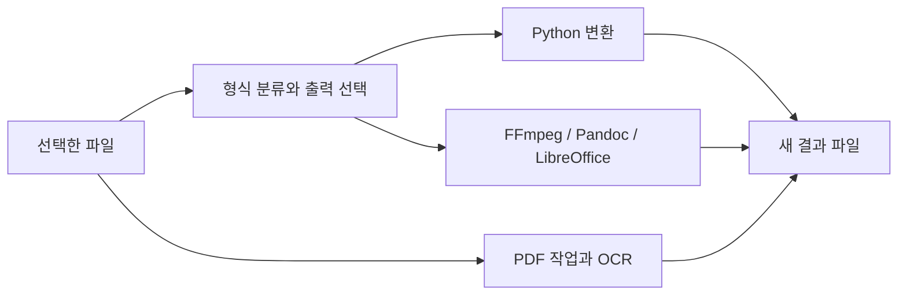
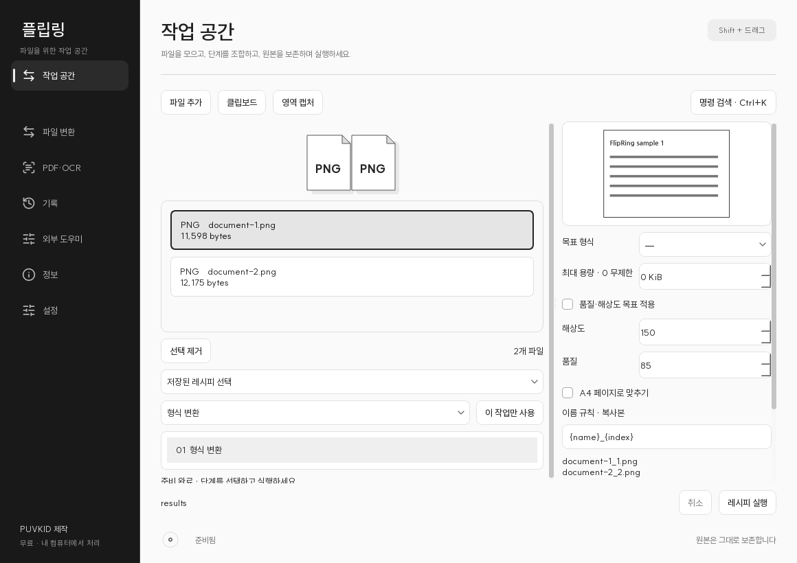
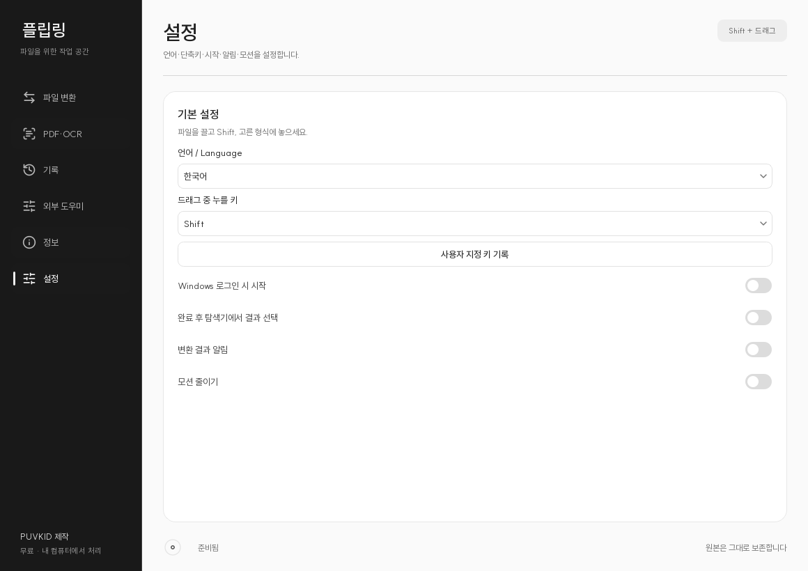

# FlipRing Project · LEVEL 1 - Beginner

> 11월 14일의 검사 기록은 당시 상태로 보존했습니다. 이후 확인한 제품과 납품 상태는 [2026년 11월 20일 확인 범위](#product-verification-20261120)에서 구분합니다.

[LEVEL 1 - Beginner](%EB%A0%88%EB%B2%A81.md) · [LEVEL 2 - Explorer](%EB%A0%88%EB%B2%A82.md) · [LEVEL 3 - Practitioner](%EB%A0%88%EB%B2%A83.md) · [LEVEL 4 - Advanced](%EB%A0%88%EB%B2%A84.md) · [LEVEL 5 - Expert](%EB%A0%88%EB%B2%A85.md)

[같은 수준의 프로필](https://github.com/PUVKID/PUVKID/blob/main/docs/읽기안내/레벨1.md) · [프로젝트 첫 화면](../../README.md)

<a id="current-guide-level-1"></a>
## LEVEL 1 · 현재 1.11 안내의 기준

**현재 1.11·새개발배포 68의 사용 안내입니다.** 파일 선택·문서/PDF/OCR·작업공간·기록과 한계를 아래에서 이 수준으로 설명합니다. 이어지는 원격 보존 구역의 “현행·최신·HWP 미지원”은 1.9 기준 설명으로 구분합니다.

[현재 HWP 저장](#current-hwp-level-1) · [현재 검증과 미완료](#current-evidence-level-1) · [이전 원격 전체 설명](#legacy-project-level-1)

## 플립링은 무엇인가요?

플립 링은 PUVKID가 만든 무료 Windows 파일 도구입니다.

그림·문서·표·발표·영상·음성의 지원 형식을 바꾸고 PDF와 압축 파일을 다룹니다.

**원본**은 작업 전 파일이고 **결과**는 작업으로 새로 만든 파일입니다.

예를 들어 `사진.jpg`를 PNG로 바꾸면 JPG는 보존하고 새 PNG를 만듭니다.

이름 끝의 `.jpg`, `.pdf` 같은 확장자가 형식을 알려 줍니다.

변환은 파일 이름의 끝만 바꾸는 일이 아닙니다. 내용을 읽어 다른 형식으로 저장하므로 글꼴·표·수식·그림·배치가 달라질 수 있습니다. 완료 표시를 확인한 뒤 결과를 직접 열어 보세요. 중요한 원본은 따로 보관하고, 오류가 난 파일을 성공한 결과로 사용하지 마세요.

## 처음에는 세 단계로 시작하세요

1. **파일 선택**: 프로그램 창에서 변환할 파일을 고릅니다. 여러 파일을 함께 선택할 수도 있습니다.
2. **형식 선택**: 선택한 파일에 제공되는 출력 형식을 고릅니다. 모든 입력을 모든 출력으로 바꿀 수 있는 것은 아닙니다. 필요한 도구의 준비 상태와 안내를 확인합니다.
3. **변환**: 실행한 뒤 대기·처리·완료·실패 상태를 확인합니다. 완료된 새 파일을 열어 내용과 저장 위치를 살펴봅니다.

일반 파일 변환은 원본 폴더에 새 이름으로 결과를 만듭니다. 기존 이름과 겹칠 때도 원본이나 기존 결과를 덮어쓰지 않도록 새 이름을 사용합니다. 뒤에서 설명할 **작업 공간**은 별도의 결과 폴더를 사용하므로 그 화면에서 지정한 위치를 확인하세요.

실패했다면 이유를 읽고 파일과 도구 준비 상태를 확인한 뒤 **실패 항목만 재시도**할 수 있습니다. 자주 쓰는 설정은 프리셋으로 저장해 다시 선택합니다. 원본과 결과 미리보기로 차이를 살펴볼 수 있지만, 미리보기만으로 모든 페이지나 수식이 정확하다고 판단하지는 마세요.

### 탐색기의 Shift 원형 메뉴는 선택해서 쓰는 방법입니다

위 세 단계에 익숙해진 뒤에는 탐색기에서 파일을 끌면서 **Shift**를 눌러 원형 메뉴를 사용할 수 있습니다. 원하는 형식 쪽으로 가져가 선택하고, 가운데로 가져가면 취소합니다. 파일 선택 창을 쓰기 위해 Shift 조작을 먼저 배울 필요는 없습니다. 취소해도 이미 완료된 다른 결과까지 지워지는 것은 아닙니다.

창을 닫아도 앱이 트레이에 남을 수 있습니다. 창이 보이지 않으면 Windows 트레이를 확인하고, 완전히 끝낼 때는 트레이 메뉴를 사용하세요.

## 어떤 도구가 들어 있고 무엇을 따로 준비하나요?

검증한 Windows 배포물에는 **7-Zip 실행 구성 요소, Tesseract OCR 엔진과 한국어·영어 모델, H2Orestart와 Java**가 들어 있습니다.

고객이 이 구성요소를 모두 따로 찾아 설치해야 한다는 뜻은 아닙니다.

다만 소스 코드만 받은 환경은 설치 제품과 다르므로 빌드 안내대로 자산과 의존성을 준비해야 합니다.

| 작업 | 쓰는 도구와 준비 조건 |
|---|---|
| 이미지·PDF 페이지 | JPG·PNG 등 지원 그림 형식을 바꾸고 그림을 PDF로 묶거나 PDF 페이지를 이미지로 만듭니다.<br>작업마다 제공되는 출력이 다릅니다. |
| Word·Excel·PowerPoint·OpenDocument | **LibreOffice는 별도 설치**가 필요합니다.<br>앱의 준비 상태 안내와 입력·출력 목록을 먼저 확인하세요. |
| HWP·HWPX 입력 | 별도 LibreOffice와 동봉 H2Orestart·Java를 함께 사용합니다.<br>LibreOffice와 Java의 비트 수가 맞아야합니다.<br>현재 제품은 HWP·HWPX를 읽어 다른 지원 형식으로 저장합니다. |
| 전자책·일부 문서 | 해당 변환에는 **Pandoc을 별도로 준비**해야 합니다.<br>Office 문서 변환에 쓰는 LibreOffice와 역할이 다릅니다. |
| 영상·음성 | 해당 변환에는 **FFmpeg를 별도로 준비**해야 합니다.<br>입력·출력 형식과 도구 상태를 확인하세요. |
| 압축 파일 | 동봉 7-Zip을 사용하는 경로가 있으며 RAR 등 지원 입력을 처리합니다.<br>안전하지 않은 경로·링크가 포함된 압축 파일은 거부될 수 있습니다.<br>모든 압축 형식으로 새 저장을 제공하는 것은 아닙니다. |
| 그림 속 문자 읽기 | 동봉 Tesseract와 한국어·영어 모델을 사용합니다.<br>언어와 출력 형식을 고르며 인식 오류는 결과 검토에서 확인합니다. |

도구가 준비되지 않은 작업은 안내를 읽고 필요한 외부 도구를 준비한 뒤 다시 시도합니다. 특정 시험의 성공이 모든 도구 버전과 모든 입력의 호환성을 보장하지는 않습니다.

## 문서·표·발표를 바꾸는 방법과 남는 내용

앱의 입력·출력 목록은 서로 다릅니다. **읽을 수 있는 파일이라고 같은 형식으로 새 저장할 수 있는 것은 아닙니다.** 예를 들어 오래된 Word 문서 DOC를 DOCX로, DOCX를 DOC로 바꾸는 대표 경로를 제공하지만 새 형식의 기능이 오래된 형식에서 모두 유지되지는 않습니다.

| 문서 종류 | 대표 입력과 출력 예시 | 결과에서 확인할 것 |
|---|---|---|
| 글 문서 | DOC ↔DOCX, ODT 같은 OpenDocument, RTF를 지원하고 지원 문서를 TXT·HTML·EPUB·PDF나 페이지 이미지로 저장합니다. | 글꼴·표·그림·쪽 나눔을 확인합니다.<br>TXT에는 문서의 시각적 서식이 남지 않습니다. |
| 계산 표 | XLS ↔XLSX, ODS 같은 OpenDocument를 다루고 CSV·TSV·PDF·HTML 등 지원 출력을 제공합니다. | 수식·계산 값·차트·인쇄 범위·시트 구성을 확인합니다. |
| 발표 | PPT ↔PPTX, ODP 같은 OpenDocument를 다루고 PDF·페이지 이미지·텍스트로 저장할 수 있습니다. | 글 꼴·그림·슬라이드 배치를 확인합니다.<br>PPT →TXT는 **텍스트만** 남기며 발표 화면을 보존하는 출력이 아닙니다. |
| 다른 문서 | 텍스트·Markdown·HTML·전자책과 엔진이 읽을 수 있는 iWork·WordPerfect·AbiWord 등의 대표 입력을 제공합니다. | 전용 기능은 문서마다 호환이 다르며 앱에 표시된 지원 조합을 따릅니다. |

**XLSB, 매크로 문서, 템플릿은 입력 전용**입니다. XLSM·DOCM·PPTM이나 XLT·DOT·POT 계열을 읽는다고 그 형식으로 새 저장하거나 매크로를 실행한다는 뜻은 아닙니다. 변환할 때 매크로 실행과 외부 링크 갱신을 제한합니다.

CSV·TSV는 첫 시트의 **표시값**을 저장합니다. 예를 들어 두 시트가 있고 셀에 계산 식이 들어 있는 XLSX를 CSV로 바꾸면 두 시트와 수식·서식이 그대로 옮겨지는 것이 아닙니다. 여러 시트·수식·서식을 보존해야한다면 XLSX·XLS·ODS를 고르고 결과를 확인하세요.

현대 XLSB 표본과 달리 **초기 Excel 2007 Beta2 XLSB 변종은 지원 완료 범위에서 제외**합니다. 내용이 있는 시트를 도구가 빈 것으로 읽으면 저장 전에 오류를 알립니다. 이 경우 원래 작성 프로그램에서 최신 XLSX로 저장한 새 복사 본을 사용하세요. 모든 셀의 의미가 같다는 보장은 별도입니다.

### HWP·HWPX의 현재 기능과 후속 목표

새 소스에는 **DOCX·TXT·HWP5·HWPX에서 HWP·HWPX로 저장하는 제한 기능**이 구현됐습니다.

예를 들어 한글 문단·단순한 표·PNG 그림이 있는 DOCX를 HWPX로 바꾸는 경로입니다.

이 저장에는 별도 LibreOffice가 필요하지 않습니다.

반대로 HWP를 PDF나 Word로 바꾸는 기존 기능은 계속 LibreOffice·H2Orestart·Java를 사용합니다.

저장 기능은 소스 35 독립 검사와 새 배포 68의 portable/installed 고정 DOCX 각 1 시험에서 HWP/HWPX 두 출력까지 확인했습니다.

실제 사용자 PNG/HWP 확인과 HWPX Shift 추가 대기는 아래 현재 검증 절에서 구분합니다.

일부 복잡한 그림 개체가 든 구형 HWP는 LibreOffice·H2Orestart에서 불러오기 오류가 확인됐습니다.

암호·보호·배포용 문서와 복잡한 수식·그림·표를 완벽하게 지원한다고 보장하지 않습니다.

실패하면 원본을 보존하고 원래 작성 프로그램에서 HWPX·DOCX·PDF로 저장한 새 복사 본을 사용하세요.

일부 Office 문서는 외부 변환 도구 연결이 끊기는 오류도 관측됐습니다.

임시 파일이 생겼더라도 최종 변환 성공으로 처리하지 않는 경우가 있으므로 오류 안내를 확인하세요.

## PDF 페이지를 정리하기

PDF는 문서를 일정한 모양으로 전달하는 형식입니다. 여러 PDF 합치기, 나누기, 선택 페이지 추출·삭제·회전, 이미지 묶기, 페이지 이미지 저장과 압축을 선택할 수 있습니다. 합칠 파일은 목록에서 순서를 확인합니다. PDF 썸네일에서는 순서를 바꾸고 여러 페이지를 선택하거나 확대해 내용을 살펴볼 수 있습니다.

나누기·추출·삭제·회전을 선택하면 **페이지 범위는 기본 화면에 표시**됩니다. 회전 작업은 각도도 기본 화면에 나옵니다. `1,3-5`는 1 쪽과 3~5 쪽처럼 범위를 지정하는 예입니다. 특히 삭제 작업에서는 남 길 쪽과 지울 쪽을 혼동하지 마세요. 전체 페이지를 삭제하는 요청은 거부됩니다.

**고급 옵션은 작업별로 다릅니다.** PDF →이미지는 출력 형식을 기본 화면에서 고르고 페이지 범위·DPI·품질은 고급에서 조정합니다.

OCR은 언어·출력을 기본 화면에서 고르고 페이지 범위·DPI·인식 배치 등의 세부 항목을 고급에서 조정합니다.

이미지 →PDF에는 DPI 세부 옵션이 있습니다.

현재 작업에 해당하지 않는 옵션은 나타나지 않습니다.

DPI는 페이지를 얼마나 촘촘한 그림으로 만들지 정하는 값입니다. 높이면 더 큰 이미지와 처리 량이 생길 수 있습니다. 이미지 방식 PDF 압축은 화질을 잃을 수 있고 무손실 정리도 크기 감소를 보장하지 않습니다. 암호화·손상 PDF는 처리되지 않을 수 있습니다.

## OCR 결과를 읽고 고치기

**OCR은 사진이나 스캔 이미지 속 글자를 찾는 기능**입니다. 한국어·영어를 각각 또는 함께 선택하고 검색 가능한 PDF·TXT·DOCX·XLSX 같은 지원 출력으로 저장합니다. 검색 PDF는 페이지를 이미지로 다시 만들고 인식한 글자 층을 더하는 방식입니다. 원래 문서의 표·위치를 그대로 복원한다는 뜻은 아닙니다.

작업 공간의 OCR 검토에서는 인식한 글자의 위치와 낮은 확신도 표시를 살펴보고 텍스트를 직접 고칩니다.

고친 내용을 TXT·PDF·DOCX·XLSX로 별도 저장할 수 있습니다.

인식 결과나 표 추정은 틀릴 수 있으므로 숫자·고유 명사·표의 행과 열·병합 셀을 원본과 대조하세요.

인식 신뢰도는 실제 인식 엔진의 관측 값이며 문서 전체가 정확하다는 보증이 아닙니다.

두 파일을 고르는 **결과 비교**는 결과와 원본 또는 두 결과를 검토할 때 사용합니다. 비교 표시를 보면서 내용 차이를 확인하세요. 모든 문서의 의미와 서식이 같다는 자동 인증 기능은 아닙니다.

**개인정보 후보 검토**는 놓칠 수 있는 부분을 찾는 보조 기능입니다. 후보를 사용자가 검토하고 지정한 영역을 가린 **새 복사본**을 만들 수 있습니다. 모든 개인정보를 자동으로 찾아 주거나 원본·다른 사본을 삭제하는 기능이 아닙니다. 공유하기 전에 새 파일의 각 페이지와 다른 남은 내용을 직접 확인해야 합니다.

## 작업 공간으로 여러 작업을 묶기

단순 형식 변환에 익숙해진 뒤 작업 공간을 사용할 수 있습니다. 파일을 모으고 순서와 목표를 정한 뒤 결과 폴더에 새 파일을 만드는 화면입니다. 아래 기능은 목적에 맞게 선택해서 사용하며 전부 설정해야만 변환할 수 있는 것은 아닙니다.

### 파일을 모으고 이름과 순서를 정하기

파일을 추가해 카드 목록을 만들고 필요한 순서를 확인합니다. PDF 합치기·이미지 조합·GIF 만들기 등 선택한 작업에 맞춰 파일을 조합합니다. 같은 목록이라도 선택한 작업에 따라 새 결과가 달라지므로 실행 전에 순서를 확인하세요.

이름 규칙은 `{name}_{index}`처럼 원래 이름과 번호를 조합해 **새 복사본**을 만드는 기능입니다. 규칙을 확인하고 적용한 뒤 결과 이름을 살펴보세요. 원본 이름을 일괄 바꿔 없애는 작업으로 이해하지 마세요.

클립보드의 파일·그림·텍스트를 입력으로 가져올 수 있고, 사용자가 직접 시작한 영역 캡처를 입력으로 사용할 수도 있습니다. 자동으로 화면 전체를 감시하는 기능은 아닙니다. 가져온 내용이 의도한 자료인지 확인하고 작업을 선택하세요. **Ctrl+K 명령 검색**에서는 하고 싶은 작업을 찾아 선택할 수 있습니다.

### 형식·화질·용량·페이지 목표를 고르기

출력 형식과 필요할 때 품질·DPI·A4 페이지 규격·목표 용량을 정합니다.

예를 들어 문서 이미지를 A4에 맞추거나 그림 품질을 조정해 새 결과를 만들 수 있습니다.

목표 용량은 KiB 단위의 조건이며, 화질을 조절해도 원하는 크기에 도달하지 못할 수 있습니다.

**용량 목표 미달성은 경고로 알리고 결과를 보존하며 목표 달성 성공과 구분**합니다.

원하는 수치를 적었다고 결과가 반드시 그 수치가 되는 것은 아닙니다.

작업 공간의 결과 폴더는 기본으로 앱 데이터 아래의 `results`를 사용하며 고급 옵션에서 선택할 수 있습니다. 일반 변환의 원본 폴더와 혼동하지 마세요. 완료 뒤 결과 경로를 확인하고 경로나 파일 자체를 복사하거나 결과 파일을 끌어 다른 곳에서 사용할 수 있습니다.

### 반복할 처리 순서를 저장하기

필요한 처리 단계를 추가하고 위아래 순서를 바꿔 **레시피**로 저장할 수 있습니다. 레시피는 반복할 작업 조합입니다. 저장한 레시피를 다시 쓰거나 가져오기·내보내기로 전달할 수 있습니다. 가져온 레시피도 단계와 목표·출력 위치를 검토한 뒤 실행하세요. 레시피를 저장한 것과 실제 입력의 처리가 성공한 것은 다릅니다.

고급 옵션의 감시 폴더는 사용자가 고른 폴더에서 쓰기가 안정된 새 파일을 처리하는 기능입니다.

사용할 폴더와 작업 조건을 먼저 확인하고 켜세요.

파일이 저장되는 중간에 바로 완료된 입력으로 간주하는 방식은 아니며, 결과와 오류를 계속 확인해야 합니다.

휠 개인화에서는 메뉴 순서·숨길 항목·레시피를 조정할 수 있습니다.

감시 폴더와 개인화는 선택 기능이며 기본 세 단계의 필수 준비가 아닙니다.

## 기록과 화면 설정

기록에서는 작업을 검색·필터링하고 필요한 정보를 복사할 수 있습니다. 결과 항목을 왼쪽 버튼으로 두 번 누르면 파일 자체를 실행하지 않고 탐색기에서 그 파일을 선택합니다. 이동·삭제된 파일은 안내를 확인하세요. 기록에는 입력·출력 경로와 오류가 포함될 수 있으므로 그대로 공개하지 마세요.

화면 언어는 한국어와 영어 중 고르고 모션 축소를 사용할 수 있습니다. 창은 고정 크기로 제공하며 작은 화면에서는 스크롤을 사용합니다. 파일 선택·작업·실행·취소·진행·오류는 작업에 맞게 접근할 수 있고, 세부 옵션은 해당 작업의 고급 옵션에서 펼칩니다. 페이지 범위가 언제나 고급에 숨는 것은 아닙니다.

## 실행 파일·전체 소스·라이선스

Windows 실행 파일 `프로그램/FlipRing/FlipRing.exe`를 시작하거나 `설치파일/FlipRing-Setup.exe`로 설치합니다. 검증한 실행·설치 파일에는 코드 서명이 없습니다. 실행 파일 한 개만 떼어 옮기면 필요한 구성요소가 빠질 수 있으므로 배포 폴더 구성을 유지하세요.

전체 소스 배포 ZIP은 제품 코드·빌드 안내·자산·검사 도구·라이선스와 상응 소스를 함께 확인하는 자료입니다.

GitHub가 자동 생성하는 저장소 ZIP과 구분합니다.

사용한 외부 구성 요소의 라이선스와 고지를 보존해야 합니다.

소스에서 직접 실행·빌 드할 때는 Python과 고정 의존성, 자산과 외부 도구를 빌 드 안내대로 준비해야하며 소스를 받기만했다고 설치 제품의 환경이 준비되는 것은 아닙니다.

프로젝트에 확인된 논문이나 원고는 없습니다.

## 안에서는 어떻게 처리하나요?

화면은 입력과 작업을 받아 진행 상태를 보여 주고, 엔진은 파일 종류에 맞는 처리 기능이나 외부 도구를 호출합니다. PDF 처리는 페이지 작업과 OCR을 맡습니다. 따라서 같은 앱 안에서도 Office 변환과 OCR은 필요한 도구가 다릅니다.

Office 변환은 분리된 임시 설정을 사용합니다.

문서 도우미의 순수 Python 파일 세 개만 전용 위치에 준비하고 외부 LibreOffice의 Python을 `-B` 옵션으로 실행해 앱에 동봉된 다른 버전의 확장 모듈과 충돌하지 않게 합니다. `-B`는 그 실행에서 Python 바이트코드 캐시 생성을 막습니다.

사용자의 기존 LibreOffice 설정을 바꾸는 조치가 아닙니다.

이 구현 설명은 모든 외부 도구나 모든 문서의 성공 보장이 아닙니다.

## 확인한 결과와 아직 남은 일

**이전 배포 55 또는 이 전 소스 시점의 보존 관측입니다. 새 68의 근거는 이 페이지 현재 검증 절과 구분합니다.**

현재 문서 기능 검사 **51개는 통과**했습니다.

새 설치 본의 설치 파일 대조와 내장 19개 모듈 대조, 별도 독립 배포 대조도 통과했습니다.

자체 생성한 DOCX·JPG 시험 자료를 사용자가 실제 앱으로 조작해 **PDF·PNG 생성, 원본 보존, 원형 메뉴 가운데 취소**를 확인했습니다.

부모 작업에서 결과 파일·텍스트·표·픽셀·기록을 대조했고 한 페이지 PDF의 3×3 표도 확인했습니다.

이 문서 작성자가 시험이나 화면 검사를 새로 실행한 것은 아닙니다.

특정 자료의 성공을 모든 문서·모든 조작의 성공으로 확대하지 않습니다.

현재 소스로 기존 기능 163개와 확장 기능 86개를 각각 다시 검사해 통과했습니다.

이것과 최종 납품 파일까지 확인하는 중앙 완료 검사는 다릅니다.

새 HWP 저장은 모든 문서 모양을 그대로 옮기는 기능이 아닙니다.

병합·중첩 표, 수식, 주석과 미 지원 개체는 거부하며 글 꼴·쪽 배치는 단순해질 수 있습니다.

새 최종 납품 교체와 GitHub 공개 반영은 아직 남아 있습니다.

## 보존된 차수와 자료

아래 표에는 실제로 구분된 17개 자료를 담았습니다. 작업 전 부분 보존 본은 완전한 배포 버전과 다릅니다. 상세 설명은 같은 초급 수준으로 연결하며, 폴더와 비교는 각각 원본 자료와 실제 차이를 살펴보는 곳입니다.

| 차수·자료 | 자료 폴더 | 초급 상세 | 전체 비교·범위 |
|---|---|---|---|
| 1.2.0 | [자료](../../history/1.2.0) | [설명](../../docs/versions/1.2.0.md#reading-level-1) | [비교](../../docs/revision-audit/1.2.0.md) |
| 부드러운디자인-작업전 | [자료](../../history/부드러운디자인-작업전) | [설명](../../docs/versions/부드러운디자인-작업전.md#reading-level-1) | [비교](../../docs/revision-audit/부드러운디자인-작업전.md) |
| 버튼모션-작업전 | [자료](../../history/버튼모션-작업전) | [설명](../../docs/versions/버튼모션-작업전.md#reading-level-1) | [비교](../../docs/revision-audit/버튼모션-작업전.md) |
| 콤보-작업전 | [자료](../../history/콤보-작업전) | [설명](../../docs/versions/콤보-작업전.md#reading-level-1) | [비교](../../docs/revision-audit/콤보-작업전.md) |
| 탭잔상-작업전 | [자료](../../history/탭잔상-작업전) | [설명](../../docs/versions/탭잔상-작업전.md#reading-level-1) | [비교](../../docs/revision-audit/탭잔상-작업전.md) |
| 호버대비-작업전 | [자료](../../history/호버대비-작업전) | [설명](../../docs/versions/호버대비-작업전.md#reading-level-1) | [비교](../../docs/revision-audit/호버대비-작업전.md) |
| 1.4.0 | [자료](../../history/1.4.0) | [설명](../../docs/versions/1.4.0.md#reading-level-1) | [비교](../../docs/revision-audit/1.4.0.md) |
| 내부모션-작업전 | [자료](../../history/내부모션-작업전) | [설명](../../docs/versions/내부모션-작업전.md#reading-level-1) | [비교](../../docs/revision-audit/내부모션-작업전.md) |
| 1.6.0 | [자료](../../history/1.6.0) | [설명](../../docs/versions/1.6.0.md#reading-level-1) | [비교](../../docs/revision-audit/1.6.0.md) |
| 1.7.0 | [자료](../../history/1.7.0) | [설명](../../docs/versions/1.7.0.md#reading-level-1) | [비교](../../docs/revision-audit/1.7.0.md) |
| 1.8.0 | [자료](../../history/1.8.0) | [설명](../../docs/versions/1.8.0.md#reading-level-1) | [비교](../../docs/revision-audit/1.8.0.md) |
| 1.9.0 | [자료](../../history/1.9.0) | [설명](../../docs/versions/1.9.0.md#reading-level-1) | [비교](../../docs/revision-audit/1.9.0.md) |
| 1.10.0 | [자료](../../history/1.10.0) | [설명](../../docs/versions/1.10.0.md#reading-level-1) | [비교](../../docs/revision-audit/1.10.0.md) |
| 1.11.0 | [자료](../../history/1.11.0) | [설명](../../docs/versions/1.11.0.md#reading-level-1) | [비교](../../docs/revision-audit/1.11.0.md) |
| 최종 | [자료](../../소스) | [설명](../../docs/versions/최종.md#reading-level-1) | [비교](../../docs/revision-audit/최종.md) |
| 현행소스 | [자료](../../소스) | [설명](../../docs/revision-audit/현행소스.md#reading-level-1) | [비교](../../docs/revision-audit/현행소스.md) |
| 고유 작업 코드·문서 | [자료](../../보존자료/작업소스) | [설명](../../docs/SOURCE_MATERIALS.md#reading-level-1) | [비교](../../docs/2026-11-02_공개반영재개검증.md) |

<a id="current-hwp-level-1"></a>
## LEVEL 1 · HWP 제한 저장의 선택·절차·검증 경계

HWP는 한글 문서 형식이고 HWPX는 XML 기반 한글 문서 형식입니다.

새 저장은 **DOCX·TXT·HWP5·HWPX 네 입력에서 HWP·HWPX로** 한정합니다.

원본과 같은 확장자는 목표에서 빠집니다.

단순 문단·굵게/기울임·병합하지 않은 직사각형 표·PNG/JPEG 그림부터 사용하고, 새 결과의 문장 순서·표의 칸·그림을 원본과 대조하세요.

병합/중첩 표·수식·주석·필드·떠 있거나 회전한 그림은 거부합니다.

글꼴·쪽 배치의 완전 재현과 HWP3 저장은 지원 주장이 아닙니다.

이 저장에는 별도 LibreOffice가 필요하지 않습니다.

앱의 자식 worker가 제한된 변환을 맡습니다.

기존 HWP →PDF/Word 읽기는 LibreOffice·H2Orestart·Java가 계속 필요합니다.

HWP5 쓰기는 라이브러리에서도 실험적이며 소스 35 검사·고정 DOCX의 두 출력 확인을 모든 문서 호환이나 다른 문서 프로그램의 화면 일치로 넓히지 않습니다.

<a id="current-evidence-level-1"></a>
## LEVEL 1·새 배포 68의 현재 확인과 남은 절차

**새 개발 배포 68은 빌드·설치·기동과 제한 표본 확인까지 마쳤으며 최종 납품 교체·중앙 완료 검사·GitHub/Release 공개는 남아 있습니다.** 설치 파일과 실행 폴더의 구성, 창 응답과 중복 실행 잠금을 확인했습니다.

HWP 소스 35개는 별도 검증 담당이 직접 검사했습니다.

문서 51개·기존 기능 163개·확장 기능 86개는 부모가 현재 소스로 실행하고 독립 담당이 저장된 검사 ID·통계·소스 해 시를 대조했습니다.

같은 사람이 모든 검사를 다시 실행한 결과로 합치지 않습니다.

사용자의 새 설치본 조작에서는 실제 **PNG·HWP 파일**이 생겼습니다.

두 원본의 해시가 그대로이고 JPG와 PNG의 RGB, HWP의 한글·3×3 표·PNG 그림의 바이트와 마지막 행, 새 프로필의 성공 기록 2개를 대조했습니다.

가운데 취소는 사용자가 직접 확인했습니다.

사용자 답변에는 HWPX라고 적혔지만 실제 파일·기록은 HWP 여서 **HWPX를 Shift로 만든 실제 조작은 추가 확인 대기**입니다.

HWPX 자동 시험은 휴대용·설치본에서 각각 통과했으며 이 두 종류의 확인을 구분합니다.

## LEVEL 1 · 새 배포 파일을 대조하는 값

바이트는 파일 용량이고 SHA-256은 같은 내용인지 확인하는 지문입니다. 아래는 실제 개발 배포 68의 파일이며 원격 공개나 최종 교체가 끝났다는 뜻은 아닙니다.

| 파일 | 바이트 | SHA-256 |
| --- | ---: | --- |
| `프로그램/FlipRing/FlipRing.exe` | 9585792 | `9dfa98ef7ab9778ffc686e7c560f928aeff06e02d120cff8575733313f5c09d3` |
| `설치파일/FlipRing-Setup.exe` | 178176550 | `28a976afca70842b0e06b4a8e6c0c570388e8320e4d1eb1b8998b9189bd5ab5e` |
| `플립링-1.11.0-전체소스.zip` | 671431794 | `156708240f854b7af8917d3f46d059f83cc92e548a698219d4726e92d8becf0a` |

실행 구성 1207 파일 478350675B, 소스 ZIP948 항목·해제합계 809141540B를 대조했습니다.

상응 소스 10개 528499332B는 실행 구성에서 분리해 전체 소스 ZIP에 원 바이트로 보존합니다. python-hwpx6.12.0의 Apache-2.0 LICENSE·NOTICE·METADATA와 정확 상응 소스, 기존 법적 고지를 유지합니다.

파일 용량으로 속도·RSS·외부뷰어 렌더일치 효과를 계산하지 않습니다.

<a id="legacy-project-level-1"></a>
## LEVEL 1 · 1.9 기준 원격 안내와 전체 원문 보존

**여기부터 아래는 원격 874b2f1의 기존 설명을 보존한 구역입니다.** 아래 “현재·최신·현행”과 HWP 미지원 문장은 이 구역의 1.9 기준 소스를 뜻합니다.

위의 현재 1.11 문서 지원·HWP 제한 저장·배포 68 상태와 구분합니다.

기존 모바일 문단·실질 기능·표·코드·이미지·14개 자료 연결·이력은 생략하지 않았습니다.

새 사용 절차와 전체 17 자료는 [현재 안내](#current-guide-level-1)에서 읽습니다.

<!-- legacy-remote-874-start -->

## LEVEL 1 · 프로젝트 소개와 읽는 방법

로컬 파일을 다른 형식으로 바꾸고 PDF 쪽을 정리하거나 이미지 글자를 읽는 Windows 앱입니다. 예를 들어 스캔 PDF에서 글자를 추출해도 원래 표의 모든 행·열이 복구되는 것은 아닙니다. **완료 표시 뒤에도 실제 결과 파일을 확인합니다.**

## LEVEL 1 · 실제 기능과 동작 범위

| 확인할 항목 (Checklist) | 본문의 핵심 조건 |
| --- | --- |
| 기능·동작 | 파일을 고르고 목표 형식이나 PDF 작업·품질·쪽을 지정합니다.<br>도구와 공간을 확인한 뒤 처리하고 새 결과를 엽니다.<br>감시 폴더는 사용자가 켜는 기능이며 개인정보 후보도 검토 보조입니다. |
| 입력·처리·출력 | 입력은 사용자가 고른 파일이고 결과는 새 형식 파일·편집 PDF·OCR 문서입니다.<br>새 이름을 사용하는 결과 보존이 있어도 사용자가 원본을 별도 보관하는 것이 필요합니다. |
| 결과·한계 | OCR과 표 복원은 문서에 따라 달라집니다.<br>이미지 압축은 손실이 있을 수 있고 무손실 정리도 항상 더 작은 파일을 만들지는 않습니다.<br>후보 검토가 모든 개인 정보를 찾는 것은 아닙니다. |


파일을 고르고 목표 형식이나 PDF 작업·품질·쪽을 지정합니다. 도구와 공간을 확인한 뒤 처리하고 새 결과를 엽니다. 감시 폴더는 사용자가 켜는 기능이며 개인정보 후보도 검토 보조입니다.

사용자가 보는 동작을 먼저 설명하고 아래 실제 기능표의 이름과 연결합니다.

**기능별 공통 근거**

파일 변환부터 PDF 정리까지 한 화면에서 이어서 할 수 있도록 만든 도구입니다.

플립링은 파일 형식을 분류해 가능한 출력 형식을 보여주고, Python 라이브러리 또는 외부 변환 도구로 작업을 수행합니다. PDF 화면에서는 페이지 편집과 OCR 작업을 별도로 제공합니다.

| 기능 | 구현 내용 |
| --- | --- |
| 파일 변환 | 이미지·문서·오디오·비디오·표·자막·압축 형식 처리 |
| 원형 메뉴 | 지원 형식 선택과 트레이 중심의 Windows 인터페이스 |
| PDF 편집 | 병합·분할·추출·삭제·회전·압축 |
| PDF·이미지 변환 | 이미지를 PDF로 묶거나 PDF 페이지를 이미지로 저장 |
| OCR | Tesseract를 이용한 한국어·영어 인식과 문서 출력 |
| 결과 보존 | 기존 이름과 충돌하면 새 이름으로 출력 |



## LEVEL 1 · 입력에서 처리와 출력까지

입력은 사용자가 고른 파일이고 결과는 새 형식 파일·편집 PDF·OCR 문서입니다. 새 이름을 사용하는 결과 보존이 있어도 사용자가 원본을 별도 보관하는 것이 필요합니다.

| 단계 | 이 프로젝트에서 다루는 내용 |
| --- | --- |
| 입력 | 로컬 이미지·문서·미디어·PDF |
| 처리 | PySide6 UI, 변환 엔진·외부 도구, 페이지 편집·Tesseract OCR |
| 출력 | 새 형식 파일·편집 PDF·인식 문서 |


---

## LEVEL 1 · 사용·실험 순서와 확인 방법

빠른 시작의 환경 준비를 읽고 필요한 기능의 외부 도구를 준비합니다. 앱에서 파일과 작업을 고른 뒤 실제 결과를 엽니다. 닫기 버튼은 트레이 숨김이므로 종료는 트레이 메뉴에서 확인합니다.

## LEVEL 1 · 결과와 한계를 해석하는 기준

OCR과 표 복원은 문서에 따라 달라집니다. 이미지 압축은 손실이 있을 수 있고 무손실 정리도 항상 더 작은 파일을 만들지는 않습니다. 후보 검토가 모든 개인 정보를 찾는 것은 아닙니다.

## LEVEL 1 · 구현과 핵심 파일을 연결해 읽기

app.py는 창·선택·트레이, engine.py는 변환, PDF 파일들은 쪽 편집·인식을 맡습니다. 처음에는 기능 표와 사용 순서를 읽고 필요한 부분만 해당 코드로 이동합니다.

## LEVEL 1 · 용어와 실수하기 쉬운 구분

파일 변환은 원본을 읽어 다른 형식의 새 파일을 만드는 일입니다.

PDF 페이지 편집은 문서의 일부 쪽을 합치거나 나누고 회전하는 작업입니다.

OCR은 이미지 속 글자를 인식하는 기능이며 원래 문서 배치를 완벽히 복구한다는 뜻은 아닙니다.

프리 셋은 자주 쓰는 옵션, 레시피는 여러 처리의 순서, 작업 큐는 기다리는 작업의 목록입니다.

Qt·PySide6는 창과 화면을 만드는 도구입니다.

**원본을 보존한 새 결과 저장과 로컬 처리**를 기본으로 합니다. OCR·표 열 복원·개인정보 후보 검토는 완전한 품질·탐지를 보장하지 않습니다. 부분 보관본은 독립 설치 제품이 아니며 기능별 외부 도구·글꼴·언어 자료가 필요합니다.

## LEVEL 1 · 전체 차수와 같은 수준의 상세 설명

차수 이름은 실제 보관 단위를 따릅니다. 부분본·시험 도구·최종 안내는 제품 버전과 구분하며, 폴더와 직전 비교를 함께 연결합니다.

| 차수·자료 | 자료 폴더 | 이 수준의 차수 설명 | 직전 비교·범위 |
| --- | --- | --- | --- |
| 1.2.0 | [자료](../../history/1.2.0) | [LEVEL 1 - Beginner](../versions/1.2.0.md#reading-level-1) | [전체 비교](../revision-audit/1.2.0.md) |
| 부드러운디자인-작업전 | [자료](../../history/%EB%B6%80%EB%93%9C%EB%9F%AC%EC%9A%B4%EB%94%94%EC%9E%90%EC%9D%B8-%EC%9E%91%EC%97%85%EC%A0%84) | [LEVEL 1 - Beginner](../versions/%EB%B6%80%EB%93%9C%EB%9F%AC%EC%9A%B4%EB%94%94%EC%9E%90%EC%9D%B8-%EC%9E%91%EC%97%85%EC%A0%84.md#reading-level-1) | [전체 비교](../revision-audit/%EB%B6%80%EB%93%9C%EB%9F%AC%EC%9A%B4%EB%94%94%EC%9E%90%EC%9D%B8-%EC%9E%91%EC%97%85%EC%A0%84.md) |
| 버튼모션-작업전 | [자료](../../history/%EB%B2%84%ED%8A%BC%EB%AA%A8%EC%85%98-%EC%9E%91%EC%97%85%EC%A0%84) | [LEVEL 1 - Beginner](../versions/%EB%B2%84%ED%8A%BC%EB%AA%A8%EC%85%98-%EC%9E%91%EC%97%85%EC%A0%84.md#reading-level-1) | [전체 비교](../revision-audit/%EB%B2%84%ED%8A%BC%EB%AA%A8%EC%85%98-%EC%9E%91%EC%97%85%EC%A0%84.md) |
| 콤보-작업전 | [자료](../../history/%EC%BD%A4%EB%B3%B4-%EC%9E%91%EC%97%85%EC%A0%84) | [LEVEL 1 - Beginner](../versions/%EC%BD%A4%EB%B3%B4-%EC%9E%91%EC%97%85%EC%A0%84.md#reading-level-1) | [전체 비교](../revision-audit/%EC%BD%A4%EB%B3%B4-%EC%9E%91%EC%97%85%EC%A0%84.md) |
| 탭잔상-작업전 | [자료](../../history/%ED%83%AD%EC%9E%94%EC%83%81-%EC%9E%91%EC%97%85%EC%A0%84) | [LEVEL 1 - Beginner](../versions/%ED%83%AD%EC%9E%94%EC%83%81-%EC%9E%91%EC%97%85%EC%A0%84.md#reading-level-1) | [전체 비교](../revision-audit/%ED%83%AD%EC%9E%94%EC%83%81-%EC%9E%91%EC%97%85%EC%A0%84.md) |
| 호버대비-작업전 | [자료](../../history/%ED%98%B8%EB%B2%84%EB%8C%80%EB%B9%84-%EC%9E%91%EC%97%85%EC%A0%84) | [LEVEL 1 - Beginner](../versions/%ED%98%B8%EB%B2%84%EB%8C%80%EB%B9%84-%EC%9E%91%EC%97%85%EC%A0%84.md#reading-level-1) | [전체 비교](../revision-audit/%ED%98%B8%EB%B2%84%EB%8C%80%EB%B9%84-%EC%9E%91%EC%97%85%EC%A0%84.md) |
| 1.4.0 | [자료](../../history/1.4.0) | [LEVEL 1 - Beginner](../versions/1.4.0.md#reading-level-1) | [전체 비교](../revision-audit/1.4.0.md) |
| 내부모션-작업전 | [자료](../../history/%EB%82%B4%EB%B6%80%EB%AA%A8%EC%85%98-%EC%9E%91%EC%97%85%EC%A0%84) | [LEVEL 1 - Beginner](../versions/%EB%82%B4%EB%B6%80%EB%AA%A8%EC%85%98-%EC%9E%91%EC%97%85%EC%A0%84.md#reading-level-1) | [전체 비교](../revision-audit/%EB%82%B4%EB%B6%80%EB%AA%A8%EC%85%98-%EC%9E%91%EC%97%85%EC%A0%84.md) |
| 1.6.0 | [자료](../../history/1.6.0) | [LEVEL 1 - Beginner](../versions/1.6.0.md#reading-level-1) | [전체 비교](../revision-audit/1.6.0.md) |
| 1.7.0 | [자료](../../history/1.7.0) | [LEVEL 1 - Beginner](../versions/1.7.0.md#reading-level-1) | [전체 비교](../revision-audit/1.7.0.md) |
| 1.8.0 | [자료](../../history/1.8.0) | [LEVEL 1 - Beginner](../versions/1.8.0.md#reading-level-1) | [전체 비교](../revision-audit/1.8.0.md) |
| 현행소스 | [자료](../../%EC%86%8C%EC%8A%A4) | [LEVEL 1 - Beginner](../revision-audit/%ED%98%84%ED%96%89%EC%86%8C%EC%8A%A4.md#reading-level-1) | [전체 비교](../revision-audit/%ED%98%84%ED%96%89%EC%86%8C%EC%8A%A4.md) |
| 고유 작업 코드·문서 | [자료](../../%EB%B3%B4%EC%A1%B4%EC%9E%90%EB%A3%8C/%EC%9E%91%EC%97%85%EC%86%8C%EC%8A%A4) | [LEVEL 1 - Beginner](../SOURCE_MATERIALS.md#reading-level-1) | [전체 비교](../2026-11-02_%EA%B3%B5%EA%B0%9C%EB%B0%98%EC%98%81%EC%9E%AC%EA%B0%9C%EA%B2%80%EC%A6%9D.md) |
| 1.9.0 | [자료](../../history/1.9.0) | [LEVEL 1 - Beginner](../versions/1.9.0.md#reading-level-1) | [전체 비교](../revision-audit/1.9.0.md) |

## LEVEL 1 · 논문·원고와 원본 자료의 범위

소프트웨어의 소스·사용 안내·검사·설치 및 권리 자료를 다룹니다. 보관된 앱 렌더·회귀 검사 수를 문서 변환 품질의 전수 측정이나 논문 성과로 바꾸지 않습니다. 기존 라이선스와 법적 자료는 원문을 유지합니다.

## LEVEL 1 · 원래 모든 세부 설명으로 이동하기

설정값·코드 예제·실패 조건·측정 범위·화면과 파일별 안내를 생략하지 않도록 첫 화면의 전체 본문을 아래에 함께 둡니다. 각 항목은 이 페이지의 공통 근거로 바로 이동합니다. 원문에 담긴 이전 차수 조건을 현재 실행 조건으로 자동 적용하지 않습니다.

| 첫 화면의 원래 항목 | 이 페이지의 전체 근거 |
| --- | --- |
| FlipRing Project | [원문 보기](#source-section-1) |
| 파일 선택부터 결과 보존까지 | [원문 보기](#source-section-2) |
| 최신차수에서 달라진 점 | [원문 보기](#source-section-3) |
| 작업 공간과 실제 작업 모션 | [원문 보기](#source-section-4) |
| 설치본과 공개 소스 | [원문 보기](#source-section-5) |
| 확인된 전체 버전과 보존 기준본 | [원문 보기](#source-section-6) |
| 이전 1.8 고정 창 설정 화면 | [원문 보기](#source-section-7) |
| 입력·처리·출력 | [원문 보기](#source-section-8) |
| 프로젝트 소개 | [원문 보기](#source-section-9) |
| 저장소 구성 | [원문 보기](#source-section-10) |
| 주요 기술과 처리 방식 | [원문 보기](#source-section-11) |
| 트레이와 원형 메뉴 | [원문 보기](#source-section-12) |
| 화면과 기록 | [원문 보기](#source-section-13) |
| PDF 작업과 인식 옵션 | [원문 보기](#source-section-14) |
| 빠른 시작 | [원문 보기](#source-section-15) |
| 입출력과 도구 구성 | [원문 보기](#source-section-16) |
| 로컬 설정과 검사 코드 | [원문 보기](#source-section-17) |
| 문제 해결 | [원문 보기](#source-section-18) |
| 모든 차수·보관본과 전체 차이 | [원문 보기](#source-section-19) |
| HWP·HWPX 지원 범위 | [원문 보기](#source-section-20) |
| 차수별 화면과 검증 이미지 | [원문 보기](#source-section-21) |

## LEVEL 1 · 항목별 자세한 풀이와 확인 지점

### LEVEL 1 · 파일 선택부터 결과 보존까지

이 항목은 다음 실제 조건으로 동작합니다. 용어는 앞선 설명과 연결하고 값·입력·출력이 무엇을 가리키는지 함께 읽습니다.

앱과 변환: `app.py`가 창·트레이·파일 선택을 연결하고 `engine.py`는 입력 종류와 가능한 목표 형식·외부 변환 도구를 판별합니다.

PDF와 사전 점검: `pdf_panel.py`와 `pdf_tools.py`는 PDF 요청을 구성·실행하며, `flipring_workflow.py`는 이름별 프리셋과 파일별 사전 점검을 맡습니다.

미리보기와 작업 공간: `preview_panel.py`·`pdf_pages.py`는 미리보기와 페이지 작업을, 후속 `workspace_core.py`·`workspace_ui.py`는 레시피·감시 폴더·검색 중심의 작업 공간을 구성합니다.

파일을 선택하고 목표 형식이나 작업, 페이지와 품질을 지정합니다. 필요한 도구와 입력·출력 공간을 확인한 뒤 작업 큐에서 처리하고 결과 파일을 엽니다. 변환 성공 표시가 OCR 문맥이나 행·열 복원 품질까지 보증하지는 않으므로 결과를 직접 확인합니다. 입력·출력 경로가 작업 기록에 남을 수 있습니다.

7.0부터 보존된 프리 셋 검증 조건은 다음과 같습니다.

이름은 1~80 자이며 대소문자를 무시한 중복 이름을 거부합니다. convert/pdf 종류와 허용 옵션만 저장합니다.

PDF 회전 90/180/270·품질 20~95·DPI 60~600·PSM 3/6/11·OCR 언어 kor +eng/kor/eng를 검사합니다.

손상된 프리 셋은 오류를 보존하고 덮어 쓰지 않습니다. 정상 저장만 임시 JSON의 flush/fsync·교체를 사용합니다.

사전 점검의 공간 값은 입력 4 배 +64MiB라는 보수적 추정입니다.

입력 부재·미지원 형식·외부 도우미 부재·공간 부족·쓰기 실패를 서로 다른 코드로 돌려 주므로 같은 오류로 뭉뚱그려 재시도하지 않습니다.

FFmpeg·LibreOffice·Tesseract 등은 선택한 기능에 필요한 경우 준비하고 원본은 별도 보존합니다.

9.0은 레시피·Ctrl +K 검색·사용자가 켜는 감시 폴더·OCR 교정·개인 정보 후보 검토를 확장합니다.

검증 기록의 249개 회귀와 설치 제품 626 파일 대조는 당시 범위의 검사이며 모든 문서의 변환 품질 측정은 아닙니다.

화면 수정 전 부분 본은 독립 설치 패키지가 아니므로 차수 표의 자료 성격을 먼저 확인합니다.

파일 선택·형식 판별·사전 점검·큐·새 파일 저장을 이어 주는 항목입니다. 파일·목표·페이지·품질과 도우미·공간 상태를 먼저 확인한 뒤 결과 파일을 직접 엽니다.

**오해하지 않을 점:** app/engine/PDF/workflow/preview/workspace 책임과 원본 보존·기록 경계를 분리합니다.

[이 항목의 전체 조건·원문](#source-section-2)

### LEVEL 1 · 최신차수에서 달라진 점

이 항목은 다음 실제 조건으로 동작합니다. 용어는 앞선 설명과 연결하고 값·입력·출력이 무엇을 가리키는지 함께 읽습니다.

**1.9.0 · 파일 작업 공간과 검토 도구**

파일을 모은 뒤 목표 형식·용량·페이지 규격과 처리 순서를 한 작업 공간에서 지정하도록 확장합니다. 원본을 보존한 새 결과 저장과 로컬 처리를 기본으로 합니다.

Ctrl+K 빠른 명령창, 이름 규칙 복사, 기록 검색·필터·복사와 휠 개인화를 연결합니다.

파일 카드에서 PDF·이미지 조합과 레시피를 구성하고, 사용자가 켠 감시 폴더에서 안정된 입력에 같은 처리 순서를 적용합니다.

OCR 교정·전후 비교·흐림/중복/개인 정보 후보 검토와 사용자가 확인한 영역 가림을 제공합니다. 후보 탐지가 모든 문제를 찾아내거나 OCR이 원래 문서 배치를 완전히 복원한다고 보장하지 않습니다.

클립보드와 사용자가 직접 시작한 화면 영역 캡처를 입력으로 받습니다. 실제 작업의 대기·실행·결과를 표시하고 모션 감소 설정을 유지합니다.

[1.9 구현·실제 검사·제한](../versions/1.9.0.md#reading-level-1) · [사용 안내](../../%EC%86%8C%EC%8A%A4/1.9-%ED%99%95%EC%9E%A5%EC%95%88%EB%82%B4.md) · [직전 1.8과 전체 비교](../revision-audit/1.9.0.md)




화면 자료는 Qt 가상 화면에서 만든 앱 렌더입니다. 실제 모니터 배율 변경·물리 Shift 드래그·프레임 속도 검증과 구분합니다. 전체 렌더 범위는 5 조건 160장, 대표 시각 검토는 9장으로 구분하며 이 첫 화면에는 개인 사용자 경로가 없는 한국어·영어 화면과 실제 작업 모션만 사용합니다.

새 실행 프로그램·설치 파일·전체 실행 자산과 법적 자료는 로컬 1.9 납품 폴더에서 제공합니다.

이 저장소는 제품 소스·검사 도구·안내와 기존 공개 자산·라이선스를 보관하며 대용량 실행·설치 바이너리를 새로 업로드하지 않습니다.

새 설치본의 실제 확인 결과와 파일 크기·해시는 [1.9 상세 기록](../versions/1.9.0.md#reading-level-1)에 연결합니다. [기존 회귀 도구](../../tools19/regression19.py) · [신규 검사 도구](../../tools19/new_suites19.py)는 실행 환경이 준비된 저장소의 `소스/`를 기준으로 동작합니다.

현행 공개 소스에 남아 있던 이전 버전의 자동 생성 `FlipRing.spec`·`installer.iss`는 기준 원문과 대조한 뒤 제거합니다.

새 `build.py`가 실제 빌드 경로에 맞춰 다시 생성하므로 별도로 보관된 이전 버전 설정을 새 버전에 사용하지 않습니다.

로컬 전체 소스의 새 생성 파일과 기존 역사 원문은 보존합니다.

두 공개 파일의 삭제도 전체 변경 비교에 포함합니다.

**1.8.0 · 고정 창과 세부 디자인**

기본 창을 1160×820 논리 픽셀로 고정하고 메뉴·작업·원본/결과의 구분을 보강했습니다.

파일·폴더 선택창, PDF 페이지 번호, 고배율 아이콘·미리보기와 작은 화면의 스크롤 접근을 보완했습니다.

[1.8 실제 변경·검증 범위](../versions/1.8.0.md#reading-level-1) · [화면 안내](../../%EC%86%8C%EC%8A%A4/1.8-%ED%99%94%EB%A9%B4%EC%95%88%EB%82%B4.md)

[163개 기능 검사와 모션 동기화 검증](../2026-11-02_%EA%B2%80%EC%82%AC%EC%8B%A4%ED%96%89%EA%B5%AC%EC%84%B1%EB%B3%B4%EC%99%84.md)을 별도로 기록했습니다. 이 후속 기록은 보존된 1.8.0 제품과 검사 실행에 관한 자료입니다.

개발 검증에 사용하는 [출력 수집기](../../tools/release_capture.py)와 [회귀 검사 전체 소스](../../tools/test_release_capture.py)도 함께 보관합니다.

**1.7.0 · 파일별 작업 흐름과 PDF 페이지 편집**

원본·결과 이미지 미리보기, 파일별 대기·완료·실패·취소와 실패만 재시도, 기본·사용자 프리셋을 연결했습니다.

PDF 실제 썸네일의 드래그 순서 변경·다중 선택·회전·삭제·추출·확대와 새 파일 저장을 추가했습니다.

입력·도우미·쓰기·공간 점검, 별도 설정 화면과 저장되는 모션 줄이기를 제공합니다.

기존 Shift 원형 메뉴, 원본 보존, PDF·한영 OCR, 언어 설정과 기록의 탐색기 선택을 유지합니다.

[1.7 변경과 검증 범위](../versions/1.7.0.md#reading-level-1) · [사용 방법과 검사 재현](../../%EC%86%8C%EC%8A%A4/1.7-%EC%83%88%EA%B8%B0%EB%8A%A5%EC%95%88%EB%82%B4.md)

**기본 구조** — 원형 메뉴·트레이와 변환·PDF 처리

원형 메뉴와 작업 큐를 중심으로 파일 변환과 PDF 처리를 연결했습니다.

app.py는 Shift를 누른 채 파일을 끄는 입력을 감시하고 원형 메뉴·트레이·작업 큐를 연결합니다. 일반 변환과 PDF 작업은 각각 단일 작업 스레드이며 두 큐를 동시에 실행하지 않습니다.

engine.convert는 파일 종류별 도구를 선택하고 같은 드라이브 임시 폴더에서 처리한 뒤 새 이름으로 이동합니다. 압축의 상위·절대 경로와 링크를 검사합니다.

pdf_tools와 pdf_panel은 페이지 추출·삭제·회전·압축·OCR 출력 옵션을 처리합니다. PDF 결과는 배타적 생성으로 덮어 쓰기를 피하며 OCR의 행·열은 글자 위치에서 추정합니다.

studio_ui·ui_motion은 화면과 유한 애니메이션을 구성합니다. 최근 기록은 입력·출력·오류를 최대 200개 보관하므로 운영 파일 경로를 포함할 수 있습니다.

1.2.0·설치 구성의 AppVersion =1.2.0으로 확인한 이전 Mono 소스·[폴더](../../history/1.2.0) · [설명](../versions/1.2.0.md#reading-level-1) · 직전 비교 대상·순서 근거 없음

부드러운디자인-작업전 · app·PDF 화면·GUI 검사만 남은 부분 기준본 · [폴더](../../history/%EB%B6%80%EB%93%9C%EB%9F%AC%EC%9A%B4%EB%94%94%EC%9E%90%EC%9D%B8-%EC%9E%91%EC%97%85%EC%A0%84) · [설명](../versions/%EB%B6%80%EB%93%9C%EB%9F%AC%EC%9A%B4%EB%94%94%EC%9E%90%EC%9D%B8-%EC%9E%91%EC%97%85%EC%A0%84.md#reading-level-1) · 직전 비교 대상·순서 근거 없음

버튼모션-작업전 · app·GUI 검사만 남은 부분 기준본 · [폴더](../../history/%EB%B2%84%ED%8A%BC%EB%AA%A8%EC%85%98-%EC%9E%91%EC%97%85%EC%A0%84) · [설명](../versions/%EB%B2%84%ED%8A%BC%EB%AA%A8%EC%85%98-%EC%9E%91%EC%97%85%EC%A0%84.md#reading-level-1) · 직전 비교 대상·순서 근거 없음

콤보-작업전 · app·GUI 검사만 남은 부분 기준본 · [폴더](../../history/%EC%BD%A4%EB%B3%B4-%EC%9E%91%EC%97%85%EC%A0%84) · [설명](../versions/%EC%BD%A4%EB%B3%B4-%EC%9E%91%EC%97%85%EC%A0%84.md#reading-level-1) · 직전 비교 대상·순서 근거 없음

탭잔상-작업전 · app·GUI 검사만 남은 부분 기준본 · [폴더](../../history/%ED%83%AD%EC%9E%94%EC%83%81-%EC%9E%91%EC%97%85%EC%A0%84) · [설명](../versions/%ED%83%AD%EC%9E%94%EC%83%81-%EC%9E%91%EC%97%85%EC%A0%84.md#reading-level-1) · 직전 비교 대상·순서 근거 없음

호버대비-작업전 · app·GUI 검사만 남은 부분 기준본 · [폴더](../../history/%ED%98%B8%EB%B2%84%EB%8C%80%EB%B9%84-%EC%9E%91%EC%97%85%EC%A0%84) · [설명](../versions/%ED%98%B8%EB%B2%84%EB%8C%80%EB%B9%84-%EC%9E%91%EC%97%85%EC%A0%84.md#reading-level-1) · 직전 비교 대상·순서 근거 없음

1.4.0·설치 구성의 AppVersion =1.4.0으로 확인한 스튜디오 재설계 전 소스·[폴더](../../history/1.4.0) · [설명](../versions/1.4.0.md#reading-level-1) · [1.2.0 대비 전체 차이](../diffs/1.4.0.patch)

내부 모션-작업 전·내부 모션 확장 전 보존된 11개 Python 파일·[폴더](../../history/%EB%82%B4%EB%B6%80%EB%AA%A8%EC%85%98-%EC%9E%91%EC%97%85%EC%A0%84) · [설명](../versions/%EB%82%B4%EB%B6%80%EB%AA%A8%EC%85%98-%EC%9E%91%EC%97%85%EC%A0%84.md#reading-level-1) · [1.4.0 대비 전체 차이](../diffs/%EB%82%B4%EB%B6%80%EB%AA%A8%EC%85%98-%EC%9E%91%EC%97%85%EC%A0%84.patch)

1.6.0·설치 구성의 AppVersion =1.6.0으로 확인한 이번 작업 전 소스·[폴더](../../history/1.6.0) · [설명](../versions/1.6.0.md#reading-level-1) · [1.4.0 대비 전체 차이](../diffs/1.6.0.patch)

1.7.0 · 이번 작업 흐름 확장 소스. 설치·실제 조작 결과는 별도 검증 기록으로 구분 · [폴더](../../history/1.7.0) · [설명](../versions/1.7.0.md#reading-level-1) · [1.6.0 대비 전체 차이](../diffs/1.7.0.patch)

1.8.0 · 고정 창·영역 구분·배율 렌더 개선 · [폴더](../../history/1.8.0) · [설명](../versions/1.8.0.md#reading-level-1) · [1.7.0 대비 전체 차이](../diffs/1.8.0.patch)

1.9.0 · 작업 공간·레시피·OCR 검토와 실제 상태 모션 확장 · [폴더](../../history/1.9.0) · [설명](../versions/1.9.0.md#reading-level-1) · [1.8.0 대비 전체 차이](../revision-audit/1.9.0.md)

원래 1차·2차와 보존 파일의 대응은 확인되지 않았습니다. 1.3·1.5의 완전한 최종 소스도 확인되지 않아 번호를 만들어 채우지 않습니다. [보존 범위와 비교 한계](../VERSIONS.md)를 함께 확인해 주세요.



1160×820 논리 픽셀에서 생성한 Qt 자체 정지 렌더입니다. 실제 Windows 화면 캡처·모니터 배율 변경이나 프레임 속도 증거와 구분합니다. 아래 기존 구성 자료는 이전 보존 버전의 설명도 포함합니다.

1.9 작업 공간은 파일 카드·레시피·검색·감시 폴더·OCR 검토를 연결합니다. 원본 보존과 사용자가 켠 감시·확인한 가림 영역을 실제 기능과 대조합니다.

**오해하지 않을 점:** 현재 기능과 보존 1.8/1.7의 조건·검사 범위를 혼합하지 않습니다.

[이 항목의 전체 조건·원문](#source-section-3)

### LEVEL 1 · 작업 공간과 실제 작업 모션

움직이는 파일 카드와 완료 표시는 실제 작업 상태를 따라가는 화면입니다. Qt 자체 렌더·실제 작업 모션과 물리 모니터·드래그·배율 시험의 범위를 구분합니다.

**오해하지 않을 점:** 가상 화면 160장·대표 9장과 성능·전수 조작 검증은 서로 다른 증거입니다.

[이 항목의 전체 조건·원문](#source-section-4)

### LEVEL 1 · 설치본과 공개 소스

소스 저장소와 로컬 설치본·실행 자산은 제공 범위가 다릅니다. 설치 자료의 크기·해시·권리 자료와 소스의 빌드 진입점을 확인합니다.

**오해하지 않을 점:** 기존 자동 생성 spec/iss 삭제와 새 build.py 생성 책임을 구분합니다.

[이 항목의 전체 조건·원문](#source-section-5)

### LEVEL 1 · 확인된 전체 버전과 보존 기준본

버전과 화면 수정 전 부분본을 모아 놓은 표입니다. 폴더·상세·비교와 부분 보존 여부를 같은 행으로 확인합니다.

**오해하지 않을 점:** 확인되지 않은 1.3/1.5·원래 1차/2차 대응을 임의로 채우지 않습니다.

[이 항목의 전체 조건·원문](#source-section-6)

### LEVEL 1 · 이전 1.8 고정 창 설정 화면

이 그림은 이전 고정 창 구성의 Qt 자체 렌더입니다. 1160×820 논리 픽셀·정지 렌더와 실제 Windows 화면·배율·FPS를 구분합니다.

**오해하지 않을 점:** 이전 설정 화면을 최신 1.9의 모든 조작 검증으로 사용하지 않습니다.

[이 항목의 전체 조건·원문](#source-section-7)

### LEVEL 1 · 입력·처리·출력

이 항목은 다음 실제 조건으로 동작합니다. 용어는 앞선 설명과 연결하고 값·입력·출력이 무엇을 가리키는지 함께 읽습니다.

입력 — 로컬 이미지·문서·미디어·PDF

처리 — PySide6 UI, 변환 엔진·외부 도구, 페이지 편집·Tesseract OCR

출력 — 새 형식 파일·편집 PDF·인식 문서

--

로컬 파일이 변환·PDF·OCR 처리를 거쳐 새 결과 파일이 됩니다. 선택한 입력 형식·옵션·도우미와 출력 파일을 대조합니다.

**오해하지 않을 점:** 변환 성공과 문맥·표 복원 품질을 분리합니다.

[이 항목의 전체 조건·원문](#source-section-8)

### LEVEL 1 · 프로젝트 소개

이 항목은 다음 실제 조건으로 동작합니다. 용어는 앞선 설명과 연결하고 값·입력·출력이 무엇을 가리키는지 함께 읽습니다.

파일 변환부터 PDF 정리까지 한 화면에서 이어서 할 수 있도록 만든 도구입니다.

플립링은 파일 형식을 분류해 가능한 출력 형식을 보여주고, Python 라이브러리 또는 외부 변환 도구로 작업을 수행합니다. PDF 화면에서는 페이지 편집과 OCR 작업을 별도로 제공합니다.

파일 변환 — 이미지·문서·오디오·비디오·표·자막·압축 형식 처리

원형 메뉴 — 지원 형식 선택과 트레이 중심의 Windows 인터페이스

PDF 편집 — 병합·분할·추출·삭제·회전·압축

PDF·이미지 변환 — 이미지를 PDF로 묶거나 PDF 페이지를 이미지로 저장

OCR — Tesseract를 이용한 한국어·영어 인식과 문서 출력

결과 보존 — 기존 이름과 충돌하면 새 이름으로 출력

파일 변환과 PDF 편집·인식을 한 화면에서 이어 하는 앱입니다. 파일 변환·병합·분할·회전·OCR·새 이름 저장을 필요한 기능별로 확인합니다.

**오해하지 않을 점:** 기능 존재·지원 형식·실제 품질과 외부 도구 의존성을 구분합니다.

[이 항목의 전체 조건·원문](#source-section-9)

### LEVEL 1 · 저장소 구성

앱·엔진·PDF·화면·의존성·빌드·검사 파일의 역할을 찾는 지도입니다. 같은 버전의 소스와 assets·licenses·고정 의존성을 확인합니다.

**오해하지 않을 점:** 검사 도구의 존재와 실행 성공·완전 설치 환경을 분리합니다.

[이 항목의 전체 조건·원문](#source-section-10)

### LEVEL 1 · 주요 기술과 처리 방식

이 항목은 다음 실제 조건으로 동작합니다. 용어는 앞선 설명과 연결하고 값·입력·출력이 무엇을 가리키는지 함께 읽습니다.

파일 종류에 따라 처리 도구가 달라집니다. Pillow·pi-heif는 이미지, pypdfium2·pypdf는 PDF 읽기와 편집, python-docx·ReportLab은 문서 생성을 맡습니다. 표 형태의 OCR 출력은 글자의 위치에서 행·열을 추정하므로 복잡한 표를 완전히 복원한다고 보장하지 않습니다.

`engine.convert()`는 원본과 같은 드라이브의 임시 폴더에서 변환한 뒤 새 이름으로 이동합니다. 압축 내부의 상위 경로·절대 경로와 링크를 검사합니다. PDF 출력은 배타적 파일 생성으로 기존 결과 덮어쓰기를 피하도록 구성합니다.

기본 조합은 **Shift를 누른 채 탐색기·바탕 화면에서 파일을 끌기**입니다. 앱은 30ms 간격으로 입력 상태를 확인하고 10px보다 큰 이동에서 원형 메뉴를 띄웁니다. 메뉴에 실제로 전달된 로컬 파일을 확인하고 복사 동작으로 드롭을 받아 변환합니다. 중앙·지원하지 않는 영역에서는 변환하지 않습니다.

창의 닫기 버튼은 앱을 트레이로 숨깁니다. 종료는 트레이 메뉴에서 선택하며, 변환 작업이 남아 있으면 완료를 기다리도록 안내합니다. 일반 변환과 PDF 작업은 각각 단일 작업 스레드를 사용하고 두 큐를 동시에 실행하지 않습니다. 도움 도구 화면은 설치 명령을 클립보드에 복사하며 자동 설치하지 않습니다.

화면은 PySide6와 QPainter로 그리며 앱 전용 SUIT Regular·Medium·SemiBold 글꼴을 읽습니다. 버튼·선택·상태 피드백은 유한 애니메이션이며 숨긴 화면에서는 멈춥니다. 도구팁은 파일 명과 오류를 일반 텍스트로 표시합니다.

최근 변환 기록은 최대 200개이며 입력·출력 경로와 오류를 포함합니다. 기록 파일이 손상되면 오류 표시와 함께 기존 파일을 덮어쓰지 않도록 처리합니다. 기록의 결과를 더블 클릭하면 해당 파일을 실행하지 않고 탐색기에서 선택합니다.

페이지 선택 — 전체 또는 `1,3-5`; 삭제에는 명시 범위 필요

회전 — 90°·180°·270°

이미지 품질 — 20~95, 기본 80

해상도 — 60~600 DPI, 기본 200

OCR 언어 — 한국어+영어, 한국어, 영어

OCR 배치 — 자동 PSM 3, 단일 블록 6, 흩어진 글자 11

인식 결과 — 검색 PDF·TXT·DOCX·XLSX

검색 PDF는 페이지를 이미지로 재구성하고 인식 텍스트 층을 추가합니다. Word·Excel은 글자 좌표로 행과 열을 추정하므로 원래 배치나 병합 셀을 완전히 복원하지 않습니다. 이미지 재압축은 손실 방식이며 무손실 정리도 파일 크기 감소를 보장하지 않습니다. 취소 요청은 작업에 전달하고 이미 완성한 결과를 유지합니다.

입력 종류에 따라 이미지·PDF·문서 도구가 달라집니다. 원본과 같은 드라이브 임시 처리·새 이름 이동·PDF 배타적 생성을 확인합니다.

**오해하지 않을 점:** 압축 경로 탈출·링크 거부와 OCR 좌표 기반 표 복원 한계를 검토합니다.

[이 항목의 전체 조건·원문](#source-section-11)

### LEVEL 1 · 트레이와 원형 메뉴

Shift 드래그로 형식을 고르고 닫기는 트레이로 숨기는 동작입니다. 트레이 종료·진행 작업·지원 영역·도우미 안내와 두 큐의 동시 실행 제한을 확인합니다.

**오해하지 않을 점:** 30ms 폴링·10px 임계와 실제 드롭 검증·작업 스레드를 분리합니다.

[이 항목의 전체 조건·원문](#source-section-12)

### LEVEL 1 · 화면과 기록

화면 상태와 최근 변환 경로·오류 기록을 함께 다룹니다. 손상 기록 보존·최대 200개·결과 더블클릭의 탐색기 선택을 확인합니다.

**오해하지 않을 점:** 기록의 경로 개인정보와 유한 애니메이션·숨김 시 정지를 검토합니다.

[이 항목의 전체 조건·원문](#source-section-13)

### LEVEL 1 · PDF 작업과 인식 옵션

쪽 선택·회전·품질·해상도·인식 언어·출력 형식을 고릅니다. 허용 범위와 명시 삭제 페이지·OCR 출력·취소 뒤 완성 결과 보존을 확인합니다.

**오해하지 않을 점:** 이미지 손실 압축·검색 PDF 재구성·Word/Excel 좌표 추정 한계를 구분합니다.

[이 항목의 전체 조건·원문](#source-section-14)

### LEVEL 1 · 빠른 시작

이 항목은 다음 실제 조건으로 동작합니다. 용어는 앞선 설명과 연결하고 값·입력·출력이 무엇을 가리키는지 함께 읽습니다.

Windows Python 환경에서 의존성을 준비합니다.

이 공개 사본에는 `소스/assets/fonts/`의 SUIT Regular·Medium·SemiBold 글꼴과 `소스/assets/NanumGothicBold.ttf`, 일부 화면 자산 및 `소스/vendor/tesseract/tessdata/`의 eng·kor·osd 언어 자료가 포함되어 있습니다.

OCR·압축 기능에 필요한 `tesseract.exe`와 7-Zip 실행 바이너리는 포함되어 있지 않습니다.

필요한 실행 환경과 기능별 도구를 따로 준비해야 하며, 소스만으로 배포 앱과 동일한 실행이나 재빌드를 보장하지 않습니다.

필요한 자산을 정당한 배포 원본에서 준비한 개발 환경의 진입점은 다음과 같습니다.

`--settings`는 작업 창을 표시합니다. 인자 없는 일반 실행은 트레이에 상주합니다. UI 글꼴 3 종을 읽지 못하면 시작 단계에서 오류가 발생하므로 `assets/fonts/` 입력도 필요합니다.

빌 드 스크립트는 PyInstaller와 Inno Setup을 사용하며 기존 출력 폴더가 있으면 중단합니다. `build.py`는 추가 배포 자산·고지 파일도 참조하므로 빌드 전에 해당 입력을 함께 준비해야 합니다.

실행 전에 Python 환경·의존성·글꼴·도우미를 준비합니다. 고정 의존성·빠진 자산·Tesseract 언어 자료·FFmpeg/Office 도구를 확인합니다.

**오해하지 않을 점:** 소스 복제와 완전 실행·설치 재현의 조건을 구분합니다.

[이 항목의 전체 조건·원문](#source-section-15)

### LEVEL 1 · 입출력과 도구 구성

이 항목은 다음 실제 조건으로 동작합니다. 용어는 앞선 설명과 연결하고 값·입력·출력이 무엇을 가리키는지 함께 읽습니다.

오디오·비디오 — FFmpeg

전자책·일부 문서 — Pandoc

Office 문서·발표·표 — LibreOffice

RAR 처리 — 로컬 배포물에 동봉한 7-Zip 26.05 해제 도구

OCR — Tesseract와 `kor`, `eng` 언어 자료

PDF 페이지 선택 — `1,3-5` 형태의 1부터 시작하는 범위

PDF 작업은 암호화된 PDF를 거부합니다. 이미지 PDF에서 텍스트를 얻으려면 OCR이 필요하며, 일반 텍스트 추출과 OCR은 별도 경로입니다. 변환 결과의 레이아웃·수식·매크로 등 원본 특성은 형식과 도구에 따라 달라질 수 있습니다.

이전 1.8 설정과 기록은 `%LOCALAPPDATA%/PUVKID/DragWheel/`에 보존합니다.

새 1.9는 별도 사용자 데이터 경계를 사용하며 [차수 안내](../versions/1.9.0.md#reading-level-1)에 실제 확인 범위를 기록합니다. `running.lock`으로 중복 실행을 막습니다.

Windows 자동 시작을 사용자가 켜면 현재 사용자의 Run 레지스트리에 등록합니다.

이 설정·기록은 개인 운영 자료이므로 공개 코드와 분리해 보관합니다.

기능마다 입력·출력·외부 도구 조건이 다릅니다. 사용할 조합의 지원 형식·도구·옵션과 오류를 확인합니다.

**오해하지 않을 점:** 실제 입력 검증과 도구 실행·결과 보존의 경계를 검토합니다.

[이 항목의 전체 조건·원문](#source-section-16)

### LEVEL 1 · 로컬 설정과 검사 코드

사용 설정과 기능 검사를 담은 코드의 범위를 설명합니다. 기록·프리셋·모션·언어 설정과 실제 검사 실행 환경을 확인합니다.

**오해하지 않을 점:** 설정 저장·회귀 통과를 모든 문서 품질·물리 조작 보증으로 확대하지 않습니다.

[이 항목의 전체 조건·원문](#source-section-17)

### LEVEL 1 · 문제 해결

이 항목은 다음 실제 조건으로 동작합니다. 용어는 앞선 설명과 연결하고 값·입력·출력이 무엇을 가리키는지 함께 읽습니다.

변환 도구를 찾지 못함 — FFmpeg·Pandoc·LibreOffice 설치와 검색 경로

실행했지만 창이 보이지 않음 — 트레이 메뉴 또는 `app.py --settings`

종료가 거부됨 — 일반 변환·PDF 작업 완료 여부

OCR 구성 누락 — Tesseract 실행 파일과 언어 자료

글꼴·화면 자산 오류 — 동봉된 `assets/` 글꼴·자산의 실제 경로와 필수 파일 누락 여부

PDF 페이지 범위 오류 — 1부터 시작하는 범위와 실제 페이지 수

PDF가 거부됨 — 암호화·빈 문서·손상 여부

압축 변환이 거부됨 — 절대 경로·상위 경로·심볼릭 링크 포함 여부

기존 MIT 라이선스는 [적용 범위 문서](../../%EC%86%8C%EC%8A%A4/LICENSE.txt)를 따릅니다. 외부 구성요소와 글꼴의 별도 라이선스도 함께 확인하세요.

--

**선택하고, 변환하고, 새 결과로 보관합니다.**

도우미·형식·언어 자료·권한·공간 오류를 나누어 확인합니다. 원문 증상표에 맞춰 입력과 경로·도구를 점검하고 오류 원문을 보존합니다.

**오해하지 않을 점:** 지원하지 않는 조합·실패 압축·쓰기 실패를 성공으로 우회하지 않습니다.

[이 항목의 전체 조건·원문](#source-section-18)

### LEVEL 1 · 모든 차수·보관본과 전체 차이

실제 보관 버전과 부분 본의 원본·상세·비교를 연결합니다. 선택 버전의 파일·설정·자산 대응과 전체 diff를 함께 읽습니다.

**오해하지 않을 점:** 파일 변화량을 품질 개선률로 환산하거나 없는 중간 버전을 만들지 않습니다.

[이 항목의 전체 조건·원문](#source-section-19)

### LEVEL 1 · HWP·HWPX 지원 범위

이 항목은 다음 실제 조건으로 동작합니다. 용어는 앞선 설명과 연결하고 값·입력·출력이 무엇을 가리키는지 함께 읽습니다.

현행 `소스/engine.py`의 `TABLE`에는 HWP·HWPX가 없습니다. `classify()`는 목록 밖 확장자를 지원하지 않는 파일로 거부하므로 **현재 HWP·HWPX →PDF는 지원하지 않습니다.** LibreOffice 설치만으로 해당 입력이 이 앱에 연결되는 것은 아닙니다.

입력 분류 코드의 직접 확인이며 실제 HWP 문서 변환 시험은 실행하지 않았습니다.

한글 문서 지원은 형식·변환 경로와 외부 도구의 제약을 따릅니다. 원래 안내의 HWP/HWPX 입력·출력·도구 조건과 결과 문서를 직접 확인합니다.

**오해하지 않을 점:** 확장자 지원 표기를 문서 양식·모든 버전의 완전 복원 보장으로 해석하지 않습니다.

[이 항목의 전체 조건·원문](#source-section-20)

### LEVEL 1 · 차수별 화면과 검증 이미지

이미지 출처·차수·실제 렌더와 합성 입력을 확인하는 항목입니다. 이미지 목록과 해시·원래 검증 범위를 대조합니다.

**오해하지 않을 점:** 한 장의 화면을 전체 조작·성능 검증으로 확대하지 않습니다.

[이 항목의 전체 조건·원문](#source-section-21)


## LEVEL 1 · 다음에 읽을 곳

같은 관점의 [프로필](https://github.com/PUVKID/PUVKID/blob/main/docs/읽기안내/레벨1.md)에서 다른 프로젝트로 이동하거나 위 차수표에서 구현의 변화를 읽습니다.

다른 깊이가 필요하면 페이지 위의 수준 선택을 이용합니다.

수치·예제 명령·비교 파일은 아래 전체 근거와 차수별 원문에서 함께 확인합니다.

<a id="common-source"></a>
## LEVEL 1 · 공통 근거 · 첫 화면의 원래 전체 설명


<a name="-flipring-project"></a>
<a id="source-section-1"></a>
## FlipRing Project

파일 변환과 PDF 편집·OCR을 한 화면에서 처리하는 Windows 앱입니다.

**기술 분류:** 데스크톱 소프트웨어 › Qt·문서 처리 › 파일 변환·PDF·OCR

`Python`
`PySide6`
`Windows`

[빠른 시작](#quick-start) · [저장소 구성](#repository-structure) · [입출력 구성](#data-settings)

[핵심 구성](#input-processing-output)

[전체 차수·원본 비교](../REVISION_INDEX.md) · [공개 상태 재확인](../2026-11-02_%EA%B3%B5%EA%B0%9C%EB%B0%98%EC%98%81%EC%9E%AC%EA%B0%9C%EA%B2%80%EC%A6%9D.md) · [검사 실행 구성 보완](../2026-11-02_%EA%B2%80%EC%82%AC%EC%8B%A4%ED%96%89%EA%B5%AC%EC%84%B1%EB%B3%B4%EC%99%84.md)

<a name="implementation-details"></a>

<a name="-파일-선택부터-결과-보존까지"></a>
<a id="source-section-2"></a>
## 파일 선택부터 결과 보존까지

- 앱과 변환: `app.py`가 창·트레이·파일 선택을 연결하고 `engine.py`는 입력 종류와 가능한 목표 형식·외부 변환 도구를 판별합니다.
- PDF와 사전 점검: `pdf_panel.py`와 `pdf_tools.py`는 PDF 요청을 구성·실행하며, `flipring_workflow.py`는 이름별 프리셋과 파일별 사전 점검을 맡습니다.
- 미리보기와 작업 공간: `preview_panel.py`·`pdf_pages.py`는 미리보기와 페이지 작업을, 후속 `workspace_core.py`·`workspace_ui.py`는 레시피·감시 폴더·검색 중심의 작업 공간을 구성합니다.

파일을 선택하고 목표 형식이나 작업, 페이지와 품질을 지정합니다. 필요한 도구와 입력·출력 공간을 확인한 뒤 작업 큐에서 처리하고 결과 파일을 엽니다. 변환 성공 표시가 OCR 문맥이나 행·열 복원 품질까지 보증하지는 않으므로 결과를 직접 확인합니다. 입력·출력 경로가 작업 기록에 남을 수 있습니다.

1.7.0부터 보존된 프리 셋 검증 조건은 다음과 같습니다.

- 이름은 1~80 자이며 대소문자를 무시한 중복 이름을 거부합니다. convert/pdf 종류와 허용 옵션만 저장합니다.
- PDF 회전 90/180/270·품질 20~95·DPI 60~600·PSM 3/6/11·OCR 언어 kor +eng/kor/eng를 검사합니다.
- 손상된 프리 셋은 오류를 보존하고 덮어 쓰지 않습니다. 정상 저장만 임시 JSON의 flush/fsync·교체를 사용합니다.

사전 점검의 공간 값은 입력 4 배 +64MiB라는 보수적 추정입니다.

입력 부재·미지원 형식·외부 도우미 부재·공간 부족·쓰기 실패를 서로 다른 코드로 돌려 주므로 같은 오류로 뭉뚱그려 재시도하지 않습니다.

FFmpeg·LibreOffice·Tesseract 등은 선택한 기능에 필요한 경우 준비하고 원본은 별도 보존합니다.

1.9.0은 레시피·Ctrl +K 검색·사용자가 켜는 감시 폴더·OCR 교정·개인 정보 후보 검토를 확장합니다.

검증 기록의 249개 회귀와 설치 제품 626 파일 대조는 당시 범위의 검사이며 모든 문서의 변환 품질 측정은 아닙니다.

화면 수정 전 부분 본은 독립 설치 패키지가 아니므로 차수 표의 자료 성격을 먼저 확인합니다.

[각 차수의 코드·조건·관측·전체 비교](../REVISION_INDEX.md)


<a name="overview"></a>

<a name="latest-changes"></a>
<a name="-최신차수에서-달라진-점"></a>
<a id="source-section-3"></a>
## 최신차수에서 달라진 점

**1.9.0 · 파일 작업 공간과 검토 도구**

파일을 모은 뒤 목표 형식·용량·페이지 규격과 처리 순서를 한 작업 공간에서 지정하도록 확장합니다. 원본을 보존한 새 결과 저장과 로컬 처리를 기본으로 합니다.

- Ctrl+K 빠른 명령창, 이름 규칙 복사, 기록 검색·필터·복사와 휠 개인화를 연결합니다.
- 파일 카드에서 PDF·이미지 조합과 레시피를 구성하고, 사용자가 켠 감시 폴더에서 안정된 입력에 같은 처리 순서를 적용합니다.
- OCR 교정·전후 비교·흐림/중복/개인 정보 후보 검토와 사용자가 확인한 영역 가림을 제공합니다. 후보 탐지가 모든 문제를 찾아내거나 OCR이 원래 문서 배치를 완전히 복원한다고 보장하지 않습니다.
- 클립보드와 사용자가 직접 시작한 화면 영역 캡처를 입력으로 받습니다. 실제 작업의 대기·실행·결과를 표시하고 모션 감소 설정을 유지합니다.
- [1.9 구현·실제 검사·제한](../versions/1.9.0.md#reading-level-1) · [사용 안내](../../%EC%86%8C%EC%8A%A4/1.9-%ED%99%95%EC%9E%A5%EC%95%88%EB%82%B4.md) · [직전 1.8과 전체 비교](../revision-audit/1.9.0.md)

<a name="️-작업-공간과-실제-작업-모션"></a>
<a id="source-section-4"></a>
### 작업 공간과 실제 작업 모션


[영어 작업 공간](../../assets/screenshots/1.9.0/workspace-en.png)도 같은 파일 선택·작업 단계·주요 옵션을 제공합니다. 아래 움직임은 실제 작업 상태를 따라 파일 카드와 완료 표시가 변하는 Qt 영역을 기록한 것입니다. 정지 이미지를 기능 화면으로 붙인 구성이 아닙니다.


화면 자료는 Qt 가상 화면에서 만든 앱 렌더입니다. 실제 모니터 배율 변경·물리 Shift 드래그·프레임 속도 검증과 구분합니다. 전체 렌더 범위는 5 조건 160장, 대표 시각 검토는 9장으로 구분하며 이 첫 화면에는 개인 사용자 경로가 없는 한국어·영어 화면과 실제 작업 모션만 사용합니다.

<a name="-설치본과-공개-소스"></a>
<a id="source-section-5"></a>
### 설치본과 공개 소스

새 실행 프로그램·설치 파일·전체 실행 자산과 법적 자료는 로컬 1.9 납품 폴더에서 제공합니다.

이 저장소는 제품 소스·검사 도구·안내와 기존 공개 자산·라이선스를 보관하며 대용량 실행·설치 바이너리를 새로 업로드하지 않습니다.

새 설치본의 실제 확인 결과와 파일 크기·해시는 [1.9 상세 기록](../versions/1.9.0.md#reading-level-1)에 연결합니다. [기존 회귀 도구](../../tools19/regression19.py) · [신규 검사 도구](../../tools19/new_suites19.py)는 실행 환경이 준비된 저장소의 `소스/`를 기준으로 동작합니다.

현행 공개 소스에 남아 있던 이전 버전의 자동 생성 `FlipRing.spec`·`installer.iss`는 기준 원문과 대조한 뒤 제거합니다.

새 `build.py`가 실제 빌드 경로에 맞춰 다시 생성하므로 별도로 보관된 이전 버전 설정을 새 버전에 사용하지 않습니다.

로컬 전체 소스의 새 생성 파일과 기존 역사 원문은 보존합니다.

두 공개 파일의 삭제도 전체 변경 비교에 포함합니다.

**1.8.0 · 고정 창과 세부 디자인**

- 기본 창을 1160×820 논리 픽셀로 고정하고 메뉴·작업·원본/결과의 구분을 보강했습니다.
- 파일·폴더 선택창, PDF 페이지 번호, 고배율 아이콘·미리보기와 작은 화면의 스크롤 접근을 보완했습니다.
- [1.8 실제 변경·검증 범위](../versions/1.8.0.md#reading-level-1) · [화면 안내](../../%EC%86%8C%EC%8A%A4/1.8-%ED%99%94%EB%A9%B4%EC%95%88%EB%82%B4.md)
- [163개 기능 검사와 모션 동기화 검증](../2026-11-02_%EA%B2%80%EC%82%AC%EC%8B%A4%ED%96%89%EA%B5%AC%EC%84%B1%EB%B3%B4%EC%99%84.md)을 별도로 기록했습니다. 이 후속 기록은 보존된 1.8.0 제품과 검사 실행에 관한 자료입니다.
- 개발 검증에 사용하는 [출력 수집기](../../tools/release_capture.py)와 [회귀 검사 전체 소스](../../tools/test_release_capture.py)도 함께 보관합니다.

**1.7.0 · 파일별 작업 흐름과 PDF 페이지 편집**

- 원본·결과 이미지 미리보기, 파일별 대기·완료·실패·취소와 실패만 재시도, 기본·사용자 프리셋을 연결했습니다.
- PDF 실제 썸네일의 드래그 순서 변경·다중 선택·회전·삭제·추출·확대와 새 파일 저장을 추가했습니다.
- 입력·도우미·쓰기·공간 점검, 별도 설정 화면과 저장되는 모션 줄이기를 제공합니다.
- 기존 Shift 원형 메뉴, 원본 보존, PDF·한영 OCR, 언어 설정과 기록의 탐색기 선택을 유지합니다.
- [1.7 변경과 검증 범위](../versions/1.7.0.md#reading-level-1) · [사용 방법과 검사 재현](../../%EC%86%8C%EC%8A%A4/1.7-%EC%83%88%EA%B8%B0%EB%8A%A5%EC%95%88%EB%82%B4.md)


**기본 구조** — 원형 메뉴·트레이와 변환·PDF 처리

원형 메뉴와 작업 큐를 중심으로 파일 변환과 PDF 처리를 연결했습니다.

- app.py는 Shift를 누른 채 파일을 끄는 입력을 감시하고 원형 메뉴·트레이·작업 큐를 연결합니다. 일반 변환과 PDF 작업은 각각 단일 작업 스레드이며 두 큐를 동시에 실행하지 않습니다.
- engine.convert는 파일 종류별 도구를 선택하고 같은 드라이브 임시 폴더에서 처리한 뒤 새 이름으로 이동합니다. 압축의 상위·절대 경로와 링크를 검사합니다.
- pdf_tools와 pdf_panel은 페이지 추출·삭제·회전·압축·OCR 출력 옵션을 처리합니다. PDF 결과는 배타적 생성으로 덮어 쓰기를 피하며 OCR의 행·열은 글자 위치에서 추정합니다.
- studio_ui·ui_motion은 화면과 유한 애니메이션을 구성합니다. 최근 기록은 입력·출력·오류를 최대 200개 보관하므로 운영 파일 경로를 포함할 수 있습니다.

[최신 자료 자세히 보기](../versions/%EA%B8%B0%EB%B3%B8.md) · [전체 차수 의미 비교](../VERSIONS.md)

<a id="source-section-6"></a>
### 확인된 전체 버전과 보존 기준본

| 확인된 버전·기준본 | 보존 범위 | 소스·설명 | 비교 |
| --- | --- | --- | --- |
| 1.2.0 | 설치 구성의 AppVersion =1.2.0으로 확인한 이전 Mono 소스 | [폴더](../../history/1.2.0) · [설명](../versions/1.2.0.md#reading-level-1) | 직전 비교 대상·순서 근거 없음 |
| 부드러운디자인-작업전 | app·PDF 화면·GUI 검사만 남은 부분 기준본 | [폴더](../../history/%EB%B6%80%EB%93%9C%EB%9F%AC%EC%9A%B4%EB%94%94%EC%9E%90%EC%9D%B8-%EC%9E%91%EC%97%85%EC%A0%84) · [설명](../versions/%EB%B6%80%EB%93%9C%EB%9F%AC%EC%9A%B4%EB%94%94%EC%9E%90%EC%9D%B8-%EC%9E%91%EC%97%85%EC%A0%84.md#reading-level-1) | 직전 비교 대상·순서 근거 없음 |
| 버튼모션-작업전 | app·GUI 검사만 남은 부분 기준본 | [폴더](../../history/%EB%B2%84%ED%8A%BC%EB%AA%A8%EC%85%98-%EC%9E%91%EC%97%85%EC%A0%84) · [설명](../versions/%EB%B2%84%ED%8A%BC%EB%AA%A8%EC%85%98-%EC%9E%91%EC%97%85%EC%A0%84.md#reading-level-1) | 직전 비교 대상·순서 근거 없음 |
| 콤보-작업전 | app·GUI 검사만 남은 부분 기준본 | [폴더](../../history/%EC%BD%A4%EB%B3%B4-%EC%9E%91%EC%97%85%EC%A0%84) · [설명](../versions/%EC%BD%A4%EB%B3%B4-%EC%9E%91%EC%97%85%EC%A0%84.md#reading-level-1) | 직전 비교 대상·순서 근거 없음 |
| 탭잔상-작업전 | app·GUI 검사만 남은 부분 기준본 | [폴더](../../history/%ED%83%AD%EC%9E%94%EC%83%81-%EC%9E%91%EC%97%85%EC%A0%84) · [설명](../versions/%ED%83%AD%EC%9E%94%EC%83%81-%EC%9E%91%EC%97%85%EC%A0%84.md#reading-level-1) | 직전 비교 대상·순서 근거 없음 |
| 호버대비-작업전 | app·GUI 검사만 남은 부분 기준본 | [폴더](../../history/%ED%98%B8%EB%B2%84%EB%8C%80%EB%B9%84-%EC%9E%91%EC%97%85%EC%A0%84) · [설명](../versions/%ED%98%B8%EB%B2%84%EB%8C%80%EB%B9%84-%EC%9E%91%EC%97%85%EC%A0%84.md#reading-level-1) | 직전 비교 대상·순서 근거 없음 |
| 1.4.0 | 설치 구성의 AppVersion =1.4.0으로 확인한 스튜디오 재설계 전 소스 | [폴더](../../history/1.4.0) · [설명](../versions/1.4.0.md#reading-level-1) | [1.2.0 대비 전체 차이](../diffs/1.4.0.patch) |
| 내부 모션-작업 전 | 내부 모션 확장 전 보존된 11개 Python 파일 | [폴더](../../history/%EB%82%B4%EB%B6%80%EB%AA%A8%EC%85%98-%EC%9E%91%EC%97%85%EC%A0%84) · [설명](../versions/%EB%82%B4%EB%B6%80%EB%AA%A8%EC%85%98-%EC%9E%91%EC%97%85%EC%A0%84.md#reading-level-1) | [1.4.0 대비 전체 차이](../diffs/%EB%82%B4%EB%B6%80%EB%AA%A8%EC%85%98-%EC%9E%91%EC%97%85%EC%A0%84.patch) |
| 1.6.0 | 설치 구성의 AppVersion =1.6.0으로 확인한 이번 작업 전 소스 | [폴더](../../history/1.6.0) · [설명](../versions/1.6.0.md#reading-level-1) | [1.4.0 대비 전체 차이](../diffs/1.6.0.patch) |
| 1.7.0 | 이번 작업 흐름 확장 소스.<br>설치·실제 조작 결과는 별도 검증 기록으로 구분 | [폴더](../../history/1.7.0) · [설명](../versions/1.7.0.md#reading-level-1) | [1.6.0 대비 전체 차이](../diffs/1.7.0.patch) |
| 1.8.0 | 고정 창·영역 구분·배율 렌더 개선 | [폴더](../../history/1.8.0) · [설명](../versions/1.8.0.md#reading-level-1) | [1.7.0 대비 전체 차이](../diffs/1.8.0.patch) |
| 1.9.0 | 작업 공간·레시피·OCR 검토와 실제 상태 모션 확장 | [폴더](../../history/1.9.0) · [설명](../versions/1.9.0.md#reading-level-1) | [1.8.0 대비 전체 차이](../revision-audit/1.9.0.md) |

원래 1차·2차와 보존 파일의 대응은 확인되지 않았습니다. 1.3·1.5의 완전한 최종 소스도 확인되지 않아 번호를 만들어 채우지 않습니다. [보존 범위와 비교 한계](../VERSIONS.md)를 함께 확인해 주세요.

<a name="preview"></a>

<a id="source-section-7"></a>
### 이전 1.8 고정 창 설정 화면


1160×820 논리 픽셀에서 생성한 Qt 자체 정지 렌더입니다. 실제 Windows 화면 캡처·모니터 배율 변경이나 프레임 속도 증거와 구분합니다. 아래 기존 구성 자료는 이전 보존 버전의 설명도 포함합니다.


<a name="input-processing-output"></a>

<a name="-입력처리출력"></a>
<a id="source-section-8"></a>
## 입력·처리·출력

| 단계 | 이 프로젝트에서 다루는 내용 |
| --- | --- |
| 입력 | 로컬 이미지·문서·미디어·PDF |
| 처리 | PySide6 UI, 변환 엔진·외부 도구, 페이지 편집·Tesseract OCR |
| 출력 | 새 형식 파일·편집 PDF·인식 문서 |


---

<a name="introduction"></a>

<a name="-프로젝트-소개"></a>
<a id="source-section-9"></a>
## 프로젝트 소개

파일 변환부터 PDF 정리까지 한 화면에서 이어서 할 수 있도록 만든 도구입니다.

플립링은 파일 형식을 분류해 가능한 출력 형식을 보여주고, Python 라이브러리 또는 외부 변환 도구로 작업을 수행합니다. PDF 화면에서는 페이지 편집과 OCR 작업을 별도로 제공합니다.

| 기능 | 구현 내용 |
| --- | --- |
| 파일 변환 | 이미지·문서·오디오·비디오·표·자막·압축 형식 처리 |
| 원형 메뉴 | 지원 형식 선택과 트레이 중심의 Windows 인터페이스 |
| PDF 편집 | 병합·분할·추출·삭제·회전·압축 |
| PDF·이미지 변환 | 이미지를 PDF로 묶거나 PDF 페이지를 이미지로 저장 |
| OCR | Tesseract를 이용한 한국어·영어 인식과 문서 출력 |
| 결과 보존 | 기존 이름과 충돌하면 새 이름으로 출력 |


<a name="repository-structure"></a>

<a name="-저장소-구성"></a>
<a id="source-section-10"></a>
## 저장소 구성

```text
.
├── 소스/
│   ├── app.py
│   ├── engine.py
│   ├── pdf_tools.py
│   ├── pdf_panel.py
│   ├── studio_ui.py
│   ├── ui_motion.py
│   ├── i18n.py
│   ├── requirements-lock.txt
│   ├── build.py
│   ├── package.py
│   ├── test_engine.py
│   ├── test_gui.py
│   ├── test_pdf_tools.py
│   └── licenses/
└── docs/VERSIONS.md
```

- [앱 진입점](../../%EC%86%8C%EC%8A%A4/app.py)과 [변환 엔진](../../%EC%86%8C%EC%8A%A4/engine.py).
- [PDF 처리](../../%EC%86%8C%EC%8A%A4/pdf_tools.py)와 [PDF 화면](../../%EC%86%8C%EC%8A%A4/pdf_panel.py).
- [고정 의존성](../../%EC%86%8C%EC%8A%A4/requirements-lock.txt), [기존 라이선스](../../%EC%86%8C%EC%8A%A4/LICENSE.txt), [버전 기록](../VERSIONS.md).

<a name="implementation"></a>

<a name="-주요-기술과-처리-방식"></a>
<a id="source-section-11"></a>
## 주요 기술과 처리 방식

파일 종류에 따라 처리 도구가 달라집니다. Pillow·pi-heif는 이미지, pypdfium2·pypdf는 PDF 읽기와 편집, python-docx·ReportLab은 문서 생성을 맡습니다. 표 형태의 OCR 출력은 글자의 위치에서 행·열을 추정하므로 복잡한 표를 완전히 복원한다고 보장하지 않습니다.

`engine.convert()`는 원본과 같은 드라이브의 임시 폴더에서 변환한 뒤 새 이름으로 이동합니다. 압축 내부의 상위 경로·절대 경로와 링크를 검사합니다. PDF 출력은 배타적 파일 생성으로 기존 결과 덮어쓰기를 피하도록 구성합니다.

<a name="️-트레이와-원형-메뉴"></a>
<a id="source-section-12"></a>
### 트레이와 원형 메뉴

기본 조합은 **Shift를 누른 채 탐색기·바탕 화면에서 파일을 끌기**입니다. 앱은 30ms 간격으로 입력 상태를 확인하고 10px보다 큰 이동에서 원형 메뉴를 띄웁니다. 메뉴에 실제로 전달된 로컬 파일을 확인하고 복사 동작으로 드롭을 받아 변환합니다. 중앙·지원하지 않는 영역에서는 변환하지 않습니다.

창의 닫기 버튼은 앱을 트레이로 숨깁니다. 종료는 트레이 메뉴에서 선택하며, 변환 작업이 남아 있으면 완료를 기다리도록 안내합니다. 일반 변환과 PDF 작업은 각각 단일 작업 스레드를 사용하고 두 큐를 동시에 실행하지 않습니다. 도움 도구 화면은 설치 명령을 클립보드에 복사하며 자동 설치하지 않습니다.

<a name="-화면과-기록"></a>
<a id="source-section-13"></a>
### 화면과 기록

화면은 PySide6와 QPainter로 그리며 앱 전용 SUIT Regular·Medium·SemiBold 글꼴을 읽습니다. 버튼·선택·상태 피드백은 유한 애니메이션이며 숨긴 화면에서는 멈춥니다. 도구팁은 파일 명과 오류를 일반 텍스트로 표시합니다.

최근 변환 기록은 최대 200개이며 입력·출력 경로와 오류를 포함합니다. 기록 파일이 손상되면 오류 표시와 함께 기존 파일을 덮어쓰지 않도록 처리합니다. 기록의 결과를 더블 클릭하면 해당 파일을 실행하지 않고 탐색기에서 선택합니다.

<a name="-pdf-작업과-인식-옵션"></a>
<a id="source-section-14"></a>
### PDF 작업과 인식 옵션

| 옵션 | 화면의 실제 값 |
| --- | --- |
| 페이지 선택 | 전체 또는 `1,3-5`; 삭제에는 명시 범위 필요 |
| 회전 | 90°·180°·270° |
| 이미지 품질 | 20~95, 기본 80 |
| 해상도 | 60~600 DPI, 기본 200 |
| OCR 언어 | 한국어+영어, 한국어, 영어 |
| OCR 배치 | 자동 PSM 3, 단일 블록 6, 흩어진 글자 11 |
| 인식 결과 | 검색 PDF·TXT·DOCX·XLSX |

검색 PDF는 페이지를 이미지로 재구성하고 인식 텍스트 층을 추가합니다. Word·Excel은 글자 좌표로 행과 열을 추정하므로 원래 배치나 병합 셀을 완전히 복원하지 않습니다. 이미지 재압축은 손실 방식이며 무손실 정리도 파일 크기 감소를 보장하지 않습니다. 취소 요청은 작업에 전달하고 이미 완성한 결과를 유지합니다.

<a name="quick-start"></a>

<a name="-빠른-시작"></a>
<a id="source-section-15"></a>
## 빠른 시작

Windows Python 환경에서 의존성을 준비합니다.

```powershell
cd "소스"
python -m venv .venv
.\.venv\Scripts\python -m pip install -r requirements-lock.txt
```

이 공개 사본에는 `소스/assets/fonts/`의 SUIT Regular·Medium·SemiBold 글꼴과 `소스/assets/NanumGothicBold.ttf`, 일부 화면 자산 및 `소스/vendor/tesseract/tessdata/`의 eng·kor·osd 언어 자료가 포함되어 있습니다.

OCR·압축 기능에 필요한 `tesseract.exe`와 7-Zip 실행 바이너리는 포함되어 있지 않습니다.

필요한 실행 환경과 기능별 도구를 따로 준비해야 하며, 소스만으로 배포 앱과 동일한 실행이나 재빌드를 보장하지 않습니다.

필요한 자산을 정당한 배포 원본에서 준비한 개발 환경의 진입점은 다음과 같습니다.

```powershell
.\.venv\Scripts\python app.py --settings
```

`--settings`는 작업 창을 표시합니다. 인자 없는 일반 실행은 트레이에 상주합니다. UI 글꼴 3 종을 읽지 못하면 시작 단계에서 오류가 발생하므로 `assets/fonts/` 입력도 필요합니다.

빌 드 스크립트는 PyInstaller와 Inno Setup을 사용하며 기존 출력 폴더가 있으면 중단합니다. `build.py`는 추가 배포 자산·고지 파일도 참조하므로 빌드 전에 해당 입력을 함께 준비해야 합니다.

<a name="data-settings"></a>

<a name="-입출력과-도구-구성"></a>
<a id="source-section-16"></a>
## 입출력과 도구 구성

| 작업 | 사용 도구·입력 |
| --- | --- |
| 오디오·비디오 | FFmpeg |
| 전자책·일부 문서 | Pandoc |
| Office 문서·발표·표 | LibreOffice |
| RAR 처리 | 로컬 배포물에 동봉한 7-Zip 26.05 해제 도구 |
| OCR | Tesseract와 `kor`, `eng` 언어 자료 |
| PDF 페이지 선택 | `1,3-5` 형태의 1부터 시작하는 범위 |

PDF 작업은 암호화된 PDF를 거부합니다. 이미지 PDF에서 텍스트를 얻으려면 OCR이 필요하며, 일반 텍스트 추출과 OCR은 별도 경로입니다. 변환 결과의 레이아웃·수식·매크로 등 원본 특성은 형식과 도구에 따라 달라질 수 있습니다.

<a name="️-로컬-설정과-검사-코드"></a>
<a id="source-section-17"></a>
### 로컬 설정과 검사 코드

이전 1.8 설정과 기록은 `%LOCALAPPDATA%/PUVKID/DragWheel/`에 보존합니다.

새 1.9는 별도 사용자 데이터 경계를 사용하며 [차수 안내](../versions/1.9.0.md#reading-level-1)에 실제 확인 범위를 기록합니다. `running.lock`으로 중복 실행을 막습니다.

Windows 자동 시작을 사용자가 켜면 현재 사용자의 Run 레지스트리에 등록합니다.

이 설정·기록은 개인 운영 자료이므로 공개 코드와 분리해 보관합니다.

[변환 검사](../../%EC%86%8C%EC%8A%A4/test_engine.py)는 생성한 파일과 사용 가능한 변환 도구를 다룹니다. [PDF·OCR 검사](../../%EC%86%8C%EC%8A%A4/test_pdf_tools.py)는 페이지 편집·원본 해시·좌표 표·프로세스 시간 제한 및 취소를 검사하며, `--ocr`는 실제 Tesseract 검사, `--gui`는 Qt 화면·스레드·상태 복구 검사를 추가합니다.

Windows 글꼴·운영 체제 API와 선택한 기능의 실행 파일이 필요합니다.

<a name="troubleshooting"></a>

<a name="️-문제-해결"></a>
<a id="source-section-18"></a>
## 문제 해결

| 증상 | 확인할 내용 |
| --- | --- |
| 변환 도구를 찾지 못함 | FFmpeg·Pandoc·LibreOffice 설치와 검색 경로 |
| 실행했지만 창이 보이지 않음 | 트레이 메뉴 또는 `app.py --settings` |
| 종료가 거부됨 | 일반 변환·PDF 작업 완료 여부 |
| OCR 구성 누락 | Tesseract 실행 파일과 언어 자료 |
| 글꼴·화면 자산 오류 | 동봉된 `assets/` 글꼴·자산의 실제 경로와 필수 파일 누락 여부 |
| PDF 페이지 범위 오류 | 1부터 시작하는 범위와 실제 페이지 수 |
| PDF가 거부됨 | 암호화·빈 문서·손상 여부 |
| 압축 변환이 거부됨 | 절대 경로·상위 경로·심볼릭 링크 포함 여부 |

기존 MIT 라이선스는 [적용 범위 문서](../../%EC%86%8C%EC%8A%A4/LICENSE.txt)를 따릅니다. 외부 구성요소와 글꼴의 별도 라이선스도 함께 확인하세요.

---

<div align="center">

**선택하고, 변환하고, 새 결과로 보관합니다.**

</div>

<!-- apps-revision-audit -->
<a name="-모든-차수보관본과-전체-차이"></a>
<a id="source-section-19"></a>
## 모든 차수·보관본과 전체 차이

각 차수의 소스·설정·리소스·사용법·설계를 함께 보관합니다. 부분 자료와 실제 제품 버전을 각 설명에서 구분합니다.

| 차수·자료 | 자료 폴더·원본 | 상세 설명 | 직전 비교·범위 |
| --- | --- | --- | --- |
| 1.2.0 | [자료 폴더](../../history/1.2.0) | [상세 설명](../versions/1.2.0.md#reading-level-1) | [전체 비교·범위](../revision-audit/1.2.0.md) |
| 부드러운디자인-작업전 | [자료 폴더](../../history/%EB%B6%80%EB%93%9C%EB%9F%AC%EC%9A%B4%EB%94%94%EC%9E%90%EC%9D%B8-%EC%9E%91%EC%97%85%EC%A0%84) | [상세 설명](../versions/%EB%B6%80%EB%93%9C%EB%9F%AC%EC%9A%B4%EB%94%94%EC%9E%90%EC%9D%B8-%EC%9E%91%EC%97%85%EC%A0%84.md#reading-level-1) | [전체 비교·범위](../revision-audit/%EB%B6%80%EB%93%9C%EB%9F%AC%EC%9A%B4%EB%94%94%EC%9E%90%EC%9D%B8-%EC%9E%91%EC%97%85%EC%A0%84.md) |
| 버튼모션-작업전 | [자료 폴더](../../history/%EB%B2%84%ED%8A%BC%EB%AA%A8%EC%85%98-%EC%9E%91%EC%97%85%EC%A0%84) | [상세 설명](../versions/%EB%B2%84%ED%8A%BC%EB%AA%A8%EC%85%98-%EC%9E%91%EC%97%85%EC%A0%84.md#reading-level-1) | [전체 비교·범위](../revision-audit/%EB%B2%84%ED%8A%BC%EB%AA%A8%EC%85%98-%EC%9E%91%EC%97%85%EC%A0%84.md) |
| 콤보-작업전 | [자료 폴더](../../history/%EC%BD%A4%EB%B3%B4-%EC%9E%91%EC%97%85%EC%A0%84) | [상세 설명](../versions/%EC%BD%A4%EB%B3%B4-%EC%9E%91%EC%97%85%EC%A0%84.md#reading-level-1) | [전체 비교·범위](../revision-audit/%EC%BD%A4%EB%B3%B4-%EC%9E%91%EC%97%85%EC%A0%84.md) |
| 탭잔상-작업전 | [자료 폴더](../../history/%ED%83%AD%EC%9E%94%EC%83%81-%EC%9E%91%EC%97%85%EC%A0%84) | [상세 설명](../versions/%ED%83%AD%EC%9E%94%EC%83%81-%EC%9E%91%EC%97%85%EC%A0%84.md#reading-level-1) | [전체 비교·범위](../revision-audit/%ED%83%AD%EC%9E%94%EC%83%81-%EC%9E%91%EC%97%85%EC%A0%84.md) |
| 호버대비-작업전 | [자료 폴더](../../history/%ED%98%B8%EB%B2%84%EB%8C%80%EB%B9%84-%EC%9E%91%EC%97%85%EC%A0%84) | [상세 설명](../versions/%ED%98%B8%EB%B2%84%EB%8C%80%EB%B9%84-%EC%9E%91%EC%97%85%EC%A0%84.md#reading-level-1) | [전체 비교·범위](../revision-audit/%ED%98%B8%EB%B2%84%EB%8C%80%EB%B9%84-%EC%9E%91%EC%97%85%EC%A0%84.md) |
| 1.4.0 | [자료 폴더](../../history/1.4.0) | [상세 설명](../versions/1.4.0.md#reading-level-1) | [전체 비교·범위](../revision-audit/1.4.0.md) |
| 내부모션-작업전 | [자료 폴더](../../history/%EB%82%B4%EB%B6%80%EB%AA%A8%EC%85%98-%EC%9E%91%EC%97%85%EC%A0%84) | [상세 설명](../versions/%EB%82%B4%EB%B6%80%EB%AA%A8%EC%85%98-%EC%9E%91%EC%97%85%EC%A0%84.md#reading-level-1) | [전체 비교·범위](../revision-audit/%EB%82%B4%EB%B6%80%EB%AA%A8%EC%85%98-%EC%9E%91%EC%97%85%EC%A0%84.md) |
| 1.6.0 | [자료 폴더](../../history/1.6.0) | [상세 설명](../versions/1.6.0.md#reading-level-1) | [전체 비교·범위](../revision-audit/1.6.0.md) |
| 1.7.0 | [자료 폴더](../../history/1.7.0) | [상세 설명](../versions/1.7.0.md#reading-level-1) | [전체 비교·범위](../revision-audit/1.7.0.md) |
| 1.8.0 | [자료 폴더](../../history/1.8.0) | [상세 설명](../versions/1.8.0.md#reading-level-1) | [전체 비교·범위](../revision-audit/1.8.0.md) |
| 현행소스 | [자료 폴더](../../%EC%86%8C%EC%8A%A4) | [상세 설명](../revision-audit/%ED%98%84%ED%96%89%EC%86%8C%EC%8A%A4.md#reading-level-1) | [전체 비교·범위](../revision-audit/%ED%98%84%ED%96%89%EC%86%8C%EC%8A%A4.md) |
| 고유 작업 코드·문서 | [자료 폴더](../../%EB%B3%B4%EC%A1%B4%EC%9E%90%EB%A3%8C/%EC%9E%91%EC%97%85%EC%86%8C%EC%8A%A4) | [상세 설명](../SOURCE_MATERIALS.md#reading-level-1) | [전체 비교·범위](../2026-11-02_%EA%B3%B5%EA%B0%9C%EB%B0%98%EC%98%81%EC%9E%AC%EA%B0%9C%EA%B2%80%EC%A6%9D.md) |
| 1.9.0 | [자료 폴더](../../history/1.9.0) | [상세 설명](../versions/1.9.0.md#reading-level-1) | [전체 비교·범위](../revision-audit/1.9.0.md) |


<!-- flipring-supported-input -->
<a name="-hwphwpx-지원-범위"></a>
<a id="source-section-20"></a>
## HWP·HWPX 지원 범위

현행 `소스/engine.py`의 `TABLE`에는 HWP·HWPX가 없습니다. `classify()`는 목록 밖 확장자를 지원하지 않는 파일로 거부하므로 **현재 HWP·HWPX →PDF는 지원하지 않습니다.** LibreOffice 설치만으로 해당 입력이 이 앱에 연결되는 것은 아닙니다.

입력 분류 코드의 직접 확인이며 실제 HWP 문서 변환 시험은 실행하지 않았습니다.


<a name="️-차수별-화면과-검증-이미지"></a>
<a id="source-section-21"></a>
### 차수별 화면과 검증 이미지

[원문 이미지·차수별 출처·파일 해시](../IMAGE_MATERIALS.md)에서 화면과 합성 테스트 입력을 확인할 수 있습니다.

<!-- legacy-remote-874-end -->


<a id="product-verification-20261120"></a>
## 2026년 11월 20일 확인 범위

| 확인한 부분 | 결과와 확인 범위 |
| --- | --- |
| 프로그램 검사 | **기존 163개와 확장 86개 검사를 다시 실행해 통과**했습니다.<br>별도의 쉬운 화면 검사 8개도 통과했습니다. |
| 문서·한글 저장 검사 | 이전에 실행한 문서 51개·한글 저장 35개 검사의 원문과 현재 코드가 같은지 대조했습니다.<br>이 두 묶음을 이번에 다시 실행한 것은 아닙니다. |
| 실행·설치·전체 소스 | 검증된 새 프로그램·설치 파일·전체 소스 ZIP을 최종 납품 폴더에 반영했습니다.<br>최종 파일 1,212개를 전량 대조했고, 전체 소스 ZIP에는 948개 항목과 빌드 방법이 들어 있습니다. |
| 탐색기에서 직접 사용 | 사용자가 직접 Shift로 드래그해 PNG와 HWP 생성, 원본 보존, 중앙 취소를 확인했습니다.<br>생성 파일과 기록도 대조했습니다. |
| HWPX 확인 범위 | 실행본과 설치본의 별도 처리기에서 HWPX 저장 표본을 확인했습니다.<br>**사용자가 탐색기에서 직접 HWPX로 저장하는 시험은 아직 별도 확인되지 않았습니다.** |
| 문서 호환 한계 | HWP5 쓰기는 실험적이며 HWP3로 저장하지 않습니다.<br>복잡하거나 지원하지 않는 구조는 성공으로 숨기지 않고 거부합니다.<br>외부 문서 프로그램에서 모든 페이지 배치와 글꼴이 같다는 보장은 없습니다. |

위 기록은 제품 검사와 로컬 납품의 범위입니다. GitHub 게시·설치 파일 및 전체 소스의 원격 다운로드 검증은 별도 절차이며, 이 표가 그 완료를 대신하지 않습니다. 실행 파일과 설치 파일에는 코드 서명이 적용되지 않았습니다.
