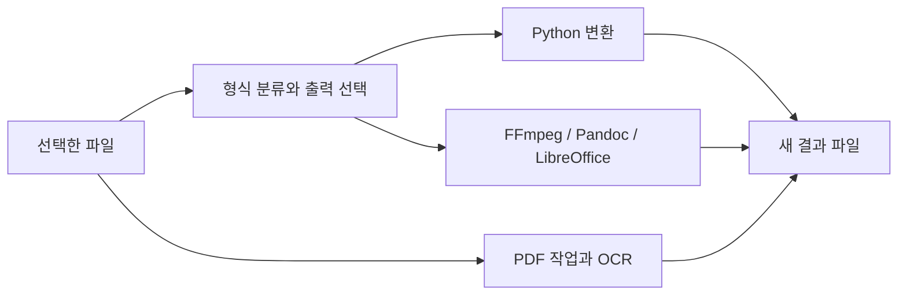
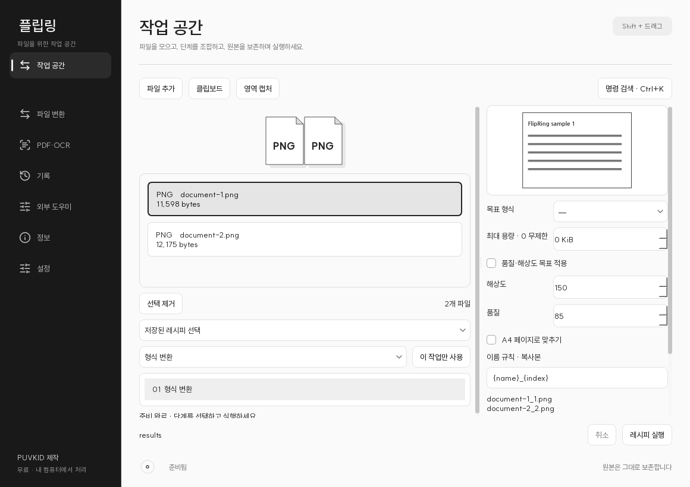
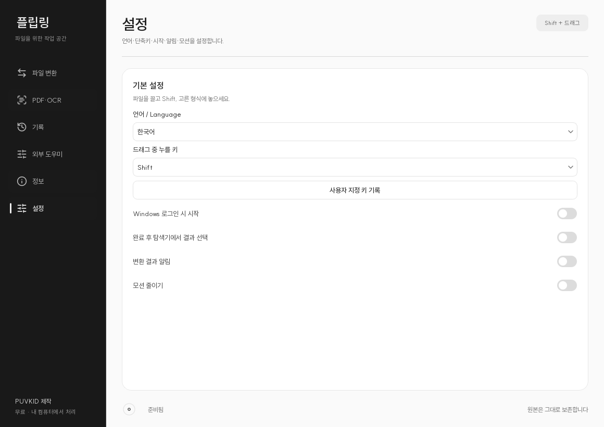

<a id="level-2--현재-111-안내의-기준"></a>
# FlipRing Project · LEVEL 2 - Explorer

> 11월 14일의 검사 기록은 당시 상태로 보존했습니다. 이후 확인한 제품과 납품 상태는 [2026년 11월 20일 확인 범위](#product-verification-20261120)에서 구분합니다.

<details>
<summary>다른 읽기 수준 선택</summary>

| 읽기 수준 | 설명의 초점 |
| --- | --- |
| [LEVEL 1 · Beginner](%EB%A0%88%EB%B2%A81.md) | 목적과 동작부터 |
| [LEVEL 2 · Explorer](%EB%A0%88%EB%B2%A82.md) 현재 | 구성과 연결 원리 |
| [LEVEL 3 · Practitioner](%EB%A0%88%EB%B2%A83.md) | 준비·실행·결과 확인 |
| [LEVEL 4 · Advanced](%EB%A0%88%EB%B2%A84.md) | 구현·설계·실패 처리 |
| [LEVEL 5 · Expert](%EB%A0%88%EB%B2%A85.md) | 근거·프로토콜·한계 검토 |

</details>

[같은 수준의 프로필](https://github.com/PUVKID/PUVKID/blob/main/docs/읽기안내/레벨2.md) · [프로젝트 첫 화면](../../README.md)

<a id="level-2--1121-문서-입력-보완"></a>

## 1.12.1 문서 입력 보완

| 항목 | 입력·처리 | 확인·주의 |
| --- | --- | --- |
| ABW | 허용된 DTD만 격리 사본에서 제거 | 다른 DTD·엔터티는 거부합니다. |
| DIF | 문자 인코딩을 순서대로 해석 | UTF-8 사본 이름이 충돌하면 덮어쓰지 않습니다. |
| HWP·HWPX | 전체·부분 그림 | 64×48 전체와 32×24 부분을 각 두 형식에서 비교했습니다. |


ABW의 정해진 DTD 선언만 안전 사본에서 제거하고 나머지 DTD와 엔터티는 거부합니다. DIF는 문자 인코딩을 순서대로 해석해 UTF-8 사본을 만듭니다. 파일 이름이 충돌하면 기존 파일을 덮어쓰지 않습니다.

HWP·HWPX 전체 그림의 마지막 줄이 잘리던 문제를 고쳤습니다. 64×48 전체 그림과 32×24 부분 자르기를 각 두 형식에서 읽어 원본 픽셀과 비교한 네 경로가 통과했습니다. 다른 모든 그림이나 뷰어의 동일성을 뜻하지 않습니다.

[같은 수준의 1.12.1 상세](../versions/1.12.1.md#reading-level-2) · [직전 전체 비교](../revision-audit/1.12.1.md)

<a id="current-guide-level-2"></a>
<a id="level-2--현재-1120"></a>
<a id="level-2--이전-1120"></a>

## 이전 1.12.0

| 역할·조건 | 동작과 확인할 내용 |
| --- | --- |
| 입력 수집과 제외 조건 | 파일·폴더를 수집하며 하위 폴더 구조를 유지하고 확장자 필터·중복 제거·숨김 및 임시 파일 제외를 적용합니다. |
| 실행 전 사전 점검 | 실행 전 지원 형식·누락 도구·입력 부재·보수적인 필요 공간을 점검합니다. |
| 대기열 설정 스냅샷 | 작업별 설정을 스냅샷으로 보관하므로 실행 중 새 파일이나 작업을 추가해도 이미 등록한 작업 설정을 바꾸지 않습니다. |
| 직렬 처리와 진행 상태 | 대기열은 등록한 작업을 차례대로 처리하고 파일별 상태와 전체 진행률을 표시합니다. |
| 일시 정지와 현재 작업 취소 | 일시 정지는 다음 작업부터 적용하며 현재 작업 중단은 취소 버튼을 사용합니다. |

실패한 입력만 다시 시도하고 ZIP 묶기만 실패하면 완료한 변환을 반복하지 않습니다.

이미지 전후·투명 배경·실제 바이트 절감량을 비교하며 PDF는 페이지 미리보기, 다른 문서는 파일 정보와 기존 문서 도구로 연결합니다.

[같은 수준의 1.12.0 상세](../versions/1.12.0.md#reading-level-2) · [프로젝트 첫 화면](../../README.md)

<a id="level-2--이전-111-안내의-기준"></a>

## 이전 1.11 안내의 기준

1.11·새개발배포 68 당시의 사용 안내입니다. 파일 선택·문서/PDF/OCR·작업공간·기록과 한계를 아래에서 이 수준으로 설명합니다. 이어지는 원격 보존 구역의 “현행·최신·HWP 미지원”은 1.9 기준 설명으로 구분합니다.

[현재 HWP 저장](#current-hwp-level-2) · [현재 검증과 미완료](#current-evidence-level-2) · [이전 원격 전체 설명](#legacy-project-level-2)

<a id="level-2--입력에서-결과까지-이어지는-구조"></a>

## 입력에서 결과까지 이어지는 구조

| 역할·조건 | 동작과 확인할 내용 |
| --- | --- |
| 파일과 보관 | 플립 링은 PUVKID가 만든 무료 로컬 Windows 파일 도구입니다. |
| 파일과 보관 | 사용자가 파일과 작업을 고르면 화면이 실행 요청을 만들고, 변환 엔진이 형식에 맞는 처리기를 선택하며, 결과를 새 파일로 전달합니다. |
| 파일과 보관 | 선택 가능한 형식, 필요한 도구, 실제 파일의 호환성은 서로 다른 조건입니다. |
| 입력과 처리 | DOCX라는 이름을 가졌어도 본문이 손상되면 처리할 수 없고, 입력을 읽을 수 있어도 같은 형식으로 저장하지 못할 수 있습니다. |
| 파일과 보관 | 기본 사용 흐름은 **파일 선택 → 형식 선택 → 변환**입니다. |

파일을 고르면 지원되는 출력이 연결되고 실행 후 파일별 대기·처리·완료·실패·취소를 확인합니다.

선택적인 탐색기 Shift 드래그는 같은 변환을 빠르게 요청하는 다른 진입점입니다.

원형 메뉴의 바깥 형식은 실행 선택, 가운데는 취소이며 기본 창 사용의 필수 조건이 아닙니다.

취소는 원본이나 먼저 완료한 다른 결과를 없애지 않습니다.

| 역할·조건 | 동작과 확인할 내용 |
| --- | --- |
| 저장 확인 | 일반 변환은 원본 폴더에 충돌을 피한 새 이름으로 저장합니다. |
| 반복 작업 구성 | 작업 공간은 별도 결과 폴더를 사용합니다. |
| 입력과 처리 | 따라서 결과 확인은 성공 표시만 읽는 것에서 끝나지 않고 **어느 입력에서 어떤 형식과 위치로 만들어졌는지** 확인하는 단계까지 이어집니다. |
| 파일과 보관 | 미리보기를 지원하는 형식은 원본·결과의 크기와 용량을 비교하고 그 밖에는 결과 파일을 직접 열어 확인합니다. |

<a id="level-2--기능과-도구가-연결되는-방식"></a>

## 기능과 도구가 연결되는 방식

이미지·문서·표·발표·영상·음성·압축·PDF는 한 화면에서 고르더라도 같은 엔진으로 처리되지 않습니다.

PDF의 페이지 순서 변경과 스캔 글자 인식도 별개입니다.

각 작업이 어떤 도구를 이용하는지 알면 준비 상태와 오류를 이해하기 쉽습니다.

| 처리 분야 | 배포물과 외부 환경의 관계 | 성공과 구분할 조건 |
|---|---|---|
| 그림·PDF | 이미지 변환·PDF 페이지 편집·렌더링 경로를 사용합니다. | 그림 생성, 페이지 수·순서·화질이 원하는지 확인합니다. |
| OCR | 배포물에 Tesseract 엔진과 한국어·영어 모델이 들어 있습니다. | 언어 모델이 있다고 인식 내용과 표 구조가 모두 정확한 것은 아닙니다. |
| 압축·RAR | 동봉 7-Zip 실행 구성요소를 사용하는 경로가 있습니다. | 지원되는 입력·출력 방향과 안전 경로 검증을 통과해야 합니다. |
| Office | LibreOffice는 별도 설치가 필요합니다. | 프로그램 존재와 실제 문서의 필터 호환은 다릅니다. |
| HWP·HWPX 읽기 | 별도 LibreOffice에 동봉 H2Orestart와 Java를 연결합니다.<br>Java 비트 수는 LibreOffice와 맞아야합니다. | 준비 상태가 정상이어도 모든 HWP 변종을 읽는 것은 아닙니다. |
| 전자책·일부 문서/영상·음성 | 해당 작업에는 Pandoc/FFmpeg를 각각 별도로 준비합니다. | 이 도구들을 배포 물에 모두 동봉했다고 설명하지 않습니다. |

소스만 받은 환경과 설치 배포 물은 다릅니다.

| 역할·조건 | 동작과 확인할 내용 |
| --- | --- |
| 사용 도구 | 소스 실행에는 Python·고정 의존성·자산과 위 도구 조건이 필요하며 설치 본에는 일부 런타임이 이미 들어 있습니다. |
| 사용 도구 | 실행 EXE 하나만 복사하면 동 봉 도구와 DLL이 빠질 수 있으므로 배포 폴더 구성을 유지합니다. |

<a id="level-2--문서-계열과-변환-방향"></a>

## 문서 계열과 변환 방향

| 항목 | 동작·조건 |
|---|---|
| 문서·표·발표 | Word·Excel·PowerPoint 계열과 OpenDocument를 구분합니다. |
| 방향 | DOC↔DOCX·XLS↔XLSX·PPT↔PPTX 등은 같은 계열의 왕복 경로입니다. |
| 제한 | XLSB·매크로·템플릿은 입력 전용이며 모든 기능의 무손실을 뜻하지 않습니다. |


Word 계열은 글 문서, Excel 계열은 시트와 셀, PowerPoint 계열은 슬라이드라는 서로 다른 구조를 가집니다.

플립 링은 계열을 구분해 저장 필터를 선택합니다.

DOC ↔DOCX, XLS ↔XLSX, PPT ↔PPTX가 대표 왕복 경로이며 각각 ODT·ODS·ODP 같은 OpenDocument도 다룹니다.

왕복 가능은 원본의 모든 기능이 손실 없이 돌아온다는 뜻이 아닙니다.

문서 입력에는 DOCM·DOT 계열, 발표에는 PPTM·POT·PPS 계열, 표에는 XLSB·XLSM·XLT 계열 등이 더 있습니다.

**XLSB·매크로·템플릿은 입력 전용**이며 매크로 실행을 지원하는 저장기가 아닙니다.

| 역할·조건 | 동작과 확인할 내용 |
| --- | --- |
| 입력과 처리 | 텍스트·Markdown·HTML·전자책과 일부 iWork·WordPerfect·AbiWord도 대표 입력에 포함되지만 전용 기능 호환은 문서마다 다릅니다. |
| 출력 결과 | 내용의 성격이 바뀌는 출력도 있습니다. |

CSV·TSV는 첫 시트의 표시 값만 남겨 다중 시트·수식·서식을 보존하지 않습니다.

이를 유지할 목적이면 XLSX·XLS·ODS를 고릅니다.

PPT →TXT는 슬라이드의 텍스트만 남기고 PDF·페이지 이미지는 시각적 내용을 전달하는 다른 선택입니다.

차트·글꼴·수식·쪽 배치를 결과에서 확인해야 합니다.

현대 XLSB 표본과 구분해 초기 Excel 2007 Beta2 XLSB 변종은 지원 완료에서 제외합니다.

| 역할·조건 | 동작과 확인할 내용 |
| --- | --- |
| 사용 도구 | 내용이 있는 시트를 도구가 빈 것으로 읽으면 오류를 알립니다. |
| 저장 확인 | 원래 작성 앱에서 최신 XLSX로 저장한 복사 본이 대안입니다. |
| 저장 확인 | 복잡한 그림 개체가 있는 구형 HWP도 일부 불러오기 오류가 있어 HWPX·DOCX·PDF로 새 저장한 복사 본을 사용할 수 있습니다. |

HWP 경로는 두 가지로 나뉩니다.

| 역할·조건 | 동작과 확인할 내용 |
| --- | --- |
| 저장 확인 | DOCX·TXT·HWP5·HWPX → HWP·HWPX 저장은 앱의 별도 변환 프로세스와 python-hwpx 6.12.0을 사용합니다. |
| 출력 결과 | **HWP·HWPX → PDF·DOCX 등 기존 출력**은 LibreOffice·H2Orestart·Java 경로를 유지합니다. |

같은 확장자는 변환 목표에서 빠집니다.

새 저장은 소스 35 독립 검사와 배포 68의 portable/installed 고정 DOCX 각 1 시험을 통과했습니다.

실제 사용자 PNG/HWP 및 HWPX Shift 추가 확인 대기는 별도입니다.

단순 문단·직사각형 표·PNG/JPEG 그림이 주 대상이며 병합 표·수식·주석·떠 있는 그림 등은 내용을 지운 채 성공시키지 않고 거부합니다.

<a id="level-2--pdf-구조-변경과-ocr-내용-추정의-차이"></a>

## PDF 구조 변경과 OCR 내용 추정의 차이

| 역할·조건 | 동작과 확인할 내용 |
| --- | --- |
| 파일과 보관 | PDF 합치기는 파일 순서를 이어 붙이고, 나누기·추출·삭제·회전은 지정 페이지를 대상으로 구조를 바꿉니다. |
| 화면 확인 | 이 네 작업의 **페이지 범위는 기본 화면**, 회전 각도도 기본 화면에 표시됩니다. |
| 범위 확인 | `1,3-5`는 1 쪽과 3~5 쪽을 뜻하는 범위 예입니다. |

전체 페이지 삭제는 거부합니다.

썸네일 드래그 순서, 다중 선택, 확대 보기는 페이지를 확인하는 수단입니다.

| 역할·조건 | 동작과 확인할 내용 |
| --- | --- |
| 출력 결과 | PDF →이미지는 출력 형식을 기본 화면에서 선택하고 페이지 범위·DPI·품질은 고급 옵션에서 조정합니다. |
| PDF 작업과 옵션 | 이미지 →PDF는 파일 순서가 기본이고 DPI는 세부 조건입니다. |
| 관측과 모델의 역할 | OCR은 언어와 출력이 기본이며 페이지 범위·DPI·인식 배치·강제 인식 같은 항목은 고급에서 조절합니다. |
| 범위 확인 | 따라서 페이지 범위를 전부 고급 기능으로 묶으면 잘못된 설명이 됩니다. |
| 관측과 모델의 역할 | OCR은 글자의 위치와 모양에서 텍스트를 추정합니다. |

검색 PDF는 페이지 이미지와 인식 글자 층을 결합하며 원래 문서의 편집 구조를 복원하지 않습니다.

검토 화면에서 단어 위치·확신도와 낮은 확신도 후보를 보고 텍스트를 고친 뒤 TXT·PDF·DOCX·XLSX로 저장할 수 있습니다.

표의 행 열·병합 셀·수식·다 단 문서는 특히 대조가 필요합니다.

무손실 PDF 정리는 파일 크기 감소를 보장하지 않고, 이미지 방식 압축은 화질을 잃을 수 있습니다.

DPI를 높이면 페이지 이미지와 처리량이 커질 수 있습니다.

암호화·손상 파일은 오류로 구분합니다.

이런 한계는 출력 파일이 존재한다는 사실만으로 사라지지 않습니다.

<a id="level-2--작업-공간에서-입력순서목표를-조합하기"></a>

## 작업 공간에서 입력·순서·목표를 조합하기

| 역할·조건 | 동작과 확인할 내용 |
| --- | --- |
| 반복 작업 구성 | 작업 공간의 파일 카드는 실제 입력과 순서를 나타냅니다. |
| 입력과 처리 | PDF 합치기·이미지 PDF·콜라주·GIF·워터마크·영수증 OCR 표 XLSX 같은 작업을 선택하면 같은 입력 목록도 다른 결과가 됩니다. |
| 입력과 처리 | Ctrl+K 명령 검색은 이 기능으로 가는 길이며, 클립보드의 파일·그림·텍스트와 사용자가 직접 시작한 영역 캡처도 입력이 됩니다. |

이름 규칙은 `{name}`·`{index}`·`{date}`로 **이름 바꾼 복사본**을 만드는 작업입니다.

원본을 개명해 없애지 않습니다.

| 역할·조건 | 동작과 확인할 내용 |
| --- | --- |
| 저장 확인 | 레시피는 허용된 작업 단계와 순서를 저장한 설정입니다. |
| 저장 확인 | 단계를 추가·삭제·재정렬하고 JSON으로 저장·가져오기·내보내기하며, 휠에서 레시피를 호출할 수도 있습니다. |
| 파일과 보관 | 파일의 실제 처리 결과와 레시피 저장 성공은 서로 다릅니다. |
| 출력 결과 | 목표는 출력 형식·품질·DPI·용량 상한·A4 페이지 규격을 연결합니다. |

예를 들어 더 작은 PDF를 원해도 품질과 내용 때문에 목표 용량에 도달하지 못할 수 있습니다.

미달성 경고와 생성 결과를 보존하고 목표 달성 성공과 구분합니다.

| 역할·조건 | 동작과 확인할 내용 |
| --- | --- |
| 반복 작업 구성 | 작업 공간은 기본 앱 데이터 아래 `results`에 저장하고 고급에서 결과 폴더를 바꿉니다. |
| 파일과 보관 | 결과 파일·경로 복사와 결과 드래그로 다른 작업에 연결합니다. |
| 파일과 보관 | 감시 폴더는 사용자가 켠 폴더에서 크기·수정 시각이 안정된 새 파일에 레시피를 적용합니다. |
| 파일과 보관 | 결과·임시 파일과 재처리 루프를 피하는 조건이 중요합니다. |

휠 개인화는 지원 형식 순서·숨김·레시피를 조절하며 기본값 복구와 중앙 취소 의미를 유지합니다.

이 선택 기능들은 기본 변환의 필수 준비가 아닙니다.

<a id="level-2--비교와-가림은-사용자의-검토를-돕습니다"></a>

## 비교와 가림은 사용자의 검토를 돕습니다

두 파일 비교는 페이지 수·크기·텍스트와 실제 미리보기를 함께 검토하는 기능입니다.

빈 페이지·중복·흐림·가장자리 내용·개인정보 후보도 검토용 단서입니다.

자동 후보가 전부 사실이라는 뜻도, 후보가 없으면 안전하다는 뜻도 아닙니다.

사용자가 고른 영역은 새 PDF·이미지 복사본에서 실제 픽셀로 가립니다.

원본이나 다른 사본을 삭제하지 않으므로 공유 전에는 새 파일의 모든 페이지와 텍스트를 따로 확인해야 합니다.

OCR 교정·비교·후보 확인·가림은 서로 이어 쓸 수 있지만 완전 탐지나 문서 의미의 자동 인증을 제공하지 않습니다.

<a id="level-2--화면설정내부-처리의-관계"></a>

## 화면·설정·내부 처리의 관계

현재 시작 화면은 간단한 파일 변환이고 작업 공간은 별도 메뉴에 남아 있습니다.

프리셋은 형식과 옵션을 재사용하며 과거 경로를 자동 재실행하지 않습니다.

| 역할·조건 | 동작과 확인할 내용 |
| --- | --- |
| 파일과 보관 | 기록은 검색·필터·파일/경로 복사를 지원하고 결과 왼쪽 더블클릭은 파일 실행 대신 탐색기 선택을 요청합니다. |
| 기록 확인 | 경로와 오류가 포함된 기록을 그대로 공개하지 마세요. |

앱은 흑백·회색·SUIT와 한국어/영어, 모션 축소를 유지합니다.

1160×820 논리 크기와 실제 모니터 픽셀은 같지 않으며 작은 화면에서는 맞춤·스크롤이 필요합니다.

모션은 실제 선택·처리·완료 상태를 따라가고 진행을 알 수 없을 때 임의 백분율을 만들지 않습니다.

트레이·자동 시작 설정은 일반 문서 변환 조건과 별개입니다.

문서 처리에는 일 회용 LibreOffice 프로필을 씁니다.

매크로·능동 콘텐츠·외부 갱신을 제한하고 OpenCL을 그 프로필에서 끕니다.

| 역할·조건 | 동작과 확인할 내용 |
| --- | --- |
| 파일과 보관 | 순수 Python 도우미 세 파일만 별도 위치에 두고 LibreOffice Python을 `-B`로 실행해 앱의 다른 Python 버전 확장과 충돌하지 않게 합니다. |
| 설정 확인 | 사용자 전역 LibreOffice 설정을 바꾸지 않습니다. |
| 사용 도구 | 외부 도구 취소는 작업별 소유 프로세스와 후손 정리 확인으로 이어집니다. |

<a id="level-2--결과와-배포-상태를-함께-읽기"></a>

## 결과와 배포 상태를 함께 읽기

이전 배포 55 또는 이전 소스 시점의 보존 관측입니다.

새 68의 근거는 이 페이지 현재 검증 절과 구분합니다.

현재 소스의 문서 검사 51개와 실제 배포 55의 내장 19 모듈·설치 1178 파일 대조, 독립 배포 대조가 통과했습니다.

자체 생성 DOCX·JPG를 사용자가 실제 앱으로 조작한 PDF·PNG 생성, 원본 보존, 가운데 취소도 확인했습니다.

소스 검사·패키지 대조·물리 조작은 서로 다른 증거이며 모든 입력의 호환성을 증명하지 않습니다.

| 역할·조건 | 동작과 확인할 내용 |
| --- | --- |
| 검증 확인 | 기존 개발 배포 55의 검증과 아직 교체하지 않은 최종 폴더의 배포 26은 별도 객체입니다. |
| 저장 확인 | 현재 HWP 저장 추가 소스로 문서 51·기존 163·확장 86 검사가 통과했습니다. |

새 HWP 배포 68의 빌드·설치·고정 표본은 확인했습니다.

최종 교체·GitHub/Release·중앙 완료·HWPX Shift 추가 확인은 남아 있습니다.

실행·설치 파일은 코드 서명이 없으며 전체 소스 ZIP과 GitHub 자동 ZIP은 다릅니다.

확인된 프로젝트 논문이나 원고는 없습니다.

<a id="level-2--전체-차수와-원문을-읽는-순서"></a>

## 전체 차수와 원문을 읽는 순서

아래 17 행은 완전 배포 본·작업 전 부분 보존·현행 소스·고유자료를 구분합니다.

같은 수준 상세 목표로 연결하고 자료 폴더와 전체 비교는 원문 역할을 유지합니다.

당시의 기능·CLI·의존성·검사 결과를 현행에 소급하지 않습니다.

연결 목표의 수준별 본문은 로컬 후보이며 현재 페이지 작성만으로 원격 연결이 완료된 것은 아닙니다.

| 차수·자료 | 자료 폴더 | 같은 수준 상세 | 전체 비교·범위 | 이 수준에서 확인할 범위 |
|---|---|---|---|---|
| 1.2.0 | [자료](../../history/1.2.0) | [설명](../../docs/versions/1.2.0.md#reading-level-2) | [비교](../../docs/revision-audit/1.2.0.md) | 분류와 Shift 요청·트레이·한 영·PDF의 초기 관계.<br>직전 완전 원본은 확인되지 않습니다. |
| 부드러운디자인-작업전 | [자료](../../history/부드러운디자인-작업전) | [설명](../../docs/versions/부드러운디자인-작업전.md#reading-level-2) | [비교](../../docs/revision-audit/부드러운디자인-작업전.md) | app/PDF/GUI 일부만 남아 전체 배포를 복원한 자료가 아닙니다. |
| 버튼모션-작업전 | [자료](../../history/버튼모션-작업전) | [설명](../../docs/versions/버튼모션-작업전.md#reading-level-2) | [비교](../../docs/revision-audit/버튼모션-작업전.md) | 버튼 상태 반응의 작업 전 일부 자료이며 후속 개선을 소급하지 않습니다. |
| 콤보-작업전 | [자료](../../history/콤보-작업전) | [설명](../../docs/versions/콤보-작업전.md#reading-level-2) | [비교](../../docs/revision-audit/콤보-작업전.md) | 드롭다운 선택 상태와 입력의 관계를 보는 부분 기준입니다. |
| 탭잔상-작업전 | [자료](../../history/탭잔상-작업전) | [설명](../../docs/versions/탭잔상-작업전.md#reading-level-2) | [비교](../../docs/revision-audit/탭잔상-작업전.md) | 탭 전환 표시와 잔상 문제를 이해하는 부분 기준입니다. |
| 호버대비-작업전 | [자료](../../history/호버대비-작업전) | [설명](../../docs/versions/호버대비-작업전.md#reading-level-2) | [비교](../../docs/revision-audit/호버대비-작업전.md) | 호버·대비와 가독성의 관계를 보는 부분 기준입니다. |
| 1.4.0 | [자료](../../history/1.4.0) | [설명](../../docs/versions/1.4.0.md#reading-level-2) | [비교](../../docs/revision-audit/1.4.0.md) | 스튜디오 재설계 전 구성으로 확인된 1.2와 비교하며 없는 중간 차수를 만들지 않습니다. |
| 내부모션-작업전 | [자료](../../history/내부모션-작업전) | [설명](../../docs/versions/내부모션-작업전.md#reading-level-2) | [비교](../../docs/revision-audit/내부모션-작업전.md) | studio_ui가 있는 내부모션 전 11Python 자료로 완전 1.5라고 부르지 않습니다. |
| 1.6.0 | [자료](../../history/1.6.0) | [설명](../../docs/versions/1.6.0.md#reading-level-2) | [비교](../../docs/revision-audit/1.6.0.md) | 공통 선택창·메뉴·메시지·입력과 유한모션의 연결입니다. |
| 1.7.0 | [자료](../../history/1.7.0) | [설명](../../docs/versions/1.7.0.md#reading-level-2) | [비교](../../docs/revision-audit/1.7.0.md) | 프리셋·사전 점검·큐·PDF 편집이 반복 입력을 줄이는 관계입니다. |
| 1.8.0 | [자료](../../history/1.8.0) | [설명](../../docs/versions/1.8.0.md#reading-level-2) | [비교](../../docs/revision-audit/1.8.0.md) | 논리창·DPR·스크롤·영역구분과 상태모션을 연결합니다. |
| 1.9.0 | [자료](../../history/1.9.0) | [설명](../../docs/versions/1.9.0.md#reading-level-2) | [비교](../../docs/revision-audit/1.9.0.md) | 입력카드→레시피/목표→결과/검토로 확장되며 후보·용량한계가 있습니다. |
| 1.10.0 | [자료](../../history/1.10.0) | [설명](../../docs/versions/1.10.0.md#reading-level-2) | [비교](../../docs/revision-audit/1.10.0.md) | 문서 계열·필터를 확장한 이력.<br>당시 44 관측·통합 7시간 초과를 보존합니다. |
| 1.11.0 | [자료](../../history/1.11.0) | [설명](../../docs/versions/1.11.0.md#reading-level-2) | [비교](../../docs/revision-audit/1.11.0.md) | 1.11 당시 간단 시작·고급 옵션·문서 프로필·Python 격리를 연결한 설명입니다. |
| 1.12.0 | [자료](../../history/1.12.0/) | [설명](../versions/1.12.0.md#reading-level-2) | [비교](../revision-audit/1.12.0.md) | 빠른 작업·폴더 변환·테마·앱 내 도구 설치의 구현과 확인 범위를 구분합니다. |
| 최종 | [자료](../../소스) | [설명](../../docs/versions/최종.md#reading-level-2) | [비교](../../docs/revision-audit/최종.md) | 같은 1.11의 납품 구성이며 새 버전이 아닙니다.<br>이전 최종 26·새개발 68·교체대기를 구분합니다. |
| 현행소스 | [자료](../../소스) | [설명](../../docs/revision-audit/현행소스.md#reading-level-2) | [비교](../../docs/revision-audit/현행소스.md) | 현재 소스의 역할과 이전공개원문의 전체비교는 다른 관점입니다. |
| 고유 작업 코드·문서 | [자료](../../보존자료/작업소스) | [설명](../../docs/SOURCE_MATERIALS.md#reading-level-2) | [비교](../../docs/2026-11-02_공개반영재개검증.md) | 부분작업·고유코드·상응소스는 직선적인 새버전열이 아닙니다. |

<a id="current-hwp-level-2"></a>
<a id="level-2--hwp-제한-저장의-선택절차검증-경계"></a>

## HWP 제한 저장의 선택·절차·검증 경계

| 역할·조건 | 동작과 확인할 내용 |
| --- | --- |
| 파일과 보관 | 새 저장은 구조 검사 →제한 내용 매핑 →앱 Python worker →결과 JSON/경로/해시 확인 →새 파일 게시로 이어집니다. |
| 입력과 처리 | 입력 DOCX/TXT/HWP5/HWPX와 목표 HWP/HWPX를 한정하고 같은 확장자를 제외합니다. |

기존 HWP 읽기의 Office 경로와 분리해 앱/LibreOffice Python 확장을 섞지 않습니다.

코어 20은 구조·내용 손실·외부 참조 거부, worker12는 메시지와 실제 소유 자식/후손 종료, 고정 1은 한글·3×3 셀·PNG bytes·64×48 RGB 마지막 행, 미지 2는 저장 전 거부·출력 없음·원본 보존을 확인합니다.

단순 문단·비병합 직사각형 표·PNG/JPEG 밖의 구조는 거부하며 HWP5 실험적 쓰기·글꼴/쪽배치·메타데이터 처리 한계가 남습니다.

같은 라이브러리 재개방과 외부뷰어 렌더 검증은 다릅니다.

<a id="current-evidence-level-2"></a>


<a id="level-2새-배포-68의-현재-확인과-남은-절차"></a>

## 새 배포 68의 현재 확인과 남은 절차

| 역할·조건 | 동작과 확인할 내용 |
| --- | --- |
| 입력과 처리 | 현재 근거는 소스 검사 →frozen 배포 대조 →실제 설치 →사용자 입력으로 나뉩니다. |
| 저장 확인 | HWP35는 독립 직접 실행 20 +12 +1 +2이고 문서 51·기존 163·확장 86은 부모 실행 및 독립 저장 근거 대조입니다. |
| 파일과 보관 | 배포 68의 내장 21 모듈·데이터 9, runtime1207 파일과 ZIP948 항목이 원본과 맞습니다. |

실제 설치는 1207 runtime +uninstaller2를 대조하고 창 응답·소유 잠금을 확인했습니다.

새 사용자 시험의 파일·성공 기록은 PNG와 HWP입니다.

원본 2개와 RGB·한글·표·그림이 대조됐고 중앙 취소는 사용자가 확인했습니다.

답변의 HWPX와 실제 HWP가 달라 Shift HWPX는 추가 확인 대기입니다.

portable/installed 고정 DOCX 각 1 시험의 HWPX 출력 PASS와 같은 근거로 취급하지 않습니다.

최종 교체·중앙 gate·GitHub/Release는 남아 있습니다.

<a id="level-2--새-배포-파일을-대조하는-값"></a>

## 새 배포 파일을 대조하는 값

실행 파일·설치 파일·전체 소스 ZIP은 별도 객체입니다.

같은 배포의 파일을 크기와 해시로 연결하며 내용 검수·사용자 확인은 별도입니다.

| 파일 | 바이트 | SHA-256 |
| --- | ---: | --- |
| `프로그램/FlipRing/FlipRing.exe` | 9585792 | `9dfa98ef7ab9778ffc686e7c560f928aeff06e02d120cff8575733313f5c09d3` |
| `설치파일/FlipRing-Setup.exe` | 178176550 | `28a976afca70842b0e06b4a8e6c0c570388e8320e4d1eb1b8998b9189bd5ab5e` |
| `플립링-1.11.0-전체소스.zip` | 671431794 | `156708240f854b7af8917d3f46d059f83cc92e548a698219d4726e92d8becf0a` |

| 역할·조건 | 동작과 확인할 내용 |
| --- | --- |
| 파일과 보관 | 실행 구성 1207 파일 478350675B, 소스 ZIP948 항목·해제합계 809141540B를 대조했습니다. |
| 실행 확인 | 상응 소스 10개 528499332B는 실행 구성에서 분리해 전체 소스 ZIP에 원 바이트로 보존합니다. |

python-hwpx6.12.0의 Apache-2.0 LICENSE·NOTICE·METADATA와 정확 상응 소스, 기존 법적 고지를 유지합니다.

파일 용량으로 속도·RSS·외부뷰어 렌더일치 효과를 계산하지 않습니다.

<a id="legacy-project-level-2"></a>


<a id="level-2--19-기준-원격-안내와-전체-원문-보존"></a>

## 1.9 기준 원격 안내와 전체 원문 보존

여기부터 아래는 원격 874b2f1의 기존 설명을 보존한 구역입니다. 아래 “현재·최신·현행”과 HWP 미지원 문장은 이 구역의 1.9 기준 소스를 뜻합니다.

위의 현재 1.11 문서 지원·HWP 제한 저장·배포 68 상태와 구분합니다.

| 역할·조건 | 동작과 확인할 내용 |
| --- | --- |
| 사용 자료 | 기존 모바일 문단·실질 기능·표·코드·이미지·14개 자료 연결·이력은 생략하지 않았습니다. |
| 사용 자료 | 새 사용 절차와 전체 17 자료는 [현재 안내](#current-guide-level-2)에서 읽습니다. |

<!-- legacy-remote-874-start -->

## LEVEL 2 · 프로젝트 소개와 읽는 방법

파일 선택·가능 형식 판별·옵션·사전 점검·작업 큐·결과 보존의 흐름으로 읽습니다. 후속 작업 공간은 파일별 작업과 여러 처리 순서를 레시피로 묶고 OCR 검토를 연결합니다.

## LEVEL 2 · 실제 기능과 동작 범위

| 확인할 항목 | 본문의 핵심 조건 |
| --- | --- |
| 기능·동작 | 프리셋은 옵션 재사용, 레시피는 처리 순서, 감시 폴더는 안정된 새 파일의 반복 입력을 맡습니다.<br>PDF 편집·OCR·이미지 변환은 입출력과 품질 한계가 다릅니다. |
| 입력·처리·출력 | 형식 분류와 기능별 도구 선택을 거쳐 옵션이 처리 요청으로 전달됩니다.<br>PDF와 일반 변환은 별도 큐이지만 동시 실행하지 않는 구성입니다. |
| 결과·한계 | 품질 결과와 기능 검사 수·렌더 수는 다른 근거입니다. 249개 회귀와 설치 제품 626 파일 대조를 모든 문서 변환 품질의 측정으로 읽지 않습니다. |


프리셋은 옵션 재사용, 레시피는 처리 순서, 감시 폴더는 안정된 새 파일의 반복 입력을 맡습니다. PDF 편집·OCR·이미지 변환은 입출력과 품질 한계가 다릅니다.

기능 사이에서 자료와 상태가 어떻게 이어지는지 함께 읽습니다.

**기능별 공통 근거**

파일 변환부터 PDF 정리까지 한 화면에서 이어서 할 수 있도록 만든 도구입니다.

플립링은 파일 형식을 분류해 가능한 출력 형식을 보여주고, Python 라이브러리 또는 외부 변환 도구로 작업을 수행합니다. PDF 화면에서는 페이지 편집과 OCR 작업을 별도로 제공합니다.

| 기능 | 구현 내용 |
| --- | --- |
| 파일 변환 | 이미지·문서·오디오·비디오·표·자막·압축 형식 처리 |
| 원형 메뉴 | 지원 형식 선택과 트레이 중심의 Windows 인터페이스 |
| PDF 편집 | 병합·분할·추출·삭제·회전·압축 |
| PDF·이미지 변환 | 이미지를 PDF로 묶거나 PDF 페이지를 이미지로 저장 |
| OCR | Tesseract를 이용한 한국어·영어 인식과 문서 출력 |
| 결과 보존 | 기존 이름과 충돌하면 새 이름으로 출력 |



## LEVEL 2 · 입력에서 처리와 출력까지

형식 분류와 기능별 도구 선택을 거쳐 옵션이 처리 요청으로 전달됩니다. PDF와 일반 변환은 별도 큐이지만 동시 실행하지 않는 구성입니다.

| 단계 | 이 프로젝트에서 다루는 내용 |
| --- | --- |
| 입력 | 로컬 이미지·문서·미디어·PDF |
| 처리 | PySide6 UI, 변환 엔진·외부 도구, 페이지 편집·Tesseract OCR |
| 출력 | 새 형식 파일·편집 PDF·인식 문서 |


---

## LEVEL 2 · 사용·실험 순서와 확인 방법

파일 분류 → 목표·페이지·품질 선택 → 사전 점검 → 큐 → 새 결과 저장 → 실제 문서 검토 순서입니다. 후속 작업 공간에서는 여러 단계를 레시피로 구성할 수 있습니다.

## LEVEL 2 · 결과와 한계를 해석하는 기준

품질 결과와 기능 검사 수·렌더 수는 다른 근거입니다. 249개 회귀와 설치 제품 626 파일 대조를 모든 문서 변환 품질의 측정으로 읽지 않습니다.

## LEVEL 2 · 구현과 핵심 파일을 연결해 읽기

flipring_workflow는 프리셋·사전 점검, preview/pdf _pages는 미리 보기·페이지, workspace는 레시피·감시·검색을 맡습니다. 파일별 상태와 실제 작업 모션을 연결합니다.

## LEVEL 2 · 용어와 실수하기 쉬운 구분

파일 변환은 원본을 읽어 다른 형식의 새 파일을 만드는 일입니다.

PDF 페이지 편집은 문서의 일부 쪽을 합치거나 나누고 회전하는 작업입니다.

OCR은 이미지 속 글자를 인식하는 기능이며 원래 문서 배치를 완벽히 복구한다는 뜻은 아닙니다.

프리셋은 자주 쓰는 옵션, 레시피는 여러 처리의 순서, 작업 큐는 기다리는 작업의 목록입니다.

Qt·PySide6는 창과 화면을 만드는 도구입니다.

**원본을 보존한 새 결과 저장과 로컬 처리**를 기본으로 합니다. OCR·표 열 복원·개인정보 후보 검토는 완전한 품질·탐지를 보장하지 않습니다. 부분 보관본은 독립 설치 제품이 아니며 기능별 외부 도구·글꼴·언어 자료가 필요합니다.

## LEVEL 2 · 전체 차수와 같은 수준의 상세 설명

차수 이름은 실제 보관 단위를 따릅니다. 부분본·시험 도구·최종 안내는 제품 버전과 구분하며, 폴더와 직전 비교를 함께 연결합니다.

| 차수·자료 | 자료 폴더 | 이 수준의 차수 설명 | 직전 비교·범위 |
| --- | --- | --- | --- |
| 1.2.0 | [자료](../../history/1.2.0) | [LEVEL 2 - Explorer](../versions/1.2.0.md#reading-level-2) | [전체 비교](../revision-audit/1.2.0.md) |
| 부드러운디자인-작업전 | [자료](../../history/%EB%B6%80%EB%93%9C%EB%9F%AC%EC%9A%B4%EB%94%94%EC%9E%90%EC%9D%B8-%EC%9E%91%EC%97%85%EC%A0%84) | [LEVEL 2 - Explorer](../versions/%EB%B6%80%EB%93%9C%EB%9F%AC%EC%9A%B4%EB%94%94%EC%9E%90%EC%9D%B8-%EC%9E%91%EC%97%85%EC%A0%84.md#reading-level-2) | [전체 비교](../revision-audit/%EB%B6%80%EB%93%9C%EB%9F%AC%EC%9A%B4%EB%94%94%EC%9E%90%EC%9D%B8-%EC%9E%91%EC%97%85%EC%A0%84.md) |
| 버튼모션-작업전 | [자료](../../history/%EB%B2%84%ED%8A%BC%EB%AA%A8%EC%85%98-%EC%9E%91%EC%97%85%EC%A0%84) | [LEVEL 2 - Explorer](../versions/%EB%B2%84%ED%8A%BC%EB%AA%A8%EC%85%98-%EC%9E%91%EC%97%85%EC%A0%84.md#reading-level-2) | [전체 비교](../revision-audit/%EB%B2%84%ED%8A%BC%EB%AA%A8%EC%85%98-%EC%9E%91%EC%97%85%EC%A0%84.md) |
| 콤보-작업전 | [자료](../../history/%EC%BD%A4%EB%B3%B4-%EC%9E%91%EC%97%85%EC%A0%84) | [LEVEL 2 - Explorer](../versions/%EC%BD%A4%EB%B3%B4-%EC%9E%91%EC%97%85%EC%A0%84.md#reading-level-2) | [전체 비교](../revision-audit/%EC%BD%A4%EB%B3%B4-%EC%9E%91%EC%97%85%EC%A0%84.md) |
| 탭잔상-작업전 | [자료](../../history/%ED%83%AD%EC%9E%94%EC%83%81-%EC%9E%91%EC%97%85%EC%A0%84) | [LEVEL 2 - Explorer](../versions/%ED%83%AD%EC%9E%94%EC%83%81-%EC%9E%91%EC%97%85%EC%A0%84.md#reading-level-2) | [전체 비교](../revision-audit/%ED%83%AD%EC%9E%94%EC%83%81-%EC%9E%91%EC%97%85%EC%A0%84.md) |
| 호버대비-작업전 | [자료](../../history/%ED%98%B8%EB%B2%84%EB%8C%80%EB%B9%84-%EC%9E%91%EC%97%85%EC%A0%84) | [LEVEL 2 - Explorer](../versions/%ED%98%B8%EB%B2%84%EB%8C%80%EB%B9%84-%EC%9E%91%EC%97%85%EC%A0%84.md#reading-level-2) | [전체 비교](../revision-audit/%ED%98%B8%EB%B2%84%EB%8C%80%EB%B9%84-%EC%9E%91%EC%97%85%EC%A0%84.md) |
| 1.4.0 | [자료](../../history/1.4.0) | [LEVEL 2 - Explorer](../versions/1.4.0.md#reading-level-2) | [전체 비교](../revision-audit/1.4.0.md) |
| 내부모션-작업전 | [자료](../../history/%EB%82%B4%EB%B6%80%EB%AA%A8%EC%85%98-%EC%9E%91%EC%97%85%EC%A0%84) | [LEVEL 2 - Explorer](../versions/%EB%82%B4%EB%B6%80%EB%AA%A8%EC%85%98-%EC%9E%91%EC%97%85%EC%A0%84.md#reading-level-2) | [전체 비교](../revision-audit/%EB%82%B4%EB%B6%80%EB%AA%A8%EC%85%98-%EC%9E%91%EC%97%85%EC%A0%84.md) |
| 1.6.0 | [자료](../../history/1.6.0) | [LEVEL 2 - Explorer](../versions/1.6.0.md#reading-level-2) | [전체 비교](../revision-audit/1.6.0.md) |
| 1.7.0 | [자료](../../history/1.7.0) | [LEVEL 2 - Explorer](../versions/1.7.0.md#reading-level-2) | [전체 비교](../revision-audit/1.7.0.md) |
| 1.8.0 | [자료](../../history/1.8.0) | [LEVEL 2 - Explorer](../versions/1.8.0.md#reading-level-2) | [전체 비교](../revision-audit/1.8.0.md) |
| 현행소스 | [자료](../../%EC%86%8C%EC%8A%A4) | [LEVEL 2 - Explorer](../revision-audit/%ED%98%84%ED%96%89%EC%86%8C%EC%8A%A4.md#reading-level-2) | [전체 비교](../revision-audit/%ED%98%84%ED%96%89%EC%86%8C%EC%8A%A4.md) |
| 고유 작업 코드·문서 | [자료](../../%EB%B3%B4%EC%A1%B4%EC%9E%90%EB%A3%8C/%EC%9E%91%EC%97%85%EC%86%8C%EC%8A%A4) | [LEVEL 2 - Explorer](../SOURCE_MATERIALS.md#reading-level-2) | [전체 비교](../2026-11-02_%EA%B3%B5%EA%B0%9C%EB%B0%98%EC%98%81%EC%9E%AC%EA%B0%9C%EA%B2%80%EC%A6%9D.md) |
| 1.9.0 | [자료](../../history/1.9.0) | [LEVEL 2 - Explorer](../versions/1.9.0.md#reading-level-2) | [전체 비교](../revision-audit/1.9.0.md) |

## LEVEL 2 · 논문·원고와 원본 자료의 범위

소프트웨어의 소스·사용 안내·검사·설치 및 권리 자료를 다룹니다. 보관된 앱 렌더·회귀 검사 수를 문서 변환 품질의 전수 측정이나 논문 성과로 바꾸지 않습니다. 기존 라이선스와 법적 자료는 원문을 유지합니다.

## LEVEL 2 · 원래 모든 세부 설명으로 이동하기

설정값·코드 예제·실패 조건·측정 범위·화면과 파일별 안내를 생략하지 않도록 첫 화면의 전체 본문을 아래에 함께 둡니다. 각 항목은 이 페이지의 공통 근거로 바로 이동합니다. 원문에 담긴 이전 차수 조건을 현재 실행 조건으로 자동 적용하지 않습니다.

| 첫 화면의 원래 항목 | 이 페이지의 전체 근거 |
| --- | --- |
| FlipRing Project | [원문 보기](#source-section-1) |
| 파일 선택부터 결과 보존까지 | [원문 보기](#source-section-2) |
| 최신차수에서 달라진 점 | [원문 보기](#source-section-3) |
| 작업 공간과 실제 작업 모션 | [원문 보기](#source-section-4) |
| 설치본과 공개 소스 | [원문 보기](#source-section-5) |
| 확인된 전체 버전과 보존 기준본 | [원문 보기](#source-section-6) |
| 이전 1.8 고정 창 설정 화면 | [원문 보기](#source-section-7) |
| 입력·처리·출력 | [원문 보기](#source-section-8) |
| 프로젝트 소개 | [원문 보기](#source-section-9) |
| 저장소 구성 | [원문 보기](#source-section-10) |
| 주요 기술과 처리 방식 | [원문 보기](#source-section-11) |
| 트레이와 원형 메뉴 | [원문 보기](#source-section-12) |
| 화면과 기록 | [원문 보기](#source-section-13) |
| PDF 작업과 인식 옵션 | [원문 보기](#source-section-14) |
| 빠른 시작 | [원문 보기](#source-section-15) |
| 입출력과 도구 구성 | [원문 보기](#source-section-16) |
| 로컬 설정과 검사 코드 | [원문 보기](#source-section-17) |
| 문제 해결 | [원문 보기](#source-section-18) |
| 모든 차수·보관본과 전체 차이 | [원문 보기](#source-section-19) |
| HWP·HWPX 지원 범위 | [원문 보기](#source-section-20) |
| 차수별 화면과 검증 이미지 | [원문 보기](#source-section-21) |

## LEVEL 2 · 항목별 자세한 풀이와 확인 지점

### LEVEL 2 · 파일 선택부터 결과 보존까지

이 항목의 설정과 자료 흐름은 다음 조건으로 연결됩니다. 같은 이름이 있어도 서로 다른 차수의 구성과 합치지 않습니다.

앱과 변환: `app.py`가 창·트레이·파일 선택을 연결하고 `engine.py`는 입력 종류와 가능한 목표 형식·외부 변환 도구를 판별합니다.

PDF와 사전 점검: `pdf_panel.py`와 `pdf_tools.py`는 PDF 요청을 구성·실행하며, `flipring_workflow.py`는 이름별 프리셋과 파일별 사전 점검을 맡습니다.

미리보기와 작업 공간: `preview_panel.py`·`pdf_pages.py`는 미리보기와 페이지 작업을, 후속 `workspace_core.py`·`workspace_ui.py`는 레시피·감시 폴더·검색 중심의 작업 공간을 구성합니다.

파일을 선택하고 목표 형식이나 작업, 페이지와 품질을 지정합니다. 필요한 도구와 입력·출력 공간을 확인한 뒤 작업 큐에서 처리하고 결과 파일을 엽니다. 변환 성공 표시가 OCR 문맥이나 행·열 복원 품질까지 보증하지는 않으므로 결과를 직접 확인합니다. 입력·출력 경로가 작업 기록에 남을 수 있습니다.

7.0부터 보존된 프리셋 검증 조건은 다음과 같습니다.

이름은 1~80 자이며 대소문자를 무시한 중복 이름을 거부합니다. convert/pdf 종류와 허용 옵션만 저장합니다.

PDF 회전 90/180/270·품질 20\~95·DPI 60\~600·PSM 3/6/11·OCR 언어 kor+eng/kor/eng를 검사합니다.

손상된 프리셋은 오류를 보존하고 덮어 쓰지 않습니다. 정상 저장만 임시 JSON의 flush/fsync·교체를 사용합니다.

사전 점검의 공간 값은 입력 4 배 +64MiB라는 보수적 추정입니다.

입력 부재·미지원 형식·외부 도우미 부재·공간 부족·쓰기 실패를 서로 다른 코드로 돌려 주므로 같은 오류로 뭉뚱그려 재시도하지 않습니다.

FFmpeg·LibreOffice·Tesseract 등은 선택한 기능에 필요한 경우 준비하고 원본은 별도 보존합니다.

9.0은 레시피·Ctrl +K 검색·사용자가 켜는 감시 폴더·OCR 교정·개인 정보 후보 검토를 확장합니다.

검증 기록의 249개 회귀와 설치 제품 626 파일 대조는 당시 범위의 검사이며 모든 문서의 변환 품질 측정은 아닙니다.

화면 수정 전 부분 본은 독립 설치 패키지가 아니므로 차수 표의 자료 성격을 먼저 확인합니다.

파일 선택·형식 판별·사전 점검·큐·새 파일 저장을 이어 주는 항목입니다.

**흐름과 개념:** 파일·목표·페이지·품질과 도우미·공간 상태를 먼저 확인한 뒤 결과 파일을 직접 엽니다. app/engine/PDF/workflow/preview/workspace 책임과 원본 보존·기록 경계를 분리합니다.

**이 항목에서 연결되는 실제 설명**

- 앱과 변환: `app.py`가 창·트레이·파일 선택을 연결하고 `engine.py`는 입력 종류와 가능한 목표 형식·외부 변환 도구를 판별합니다.
- PDF와 사전 점검: `pdf_panel.py`와 `pdf_tools.py`는 PDF 요청을 구성·실행하며, `flipring_workflow.py`는 이름별 프리셋과 파일별 사전 점검을 맡습니다.
- 미리보기와 작업 공간: `preview_panel.py`·`pdf_pages.py`는 미리보기와 페이지 작업을, 후속 `workspace_core.py`·`workspace_ui.py`는 레시피·감시 폴더·검색 중심의 작업 공간을 구성합니다.

파일을 선택하고 목표 형식이나 작업, 페이지와 품질을 지정합니다. 필요한 도구와 입력·출력 공간을 확인한 뒤 작업 큐에서 처리하고 결과 파일을 엽니다. 변환 성공 표시가 OCR 문맥이나 행·열 복원 품질까지 보증하지는 않으므로 결과를 직접 확인합니다. 입력·출력 경로가 작업 기록에 남을 수 있습니다.

1.7.0부터 보존된 프리셋 검증 조건은 다음과 같습니다.

- 이름은 1~80 자이며 대소문자를 무시한 중복 이름을 거부합니다. convert/pdf 종류와 허용 옵션만 저장합니다.
- PDF 회전 90/180/270·품질 20\~95·DPI 60\~600·PSM 3/6/11·OCR 언어 kor+eng/kor/eng를 검사합니다.
- 손상된 프리셋은 오류를 보존하고 덮어 쓰지 않습니다. 정상 저장만 임시 JSON의 flush/fsync·교체를 사용합니다.

사전 점검의 공간 값은 입력 4 배 +64MiB라는 보수적 추정입니다.

입력 부재·미지원 형식·외부 도우미 부재·공간 부족·쓰기 실패를 서로 다른 코드로 돌려 주므로 같은 오류로 뭉뚱그려 재시도하지 않습니다.

FFmpeg·LibreOffice·Tesseract 등은 선택한 기능에 필요한 경우 준비하고 원본은 별도 보존합니다.

1.9.0은 레시피·Ctrl +K 검색·사용자가 켜는 감시 폴더·OCR 교정·개인 정보 후보 검토를 확장합니다.

검증 기록의 249개 회귀와 설치 제품 626 파일 대조는 당시 범위의 검사이며 모든 문서의 변환 품질 측정은 아닙니다.

화면 수정 전 부분 본은 독립 설치 패키지가 아니므로 차수 표의 자료 성격을 먼저 확인합니다.

[이 항목의 전체 조건·원문](#source-section-2)

### LEVEL 2 · 최신차수에서 달라진 점

이 항목의 설정과 자료 흐름은 다음 조건으로 연결됩니다. 같은 이름이 있어도 서로 다른 차수의 구성과 합치지 않습니다.

**1.9.0 · 파일 작업 공간과 검토 도구**

파일을 모은 뒤 목표 형식·용량·페이지 규격과 처리 순서를 한 작업 공간에서 지정하도록 확장합니다. 원본을 보존한 새 결과 저장과 로컬 처리를 기본으로 합니다.

Ctrl+K 빠른 명령창, 이름 규칙 복사, 기록 검색·필터·복사와 휠 개인화를 연결합니다.

파일 카드에서 PDF·이미지 조합과 레시피를 구성하고, 사용자가 켠 감시 폴더에서 안정된 입력에 같은 처리 순서를 적용합니다.

OCR 교정·전후 비교·흐림/중복/개인 정보 후보 검토와 사용자가 확인한 영역 가림을 제공합니다. 후보 탐지가 모든 문제를 찾아내거나 OCR이 원래 문서 배치를 완전히 복원한다고 보장하지 않습니다.

클립보드와 사용자가 직접 시작한 화면 영역 캡처를 입력으로 받습니다. 실제 작업의 대기·실행·결과를 표시하고 모션 감소 설정을 유지합니다.

[1.9 구현·실제 검사·제한](../versions/1.9.0.md#reading-level-2) · [사용 안내](../../%EC%86%8C%EC%8A%A4/1.9-%ED%99%95%EC%9E%A5%EC%95%88%EB%82%B4.md) · [직전 1.8과 전체 비교](../revision-audit/1.9.0.md)




화면 자료는 Qt 가상 화면에서 만든 앱 렌더입니다. 실제 모니터 배율 변경·물리 Shift 드래그·프레임 속도 검증과 구분합니다. 전체 렌더 범위는 5 조건 160장, 대표 시각 검토는 9장으로 구분하며 이 첫 화면에는 개인 사용자 경로가 없는 한국어·영어 화면과 실제 작업 모션만 사용합니다.

새 실행 프로그램·설치 파일·전체 실행 자산과 법적 자료는 로컬 1.9 납품 폴더에서 제공합니다.

이 저장소는 제품 소스·검사 도구·안내와 기존 공개 자산·라이선스를 보관하며 대용량 실행·설치 바이너리를 새로 업로드하지 않습니다.

새 설치본의 실제 확인 결과와 파일 크기·해시는 [1.9 상세 기록](../versions/1.9.0.md#reading-level-2)에 연결합니다. [기존 회귀 도구](../../tools19/regression19.py) · [신규 검사 도구](../../tools19/new_suites19.py)는 실행 환경이 준비된 저장소의 `소스/`를 기준으로 동작합니다.

현행 공개 소스에 남아 있던 이전 버전의 자동 생성 `FlipRing.spec`·`installer.iss`는 기준 원문과 대조한 뒤 제거합니다.

새 `build.py`가 실제 빌드 경로에 맞춰 다시 생성하므로 별도로 보관된 이전 버전 설정을 새 버전에 사용하지 않습니다.

로컬 전체 소스의 새 생성 파일과 기존 역사 원문은 보존합니다.

두 공개 파일의 삭제도 전체 변경 비교에 포함합니다.

**1.8.0 · 고정 창과 세부 디자인**

기본 창을 1160×820 논리 픽셀로 고정하고 메뉴·작업·원본/결과의 구분을 보강했습니다.

파일·폴더 선택창, PDF 페이지 번호, 고배율 아이콘·미리보기와 작은 화면의 스크롤 접근을 보완했습니다.

[1.8 실제 변경·검증 범위](../versions/1.8.0.md#reading-level-2) · [화면 안내](../../%EC%86%8C%EC%8A%A4/1.8-%ED%99%94%EB%A9%B4%EC%95%88%EB%82%B4.md)

[163개 기능 검사와 모션 동기화 검증](../2026-11-02_%EA%B2%80%EC%82%AC%EC%8B%A4%ED%96%89%EA%B5%AC%EC%84%B1%EB%B3%B4%EC%99%84.md)을 별도로 기록했습니다. 이 후속 기록은 보존된 1.8.0 제품과 검사 실행에 관한 자료입니다.

개발 검증에 사용하는 [출력 수집기](../../tools/release_capture.py)와 [회귀 검사 전체 소스](../../tools/test_release_capture.py)도 함께 보관합니다.

**1.7.0 · 파일별 작업 흐름과 PDF 페이지 편집**

원본·결과 이미지 미리보기, 파일별 대기·완료·실패·취소와 실패만 재시도, 기본·사용자 프리셋을 연결했습니다.

PDF 실제 썸네일의 드래그 순서 변경·다중 선택·회전·삭제·추출·확대와 새 파일 저장을 추가했습니다.

입력·도우미·쓰기·공간 점검, 별도 설정 화면과 저장되는 모션 줄이기를 제공합니다.

기존 Shift 원형 메뉴, 원본 보존, PDF·한영 OCR, 언어 설정과 기록의 탐색기 선택을 유지합니다.

[1.7 변경과 검증 범위](../versions/1.7.0.md#reading-level-2) · [사용 방법과 검사 재현](../../%EC%86%8C%EC%8A%A4/1.7-%EC%83%88%EA%B8%B0%EB%8A%A5%EC%95%88%EB%82%B4.md)

**기본 구조** — 원형 메뉴·트레이와 변환·PDF 처리

원형 메뉴와 작업 큐를 중심으로 파일 변환과 PDF 처리를 연결했습니다.

app.py는 Shift를 누른 채 파일을 끄는 입력을 감시하고 원형 메뉴·트레이·작업 큐를 연결합니다. 일반 변환과 PDF 작업은 각각 단일 작업 스레드이며 두 큐를 동시에 실행하지 않습니다.

engine.convert는 파일 종류별 도구를 선택하고 같은 드라이브 임시 폴더에서 처리한 뒤 새 이름으로 이동합니다. 압축의 상위·절대 경로와 링크를 검사합니다.

pdf_tools와 pdf_panel은 페이지 추출·삭제·회전·압축·OCR 출력 옵션을 처리합니다. PDF 결과는 배타적 생성으로 덮어 쓰기를 피하며 OCR의 행·열은 글자 위치에서 추정합니다.

studio_ui·ui_motion은 화면과 유한 애니메이션을 구성합니다. 최근 기록은 입력·출력·오류를 최대 200개 보관하므로 운영 파일 경로를 포함할 수 있습니다.

1.2.0·설치 구성의 AppVersion =1.2.0으로 확인한 이전 Mono 소스·[폴더](../../history/1.2.0) · [설명](../versions/1.2.0.md#reading-level-2) · 직전 비교 대상·순서 근거 없음

부드러운디자인-작업전 · app·PDF 화면·GUI 검사만 남은 부분 기준본 · [폴더](../../history/%EB%B6%80%EB%93%9C%EB%9F%AC%EC%9A%B4%EB%94%94%EC%9E%90%EC%9D%B8-%EC%9E%91%EC%97%85%EC%A0%84) · [설명](../versions/%EB%B6%80%EB%93%9C%EB%9F%AC%EC%9A%B4%EB%94%94%EC%9E%90%EC%9D%B8-%EC%9E%91%EC%97%85%EC%A0%84.md#reading-level-2) · 직전 비교 대상·순서 근거 없음

버튼모션-작업전 · app·GUI 검사만 남은 부분 기준본 · [폴더](../../history/%EB%B2%84%ED%8A%BC%EB%AA%A8%EC%85%98-%EC%9E%91%EC%97%85%EC%A0%84) · [설명](../versions/%EB%B2%84%ED%8A%BC%EB%AA%A8%EC%85%98-%EC%9E%91%EC%97%85%EC%A0%84.md#reading-level-2) · 직전 비교 대상·순서 근거 없음

콤보-작업전 · app·GUI 검사만 남은 부분 기준본 · [폴더](../../history/%EC%BD%A4%EB%B3%B4-%EC%9E%91%EC%97%85%EC%A0%84) · [설명](../versions/%EC%BD%A4%EB%B3%B4-%EC%9E%91%EC%97%85%EC%A0%84.md#reading-level-2) · 직전 비교 대상·순서 근거 없음

탭잔상-작업전 · app·GUI 검사만 남은 부분 기준본 · [폴더](../../history/%ED%83%AD%EC%9E%94%EC%83%81-%EC%9E%91%EC%97%85%EC%A0%84) · [설명](../versions/%ED%83%AD%EC%9E%94%EC%83%81-%EC%9E%91%EC%97%85%EC%A0%84.md#reading-level-2) · 직전 비교 대상·순서 근거 없음

호버대비-작업전 · app·GUI 검사만 남은 부분 기준본 · [폴더](../../history/%ED%98%B8%EB%B2%84%EB%8C%80%EB%B9%84-%EC%9E%91%EC%97%85%EC%A0%84) · [설명](../versions/%ED%98%B8%EB%B2%84%EB%8C%80%EB%B9%84-%EC%9E%91%EC%97%85%EC%A0%84.md#reading-level-2) · 직전 비교 대상·순서 근거 없음

1.4.0·설치 구성의 AppVersion =1.4.0으로 확인한 스튜디오 재설계 전 소스·[폴더](../../history/1.4.0) · [설명](../versions/1.4.0.md#reading-level-2) · [1.2.0 대비 전체 차이](../diffs/1.4.0.patch)

내부 모션-작업 전·내부 모션 확장 전 보존된 11개 Python 파일·[폴더](../../history/%EB%82%B4%EB%B6%80%EB%AA%A8%EC%85%98-%EC%9E%91%EC%97%85%EC%A0%84) · [설명](../versions/%EB%82%B4%EB%B6%80%EB%AA%A8%EC%85%98-%EC%9E%91%EC%97%85%EC%A0%84.md#reading-level-2) · [1.4.0 대비 전체 차이](../diffs/%EB%82%B4%EB%B6%80%EB%AA%A8%EC%85%98-%EC%9E%91%EC%97%85%EC%A0%84.patch)

1.6.0·설치 구성의 AppVersion =1.6.0으로 확인한 이번 작업 전 소스·[폴더](../../history/1.6.0) · [설명](../versions/1.6.0.md#reading-level-2) · [1.4.0 대비 전체 차이](../diffs/1.6.0.patch)

1.7.0 · 이번 작업 흐름 확장 소스. 설치·실제 조작 결과는 별도 검증 기록으로 구분 · [폴더](../../history/1.7.0) · [설명](../versions/1.7.0.md#reading-level-2) · [1.6.0 대비 전체 차이](../diffs/1.7.0.patch)

1.8.0 · 고정 창·영역 구분·배율 렌더 개선 · [폴더](../../history/1.8.0) · [설명](../versions/1.8.0.md#reading-level-2) · [1.7.0 대비 전체 차이](../diffs/1.8.0.patch)

1.9.0 · 작업 공간·레시피·OCR 검토와 실제 상태 모션 확장 · [폴더](../../history/1.9.0) · [설명](../versions/1.9.0.md#reading-level-2) · [1.8.0 대비 전체 차이](../revision-audit/1.9.0.md)

원래 1차·2차와 보존 파일의 대응은 확인되지 않았습니다. 1.3·1.5의 완전한 최종 소스도 확인되지 않아 번호를 만들어 채우지 않습니다. [보존 범위와 비교 한계](../VERSIONS.md)를 함께 확인해 주세요.



1160×820 논리 픽셀에서 생성한 Qt 자체 정지 렌더입니다. 실제 Windows 화면 캡처·모니터 배율 변경이나 프레임 속도 증거와 구분합니다. 아래 기존 구성 자료는 이전 보존 버전의 설명도 포함합니다.

1.9 작업 공간은 파일 카드·레시피·검색·감시 폴더·OCR 검토를 연결합니다.

**흐름과 개념:** 원본 보존과 사용자가 켠 감시·확인한 가림 영역을 실제 기능과 대조합니다. 현재 기능과 보존 1.8/1.7의 조건·검사 범위를 혼합하지 않습니다.

**이 항목에서 연결되는 실제 설명**

**1.9.0 · 파일 작업 공간과 검토 도구**

파일을 모은 뒤 목표 형식·용량·페이지 규격과 처리 순서를 한 작업 공간에서 지정하도록 확장합니다. 원본을 보존한 새 결과 저장과 로컬 처리를 기본으로 합니다.

- Ctrl+K 빠른 명령창, 이름 규칙 복사, 기록 검색·필터·복사와 휠 개인화를 연결합니다.
- 파일 카드에서 PDF·이미지 조합과 레시피를 구성하고, 사용자가 켠 감시 폴더에서 안정된 입력에 같은 처리 순서를 적용합니다.
- OCR 교정·전후 비교·흐림/중복/개인 정보 후보 검토와 사용자가 확인한 영역 가림을 제공합니다. 후보 탐지가 모든 문제를 찾아내거나 OCR이 원래 문서 배치를 완전히 복원한다고 보장하지 않습니다.
- 클립보드와 사용자가 직접 시작한 화면 영역 캡처를 입력으로 받습니다. 실제 작업의 대기·실행·결과를 표시하고 모션 감소 설정을 유지합니다.
- [1.9 구현·실제 검사·제한](../versions/1.9.0.md#reading-level-2) · [사용 안내](../../%EC%86%8C%EC%8A%A4/1.9-%ED%99%95%EC%9E%A5%EC%95%88%EB%82%B4.md) · [직전 1.8과 전체 비교](../revision-audit/1.9.0.md)

[이 항목의 전체 조건·원문](#source-section-3)

### LEVEL 2 · 작업 공간과 실제 작업 모션

움직이는 파일 카드와 완료 표시는 실제 작업 상태를 따라가는 화면입니다.

**흐름과 개념:** Qt 자체 렌더·실제 작업 모션과 물리 모니터·드래그·배율 시험의 범위를 구분합니다. 가상 화면 160장·대표 9장과 성능·전수 조작 검증은 서로 다른 증거입니다.

**이 항목에서 연결되는 실제 설명**


화면 자료는 Qt 가상 화면에서 만든 앱 렌더입니다. 실제 모니터 배율 변경·물리 Shift 드래그·프레임 속도 검증과 구분합니다. 전체 렌더 범위는 5 조건 160장, 대표 시각 검토는 9장으로 구분하며 이 첫 화면에는 개인 사용자 경로가 없는 한국어·영어 화면과 실제 작업 모션만 사용합니다.

[이 항목의 전체 조건·원문](#source-section-4)

### LEVEL 2 · 설치본과 공개 소스

소스 저장소와 로컬 설치본·실행 자산은 제공 범위가 다릅니다.

**흐름과 개념:** 설치 자료의 크기·해시·권리 자료와 소스의 빌드 진입점을 확인합니다. 기존 자동 생성 spec/iss 삭제와 새 build.py 생성 책임을 구분합니다.

**이 항목에서 연결되는 실제 설명**

새 실행 프로그램·설치 파일·전체 실행 자산과 법적 자료는 로컬 1.9 납품 폴더에서 제공합니다.

이 저장소는 제품 소스·검사 도구·안내와 기존 공개 자산·라이선스를 보관하며 대용량 실행·설치 바이너리를 새로 업로드하지 않습니다.

새 설치본의 실제 확인 결과와 파일 크기·해시는 [1.9 상세 기록](../versions/1.9.0.md#reading-level-2)에 연결합니다. [기존 회귀 도구](../../tools19/regression19.py) · [신규 검사 도구](../../tools19/new_suites19.py)는 실행 환경이 준비된 저장소의 `소스/`를 기준으로 동작합니다.

현행 공개 소스에 남아 있던 이전 버전의 자동 생성 `FlipRing.spec`·`installer.iss`는 기준 원문과 대조한 뒤 제거합니다.

새 `build.py`가 실제 빌드 경로에 맞춰 다시 생성하므로 별도로 보관된 이전 버전 설정을 새 버전에 사용하지 않습니다.

로컬 전체 소스의 새 생성 파일과 기존 역사 원문은 보존합니다.

두 공개 파일의 삭제도 전체 변경 비교에 포함합니다.

**1.8.0 · 고정 창과 세부 디자인**

- 기본 창을 1160×820 논리 픽셀로 고정하고 메뉴·작업·원본/결과의 구분을 보강했습니다.
- 파일·폴더 선택창, PDF 페이지 번호, 고배율 아이콘·미리보기와 작은 화면의 스크롤 접근을 보완했습니다.
- [1.8 실제 변경·검증 범위](../versions/1.8.0.md#reading-level-2) · [화면 안내](../../%EC%86%8C%EC%8A%A4/1.8-%ED%99%94%EB%A9%B4%EC%95%88%EB%82%B4.md)
- [163개 기능 검사와 모션 동기화 검증](../2026-11-02_%EA%B2%80%EC%82%AC%EC%8B%A4%ED%96%89%EA%B5%AC%EC%84%B1%EB%B3%B4%EC%99%84.md)을 별도로 기록했습니다. 이 후속 기록은 보존된 1.8.0 제품과 검사 실행에 관한 자료입니다.
- 개발 검증에 사용하는 [출력 수집기](../../tools/release_capture.py)와 [회귀 검사 전체 소스](../../tools/test_release_capture.py)도 함께 보관합니다.

**1.7.0 · 파일별 작업 흐름과 PDF 페이지 편집**

- 원본·결과 이미지 미리보기, 파일별 대기·완료·실패·취소와 실패만 재시도, 기본·사용자 프리셋을 연결했습니다.
- PDF 실제 썸네일의 드래그 순서 변경·다중 선택·회전·삭제·추출·확대와 새 파일 저장을 추가했습니다.
- 입력·도우미·쓰기·공간 점검, 별도 설정 화면과 저장되는 모션 줄이기를 제공합니다.
- 기존 Shift 원형 메뉴, 원본 보존, PDF·한영 OCR, 언어 설정과 기록의 탐색기 선택을 유지합니다.
- [1.7 변경과 검증 범위](../versions/1.7.0.md#reading-level-2) · [사용 방법과 검사 재현](../../%EC%86%8C%EC%8A%A4/1.7-%EC%83%88%EA%B8%B0%EB%8A%A5%EC%95%88%EB%82%B4.md)

**기본 구조** — 원형 메뉴·트레이와 변환·PDF 처리

원형 메뉴와 작업 큐를 중심으로 파일 변환과 PDF 처리를 연결했습니다.

- app.py는 Shift를 누른 채 파일을 끄는 입력을 감시하고 원형 메뉴·트레이·작업 큐를 연결합니다. 일반 변환과 PDF 작업은 각각 단일 작업 스레드이며 두 큐를 동시에 실행하지 않습니다.
- engine.convert는 파일 종류별 도구를 선택하고 같은 드라이브 임시 폴더에서 처리한 뒤 새 이름으로 이동합니다. 압축의 상위·절대 경로와 링크를 검사합니다.
- pdf_tools와 pdf_panel은 페이지 추출·삭제·회전·압축·OCR 출력 옵션을 처리합니다. PDF 결과는 배타적 생성으로 덮어 쓰기를 피하며 OCR의 행·열은 글자 위치에서 추정합니다.
- studio_ui·ui_motion은 화면과 유한 애니메이션을 구성합니다. 최근 기록은 입력·출력·오류를 최대 200개 보관하므로 운영 파일 경로를 포함할 수 있습니다.

[이 항목의 전체 조건·원문](#source-section-5)

### LEVEL 2 · 확인된 전체 버전과 보존 기준본

버전과 화면 수정 전 부분본을 모아 놓은 표입니다.

**흐름과 개념:** 폴더·상세·비교와 부분 보존 여부를 같은 행으로 확인합니다. 확인되지 않은 1.3/1.5·원래 1차/2차 대응을 임의로 채우지 않습니다.

**이 항목에서 연결되는 실제 설명**

| 확인된 버전·기준본 | 보존 범위 | 소스·설명 | 비교 |
| --- | --- | --- | --- |
| 1.2.0 | 설치 구성의 AppVersion =1.2.0으로 확인한 이전 Mono 소스 | [폴더](../../history/1.2.0) · [설명](../versions/1.2.0.md#reading-level-2) | 직전 비교 대상·순서 근거 없음 |
| 부드러운디자인-작업전 | app·PDF 화면·GUI 검사만 남은 부분 기준본 | [폴더](../../history/%EB%B6%80%EB%93%9C%EB%9F%AC%EC%9A%B4%EB%94%94%EC%9E%90%EC%9D%B8-%EC%9E%91%EC%97%85%EC%A0%84) · [설명](../versions/%EB%B6%80%EB%93%9C%EB%9F%AC%EC%9A%B4%EB%94%94%EC%9E%90%EC%9D%B8-%EC%9E%91%EC%97%85%EC%A0%84.md#reading-level-2) | 직전 비교 대상·순서 근거 없음 |
| 버튼모션-작업전 | app·GUI 검사만 남은 부분 기준본 | [폴더](../../history/%EB%B2%84%ED%8A%BC%EB%AA%A8%EC%85%98-%EC%9E%91%EC%97%85%EC%A0%84) · [설명](../versions/%EB%B2%84%ED%8A%BC%EB%AA%A8%EC%85%98-%EC%9E%91%EC%97%85%EC%A0%84.md#reading-level-2) | 직전 비교 대상·순서 근거 없음 |
| 콤보-작업전 | app·GUI 검사만 남은 부분 기준본 | [폴더](../../history/%EC%BD%A4%EB%B3%B4-%EC%9E%91%EC%97%85%EC%A0%84) · [설명](../versions/%EC%BD%A4%EB%B3%B4-%EC%9E%91%EC%97%85%EC%A0%84.md#reading-level-2) | 직전 비교 대상·순서 근거 없음 |
| 탭잔상-작업전 | app·GUI 검사만 남은 부분 기준본 | [폴더](../../history/%ED%83%AD%EC%9E%94%EC%83%81-%EC%9E%91%EC%97%85%EC%A0%84) · [설명](../versions/%ED%83%AD%EC%9E%94%EC%83%81-%EC%9E%91%EC%97%85%EC%A0%84.md#reading-level-2) | 직전 비교 대상·순서 근거 없음 |
| 호버대비-작업전 | app·GUI 검사만 남은 부분 기준본 | [폴더](../../history/%ED%98%B8%EB%B2%84%EB%8C%80%EB%B9%84-%EC%9E%91%EC%97%85%EC%A0%84) · [설명](../versions/%ED%98%B8%EB%B2%84%EB%8C%80%EB%B9%84-%EC%9E%91%EC%97%85%EC%A0%84.md#reading-level-2) | 직전 비교 대상·순서 근거 없음 |
| 1.4.0 | 설치 구성의 AppVersion =1.4.0으로 확인한 스튜디오 재설계 전 소스 | [폴더](../../history/1.4.0) · [설명](../versions/1.4.0.md#reading-level-2) | [1.2.0 대비 전체 차이](../diffs/1.4.0.patch) |
| 내부 모션-작업 전 | 내부 모션 확장 전 보존된 11개 Python 파일 | [폴더](../../history/%EB%82%B4%EB%B6%80%EB%AA%A8%EC%85%98-%EC%9E%91%EC%97%85%EC%A0%84) · [설명](../versions/%EB%82%B4%EB%B6%80%EB%AA%A8%EC%85%98-%EC%9E%91%EC%97%85%EC%A0%84.md#reading-level-2) | [1.4.0 대비 전체 차이](../diffs/%EB%82%B4%EB%B6%80%EB%AA%A8%EC%85%98-%EC%9E%91%EC%97%85%EC%A0%84.patch) |
| 1.6.0 | 설치 구성의 AppVersion =1.6.0으로 확인한 이번 작업 전 소스 | [폴더](../../history/1.6.0) · [설명](../versions/1.6.0.md#reading-level-2) | [1.4.0 대비 전체 차이](../diffs/1.6.0.patch) |
| 1.7.0 | 이번 작업 흐름 확장 소스.<br>설치·실제 조작 결과는 별도 검증 기록으로 구분 | [폴더](../../history/1.7.0) · [설명](../versions/1.7.0.md#reading-level-2) | [1.6.0 대비 전체 차이](../diffs/1.7.0.patch) |
| 1.8.0 | 고정 창·영역 구분·배율 렌더 개선 | [폴더](../../history/1.8.0) · [설명](../versions/1.8.0.md#reading-level-2) | [1.7.0 대비 전체 차이](../diffs/1.8.0.patch) |
| 1.9.0 | 작업 공간·레시피·OCR 검토와 실제 상태 모션 확장 | [폴더](../../history/1.9.0) · [설명](../versions/1.9.0.md#reading-level-2) | [1.8.0 대비 전체 차이](../revision-audit/1.9.0.md) |

원래 1차·2차와 보존 파일의 대응은 확인되지 않았습니다. 1.3·1.5의 완전한 최종 소스도 확인되지 않아 번호를 만들어 채우지 않습니다. [보존 범위와 비교 한계](../VERSIONS.md)를 함께 확인해 주세요.

[이 항목의 전체 조건·원문](#source-section-6)

### LEVEL 2 · 이전 1.8 고정 창 설정 화면

이 그림은 이전 고정 창 구성의 Qt 자체 렌더입니다.

**흐름과 개념:** 1160×820 논리 픽셀·정지 렌더와 실제 Windows 화면·배율·FPS를 구분합니다. 이전 설정 화면을 최신 1.9의 모든 조작 검증으로 사용하지 않습니다.

**이 항목에서 연결되는 실제 설명**


1160×820 논리 픽셀에서 생성한 Qt 자체 정지 렌더입니다. 실제 Windows 화면 캡처·모니터 배율 변경이나 프레임 속도 증거와 구분합니다. 아래 기존 구성 자료는 이전 보존 버전의 설명도 포함합니다.

<a name="input-processing-output"></a>

[이 항목의 전체 조건·원문](#source-section-7)

### LEVEL 2 · 입력·처리·출력

이 항목의 설정과 자료 흐름은 다음 조건으로 연결됩니다. 같은 이름이 있어도 서로 다른 차수의 구성과 합치지 않습니다.

입력 — 로컬 이미지·문서·미디어·PDF

처리 — PySide6 UI, 변환 엔진·외부 도구, 페이지 편집·Tesseract OCR

출력 — 새 형식 파일·편집 PDF·인식 문서

--

로컬 파일이 변환·PDF·OCR 처리를 거쳐 새 결과 파일이 됩니다.

**흐름과 개념:** 선택한 입력 형식·옵션·도우미와 출력 파일을 대조합니다. 변환 성공과 문맥·표 복원 품질을 분리합니다.

**이 항목에서 연결되는 실제 설명**

| 단계 | 이 프로젝트에서 다루는 내용 |
| --- | --- |
| 입력 | 로컬 이미지·문서·미디어·PDF |
| 처리 | PySide6 UI, 변환 엔진·외부 도구, 페이지 편집·Tesseract OCR |
| 출력 | 새 형식 파일·편집 PDF·인식 문서 |

[이 항목의 전체 조건·원문](#source-section-8)

### LEVEL 2 · 프로젝트 소개

이 항목의 설정과 자료 흐름은 다음 조건으로 연결됩니다. 같은 이름이 있어도 서로 다른 차수의 구성과 합치지 않습니다.

파일 변환부터 PDF 정리까지 한 화면에서 이어서 할 수 있도록 만든 도구입니다.

플립링은 파일 형식을 분류해 가능한 출력 형식을 보여주고, Python 라이브러리 또는 외부 변환 도구로 작업을 수행합니다. PDF 화면에서는 페이지 편집과 OCR 작업을 별도로 제공합니다.

파일 변환 — 이미지·문서·오디오·비디오·표·자막·압축 형식 처리

원형 메뉴 — 지원 형식 선택과 트레이 중심의 Windows 인터페이스

PDF 편집 — 병합·분할·추출·삭제·회전·압축

PDF·이미지 변환 — 이미지를 PDF로 묶거나 PDF 페이지를 이미지로 저장

OCR — Tesseract를 이용한 한국어·영어 인식과 문서 출력

결과 보존 — 기존 이름과 충돌하면 새 이름으로 출력

파일 변환과 PDF 편집·인식을 한 화면에서 이어 하는 앱입니다.

**흐름과 개념:** 파일 변환·병합·분할·회전·OCR·새 이름 저장을 필요한 기능별로 확인합니다. 기능 존재·지원 형식·실제 품질과 외부 도구 의존성을 구분합니다.

**이 항목에서 연결되는 실제 설명**

파일 변환부터 PDF 정리까지 한 화면에서 이어서 할 수 있도록 만든 도구입니다.

플립링은 파일 형식을 분류해 가능한 출력 형식을 보여주고, Python 라이브러리 또는 외부 변환 도구로 작업을 수행합니다. PDF 화면에서는 페이지 편집과 OCR 작업을 별도로 제공합니다.

[이 항목의 전체 조건·원문](#source-section-9)

### LEVEL 2 · 저장소 구성

앱·엔진·PDF·화면·의존성·빌드·검사 파일의 역할을 찾는 지도입니다.

**흐름과 개념:** 같은 버전의 소스와 assets·licenses·고정 의존성을 확인합니다. 검사 도구의 존재와 실행 성공·완전 설치 환경을 분리합니다.

**이 항목에서 연결되는 실제 설명**


[이 항목의 전체 조건·원문](#source-section-10)

### LEVEL 2 · 주요 기술과 처리 방식

이 항목의 설정과 자료 흐름은 다음 조건으로 연결됩니다. 같은 이름이 있어도 서로 다른 차수의 구성과 합치지 않습니다.

파일 종류에 따라 처리 도구가 달라집니다. Pillow·pi-heif는 이미지, pypdfium2·pypdf는 PDF 읽기와 편집, python-docx·ReportLab은 문서 생성을 맡습니다. 표 형태의 OCR 출력은 글자의 위치에서 행·열을 추정하므로 복잡한 표를 완전히 복원한다고 보장하지 않습니다.

`engine.convert()`는 원본과 같은 드라이브의 임시 폴더에서 변환한 뒤 새 이름으로 이동합니다. 압축 내부의 상위 경로·절대 경로와 링크를 검사합니다. PDF 출력은 배타적 파일 생성으로 기존 결과 덮어쓰기를 피하도록 구성합니다.

기본 조합은 **Shift를 누른 채 탐색기·바탕 화면에서 파일을 끌기**입니다. 앱은 30ms 간격으로 입력 상태를 확인하고 10px보다 큰 이동에서 원형 메뉴를 띄웁니다. 메뉴에 실제로 전달된 로컬 파일을 확인하고 복사 동작으로 드롭을 받아 변환합니다. 중앙·지원하지 않는 영역에서는 변환하지 않습니다.

창의 닫기 버튼은 앱을 트레이로 숨깁니다. 종료는 트레이 메뉴에서 선택하며, 변환 작업이 남아 있으면 완료를 기다리도록 안내합니다. 일반 변환과 PDF 작업은 각각 단일 작업 스레드를 사용하고 두 큐를 동시에 실행하지 않습니다. 도움 도구 화면은 설치 명령을 클립보드에 복사하며 자동 설치하지 않습니다.

화면은 PySide6와 QPainter로 그리며 앱 전용 SUIT Regular·Medium·SemiBold 글꼴을 읽습니다. 버튼·선택·상태 피드백은 유한 애니메이션이며 숨긴 화면에서는 멈춥니다. 도구팁은 파일명과 오류를 일반 텍스트로 표시합니다.

최근 변환 기록은 최대 200개이며 입력·출력 경로와 오류를 포함합니다. 기록 파일이 손상되면 오류 표시와 함께 기존 파일을 덮어쓰지 않도록 처리합니다. 기록의 결과를 더블 클릭하면 해당 파일을 실행하지 않고 탐색기에서 선택합니다.

페이지 선택 — 전체 또는 `1,3-5`; 삭제에는 명시 범위 필요

회전 — 90°·180°·270°

이미지 품질 — 20~95, 기본 80

해상도 — 60~600 DPI, 기본 200

OCR 언어 — 한국어+영어, 한국어, 영어

OCR 배치 — 자동 PSM 3, 단일 블록 6, 흩어진 글자 11

인식 결과 — 검색 PDF·TXT·DOCX·XLSX

검색 PDF는 페이지를 이미지로 재구성하고 인식 텍스트 층을 추가합니다. Word·Excel은 글자 좌표로 행과 열을 추정하므로 원래 배치나 병합 셀을 완전히 복원하지 않습니다. 이미지 재압축은 손실 방식이며 무손실 정리도 파일 크기 감소를 보장하지 않습니다. 취소 요청은 작업에 전달하고 이미 완성한 결과를 유지합니다.

입력 종류에 따라 이미지·PDF·문서 도구가 달라집니다.

**흐름과 개념:** 원본과 같은 드라이브 임시 처리·새 이름 이동·PDF 배타적 생성을 확인합니다. 압축 경로 탈출·링크 거부와 OCR 좌표 기반 표 복원 한계를 검토합니다.

**이 항목에서 연결되는 실제 설명**

파일 종류에 따라 처리 도구가 달라집니다. Pillow·pi-heif는 이미지, pypdfium2·pypdf는 PDF 읽기와 편집, python-docx·ReportLab은 문서 생성을 맡습니다. 표 형태의 OCR 출력은 글자의 위치에서 행·열을 추정하므로 복잡한 표를 완전히 복원한다고 보장하지 않습니다.

`engine.convert()`는 원본과 같은 드라이브의 임시 폴더에서 변환한 뒤 새 이름으로 이동합니다. 압축 내부의 상위 경로·절대 경로와 링크를 검사합니다. PDF 출력은 배타적 파일 생성으로 기존 결과 덮어쓰기를 피하도록 구성합니다.

[이 항목의 전체 조건·원문](#source-section-11)

### LEVEL 2 · 트레이와 원형 메뉴

Shift 드래그로 형식을 고르고 닫기는 트레이로 숨기는 동작입니다.

**흐름과 개념:** 트레이 종료·진행 작업·지원 영역·도우미 안내와 두 큐의 동시 실행 제한을 확인합니다. 30ms 폴링·10px 임계와 실제 드롭 검증·작업 스레드를 분리합니다.

**이 항목에서 연결되는 실제 설명**

기본 조합은 **Shift를 누른 채 탐색기·바탕 화면에서 파일을 끌기**입니다. 앱은 30ms 간격으로 입력 상태를 확인하고 10px보다 큰 이동에서 원형 메뉴를 띄웁니다. 메뉴에 실제로 전달된 로컬 파일을 확인하고 복사 동작으로 드롭을 받아 변환합니다. 중앙·지원하지 않는 영역에서는 변환하지 않습니다.

창의 닫기 버튼은 앱을 트레이로 숨깁니다. 종료는 트레이 메뉴에서 선택하며, 변환 작업이 남아 있으면 완료를 기다리도록 안내합니다. 일반 변환과 PDF 작업은 각각 단일 작업 스레드를 사용하고 두 큐를 동시에 실행하지 않습니다. 도움 도구 화면은 설치 명령을 클립보드에 복사하며 자동 설치하지 않습니다.

[이 항목의 전체 조건·원문](#source-section-12)

### LEVEL 2 · 화면과 기록

화면 상태와 최근 변환 경로·오류 기록을 함께 다룹니다.

**흐름과 개념:** 손상 기록 보존·최대 200개·결과 더블클릭의 탐색기 선택을 확인합니다. 기록의 경로 개인정보와 유한 애니메이션·숨김 시 정지를 검토합니다.

**이 항목에서 연결되는 실제 설명**

화면은 PySide6와 QPainter로 그리며 앱 전용 SUIT Regular·Medium·SemiBold 글꼴을 읽습니다. 버튼·선택·상태 피드백은 유한 애니메이션이며 숨긴 화면에서는 멈춥니다. 도구팁은 파일명과 오류를 일반 텍스트로 표시합니다.

최근 변환 기록은 최대 200개이며 입력·출력 경로와 오류를 포함합니다. 기록 파일이 손상되면 오류 표시와 함께 기존 파일을 덮어쓰지 않도록 처리합니다. 기록의 결과를 더블 클릭하면 해당 파일을 실행하지 않고 탐색기에서 선택합니다.

[이 항목의 전체 조건·원문](#source-section-13)

### LEVEL 2 · PDF 작업과 인식 옵션

쪽 선택·회전·품질·해상도·인식 언어·출력 형식을 고릅니다.

**흐름과 개념:** 허용 범위와 명시 삭제 페이지·OCR 출력·취소 뒤 완성 결과 보존을 확인합니다. 이미지 손실 압축·검색 PDF 재구성·Word/Excel 좌표 추정 한계를 구분합니다.

**이 항목에서 연결되는 실제 설명**

| 옵션 | 화면의 실제 값 |
| --- | --- |
| 페이지 선택 | 전체 또는 `1,3-5`; 삭제에는 명시 범위 필요 |
| 회전 | 90°·180°·270° |
| 이미지 품질 | 20~95, 기본 80 |
| 해상도 | 60~600 DPI, 기본 200 |
| OCR 언어 | 한국어+영어, 한국어, 영어 |
| OCR 배치 | 자동 PSM 3, 단일 블록 6, 흩어진 글자 11 |
| 인식 결과 | 검색 PDF·TXT·DOCX·XLSX |

검색 PDF는 페이지를 이미지로 재구성하고 인식 텍스트 층을 추가합니다. Word·Excel은 글자 좌표로 행과 열을 추정하므로 원래 배치나 병합 셀을 완전히 복원하지 않습니다. 이미지 재압축은 손실 방식이며 무손실 정리도 파일 크기 감소를 보장하지 않습니다. 취소 요청은 작업에 전달하고 이미 완성한 결과를 유지합니다.

[이 항목의 전체 조건·원문](#source-section-14)

### LEVEL 2 · 빠른 시작

이 항목의 설정과 자료 흐름은 다음 조건으로 연결됩니다. 같은 이름이 있어도 서로 다른 차수의 구성과 합치지 않습니다.

Windows Python 환경에서 의존성을 준비합니다.

이 공개 사본에는 `소스/assets/fonts/`의 SUIT Regular·Medium·SemiBold 글꼴과 `소스/assets/NanumGothicBold.ttf`, 일부 화면 자산 및 `소스/vendor/tesseract/tessdata/`의 eng·kor·osd 언어 자료가 포함되어 있습니다.

OCR·압축 기능에 필요한 `tesseract.exe`와 7-Zip 실행 바이너리는 포함되어 있지 않습니다.

필요한 실행 환경과 기능별 도구를 따로 준비해야 하며, 소스만으로 배포 앱과 동일한 실행이나 재빌드를 보장하지 않습니다.

필요한 자산을 정당한 배포 원본에서 준비한 개발 환경의 진입점은 다음과 같습니다.

`--settings`는 작업 창을 표시합니다. 인자 없는 일반 실행은 트레이에 상주합니다. UI 글꼴 3 종을 읽지 못하면 시작 단계에서 오류가 발생하므로 `assets/fonts/` 입력도 필요합니다.

빌드 스크립트는 PyInstaller와 Inno Setup을 사용하며 기존 출력 폴더가 있으면 중단합니다. `build.py`는 추가 배포 자산·고지 파일도 참조하므로 빌드 전에 해당 입력을 함께 준비해야 합니다.

실행 전에 Python 환경·의존성·글꼴·도우미를 준비합니다.

**흐름과 개념:** 고정 의존성·빠진 자산·Tesseract 언어 자료·FFmpeg/Office 도구를 확인합니다. 소스 복제와 완전 실행·설치 재현의 조건을 구분합니다.

**이 항목에서 연결되는 실제 설명**

Windows Python 환경에서 의존성을 준비합니다.

이 공개 사본에는 `소스/assets/fonts/`의 SUIT Regular·Medium·SemiBold 글꼴과 `소스/assets/NanumGothicBold.ttf`, 일부 화면 자산 및 `소스/vendor/tesseract/tessdata/`의 eng·kor·osd 언어 자료가 포함되어 있습니다.

OCR·압축 기능에 필요한 `tesseract.exe`와 7-Zip 실행 바이너리는 포함되어 있지 않습니다.

필요한 실행 환경과 기능별 도구를 따로 준비해야 하며, 소스만으로 배포 앱과 동일한 실행이나 재빌드를 보장하지 않습니다.

필요한 자산을 정당한 배포 원본에서 준비한 개발 환경의 진입점은 다음과 같습니다.

`--settings`는 작업 창을 표시합니다. 인자 없는 일반 실행은 트레이에 상주합니다. UI 글꼴 3 종을 읽지 못하면 시작 단계에서 오류가 발생하므로 `assets/fonts/` 입력도 필요합니다.

빌드 스크립트는 PyInstaller와 Inno Setup을 사용하며 기존 출력 폴더가 있으면 중단합니다. `build.py`는 추가 배포 자산·고지 파일도 참조하므로 빌드 전에 해당 입력을 함께 준비해야 합니다.

[이 항목의 전체 조건·원문](#source-section-15)

### LEVEL 2 · 입출력과 도구 구성

이 항목의 설정과 자료 흐름은 다음 조건으로 연결됩니다. 같은 이름이 있어도 서로 다른 차수의 구성과 합치지 않습니다.

오디오·비디오 — FFmpeg

전자책·일부 문서 — Pandoc

Office 문서·발표·표 — LibreOffice

RAR 처리 — 로컬 배포물에 동봉한 7-Zip 26.05 해제 도구

OCR — Tesseract와 `kor`, `eng` 언어 자료

PDF 페이지 선택 — `1,3-5` 형태의 1부터 시작하는 범위

PDF 작업은 암호화된 PDF를 거부합니다. 이미지 PDF에서 텍스트를 얻으려면 OCR이 필요하며, 일반 텍스트 추출과 OCR은 별도 경로입니다. 변환 결과의 레이아웃·수식·매크로 등 원본 특성은 형식과 도구에 따라 달라질 수 있습니다.

이전 1.8 설정과 기록은 `%LOCALAPPDATA%/PUVKID/DragWheel/`에 보존합니다.

새 1.9는 별도 사용자 데이터 경계를 사용하며 [차수 안내](../versions/1.9.0.md#reading-level-2)에 실제 확인 범위를 기록합니다. `running.lock`으로 중복 실행을 막습니다.

Windows 자동 시작을 사용자가 켜면 현재 사용자의 Run 레지스트리에 등록합니다.

이 설정·기록은 개인 운영 자료이므로 공개 코드와 분리해 보관합니다.

기능마다 입력·출력·외부 도구 조건이 다릅니다.

**흐름과 개념:** 사용할 조합의 지원 형식·도구·옵션과 오류를 확인합니다. 실제 입력 검증과 도구 실행·결과 보존의 경계를 검토합니다.

**이 항목에서 연결되는 실제 설명**

| 작업 | 사용 도구·입력 |
| --- | --- |
| 오디오·비디오 | FFmpeg |
| 전자책·일부 문서 | Pandoc |
| Office 문서·발표·표 | LibreOffice |
| RAR 처리 | 로컬 배포물에 동봉한 7-Zip 26.05 해제 도구 |
| OCR | Tesseract와 `kor`, `eng` 언어 자료 |
| PDF 페이지 선택 | `1,3-5` 형태의 1부터 시작하는 범위 |

PDF 작업은 암호화된 PDF를 거부합니다. 이미지 PDF에서 텍스트를 얻으려면 OCR이 필요하며, 일반 텍스트 추출과 OCR은 별도 경로입니다. 변환 결과의 레이아웃·수식·매크로 등 원본 특성은 형식과 도구에 따라 달라질 수 있습니다.

[이 항목의 전체 조건·원문](#source-section-16)

### LEVEL 2 · 로컬 설정과 검사 코드

사용 설정과 기능 검사를 담은 코드의 범위를 설명합니다.

**흐름과 개념:** 기록·프리셋·모션·언어 설정과 실제 검사 실행 환경을 확인합니다. 설정 저장·회귀 통과를 모든 문서 품질·물리 조작 보증으로 확대하지 않습니다.

**이 항목에서 연결되는 실제 설명**

이전 1.8 설정과 기록은 `%LOCALAPPDATA%/PUVKID/DragWheel/`에 보존합니다.

새 1.9는 별도 사용자 데이터 경계를 사용하며 [차수 안내](../versions/1.9.0.md#reading-level-2)에 실제 확인 범위를 기록합니다. `running.lock`으로 중복 실행을 막습니다.

Windows 자동 시작을 사용자가 켜면 현재 사용자의 Run 레지스트리에 등록합니다.

이 설정·기록은 개인 운영 자료이므로 공개 코드와 분리해 보관합니다.

[이 항목의 전체 조건·원문](#source-section-17)

### LEVEL 2 · 문제 해결

이 항목의 설정과 자료 흐름은 다음 조건으로 연결됩니다. 같은 이름이 있어도 서로 다른 차수의 구성과 합치지 않습니다.

변환 도구를 찾지 못함 — FFmpeg·Pandoc·LibreOffice 설치와 검색 경로

실행했지만 창이 보이지 않음 — 트레이 메뉴 또는 `app.py --settings`

종료가 거부됨 — 일반 변환·PDF 작업 완료 여부

OCR 구성 누락 — Tesseract 실행 파일과 언어 자료

글꼴·화면 자산 오류 — 동봉된 `assets/` 글꼴·자산의 실제 경로와 필수 파일 누락 여부

PDF 페이지 범위 오류 — 1부터 시작하는 범위와 실제 페이지 수

PDF가 거부됨 — 암호화·빈 문서·손상 여부

압축 변환이 거부됨 — 절대 경로·상위 경로·심볼릭 링크 포함 여부

기존 MIT 라이선스는 [적용 범위 문서](../../%EC%86%8C%EC%8A%A4/LICENSE.txt)를 따릅니다. 외부 구성요소와 글꼴의 별도 라이선스도 함께 확인하세요.

--

**선택하고, 변환하고, 새 결과로 보관합니다.**

도우미·형식·언어 자료·권한·공간 오류를 나누어 확인합니다.

**흐름과 개념:** 원문 증상표에 맞춰 입력과 경로·도구를 점검하고 오류 원문을 보존합니다. 지원하지 않는 조합·실패 압축·쓰기 실패를 성공으로 우회하지 않습니다.

**이 항목에서 연결되는 실제 설명**

| 증상 | 확인할 내용 |
| --- | --- |
| 변환 도구를 찾지 못함 | FFmpeg·Pandoc·LibreOffice 설치와 검색 경로 |
| 실행했지만 창이 보이지 않음 | 트레이 메뉴 또는 `app.py --settings` |
| 종료가 거부됨 | 일반 변환·PDF 작업 완료 여부 |
| OCR 구성 누락 | Tesseract 실행 파일과 언어 자료 |
| 글꼴·화면 자산 오류 | 동봉된 `assets/` 글꼴·자산의 실제 경로와 필수 파일 누락 여부 |
| PDF 페이지 범위 오류 | 1부터 시작하는 범위와 실제 페이지 수 |
| PDF가 거부됨 | 암호화·빈 문서·손상 여부 |
| 압축 변환이 거부됨 | 절대 경로·상위 경로·심볼릭 링크 포함 여부 |

기존 MIT 라이선스는 [적용 범위 문서](../../%EC%86%8C%EC%8A%A4/LICENSE.txt)를 따릅니다. 외부 구성요소와 글꼴의 별도 라이선스도 함께 확인하세요.

**선택하고, 변환하고, 새 결과로 보관합니다.**

[이 항목의 전체 조건·원문](#source-section-18)

### LEVEL 2 · 모든 차수·보관본과 전체 차이

실제 보관 버전과 부분본의 원본·상세·비교를 연결합니다.

**흐름과 개념:** 선택 버전의 파일·설정·자산 대응과 전체 diff를 함께 읽습니다. 파일 변화 량을 품질 개선률로 환산하거나 없는 중간 버전을 만들지 않습니다.

**이 항목에서 연결되는 실제 설명**

각 차수의 소스·설정·리소스·사용법·설계를 함께 보관합니다. 부분 자료와 실제 제품 버전을 각 설명에서 구분합니다.

<!-- flipring-supported-input -->
<a name="-hwphwpx-지원-범위"></a>

[이 항목의 전체 조건·원문](#source-section-19)

### LEVEL 2 · HWP·HWPX 지원 범위

이 항목의 설정과 자료 흐름은 다음 조건으로 연결됩니다. 같은 이름이 있어도 서로 다른 차수의 구성과 합치지 않습니다.

현행 `소스/engine.py`의 `TABLE`에는 HWP·HWPX가 없습니다. `classify()`는 목록 밖 확장자를 지원하지 않는 파일로 거부하므로 **현재 HWP·HWPX →PDF는 지원하지 않습니다.** LibreOffice 설치만으로 해당 입력이 이 앱에 연결되는 것은 아닙니다.

입력 분류 코드의 직접 확인이며 실제 HWP 문서 변환 시험은 실행하지 않았습니다.

한글 문서 지원은 형식·변환 경로와 외부 도구의 제약을 따릅니다.

**흐름과 개념:** 원래 안내의 HWP/HWPX 입력·출력·도구 조건과 결과 문서를 직접 확인합니다. 확장자 지원 표기를 문서 양식·모든 버전의 완전 복원 보장으로 해석하지 않습니다.

**이 항목에서 연결되는 실제 설명**

현행 `소스/engine.py`의 `TABLE`에는 HWP·HWPX가 없습니다. `classify()`는 목록 밖 확장자를 지원하지 않는 파일로 거부하므로 **현재 HWP·HWPX →PDF는 지원하지 않습니다.** LibreOffice 설치만으로 해당 입력이 이 앱에 연결되는 것은 아닙니다.

입력 분류 코드의 직접 확인이며 실제 HWP 문서 변환 시험은 실행하지 않았습니다.

<a name="️-차수별-화면과-검증-이미지"></a>

[이 항목의 전체 조건·원문](#source-section-20)

### LEVEL 2 · 차수별 화면과 검증 이미지

이미지 출처·차수·실제 렌더와 합성 입력을 확인하는 항목입니다.

**흐름과 개념:** 이미지 목록과 해시·원래 검증 범위를 대조합니다. 한 장의 화면을 전체 조작·성능 검증으로 확대하지 않습니다.

**이 항목에서 연결되는 실제 설명**


[이 항목의 전체 조건·원문](#source-section-21)


## LEVEL 2 · 다음에 읽을 곳

같은 관점의 [프로필](https://github.com/PUVKID/PUVKID/blob/main/docs/읽기안내/레벨2.md)에서 다른 프로젝트로 이동하거나 위 차수표에서 구현의 변화를 읽습니다.

다른 깊이가 필요하면 페이지 위의 수준 선택을 이용합니다.

수치·예제 명령·비교 파일은 아래 전체 근거와 차수별 원문에서 함께 확인합니다.

<a id="common-source"></a>
## LEVEL 2 · 공통 근거 · 첫 화면의 원래 전체 설명


<a name="-flipring-project"></a>
<a id="source-section-1"></a>
## FlipRing Project

파일 변환과 PDF 편집·OCR을 한 화면에서 처리하는 Windows 앱입니다.

**기술 분류:** 데스크톱 소프트웨어 › Qt·문서 처리 › 파일 변환·PDF·OCR

`Python`
`PySide6`
`Windows`

[빠른 시작](#quick-start) · [저장소 구성](#repository-structure) · [입출력 구성](#data-settings)

[핵심 구성](#input-processing-output)

[전체 차수·원본 비교](../REVISION_INDEX.md) · [공개 상태 재확인](../2026-11-02_%EA%B3%B5%EA%B0%9C%EB%B0%98%EC%98%81%EC%9E%AC%EA%B0%9C%EA%B2%80%EC%A6%9D.md) · [검사 실행 구성 보완](../2026-11-02_%EA%B2%80%EC%82%AC%EC%8B%A4%ED%96%89%EA%B5%AC%EC%84%B1%EB%B3%B4%EC%99%84.md)

<a name="implementation-details"></a>

<a name="-파일-선택부터-결과-보존까지"></a>
<a id="source-section-2"></a>
## 파일 선택부터 결과 보존까지

- 앱과 변환: `app.py`가 창·트레이·파일 선택을 연결하고 `engine.py`는 입력 종류와 가능한 목표 형식·외부 변환 도구를 판별합니다.
- PDF와 사전 점검: `pdf_panel.py`와 `pdf_tools.py`는 PDF 요청을 구성·실행하며, `flipring_workflow.py`는 이름별 프리셋과 파일별 사전 점검을 맡습니다.
- 미리보기와 작업 공간: `preview_panel.py`·`pdf_pages.py`는 미리보기와 페이지 작업을, 후속 `workspace_core.py`·`workspace_ui.py`는 레시피·감시 폴더·검색 중심의 작업 공간을 구성합니다.

파일을 선택하고 목표 형식이나 작업, 페이지와 품질을 지정합니다. 필요한 도구와 입력·출력 공간을 확인한 뒤 작업 큐에서 처리하고 결과 파일을 엽니다. 변환 성공 표시가 OCR 문맥이나 행·열 복원 품질까지 보증하지는 않으므로 결과를 직접 확인합니다. 입력·출력 경로가 작업 기록에 남을 수 있습니다.

1.7.0부터 보존된 프리셋 검증 조건은 다음과 같습니다.

- 이름은 1~80 자이며 대소문자를 무시한 중복 이름을 거부합니다. convert/pdf 종류와 허용 옵션만 저장합니다.
- PDF 회전 90/180/270·품질 20\~95·DPI 60\~600·PSM 3/6/11·OCR 언어 kor+eng/kor/eng를 검사합니다.
- 손상된 프리셋은 오류를 보존하고 덮어 쓰지 않습니다. 정상 저장만 임시 JSON의 flush/fsync·교체를 사용합니다.

사전 점검의 공간 값은 입력 4 배 +64MiB라는 보수적 추정입니다.

입력 부재·미지원 형식·외부 도우미 부재·공간 부족·쓰기 실패를 서로 다른 코드로 돌려 주므로 같은 오류로 뭉뚱그려 재시도하지 않습니다.

FFmpeg·LibreOffice·Tesseract 등은 선택한 기능에 필요한 경우 준비하고 원본은 별도 보존합니다.

1.9.0은 레시피·Ctrl +K 검색·사용자가 켜는 감시 폴더·OCR 교정·개인 정보 후보 검토를 확장합니다.

검증 기록의 249개 회귀와 설치 제품 626 파일 대조는 당시 범위의 검사이며 모든 문서의 변환 품질 측정은 아닙니다.

화면 수정 전 부분 본은 독립 설치 패키지가 아니므로 차수 표의 자료 성격을 먼저 확인합니다.

[각 차수의 코드·조건·관측·전체 비교](../REVISION_INDEX.md)


<a name="overview"></a>

<a name="latest-changes"></a>
<a name="-최신차수에서-달라진-점"></a>
<a id="source-section-3"></a>
## 최신차수에서 달라진 점

**1.9.0 · 파일 작업 공간과 검토 도구**

파일을 모은 뒤 목표 형식·용량·페이지 규격과 처리 순서를 한 작업 공간에서 지정하도록 확장합니다. 원본을 보존한 새 결과 저장과 로컬 처리를 기본으로 합니다.

- Ctrl+K 빠른 명령창, 이름 규칙 복사, 기록 검색·필터·복사와 휠 개인화를 연결합니다.
- 파일 카드에서 PDF·이미지 조합과 레시피를 구성하고, 사용자가 켠 감시 폴더에서 안정된 입력에 같은 처리 순서를 적용합니다.
- OCR 교정·전후 비교·흐림/중복/개인 정보 후보 검토와 사용자가 확인한 영역 가림을 제공합니다. 후보 탐지가 모든 문제를 찾아내거나 OCR이 원래 문서 배치를 완전히 복원한다고 보장하지 않습니다.
- 클립보드와 사용자가 직접 시작한 화면 영역 캡처를 입력으로 받습니다. 실제 작업의 대기·실행·결과를 표시하고 모션 감소 설정을 유지합니다.
- [1.9 구현·실제 검사·제한](../versions/1.9.0.md#reading-level-2) · [사용 안내](../../%EC%86%8C%EC%8A%A4/1.9-%ED%99%95%EC%9E%A5%EC%95%88%EB%82%B4.md) · [직전 1.8과 전체 비교](../revision-audit/1.9.0.md)

<a name="️-작업-공간과-실제-작업-모션"></a>
<a id="source-section-4"></a>
### 작업 공간과 실제 작업 모션


[영어 작업 공간](../../assets/screenshots/1.9.0/workspace-en.png)도 같은 파일 선택·작업 단계·주요 옵션을 제공합니다. 아래 움직임은 실제 작업 상태를 따라 파일 카드와 완료 표시가 변하는 Qt 영역을 기록한 것입니다. 정지 이미지를 기능 화면으로 붙인 구성이 아닙니다.


화면 자료는 Qt 가상 화면에서 만든 앱 렌더입니다. 실제 모니터 배율 변경·물리 Shift 드래그·프레임 속도 검증과 구분합니다. 전체 렌더 범위는 5 조건 160장, 대표 시각 검토는 9장으로 구분하며 이 첫 화면에는 개인 사용자 경로가 없는 한국어·영어 화면과 실제 작업 모션만 사용합니다.

<a name="-설치본과-공개-소스"></a>
<a id="source-section-5"></a>
### 설치본과 공개 소스

새 실행 프로그램·설치 파일·전체 실행 자산과 법적 자료는 로컬 1.9 납품 폴더에서 제공합니다.

이 저장소는 제품 소스·검사 도구·안내와 기존 공개 자산·라이선스를 보관하며 대용량 실행·설치 바이너리를 새로 업로드하지 않습니다.

새 설치본의 실제 확인 결과와 파일 크기·해시는 [1.9 상세 기록](../versions/1.9.0.md#reading-level-2)에 연결합니다. [기존 회귀 도구](../../tools19/regression19.py) · [신규 검사 도구](../../tools19/new_suites19.py)는 실행 환경이 준비된 저장소의 `소스/`를 기준으로 동작합니다.

현행 공개 소스에 남아 있던 이전 버전의 자동 생성 `FlipRing.spec`·`installer.iss`는 기준 원문과 대조한 뒤 제거합니다.

새 `build.py`가 실제 빌드 경로에 맞춰 다시 생성하므로 별도로 보관된 이전 버전 설정을 새 버전에 사용하지 않습니다.

로컬 전체 소스의 새 생성 파일과 기존 역사 원문은 보존합니다.

두 공개 파일의 삭제도 전체 변경 비교에 포함합니다.

**1.8.0 · 고정 창과 세부 디자인**

- 기본 창을 1160×820 논리 픽셀로 고정하고 메뉴·작업·원본/결과의 구분을 보강했습니다.
- 파일·폴더 선택창, PDF 페이지 번호, 고배율 아이콘·미리보기와 작은 화면의 스크롤 접근을 보완했습니다.
- [1.8 실제 변경·검증 범위](../versions/1.8.0.md#reading-level-2) · [화면 안내](../../%EC%86%8C%EC%8A%A4/1.8-%ED%99%94%EB%A9%B4%EC%95%88%EB%82%B4.md)
- [163개 기능 검사와 모션 동기화 검증](../2026-11-02_%EA%B2%80%EC%82%AC%EC%8B%A4%ED%96%89%EA%B5%AC%EC%84%B1%EB%B3%B4%EC%99%84.md)을 별도로 기록했습니다. 이 후속 기록은 보존된 1.8.0 제품과 검사 실행에 관한 자료입니다.
- 개발 검증에 사용하는 [출력 수집기](../../tools/release_capture.py)와 [회귀 검사 전체 소스](../../tools/test_release_capture.py)도 함께 보관합니다.

**1.7.0 · 파일별 작업 흐름과 PDF 페이지 편집**

- 원본·결과 이미지 미리보기, 파일별 대기·완료·실패·취소와 실패만 재시도, 기본·사용자 프리셋을 연결했습니다.
- PDF 실제 썸네일의 드래그 순서 변경·다중 선택·회전·삭제·추출·확대와 새 파일 저장을 추가했습니다.
- 입력·도우미·쓰기·공간 점검, 별도 설정 화면과 저장되는 모션 줄이기를 제공합니다.
- 기존 Shift 원형 메뉴, 원본 보존, PDF·한영 OCR, 언어 설정과 기록의 탐색기 선택을 유지합니다.
- [1.7 변경과 검증 범위](../versions/1.7.0.md#reading-level-2) · [사용 방법과 검사 재현](../../%EC%86%8C%EC%8A%A4/1.7-%EC%83%88%EA%B8%B0%EB%8A%A5%EC%95%88%EB%82%B4.md)


**기본 구조** — 원형 메뉴·트레이와 변환·PDF 처리

원형 메뉴와 작업 큐를 중심으로 파일 변환과 PDF 처리를 연결했습니다.

- app.py는 Shift를 누른 채 파일을 끄는 입력을 감시하고 원형 메뉴·트레이·작업 큐를 연결합니다. 일반 변환과 PDF 작업은 각각 단일 작업 스레드이며 두 큐를 동시에 실행하지 않습니다.
- engine.convert는 파일 종류별 도구를 선택하고 같은 드라이브 임시 폴더에서 처리한 뒤 새 이름으로 이동합니다. 압축의 상위·절대 경로와 링크를 검사합니다.
- pdf_tools와 pdf_panel은 페이지 추출·삭제·회전·압축·OCR 출력 옵션을 처리합니다. PDF 결과는 배타적 생성으로 덮어 쓰기를 피하며 OCR의 행·열은 글자 위치에서 추정합니다.
- studio_ui·ui_motion은 화면과 유한 애니메이션을 구성합니다. 최근 기록은 입력·출력·오류를 최대 200개 보관하므로 운영 파일 경로를 포함할 수 있습니다.

[최신 자료 자세히 보기](../versions/%EA%B8%B0%EB%B3%B8.md) · [전체 차수 의미 비교](../VERSIONS.md)

<a id="source-section-6"></a>
### 확인된 전체 버전과 보존 기준본

| 확인된 버전·기준본 | 보존 범위 | 소스·설명 | 비교 |
| --- | --- | --- | --- |
| 1.2.0 | 설치 구성의 AppVersion =1.2.0으로 확인한 이전 Mono 소스 | [폴더](../../history/1.2.0) · [설명](../versions/1.2.0.md#reading-level-2) | 직전 비교 대상·순서 근거 없음 |
| 부드러운디자인-작업전 | app·PDF 화면·GUI 검사만 남은 부분 기준본 | [폴더](../../history/%EB%B6%80%EB%93%9C%EB%9F%AC%EC%9A%B4%EB%94%94%EC%9E%90%EC%9D%B8-%EC%9E%91%EC%97%85%EC%A0%84) · [설명](../versions/%EB%B6%80%EB%93%9C%EB%9F%AC%EC%9A%B4%EB%94%94%EC%9E%90%EC%9D%B8-%EC%9E%91%EC%97%85%EC%A0%84.md#reading-level-2) | 직전 비교 대상·순서 근거 없음 |
| 버튼모션-작업전 | app·GUI 검사만 남은 부분 기준본 | [폴더](../../history/%EB%B2%84%ED%8A%BC%EB%AA%A8%EC%85%98-%EC%9E%91%EC%97%85%EC%A0%84) · [설명](../versions/%EB%B2%84%ED%8A%BC%EB%AA%A8%EC%85%98-%EC%9E%91%EC%97%85%EC%A0%84.md#reading-level-2) | 직전 비교 대상·순서 근거 없음 |
| 콤보-작업전 | app·GUI 검사만 남은 부분 기준본 | [폴더](../../history/%EC%BD%A4%EB%B3%B4-%EC%9E%91%EC%97%85%EC%A0%84) · [설명](../versions/%EC%BD%A4%EB%B3%B4-%EC%9E%91%EC%97%85%EC%A0%84.md#reading-level-2) | 직전 비교 대상·순서 근거 없음 |
| 탭잔상-작업전 | app·GUI 검사만 남은 부분 기준본 | [폴더](../../history/%ED%83%AD%EC%9E%94%EC%83%81-%EC%9E%91%EC%97%85%EC%A0%84) · [설명](../versions/%ED%83%AD%EC%9E%94%EC%83%81-%EC%9E%91%EC%97%85%EC%A0%84.md#reading-level-2) | 직전 비교 대상·순서 근거 없음 |
| 호버대비-작업전 | app·GUI 검사만 남은 부분 기준본 | [폴더](../../history/%ED%98%B8%EB%B2%84%EB%8C%80%EB%B9%84-%EC%9E%91%EC%97%85%EC%A0%84) · [설명](../versions/%ED%98%B8%EB%B2%84%EB%8C%80%EB%B9%84-%EC%9E%91%EC%97%85%EC%A0%84.md#reading-level-2) | 직전 비교 대상·순서 근거 없음 |
| 1.4.0 | 설치 구성의 AppVersion =1.4.0으로 확인한 스튜디오 재설계 전 소스 | [폴더](../../history/1.4.0) · [설명](../versions/1.4.0.md#reading-level-2) | [1.2.0 대비 전체 차이](../diffs/1.4.0.patch) |
| 내부 모션-작업 전 | 내부 모션 확장 전 보존된 11개 Python 파일 | [폴더](../../history/%EB%82%B4%EB%B6%80%EB%AA%A8%EC%85%98-%EC%9E%91%EC%97%85%EC%A0%84) · [설명](../versions/%EB%82%B4%EB%B6%80%EB%AA%A8%EC%85%98-%EC%9E%91%EC%97%85%EC%A0%84.md#reading-level-2) | [1.4.0 대비 전체 차이](../diffs/%EB%82%B4%EB%B6%80%EB%AA%A8%EC%85%98-%EC%9E%91%EC%97%85%EC%A0%84.patch) |
| 1.6.0 | 설치 구성의 AppVersion =1.6.0으로 확인한 이번 작업 전 소스 | [폴더](../../history/1.6.0) · [설명](../versions/1.6.0.md#reading-level-2) | [1.4.0 대비 전체 차이](../diffs/1.6.0.patch) |
| 1.7.0 | 이번 작업 흐름 확장 소스.<br>설치·실제 조작 결과는 별도 검증 기록으로 구분 | [폴더](../../history/1.7.0) · [설명](../versions/1.7.0.md#reading-level-2) | [1.6.0 대비 전체 차이](../diffs/1.7.0.patch) |
| 1.8.0 | 고정 창·영역 구분·배율 렌더 개선 | [폴더](../../history/1.8.0) · [설명](../versions/1.8.0.md#reading-level-2) | [1.7.0 대비 전체 차이](../diffs/1.8.0.patch) |
| 1.9.0 | 작업 공간·레시피·OCR 검토와 실제 상태 모션 확장 | [폴더](../../history/1.9.0) · [설명](../versions/1.9.0.md#reading-level-2) | [1.8.0 대비 전체 차이](../revision-audit/1.9.0.md) |

원래 1차·2차와 보존 파일의 대응은 확인되지 않았습니다. 1.3·1.5의 완전한 최종 소스도 확인되지 않아 번호를 만들어 채우지 않습니다. [보존 범위와 비교 한계](../VERSIONS.md)를 함께 확인해 주세요.

<a name="preview"></a>

<a id="source-section-7"></a>
### 이전 1.8 고정 창 설정 화면


1160×820 논리 픽셀에서 생성한 Qt 자체 정지 렌더입니다. 실제 Windows 화면 캡처·모니터 배율 변경이나 프레임 속도 증거와 구분합니다. 아래 기존 구성 자료는 이전 보존 버전의 설명도 포함합니다.


<a name="input-processing-output"></a>

<a name="-입력처리출력"></a>
<a id="source-section-8"></a>
## 입력·처리·출력

| 단계 | 이 프로젝트에서 다루는 내용 |
| --- | --- |
| 입력 | 로컬 이미지·문서·미디어·PDF |
| 처리 | PySide6 UI, 변환 엔진·외부 도구, 페이지 편집·Tesseract OCR |
| 출력 | 새 형식 파일·편집 PDF·인식 문서 |


---

<a name="introduction"></a>

<a name="-프로젝트-소개"></a>
<a id="source-section-9"></a>
## 프로젝트 소개

파일 변환부터 PDF 정리까지 한 화면에서 이어서 할 수 있도록 만든 도구입니다.

플립링은 파일 형식을 분류해 가능한 출력 형식을 보여주고, Python 라이브러리 또는 외부 변환 도구로 작업을 수행합니다. PDF 화면에서는 페이지 편집과 OCR 작업을 별도로 제공합니다.

| 기능 | 구현 내용 |
| --- | --- |
| 파일 변환 | 이미지·문서·오디오·비디오·표·자막·압축 형식 처리 |
| 원형 메뉴 | 지원 형식 선택과 트레이 중심의 Windows 인터페이스 |
| PDF 편집 | 병합·분할·추출·삭제·회전·압축 |
| PDF·이미지 변환 | 이미지를 PDF로 묶거나 PDF 페이지를 이미지로 저장 |
| OCR | Tesseract를 이용한 한국어·영어 인식과 문서 출력 |
| 결과 보존 | 기존 이름과 충돌하면 새 이름으로 출력 |


<a name="repository-structure"></a>

<a name="-저장소-구성"></a>
<a id="source-section-10"></a>
## 저장소 구성

```text
.
├── 소스/
│   ├── app.py
│   ├── engine.py
│   ├── pdf_tools.py
│   ├── pdf_panel.py
│   ├── studio_ui.py
│   ├── ui_motion.py
│   ├── i18n.py
│   ├── requirements-lock.txt
│   ├── build.py
│   ├── package.py
│   ├── test_engine.py
│   ├── test_gui.py
│   ├── test_pdf_tools.py
│   └── licenses/
└── docs/VERSIONS.md
```

- [앱 진입점](../../%EC%86%8C%EC%8A%A4/app.py)과 [변환 엔진](../../%EC%86%8C%EC%8A%A4/engine.py).
- [PDF 처리](../../%EC%86%8C%EC%8A%A4/pdf_tools.py)와 [PDF 화면](../../%EC%86%8C%EC%8A%A4/pdf_panel.py).
- [고정 의존성](../../%EC%86%8C%EC%8A%A4/requirements-lock.txt), [기존 라이선스](../../%EC%86%8C%EC%8A%A4/LICENSE.txt), [버전 기록](../VERSIONS.md).

<a name="implementation"></a>

<a name="-주요-기술과-처리-방식"></a>
<a id="source-section-11"></a>
## 주요 기술과 처리 방식

파일 종류에 따라 처리 도구가 달라집니다. Pillow·pi-heif는 이미지, pypdfium2·pypdf는 PDF 읽기와 편집, python-docx·ReportLab은 문서 생성을 맡습니다. 표 형태의 OCR 출력은 글자의 위치에서 행·열을 추정하므로 복잡한 표를 완전히 복원한다고 보장하지 않습니다.

`engine.convert()`는 원본과 같은 드라이브의 임시 폴더에서 변환한 뒤 새 이름으로 이동합니다. 압축 내부의 상위 경로·절대 경로와 링크를 검사합니다. PDF 출력은 배타적 파일 생성으로 기존 결과 덮어쓰기를 피하도록 구성합니다.

<a name="️-트레이와-원형-메뉴"></a>
<a id="source-section-12"></a>
### 트레이와 원형 메뉴

기본 조합은 **Shift를 누른 채 탐색기·바탕 화면에서 파일을 끌기**입니다. 앱은 30ms 간격으로 입력 상태를 확인하고 10px보다 큰 이동에서 원형 메뉴를 띄웁니다. 메뉴에 실제로 전달된 로컬 파일을 확인하고 복사 동작으로 드롭을 받아 변환합니다. 중앙·지원하지 않는 영역에서는 변환하지 않습니다.

창의 닫기 버튼은 앱을 트레이로 숨깁니다. 종료는 트레이 메뉴에서 선택하며, 변환 작업이 남아 있으면 완료를 기다리도록 안내합니다. 일반 변환과 PDF 작업은 각각 단일 작업 스레드를 사용하고 두 큐를 동시에 실행하지 않습니다. 도움 도구 화면은 설치 명령을 클립보드에 복사하며 자동 설치하지 않습니다.

<a name="-화면과-기록"></a>
<a id="source-section-13"></a>
### 화면과 기록

화면은 PySide6와 QPainter로 그리며 앱 전용 SUIT Regular·Medium·SemiBold 글꼴을 읽습니다. 버튼·선택·상태 피드백은 유한 애니메이션이며 숨긴 화면에서는 멈춥니다. 도구팁은 파일명과 오류를 일반 텍스트로 표시합니다.

최근 변환 기록은 최대 200개이며 입력·출력 경로와 오류를 포함합니다. 기록 파일이 손상되면 오류 표시와 함께 기존 파일을 덮어쓰지 않도록 처리합니다. 기록의 결과를 더블 클릭하면 해당 파일을 실행하지 않고 탐색기에서 선택합니다.

<a name="-pdf-작업과-인식-옵션"></a>
<a id="source-section-14"></a>
### PDF 작업과 인식 옵션

| 옵션 | 화면의 실제 값 |
| --- | --- |
| 페이지 선택 | 전체 또는 `1,3-5`; 삭제에는 명시 범위 필요 |
| 회전 | 90°·180°·270° |
| 이미지 품질 | 20~95, 기본 80 |
| 해상도 | 60~600 DPI, 기본 200 |
| OCR 언어 | 한국어+영어, 한국어, 영어 |
| OCR 배치 | 자동 PSM 3, 단일 블록 6, 흩어진 글자 11 |
| 인식 결과 | 검색 PDF·TXT·DOCX·XLSX |

검색 PDF는 페이지를 이미지로 재구성하고 인식 텍스트 층을 추가합니다. Word·Excel은 글자 좌표로 행과 열을 추정하므로 원래 배치나 병합 셀을 완전히 복원하지 않습니다. 이미지 재압축은 손실 방식이며 무손실 정리도 파일 크기 감소를 보장하지 않습니다. 취소 요청은 작업에 전달하고 이미 완성한 결과를 유지합니다.

<a name="quick-start"></a>

<a name="-빠른-시작"></a>
<a id="source-section-15"></a>
## 빠른 시작

Windows Python 환경에서 의존성을 준비합니다.

```powershell
cd "소스"
python -m venv .venv
.\.venv\Scripts\python -m pip install -r requirements-lock.txt
```

이 공개 사본에는 `소스/assets/fonts/`의 SUIT Regular·Medium·SemiBold 글꼴과 `소스/assets/NanumGothicBold.ttf`, 일부 화면 자산 및 `소스/vendor/tesseract/tessdata/`의 eng·kor·osd 언어 자료가 포함되어 있습니다.

OCR·압축 기능에 필요한 `tesseract.exe`와 7-Zip 실행 바이너리는 포함되어 있지 않습니다.

필요한 실행 환경과 기능별 도구를 따로 준비해야 하며, 소스만으로 배포 앱과 동일한 실행이나 재빌드를 보장하지 않습니다.

필요한 자산을 정당한 배포 원본에서 준비한 개발 환경의 진입점은 다음과 같습니다.

```powershell
.\.venv\Scripts\python app.py --settings
```

`--settings`는 작업 창을 표시합니다. 인자 없는 일반 실행은 트레이에 상주합니다. UI 글꼴 3 종을 읽지 못하면 시작 단계에서 오류가 발생하므로 `assets/fonts/` 입력도 필요합니다.

빌드 스크립트는 PyInstaller와 Inno Setup을 사용하며 기존 출력 폴더가 있으면 중단합니다. `build.py`는 추가 배포 자산·고지 파일도 참조하므로 빌드 전에 해당 입력을 함께 준비해야 합니다.

<a name="data-settings"></a>

<a name="-입출력과-도구-구성"></a>
<a id="source-section-16"></a>
## 입출력과 도구 구성

| 작업 | 사용 도구·입력 |
| --- | --- |
| 오디오·비디오 | FFmpeg |
| 전자책·일부 문서 | Pandoc |
| Office 문서·발표·표 | LibreOffice |
| RAR 처리 | 로컬 배포물에 동봉한 7-Zip 26.05 해제 도구 |
| OCR | Tesseract와 `kor`, `eng` 언어 자료 |
| PDF 페이지 선택 | `1,3-5` 형태의 1부터 시작하는 범위 |

PDF 작업은 암호화된 PDF를 거부합니다. 이미지 PDF에서 텍스트를 얻으려면 OCR이 필요하며, 일반 텍스트 추출과 OCR은 별도 경로입니다. 변환 결과의 레이아웃·수식·매크로 등 원본 특성은 형식과 도구에 따라 달라질 수 있습니다.

<a name="️-로컬-설정과-검사-코드"></a>
<a id="source-section-17"></a>
### 로컬 설정과 검사 코드

이전 1.8 설정과 기록은 `%LOCALAPPDATA%/PUVKID/DragWheel/`에 보존합니다.

새 1.9는 별도 사용자 데이터 경계를 사용하며 [차수 안내](../versions/1.9.0.md#reading-level-2)에 실제 확인 범위를 기록합니다. `running.lock`으로 중복 실행을 막습니다.

Windows 자동 시작을 사용자가 켜면 현재 사용자의 Run 레지스트리에 등록합니다.

이 설정·기록은 개인 운영 자료이므로 공개 코드와 분리해 보관합니다.

[변환 검사](../../%EC%86%8C%EC%8A%A4/test_engine.py)는 생성한 파일과 사용 가능한 변환 도구를 다룹니다. [PDF·OCR 검사](../../%EC%86%8C%EC%8A%A4/test_pdf_tools.py)는 페이지 편집·원본 해시·좌표 표·프로세스 시간 제한 및 취소를 검사하며, `--ocr`는 실제 Tesseract 검사, `--gui`는 Qt 화면·스레드·상태 복구 검사를 추가합니다.

Windows 글꼴·운영 체제 API와 선택한 기능의 실행 파일이 필요합니다.

<a name="troubleshooting"></a>

<a name="️-문제-해결"></a>
<a id="source-section-18"></a>
## 문제 해결

| 증상 | 확인할 내용 |
| --- | --- |
| 변환 도구를 찾지 못함 | FFmpeg·Pandoc·LibreOffice 설치와 검색 경로 |
| 실행했지만 창이 보이지 않음 | 트레이 메뉴 또는 `app.py --settings` |
| 종료가 거부됨 | 일반 변환·PDF 작업 완료 여부 |
| OCR 구성 누락 | Tesseract 실행 파일과 언어 자료 |
| 글꼴·화면 자산 오류 | 동봉된 `assets/` 글꼴·자산의 실제 경로와 필수 파일 누락 여부 |
| PDF 페이지 범위 오류 | 1부터 시작하는 범위와 실제 페이지 수 |
| PDF가 거부됨 | 암호화·빈 문서·손상 여부 |
| 압축 변환이 거부됨 | 절대 경로·상위 경로·심볼릭 링크 포함 여부 |

기존 MIT 라이선스는 [적용 범위 문서](../../%EC%86%8C%EC%8A%A4/LICENSE.txt)를 따릅니다. 외부 구성요소와 글꼴의 별도 라이선스도 함께 확인하세요.

---

<div align="center">

**선택하고, 변환하고, 새 결과로 보관합니다.**

</div>

<!-- apps-revision-audit -->
<a name="-모든-차수보관본과-전체-차이"></a>
<a id="source-section-19"></a>
## 모든 차수·보관본과 전체 차이

각 차수의 소스·설정·리소스·사용법·설계를 함께 보관합니다. 부분 자료와 실제 제품 버전을 각 설명에서 구분합니다.

| 차수·자료 | 자료 폴더·원본 | 상세 설명 | 직전 비교·범위 |
| --- | --- | --- | --- |
| 1.2.0 | [자료 폴더](../../history/1.2.0) | [상세 설명](../versions/1.2.0.md#reading-level-2) | [전체 비교·범위](../revision-audit/1.2.0.md) |
| 부드러운디자인-작업전 | [자료 폴더](../../history/%EB%B6%80%EB%93%9C%EB%9F%AC%EC%9A%B4%EB%94%94%EC%9E%90%EC%9D%B8-%EC%9E%91%EC%97%85%EC%A0%84) | [상세 설명](../versions/%EB%B6%80%EB%93%9C%EB%9F%AC%EC%9A%B4%EB%94%94%EC%9E%90%EC%9D%B8-%EC%9E%91%EC%97%85%EC%A0%84.md#reading-level-2) | [전체 비교·범위](../revision-audit/%EB%B6%80%EB%93%9C%EB%9F%AC%EC%9A%B4%EB%94%94%EC%9E%90%EC%9D%B8-%EC%9E%91%EC%97%85%EC%A0%84.md) |
| 버튼모션-작업전 | [자료 폴더](../../history/%EB%B2%84%ED%8A%BC%EB%AA%A8%EC%85%98-%EC%9E%91%EC%97%85%EC%A0%84) | [상세 설명](../versions/%EB%B2%84%ED%8A%BC%EB%AA%A8%EC%85%98-%EC%9E%91%EC%97%85%EC%A0%84.md#reading-level-2) | [전체 비교·범위](../revision-audit/%EB%B2%84%ED%8A%BC%EB%AA%A8%EC%85%98-%EC%9E%91%EC%97%85%EC%A0%84.md) |
| 콤보-작업전 | [자료 폴더](../../history/%EC%BD%A4%EB%B3%B4-%EC%9E%91%EC%97%85%EC%A0%84) | [상세 설명](../versions/%EC%BD%A4%EB%B3%B4-%EC%9E%91%EC%97%85%EC%A0%84.md#reading-level-2) | [전체 비교·범위](../revision-audit/%EC%BD%A4%EB%B3%B4-%EC%9E%91%EC%97%85%EC%A0%84.md) |
| 탭잔상-작업전 | [자료 폴더](../../history/%ED%83%AD%EC%9E%94%EC%83%81-%EC%9E%91%EC%97%85%EC%A0%84) | [상세 설명](../versions/%ED%83%AD%EC%9E%94%EC%83%81-%EC%9E%91%EC%97%85%EC%A0%84.md#reading-level-2) | [전체 비교·범위](../revision-audit/%ED%83%AD%EC%9E%94%EC%83%81-%EC%9E%91%EC%97%85%EC%A0%84.md) |
| 호버대비-작업전 | [자료 폴더](../../history/%ED%98%B8%EB%B2%84%EB%8C%80%EB%B9%84-%EC%9E%91%EC%97%85%EC%A0%84) | [상세 설명](../versions/%ED%98%B8%EB%B2%84%EB%8C%80%EB%B9%84-%EC%9E%91%EC%97%85%EC%A0%84.md#reading-level-2) | [전체 비교·범위](../revision-audit/%ED%98%B8%EB%B2%84%EB%8C%80%EB%B9%84-%EC%9E%91%EC%97%85%EC%A0%84.md) |
| 1.4.0 | [자료 폴더](../../history/1.4.0) | [상세 설명](../versions/1.4.0.md#reading-level-2) | [전체 비교·범위](../revision-audit/1.4.0.md) |
| 내부모션-작업전 | [자료 폴더](../../history/%EB%82%B4%EB%B6%80%EB%AA%A8%EC%85%98-%EC%9E%91%EC%97%85%EC%A0%84) | [상세 설명](../versions/%EB%82%B4%EB%B6%80%EB%AA%A8%EC%85%98-%EC%9E%91%EC%97%85%EC%A0%84.md#reading-level-2) | [전체 비교·범위](../revision-audit/%EB%82%B4%EB%B6%80%EB%AA%A8%EC%85%98-%EC%9E%91%EC%97%85%EC%A0%84.md) |
| 1.6.0 | [자료 폴더](../../history/1.6.0) | [상세 설명](../versions/1.6.0.md#reading-level-2) | [전체 비교·범위](../revision-audit/1.6.0.md) |
| 1.7.0 | [자료 폴더](../../history/1.7.0) | [상세 설명](../versions/1.7.0.md#reading-level-2) | [전체 비교·범위](../revision-audit/1.7.0.md) |
| 1.8.0 | [자료 폴더](../../history/1.8.0) | [상세 설명](../versions/1.8.0.md#reading-level-2) | [전체 비교·범위](../revision-audit/1.8.0.md) |
| 현행소스 | [자료 폴더](../../%EC%86%8C%EC%8A%A4) | [상세 설명](../revision-audit/%ED%98%84%ED%96%89%EC%86%8C%EC%8A%A4.md#reading-level-2) | [전체 비교·범위](../revision-audit/%ED%98%84%ED%96%89%EC%86%8C%EC%8A%A4.md) |
| 고유 작업 코드·문서 | [자료 폴더](../../%EB%B3%B4%EC%A1%B4%EC%9E%90%EB%A3%8C/%EC%9E%91%EC%97%85%EC%86%8C%EC%8A%A4) | [상세 설명](../SOURCE_MATERIALS.md#reading-level-2) | [전체 비교·범위](../2026-11-02_%EA%B3%B5%EA%B0%9C%EB%B0%98%EC%98%81%EC%9E%AC%EA%B0%9C%EA%B2%80%EC%A6%9D.md) |
| 1.9.0 | [자료 폴더](../../history/1.9.0) | [상세 설명](../versions/1.9.0.md#reading-level-2) | [전체 비교·범위](../revision-audit/1.9.0.md) |


<!-- flipring-supported-input -->
<a name="-hwphwpx-지원-범위"></a>
<a id="source-section-20"></a>
## HWP·HWPX 지원 범위

현행 `소스/engine.py`의 `TABLE`에는 HWP·HWPX가 없습니다. `classify()`는 목록 밖 확장자를 지원하지 않는 파일로 거부하므로 **현재 HWP·HWPX →PDF는 지원하지 않습니다.** LibreOffice 설치만으로 해당 입력이 이 앱에 연결되는 것은 아닙니다.

입력 분류 코드의 직접 확인이며 실제 HWP 문서 변환 시험은 실행하지 않았습니다.


<a name="️-차수별-화면과-검증-이미지"></a>
<a id="source-section-21"></a>
### 차수별 화면과 검증 이미지

[원문 이미지·차수별 출처·파일 해시](../IMAGE_MATERIALS.md)에서 화면과 합성 테스트 입력을 확인할 수 있습니다.

<!-- legacy-remote-874-end -->


<a id="product-verification-20261120"></a>
## 2026년 11월 20일 확인 범위

| 확인한 부분 | 결과와 확인 범위 |
| --- | --- |
| 프로그램 검사 | **기존 163개와 확장 86개 검사를 다시 실행해 통과**했습니다.<br>별도의 쉬운 화면 검사 8개도 통과했습니다. |
| 문서·한글 저장 검사 | 이전에 실행한 문서 51개·한글 저장 35개 검사의 원문과 현재 코드가 같은지 대조했습니다.<br>이 두 묶음을 이번에 다시 실행한 것은 아닙니다. |
| 실행·설치·전체 소스 | 검증된 새 프로그램·설치 파일·전체 소스 ZIP을 최종 납품 폴더에 반영했습니다.<br>최종 파일 1,212개를 전량 대조했고, 전체 소스 ZIP에는 948개 항목과 빌드 방법이 들어 있습니다. |
| 탐색기에서 직접 사용 | 사용자가 직접 Shift로 드래그해 PNG와 HWP 생성, 원본 보존, 중앙 취소를 확인했습니다.<br>생성 파일과 기록도 대조했습니다. |
| HWPX 확인 범위 | 실행본과 설치본의 별도 처리기에서 HWPX 저장 표본을 확인했습니다.<br>**사용자가 탐색기에서 직접 HWPX로 저장하는 시험은 아직 별도 확인되지 않았습니다.** |
| 문서 호환 한계 | HWP5 쓰기는 실험적이며 HWP3로 저장하지 않습니다.<br>복잡하거나 지원하지 않는 구조는 성공으로 숨기지 않고 거부합니다.<br>외부 문서 프로그램에서 모든 페이지 배치와 글꼴이 같다는 보장은 없습니다. |

위 기록은 제품 검사와 로컬 납품의 범위입니다. GitHub 게시·설치 파일 및 전체 소스의 원격 다운로드 검증은 별도 절차이며, 이 표가 그 완료를 대신하지 않습니다. 실행 파일과 설치 파일에는 코드 서명이 적용되지 않았습니다.
