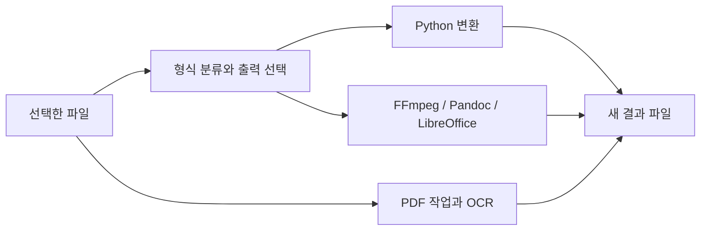
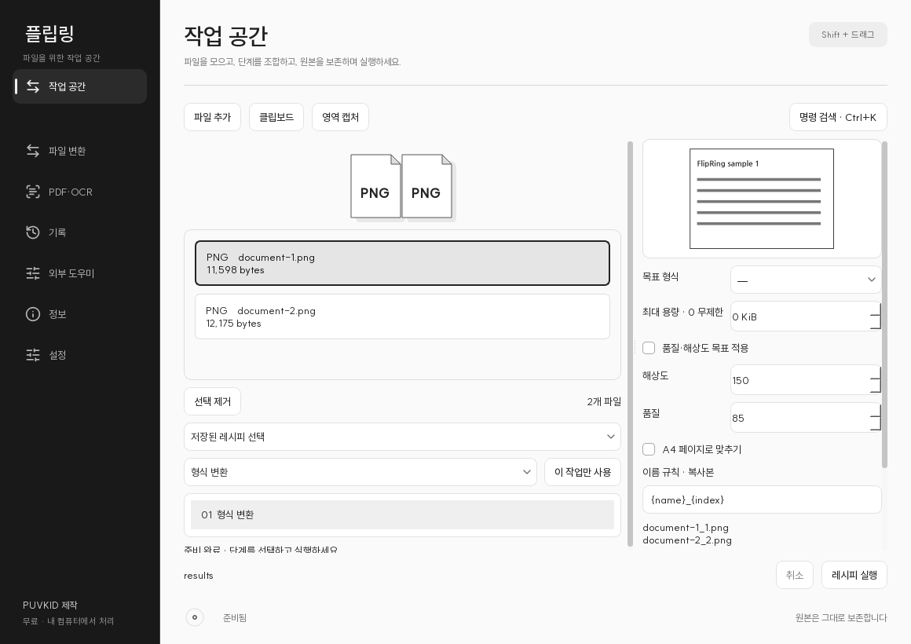
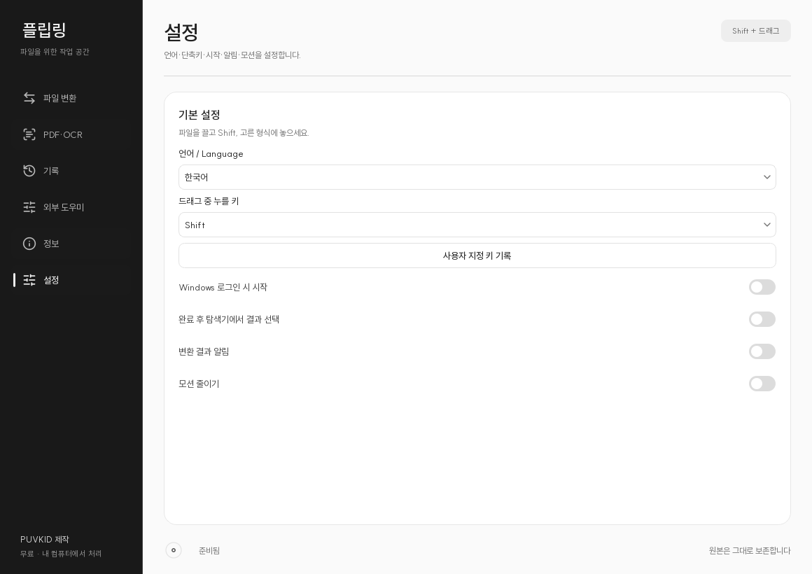

<a id="level-4--현재-111-안내의-기준"></a>
# FlipRing Project · LEVEL 4 - Advanced

> 11월 14일의 검사 기록은 당시 상태로 보존했습니다. 이후 확인한 제품과 납품 상태는 [2026년 11월 20일 확인 범위](#product-verification-20261120)에서 구분합니다.

[LEVEL 1 - Beginner](%EB%A0%88%EB%B2%A81.md) · [LEVEL 2 - Explorer](%EB%A0%88%EB%B2%A82.md) · [LEVEL 3 - Practitioner](%EB%A0%88%EB%B2%A83.md) · [LEVEL 4 - Advanced](%EB%A0%88%EB%B2%A84.md) · [LEVEL 5 - Expert](%EB%A0%88%EB%B2%A85.md)

[같은 수준의 프로필](https://github.com/PUVKID/PUVKID/blob/main/docs/읽기안내/레벨4.md) · [프로젝트 첫 화면](../../README.md)

## LEVEL 4 · 1.12.1 문서 입력 보완

| 항목 | 입력·처리 | 확인·주의 |
| --- | --- | --- |
| ABW | Expat의 DTD·엔터티 검사 | 정형 선언만 격리 사본에서 제거합니다. |
| DIF | BOM UTF-16 → UTF-8-sig → CP949 → CP1252 | 필요 시 배타적으로 UTF-8 사본을 만들고 필터 문자집합 옵션 76을 지정합니다. |
| HWP·HWPX | 64×48 전체·32×24 부분 | 각 두 형식의 원본 픽셀과 비교했습니다. |


document_formats는 Expat으로 인코딩과 무관하게 DTD·엔터티를 검사하고 정확한 AbiWord 정형 선언만 격리 사본에서 제거합니다. DIF는 BOM UTF-16, UTF-8-sig, CP949, CP1252 순으로 해석하고 필요할 때 배타적으로 UTF-8 사본을 만듭니다. document_bridge는 DIF 필터에 UTF-8 문자집합 옵션 76을 지정합니다.

HWP·HWPX 전체 그림의 마지막 줄이 잘리던 문제를 고쳤습니다. 64×48 전체 그림과 32×24 부분 자르기를 각 두 형식에서 읽어 원본 픽셀과 비교한 네 경로가 통과했습니다. 다른 모든 그림이나 뷰어의 동일성을 뜻하지 않습니다.

[같은 수준의 1.12.1 상세](../versions/1.12.1.md#reading-level-4) · [직전 전체 비교](../revision-audit/1.12.1.md)

<a id="current-guide-level-4"></a>
## LEVEL 4 · 현재 1.12.0

| 단계·기능 | 동작과 조건 |
| --- | --- |
| 작업 처리 | quick_actions.py가 검증·수집·변환을, UI가 비동기 큐와 스냅샷을 연결합니다. |
| 결과 경계 | workspace_core 임시 폴더·배타적 발행을 재사용하고 해시와 충돌을 확인합니다. |
| 테마·설치 | ThemeManager와 ToolInstaller가 화면·QProcess·재탐지를 연결합니다. |
| 취소 | winget 프로세스 중단은 이미 위임된 설치/UAC 작업의 완전 중단을 보장하지 않습니다. |


quick_actions.py는 허용 필드만 검증하는 ActionStore, 폴더 수집·사전 점검·변환 체인·결과 보관을 맡고 quick_actions_ui.py는 비동기 작업·큐·미리보기와 설정 스냅샷을 연결합니다. 기존 workspace_core의 임시 작업 폴더와 배타적 발행을 재사용합니다. 재분석 지점·폴더 연결은 따라가지 않으며 결과는 새 이름으로 발행합니다. SHA-256이 변한 결과는 정리하지 않고 보관·복원 시에도 충돌과 변경 여부를 확인합니다.


ThemeManager는 저장된 테마·시스템 변경·QPalette·공통 스타일과 직접 그리는 요소를 연결합니다. 파일 선택창은 공통 비네이티브 Qt 선택창을 재사용합니다. ToolInstaller는 허용된 패키지 ID를 셸 문자열 없이 QProcess 인자로 전달하며 비동기 진행·실패·PATH 갱신·재탐지를 처리합니다. 취소는 winget 관리 프로세스를 중단하며 이미 위임된 Windows Installer/UAC 작업의 완전 중단을 보장하지 않습니다. 빠른 작업과 기존 작업 공간·PDF·설치 사이의 상태 확인을 양방향으로 연결했습니다.


[같은 수준의 1.12.0 상세](../versions/1.12.0.md#reading-level-4) · [프로젝트 첫 화면](../../README.md)

## LEVEL 4 · 이전 1.11 안내의 기준

**1.11·새개발배포 68 당시의 사용 안내입니다.** 파일 선택·문서/PDF/OCR·작업공간·기록과 한계를 아래에서 이 수준으로 설명합니다. 이어지는 원격 보존 구역의 “현행·최신·HWP 미지원”은 1.9 기준 설명으로 구분합니다.

[현재 HWP 저장](#current-hwp-level-4) · [현재 검증과 미완료](#current-evidence-level-4) · [이전 원격 전체 설명](#legacy-project-level-4)

## LEVEL 4 · 요청·실행·표시의 경계

| 항목 | 동작·조건 |
|---|---|
| 화면 | app.py가 탐색·큐·기록·설정을 연결합니다. |
| 요청·변환 | flipring_workflow.py는 요청과 큐, engine.py는 형식 분류와 변환을 담당합니다. |
| 결과 | 원본 폴더의 새 이름과 작업 공간의 별도 결과 폴더를 구분합니다. |


플립링은 Python·PySide6 기반 로컬 Windows 파일 도구입니다.

기본 화면은 파일 선택→형식→변환을 우선하고, 기존 전문 작업 공간은 별도 메뉴로 유지합니다.

탐색기 Shift 원형 메뉴는 다른 요청 진입점이며 중앙 취소·고정 드롭 영역 의미를 유지합니다.

화면 단순화는 기능 삭제가 아니라 **위젯 노출과 실행 계약을 분리**한 변경입니다.

`app.py`는 내비게이션·일반 변환 큐·기록·설정을 연결합니다. `flipring_workflow.py`는 프리셋·사전 점검·큐의 의미를, `engine.py`는 분류·출력 선택·실제 변환을 담당합니다. `pdf_panel.py`는 PDF 옵션과 페이지 조작, `pdf_pages.py`는 편집 모델, `pdf_tools.py`는 PDF/OCR 실행을 맡습니다. `workspace_ui.py`/`workspace_core.py`와 `inspection_ui.py`/`inspection_tools.py`는 각각 화면과 파일 처리를 나눕니다.

파일별 대기·처리·완료·실패·취소는 실제 작업 이벤트에 연결합니다.

실패만 재시도하고 취소 후 원본·기완료 결과를 보존합니다.

프리셋 적용과 실행은 별도 동작이며 과거 경로를 자동 재사용하지 않습니다.

일반 변환의 원본 폴더 새 이름 출력과 작업 공간의 별도 결과 폴더를 혼동하면 결과 탐색·감시 루프·재시도 판단에 영향을 줍니다.

## LEVEL 4 · 형식 행렬과 외부 의존성

`document_formats.py`는 문서·발표·표의 입력 목록과 출력 목록, 명시 저장 필터를 나눕니다. `engine.classify`가 입력 계열을, `targets`가 여러 입력의 공통 출력을 계산합니다.

분류 가능과 실제 구조 검증·필터 성공은 별개입니다.

새 형식을 추가하려면 목록 한 줄뿐 아니라 실제 입력·변환 경로·출력 검증과 UI 준비 상태가 함께 맞아야 합니다.

Word의 DOC ↔DOCX·ODT/RTF, 표의 XLS ↔XLSX·ODS, 발표의 PPT ↔PPTX·ODP가 대표 경로입니다.

DOCM/DOT, PPTM/POT/PPS, XLSB/XLSM/XLT와 OpenDocument 템플릿 등 입력은 출력과 비대칭입니다.

**XLSB·매크로·템플릿은 입력 전용**입니다.

텍스트·Markdown·HTML·전자책과 일부 iWork·WordPerfect·AbiWord는 경로별 도구·필터 호환을 전제로 합니다.

CSV/TSV는 첫 시트 표시 값이라는 명시적 손실 선택입니다.

수식·다중 시트·서식을 보존하려면 XLSX·XLS·ODS를 고릅니다.

PPT →TXT도 슬라이드 텍스트만 내보내며 시각적 발표를 보존하지 않습니다.

초기 Excel 2007 Beta2 XLSB의 비어 있는 읽기 결과는 정상 출력으로 취급하지 않습니다.

현대 XLSB 전체와 같은 지원 상태로 묶지 않고 원작성 앱의 XLSX 복사본을 대안으로 안내합니다.

| 경로 | 구성 경계 | 변경 시 보존할 조건 |
|---|---|---|
| Office | 별도 LibreOffice의 UNO Python과 명 시 필터 | 매크로·능동 콘텐츠·외부 갱신 제한, 실제 결과 검증 |
| HWP·HWPX 읽기 | 별도 LibreOffice + 동봉 H2Orestart·Java | 비트 수·준비 상태·실제 표본 호환 분리 |
| OCR | 동봉 Tesseract·한영 모델 | 언어·배치·위치/확신도와 취소·결과 검토 |
| RAR 등 압축 | 동봉 7-Zip 실행 구성요소 | 스트리밍/CRC·안전 경로·링크 거부와 소유 후손 정리 |
| 일부 전자책·문서 / 영상·음성 | 별도 Pandoc / FFmpeg | 도구 발견과 각 입력·출력 조합의 실제 검증 |

HWP 저장은 `document_hwp.py`와 `hwp_worker.py`를 추가한 별도 경로입니다.

입력 DOCX/TXT/HWP5/HWPX와 목표 HWP/HWPX를 한정하고 앱 시작에서 Qt·엔진을 불러오기 전에 worker로 분기합니다.

기존 HWP →다른 형식의 LibreOffice 경로는 바꾸지 않습니다.

새 코어는 구조·내용 검사를 통과해야 결과를 반환하며 독립 시 각 렌더 검증은 하지 않습니다.

문단·단 순 표·PNG/JPEG를 옮기되 미지원 개체는 거부합니다.

HWP5 스트림 허용 목록과 DocInfo의 실제 그림 참조를 대조해 모르는 내용을 조용히 버리는 일을 막습니다.

이는 모든 HWPX 사용자 부품의 보존까지 증명하지 않습니다.

## LEVEL 4 · Office 실행의 두 종류 격리

`engine.office`는 실제 입력 구조를 확인한 뒤 결과 작업 폴더와 짧은 일회용 LibreOffice 프로필을 만듭니다.

프로필의 보안 설정은 매크로·능동 콘텐츠·외부 참조·업데이트를 제한하며 다섯 모듈의 사이드바 초기 상태를 명시합니다.

그 일회용 프로필의 `UseOpenCL=false`는 반복 시작 구간을 줄이려는 조치이고 전역 사용자 설정이나 앱 모션 설정이 아닙니다.

다른 격리는 **Python 모듈 검색 경로의 격리**입니다.

설치 본에서 LibreOffice Python3.13이 앱 `_internal`의 Python3.12용 `_socket.pyd`를 읽는 오류가 관측됐습니다. `document_bridge.py`·`document_formats.py`·`document_xlsb.py` 세 순수 파일만 일회용 프로필에 배타적으로 복사해 외부 Python을 `-B -X utf8`로 실행합니다.

전체 앱 폴더나 바이너리 확장을 복사하지 않습니다. `-B`는 바이트코드 캐시 쓰기를 막지만 그 자체가 모든 로더 충돌을 해결하는 옵션은 아닙니다.

성능과 호환성 조치를 혼합하지 않습니다.

OpenCL 한 조건의 순차 비교에서 ODS53.156 →26.985초를 관측했지만 외부 부하·캐시가 통제되지 않았고 일부 구간은 늘었습니다.

모든 문서 속도·RSS 개선으로 환산할 수 없습니다.

외부 도구 경로 오류·도우미 누락·복사 충돌·연결 종료·손상 문서는 실패를 보존하며 임시 파일 존재만으로 성공 처리하지 않습니다.

## LEVEL 4 · 프로세스 소유와 취소의 완료 조건

`engine.py`의 소유 실행 경로는 Windows에서 새 프로세스를 정지 상태로 만들고 Job에 연결한 뒤 재개합니다. `_OwnedProcessTree`는 Job 구성원과 핸들을 관리하며 종료 API 호출과 실제 종료 신호를 구분합니다. `_finish_owned_process`는 같은 정리 기한에서 후손과 직접 자식을 기다리고 정리 오류를 숨기지 않습니다.

RAR 경로도 생성한 프로세스의 소유권과 취소 감시를 유지합니다.

이는 PID 이름 검색으로 다른 앱을 강제 종료하는 설계가 아닙니다. 정상 결과 생성·취소 요청·후손 종료 확인·프로필 정리를 각각 다뤄야 합니다. 성공 경로만 맞고 취소 때 후손이 남으면 완료 계약이 깨집니다. 반대로 나중에 핸들을 열 수 있다는 사실만으로 프로세스가 실행 중이라고 단정해서도 안 됩니다.

## LEVEL 4 · PDF 옵션과 렌더 자원

| 항목 | 동작·조건 |
|---|---|
| 옵션 | 페이지 범위와 각도는 기본, 작업별 DPI·품질 등은 고급으로 분리합니다. |
| 상태 | 고급 패널을 접어도 저장 값과 신호를 초기화하지 않습니다. |
| 자원 | PDFium 공유 잠금과 렌더 자원·취소·스레드 경계를 유지합니다. |


PDF 구조 변경과 렌더/OCR은 다른 작업입니다.

나누기·추출·삭제·회전의 페이지 범위와 회전 각도는 기본에서 접근하고 전체 삭제는 거부합니다.

PDF →이미지는 출력이 기본, 범위·DPI·품질이 고급입니다.

OCR은 언어·출력이 기본, 범위·DPI·배치·강제 인식이 고급입니다.

이미지 →PDF의 파일 순서와 DPI, 압축 모드별 손실 안내도 보존합니다.

옵션 접기는 `_labels`와 행 위젯·요청 값의 계약을 유지한 채 표시 컨테이너를 나누는 방식입니다.

고급을 접었다고 저장 값·신호를 초기화하지 않으며 해당 작업에 유효한 필드를 보여 줍니다.

필수 오류·손실·도구 안내와 실행/취소는 접지 않습니다.

시험에서는 숨은 위젯에 입력했다고 실제 조작 가능성을 확인한 것으로 처리하면 안 됩니다.

PDF 썸네일은 실제 페이지와 편집 순서를 연결하고 다중 선택·회전·삭제·추출·확대는 메모리 편집 모델을 거쳐 새 결과로 저장합니다. `pdf_lock.py`의 PDFium 공유 잠금과 작업 게이트는 여러 화면의 동시 접근을 제어합니다.

렌더된 페이지·비트맵·문서 수명, 취소 중 해제, GUI 스레드와 작업 스 레드 경계를 보존해야 합니다.

고 DPI 이미지 크기와 논리 표시 크기는 다릅니다.

## LEVEL 4 · OCR·비교·검토·가림의 데이터 계약

| 기능 | 동작 | 확인·주의 |
| --- | --- | --- |
| OCR | 텍스트·페이지·확신도·정규화 위치 | 인식 확신도를 문서 정확도로 취급하지 않습니다. |
| 비교 | 페이지 수·크기·텍스트·미리보기 | 흐림과 개인정보는 사람이 확인할 후보입니다. |
| 가림 | 지정 사각형을 새 결과의 픽셀에 적용 | 원본은 보존하며 완전 탐지를 보장하지 않습니다. |


OCR 결과에는 텍스트·페이지·단어 확신도·정규화 위치가 있고 교정 UI는 이를 원본과 연결합니다.

낮은 확신도 후보를 검토하고 편집 텍스트를 TXT/PDF/DOCX/XLSX로 내보냅니다.

검색 PDF는 이미지 +텍스트층이며 표·수식·다 단 원 구조의 완전 복원이 아닙니다.

인식 확신도를 문서 정확도나 개인 정보 재현율로 바꾸어 표현하지 않습니다.

두 파일 비교는 페이지 수·크기·텍스트 차이와 실제 페이지 미리보기를 제공합니다.

흐림·가장자리·빈/중복 페이지·개인정보는 후보입니다. `redact_file`은 사용자가 지정한 페이지·정규화 사각형을 새 이미지/PDF의 픽셀에 가리는 경로이며 텍스트 위에 상자만 얹는 것과 구분합니다.

원본을 삭제하지 않고 완전 탐지를 보장하지 않으므로 새 결과의 텍스트 부재·다른 페이지도 검토 대상입니다.

## LEVEL 4 · 레시피·목표·감시의 안전한 연결

`workspace_core.validate_recipe`는 버전·이름·허용 op와 필드를 검증합니다.

변환·리사이즈·워터 마크·OCR·가림·이름 복사·PDF 조합·콜라주·GIF·영수증 XLSX·PDF 압축·페이지 정규화·검토를 허용 단계로 조합합니다. `RecipeStore`의 저장/가져오기/내보내기와 UI의 단계 추가·삭제·재정렬은 임의 코드 실행을 제공하지 않습니다.

`execute_workspace`의 출력·단계·검사·경고와 `constraints_met`를 구분해야 합니다.

형식·품질·DPI·A4 옵션과 KiB 용량 상한은 따로 검증합니다.

생성 결과가 max_bytes를 초과한 경우 용량 미달성 경고와 결과를 보존합니다.

다른 입력·실행 오류 전체를 경고로 바꾸지 않습니다.

파일 생성 성공만으로 목표 달성 true를 만들지 않습니다.

이름 규칙은 `{name}`·`{index}`·`{date}`의 복사본 생성이며 예약 이름·경로 문자·충돌을 검사합니다.

UI는 실제 파일 카드 순서·Ctrl +K·클립보드 파일/그림/텍스트·사용자 시작 영역 캡처를 연결합니다.

결과 기본 위치는 앱 데이터 `results`이고 출력 폴더 선택·파일/경로 복사·결과 드래그로 다음 작업과 이어집니다.

감시 폴더는 파일 크기/시각 안정과 결과·임시·재처리 제외가 필요합니다.

휠의 순서/숨김/레시피 개인화는 지원 형식·중앙 취소·고정 드롭 좌표를 유지합니다.

## LEVEL 4 · 화면 자원·저장 상태·검증 절충

`fixed_viewport.py`는 1160×820 논리 창과 작은 사용 가능 영역을 맞추고 스크롤 접근을 제공합니다. `preview_panel.py`·PDF 화면은 DPR과 이미지 표시 크기를 구분합니다.

SUIT·흑백/회색·한영·모션 축소는 이 제품의 기존 선택입니다. `studio_ui.py`·`ui_motion.py`의 유한 모션은 선택/처리/완료를 따라가되 입력 영역을 움직이지 않고 숨김·종료·감소 모드에서 정리합니다.

기록 검색·필터·복사와 탐색기 선택은 파일 실행과 다릅니다. 언어 전환은 사용자 경로·변환 상태·설정 값을 바꾸면 안 됩니다. 소스 회귀와 실제 고배율 모니터·탐색기 OLE 조작·설치 본의 DLL 검색 경로는 각각 별도 검증 경계입니다. 정지 캡처나 offscreen 통과로 모든 실제 조작 상태를 주장하지 않습니다.

빌드는 준비 →외부 전체 소스 동결 →준비된 소스 불변 컴파일 →포장으로 이어집니다.

정확히 허용된 상응 소스 10개 528499332B만 실행 구성에서 분리하고 전체 ZIP에는 원 바이트를 보존하며 고지에 파일명·SHA·예정 릴리스 URL을 연결합니다.

용량별 일괄 제거나 라이선스 삭제는 같은 정책이 아닙니다.

디스크 절감과 메모리·시작 시간도 별개입니다.

## LEVEL 4 · 현재 확인과 확장 전 남은 경계

| 항목 | 동작·조건 |
|---|---|
| 소스 | 문서 51·기존 163·확장 86 검사와 당시 소스를 연결합니다. |
| 과거 배포 | 배포 55의 내장 19 모듈·설치 1178 파일 및 실제 조작을 해당 객체의 근거로 둡니다. |
| 한계 | 소스·배포·고정 표본과 중앙 완료·공개 절차를 구분합니다. |


**이전 배포 55 또는 이전 소스 시점의 보존 관측입니다. 새 68의 근거는 이 페이지 현재 검증 절과 구분합니다.**

HWP를 추가한 현재 소스로 문서 51·기존 163·확장 86 검사를 각각 통과했습니다.

과거 개발 배포 55의 내장 19 모듈·설치 1178 파일·사용자 실제 조작은 그 배포 객체의 증거입니다.

새 HWP 소스의 설치 본 검사로 재사용하지 않습니다.

이전 최종 26 과 새개발 68을 구분합니다.

새빌드·설치·고정 표본은 확인했고 중앙 완료·최종 교체·원격 게시가 남았습니다.

전문 검토에는 전체 소스 ZIP의 제품·빌드·검사·자산·법적 원문·상응 소스와 원문 비교를 함께 사용합니다. 실행/설치 파일은 코드 미서명입니다. 확인된 논문이나 원고가 없으므로 논문 성능이나 전수 정확도를 만들지 않습니다. 기능 확장은 구현·보안·실 파일 검사·설치·사용자 조작·공개를 각각 갱신해야 합니다.

## LEVEL 4 · 전체 차수와 원문을 읽는 순서

아래 17 행은 완전 배포 본·작업 전 부분 보존·현행 소스·고유자료를 구분합니다.

같은 수준 상세 목표로 연결하고 자료 폴더와 전체 비교는 원문 역할을 유지합니다.

당시의 기능·CLI·의존성·검사 결과를 현행에 소급하지 않습니다.

연결 목표의 수준별 본문은 로컬 후보이며 현재 페이지 작성만으로 원격 연결이 완료된 것은 아닙니다.

| 차수·자료 | 자료 폴더 | 같은 수준 상세 | 전체 비교·범위 | 이 수준에서 확인할 범위 |
|---|---|---|---|---|
| 1.2.0 | [자료](../../history/1.2.0) | [설명](../../docs/versions/1.2.0.md#reading-level-4) | [비교](../../docs/revision-audit/1.2.0.md) | 초기 분류/요청/트레이/PDF 경계를 현재 모듈 분할과 구분합니다. |
| 부드러운디자인-작업전 | [자료](../../history/부드러운디자인-작업전) | [설명](../../docs/versions/부드러운디자인-작업전.md#reading-level-4) | [비교](../../docs/revision-audit/부드러운디자인-작업전.md) | app/PDF/GUI만으로 남은 모듈 설계를 추정하지 않습니다. |
| 버튼모션-작업전 | [자료](../../history/버튼모션-작업전) | [설명](../../docs/versions/버튼모션-작업전.md#reading-level-4) | [비교](../../docs/revision-audit/버튼모션-작업전.md) | 버튼모션과 고정클릭영역·상태수명에 초점을 둡니다. |
| 콤보-작업전 | [자료](../../history/콤보-작업전) | [설명](../../docs/versions/콤보-작업전.md#reading-level-4) | [비교](../../docs/revision-audit/콤보-작업전.md) | 선택입력과 휠/팝업상태전파 경계를 검토합니다. |
| 탭잔상-작업전 | [자료](../../history/탭잔상-작업전) | [설명](../../docs/versions/탭잔상-작업전.md#reading-level-4) | [비교](../../docs/revision-audit/탭잔상-작업전.md) | 탭전환·효과정리·재진입 수명을 검토합니다. |
| 호버대비-작업전 | [자료](../../history/호버대비-작업전) | [설명](../../docs/versions/호버대비-작업전.md#reading-level-4) | [비교](../../docs/revision-audit/호버대비-작업전.md) | 색상·강조와 이벤트/가독성의 변경을 구분합니다. |
| 1.4.0 | [자료](../../history/1.4.0) | [설명](../../docs/versions/1.4.0.md#reading-level-4) | [비교](../../docs/revision-audit/1.4.0.md) | 재설계 전 구조와 확인된 1.2간 실제 모듈 차이를 검토합니다. |
| 내부모션-작업전 | [자료](../../history/내부모션-작업전) | [설명](../../docs/versions/내부모션-작업전.md#reading-level-4) | [비교](../../docs/revision-audit/내부모션-작업전.md) | studio_ui·build·package의 보존 변경과 일부 자료 한계를 검토합니다. |
| 1.6.0 | [자료](../../history/1.6.0) | [설명](../../docs/versions/1.6.0.md#reading-level-4) | [비교](../../docs/revision-audit/1.6.0.md) | ui_motion 공통표면·유한효과·메뉴/선택창연결을 검토합니다. |
| 1.7.0 | [자료](../../history/1.7.0) | [설명](../../docs/versions/1.7.0.md#reading-level-4) | [비교](../../docs/revision-audit/1.7.0.md) | workflow/preview/pdf _pages 분리와 기존 engine 계약을 검토합니다. |
| 1.8.0 | [자료](../../history/1.8.0) | [설명](../../docs/versions/1.8.0.md#reading-level-4) | [비교](../../docs/revision-audit/1.8.0.md) | fixed_viewport/DPR/논리좌표와 모션종료관찰을 검토합니다. |
| 1.9.0 | [자료](../../history/1.9.0) | [설명](../../docs/versions/1.9.0.md#reading-level-4) | [비교](../../docs/revision-audit/1.9.0.md) | workspace/inspection 코 어·UI 분리와 PDF 잠금·목표 상태를 검토합니다. |
| 1.10.0 | [자료](../../history/1.10.0) | [설명](../../docs/versions/1.10.0.md#reading-level-4) | [비교](../../docs/revision-audit/1.10.0.md) | 문서행렬/UNO/도구준비·보안경계를 검토하되 당시통합미완료를 남깁니다. |
| 1.11.0 | [자료](../../history/1.11.0) | [설명](../../docs/versions/1.11.0.md#reading-level-4) | [비교](../../docs/revision-audit/1.11.0.md) | 접기 UI·UseOpenCL·소유 Job·외부 Python 시작 경로의 각각의 변경 영향을 검토합니다. |
| 1.12.0 | [자료](../../history/1.12.0/) | [설명](../versions/1.12.0.md#reading-level-4) | [비교](../revision-audit/1.12.0.md) | 빠른 작업·폴더 변환·테마·앱 내 도구 설치의 구현과 확인 범위를 구분합니다. |
| 최종 | [자료](../../소스) | [설명](../../docs/versions/최종.md#reading-level-4) | [비교](../../docs/revision-audit/최종.md) | 동일 버전 배포 구성과 소스 동결·고지·runtime 분리의 계약입니다. |
| 현행소스 | [자료](../../소스) | [설명](../../docs/revision-audit/현행소스.md#reading-level-4) | [비교](../../docs/revision-audit/현행소스.md) | 역사원문과 현재코드/설정/함수표를 혼합하지 않고 읽습니다. |
| 고유 작업 코드·문서 | [자료](../../보존자료/작업소스) | [설명](../../docs/SOURCE_MATERIALS.md#reading-level-4) | [비교](../../docs/2026-11-02_공개반영재개검증.md) | 부품단위출처·법적상응소스·보류와 제품코드를 구분합니다. |

<a id="current-hwp-level-4"></a>
## LEVEL 4 · HWP 제한 저장의 선택·절차·검증 경계

| 항목 | 동작·조건 |
|---|---|
| 입력·출력 | DOCX·TXT·HWP5·HWPX에서 HWP·HWPX로 저장하며 같은 확장자는 제외합니다. |
| 허용 구조 | 단순 문단·비병합 직사각형 표·PNG/JPEG 그림을 다룹니다. |
| 거부·한계 | 복잡한 표·수식·주석·필드와 일부 그림 구조를 거부하며 HWP5 쓰기는 실험적입니다. |
| 도구 구분 | 새 제한 저장과 기존 HWP 읽기의 외부 도구 경로를 구분합니다. |


document _formats.

NATIVE _HWP _INPUTS·engine.targets가 네 입력과 두 목표의 경계를 정하고 document_hwp.py가 ZIP/XML·외부 참조·크기·그림·손실을 검사합니다.

HWP5 지원 스트림과 DocInfo의 그림 참조 집합을 대조해 모르는 내용을 조용히 버리지 않습니다.

기본 스크립트 허용은 알려진 정확 상수만이며 사용자 스크립트 실행 허용이 아닙니다.

app의 worker 분기는 Qt/engine import 전에 실행되고 hwp_worker는 요청·원본해시·기존 결과를 검사합니다. run_hwp_worker는 소유 Job/Popen·엄격 UTF8·64KiB로 그·과대/중복 JSON·정확 출력 경로/해시를 검증한 뒤 반환합니다.

취소/회수 오류는 반환 성공으로 숨기지 않습니다.

PrvImage 생략·PrvText 정규화·선택 Summary 매핑은 원 메타 바이트 보존과 다르고 외부 렌더 검증도 아닙니다.

<a id="current-evidence-level-4"></a>
## LEVEL 4·새 배포 68의 현재 확인과 남은 절차

현재 제품 Python48·검사 도구 6의 동결을 유지하면서 HWP35 독립 직접 실행과 문서 51·기존 163·확장 86의 부모 실행/독립 저장 대조를 결합합니다.

배포 68은 21개 내장 재귀 codeobject·native 데이터 9·runtime1207/478350675B·ZIP948/809141540B를 대조했습니다. canonical70의 metadata 정렬/EOF 승격은 4504 →4502B 한 파일만 바꿨고 나머지 951 파일과 제품 Python48/tools6는 불변입니다.

실제 설치는 1207 runtime +uninstaller2·창 응답·잠금을, portable/installed 고정 DOCX 각 1 시험은 각각 HWP/HWPX 출력을 확인했습니다.

사용자 새 실제 출력은 PNG/HWP와 성공 기록 2개이며 원본/RGB/한글·표·그림을 대조했습니다.

중앙 취소 사용자 확인과 추가 대기인 HWPX Shift 조작을 분리합니다.

새 최종 교체·중앙 gate·GitHub/Release와 외부뷰어 렌더 검증은 완료되지 않았습니다.

## LEVEL 4 · 새 배포 파일을 대조하는 값

아래 객체 식별은 frozen 코드·데이터 대조와 결합합니다. 실행 EXE만 떼어 옮기면 runtime 구성이 달라지므로 전체 폴더를 유지합니다.

| 파일 | 바이트 | SHA-256 |
| --- | ---: | --- |
| `프로그램/FlipRing/FlipRing.exe` | 9585792 | `9dfa98ef7ab9778ffc686e7c560f928aeff06e02d120cff8575733313f5c09d3` |
| `설치파일/FlipRing-Setup.exe` | 178176550 | `28a976afca70842b0e06b4a8e6c0c570388e8320e4d1eb1b8998b9189bd5ab5e` |
| `플립링-1.11.0-전체소스.zip` | 671431794 | `156708240f854b7af8917d3f46d059f83cc92e548a698219d4726e92d8becf0a` |

실행 구성 1207 파일 478350675B, 소스 ZIP948 항목·해제합계 809141540B를 대조했습니다.

상응 소스 10개 528499332B는 실행 구성에서 분리해 전체 소스 ZIP에 원 바이트로 보존합니다. python-hwpx6.12.0의 Apache-2.0 LICENSE·NOTICE·METADATA와 정확 상응 소스, 기존 법적 고지를 유지합니다.

파일 용량으로 속도·RSS·외부뷰어 렌더일치 효과를 계산하지 않습니다.

<a id="legacy-project-level-4"></a>
## LEVEL 4 · 1.9 기준 원격 안내와 전체 원문 보존

**여기부터 아래는 원격 874b2f1의 기존 설명을 보존한 구역입니다.** 아래 “현재·최신·현행”과 HWP 미지원 문장은 이 구역의 1.9 기준 소스를 뜻합니다.

위의 현재 1.11 문서 지원·HWP 제한 저장·배포 68 상태와 구분합니다.

기존 모바일 문단·실질 기능·표·코드·이미지·14개 자료 연결·이력은 생략하지 않았습니다.

새 사용 절차와 전체 17 자료는 [현재 안내](#current-guide-level-4)에서 읽습니다.

<!-- legacy-remote-874-start -->

## LEVEL 4 · 프로젝트 소개와 읽는 방법

앱·변환 엔진·PDF 처리·사전 점검·미리보기·작업 공간의 경계를 나누어 검토합니다. 원본 보존·경로 검증·설정 오류 보존·큐 실행·취소 정책이 구현 선택의 중심입니다.

## LEVEL 4 · 실제 기능과 동작 범위

| 확인할 항목 | 본문의 핵심 조건 |
| --- | --- |
| 기능·동작 | app/engine/pdf/workflow/preview/workspace 책임을 나누고 로컬 입력·출력·기록의 경계를 검토합니다.<br>실제 작업 상태 모션과 정지 렌더를 구분합니다. |
| 입력·처리·출력 | 원본과 같은 드라이브의 임시 처리와 새 이름 이동, 배타적 PDF 생성, 요청 검증과 취소 전달의 경계를 검토합니다. |
| 결과·한계 | 공간 추정 입력 4 배 +64MiB는 보수적 계획치이며 성공 보장이 아닙니다.<br>손상 기록 보존·새 결과·도우미 부재와 UI 상태 시험의 범위를 함께 읽습니다. |


app/engine/pdf/workflow/preview/workspace 책임을 나누고 로컬 입력·출력·기록의 경계를 검토합니다. 실제 작업 상태 모션과 정지 렌더를 구분합니다.

화면·처리 모듈·저장 경계를 분리해 설계 선택을 검토합니다.

**기능별 공통 근거**

파일 변환부터 PDF 정리까지 한 화면에서 이어서 할 수 있도록 만든 도구입니다.

플립링은 파일 형식을 분류해 가능한 출력 형식을 보여주고, Python 라이브러리 또는 외부 변환 도구로 작업을 수행합니다. PDF 화면에서는 페이지 편집과 OCR 작업을 별도로 제공합니다.

| 기능 | 구현 내용 |
| --- | --- |
| 파일 변환 | 이미지·문서·오디오·비디오·표·자막·압축 형식 처리 |
| 원형 메뉴 | 지원 형식 선택과 트레이 중심의 Windows 인터페이스 |
| PDF 편집 | 병합·분할·추출·삭제·회전·압축 |
| PDF·이미지 변환 | 이미지를 PDF로 묶거나 PDF 페이지를 이미지로 저장 |
| OCR | Tesseract를 이용한 한국어·영어 인식과 문서 출력 |
| 결과 보존 | 기존 이름과 충돌하면 새 이름으로 출력 |



## LEVEL 4 · 입력에서 처리와 출력까지

원본과 같은 드라이브의 임시 처리와 새 이름 이동, 배타적 PDF 생성, 요청 검증과 취소 전달의 경계를 검토합니다.

| 단계 | 이 프로젝트에서 다루는 내용 |
| --- | --- |
| 입력 | 로컬 이미지·문서·미디어·PDF |
| 처리 | PySide6 UI, 변환 엔진·외부 도구, 페이지 편집·Tesseract OCR |
| 출력 | 새 형식 파일·편집 PDF·인식 문서 |


---

## LEVEL 4 · 사용·실험 순서와 확인 방법

각 버전·부분본의 app/engine/PDF·자산 의존성과 실행·테스트 도구를 분리합니다. 화면 생성 렌더와 실제 Windows 물리 드래그·배율·성능 시험은 별도입니다.

## LEVEL 4 · 결과와 한계를 해석하는 기준

공간 추정 입력 4 배 +64MiB는 보수적 계획치이며 성공 보장이 아닙니다. 손상 기록 보존·새 결과·도우미 부재와 UI 상태 시험의 범위를 함께 읽습니다.

## LEVEL 4 · 구현과 핵심 파일을 연결해 읽기

engine.convert·PDF 배타적 생성·PresetStore·Request와 workspace 책임을 분리합니다. 기존 자동 생성 빌드 설정과 현행 build.py의 생성 경로를 구분합니다.

## LEVEL 4 · 용어와 실수하기 쉬운 구분

파일 변환은 원본을 읽어 다른 형식의 새 파일을 만드는 일입니다.

PDF 페이지 편집은 문서의 일부 쪽을 합치거나 나누고 회전하는 작업입니다.

OCR은 이미지 속 글자를 인식하는 기능이며 원래 문서 배치를 완벽히 복구한다는 뜻은 아닙니다.

프리셋은 자주 쓰는 옵션, 레시피는 여러 처리의 순서, 작업 큐는 기다리는 작업의 목록입니다.

Qt·PySide6는 창과 화면을 만드는 도구입니다.

**원본을 보존한 새 결과 저장과 로컬 처리**를 기본으로 합니다. OCR·표 열 복원·개인정보 후보 검토는 완전한 품질·탐지를 보장하지 않습니다. 부분 보관본은 독립 설치 제품이 아니며 기능별 외부 도구·글꼴·언어 자료가 필요합니다.

## LEVEL 4 · 전체 차수와 같은 수준의 상세 설명

차수 이름은 실제 보관 단위를 따릅니다. 부분본·시험 도구·최종 안내는 제품 버전과 구분하며, 폴더와 직전 비교를 함께 연결합니다.

| 차수·자료 | 자료 폴더 | 이 수준의 차수 설명 | 직전 비교·범위 |
| --- | --- | --- | --- |
| 1.2.0 | [자료](../../history/1.2.0) | [LEVEL 4 - Advanced](../versions/1.2.0.md#reading-level-4) | [전체 비교](../revision-audit/1.2.0.md) |
| 부드러운디자인-작업전 | [자료](../../history/%EB%B6%80%EB%93%9C%EB%9F%AC%EC%9A%B4%EB%94%94%EC%9E%90%EC%9D%B8-%EC%9E%91%EC%97%85%EC%A0%84) | [LEVEL 4 - Advanced](../versions/%EB%B6%80%EB%93%9C%EB%9F%AC%EC%9A%B4%EB%94%94%EC%9E%90%EC%9D%B8-%EC%9E%91%EC%97%85%EC%A0%84.md#reading-level-4) | [전체 비교](../revision-audit/%EB%B6%80%EB%93%9C%EB%9F%AC%EC%9A%B4%EB%94%94%EC%9E%90%EC%9D%B8-%EC%9E%91%EC%97%85%EC%A0%84.md) |
| 버튼모션-작업전 | [자료](../../history/%EB%B2%84%ED%8A%BC%EB%AA%A8%EC%85%98-%EC%9E%91%EC%97%85%EC%A0%84) | [LEVEL 4 - Advanced](../versions/%EB%B2%84%ED%8A%BC%EB%AA%A8%EC%85%98-%EC%9E%91%EC%97%85%EC%A0%84.md#reading-level-4) | [전체 비교](../revision-audit/%EB%B2%84%ED%8A%BC%EB%AA%A8%EC%85%98-%EC%9E%91%EC%97%85%EC%A0%84.md) |
| 콤보-작업전 | [자료](../../history/%EC%BD%A4%EB%B3%B4-%EC%9E%91%EC%97%85%EC%A0%84) | [LEVEL 4 - Advanced](../versions/%EC%BD%A4%EB%B3%B4-%EC%9E%91%EC%97%85%EC%A0%84.md#reading-level-4) | [전체 비교](../revision-audit/%EC%BD%A4%EB%B3%B4-%EC%9E%91%EC%97%85%EC%A0%84.md) |
| 탭잔상-작업전 | [자료](../../history/%ED%83%AD%EC%9E%94%EC%83%81-%EC%9E%91%EC%97%85%EC%A0%84) | [LEVEL 4 - Advanced](../versions/%ED%83%AD%EC%9E%94%EC%83%81-%EC%9E%91%EC%97%85%EC%A0%84.md#reading-level-4) | [전체 비교](../revision-audit/%ED%83%AD%EC%9E%94%EC%83%81-%EC%9E%91%EC%97%85%EC%A0%84.md) |
| 호버대비-작업전 | [자료](../../history/%ED%98%B8%EB%B2%84%EB%8C%80%EB%B9%84-%EC%9E%91%EC%97%85%EC%A0%84) | [LEVEL 4 - Advanced](../versions/%ED%98%B8%EB%B2%84%EB%8C%80%EB%B9%84-%EC%9E%91%EC%97%85%EC%A0%84.md#reading-level-4) | [전체 비교](../revision-audit/%ED%98%B8%EB%B2%84%EB%8C%80%EB%B9%84-%EC%9E%91%EC%97%85%EC%A0%84.md) |
| 1.4.0 | [자료](../../history/1.4.0) | [LEVEL 4 - Advanced](../versions/1.4.0.md#reading-level-4) | [전체 비교](../revision-audit/1.4.0.md) |
| 내부모션-작업전 | [자료](../../history/%EB%82%B4%EB%B6%80%EB%AA%A8%EC%85%98-%EC%9E%91%EC%97%85%EC%A0%84) | [LEVEL 4 - Advanced](../versions/%EB%82%B4%EB%B6%80%EB%AA%A8%EC%85%98-%EC%9E%91%EC%97%85%EC%A0%84.md#reading-level-4) | [전체 비교](../revision-audit/%EB%82%B4%EB%B6%80%EB%AA%A8%EC%85%98-%EC%9E%91%EC%97%85%EC%A0%84.md) |
| 1.6.0 | [자료](../../history/1.6.0) | [LEVEL 4 - Advanced](../versions/1.6.0.md#reading-level-4) | [전체 비교](../revision-audit/1.6.0.md) |
| 1.7.0 | [자료](../../history/1.7.0) | [LEVEL 4 - Advanced](../versions/1.7.0.md#reading-level-4) | [전체 비교](../revision-audit/1.7.0.md) |
| 1.8.0 | [자료](../../history/1.8.0) | [LEVEL 4 - Advanced](../versions/1.8.0.md#reading-level-4) | [전체 비교](../revision-audit/1.8.0.md) |
| 현행소스 | [자료](../../%EC%86%8C%EC%8A%A4) | [LEVEL 4 - Advanced](../revision-audit/%ED%98%84%ED%96%89%EC%86%8C%EC%8A%A4.md#reading-level-4) | [전체 비교](../revision-audit/%ED%98%84%ED%96%89%EC%86%8C%EC%8A%A4.md) |
| 고유 작업 코드·문서 | [자료](../../%EB%B3%B4%EC%A1%B4%EC%9E%90%EB%A3%8C/%EC%9E%91%EC%97%85%EC%86%8C%EC%8A%A4) | [LEVEL 4 - Advanced](../SOURCE_MATERIALS.md#reading-level-4) | [전체 비교](../2026-11-02_%EA%B3%B5%EA%B0%9C%EB%B0%98%EC%98%81%EC%9E%AC%EA%B0%9C%EA%B2%80%EC%A6%9D.md) |
| 1.9.0 | [자료](../../history/1.9.0) | [LEVEL 4 - Advanced](../versions/1.9.0.md#reading-level-4) | [전체 비교](../revision-audit/1.9.0.md) |

## LEVEL 4 · 논문·원고와 원본 자료의 범위

소프트웨어의 소스·사용 안내·검사·설치 및 권리 자료를 다룹니다. 보관된 앱 렌더·회귀 검사 수를 문서 변환 품질의 전수 측정이나 논문 성과로 바꾸지 않습니다. 기존 라이선스와 법적 자료는 원문을 유지합니다.

## LEVEL 4 · 원래 모든 세부 설명으로 이동하기

설정값·코드 예제·실패 조건·측정 범위·화면과 파일별 안내를 생략하지 않도록 첫 화면의 전체 본문을 아래에 함께 둡니다. 각 항목은 이 페이지의 공통 근거로 바로 이동합니다. 원문에 담긴 이전 차수 조건을 현재 실행 조건으로 자동 적용하지 않습니다.

| 첫 화면의 원래 항목 | 이 페이지의 전체 근거 |
| --- | --- |
| FlipRing Project | [원문 보기](#source-section-1) |
| 파일 선택부터 결과 보존까지 | [원문 보기](#source-section-2) |
| 최신차수에서 달라진 점 | [원문 보기](#source-section-3) |
| 작업 공간과 실제 작업 모션 | [원문 보기](#source-section-4) |
| 설치본과 공개 소스 | [원문 보기](#source-section-5) |
| 확인된 전체 버전과 보존 기준본 | [원문 보기](#source-section-6) |
| 이전 1.8 고정 창 설정 화면 | [원문 보기](#source-section-7) |
| 입력·처리·출력 | [원문 보기](#source-section-8) |
| 프로젝트 소개 | [원문 보기](#source-section-9) |
| 저장소 구성 | [원문 보기](#source-section-10) |
| 주요 기술과 처리 방식 | [원문 보기](#source-section-11) |
| 트레이와 원형 메뉴 | [원문 보기](#source-section-12) |
| 화면과 기록 | [원문 보기](#source-section-13) |
| PDF 작업과 인식 옵션 | [원문 보기](#source-section-14) |
| 빠른 시작 | [원문 보기](#source-section-15) |
| 입출력과 도구 구성 | [원문 보기](#source-section-16) |
| 로컬 설정과 검사 코드 | [원문 보기](#source-section-17) |
| 문제 해결 | [원문 보기](#source-section-18) |
| 모든 차수·보관본과 전체 차이 | [원문 보기](#source-section-19) |
| HWP·HWPX 지원 범위 | [원문 보기](#source-section-20) |
| 차수별 화면과 검증 이미지 | [원문 보기](#source-section-21) |

## LEVEL 4 · 항목별 자세한 풀이와 확인 지점

### LEVEL 4 · 파일 선택부터 결과 보존까지

이 항목의 설계 경계는 다음 실제 조건과 제약에 있습니다. 설정값과 처리 결과의 책임을 나누어 검토합니다.

앱과 변환: `app.py`가 창·트레이·파일 선택을 연결하고 `engine.py`는 입력 종류와 가능한 목표 형식·외부 변환 도구를 판별합니다.

PDF와 사전 점검: `pdf_panel.py`와 `pdf_tools.py`는 PDF 요청을 구성·실행하며, `flipring_workflow.py`는 이름별 프리셋과 파일별 사전 점검을 맡습니다.

미리보기와 작업 공간: `preview_panel.py`·`pdf_pages.py`는 미리보기와 페이지 작업을, 후속 `workspace_core.py`·`workspace_ui.py`는 레시피·감시 폴더·검색 중심의 작업 공간을 구성합니다.

파일을 선택하고 목표 형식이나 작업, 페이지와 품질을 지정합니다. 필요한 도구와 입력·출력 공간을 확인한 뒤 작업 큐에서 처리하고 결과 파일을 엽니다. 변환 성공 표시가 OCR 문맥이나 행·열 복원 품질까지 보증하지는 않으므로 결과를 직접 확인합니다. 입력·출력 경로가 작업 기록에 남을 수 있습니다.

7.0부터 보존된 프리셋 검증 조건은 다음과 같습니다.

이름은 1~80 자이며 대소문자를 무시한 중복 이름을 거부합니다. convert/pdf 종류와 허용 옵션만 저장합니다.

PDF 회전 90/180/270·품질 20~95·DPI 60~600·PSM 3/6/11·OCR 언어 kor+eng/kor/eng를 검사합니다.

손상된 프리셋은 오류를 보존하고 덮어 쓰지 않습니다. 정상 저장만 임시 JSON의 flush/fsync·교체를 사용합니다.

사전 점검의 공간 값은 입력 4 배 +64MiB라는 보수적 추정입니다.

입력 부재·미지원 형식·외부 도우미 부재·공간 부족·쓰기 실패를 서로 다른 코드로 돌려 주므로 같은 오류로 뭉뚱그려 재시도하지 않습니다.

FFmpeg·LibreOffice·Tesseract 등은 선택한 기능에 필요한 경우 준비하고 원본은 별도 보존합니다.

9.0은 레시피·Ctrl +K 검색·사용자가 켜는 감시 폴더·OCR 교정·개인 정보 후보 검토를 확장합니다.

검증 기록의 249개 회귀와 설치 제품 626 파일 대조는 당시 범위의 검사이며 모든 문서의 변환 품질 측정은 아닙니다.

화면 수정 전 부분 본은 독립 설치 패키지가 아니므로 차수 표의 자료 성격을 먼저 확인합니다.

app/engine/PDF/workflow/preview/workspace 책임과 원본 보존·기록 경계를 분리합니다.

**설계·구현 검토:** 파일·목표·페이지·품질과 도우미·공간 상태를 먼저 확인한 뒤 결과 파일을 직접 엽니다.

관련 원문 기호는 app.py·engine.py·pdf_panel.py·pdf_tools.py·flipring_workflow.py·preview_panel.py·pdf_pages.py·workspace_core.py·workspace_ui.py입니다.

- 앱과 변환: `app.py`가 창·트레이·파일 선택을 연결하고 `engine.py`는 입력 종류와 가능한 목표 형식·외부 변환 도구를 판별합니다.
- PDF와 사전 점검: `pdf_panel.py`와 `pdf_tools.py`는 PDF 요청을 구성·실행하며, `flipring_workflow.py`는 이름별 프리셋과 파일별 사전 점검을 맡습니다.
- 미리보기와 작업 공간: `preview_panel.py`·`pdf_pages.py`는 미리보기와 페이지 작업을, 후속 `workspace_core.py`·`workspace_ui.py`는 레시피·감시 폴더·검색 중심의 작업 공간을 구성합니다.

파일을 선택하고 목표 형식이나 작업, 페이지와 품질을 지정합니다. 필요한 도구와 입력·출력 공간을 확인한 뒤 작업 큐에서 처리하고 결과 파일을 엽니다. 변환 성공 표시가 OCR 문맥이나 행·열 복원 품질까지 보증하지는 않으므로 결과를 직접 확인합니다. 입력·출력 경로가 작업 기록에 남을 수 있습니다.

1.7.0부터 보존된 프리셋 검증 조건은 다음과 같습니다.

- 이름은 1~80 자이며 대소문자를 무시한 중복 이름을 거부합니다. convert/pdf 종류와 허용 옵션만 저장합니다.
- PDF 회전 90/180/270·품질 20~95·DPI 60~600·PSM 3/6/11·OCR 언어 kor+eng/kor/eng를 검사합니다.
- 손상된 프리셋은 오류를 보존하고 덮어 쓰지 않습니다. 정상 저장만 임시 JSON의 flush/fsync·교체를 사용합니다.

사전 점검의 공간 값은 입력 4 배 +64MiB라는 보수적 추정입니다.

입력 부재·미지원 형식·외부 도우미 부재·공간 부족·쓰기 실패를 서로 다른 코드로 돌려 주므로 같은 오류로 뭉뚱그려 재시도하지 않습니다.

FFmpeg·LibreOffice·Tesseract 등은 선택한 기능에 필요한 경우 준비하고 원본은 별도 보존합니다.

1.9.0은 레시피·Ctrl +K 검색·사용자가 켜는 감시 폴더·OCR 교정·개인 정보 후보 검토를 확장합니다.

검증 기록의 249개 회귀와 설치 제품 626 파일 대조는 당시 범위의 검사이며 모든 문서의 변환 품질 측정은 아닙니다.

화면 수정 전 부분 본은 독립 설치 패키지가 아니므로 차수 표의 자료 성격을 먼저 확인합니다.

[이 항목의 전체 조건·원문](#source-section-2)

### LEVEL 4 · 최신차수에서 달라진 점

이 항목의 설계 경계는 다음 실제 조건과 제약에 있습니다. 설정값과 처리 결과의 책임을 나누어 검토합니다.

**1.9.0 · 파일 작업 공간과 검토 도구**

파일을 모은 뒤 목표 형식·용량·페이지 규격과 처리 순서를 한 작업 공간에서 지정하도록 확장합니다. 원본을 보존한 새 결과 저장과 로컬 처리를 기본으로 합니다.

Ctrl+K 빠른 명령창, 이름 규칙 복사, 기록 검색·필터·복사와 휠 개인화를 연결합니다.

파일 카드에서 PDF·이미지 조합과 레시피를 구성하고, 사용자가 켠 감시 폴더에서 안정된 입력에 같은 처리 순서를 적용합니다.

OCR 교정·전후 비교·흐림/중복/개인 정보 후보 검토와 사용자가 확인한 영역 가림을 제공합니다. 후보 탐지가 모든 문제를 찾아내거나 OCR이 원래 문서 배치를 완전히 복원한다고 보장하지 않습니다.

클립보드와 사용자가 직접 시작한 화면 영역 캡처를 입력으로 받습니다. 실제 작업의 대기·실행·결과를 표시하고 모션 감소 설정을 유지합니다.

[1.9 구현·실제 검사·제한](../versions/1.9.0.md#reading-level-4) · [사용 안내](../../%EC%86%8C%EC%8A%A4/1.9-%ED%99%95%EC%9E%A5%EC%95%88%EB%82%B4.md) · [직전 1.8과 전체 비교](../revision-audit/1.9.0.md)




화면 자료는 Qt 가상 화면에서 만든 앱 렌더입니다. 실제 모니터 배율 변경·물리 Shift 드래그·프레임 속도 검증과 구분합니다. 전체 렌더 범위는 5 조건 160장, 대표 시각 검토는 9장으로 구분하며 이 첫 화면에는 개인 사용자 경로가 없는 한국어·영어 화면과 실제 작업 모션만 사용합니다.

새 실행 프로그램·설치 파일·전체 실행 자산과 법적 자료는 로컬 1.9 납품 폴더에서 제공합니다.

이 저장소는 제품 소스·검사 도구·안내와 기존 공개 자산·라이선스를 보관하며 대용량 실행·설치 바이너리를 새로 업로드하지 않습니다.

새 설치본의 실제 확인 결과와 파일 크기·해시는 [1.9 상세 기록](../versions/1.9.0.md#reading-level-4)에 연결합니다. [기존 회귀 도구](../../tools19/regression19.py) · [신규 검사 도구](../../tools19/new_suites19.py)는 실행 환경이 준비된 저장소의 `소스/`를 기준으로 동작합니다.

현행 공개 소스에 남아 있던 이전 버전의 자동 생성 `FlipRing.spec`·`installer.iss`는 기준 원문과 대조한 뒤 제거합니다.

새 `build.py`가 실제 빌드 경로에 맞춰 다시 생성하므로 별도로 보관된 이전 버전 설정을 새 버전에 사용하지 않습니다.

로컬 전체 소스의 새 생성 파일과 기존 역사 원문은 보존합니다.

두 공개 파일의 삭제도 전체 변경 비교에 포함합니다.

**1.8.0 · 고정 창과 세부 디자인**

기본 창을 1160×820 논리 픽셀로 고정하고 메뉴·작업·원본/결과의 구분을 보강했습니다.

파일·폴더 선택창, PDF 페이지 번호, 고배율 아이콘·미리보기와 작은 화면의 스크롤 접근을 보완했습니다.

[1.8 실제 변경·검증 범위](../versions/1.8.0.md#reading-level-4) · [화면 안내](../../%EC%86%8C%EC%8A%A4/1.8-%ED%99%94%EB%A9%B4%EC%95%88%EB%82%B4.md)

[163개 기능 검사와 모션 동기화 검증](../2026-11-02_%EA%B2%80%EC%82%AC%EC%8B%A4%ED%96%89%EA%B5%AC%EC%84%B1%EB%B3%B4%EC%99%84.md)을 별도로 기록했습니다. 이 후속 기록은 보존된 1.8.0 제품과 검사 실행에 관한 자료입니다.

개발 검증에 사용하는 [출력 수집기](../../tools/release_capture.py)와 [회귀 검사 전체 소스](../../tools/test_release_capture.py)도 함께 보관합니다.

**1.7.0 · 파일별 작업 흐름과 PDF 페이지 편집**

원본·결과 이미지 미리보기, 파일별 대기·완료·실패·취소와 실패만 재시도, 기본·사용자 프리셋을 연결했습니다.

PDF 실제 썸네일의 드래그 순서 변경·다중 선택·회전·삭제·추출·확대와 새 파일 저장을 추가했습니다.

입력·도우미·쓰기·공간 점검, 별도 설정 화면과 저장되는 모션 줄이기를 제공합니다.

기존 Shift 원형 메뉴, 원본 보존, PDF·한영 OCR, 언어 설정과 기록의 탐색기 선택을 유지합니다.

[1.7 변경과 검증 범위](../versions/1.7.0.md#reading-level-4) · [사용 방법과 검사 재현](../../%EC%86%8C%EC%8A%A4/1.7-%EC%83%88%EA%B8%B0%EB%8A%A5%EC%95%88%EB%82%B4.md)

**기본 구조** — 원형 메뉴·트레이와 변환·PDF 처리

원형 메뉴와 작업 큐를 중심으로 파일 변환과 PDF 처리를 연결했습니다.

app.py는 Shift를 누른 채 파일을 끄는 입력을 감시하고 원형 메뉴·트레이·작업 큐를 연결합니다. 일반 변환과 PDF 작업은 각각 단일 작업 스레드이며 두 큐를 동시에 실행하지 않습니다.

engine.convert는 파일 종류별 도구를 선택하고 같은 드라이브 임시 폴더에서 처리한 뒤 새 이름으로 이동합니다. 압축의 상위·절대 경로와 링크를 검사합니다.

pdf_tools와 pdf_panel은 페이지 추출·삭제·회전·압축·OCR 출력 옵션을 처리합니다. PDF 결과는 배타적 생성으로 덮어 쓰기를 피하며 OCR의 행·열은 글자 위치에서 추정합니다.

studio_ui·ui_motion은 화면과 유한 애니메이션을 구성합니다. 최근 기록은 입력·출력·오류를 최대 200개 보관하므로 운영 파일 경로를 포함할 수 있습니다.

1.2.0·설치 구성의 AppVersion =1.2.0으로 확인한 이전 Mono 소스·[폴더](../../history/1.2.0) · [설명](../versions/1.2.0.md#reading-level-4) · 직전 비교 대상·순서 근거 없음

부드러운디자인-작업전 · app·PDF 화면·GUI 검사만 남은 부분 기준본 · [폴더](../../history/%EB%B6%80%EB%93%9C%EB%9F%AC%EC%9A%B4%EB%94%94%EC%9E%90%EC%9D%B8-%EC%9E%91%EC%97%85%EC%A0%84) · [설명](../versions/%EB%B6%80%EB%93%9C%EB%9F%AC%EC%9A%B4%EB%94%94%EC%9E%90%EC%9D%B8-%EC%9E%91%EC%97%85%EC%A0%84.md#reading-level-4) · 직전 비교 대상·순서 근거 없음

버튼모션-작업전 · app·GUI 검사만 남은 부분 기준본 · [폴더](../../history/%EB%B2%84%ED%8A%BC%EB%AA%A8%EC%85%98-%EC%9E%91%EC%97%85%EC%A0%84) · [설명](../versions/%EB%B2%84%ED%8A%BC%EB%AA%A8%EC%85%98-%EC%9E%91%EC%97%85%EC%A0%84.md#reading-level-4) · 직전 비교 대상·순서 근거 없음

콤보-작업전 · app·GUI 검사만 남은 부분 기준본 · [폴더](../../history/%EC%BD%A4%EB%B3%B4-%EC%9E%91%EC%97%85%EC%A0%84) · [설명](../versions/%EC%BD%A4%EB%B3%B4-%EC%9E%91%EC%97%85%EC%A0%84.md#reading-level-4) · 직전 비교 대상·순서 근거 없음

탭잔상-작업전 · app·GUI 검사만 남은 부분 기준본 · [폴더](../../history/%ED%83%AD%EC%9E%94%EC%83%81-%EC%9E%91%EC%97%85%EC%A0%84) · [설명](../versions/%ED%83%AD%EC%9E%94%EC%83%81-%EC%9E%91%EC%97%85%EC%A0%84.md#reading-level-4) · 직전 비교 대상·순서 근거 없음

호버대비-작업전 · app·GUI 검사만 남은 부분 기준본 · [폴더](../../history/%ED%98%B8%EB%B2%84%EB%8C%80%EB%B9%84-%EC%9E%91%EC%97%85%EC%A0%84) · [설명](../versions/%ED%98%B8%EB%B2%84%EB%8C%80%EB%B9%84-%EC%9E%91%EC%97%85%EC%A0%84.md#reading-level-4) · 직전 비교 대상·순서 근거 없음

1.4.0·설치 구성의 AppVersion =1.4.0으로 확인한 스튜디오 재설계 전 소스·[폴더](../../history/1.4.0) · [설명](../versions/1.4.0.md#reading-level-4) · [1.2.0 대비 전체 차이](../diffs/1.4.0.patch)

내부 모션-작업 전·내부 모션 확장 전 보존된 11개 Python 파일·[폴더](../../history/%EB%82%B4%EB%B6%80%EB%AA%A8%EC%85%98-%EC%9E%91%EC%97%85%EC%A0%84) · [설명](../versions/%EB%82%B4%EB%B6%80%EB%AA%A8%EC%85%98-%EC%9E%91%EC%97%85%EC%A0%84.md#reading-level-4) · [1.4.0 대비 전체 차이](../diffs/%EB%82%B4%EB%B6%80%EB%AA%A8%EC%85%98-%EC%9E%91%EC%97%85%EC%A0%84.patch)

1.6.0·설치 구성의 AppVersion =1.6.0으로 확인한 이번 작업 전 소스·[폴더](../../history/1.6.0) · [설명](../versions/1.6.0.md#reading-level-4) · [1.4.0 대비 전체 차이](../diffs/1.6.0.patch)

1.7.0 · 이번 작업 흐름 확장 소스. 설치·실제 조작 결과는 별도 검증 기록으로 구분 · [폴더](../../history/1.7.0) · [설명](../versions/1.7.0.md#reading-level-4) · [1.6.0 대비 전체 차이](../diffs/1.7.0.patch)

1.8.0 · 고정 창·영역 구분·배율 렌더 개선 · [폴더](../../history/1.8.0) · [설명](../versions/1.8.0.md#reading-level-4) · [1.7.0 대비 전체 차이](../diffs/1.8.0.patch)

1.9.0 · 작업 공간·레시피·OCR 검토와 실제 상태 모션 확장 · [폴더](../../history/1.9.0) · [설명](../versions/1.9.0.md#reading-level-4) · [1.8.0 대비 전체 차이](../revision-audit/1.9.0.md)

원래 1차·2차와 보존 파일의 대응은 확인되지 않았습니다. 1.3·1.5의 완전한 최종 소스도 확인되지 않아 번호를 만들어 채우지 않습니다. [보존 범위와 비교 한계](../VERSIONS.md)를 함께 확인해 주세요.



1160×820 논리 픽셀에서 생성한 Qt 자체 정지 렌더입니다. 실제 Windows 화면 캡처·모니터 배율 변경이나 프레임 속도 증거와 구분합니다. 아래 기존 구성 자료는 이전 보존 버전의 설명도 포함합니다.

현재 기능과 보존 1.8/1.7의 조건·검사 범위를 혼합하지 않습니다.

**설계·구현 검토:** 원본 보존과 사용자가 켠 감시·확인한 가림 영역을 실제 기능과 대조합니다.

**1.9.0 · 파일 작업 공간과 검토 도구**

파일을 모은 뒤 목표 형식·용량·페이지 규격과 처리 순서를 한 작업 공간에서 지정하도록 확장합니다. 원본을 보존한 새 결과 저장과 로컬 처리를 기본으로 합니다.

- Ctrl+K 빠른 명령창, 이름 규칙 복사, 기록 검색·필터·복사와 휠 개인화를 연결합니다.
- 파일 카드에서 PDF·이미지 조합과 레시피를 구성하고, 사용자가 켠 감시 폴더에서 안정된 입력에 같은 처리 순서를 적용합니다.
- OCR 교정·전후 비교·흐림/중복/개인 정보 후보 검토와 사용자가 확인한 영역 가림을 제공합니다. 후보 탐지가 모든 문제를 찾아내거나 OCR이 원래 문서 배치를 완전히 복원한다고 보장하지 않습니다.
- 클립보드와 사용자가 직접 시작한 화면 영역 캡처를 입력으로 받습니다. 실제 작업의 대기·실행·결과를 표시하고 모션 감소 설정을 유지합니다.
- [1.9 구현·실제 검사·제한](../versions/1.9.0.md#reading-level-4) · [사용 안내](../../%EC%86%8C%EC%8A%A4/1.9-%ED%99%95%EC%9E%A5%EC%95%88%EB%82%B4.md) · [직전 1.8과 전체 비교](../revision-audit/1.9.0.md)

[이 항목의 전체 조건·원문](#source-section-3)

### LEVEL 4 · 작업 공간과 실제 작업 모션

가상 화면 160장·대표 9장과 성능·전수 조작 검증은 서로 다른 증거입니다.

**설계·구현 검토:** Qt 자체 렌더·실제 작업 모션과 물리 모니터·드래그·배율 시험의 범위를 구분합니다.


화면 자료는 Qt 가상 화면에서 만든 앱 렌더입니다. 실제 모니터 배율 변경·물리 Shift 드래그·프레임 속도 검증과 구분합니다. 전체 렌더 범위는 5 조건 160장, 대표 시각 검토는 9장으로 구분하며 이 첫 화면에는 개인 사용자 경로가 없는 한국어·영어 화면과 실제 작업 모션만 사용합니다.

[이 항목의 전체 조건·원문](#source-section-4)

### LEVEL 4 · 설치본과 공개 소스

기존 자동 생성 spec/iss 삭제와 새 build.py 생성 책임을 구분합니다.

**설계·구현 검토:** 설치 자료의 크기·해시·권리 자료와 소스의 빌드 진입 점을 확인합니다. 관련 원문 기호는 소스/·FlipRing.spec·installer.iss·build.py입니다.

새 실행 프로그램·설치 파일·전체 실행 자산과 법적 자료는 로컬 1.9 납품 폴더에서 제공합니다.

이 저장소는 제품 소스·검사 도구·안내와 기존 공개 자산·라이선스를 보관하며 대용량 실행·설치 바이너리를 새로 업로드하지 않습니다.

새 설치본의 실제 확인 결과와 파일 크기·해시는 [1.9 상세 기록](../versions/1.9.0.md#reading-level-4)에 연결합니다. [기존 회귀 도구](../../tools19/regression19.py) · [신규 검사 도구](../../tools19/new_suites19.py)는 실행 환경이 준비된 저장소의 `소스/`를 기준으로 동작합니다.

현행 공개 소스에 남아 있던 이전 버전의 자동 생성 `FlipRing.spec`·`installer.iss`는 기준 원문과 대조한 뒤 제거합니다.

새 `build.py`가 실제 빌드 경로에 맞춰 다시 생성하므로 별도로 보관된 이전 버전 설정을 새 버전에 사용하지 않습니다.

로컬 전체 소스의 새 생성 파일과 기존 역사 원문은 보존합니다.

두 공개 파일의 삭제도 전체 변경 비교에 포함합니다.

**1.8.0 · 고정 창과 세부 디자인**

- 기본 창을 1160×820 논리 픽셀로 고정하고 메뉴·작업·원본/결과의 구분을 보강했습니다.
- 파일·폴더 선택창, PDF 페이지 번호, 고배율 아이콘·미리보기와 작은 화면의 스크롤 접근을 보완했습니다.
- [1.8 실제 변경·검증 범위](../versions/1.8.0.md#reading-level-4) · [화면 안내](../../%EC%86%8C%EC%8A%A4/1.8-%ED%99%94%EB%A9%B4%EC%95%88%EB%82%B4.md)
- [163개 기능 검사와 모션 동기화 검증](../2026-11-02_%EA%B2%80%EC%82%AC%EC%8B%A4%ED%96%89%EA%B5%AC%EC%84%B1%EB%B3%B4%EC%99%84.md)을 별도로 기록했습니다. 이 후속 기록은 보존된 1.8.0 제품과 검사 실행에 관한 자료입니다.
- 개발 검증에 사용하는 [출력 수집기](../../tools/release_capture.py)와 [회귀 검사 전체 소스](../../tools/test_release_capture.py)도 함께 보관합니다.

**1.7.0 · 파일별 작업 흐름과 PDF 페이지 편집**

- 원본·결과 이미지 미리보기, 파일별 대기·완료·실패·취소와 실패만 재시도, 기본·사용자 프리셋을 연결했습니다.
- PDF 실제 썸네일의 드래그 순서 변경·다중 선택·회전·삭제·추출·확대와 새 파일 저장을 추가했습니다.
- 입력·도우미·쓰기·공간 점검, 별도 설정 화면과 저장되는 모션 줄이기를 제공합니다.
- 기존 Shift 원형 메뉴, 원본 보존, PDF·한영 OCR, 언어 설정과 기록의 탐색기 선택을 유지합니다.
- [1.7 변경과 검증 범위](../versions/1.7.0.md#reading-level-4) · [사용 방법과 검사 재현](../../%EC%86%8C%EC%8A%A4/1.7-%EC%83%88%EA%B8%B0%EB%8A%A5%EC%95%88%EB%82%B4.md)

**기본 구조** — 원형 메뉴·트레이와 변환·PDF 처리

원형 메뉴와 작업 큐를 중심으로 파일 변환과 PDF 처리를 연결했습니다.

- app.py는 Shift를 누른 채 파일을 끄는 입력을 감시하고 원형 메뉴·트레이·작업 큐를 연결합니다. 일반 변환과 PDF 작업은 각각 단일 작업 스레드이며 두 큐를 동시에 실행하지 않습니다.
- engine.convert는 파일 종류별 도구를 선택하고 같은 드라이브 임시 폴더에서 처리한 뒤 새 이름으로 이동합니다. 압축의 상위·절대 경로와 링크를 검사합니다.
- pdf_tools와 pdf_panel은 페이지 추출·삭제·회전·압축·OCR 출력 옵션을 처리합니다. PDF 결과는 배타적 생성으로 덮어 쓰기를 피하며 OCR의 행·열은 글자 위치에서 추정합니다.
- studio_ui·ui_motion은 화면과 유한 애니메이션을 구성합니다. 최근 기록은 입력·출력·오류를 최대 200개 보관하므로 운영 파일 경로를 포함할 수 있습니다.

[이 항목의 전체 조건·원문](#source-section-5)

### LEVEL 4 · 확인된 전체 버전과 보존 기준본

확인되지 않은 1.3/1.5·원래 1차/2차 대응을 임의로 채우지 않습니다.

**설계·구현 검토:** 폴더·상세·비교와 부분 보존 여부를 같은 행으로 확인합니다.

| 확인된 버전·기준본 | 보존 범위 | 소스·설명 | 비교 |
| --- | --- | --- | --- |
| 1.2.0 | 설치 구성의 AppVersion =1.2.0으로 확인한 이전 Mono 소스 | [폴더](../../history/1.2.0) · [설명](../versions/1.2.0.md#reading-level-4) | 직전 비교 대상·순서 근거 없음 |
| 부드러운디자인-작업전 | app·PDF 화면·GUI 검사만 남은 부분 기준본 | [폴더](../../history/%EB%B6%80%EB%93%9C%EB%9F%AC%EC%9A%B4%EB%94%94%EC%9E%90%EC%9D%B8-%EC%9E%91%EC%97%85%EC%A0%84) · [설명](../versions/%EB%B6%80%EB%93%9C%EB%9F%AC%EC%9A%B4%EB%94%94%EC%9E%90%EC%9D%B8-%EC%9E%91%EC%97%85%EC%A0%84.md#reading-level-4) | 직전 비교 대상·순서 근거 없음 |
| 버튼모션-작업전 | app·GUI 검사만 남은 부분 기준본 | [폴더](../../history/%EB%B2%84%ED%8A%BC%EB%AA%A8%EC%85%98-%EC%9E%91%EC%97%85%EC%A0%84) · [설명](../versions/%EB%B2%84%ED%8A%BC%EB%AA%A8%EC%85%98-%EC%9E%91%EC%97%85%EC%A0%84.md#reading-level-4) | 직전 비교 대상·순서 근거 없음 |
| 콤보-작업전 | app·GUI 검사만 남은 부분 기준본 | [폴더](../../history/%EC%BD%A4%EB%B3%B4-%EC%9E%91%EC%97%85%EC%A0%84) · [설명](../versions/%EC%BD%A4%EB%B3%B4-%EC%9E%91%EC%97%85%EC%A0%84.md#reading-level-4) | 직전 비교 대상·순서 근거 없음 |
| 탭잔상-작업전 | app·GUI 검사만 남은 부분 기준본 | [폴더](../../history/%ED%83%AD%EC%9E%94%EC%83%81-%EC%9E%91%EC%97%85%EC%A0%84) · [설명](../versions/%ED%83%AD%EC%9E%94%EC%83%81-%EC%9E%91%EC%97%85%EC%A0%84.md#reading-level-4) | 직전 비교 대상·순서 근거 없음 |
| 호버대비-작업전 | app·GUI 검사만 남은 부분 기준본 | [폴더](../../history/%ED%98%B8%EB%B2%84%EB%8C%80%EB%B9%84-%EC%9E%91%EC%97%85%EC%A0%84) · [설명](../versions/%ED%98%B8%EB%B2%84%EB%8C%80%EB%B9%84-%EC%9E%91%EC%97%85%EC%A0%84.md#reading-level-4) | 직전 비교 대상·순서 근거 없음 |
| 1.4.0 | 설치 구성의 AppVersion =1.4.0으로 확인한 스튜디오 재설계 전 소스 | [폴더](../../history/1.4.0) · [설명](../versions/1.4.0.md#reading-level-4) | [1.2.0 대비 전체 차이](../diffs/1.4.0.patch) |
| 내부 모션-작업 전 | 내부 모션 확장 전 보존된 11개 Python 파일 | [폴더](../../history/%EB%82%B4%EB%B6%80%EB%AA%A8%EC%85%98-%EC%9E%91%EC%97%85%EC%A0%84) · [설명](../versions/%EB%82%B4%EB%B6%80%EB%AA%A8%EC%85%98-%EC%9E%91%EC%97%85%EC%A0%84.md#reading-level-4) | [1.4.0 대비 전체 차이](../diffs/%EB%82%B4%EB%B6%80%EB%AA%A8%EC%85%98-%EC%9E%91%EC%97%85%EC%A0%84.patch) |
| 1.6.0 | 설치 구성의 AppVersion =1.6.0으로 확인한 이번 작업 전 소스 | [폴더](../../history/1.6.0) · [설명](../versions/1.6.0.md#reading-level-4) | [1.4.0 대비 전체 차이](../diffs/1.6.0.patch) |
| 1.7.0 | 이번 작업 흐름 확장 소스.<br>설치·실제 조작 결과는 별도 검증 기록으로 구분 | [폴더](../../history/1.7.0) · [설명](../versions/1.7.0.md#reading-level-4) | [1.6.0 대비 전체 차이](../diffs/1.7.0.patch) |
| 1.8.0 | 고정 창·영역 구분·배율 렌더 개선 | [폴더](../../history/1.8.0) · [설명](../versions/1.8.0.md#reading-level-4) | [1.7.0 대비 전체 차이](../diffs/1.8.0.patch) |
| 1.9.0 | 작업 공간·레시피·OCR 검토와 실제 상태 모션 확장 | [폴더](../../history/1.9.0) · [설명](../versions/1.9.0.md#reading-level-4) | [1.8.0 대비 전체 차이](../revision-audit/1.9.0.md) |

원래 1차·2차와 보존 파일의 대응은 확인되지 않았습니다. 1.3·1.5의 완전한 최종 소스도 확인되지 않아 번호를 만들어 채우지 않습니다. [보존 범위와 비교 한계](../VERSIONS.md)를 함께 확인해 주세요.

[이 항목의 전체 조건·원문](#source-section-6)

### LEVEL 4 · 이전 1.8 고정 창 설정 화면

이전 설정 화면을 최신 1.9의 모든 조작 검증으로 사용하지 않습니다.

**설계·구현 검토:** 1160×820 논리 픽셀·정지 렌더와 실제 Windows 화면·배율·FPS를 구분합니다.


1160×820 논리 픽셀에서 생성한 Qt 자체 정지 렌더입니다. 실제 Windows 화면 캡처·모니터 배율 변경이나 프레임 속도 증거와 구분합니다. 아래 기존 구성 자료는 이전 보존 버전의 설명도 포함합니다.

<a name="input-processing-output"></a>

[이 항목의 전체 조건·원문](#source-section-7)

### LEVEL 4 · 입력·처리·출력

이 항목의 설계 경계는 다음 실제 조건과 제약에 있습니다. 설정값과 처리 결과의 책임을 나누어 검토합니다.

입력 — 로컬 이미지·문서·미디어·PDF

처리 — PySide6 UI, 변환 엔진·외부 도구, 페이지 편집·Tesseract OCR

출력 — 새 형식 파일·편집 PDF·인식 문서

--

변환 성공과 문맥·표 복원 품질을 분리합니다.

**설계·구현 검토:** 선택한 입력 형식·옵션·도우미와 출력 파일을 대조합니다.

| 단계 | 이 프로젝트에서 다루는 내용 |
| --- | --- |
| 입력 | 로컬 이미지·문서·미디어·PDF |
| 처리 | PySide6 UI, 변환 엔진·외부 도구, 페이지 편집·Tesseract OCR |
| 출력 | 새 형식 파일·편집 PDF·인식 문서 |

[이 항목의 전체 조건·원문](#source-section-8)

### LEVEL 4 · 프로젝트 소개

이 항목의 설계 경계는 다음 실제 조건과 제약에 있습니다. 설정값과 처리 결과의 책임을 나누어 검토합니다.

파일 변환부터 PDF 정리까지 한 화면에서 이어서 할 수 있도록 만든 도구입니다.

플립링은 파일 형식을 분류해 가능한 출력 형식을 보여주고, Python 라이브러리 또는 외부 변환 도구로 작업을 수행합니다. PDF 화면에서는 페이지 편집과 OCR 작업을 별도로 제공합니다.

파일 변환 — 이미지·문서·오디오·비디오·표·자막·압축 형식 처리

원형 메뉴 — 지원 형식 선택과 트레이 중심의 Windows 인터페이스

PDF 편집 — 병합·분할·추출·삭제·회전·압축

PDF·이미지 변환 — 이미지를 PDF로 묶거나 PDF 페이지를 이미지로 저장

OCR — Tesseract를 이용한 한국어·영어 인식과 문서 출력

결과 보존 — 기존 이름과 충돌하면 새 이름으로 출력

기능 존재·지원 형식·실제 품질과 외부 도구 의존성을 구분합니다.

**설계·구현 검토:** 파일 변환·병합·분할·회전·OCR·새 이름 저장을 필요한 기능별로 확인합니다.

파일 변환부터 PDF 정리까지 한 화면에서 이어서 할 수 있도록 만든 도구입니다.

플립링은 파일 형식을 분류해 가능한 출력 형식을 보여주고, Python 라이브러리 또는 외부 변환 도구로 작업을 수행합니다. PDF 화면에서는 페이지 편집과 OCR 작업을 별도로 제공합니다.

[이 항목의 전체 조건·원문](#source-section-9)

### LEVEL 4 · 저장소 구성

검사 도구의 존재와 실행 성공·완전 설치 환경을 분리합니다.

**설계·구현 검토:** 같은 버전의 소스와 assets·licenses·고정 의존성을 확인합니다.


[이 항목의 전체 조건·원문](#source-section-10)

### LEVEL 4 · 주요 기술과 처리 방식

이 항목의 설계 경계는 다음 실제 조건과 제약에 있습니다. 설정값과 처리 결과의 책임을 나누어 검토합니다.

파일 종류에 따라 처리 도구가 달라집니다. Pillow·pi-heif는 이미지, pypdfium2·pypdf는 PDF 읽기와 편집, python-docx·ReportLab은 문서 생성을 맡습니다. 표 형태의 OCR 출력은 글자의 위치에서 행·열을 추정하므로 복잡한 표를 완전히 복원한다고 보장하지 않습니다.

`engine.convert()`는 원본과 같은 드라이브의 임시 폴더에서 변환한 뒤 새 이름으로 이동합니다. 압축 내부의 상위 경로·절대 경로와 링크를 검사합니다. PDF 출력은 배타적 파일 생성으로 기존 결과 덮어쓰기를 피하도록 구성합니다.

기본 조합은 **Shift를 누른 채 탐색기·바탕 화면에서 파일을 끌기**입니다. 앱은 30ms 간격으로 입력 상태를 확인하고 10px보다 큰 이동에서 원형 메뉴를 띄웁니다. 메뉴에 실제로 전달된 로컬 파일을 확인하고 복사 동작으로 드롭을 받아 변환합니다. 중앙·지원하지 않는 영역에서는 변환하지 않습니다.

창의 닫기 버튼은 앱을 트레이로 숨깁니다. 종료는 트레이 메뉴에서 선택하며, 변환 작업이 남아 있으면 완료를 기다리도록 안내합니다. 일반 변환과 PDF 작업은 각각 단일 작업 스레드를 사용하고 두 큐를 동시에 실행하지 않습니다. 도움 도구 화면은 설치 명령을 클립보드에 복사하며 자동 설치하지 않습니다.

화면은 PySide6와 QPainter로 그리며 앱 전용 SUIT Regular·Medium·SemiBold 글꼴을 읽습니다. 버튼·선택·상태 피드백은 유한 애니메이션이며 숨긴 화면에서는 멈춥니다. 도구팁은 파일명과 오류를 일반 텍스트로 표시합니다.

최근 변환 기록은 최대 200개이며 입력·출력 경로와 오류를 포함합니다. 기록 파일이 손상되면 오류 표시와 함께 기존 파일을 덮어쓰지 않도록 처리합니다. 기록의 결과를 더블 클릭하면 해당 파일을 실행하지 않고 탐색기에서 선택합니다.

페이지 선택 — 전체 또는 `1,3-5`; 삭제에는 명시 범위 필요

회전 — 90°·180°·270°

이미지 품질 — 20~95, 기본 80

해상도 — 60~600 DPI, 기본 200

OCR 언어 — 한국어+영어, 한국어, 영어

OCR 배치 — 자동 PSM 3, 단일 블록 6, 흩어진 글자 11

인식 결과 — 검색 PDF·TXT·DOCX·XLSX

검색 PDF는 페이지를 이미지로 재구성하고 인식 텍스트 층을 추가합니다. Word·Excel은 글자 좌표로 행과 열을 추정하므로 원래 배치나 병합 셀을 완전히 복원하지 않습니다. 이미지 재압축은 손실 방식이며 무손실 정리도 파일 크기 감소를 보장하지 않습니다. 취소 요청은 작업에 전달하고 이미 완성한 결과를 유지합니다.

압축 경로 탈출·링크 거부와 OCR 좌표 기반 표 복원 한계를 검토합니다.

**설계·구현 검토:** 원본과 같은 드라이브 임시 처리·새 이름 이동·PDF 배타적 생성을 확인합니다. 관련 원문 기호는 engine.convert()입니다.

파일 종류에 따라 처리 도구가 달라집니다. Pillow·pi-heif는 이미지, pypdfium2·pypdf는 PDF 읽기와 편집, python-docx·ReportLab은 문서 생성을 맡습니다. 표 형태의 OCR 출력은 글자의 위치에서 행·열을 추정하므로 복잡한 표를 완전히 복원한다고 보장하지 않습니다.

`engine.convert()`는 원본과 같은 드라이브의 임시 폴더에서 변환한 뒤 새 이름으로 이동합니다. 압축 내부의 상위 경로·절대 경로와 링크를 검사합니다. PDF 출력은 배타적 파일 생성으로 기존 결과 덮어쓰기를 피하도록 구성합니다.

[이 항목의 전체 조건·원문](#source-section-11)

### LEVEL 4 · 트레이와 원형 메뉴

30ms 폴링·10px 임계와 실제 드롭 검증·작업 스레드를 분리합니다.

**설계·구현 검토:** 트레이 종료·진행 작업·지원 영역·도우미 안내와 두 큐의 동시 실행 제한을 확인합니다.

기본 조합은 **Shift를 누른 채 탐색기·바탕 화면에서 파일을 끌기**입니다. 앱은 30ms 간격으로 입력 상태를 확인하고 10px보다 큰 이동에서 원형 메뉴를 띄웁니다. 메뉴에 실제로 전달된 로컬 파일을 확인하고 복사 동작으로 드롭을 받아 변환합니다. 중앙·지원하지 않는 영역에서는 변환하지 않습니다.

창의 닫기 버튼은 앱을 트레이로 숨깁니다. 종료는 트레이 메뉴에서 선택하며, 변환 작업이 남아 있으면 완료를 기다리도록 안내합니다. 일반 변환과 PDF 작업은 각각 단일 작업 스레드를 사용하고 두 큐를 동시에 실행하지 않습니다. 도움 도구 화면은 설치 명령을 클립보드에 복사하며 자동 설치하지 않습니다.

[이 항목의 전체 조건·원문](#source-section-12)

### LEVEL 4 · 화면과 기록

기록의 경로 개인정보와 유한 애니메이션·숨김 시 정지를 검토합니다.

**설계·구현 검토:** 손상 기록 보존·최대 200개·결과 더블클릭의 탐색기 선택을 확인합니다.

화면은 PySide6와 QPainter로 그리며 앱 전용 SUIT Regular·Medium·SemiBold 글꼴을 읽습니다. 버튼·선택·상태 피드백은 유한 애니메이션이며 숨긴 화면에서는 멈춥니다. 도구팁은 파일명과 오류를 일반 텍스트로 표시합니다.

최근 변환 기록은 최대 200개이며 입력·출력 경로와 오류를 포함합니다. 기록 파일이 손상되면 오류 표시와 함께 기존 파일을 덮어쓰지 않도록 처리합니다. 기록의 결과를 더블 클릭하면 해당 파일을 실행하지 않고 탐색기에서 선택합니다.

[이 항목의 전체 조건·원문](#source-section-13)

### LEVEL 4 · PDF 작업과 인식 옵션

이미지 손실 압축·검색 PDF 재구성·Word/Excel 좌표 추정 한계를 구분합니다.

**설계·구현 검토:** 허용 범위와 명시 삭제 페이지·OCR 출력·취소 뒤 완성 결과 보존을 확인합니다. 관련 원문 기호는 1,3-5입니다.

| 옵션 | 화면의 실제 값 |
| --- | --- |
| 페이지 선택 | 전체 또는 `1,3-5`; 삭제에는 명시 범위 필요 |
| 회전 | 90°·180°·270° |
| 이미지 품질 | 20~95, 기본 80 |
| 해상도 | 60~600 DPI, 기본 200 |
| OCR 언어 | 한국어+영어, 한국어, 영어 |
| OCR 배치 | 자동 PSM 3, 단일 블록 6, 흩어진 글자 11 |
| 인식 결과 | 검색 PDF·TXT·DOCX·XLSX |

검색 PDF는 페이지를 이미지로 재구성하고 인식 텍스트 층을 추가합니다. Word·Excel은 글자 좌표로 행과 열을 추정하므로 원래 배치나 병합 셀을 완전히 복원하지 않습니다. 이미지 재압축은 손실 방식이며 무손실 정리도 파일 크기 감소를 보장하지 않습니다. 취소 요청은 작업에 전달하고 이미 완성한 결과를 유지합니다.

[이 항목의 전체 조건·원문](#source-section-14)

### LEVEL 4 · 빠른 시작

이 항목의 설계 경계는 다음 실제 조건과 제약에 있습니다. 설정값과 처리 결과의 책임을 나누어 검토합니다.

Windows Python 환경에서 의존성을 준비합니다.

이 공개 사본에는 `소스/assets/fonts/`의 SUIT Regular·Medium·SemiBold 글꼴과 `소스/assets/NanumGothicBold.ttf`, 일부 화면 자산 및 `소스/vendor/tesseract/tessdata/`의 eng·kor·osd 언어 자료가 포함되어 있습니다.

OCR·압축 기능에 필요한 `tesseract.exe`와 7-Zip 실행 바이너리는 포함되어 있지 않습니다.

필요한 실행 환경과 기능별 도구를 따로 준비해야 하며, 소스만으로 배포 앱과 동일한 실행이나 재빌드를 보장하지 않습니다.

필요한 자산을 정당한 배포 원본에서 준비한 개발 환경의 진입점은 다음과 같습니다.

`--settings`는 작업 창을 표시합니다. 인자 없는 일반 실행은 트레이에 상주합니다. UI 글꼴 3 종을 읽지 못하면 시작 단계에서 오류가 발생하므로 `assets/fonts/` 입력도 필요합니다.

빌드 스크립트는 PyInstaller와 Inno Setup을 사용하며 기존 출력 폴더가 있으면 중단합니다. `build.py`는 추가 배포 자산·고지 파일도 참조하므로 빌드 전에 해당 입력을 함께 준비해야 합니다.

소스 복제와 완전 실행·설치 재현의 조건을 구분합니다.

**설계·구현 검토:** 고정 의존성·빠진 자산·Tesseract 언어 자료·FFmpeg/Office 도구를 확인합니다.

관련 원문 기호는 소스/assets/fonts/·소스/assets/NanumGothicBold.ttf·소스/vendor/tesseract/tessdata/·tesseract.exe·--settings·assets/fonts/·build.py입니다.

Windows Python 환경에서 의존성을 준비합니다.

이 공개 사본에는 `소스/assets/fonts/`의 SUIT Regular·Medium·SemiBold 글꼴과 `소스/assets/NanumGothicBold.ttf`, 일부 화면 자산 및 `소스/vendor/tesseract/tessdata/`의 eng·kor·osd 언어 자료가 포함되어 있습니다.

OCR·압축 기능에 필요한 `tesseract.exe`와 7-Zip 실행 바이너리는 포함되어 있지 않습니다.

필요한 실행 환경과 기능별 도구를 따로 준비해야 하며, 소스만으로 배포 앱과 동일한 실행이나 재빌드를 보장하지 않습니다.

필요한 자산을 정당한 배포 원본에서 준비한 개발 환경의 진입점은 다음과 같습니다.

`--settings`는 작업 창을 표시합니다. 인자 없는 일반 실행은 트레이에 상주합니다. UI 글꼴 3 종을 읽지 못하면 시작 단계에서 오류가 발생하므로 `assets/fonts/` 입력도 필요합니다.

빌드 스크립트는 PyInstaller와 Inno Setup을 사용하며 기존 출력 폴더가 있으면 중단합니다. `build.py`는 추가 배포 자산·고지 파일도 참조하므로 빌드 전에 해당 입력을 함께 준비해야 합니다.

[이 항목의 전체 조건·원문](#source-section-15)

### LEVEL 4 · 입출력과 도구 구성

이 항목의 설계 경계는 다음 실제 조건과 제약에 있습니다. 설정값과 처리 결과의 책임을 나누어 검토합니다.

오디오·비디오 — FFmpeg

전자책·일부 문서 — Pandoc

Office 문서·발표·표 — LibreOffice

RAR 처리 — 로컬 배포물에 동봉한 7-Zip 26.05 해제 도구

OCR — Tesseract와 `kor`, `eng` 언어 자료

PDF 페이지 선택 — `1,3-5` 형태의 1부터 시작하는 범위

PDF 작업은 암호화된 PDF를 거부합니다. 이미지 PDF에서 텍스트를 얻으려면 OCR이 필요하며, 일반 텍스트 추출과 OCR은 별도 경로입니다. 변환 결과의 레이아웃·수식·매크로 등 원본 특성은 형식과 도구에 따라 달라질 수 있습니다.

이전 1.8 설정과 기록은 `%LOCALAPPDATA%/PUVKID/DragWheel/`에 보존합니다.

새 1.9는 별도 사용자 데이터 경계를 사용하며 [차수 안내](../versions/1.9.0.md#reading-level-4)에 실제 확인 범위를 기록합니다. `running.lock`으로 중복 실행을 막습니다.

Windows 자동 시작을 사용자가 켜면 현재 사용자의 Run 레지스트리에 등록합니다.

이 설정·기록은 개인 운영 자료이므로 공개 코드와 분리해 보관합니다.

실제 입력 검증과 도구 실행·결과 보존의 경계를 검토합니다.

**설계·구현 검토:** 사용할 조합의 지원 형식·도구·옵션과 오류를 확인합니다. 관련 원문 기호는 kor·eng·1,3-5입니다.

| 작업 | 사용 도구·입력 |
| --- | --- |
| 오디오·비디오 | FFmpeg |
| 전자책·일부 문서 | Pandoc |
| Office 문서·발표·표 | LibreOffice |
| RAR 처리 | 로컬 배포물에 동봉한 7-Zip 26.05 해제 도구 |
| OCR | Tesseract와 `kor`, `eng` 언어 자료 |
| PDF 페이지 선택 | `1,3-5` 형태의 1부터 시작하는 범위 |

PDF 작업은 암호화된 PDF를 거부합니다. 이미지 PDF에서 텍스트를 얻으려면 OCR이 필요하며, 일반 텍스트 추출과 OCR은 별도 경로입니다. 변환 결과의 레이아웃·수식·매크로 등 원본 특성은 형식과 도구에 따라 달라질 수 있습니다.

[이 항목의 전체 조건·원문](#source-section-16)

### LEVEL 4 · 로컬 설정과 검사 코드

설정 저장·회귀 통과를 모든 문서 품질·물리 조작 보증으로 확대하지 않습니다.

**설계·구현 검토:** 기록·프리셋·모션·언어 설정과 실제 검사 실행 환경을 확인합니다. 관련 원문 기호는 %LOCALAPPDATA %/PUVKID/DragWheel/·running.lock·--ocr·--gui입니다.

이전 1.8 설정과 기록은 `%LOCALAPPDATA%/PUVKID/DragWheel/`에 보존합니다.

새 1.9는 별도 사용자 데이터 경계를 사용하며 [차수 안내](../versions/1.9.0.md#reading-level-4)에 실제 확인 범위를 기록합니다. `running.lock`으로 중복 실행을 막습니다.

Windows 자동 시작을 사용자가 켜면 현재 사용자의 Run 레지스트리에 등록합니다.

이 설정·기록은 개인 운영 자료이므로 공개 코드와 분리해 보관합니다.

[이 항목의 전체 조건·원문](#source-section-17)

### LEVEL 4 · 문제 해결

이 항목의 설계 경계는 다음 실제 조건과 제약에 있습니다. 설정값과 처리 결과의 책임을 나누어 검토합니다.

변환 도구를 찾지 못함 — FFmpeg·Pandoc·LibreOffice 설치와 검색 경로

실행했지만 창이 보이지 않음 — 트레이 메뉴 또는 `app.py --settings`

종료가 거부됨 — 일반 변환·PDF 작업 완료 여부

OCR 구성 누락 — Tesseract 실행 파일과 언어 자료

글꼴·화면 자산 오류 — 동봉된 `assets/` 글꼴·자산의 실제 경로와 필수 파일 누락 여부

PDF 페이지 범위 오류 — 1부터 시작하는 범위와 실제 페이지 수

PDF가 거부됨 — 암호화·빈 문서·손상 여부

압축 변환이 거부됨 — 절대 경로·상위 경로·심볼릭 링크 포함 여부

기존 MIT 라이선스는 [적용 범위 문서](../../%EC%86%8C%EC%8A%A4/LICENSE.txt)를 따릅니다. 외부 구성요소와 글꼴의 별도 라이선스도 함께 확인하세요.

--

**선택하고, 변환하고, 새 결과로 보관합니다.**

지원하지 않는 조합·실패 압축·쓰기 실패를 성공으로 우회하지 않습니다.

**설계·구현 검토:** 원문 증상표에 맞춰 입력과 경로·도구를 점검하고 오류 원문을 보존합니다. 관련 원문 기호는 app.py --settings · assets/입니다.

| 증상 | 확인할 내용 |
| --- | --- |
| 변환 도구를 찾지 못함 | FFmpeg·Pandoc·LibreOffice 설치와 검색 경로 |
| 실행했지만 창이 보이지 않음 | 트레이 메뉴 또는 `app.py --settings` |
| 종료가 거부됨 | 일반 변환·PDF 작업 완료 여부 |
| OCR 구성 누락 | Tesseract 실행 파일과 언어 자료 |
| 글꼴·화면 자산 오류 | 동봉된 `assets/` 글꼴·자산의 실제 경로와 필수 파일 누락 여부 |
| PDF 페이지 범위 오류 | 1부터 시작하는 범위와 실제 페이지 수 |
| PDF가 거부됨 | 암호화·빈 문서·손상 여부 |
| 압축 변환이 거부됨 | 절대 경로·상위 경로·심볼릭 링크 포함 여부 |

기존 MIT 라이선스는 [적용 범위 문서](../../%EC%86%8C%EC%8A%A4/LICENSE.txt)를 따릅니다. 외부 구성요소와 글꼴의 별도 라이선스도 함께 확인하세요.

**선택하고, 변환하고, 새 결과로 보관합니다.**

[이 항목의 전체 조건·원문](#source-section-18)

### LEVEL 4 · 모든 차수·보관본과 전체 차이

파일 변화량을 품질 개선률로 환산하거나 없는 중간 버전을 만들지 않습니다.

**설계·구현 검토:** 선택 버전의 파일·설정·자산 대응과 전체 diff를 함께 읽습니다.

각 차수의 소스·설정·리소스·사용법·설계를 함께 보관합니다. 부분 자료와 실제 제품 버전을 각 설명에서 구분합니다.

<!-- flipring-supported-input -->
<a name="-hwphwpx-지원-범위"></a>

[이 항목의 전체 조건·원문](#source-section-19)

### LEVEL 4 · HWP·HWPX 지원 범위

이 항목의 설계 경계는 다음 실제 조건과 제약에 있습니다. 설정값과 처리 결과의 책임을 나누어 검토합니다.

현행 `소스/engine.py`의 `TABLE`에는 HWP·HWPX가 없습니다. `classify()`는 목록 밖 확장자를 지원하지 않는 파일로 거부하므로 **현재 HWP·HWPX →PDF는 지원하지 않습니다.** LibreOffice 설치만으로 해당 입력이 이 앱에 연결되는 것은 아닙니다.

입력 분류 코드의 직접 확인이며 실제 HWP 문서 변환 시험은 실행하지 않았습니다.

확장자 지원 표기를 문서 양식·모든 버전의 완전 복원 보장으로 해석하지 않습니다.

**설계·구현 검토:** 원래 안내의 HWP/HWPX 입력·출력·도구 조건과 결과 문서를 직접 확인합니다. 관련 원문 기호는 소스/engine.py · TABLE · classify()입니다.

현행 `소스/engine.py`의 `TABLE`에는 HWP·HWPX가 없습니다. `classify()`는 목록 밖 확장자를 지원하지 않는 파일로 거부하므로 **현재 HWP·HWPX →PDF는 지원하지 않습니다.** LibreOffice 설치만으로 해당 입력이 이 앱에 연결되는 것은 아닙니다.

입력 분류 코드의 직접 확인이며 실제 HWP 문서 변환 시험은 실행하지 않았습니다.

<a name="️-차수별-화면과-검증-이미지"></a>

[이 항목의 전체 조건·원문](#source-section-20)

### LEVEL 4 · 차수별 화면과 검증 이미지

한 장의 화면을 전체 조작·성능 검증으로 확대하지 않습니다.

**설계·구현 검토:** 이미지 목록과 해시·원래 검증 범위를 대조합니다.


[이 항목의 전체 조건·원문](#source-section-21)


## LEVEL 4 · 다음에 읽을 곳

같은 관점의 [프로필](https://github.com/PUVKID/PUVKID/blob/main/docs/읽기안내/레벨4.md)에서 다른 프로젝트로 이동하거나 위 차수표에서 구현의 변화를 읽습니다.

다른 깊이가 필요하면 페이지 위의 수준 선택을 이용합니다.

수치·예제 명령·비교 파일은 아래 전체 근거와 차수별 원문에서 함께 확인합니다.

<a id="common-source"></a>
## LEVEL 4 · 공통 근거 · 첫 화면의 원래 전체 설명


<a name="-flipring-project"></a>
<a id="source-section-1"></a>
## FlipRing Project

파일 변환과 PDF 편집·OCR을 한 화면에서 처리하는 Windows 앱입니다.

**기술 분류:** 데스크톱 소프트웨어 › Qt·문서 처리 › 파일 변환·PDF·OCR

`Python`
`PySide6`
`Windows`

[빠른 시작](#quick-start) · [저장소 구성](#repository-structure) · [입출력 구성](#data-settings)

[핵심 구성](#input-processing-output)

[전체 차수·원본 비교](../REVISION_INDEX.md) · [공개 상태 재확인](../2026-11-02_%EA%B3%B5%EA%B0%9C%EB%B0%98%EC%98%81%EC%9E%AC%EA%B0%9C%EA%B2%80%EC%A6%9D.md) · [검사 실행 구성 보완](../2026-11-02_%EA%B2%80%EC%82%AC%EC%8B%A4%ED%96%89%EA%B5%AC%EC%84%B1%EB%B3%B4%EC%99%84.md)

<a name="implementation-details"></a>

<a name="-파일-선택부터-결과-보존까지"></a>
<a id="source-section-2"></a>
## 파일 선택부터 결과 보존까지

- 앱과 변환: `app.py`가 창·트레이·파일 선택을 연결하고 `engine.py`는 입력 종류와 가능한 목표 형식·외부 변환 도구를 판별합니다.
- PDF와 사전 점검: `pdf_panel.py`와 `pdf_tools.py`는 PDF 요청을 구성·실행하며, `flipring_workflow.py`는 이름별 프리셋과 파일별 사전 점검을 맡습니다.
- 미리보기와 작업 공간: `preview_panel.py`·`pdf_pages.py`는 미리보기와 페이지 작업을, 후속 `workspace_core.py`·`workspace_ui.py`는 레시피·감시 폴더·검색 중심의 작업 공간을 구성합니다.

파일을 선택하고 목표 형식이나 작업, 페이지와 품질을 지정합니다. 필요한 도구와 입력·출력 공간을 확인한 뒤 작업 큐에서 처리하고 결과 파일을 엽니다. 변환 성공 표시가 OCR 문맥이나 행·열 복원 품질까지 보증하지는 않으므로 결과를 직접 확인합니다. 입력·출력 경로가 작업 기록에 남을 수 있습니다.

1.7.0부터 보존된 프리셋 검증 조건은 다음과 같습니다.

- 이름은 1~80 자이며 대소문자를 무시한 중복 이름을 거부합니다. convert/pdf 종류와 허용 옵션만 저장합니다.
- PDF 회전 90/180/270·품질 20~95·DPI 60~600·PSM 3/6/11·OCR 언어 kor+eng/kor/eng를 검사합니다.
- 손상된 프리셋은 오류를 보존하고 덮어 쓰지 않습니다. 정상 저장만 임시 JSON의 flush/fsync·교체를 사용합니다.

사전 점검의 공간 값은 입력 4 배 +64MiB라는 보수적 추정입니다.

입력 부재·미지원 형식·외부 도우미 부재·공간 부족·쓰기 실패를 서로 다른 코드로 돌려 주므로 같은 오류로 뭉뚱그려 재시도하지 않습니다.

FFmpeg·LibreOffice·Tesseract 등은 선택한 기능에 필요한 경우 준비하고 원본은 별도 보존합니다.

1.9.0은 레시피·Ctrl +K 검색·사용자가 켜는 감시 폴더·OCR 교정·개인 정보 후보 검토를 확장합니다.

검증 기록의 249개 회귀와 설치 제품 626 파일 대조는 당시 범위의 검사이며 모든 문서의 변환 품질 측정은 아닙니다.

화면 수정 전 부분 본은 독립 설치 패키지가 아니므로 차수 표의 자료 성격을 먼저 확인합니다.

[각 차수의 코드·조건·관측·전체 비교](../REVISION_INDEX.md)


<a name="overview"></a>

<a name="latest-changes"></a>
<a name="-최신차수에서-달라진-점"></a>
<a id="source-section-3"></a>
## 최신차수에서 달라진 점

**1.9.0 · 파일 작업 공간과 검토 도구**

파일을 모은 뒤 목표 형식·용량·페이지 규격과 처리 순서를 한 작업 공간에서 지정하도록 확장합니다. 원본을 보존한 새 결과 저장과 로컬 처리를 기본으로 합니다.

- Ctrl+K 빠른 명령창, 이름 규칙 복사, 기록 검색·필터·복사와 휠 개인화를 연결합니다.
- 파일 카드에서 PDF·이미지 조합과 레시피를 구성하고, 사용자가 켠 감시 폴더에서 안정된 입력에 같은 처리 순서를 적용합니다.
- OCR 교정·전후 비교·흐림/중복/개인 정보 후보 검토와 사용자가 확인한 영역 가림을 제공합니다. 후보 탐지가 모든 문제를 찾아내거나 OCR이 원래 문서 배치를 완전히 복원한다고 보장하지 않습니다.
- 클립보드와 사용자가 직접 시작한 화면 영역 캡처를 입력으로 받습니다. 실제 작업의 대기·실행·결과를 표시하고 모션 감소 설정을 유지합니다.
- [1.9 구현·실제 검사·제한](../versions/1.9.0.md#reading-level-4) · [사용 안내](../../%EC%86%8C%EC%8A%A4/1.9-%ED%99%95%EC%9E%A5%EC%95%88%EB%82%B4.md) · [직전 1.8과 전체 비교](../revision-audit/1.9.0.md)

<a name="️-작업-공간과-실제-작업-모션"></a>
<a id="source-section-4"></a>
### 작업 공간과 실제 작업 모션


[영어 작업 공간](../../assets/screenshots/1.9.0/workspace-en.png)도 같은 파일 선택·작업 단계·주요 옵션을 제공합니다. 아래 움직임은 실제 작업 상태를 따라 파일 카드와 완료 표시가 변하는 Qt 영역을 기록한 것입니다. 정지 이미지를 기능 화면으로 붙인 구성이 아닙니다.


화면 자료는 Qt 가상 화면에서 만든 앱 렌더입니다. 실제 모니터 배율 변경·물리 Shift 드래그·프레임 속도 검증과 구분합니다. 전체 렌더 범위는 5 조건 160장, 대표 시각 검토는 9장으로 구분하며 이 첫 화면에는 개인 사용자 경로가 없는 한국어·영어 화면과 실제 작업 모션만 사용합니다.

<a name="-설치본과-공개-소스"></a>
<a id="source-section-5"></a>
### 설치본과 공개 소스

새 실행 프로그램·설치 파일·전체 실행 자산과 법적 자료는 로컬 1.9 납품 폴더에서 제공합니다.

이 저장소는 제품 소스·검사 도구·안내와 기존 공개 자산·라이선스를 보관하며 대용량 실행·설치 바이너리를 새로 업로드하지 않습니다.

새 설치본의 실제 확인 결과와 파일 크기·해시는 [1.9 상세 기록](../versions/1.9.0.md#reading-level-4)에 연결합니다. [기존 회귀 도구](../../tools19/regression19.py) · [신규 검사 도구](../../tools19/new_suites19.py)는 실행 환경이 준비된 저장소의 `소스/`를 기준으로 동작합니다.

현행 공개 소스에 남아 있던 이전 버전의 자동 생성 `FlipRing.spec`·`installer.iss`는 기준 원문과 대조한 뒤 제거합니다.

새 `build.py`가 실제 빌드 경로에 맞춰 다시 생성하므로 별도로 보관된 이전 버전 설정을 새 버전에 사용하지 않습니다.

로컬 전체 소스의 새 생성 파일과 기존 역사 원문은 보존합니다.

두 공개 파일의 삭제도 전체 변경 비교에 포함합니다.

**1.8.0 · 고정 창과 세부 디자인**

- 기본 창을 1160×820 논리 픽셀로 고정하고 메뉴·작업·원본/결과의 구분을 보강했습니다.
- 파일·폴더 선택창, PDF 페이지 번호, 고배율 아이콘·미리보기와 작은 화면의 스크롤 접근을 보완했습니다.
- [1.8 실제 변경·검증 범위](../versions/1.8.0.md#reading-level-4) · [화면 안내](../../%EC%86%8C%EC%8A%A4/1.8-%ED%99%94%EB%A9%B4%EC%95%88%EB%82%B4.md)
- [163개 기능 검사와 모션 동기화 검증](../2026-11-02_%EA%B2%80%EC%82%AC%EC%8B%A4%ED%96%89%EA%B5%AC%EC%84%B1%EB%B3%B4%EC%99%84.md)을 별도로 기록했습니다. 이 후속 기록은 보존된 1.8.0 제품과 검사 실행에 관한 자료입니다.
- 개발 검증에 사용하는 [출력 수집기](../../tools/release_capture.py)와 [회귀 검사 전체 소스](../../tools/test_release_capture.py)도 함께 보관합니다.

**1.7.0 · 파일별 작업 흐름과 PDF 페이지 편집**

- 원본·결과 이미지 미리보기, 파일별 대기·완료·실패·취소와 실패만 재시도, 기본·사용자 프리셋을 연결했습니다.
- PDF 실제 썸네일의 드래그 순서 변경·다중 선택·회전·삭제·추출·확대와 새 파일 저장을 추가했습니다.
- 입력·도우미·쓰기·공간 점검, 별도 설정 화면과 저장되는 모션 줄이기를 제공합니다.
- 기존 Shift 원형 메뉴, 원본 보존, PDF·한영 OCR, 언어 설정과 기록의 탐색기 선택을 유지합니다.
- [1.7 변경과 검증 범위](../versions/1.7.0.md#reading-level-4) · [사용 방법과 검사 재현](../../%EC%86%8C%EC%8A%A4/1.7-%EC%83%88%EA%B8%B0%EB%8A%A5%EC%95%88%EB%82%B4.md)


**기본 구조** — 원형 메뉴·트레이와 변환·PDF 처리

원형 메뉴와 작업 큐를 중심으로 파일 변환과 PDF 처리를 연결했습니다.

- app.py는 Shift를 누른 채 파일을 끄는 입력을 감시하고 원형 메뉴·트레이·작업 큐를 연결합니다. 일반 변환과 PDF 작업은 각각 단일 작업 스레드이며 두 큐를 동시에 실행하지 않습니다.
- engine.convert는 파일 종류별 도구를 선택하고 같은 드라이브 임시 폴더에서 처리한 뒤 새 이름으로 이동합니다. 압축의 상위·절대 경로와 링크를 검사합니다.
- pdf_tools와 pdf_panel은 페이지 추출·삭제·회전·압축·OCR 출력 옵션을 처리합니다. PDF 결과는 배타적 생성으로 덮어 쓰기를 피하며 OCR의 행·열은 글자 위치에서 추정합니다.
- studio_ui·ui_motion은 화면과 유한 애니메이션을 구성합니다. 최근 기록은 입력·출력·오류를 최대 200개 보관하므로 운영 파일 경로를 포함할 수 있습니다.

[최신 자료 자세히 보기](../versions/%EA%B8%B0%EB%B3%B8.md) · [전체 차수 의미 비교](../VERSIONS.md)

<a id="source-section-6"></a>
### 확인된 전체 버전과 보존 기준본

| 확인된 버전·기준본 | 보존 범위 | 소스·설명 | 비교 |
| --- | --- | --- | --- |
| 1.2.0 | 설치 구성의 AppVersion =1.2.0으로 확인한 이전 Mono 소스 | [폴더](../../history/1.2.0) · [설명](../versions/1.2.0.md#reading-level-4) | 직전 비교 대상·순서 근거 없음 |
| 부드러운디자인-작업전 | app·PDF 화면·GUI 검사만 남은 부분 기준본 | [폴더](../../history/%EB%B6%80%EB%93%9C%EB%9F%AC%EC%9A%B4%EB%94%94%EC%9E%90%EC%9D%B8-%EC%9E%91%EC%97%85%EC%A0%84) · [설명](../versions/%EB%B6%80%EB%93%9C%EB%9F%AC%EC%9A%B4%EB%94%94%EC%9E%90%EC%9D%B8-%EC%9E%91%EC%97%85%EC%A0%84.md#reading-level-4) | 직전 비교 대상·순서 근거 없음 |
| 버튼모션-작업전 | app·GUI 검사만 남은 부분 기준본 | [폴더](../../history/%EB%B2%84%ED%8A%BC%EB%AA%A8%EC%85%98-%EC%9E%91%EC%97%85%EC%A0%84) · [설명](../versions/%EB%B2%84%ED%8A%BC%EB%AA%A8%EC%85%98-%EC%9E%91%EC%97%85%EC%A0%84.md#reading-level-4) | 직전 비교 대상·순서 근거 없음 |
| 콤보-작업전 | app·GUI 검사만 남은 부분 기준본 | [폴더](../../history/%EC%BD%A4%EB%B3%B4-%EC%9E%91%EC%97%85%EC%A0%84) · [설명](../versions/%EC%BD%A4%EB%B3%B4-%EC%9E%91%EC%97%85%EC%A0%84.md#reading-level-4) | 직전 비교 대상·순서 근거 없음 |
| 탭잔상-작업전 | app·GUI 검사만 남은 부분 기준본 | [폴더](../../history/%ED%83%AD%EC%9E%94%EC%83%81-%EC%9E%91%EC%97%85%EC%A0%84) · [설명](../versions/%ED%83%AD%EC%9E%94%EC%83%81-%EC%9E%91%EC%97%85%EC%A0%84.md#reading-level-4) | 직전 비교 대상·순서 근거 없음 |
| 호버대비-작업전 | app·GUI 검사만 남은 부분 기준본 | [폴더](../../history/%ED%98%B8%EB%B2%84%EB%8C%80%EB%B9%84-%EC%9E%91%EC%97%85%EC%A0%84) · [설명](../versions/%ED%98%B8%EB%B2%84%EB%8C%80%EB%B9%84-%EC%9E%91%EC%97%85%EC%A0%84.md#reading-level-4) | 직전 비교 대상·순서 근거 없음 |
| 1.4.0 | 설치 구성의 AppVersion =1.4.0으로 확인한 스튜디오 재설계 전 소스 | [폴더](../../history/1.4.0) · [설명](../versions/1.4.0.md#reading-level-4) | [1.2.0 대비 전체 차이](../diffs/1.4.0.patch) |
| 내부 모션-작업 전 | 내부 모션 확장 전 보존된 11개 Python 파일 | [폴더](../../history/%EB%82%B4%EB%B6%80%EB%AA%A8%EC%85%98-%EC%9E%91%EC%97%85%EC%A0%84) · [설명](../versions/%EB%82%B4%EB%B6%80%EB%AA%A8%EC%85%98-%EC%9E%91%EC%97%85%EC%A0%84.md#reading-level-4) | [1.4.0 대비 전체 차이](../diffs/%EB%82%B4%EB%B6%80%EB%AA%A8%EC%85%98-%EC%9E%91%EC%97%85%EC%A0%84.patch) |
| 1.6.0 | 설치 구성의 AppVersion =1.6.0으로 확인한 이번 작업 전 소스 | [폴더](../../history/1.6.0) · [설명](../versions/1.6.0.md#reading-level-4) | [1.4.0 대비 전체 차이](../diffs/1.6.0.patch) |
| 1.7.0 | 이번 작업 흐름 확장 소스.<br>설치·실제 조작 결과는 별도 검증 기록으로 구분 | [폴더](../../history/1.7.0) · [설명](../versions/1.7.0.md#reading-level-4) | [1.6.0 대비 전체 차이](../diffs/1.7.0.patch) |
| 1.8.0 | 고정 창·영역 구분·배율 렌더 개선 | [폴더](../../history/1.8.0) · [설명](../versions/1.8.0.md#reading-level-4) | [1.7.0 대비 전체 차이](../diffs/1.8.0.patch) |
| 1.9.0 | 작업 공간·레시피·OCR 검토와 실제 상태 모션 확장 | [폴더](../../history/1.9.0) · [설명](../versions/1.9.0.md#reading-level-4) | [1.8.0 대비 전체 차이](../revision-audit/1.9.0.md) |

원래 1차·2차와 보존 파일의 대응은 확인되지 않았습니다. 1.3·1.5의 완전한 최종 소스도 확인되지 않아 번호를 만들어 채우지 않습니다. [보존 범위와 비교 한계](../VERSIONS.md)를 함께 확인해 주세요.

<a name="preview"></a>

<a id="source-section-7"></a>
### 이전 1.8 고정 창 설정 화면


1160×820 논리 픽셀에서 생성한 Qt 자체 정지 렌더입니다. 실제 Windows 화면 캡처·모니터 배율 변경이나 프레임 속도 증거와 구분합니다. 아래 기존 구성 자료는 이전 보존 버전의 설명도 포함합니다.


<a name="input-processing-output"></a>

<a name="-입력처리출력"></a>
<a id="source-section-8"></a>
## 입력·처리·출력

| 단계 | 이 프로젝트에서 다루는 내용 |
| --- | --- |
| 입력 | 로컬 이미지·문서·미디어·PDF |
| 처리 | PySide6 UI, 변환 엔진·외부 도구, 페이지 편집·Tesseract OCR |
| 출력 | 새 형식 파일·편집 PDF·인식 문서 |


---

<a name="introduction"></a>

<a name="-프로젝트-소개"></a>
<a id="source-section-9"></a>
## 프로젝트 소개

파일 변환부터 PDF 정리까지 한 화면에서 이어서 할 수 있도록 만든 도구입니다.

플립링은 파일 형식을 분류해 가능한 출력 형식을 보여주고, Python 라이브러리 또는 외부 변환 도구로 작업을 수행합니다. PDF 화면에서는 페이지 편집과 OCR 작업을 별도로 제공합니다.

| 기능 | 구현 내용 |
| --- | --- |
| 파일 변환 | 이미지·문서·오디오·비디오·표·자막·압축 형식 처리 |
| 원형 메뉴 | 지원 형식 선택과 트레이 중심의 Windows 인터페이스 |
| PDF 편집 | 병합·분할·추출·삭제·회전·압축 |
| PDF·이미지 변환 | 이미지를 PDF로 묶거나 PDF 페이지를 이미지로 저장 |
| OCR | Tesseract를 이용한 한국어·영어 인식과 문서 출력 |
| 결과 보존 | 기존 이름과 충돌하면 새 이름으로 출력 |


<a name="repository-structure"></a>

<a name="-저장소-구성"></a>
<a id="source-section-10"></a>
## 저장소 구성

```text
.
├── 소스/
│   ├── app.py
│   ├── engine.py
│   ├── pdf_tools.py
│   ├── pdf_panel.py
│   ├── studio_ui.py
│   ├── ui_motion.py
│   ├── i18n.py
│   ├── requirements-lock.txt
│   ├── build.py
│   ├── package.py
│   ├── test_engine.py
│   ├── test_gui.py
│   ├── test_pdf_tools.py
│   └── licenses/
└── docs/VERSIONS.md
```

- [앱 진입점](../../%EC%86%8C%EC%8A%A4/app.py)과 [변환 엔진](../../%EC%86%8C%EC%8A%A4/engine.py).
- [PDF 처리](../../%EC%86%8C%EC%8A%A4/pdf_tools.py)와 [PDF 화면](../../%EC%86%8C%EC%8A%A4/pdf_panel.py).
- [고정 의존성](../../%EC%86%8C%EC%8A%A4/requirements-lock.txt), [기존 라이선스](../../%EC%86%8C%EC%8A%A4/LICENSE.txt), [버전 기록](../VERSIONS.md).

<a name="implementation"></a>

<a name="-주요-기술과-처리-방식"></a>
<a id="source-section-11"></a>
## 주요 기술과 처리 방식

파일 종류에 따라 처리 도구가 달라집니다. Pillow·pi-heif는 이미지, pypdfium2·pypdf는 PDF 읽기와 편집, python-docx·ReportLab은 문서 생성을 맡습니다. 표 형태의 OCR 출력은 글자의 위치에서 행·열을 추정하므로 복잡한 표를 완전히 복원한다고 보장하지 않습니다.

`engine.convert()`는 원본과 같은 드라이브의 임시 폴더에서 변환한 뒤 새 이름으로 이동합니다. 압축 내부의 상위 경로·절대 경로와 링크를 검사합니다. PDF 출력은 배타적 파일 생성으로 기존 결과 덮어쓰기를 피하도록 구성합니다.

<a name="️-트레이와-원형-메뉴"></a>
<a id="source-section-12"></a>
### 트레이와 원형 메뉴

기본 조합은 **Shift를 누른 채 탐색기·바탕 화면에서 파일을 끌기**입니다. 앱은 30ms 간격으로 입력 상태를 확인하고 10px보다 큰 이동에서 원형 메뉴를 띄웁니다. 메뉴에 실제로 전달된 로컬 파일을 확인하고 복사 동작으로 드롭을 받아 변환합니다. 중앙·지원하지 않는 영역에서는 변환하지 않습니다.

창의 닫기 버튼은 앱을 트레이로 숨깁니다. 종료는 트레이 메뉴에서 선택하며, 변환 작업이 남아 있으면 완료를 기다리도록 안내합니다. 일반 변환과 PDF 작업은 각각 단일 작업 스레드를 사용하고 두 큐를 동시에 실행하지 않습니다. 도움 도구 화면은 설치 명령을 클립보드에 복사하며 자동 설치하지 않습니다.

<a name="-화면과-기록"></a>
<a id="source-section-13"></a>
### 화면과 기록

화면은 PySide6와 QPainter로 그리며 앱 전용 SUIT Regular·Medium·SemiBold 글꼴을 읽습니다. 버튼·선택·상태 피드백은 유한 애니메이션이며 숨긴 화면에서는 멈춥니다. 도구팁은 파일명과 오류를 일반 텍스트로 표시합니다.

최근 변환 기록은 최대 200개이며 입력·출력 경로와 오류를 포함합니다. 기록 파일이 손상되면 오류 표시와 함께 기존 파일을 덮어쓰지 않도록 처리합니다. 기록의 결과를 더블 클릭하면 해당 파일을 실행하지 않고 탐색기에서 선택합니다.

<a name="-pdf-작업과-인식-옵션"></a>
<a id="source-section-14"></a>
### PDF 작업과 인식 옵션

| 옵션 | 화면의 실제 값 |
| --- | --- |
| 페이지 선택 | 전체 또는 `1,3-5`; 삭제에는 명시 범위 필요 |
| 회전 | 90°·180°·270° |
| 이미지 품질 | 20~95, 기본 80 |
| 해상도 | 60~600 DPI, 기본 200 |
| OCR 언어 | 한국어+영어, 한국어, 영어 |
| OCR 배치 | 자동 PSM 3, 단일 블록 6, 흩어진 글자 11 |
| 인식 결과 | 검색 PDF·TXT·DOCX·XLSX |

검색 PDF는 페이지를 이미지로 재구성하고 인식 텍스트 층을 추가합니다. Word·Excel은 글자 좌표로 행과 열을 추정하므로 원래 배치나 병합 셀을 완전히 복원하지 않습니다. 이미지 재압축은 손실 방식이며 무손실 정리도 파일 크기 감소를 보장하지 않습니다. 취소 요청은 작업에 전달하고 이미 완성한 결과를 유지합니다.

<a name="quick-start"></a>

<a name="-빠른-시작"></a>
<a id="source-section-15"></a>
## 빠른 시작

Windows Python 환경에서 의존성을 준비합니다.

```powershell
cd "소스"
python -m venv .venv
.\.venv\Scripts\python -m pip install -r requirements-lock.txt
```

이 공개 사본에는 `소스/assets/fonts/`의 SUIT Regular·Medium·SemiBold 글꼴과 `소스/assets/NanumGothicBold.ttf`, 일부 화면 자산 및 `소스/vendor/tesseract/tessdata/`의 eng·kor·osd 언어 자료가 포함되어 있습니다.

OCR·압축 기능에 필요한 `tesseract.exe`와 7-Zip 실행 바이너리는 포함되어 있지 않습니다.

필요한 실행 환경과 기능별 도구를 따로 준비해야 하며, 소스만으로 배포 앱과 동일한 실행이나 재빌드를 보장하지 않습니다.

필요한 자산을 정당한 배포 원본에서 준비한 개발 환경의 진입점은 다음과 같습니다.

```powershell
.\.venv\Scripts\python app.py --settings
```

`--settings`는 작업 창을 표시합니다. 인자 없는 일반 실행은 트레이에 상주합니다. UI 글꼴 3 종을 읽지 못하면 시작 단계에서 오류가 발생하므로 `assets/fonts/` 입력도 필요합니다.

빌드 스크립트는 PyInstaller와 Inno Setup을 사용하며 기존 출력 폴더가 있으면 중단합니다. `build.py`는 추가 배포 자산·고지 파일도 참조하므로 빌드 전에 해당 입력을 함께 준비해야 합니다.

<a name="data-settings"></a>

<a name="-입출력과-도구-구성"></a>
<a id="source-section-16"></a>
## 입출력과 도구 구성

| 작업 | 사용 도구·입력 |
| --- | --- |
| 오디오·비디오 | FFmpeg |
| 전자책·일부 문서 | Pandoc |
| Office 문서·발표·표 | LibreOffice |
| RAR 처리 | 로컬 배포물에 동봉한 7-Zip 26.05 해제 도구 |
| OCR | Tesseract와 `kor`, `eng` 언어 자료 |
| PDF 페이지 선택 | `1,3-5` 형태의 1부터 시작하는 범위 |

PDF 작업은 암호화된 PDF를 거부합니다. 이미지 PDF에서 텍스트를 얻으려면 OCR이 필요하며, 일반 텍스트 추출과 OCR은 별도 경로입니다. 변환 결과의 레이아웃·수식·매크로 등 원본 특성은 형식과 도구에 따라 달라질 수 있습니다.

<a name="️-로컬-설정과-검사-코드"></a>
<a id="source-section-17"></a>
### 로컬 설정과 검사 코드

이전 1.8 설정과 기록은 `%LOCALAPPDATA%/PUVKID/DragWheel/`에 보존합니다.

새 1.9는 별도 사용자 데이터 경계를 사용하며 [차수 안내](../versions/1.9.0.md#reading-level-4)에 실제 확인 범위를 기록합니다. `running.lock`으로 중복 실행을 막습니다.

Windows 자동 시작을 사용자가 켜면 현재 사용자의 Run 레지스트리에 등록합니다.

이 설정·기록은 개인 운영 자료이므로 공개 코드와 분리해 보관합니다.

[변환 검사](../../%EC%86%8C%EC%8A%A4/test_engine.py)는 생성한 파일과 사용 가능한 변환 도구를 다룹니다. [PDF·OCR 검사](../../%EC%86%8C%EC%8A%A4/test_pdf_tools.py)는 페이지 편집·원본 해시·좌표 표·프로세스 시간 제한 및 취소를 검사하며, `--ocr`는 실제 Tesseract 검사, `--gui`는 Qt 화면·스레드·상태 복구 검사를 추가합니다.

Windows 글꼴·운영 체제 API와 선택한 기능의 실행 파일이 필요합니다.

<a name="troubleshooting"></a>

<a name="️-문제-해결"></a>
<a id="source-section-18"></a>
## 문제 해결

| 증상 | 확인할 내용 |
| --- | --- |
| 변환 도구를 찾지 못함 | FFmpeg·Pandoc·LibreOffice 설치와 검색 경로 |
| 실행했지만 창이 보이지 않음 | 트레이 메뉴 또는 `app.py --settings` |
| 종료가 거부됨 | 일반 변환·PDF 작업 완료 여부 |
| OCR 구성 누락 | Tesseract 실행 파일과 언어 자료 |
| 글꼴·화면 자산 오류 | 동봉된 `assets/` 글꼴·자산의 실제 경로와 필수 파일 누락 여부 |
| PDF 페이지 범위 오류 | 1부터 시작하는 범위와 실제 페이지 수 |
| PDF가 거부됨 | 암호화·빈 문서·손상 여부 |
| 압축 변환이 거부됨 | 절대 경로·상위 경로·심볼릭 링크 포함 여부 |

기존 MIT 라이선스는 [적용 범위 문서](../../%EC%86%8C%EC%8A%A4/LICENSE.txt)를 따릅니다. 외부 구성요소와 글꼴의 별도 라이선스도 함께 확인하세요.

---

<div align="center">

**선택하고, 변환하고, 새 결과로 보관합니다.**

</div>

<!-- apps-revision-audit -->
<a name="-모든-차수보관본과-전체-차이"></a>
<a id="source-section-19"></a>
## 모든 차수·보관본과 전체 차이

각 차수의 소스·설정·리소스·사용법·설계를 함께 보관합니다. 부분 자료와 실제 제품 버전을 각 설명에서 구분합니다.

| 차수·자료 | 자료 폴더·원본 | 상세 설명 | 직전 비교·범위 |
| --- | --- | --- | --- |
| 1.2.0 | [자료 폴더](../../history/1.2.0) | [상세 설명](../versions/1.2.0.md#reading-level-4) | [전체 비교·범위](../revision-audit/1.2.0.md) |
| 부드러운디자인-작업전 | [자료 폴더](../../history/%EB%B6%80%EB%93%9C%EB%9F%AC%EC%9A%B4%EB%94%94%EC%9E%90%EC%9D%B8-%EC%9E%91%EC%97%85%EC%A0%84) | [상세 설명](../versions/%EB%B6%80%EB%93%9C%EB%9F%AC%EC%9A%B4%EB%94%94%EC%9E%90%EC%9D%B8-%EC%9E%91%EC%97%85%EC%A0%84.md#reading-level-4) | [전체 비교·범위](../revision-audit/%EB%B6%80%EB%93%9C%EB%9F%AC%EC%9A%B4%EB%94%94%EC%9E%90%EC%9D%B8-%EC%9E%91%EC%97%85%EC%A0%84.md) |
| 버튼모션-작업전 | [자료 폴더](../../history/%EB%B2%84%ED%8A%BC%EB%AA%A8%EC%85%98-%EC%9E%91%EC%97%85%EC%A0%84) | [상세 설명](../versions/%EB%B2%84%ED%8A%BC%EB%AA%A8%EC%85%98-%EC%9E%91%EC%97%85%EC%A0%84.md#reading-level-4) | [전체 비교·범위](../revision-audit/%EB%B2%84%ED%8A%BC%EB%AA%A8%EC%85%98-%EC%9E%91%EC%97%85%EC%A0%84.md) |
| 콤보-작업전 | [자료 폴더](../../history/%EC%BD%A4%EB%B3%B4-%EC%9E%91%EC%97%85%EC%A0%84) | [상세 설명](../versions/%EC%BD%A4%EB%B3%B4-%EC%9E%91%EC%97%85%EC%A0%84.md#reading-level-4) | [전체 비교·범위](../revision-audit/%EC%BD%A4%EB%B3%B4-%EC%9E%91%EC%97%85%EC%A0%84.md) |
| 탭잔상-작업전 | [자료 폴더](../../history/%ED%83%AD%EC%9E%94%EC%83%81-%EC%9E%91%EC%97%85%EC%A0%84) | [상세 설명](../versions/%ED%83%AD%EC%9E%94%EC%83%81-%EC%9E%91%EC%97%85%EC%A0%84.md#reading-level-4) | [전체 비교·범위](../revision-audit/%ED%83%AD%EC%9E%94%EC%83%81-%EC%9E%91%EC%97%85%EC%A0%84.md) |
| 호버대비-작업전 | [자료 폴더](../../history/%ED%98%B8%EB%B2%84%EB%8C%80%EB%B9%84-%EC%9E%91%EC%97%85%EC%A0%84) | [상세 설명](../versions/%ED%98%B8%EB%B2%84%EB%8C%80%EB%B9%84-%EC%9E%91%EC%97%85%EC%A0%84.md#reading-level-4) | [전체 비교·범위](../revision-audit/%ED%98%B8%EB%B2%84%EB%8C%80%EB%B9%84-%EC%9E%91%EC%97%85%EC%A0%84.md) |
| 1.4.0 | [자료 폴더](../../history/1.4.0) | [상세 설명](../versions/1.4.0.md#reading-level-4) | [전체 비교·범위](../revision-audit/1.4.0.md) |
| 내부모션-작업전 | [자료 폴더](../../history/%EB%82%B4%EB%B6%80%EB%AA%A8%EC%85%98-%EC%9E%91%EC%97%85%EC%A0%84) | [상세 설명](../versions/%EB%82%B4%EB%B6%80%EB%AA%A8%EC%85%98-%EC%9E%91%EC%97%85%EC%A0%84.md#reading-level-4) | [전체 비교·범위](../revision-audit/%EB%82%B4%EB%B6%80%EB%AA%A8%EC%85%98-%EC%9E%91%EC%97%85%EC%A0%84.md) |
| 1.6.0 | [자료 폴더](../../history/1.6.0) | [상세 설명](../versions/1.6.0.md#reading-level-4) | [전체 비교·범위](../revision-audit/1.6.0.md) |
| 1.7.0 | [자료 폴더](../../history/1.7.0) | [상세 설명](../versions/1.7.0.md#reading-level-4) | [전체 비교·범위](../revision-audit/1.7.0.md) |
| 1.8.0 | [자료 폴더](../../history/1.8.0) | [상세 설명](../versions/1.8.0.md#reading-level-4) | [전체 비교·범위](../revision-audit/1.8.0.md) |
| 현행소스 | [자료 폴더](../../%EC%86%8C%EC%8A%A4) | [상세 설명](../revision-audit/%ED%98%84%ED%96%89%EC%86%8C%EC%8A%A4.md#reading-level-4) | [전체 비교·범위](../revision-audit/%ED%98%84%ED%96%89%EC%86%8C%EC%8A%A4.md) |
| 고유 작업 코드·문서 | [자료 폴더](../../%EB%B3%B4%EC%A1%B4%EC%9E%90%EB%A3%8C/%EC%9E%91%EC%97%85%EC%86%8C%EC%8A%A4) | [상세 설명](../SOURCE_MATERIALS.md#reading-level-4) | [전체 비교·범위](../2026-11-02_%EA%B3%B5%EA%B0%9C%EB%B0%98%EC%98%81%EC%9E%AC%EA%B0%9C%EA%B2%80%EC%A6%9D.md) |
| 1.9.0 | [자료 폴더](../../history/1.9.0) | [상세 설명](../versions/1.9.0.md#reading-level-4) | [전체 비교·범위](../revision-audit/1.9.0.md) |


<!-- flipring-supported-input -->
<a name="-hwphwpx-지원-범위"></a>
<a id="source-section-20"></a>
## HWP·HWPX 지원 범위

현행 `소스/engine.py`의 `TABLE`에는 HWP·HWPX가 없습니다. `classify()`는 목록 밖 확장자를 지원하지 않는 파일로 거부하므로 **현재 HWP·HWPX →PDF는 지원하지 않습니다.** LibreOffice 설치만으로 해당 입력이 이 앱에 연결되는 것은 아닙니다.

입력 분류 코드의 직접 확인이며 실제 HWP 문서 변환 시험은 실행하지 않았습니다.


<a name="️-차수별-화면과-검증-이미지"></a>
<a id="source-section-21"></a>
### 차수별 화면과 검증 이미지

[원문 이미지·차수별 출처·파일 해시](../IMAGE_MATERIALS.md)에서 화면과 합성 테스트 입력을 확인할 수 있습니다.

<!-- legacy-remote-874-end -->


<a id="product-verification-20261120"></a>
## 2026년 11월 20일 확인 범위

| 확인한 부분 | 결과와 확인 범위 |
| --- | --- |
| 프로그램 검사 | **기존 163개와 확장 86개 검사를 다시 실행해 통과**했습니다.<br>별도의 쉬운 화면 검사 8개도 통과했습니다. |
| 문서·한글 저장 검사 | 이전에 실행한 문서 51개·한글 저장 35개 검사의 원문과 현재 코드가 같은지 대조했습니다.<br>이 두 묶음을 이번에 다시 실행한 것은 아닙니다. |
| 실행·설치·전체 소스 | 검증된 새 프로그램·설치 파일·전체 소스 ZIP을 최종 납품 폴더에 반영했습니다.<br>최종 파일 1,212개를 전량 대조했고, 전체 소스 ZIP에는 948개 항목과 빌드 방법이 들어 있습니다. |
| 탐색기에서 직접 사용 | 사용자가 직접 Shift로 드래그해 PNG와 HWP 생성, 원본 보존, 중앙 취소를 확인했습니다.<br>생성 파일과 기록도 대조했습니다. |
| HWPX 확인 범위 | 실행본과 설치본의 별도 처리기에서 HWPX 저장 표본을 확인했습니다.<br>**사용자가 탐색기에서 직접 HWPX로 저장하는 시험은 아직 별도 확인되지 않았습니다.** |
| 문서 호환 한계 | HWP5 쓰기는 실험적이며 HWP3로 저장하지 않습니다.<br>복잡하거나 지원하지 않는 구조는 성공으로 숨기지 않고 거부합니다.<br>외부 문서 프로그램에서 모든 페이지 배치와 글꼴이 같다는 보장은 없습니다. |

위 기록은 제품 검사와 로컬 납품의 범위입니다. GitHub 게시·설치 파일 및 전체 소스의 원격 다운로드 검증은 별도 절차이며, 이 표가 그 완료를 대신하지 않습니다. 실행 파일과 설치 파일에는 코드 서명이 적용되지 않았습니다.
