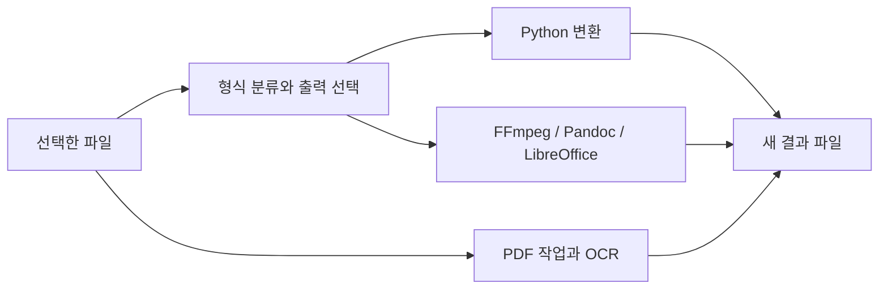
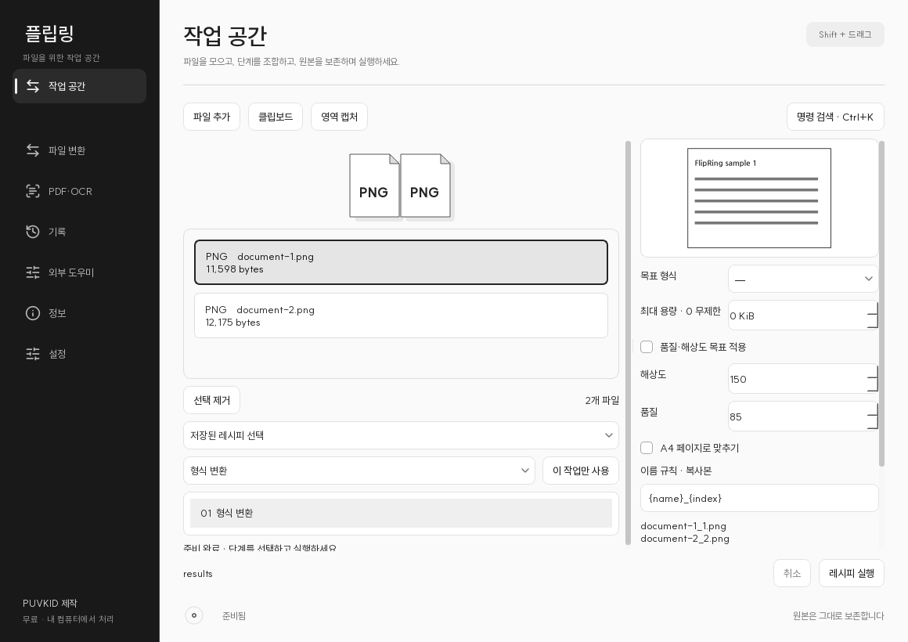
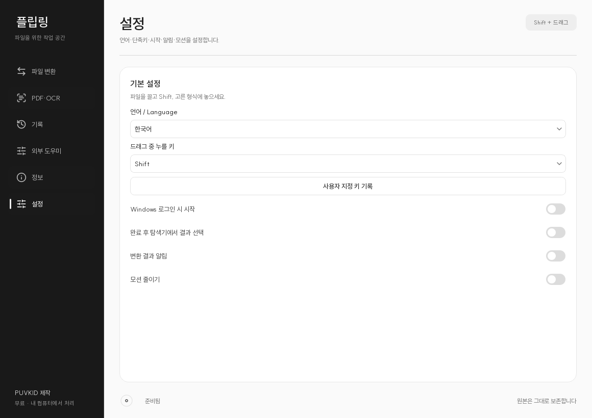

<!-- language-choice:start -->
🔵 **한국어** · [English overview](../../en/README.md)
<!-- language-choice:end -->

<a id="level-5--현재-111-안내의-기준"></a>
# FlipRing Project · LEVEL 5 - Expert

> 11월 14일의 검사 기록은 당시 상태로 보존했습니다. 이후 확인한 제품과 납품 상태는 [2026년 11월 20일 확인 범위](#product-verification-20261120)에서 구분합니다.

<details>
<summary>다른 읽기 수준 선택</summary>

| 읽기 수준 | 설명의 초점 |
| --- | --- |
| [LEVEL 1 · Beginner](%EB%A0%88%EB%B2%A81.md) | 목적과 동작부터 |
| [LEVEL 2 · Explorer](%EB%A0%88%EB%B2%A82.md) | 구성과 연결 원리 |
| [LEVEL 3 · Practitioner](%EB%A0%88%EB%B2%A83.md) | 준비·실행·결과 확인 |
| [LEVEL 4 · Advanced](%EB%A0%88%EB%B2%A84.md) | 구현·설계·실패 처리 |
| [LEVEL 5 · Expert](%EB%A0%88%EB%B2%A85.md) 현재 | 근거·프로토콜·한계 검토 |

</details>

[같은 수준의 프로필](https://github.com/PUVKID/PUVKID/blob/main/docs/읽기안내/레벨5.md) · [프로젝트 첫 화면](../../README.md)

## LEVEL 5 · 1.13.0 작업 완성도 확장

| 내용 | 상태와 연결 |
|---|---|
| 새 차수 | 전후 비교, 호환 안내, 개인정보 선택 정리와 중단 후 작업 확인을 확장합니다. 실행·설치 파일·전체 소스 ZIP을 빌드하고 Windows 설치·파일 대조를 확인했습니다. 실제 탐색기의 PNG·PDF 생성·원본 보존·중앙 취소와 내부 라이트·다크 화면·모션을 사용자 직접 확인했습니다. [배포 확인 범위](../1.13.0_배포확인.md)를 함께 안내합니다. |
| 자세히 보기 | [같은 수준의 1.13.0 상세](../versions/1.13.0.md#user-content-reading-level-5) · [1.12.1과 실제 비교](../revision-audit/1.13.0-직전비교.md) |

<a id="level-5--1121-문서-입력-보완"></a>

## 1.12.1 문서 입력 보완

| 항목 | 입력·처리 | 확인·주의 |
| --- | --- | --- |
| 회귀 | 서로 다른 검사 377개 통과 | 104개는 현행 화면 계약 보완 결과입니다. |
| 문서 입력 | 신규 단위 6개·실제 템플릿 12개 | 최초 템플릿 4개 실패는 입력 생성의 네임스페이스 표기 문제로 분리하고 재확인했습니다. |
| DIF | UTF-8·CP949 한글 셀 | BOM UTF-16은 단위 검사입니다. |
| HWP·HWPX 그림 | 전체 64×48·부분 32×24 | 각 두 형식의 네 경로에서 픽셀을 대조했습니다. |


서로 다른 기존 전체 기능 검사 377개가 통과했고 그중 104개는 현행 화면 계약 보완 결과입니다. 문서 입력 신규 단위 검사 6개, 실제 템플릿 12개와 DIF UTF-8·CP949 한글 셀을 확인했습니다. 템플릿 4개 최초 실패는 입력 생성에서 XML 네임스페이스 표기가 바뀐 원인이었고 원문 속성만 치환한 후 통과했습니다. BOM UTF-16은 단위 검사로 확인했습니다.

HWP·HWPX 전체 그림의 마지막 줄이 잘리던 문제를 고쳤습니다. 64×48 전체 그림과 32×24 부분 자르기를 각 두 형식에서 읽어 원본 픽셀과 비교한 네 경로가 통과했습니다. 다른 모든 그림이나 뷰어의 동일성을 뜻하지 않습니다.

[같은 수준의 1.12.1 상세](../versions/1.12.1.md#user-content-reading-level-5) · [직전 전체 비교](../revision-audit/1.12.1.md)

<a id="current-guide-level-5"></a>
<a id="level-5--현재-1120"></a>
<a id="level-5--이전-1120"></a>

## 이전 1.12.0

| 역할·조건 | 동작과 확인할 내용 |
| --- | --- |
| 빠른 작업 변경 검사 | 서로 다른 unittest ID **11개**는 각 변경 범위에서 통과했습니다. |
| 테마·설치 최소 검사 | **4개**를 확인했습니다. |
| 휠 연결 분기 | **1개**를 확인했습니다. |
| 상태 연동 결함·수리 | 별도 검토에서 발견한 역방향 작업 상태 누락은 실제 재현 후 두 진입 지점을 다시 확인했고 파일 상태 갱신·호스트 파일 선택 전달도 직접 확인했습니다. |

같은 최종 파일의 아래 기존 검사 근거를 재사용했으며, 이번 작업에서 반복 실행한 것은 아닙니다.

| 기존 검사 구분 | 재사용한 검사 수 |
| --- | --- |
| 기존 기능 회귀 | **163개** |
| 확장 기능 회귀 | **86개** |
| 문서 | **51개** |
| HWP | **35개** |

50개 항목을 50회의 별도 실물시험으로 집계하지 않습니다.

| 역할·조건 | 동작과 확인할 내용 |
| --- | --- |
| 테마·PDF·OCR·선택창 | 네이티브 Qt에서 빠른 작업의 라이트·다크, 다크 PDF·OCR, 다크 파일 선택창을 확인했습니다. |
| 화면 확인 | 최초 라이트 표본은 입장 모션 중이어서 정지 후 해당 화면 한 장만 추가로 확인했습니다. |
| 배포·설치 EXE 대조 | 새 배포 EXE와 설치된 EXE의 실제 Qt 설정 창 기동, 파일 버전 1.12.0, 두 EXE의 동일 해시를 확인했습니다. |
| 설치 종료 코드 | 설치 프로그램은 종료 코드 0으로 완료했습니다. |

이번 차수의 실제 마우스 Shift/OLE 변환이나 모든 외부 도구의 실제 설치를 새로 수행했다고 주장하지 않습니다.

기존 HWP 제한과 미서명 상태는 유지됩니다.

[같은 수준의 1.12.0 상세](../versions/1.12.0.md#user-content-reading-level-5) · [프로젝트 첫 화면](../../README.md)

<a id="level-5--이전-111-안내의-기준"></a>

## 이전 1.11 안내의 기준

1.11·새개발배포 68 당시의 사용 안내입니다. 파일 선택·문서/PDF/OCR·작업공간·기록과 한계를 아래에서 이 수준으로 설명합니다. 이어지는 원격 보존 구역의 “현행·최신·HWP 미지원”은 1.9 기준 설명으로 구분합니다.

[현재 HWP 저장](#current-hwp-level-5) · [현재 검증과 미완료](#current-evidence-level-5) · [이전 원격 전체 설명](#legacy-project-level-5)

<a id="level-5--검토-대상과-증거의-단위"></a>

## 검토 대상과 증거의 단위

| 항목 | 동작·조건 |
|---|---|
| 구현 | 소스가 지원하는 경로와 조건을 검토합니다. |
| 검사 | 특정 입력·설정에서 얻은 PASS와 과거 결과를 시점별로 구분합니다. |
| 배포 | 개발 배포·최종 납품·원격 게시를 서로 다른 객체로 취급합니다. |


검토 대상은 무료 로컬 Windows 파일 도구 플립 링의 현행 1.11 소스·개발 배포·보존 이력입니다.

소스가 구현하는 경로, 특정 시험의 PASS, 배포 객체, 최종 납품과 원격 게시를 독립된 주장으로 취급합니다.

현재 제품 소스 canonical70·검증한 새개발배포 68·아직 교체하지 않은 최종 납품은 별도 객체입니다.

이전 26·55 근거는 그 시점으로 구분합니다.

예전 EXE·설치·ZIP의 해시나 회귀 결과를 새 소스에 소급하면 안 됩니다.

관련 코드는 전체 소스의 `소스`와 `검사도구`, 빌드 방법, 라이선스·상응소스에 있습니다.

`app.py`, `engine.py`, `document_formats.py`, `document_bridge.py`, `document_xlsb.py`, `document_process.py`, PDF·작업 공간·검토 모듈을 경계별로 읽습니다.

확인된 프로젝트 논문이나 원고가 없으므로 연구 지표·통계적 일반화를 만들어 보충하지 않습니다.

<a id="level-5--입력출력-행렬에서-검토할-비대칭"></a>

## 입력·출력 행렬에서 검토할 비대칭

`document_formats.py`의 `DOCUMENT_INPUTS/OUTPUTS`, `PRESENTATION_INPUTS/OUTPUTS`, `SPREADSHEET_INPUTS/OUTPUTS`와 `EXPORT_FILTERS`는 입력 허용과 저장 경로를 구분합니다.

`engine.targets`의 공통 출력 계산, `validate_input`의 실제 구조 검사, 도구 준비 상태, 실제 저장 필터 성공은 서로 다른 단계입니다.

확장자 목록이 있다고 전체 입력×출력 조합 검증이 완료되는 것은 아닙니다.

| 계열 | 대표 방향과 보존 대상 | 별도로 검토할 손실·제외 |
|---|---|---|
| Word·OpenDocument | DOC ↔DOCX, ODT·RTF와 지원 TXT/HTML/EPUB/PDF/페이지 이미지 | 글꼴·표·개체·페이지 배치, DOCM/DOT 계열 입력과 저장의 비대칭 |
| Excel·OpenDocument | XLS ↔XLSX, ODS·지원 CSV/TSV/PDF/HTML | 시트·셀/수식·표시값·차트; XLSB/XLSM/XLT 계열 입력 전용 |
| PowerPoint·OpenDocument | PPT ↔PPTX, ODP·PDF·페이지 이미지·TXT | 슬라이드·텍스트·그림·효과; PPTM/POT/PPS 계열 등 입력 전용, TXT는 텍스트만 |
| 그 밖의 문서 | 텍스트/Markdown/HTML/전자책과 일부 iWork·WordPerfect·AbiWord | Pandoc·LibreOffice 경로별 필요 조건과 전용 개체 호환 |
| HWP·HWPX | 기존 읽기 DOCX/ODT/PDF 등 + 네 입력의 제한 HWP/HWPX 저장 | 제한 저장 소스 35·새 68 고정 표본 PASS; 복잡 그림·보호·HWP3·외부렌더 한계와 HWPX Shift 추가 확인 대기 |

CSV/TSV 첫 시트의 **표시값**은 원본 수식을 보존한 표현이 아닙니다.

다중 시트·수식·서식 목적은 XLSX/XLS/ODS 경로로 구분하고 값·구조를 대조합니다.

초기 Excel2007Beta2 XLSB는 지원 완료에서 제외하며 원 본문이 비어 있는 것으로 읽히면 실패로 거부합니다.

`document_xlsb.py`의 원시 시트 정보와 변환 결과 검사 범위를 셀 전량 의미 동등성으로 확대하지 않습니다.

새 소스는 python-hwpx6.12.0을 고정하고 DOCX/TXT/HWP5/HWPX → HWP/HWPX 저장을 구현했습니다.

기존 비HWP 목표는 LibreOffice 경로를 유지합니다.

HWP 쓰기는 의존성에서도 실험적이며 원 글꼴·쪽 배치 보존을 주장하지 않습니다.

`QualityPolicy`의 구조 판정과 내용 손실 거부는 독립 뷰어 렌더 동등성이 아닙니다.

HWP5 CFB 미지 스트림의 조용한 누락을 독립 검사에서 재현한 뒤, 지원 스트림·DocInfo 참조 그림 집합 검증과 입력별 메타데이터 처리 보고로 수리했습니다.

PrvImage 생략·PrvText 정규화·선택 Summary 매핑을 원메타 전체 바이트 보존과 구분합니다.

모든 HWPX 사용자 부품·모든 HWP 변종에 대한 무손실 증명은 아닙니다.

<a id="level-5--외부-환경과-문서-격리의-재현-조건"></a>

## 외부 환경과 문서 격리의 재현 조건

| 항목 | 동작·조건 |
|---|---|
| 포함 구성 | 7-Zip·Tesseract 언어 모델·H2Orestart·Java를 구분합니다. |
| 별도 도구 | LibreOffice·Pandoc·FFmpeg는 해당 경로에서 별도 준비합니다. |
| 격리 | 외부 LibreOffice의 UNO Python과 일회용 프로필을 사용합니다. |


배포 물은 7-Zip 실행 구성 요소, Tesseract와 한국어/영어 모델, H2Orestart·Java를 포함합니다.

LibreOffice는 별도 설치이며 Office에 그 설치의 UNO Python을 사용합니다.

해당 전자책/문서 경로의 Pandoc과 영상/음성의 FFmpeg도 별도입니다.

Java는 LibreOffice와 비트 수가 맞아야하며 `hwp_status`의 파일 준비 정상은 문서 호환 증명이 아닙니다.

소스 실행과 frozen 환경의 의존성 집합도 구분합니다.

| 역할·조건 | 동작과 확인할 내용 |
| --- | --- |
| 입력과 처리 | `engine.office`는 입력 검증, 임시 결과 경로, 짧은 일 회용 프로필과 요청 JSON을 구성합니다. |
| 설정 확인 | 프로필은 매크로 보안·매크로 실행 금지·능동 콘텐츠 금지·신뢰하지 않는 참조 차단·외부 업데이트 금지와 OpenCL =false를 설정하고 다섯 문서 모듈의 사이드 바 초기 상태를 명시합니다. |

사용자의 전역 설정을 변경하거나 초기화 완료 표시를 선 기록하는 방식이 아닙니다.

배포 51 실제 DOCX →PDF에서는 외부 LibreOfficePython3.13이 앱 Python3.12의 `_socket.pyd`를 읽는 충돌이 관측됐습니다.

소스 51 PASS와 frozen로 더 경계의 실패는 동시 성립합니다.

이후 `document_bridge.py`·`document_formats.py`·`document_xlsb.py` 원문만 일회용 프로필에 `xb`로 복사하고 외부 Python을 `-B -X utf8`로 실행했습니다.

전체 `_internal`이나 바이너리 확장을 복사하지 않으며 복사 누락·충돌·오류를 숨기지 않습니다.

| 역할·조건 | 동작과 확인할 내용 |
| --- | --- |
| 구현 코드 | `-B`의 바이트코드 억제와 시작 모듈 경로 분리는 각각 확인해야 합니다. |
| 설정 확인 | OpenCL 설정한 조건의 순차 관측은 ODS53.156 →26.985초, 세 UNO 준비 12.7250472/11.9658809/13.8556008 →4.1388393/4.2383016/3.3805384초였습니다. |

이는 통제된 반복 평균이나 전체 문서 가속률이 아닙니다.

일부 읽기 구간은 늘었고 외부 부하·캐시 교란을 분리하지 못했습니다.

원값을 보존하고 모든 PC의 속도·RSS 개선으로 환산하지 않습니다.

<a id="level-5--소유-프로세스와-종료-관측"></a>

## 소유 프로세스와 종료 관측

| 항목 | 동작·조건 |
|---|---|
| 시작 | Windows에서 소유 Job에 연결한 뒤 프로세스를 재개합니다. |
| 취소 | 종료 요청과 실제 자식·후손의 종료 완료를 구분합니다. |
| 오류 | API 실패·미종료와 핸들 회수 문제를 예외로 남깁니다. |


`_start_owned_process`는 Windows CREATE_SUSPENDED 후 Job 연결·재개를 수행하고 시작/할당/재개 실패에서 새 프로세스만 회수합니다. `_OwnedProcessTree`는 종료 전 핸들을 모아 TerminateJobObject를 요청하며 실제 구성원·대기 신호를 확인합니다. `_finish_owned_process`는 정리 기한을 공유해 직접 자식과 후손을 기다리고 API 오류·미종료를 예외로 남깁니다.

RAR 도우미도 소유 Job과 기존 스트리밍·CRC 경로를 보존합니다.

취소 요청 반환과 종료 완료는 같지 않습니다.

한때 나중의 OpenProcess 핸들 유무만으로 생존을 판정한 부수검사 실패가 있었으므로 실제 PID·경로·시작시각·종료신호와 관측 시점을 구분해야 합니다.

무관한 사용자 앱 종료나 이름 기준 광역종료를 정리 증거로 삼지 않습니다.

소스 소유 Job 검사와 frozen 외부도구 호출은 별도 경계입니다.

<a id="level-5ui와-pdf-요청의-수락-조건"></a>

## UI와 PDF 요청의 수락 조건

기본 UI는 파일 선택 →형식 →변환이며 Shift/OLE는 선택적 진입 점입니다.

`app.py`의 파일별 큐 상태·실패만 재시도·프리셋·원본/결과미리보기·기록은 실제 엔진 결과와 연결됩니다.

일반 결과는 원본 폴더 새 이름, 작업 공간은 앱 데이터 `results` 또는 선택한 결과 폴더입니다.

기록 더블클릭은 탐색기 선택이며 파일 실행이 아닙니다.

| 역할·조건 | 동작과 확인할 내용 |
| --- | --- |
| 범위 확인 | PDF split/extract/delete/rotate의 범위와 rotate 각도는 기본 노출입니다. |
| 출력 결과 | pdf_to_images는 출력만 기본, pages/dpi/quality는 고급이며 recognize는 language/output 기본과 pages/dpi/layout/force 고급을 나눕니다. |

images_to_pdf의 순서·dpi, 압축 모드의 손실 안 내, 전체 삭제 거부를 보존합니다.

| 역할·조건 | 동작과 확인할 내용 |
| --- | --- |
| 위치 확인 | `_labels`/행 위젯과 요청값을 바꾸지 않고 표시 위치를 나누므로 접힘이 값 초기화로 이어지면 결함입니다. |
| 범위 확인 | 과거 test69는 recognize에서 고급을 열지 않아 스크롤 범위 0 인 상태를 시험했습니다. |
| 관측 확인 | 실제 고급 열기 전후 관측 후 준비만 정정하고 기존 8assert와 다른 GUI 메서드 AST·기대 163ID를 보존했습니다. |

관련 단일/분할 20 PASS를 전체 163 PASS로 합성하지 않습니다.

| 역할·조건 | 동작과 확인할 내용 |
| --- | --- |
| 입력과 처리 | UI 노출·실제 Qt 입력·유효한 스크롤 범위를 분리해 검토합니다. |
| 저장 확인 | PDF 페이지 썸네 일 순서·다중 선택·확대·메모리 편집과 새저장, PDFium 공유 잠 금·자원 해제·취소를 확인합니다. |

OCR은 한 영 모델·인식 위치/확신도·배치와 검색 PDF의 이미지 +텍스트층을 구분하며 표/병합셀/수식/다 단 복원을 보장하지 않습니다.

무손실 압축의 크기 감소·이미지 압축의 무손실도 주장하지 않습니다.

암호·손상 입력 거부는 정상 실패 경로입니다.

<a id="level-5--작업-공간과-검토-도구의-출력-의미"></a>

## 작업 공간과 검토 도구의 출력 의미

| 역할·조건 | 동작과 확인할 내용 |
| --- | --- |
| 저장 확인 | `workspace_core.validate_recipe`는 허용 op/필드·범위·이름을 검증하고 `RecipeStore`는 JSON 레시피를 저장·가져오기·내보내기 합니다. |
| 실행 확인 | 변환·리사이즈·워터 마크·OCR·가림·이름 복사·combine_pdf·collage·gif·receipts_xlsx·compress_pdf·normalize_pages·audit를 실행 문자열 없는 단계로 조합합니다. |

`{name}/{index}/{date}` 복사 규칙에서 잘못된 규칙·Windows 예약 이름·경로 문자는 오류로 거부합니다.

| 역할·조건 | 동작과 확인할 내용 |
| --- | --- |
| 파일과 보관 | 정상 이름이 기존 파일과 충돌하면 `_publish`가 배타적 생성으로 번호를 붙인 새 이름을 시도하며 원본과 기존 결과를 덮어쓰지 않습니다. |
| 범위 확인 | 제한 범위에서 새 이름을 만들 수 없을 때는 오류입니다. |

`execute_workspace`의 `outputs`, `steps`, `checks`, `constraints_met`, `warnings`는 같은 성공 변수가 아닙니다.

생성된 결과의 크기가 목표 용량 상한 `max_bytes`를 초과하면 결과를 보존하고 목표 용량 미달성 경고를 남깁니다.

잘못된 목표 입력은 검증 오류이며, 지원하지 않는 품질·DPI 경로나 변환 실패는 별도 오류입니다.

이 경고를 형식·품질·DPI·A4 등 모든 목표 실패로 일반화하지 않고 결과 생성·목표 충족·실행 완료를 구분합니다.

| 역할·조건 | 동작과 확인할 내용 |
| --- | --- |
| 파일과 보관 | 감시폴더는 안정된 새 파일·결과/임시/반복제외를 전제로 하며 파일 카드순서·Ctrl+K·클립보드파일/그림/텍스트·사용자가 시작한 영역 캡처·휠순서/숨김/레시피·결과파일/경로복사와 드래그는 실행경로와 함께 검토합니다. |
| 저장 확인 | `recognize_editable`은 text/words/pages와 정규화 좌표·확신도를 반환하며 `export_edited_text`는 교정 텍스트를 TXT/PDF/DOCX/XLSX로 새 저장합니다. |
| 파일과 보관 | `compare_files`는 실제두파일의 페이지/크기/텍스트차이와 미리보기 검토를 돕습니다. |

`audit_file`의 흐림·가장자리·빈/중복페이지·개인정보 후보는 완전탐지 지표가 아닙니다.

`redact_file`은 사용자가 지정한 영역을 실제픽셀에 가린 새 파일이어야 하며 원텍스트가 남는 오버레이와 구분합니다.

원본·타사본은 보존되므로 새 파일의 텍스트·전페이지 확인이 필요합니다.

<a id="level-5--검사-분모순서시간소스-결합"></a>

## 검사 분모·순서·시간·소스 결합

문서 검사의 분모는 `run_documents_suite110.py`에 고정된 **14+12+4+7+8+2+4=51**입니다.

`documents_suites110.py`는 순차 결과의 expected/actual ID와 순서, 고유수·수행수·중복·누락·건너뜀·실패/오류, 완전 출력, 전후 소스·도구해시를 검사합니다.

단순 exit0이나 합계 51만으로는 같은 계약이 아닙니다.

| 군 | 수 | 원개별한도(초) | 대상 |
|---|---:|---:|---|
| test_document_formats |14|30|형식·일회용 프로필 정책|
| test_document_xlsb |12|30|실제 XLSB 구조·누락방지|
| test_documents_ui110 |4 |60 |입출력·도구 안내·Qt 연결 |
| test_documents_integration |7|180|Office 실제 왕복·결과·취소|
| test_document_external |8|210|외부실변환 경로|
| test_document_security |2|90|문서 보안·거부|
| test_document_shutdown |4|30|종료 오류·최초 예외 보존과 종료 계약(Mock)|

종료 4개는 document·desktop·process를 Mock으로 만들고 `_stop`을 patch해 최초 변환·close 예외 보존, terminate 거부·예외, wait 비정상·시간 초과와 회수 오류, 정상 승인·종료 0의 계약을 검사합니다.

실제 Windows 자식·후손을 생성하는 검사가 아닙니다.

실제 후손 종료는 별도의 소유 Job·통합 취소 근거와 구분합니다.

이전 배포 55 또는 이전 소스 시점의 보존 관측입니다.

새 68의 근거는 이 페이지 현재 검증 절과 구분합니다.

총 600초와 개별 한도를 유지합니다.

최근 독립 51은 외부 수집 206.343초/600·exit0·observed51, Python44/검사 도구 6 과 고정 표본 8 전후 불변·환경 복구를 확인했습니다.

별도 도우미 격리 6은 2.343초/60·exit0입니다.

본문 unittest 시간과 외부 수집 시간을 혼합하지 않습니다.

이 페이지 작성에서 이를 다시 실행하지 않았습니다.

기존 163 =GUI85 +PDF/OCR28 +작업 흐름 20 +PDF 편집 30이며 확장 86은 별도 분모입니다.

| 역할·조건 | 동작과 확인할 내용 |
| --- | --- |
| 실행 확인 | 현재 HWP 소스로 이 두 군과 문서 51을 각각 다시 실행해 통과했습니다. |
| 사용 도구 | 문서 51 은 원본 48개 Python·도구 6개 SHA 불변과 실제 51개 고유 검사 ID를 확인했습니다. |

이를 합친 수를 가상 정확도로 표현하지 않습니다.

최종 산출물 검사가 포함된 중앙 완료 검사는 아직 남았습니다.

과거 1.10 통합 7시간 초과와 후속 통과를 보존합니다.

<a id="level-5--배포-객체로그법적-자료의-검증"></a>

## 배포 객체·로그·법적 자료의 검증

이전 배포 55 또는 이전 소스 시점의 보존 관측입니다.

새 68의 근거는 이 페이지 현재 검증 절과 구분합니다.

개발 배포 55는 소스 동결 →전체 소스 ZIP →PyInstaller →Inno →package의 실물입니다.

| 역할·조건 | 동작과 확인할 내용 |
| --- | --- |
| 입력과 처리 | 준비 후 입력 트리 불변, ZIP939entry 원문 대조, 법적 579·참조 14·상응소스 10개 528499332B 원 바이트·공개메타 8 역 복원/개인 정보 검토, 내장 19 재귀 codeobject, 설치 1178 경로/bytes/SHA·격리 기동/응답/소유잠금/정리를 각각 구분해 확인했습니다. |
| 기록 확인 | 내부 제품 코드·빌드/검사·필수 assets/vendor/licenses는 전체 소스에 남기고 운영 기록·캐시·개인 지침은 제외합니다. |

빌드의 소유 Job·각 compiler/package600초·외부 1800초, UTF8·완전 수집을 보존합니다.

일반 64KiB와 Inno fresh 수집 모듈만 256KiB의 보관 상한은 실제 출력 수집 정책입니다.

과거 PyInstaller exit0의 invalidUTF8/원바이트미보존, Inno exit0의 163228B 중 64KiB 절단을 실패·한계로 보존했으며 exit0을 수집 정상과 같게 보지 않습니다.

새 한도에서 절단·잘못된 UTF8·미완료·capture/cleanup 오류는 거부합니다.

대형 상응 소스 10개만 정확 경로/bytes/SHA 허용 목록으로 runtime에서 분리하고 ZIP에는 원문을 남깁니다.

고지는 전체 소스 파일명·SHA·예정 ReleaseURL과 연결합니다.

예정 URL은 실제 익명 다운로드 SHA 검증 완료가 아닙니다.

용량별 glob 삭제·라이선스 삭제와 구분하며 디스크 바이트 절감을 시작 시간·RSS 효과로 환산하지 않습니다.

실행·설치 파일은 미서명입니다.

사용자의 실제 55 시험은 자체 생성 DOCX/JPG에 결합한 PDF/PNG 생성·원본 보존·중앙 취소이며 부모의 텍스트/표/픽셀/기록 대조와 독립 배포 실물 PASS가 별도로 있습니다.

이는 가상 Qt 모의·코드객체대조만의 결과가 아니지만 모든 문서 호환·모든 물리 조작의 전수 검증도 아닙니다.

새 68 빌드·설치·고정 표본과 실제 사용자 PNG/HWP는 확인했고 HWPX Shift 추가 응답·최종 교체·중앙·GitHub/Release는 미완료입니다.

새 성과를 추가하려면 실제 객체와 검증 범위를 다시 결합해야 합니다.

<a id="level-5--전체-차수와-원문을-읽는-순서"></a>

## 전체 차수와 원문을 읽는 순서

아래 17 행은 완전 배포 본·작업 전 부분 보존·현행 소스·고유자료를 구분합니다.

같은 수준 상세 목표로 연결하고 자료 폴더와 전체 비교는 원문 역할을 유지합니다.

당시의 기능·CLI·의존성·검사 결과를 현행에 소급하지 않습니다.

연결 목표의 수준별 본문은 로컬 후보이며 현재 페이지 작성만으로 원격 연결이 완료된 것은 아닙니다.

| 차수·자료 | 자료 폴더 | 같은 수준 상세 | 전체 비교·범위 | 이 수준에서 확인할 범위 |
|---|---|---|---|---|
| 1.2.0 | [자료](../../history/1.2.0) | [설명](../../docs/versions/1.2.0.md#user-content-reading-level-5) | [비교](../../docs/revision-audit/1.2.0.md) | AppVersion1.2 확인 근거와 직전 완전 원본 부재를 보존합니다. |
| 부드러운디자인-작업전 | [자료](../../history/부드러운디자인-작업전) | [설명](../../docs/versions/부드러운디자인-작업전.md#user-content-reading-level-5) | [비교](../../docs/revision-audit/부드러운디자인-작업전.md) | 부분소스의 실제 파일·원문 비교만 검증분모에 넣습니다. |
| 버튼모션-작업전 | [자료](../../history/버튼모션-작업전) | [설명](../../docs/versions/버튼모션-작업전.md#user-content-reading-level-5) | [비교](../../docs/revision-audit/버튼모션-작업전.md) | 자연 실패/제어 재현/모션 관찰 시점과 남은 assert를 구분합니다. |
| 콤보-작업전 | [자료](../../history/콤보-작업전) | [설명](../../docs/versions/콤보-작업전.md#user-content-reading-level-5) | [비교](../../docs/revision-audit/콤보-작업전.md) | 선택·팝업의 원본문/검사와 기능주장의 범위를 대조합니다. |
| 탭잔상-작업전 | [자료](../../history/탭잔상-작업전) | [설명](../../docs/versions/탭잔상-작업전.md#user-content-reading-level-5) | [비교](../../docs/revision-audit/탭잔상-작업전.md) | 잔상·삭제 객체·효과 수명과 실제 화면/offscreen 근거를 나눕니다. |
| 호버대비-작업전 | [자료](../../history/호버대비-작업전) | [설명](../../docs/versions/호버대비-작업전.md#user-content-reading-level-5) | [비교](../../docs/revision-audit/호버대비-작업전.md) | 시각 차이와 기능 검사 PASS를 서로 대체하지 않습니다. |
| 1.4.0 | [자료](../../history/1.4.0) | [설명](../../docs/versions/1.4.0.md#user-content-reading-level-5) | [비교](../../docs/revision-audit/1.4.0.md) | 원보존 파일/의존성/CLI/전체 diff와 비교 대상 부재를 검토합니다. |
| 내부모션-작업전 | [자료](../../history/내부모션-작업전) | [설명](../../docs/versions/내부모션-작업전.md#user-content-reading-level-5) | [비교](../../docs/revision-audit/내부모션-작업전.md) | 11Python·build/package 비교를 전체 1.5 실행 증거로 쓰지 않습니다. |
| 1.6.0 | [자료](../../history/1.6.0) | [설명](../../docs/versions/1.6.0.md#user-content-reading-level-5) | [비교](../../docs/revision-audit/1.6.0.md) | 검사코드증가와 실제실행·후손 정리·물리입력을 분리합니다. |
| 1.7.0 | [자료](../../history/1.7.0) | [설명](../../docs/versions/1.7.0.md#user-content-reading-level-5) | [비교](../../docs/revision-audit/1.7.0.md) | preflight 추정 공간·큐 상태·PDF 원본 보존과 원 검사 분모를 대조합니다. |
| 1.8.0 | [자료](../../history/1.8.0) | [설명](../../docs/versions/1.8.0.md#user-content-reading-level-5) | [비교](../../docs/revision-audit/1.8.0.md) | 35 배율/과거 266 재사용·163 이력과 제어 지연 계약을 분리합니다. |
| 1.9.0 | [자료](../../history/1.9.0) | [설명](../../docs/versions/1.9.0.md#user-content-reading-level-5) | [비교](../../docs/revision-audit/1.9.0.md) | 레시피 op/경계·constraints_met·후보/가림픽셀과 원 86 증거를 대조합니다. |
| 1.10.0 | [자료](../../history/1.10.0) | [설명](../../docs/versions/1.10.0.md#user-content-reading-level-5) | [비교](../../docs/revision-audit/1.10.0.md) | 당시 44 관측/통합 7원 180 미완료를 이후 51PASS로 덮지 않습니다. |
| 1.11.0 | [자료](../../history/1.11.0) | [설명](../../docs/versions/1.11.0.md#user-content-reading-level-5) | [비교](../../docs/revision-audit/1.11.0.md) | 문서 51·독립 HWP35·새 68 실물/사용자 PNG·HWP·중앙 완료/HWPX Shift 대기를 분리합니다. |
| 1.12.0 | [자료](../../history/1.12.0/) | [설명](../versions/1.12.0.md#user-content-reading-level-5) | [비교](../revision-audit/1.12.0.md) | 빠른 작업·폴더 변환·테마·앱 내 도구 설치의 구현과 확인 범위를 구분합니다. |
| 최종 | [자료](../../소스) | [설명](../../docs/versions/최종.md#user-content-reading-level-5) | [비교](../../docs/revision-audit/최종.md) | 이전 939ZIP/1178runtime/1183 납품과 새 68의 948ZIP/1207runtime·최종 교체 대기를 구분합니다. |
| 현행소스 | [자료](../../소스) | [설명](../../docs/revision-audit/현행소스.md#user-content-reading-level-5) | [비교](../../docs/revision-audit/현행소스.md) | 현재역할문서와 이전전체비교·원문함수표·라이선스의 역할을 분리합니다. |
| 고유 작업 코드·문서 | [자료](../../보존자료/작업소스) | [설명](../../docs/SOURCE_MATERIALS.md#user-content-reading-level-5) | [비교](../../docs/2026-11-02_공개반영재개검증.md) | 원출처/압축멤버/제외보류분류와 고유작업범위를 검토합니다. |

<a id="current-hwp-level-5"></a>
<a id="level-5--hwp-제한-저장의-선택절차검증-경계"></a>

## HWP 제한 저장의 선택·절차·검증 경계

| 항목 | 동작·조건 |
|---|---|
| 입력·출력 | DOCX·TXT·HWP5·HWPX에서 HWP·HWPX로 저장하며 같은 확장자는 제외합니다. |
| 허용 구조 | 단순 문단·비병합 직사각형 표·PNG/JPEG 그림을 다룹니다. |
| 거부·한계 | 복잡한 표·수식·주석·필드와 일부 그림 구조를 거부하며 HWP5 쓰기는 실험적입니다. |
| 도구 구분 | 새 제한 저장과 기존 HWP 읽기의 외부 도구 경로를 구분합니다. |


수락 경계는 DOCX/TXT/HWP5/HWPX →HWP/HWPX와 동일 확장자 제외입니다.

단순 문단·굵게/기울임·비병합 직사각형 표·PNG/JPEG 외의 구조/손실은 거부합니다.

링크/재분석 경로·ZIP/XML/외부 참조·입력 128MiB/총 해제 512MiB/XML64MiB/그림 32MiB·5000 만 픽셀 한도는 실제 코어 상수이며 각 검사의 의미를 모든 문서의 안전 증명으로 확대하지 않습니다.

HWP5 미지스트림과 DocInfo 참조 그림 집합, 정확 기본 스크립트 상수, 입력별 선택 Summary 매핑·PrvText 정규화·PrvImage 생략을 구분합니다. HWPX 사용자 부품 전체·원 글꼴/쪽배치·HWP3 저장·모든 보호 변종을 보장하지 않습니다. HWP5 쓰기는 의존성에서도 실험적입니다.

worker12는 실제 owned Job/Popen·자식/후손 종료 신호·파이프/핸들 회수와 로그/JSON/출력 경계를 검사했고 timeout은 controlled clock입니다.

고정 1은 한글 순서·3×3 셀·PNG bytes·64×48 RGB 마지막 행, 미지 2는 새 표본/과거 실패 원본의 저장 전 거부입니다.

같은 라이브러리 재개방과 portable/installed 한 표본씩의 성공은 독립 뷰어 렌더 동등성 검사가 아닙니다.

<a id="current-evidence-level-5"></a>
<a id="level-5새-배포-68의-현재-확인과-남은-절차"></a>

## 새 배포 68의 현재 확인과 남은 절차

증거의 분모는 HWP35(코어 20·worker12·고정 1·미지스트림 2) 독립 직접 실행과 문서 51·기존 163·확장 86의 부모 실행·독립 저장 ID/통계/소스 48·도구 6 해시 대 조로 나눕니다.

이전 1.10 통합7/180초 실패와 표본 경로·미지스트림 유 실 이력은 보존합니다.

합계 검사를 문서 정확도로 환산하지 않습니다.

새 68은 frozen21 재귀 codeobject·native 데이터 9·runtime1207/478350675B, sourceZIP948/809141540B와 canonical70을 대조했습니다.

실제 설치 1207 +uninstaller2·창 title 응답·소유잠금, portable/installed 고정 DOCX 각 1 시험(각 HWP/HWPX 두 출력)을 구분합니다.

기존 법적 579 +참조 14·새고지 5 +상응소스 1·데이터 9 및 대형 상응 소스10/528499332B를 확인했습니다.

| 역할·조건 | 동작과 확인할 내용 |
| --- | --- |
| 파일과 보관 | metadata만 4504 →4502B 정렬/EOF 승격했고 나머지 951 파일은 불변입니다. |
| 파일과 보관 | 사용자 새 실제 파일·history2는 PNG/HWP이며 원본 SHA2·RGB·HWP 한글/3×3 표/PNG 원 바이트·마지막 행 대조를 통과했습니다. |

중앙 취소는 사용자 확인이며 자동 물리 입력이 아닙니다.

답변의 HWPX와 실측 HWP를 혼동하지 않고 HWPX Shift 추가 확인을 기다립니다.

새 최종 교체·중앙 gate·GitHub/Release·외부뷰어 렌더 동등성은 미완료입니다.

<a id="level-5--새-배포-파일을-대조하는-값"></a>

## 새 배포 파일을 대조하는 값

아래 식별 값은 실제 빌드 68 성공 근거에서 전사했습니다.

압축 ZIP 바이트와 해제 entry 합계를 구분하고 immutable 객체와 현재 소스의 결합을 확인합니다.

| 파일 | 바이트 | SHA-256 |
| --- | ---: | --- |
| `프로그램/FlipRing/FlipRing.exe` | 9585792 | `9dfa98ef7ab9778ffc686e7c560f928aeff06e02d120cff8575733313f5c09d3` |
| `설치파일/FlipRing-Setup.exe` | 178176550 | `28a976afca70842b0e06b4a8e6c0c570388e8320e4d1eb1b8998b9189bd5ab5e` |
| `플립링-1.11.0-전체소스.zip` | 671431794 | `156708240f854b7af8917d3f46d059f83cc92e548a698219d4726e92d8becf0a` |

| 역할·조건 | 동작과 확인할 내용 |
| --- | --- |
| 파일과 보관 | 실행 구성 1207 파일 478350675B, 소스 ZIP948 항목·해제합계 809141540B를 대조했습니다. |
| 실행 확인 | 상응 소스 10개 528499332B는 실행 구성에서 분리해 전체 소스 ZIP에 원 바이트로 보존합니다. |

python-hwpx6.12.0의 Apache-2.0 LICENSE·NOTICE·METADATA와 정확 상응 소스, 기존 법적 고지를 유지합니다.

파일 용량으로 속도·RSS·외부뷰어 렌더일치 효과를 계산하지 않습니다.

<a id="legacy-project-level-5"></a>


<a id="level-5--19-기준-원격-안내와-전체-원문-보존"></a>

## 1.9 기준 원격 안내와 전체 원문 보존

여기부터 아래는 원격 874b2f1의 기존 설명을 보존한 구역입니다. 아래 “현재·최신·현행”과 HWP 미지원 문장은 이 구역의 1.9 기준 소스를 뜻합니다.

위의 현재 1.11 문서 지원·HWP 제한 저장·배포 68 상태와 구분합니다.

| 역할·조건 | 동작과 확인할 내용 |
| --- | --- |
| 사용 자료 | 기존 모바일 문단·실질 기능·표·코드·이미지·14개 자료 연결·이력은 생략하지 않았습니다. |
| 사용 자료 | 새 사용 절차와 전체 17 자료는 [현재 안내](#current-guide-level-5)에서 읽습니다. |

<!-- legacy-remote-874-start -->

## LEVEL 5 · 프로젝트 소개와 읽는 방법

전문 검토는 Request·PresetStore·변환 엔진·배타적 PDF 출력·압축 경로 검사·작업 큐·기록 저장의 수락 조건을 실제 코드와 비교하는 과정입니다. 품질·렌더·설치 검증의 증거를 분리합니다.

## LEVEL 5 · 실제 기능과 동작 범위

| 확인할 항목 | 본문의 핵심 조건 |
| --- | --- |
| 기능·동작 | 이름·종류·허용 옵션 검증, 손상 프리셋 쓰기 차단·flush/fsync 교체, 배타적 결과 생성과 경로 탈출·링크 거부를 소스 조건과 대조합니다. |
| 입력·처리·출력 | 압축 내부 상위/절대 경로·링크 검사, PDF Request 옵션과 페이지 형식·OCR 출력·도구 선택, 기록의 로컬 경로 포함을 원문과 대조합니다. |
| 결과·한계 | 압축 목표 실패·미지원 조합·쓰기 오류를 성공으로 바꾸지 않는 조건을 검토합니다.<br>OCR 문맥·표 열·후보 탐지·실제 조작 성능을 검증하지 않은 범위까지 일반화하지 않습니다. |


이름·종류·허용 옵션 검증, 손상 프리셋 쓰기 차단·flush/fsync 교체, 배타적 결과 생성과 경로 탈출·링크 거부를 소스 조건과 대조합니다.

계약·입력 거부·상태·저장·관측 근거를 실제 소스와 대조합니다.

**기능별 공통 근거**

파일 변환부터 PDF 정리까지 한 화면에서 이어서 할 수 있도록 만든 도구입니다.

플립링은 파일 형식을 분류해 가능한 출력 형식을 보여주고, Python 라이브러리 또는 외부 변환 도구로 작업을 수행합니다. PDF 화면에서는 페이지 편집과 OCR 작업을 별도로 제공합니다.

| 기능 | 구현 내용 |
| --- | --- |
| 파일 변환 | 이미지·문서·오디오·비디오·표·자막·압축 형식 처리 |
| 원형 메뉴 | 지원 형식 선택과 트레이 중심의 Windows 인터페이스 |
| PDF 편집 | 병합·분할·추출·삭제·회전·압축 |
| PDF·이미지 변환 | 이미지를 PDF로 묶거나 PDF 페이지를 이미지로 저장 |
| OCR | Tesseract를 이용한 한국어·영어 인식과 문서 출력 |
| 결과 보존 | 기존 이름과 충돌하면 새 이름으로 출력 |



## LEVEL 5 · 입력에서 처리와 출력까지

압축 내부 상위/절대 경로·링크 검사, PDF Request 옵션과 페이지 형식·OCR 출력·도구 선택, 기록의 로컬 경로 포함을 원문과 대조합니다.

| 단계 | 이 프로젝트에서 다루는 내용 |
| --- | --- |
| 입력 | 로컬 이미지·문서·미디어·PDF |
| 처리 | PySide6 UI, 변환 엔진·외부 도구, 페이지 편집·Tesseract OCR |
| 출력 | 새 형식 파일·편집 PDF·인식 문서 |


---

## LEVEL 5 · 사용·실험 순서와 확인 방법

초기 원형 메뉴의 Shift 드래그·30ms 폴링·10px 임계와 요청 큐, PDF 편집·OCR·저장·취소 경로를 소스와 확인합니다. 감시 폴더의 안정 입력·결과/임시파일·재처리 루프 제외도 검토합니다.

## LEVEL 5 · 결과와 한계를 해석하는 기준

압축 목표 실패·미지원 조합·쓰기 오류를 성공으로 바꾸지 않는 조건을 검토합니다. OCR 문맥·표 열·후보 탐지·실제 조작 성능을 검증하지 않은 범위까지 일반화하지 않습니다.

## LEVEL 5 · 구현과 핵심 파일을 연결해 읽기

소스·릴리스 회귀·신규 검사·capture 도구와 전체 diff를 대조합니다. 라이선스·외부 도구 조건을 보존하고 부분 UI 보관본을 완전 설치 제품으로 표시하지 않습니다.

## LEVEL 5 · 용어와 실수하기 쉬운 구분

파일 변환은 원본을 읽어 다른 형식의 새 파일을 만드는 일입니다.

PDF 페이지 편집은 문서의 일부 쪽을 합치거나 나누고 회전하는 작업입니다.

OCR은 이미지 속 글자를 인식하는 기능이며 원래 문서 배치를 완벽히 복구한다는 뜻은 아닙니다.

프리셋은 자주 쓰는 옵션, 레시피는 여러 처리의 순서, 작업 큐는 기다리는 작업의 목록입니다.

Qt·PySide6는 창과 화면을 만드는 도구입니다.

**원본을 보존한 새 결과 저장과 로컬 처리**를 기본으로 합니다. OCR·표 열 복원·개인정보 후보 검토는 완전한 품질·탐지를 보장하지 않습니다. 부분 보관본은 독립 설치 제품이 아니며 기능별 외부 도구·글꼴·언어 자료가 필요합니다.

## LEVEL 5 · 전체 차수와 같은 수준의 상세 설명

차수 이름은 실제 보관 단위를 따릅니다. 부분본·시험 도구·최종 안내는 제품 버전과 구분하며, 폴더와 직전 비교를 함께 연결합니다.

| 차수·자료 | 자료 폴더 | 이 수준의 차수 설명 | 직전 비교·범위 |
| --- | --- | --- | --- |
| 1.2.0 | [자료](../../history/1.2.0) | [LEVEL 5 - Expert](../versions/1.2.0.md#reading-level-5) | [전체 비교](../revision-audit/1.2.0.md) |
| 부드러운디자인-작업전 | [자료](../../history/%EB%B6%80%EB%93%9C%EB%9F%AC%EC%9A%B4%EB%94%94%EC%9E%90%EC%9D%B8-%EC%9E%91%EC%97%85%EC%A0%84) | [LEVEL 5 - Expert](../versions/%EB%B6%80%EB%93%9C%EB%9F%AC%EC%9A%B4%EB%94%94%EC%9E%90%EC%9D%B8-%EC%9E%91%EC%97%85%EC%A0%84.md#reading-level-5) | [전체 비교](../revision-audit/%EB%B6%80%EB%93%9C%EB%9F%AC%EC%9A%B4%EB%94%94%EC%9E%90%EC%9D%B8-%EC%9E%91%EC%97%85%EC%A0%84.md) |
| 버튼모션-작업전 | [자료](../../history/%EB%B2%84%ED%8A%BC%EB%AA%A8%EC%85%98-%EC%9E%91%EC%97%85%EC%A0%84) | [LEVEL 5 - Expert](../versions/%EB%B2%84%ED%8A%BC%EB%AA%A8%EC%85%98-%EC%9E%91%EC%97%85%EC%A0%84.md#reading-level-5) | [전체 비교](../revision-audit/%EB%B2%84%ED%8A%BC%EB%AA%A8%EC%85%98-%EC%9E%91%EC%97%85%EC%A0%84.md) |
| 콤보-작업전 | [자료](../../history/%EC%BD%A4%EB%B3%B4-%EC%9E%91%EC%97%85%EC%A0%84) | [LEVEL 5 - Expert](../versions/%EC%BD%A4%EB%B3%B4-%EC%9E%91%EC%97%85%EC%A0%84.md#reading-level-5) | [전체 비교](../revision-audit/%EC%BD%A4%EB%B3%B4-%EC%9E%91%EC%97%85%EC%A0%84.md) |
| 탭잔상-작업전 | [자료](../../history/%ED%83%AD%EC%9E%94%EC%83%81-%EC%9E%91%EC%97%85%EC%A0%84) | [LEVEL 5 - Expert](../versions/%ED%83%AD%EC%9E%94%EC%83%81-%EC%9E%91%EC%97%85%EC%A0%84.md#reading-level-5) | [전체 비교](../revision-audit/%ED%83%AD%EC%9E%94%EC%83%81-%EC%9E%91%EC%97%85%EC%A0%84.md) |
| 호버대비-작업전 | [자료](../../history/%ED%98%B8%EB%B2%84%EB%8C%80%EB%B9%84-%EC%9E%91%EC%97%85%EC%A0%84) | [LEVEL 5 - Expert](../versions/%ED%98%B8%EB%B2%84%EB%8C%80%EB%B9%84-%EC%9E%91%EC%97%85%EC%A0%84.md#reading-level-5) | [전체 비교](../revision-audit/%ED%98%B8%EB%B2%84%EB%8C%80%EB%B9%84-%EC%9E%91%EC%97%85%EC%A0%84.md) |
| 1.4.0 | [자료](../../history/1.4.0) | [LEVEL 5 - Expert](../versions/1.4.0.md#reading-level-5) | [전체 비교](../revision-audit/1.4.0.md) |
| 내부모션-작업전 | [자료](../../history/%EB%82%B4%EB%B6%80%EB%AA%A8%EC%85%98-%EC%9E%91%EC%97%85%EC%A0%84) | [LEVEL 5 - Expert](../versions/%EB%82%B4%EB%B6%80%EB%AA%A8%EC%85%98-%EC%9E%91%EC%97%85%EC%A0%84.md#reading-level-5) | [전체 비교](../revision-audit/%EB%82%B4%EB%B6%80%EB%AA%A8%EC%85%98-%EC%9E%91%EC%97%85%EC%A0%84.md) |
| 1.6.0 | [자료](../../history/1.6.0) | [LEVEL 5 - Expert](../versions/1.6.0.md#reading-level-5) | [전체 비교](../revision-audit/1.6.0.md) |
| 1.7.0 | [자료](../../history/1.7.0) | [LEVEL 5 - Expert](../versions/1.7.0.md#reading-level-5) | [전체 비교](../revision-audit/1.7.0.md) |
| 1.8.0 | [자료](../../history/1.8.0) | [LEVEL 5 - Expert](../versions/1.8.0.md#reading-level-5) | [전체 비교](../revision-audit/1.8.0.md) |
| 현행소스 | [자료](../../%EC%86%8C%EC%8A%A4) | [LEVEL 5 - Expert](../revision-audit/%ED%98%84%ED%96%89%EC%86%8C%EC%8A%A4.md#reading-level-5) | [전체 비교](../revision-audit/%ED%98%84%ED%96%89%EC%86%8C%EC%8A%A4.md) |
| 고유 작업 코드·문서 | [자료](../../%EB%B3%B4%EC%A1%B4%EC%9E%90%EB%A3%8C/%EC%9E%91%EC%97%85%EC%86%8C%EC%8A%A4) | [LEVEL 5 - Expert](../SOURCE_MATERIALS.md#reading-level-5) | [전체 비교](../2026-11-02_%EA%B3%B5%EA%B0%9C%EB%B0%98%EC%98%81%EC%9E%AC%EA%B0%9C%EA%B2%80%EC%A6%9D.md) |
| 1.9.0 | [자료](../../history/1.9.0) | [LEVEL 5 - Expert](../versions/1.9.0.md#reading-level-5) | [전체 비교](../revision-audit/1.9.0.md) |

## LEVEL 5 · 논문·원고와 원본 자료의 범위

소프트웨어의 소스·사용 안내·검사·설치 및 권리 자료를 다룹니다. 보관된 앱 렌더·회귀 검사 수를 문서 변환 품질의 전수 측정이나 논문 성과로 바꾸지 않습니다. 기존 라이선스와 법적 자료는 원문을 유지합니다.

## LEVEL 5 · 원래 모든 세부 설명으로 이동하기

설정값·코드 예제·실패 조건·측정 범위·화면과 파일별 안내를 생략하지 않도록 첫 화면의 전체 본문을 아래에 함께 둡니다. 각 항목은 이 페이지의 공통 근거로 바로 이동합니다. 원문에 담긴 이전 차수 조건을 현재 실행 조건으로 자동 적용하지 않습니다.

| 첫 화면의 원래 항목 | 이 페이지의 전체 근거 |
| --- | --- |
| FlipRing Project | [원문 보기](#source-section-1) |
| 파일 선택부터 결과 보존까지 | [원문 보기](#source-section-2) |
| 최신차수에서 달라진 점 | [원문 보기](#source-section-3) |
| 작업 공간과 실제 작업 모션 | [원문 보기](#source-section-4) |
| 설치본과 공개 소스 | [원문 보기](#source-section-5) |
| 확인된 전체 버전과 보존 기준본 | [원문 보기](#source-section-6) |
| 이전 1.8 고정 창 설정 화면 | [원문 보기](#source-section-7) |
| 입력·처리·출력 | [원문 보기](#source-section-8) |
| 프로젝트 소개 | [원문 보기](#source-section-9) |
| 저장소 구성 | [원문 보기](#source-section-10) |
| 주요 기술과 처리 방식 | [원문 보기](#source-section-11) |
| 트레이와 원형 메뉴 | [원문 보기](#source-section-12) |
| 화면과 기록 | [원문 보기](#source-section-13) |
| PDF 작업과 인식 옵션 | [원문 보기](#source-section-14) |
| 빠른 시작 | [원문 보기](#source-section-15) |
| 입출력과 도구 구성 | [원문 보기](#source-section-16) |
| 로컬 설정과 검사 코드 | [원문 보기](#source-section-17) |
| 문제 해결 | [원문 보기](#source-section-18) |
| 모든 차수·보관본과 전체 차이 | [원문 보기](#source-section-19) |
| HWP·HWPX 지원 범위 | [원문 보기](#source-section-20) |
| 차수별 화면과 검증 이미지 | [원문 보기](#source-section-21) |

## LEVEL 5 · 항목별 자세한 풀이와 확인 지점

### LEVEL 5 · 파일 선택부터 결과 보존까지

이 항목의 계약과 재현 조건을 아래 사실 및 연결 원문에 대조합니다. 관측값·기본값·조건 분기를 구분합니다.

앱과 변환: `app.py`가 창·트레이·파일 선택을 연결하고 `engine.py`는 입력 종류와 가능한 목표 형식·외부 변환 도구를 판별합니다.

PDF와 사전 점검: `pdf_panel.py`와 `pdf_tools.py`는 PDF 요청을 구성·실행하며, `flipring_workflow.py`는 이름별 프리셋과 파일별 사전 점검을 맡습니다.

미리보기와 작업 공간: `preview_panel.py`·`pdf_pages.py`는 미리보기와 페이지 작업을, 후속 `workspace_core.py`·`workspace_ui.py`는 레시피·감시 폴더·검색 중심의 작업 공간을 구성합니다.

파일을 선택하고 목표 형식이나 작업, 페이지와 품질을 지정합니다. 필요한 도구와 입력·출력 공간을 확인한 뒤 작업 큐에서 처리하고 결과 파일을 엽니다. 변환 성공 표시가 OCR 문맥이나 행·열 복원 품질까지 보증하지는 않으므로 결과를 직접 확인합니다. 입력·출력 경로가 작업 기록에 남을 수 있습니다.

7.0부터 보존된 프리셋 검증 조건은 다음과 같습니다.

이름은 1~80 자이며 대소문자를 무시한 중복 이름을 거부합니다. convert/pdf 종류와 허용 옵션만 저장합니다.

PDF 회전 90/180/270·품질 20\~95·DPI 60\~600·PSM 3/6/11·OCR 언어 kor+eng/kor/eng를 검사합니다.

손상된 프리셋은 오류를 보존하고 덮어 쓰지 않습니다. 정상 저장만 임시 JSON의 flush/fsync·교체를 사용합니다.

사전 점검의 공간 값은 입력 4 배 +64MiB라는 보수적 추정입니다.

입력 부재·미지원 형식·외부 도우미 부재·공간 부족·쓰기 실패를 서로 다른 코드로 돌려 주므로 같은 오류로 뭉뚱그려 재시도하지 않습니다.

FFmpeg·LibreOffice·Tesseract 등은 선택한 기능에 필요한 경우 준비하고 원본은 별도 보존합니다.

9.0은 레시피·Ctrl +K 검색·사용자가 켜는 감시 폴더·OCR 교정·개인 정보 후보 검토를 확장합니다.

검증 기록의 249개 회귀와 설치 제품 626 파일 대조는 당시 범위의 검사이며 모든 문서의 변환 품질 측정은 아닙니다.

화면 수정 전 부분 본은 독립 설치 패키지가 아니므로 차수 표의 자료 성격을 먼저 확인합니다.

app/engine/PDF/workflow/preview/workspace 책임과 원본 보존·기록 경계를 분리합니다.

**전문 대조 지점:** 파일·목표·페이지·품질과 도우미·공간 상태를 먼저 확인한 뒤 결과 파일을 직접 엽니다.

원문 식별자·옵션: app.py · engine.py · pdf_panel.py · pdf_tools.py · flipring_workflow.py · preview_panel.py · pdf_pages.py · workspace_core.py · workspace_ui.py.

- 앱과 변환: `app.py`가 창·트레이·파일 선택을 연결하고 `engine.py`는 입력 종류와 가능한 목표 형식·외부 변환 도구를 판별합니다.
- PDF와 사전 점검: `pdf_panel.py`와 `pdf_tools.py`는 PDF 요청을 구성·실행하며, `flipring_workflow.py`는 이름별 프리셋과 파일별 사전 점검을 맡습니다.
- 미리보기와 작업 공간: `preview_panel.py`·`pdf_pages.py`는 미리보기와 페이지 작업을, 후속 `workspace_core.py`·`workspace_ui.py`는 레시피·감시 폴더·검색 중심의 작업 공간을 구성합니다.

파일을 선택하고 목표 형식이나 작업, 페이지와 품질을 지정합니다. 필요한 도구와 입력·출력 공간을 확인한 뒤 작업 큐에서 처리하고 결과 파일을 엽니다. 변환 성공 표시가 OCR 문맥이나 행·열 복원 품질까지 보증하지는 않으므로 결과를 직접 확인합니다. 입력·출력 경로가 작업 기록에 남을 수 있습니다.

1.7.0부터 보존된 프리셋 검증 조건은 다음과 같습니다.

- 이름은 1~80 자이며 대소문자를 무시한 중복 이름을 거부합니다. convert/pdf 종류와 허용 옵션만 저장합니다.
- PDF 회전 90/180/270·품질 20\~95·DPI 60\~600·PSM 3/6/11·OCR 언어 kor+eng/kor/eng를 검사합니다.
- 손상된 프리셋은 오류를 보존하고 덮어 쓰지 않습니다. 정상 저장만 임시 JSON의 flush/fsync·교체를 사용합니다.

사전 점검의 공간 값은 입력 4 배 +64MiB라는 보수적 추정입니다.

입력 부재·미지원 형식·외부 도우미 부재·공간 부족·쓰기 실패를 서로 다른 코드로 돌려 주므로 같은 오류로 뭉뚱그려 재시도하지 않습니다.

FFmpeg·LibreOffice·Tesseract 등은 선택한 기능에 필요한 경우 준비하고 원본은 별도 보존합니다.

1.9.0은 레시피·Ctrl +K 검색·사용자가 켜는 감시 폴더·OCR 교정·개인 정보 후보 검토를 확장합니다.

검증 기록의 249개 회귀와 설치 제품 626 파일 대조는 당시 범위의 검사이며 모든 문서의 변환 품질 측정은 아닙니다.

화면 수정 전 부분 본은 독립 설치 패키지가 아니므로 차수 표의 자료 성격을 먼저 확인합니다.


[이 항목의 전체 조건·원문](#source-section-2)

### LEVEL 5 · 최신차수에서 달라진 점

이 항목의 계약과 재현 조건을 아래 사실 및 연결 원문에 대조합니다. 관측값·기본값·조건 분기를 구분합니다.

**1.9.0 · 파일 작업 공간과 검토 도구**

파일을 모은 뒤 목표 형식·용량·페이지 규격과 처리 순서를 한 작업 공간에서 지정하도록 확장합니다. 원본을 보존한 새 결과 저장과 로컬 처리를 기본으로 합니다.

Ctrl+K 빠른 명령창, 이름 규칙 복사, 기록 검색·필터·복사와 휠 개인화를 연결합니다.

파일 카드에서 PDF·이미지 조합과 레시피를 구성하고, 사용자가 켠 감시 폴더에서 안정된 입력에 같은 처리 순서를 적용합니다.

OCR 교정·전후 비교·흐림/중복/개인 정보 후보 검토와 사용자가 확인한 영역 가림을 제공합니다. 후보 탐지가 모든 문제를 찾아내거나 OCR이 원래 문서 배치를 완전히 복원한다고 보장하지 않습니다.

클립보드와 사용자가 직접 시작한 화면 영역 캡처를 입력으로 받습니다. 실제 작업의 대기·실행·결과를 표시하고 모션 감소 설정을 유지합니다.

[1.9 구현·실제 검사·제한](../versions/1.9.0.md#reading-level-5) · [사용 안내](../../%EC%86%8C%EC%8A%A4/1.9-%ED%99%95%EC%9E%A5%EC%95%88%EB%82%B4.md) · [직전 1.8과 전체 비교](../revision-audit/1.9.0.md)




화면 자료는 Qt 가상 화면에서 만든 앱 렌더입니다. 실제 모니터 배율 변경·물리 Shift 드래그·프레임 속도 검증과 구분합니다. 전체 렌더 범위는 5 조건 160장, 대표 시각 검토는 9장으로 구분하며 이 첫 화면에는 개인 사용자 경로가 없는 한국어·영어 화면과 실제 작업 모션만 사용합니다.

새 실행 프로그램·설치 파일·전체 실행 자산과 법적 자료는 로컬 1.9 납품 폴더에서 제공합니다.

이 저장소는 제품 소스·검사 도구·안내와 기존 공개 자산·라이선스를 보관하며 대용량 실행·설치 바이너리를 새로 업로드하지 않습니다.

새 설치본의 실제 확인 결과와 파일 크기·해시는 [1.9 상세 기록](../versions/1.9.0.md#reading-level-5)에 연결합니다. [기존 회귀 도구](../../tools19/regression19.py) · [신규 검사 도구](../../tools19/new_suites19.py)는 실행 환경이 준비된 저장소의 `소스/`를 기준으로 동작합니다.

현행 공개 소스에 남아 있던 이전 버전의 자동 생성 `FlipRing.spec`·`installer.iss`는 기준 원문과 대조한 뒤 제거합니다.

새 `build.py`가 실제 빌드 경로에 맞춰 다시 생성하므로 별도로 보관된 이전 버전 설정을 새 버전에 사용하지 않습니다.

로컬 전체 소스의 새 생성 파일과 기존 역사 원문은 보존합니다.

두 공개 파일의 삭제도 전체 변경 비교에 포함합니다.

**1.8.0 · 고정 창과 세부 디자인**

기본 창을 1160×820 논리 픽셀로 고정하고 메뉴·작업·원본/결과의 구분을 보강했습니다.

파일·폴더 선택창, PDF 페이지 번호, 고배율 아이콘·미리보기와 작은 화면의 스크롤 접근을 보완했습니다.

[1.8 실제 변경·검증 범위](../versions/1.8.0.md#reading-level-5) · [화면 안내](../../%EC%86%8C%EC%8A%A4/1.8-%ED%99%94%EB%A9%B4%EC%95%88%EB%82%B4.md)

[163개 기능 검사와 모션 동기화 검증](../2026-11-02_%EA%B2%80%EC%82%AC%EC%8B%A4%ED%96%89%EA%B5%AC%EC%84%B1%EB%B3%B4%EC%99%84.md)을 별도로 기록했습니다. 이 후속 기록은 보존된 1.8.0 제품과 검사 실행에 관한 자료입니다.

개발 검증에 사용하는 [출력 수집기](../../tools/release_capture.py)와 [회귀 검사 전체 소스](../../tools/test_release_capture.py)도 함께 보관합니다.

**1.7.0 · 파일별 작업 흐름과 PDF 페이지 편집**

원본·결과 이미지 미리보기, 파일별 대기·완료·실패·취소와 실패만 재시도, 기본·사용자 프리셋을 연결했습니다.

PDF 실제 썸네일의 드래그 순서 변경·다중 선택·회전·삭제·추출·확대와 새 파일 저장을 추가했습니다.

입력·도우미·쓰기·공간 점검, 별도 설정 화면과 저장되는 모션 줄이기를 제공합니다.

기존 Shift 원형 메뉴, 원본 보존, PDF·한영 OCR, 언어 설정과 기록의 탐색기 선택을 유지합니다.

[1.7 변경과 검증 범위](../versions/1.7.0.md#reading-level-5) · [사용 방법과 검사 재현](../../%EC%86%8C%EC%8A%A4/1.7-%EC%83%88%EA%B8%B0%EB%8A%A5%EC%95%88%EB%82%B4.md)

**기본 구조** — 원형 메뉴·트레이와 변환·PDF 처리

원형 메뉴와 작업 큐를 중심으로 파일 변환과 PDF 처리를 연결했습니다.

app.py는 Shift를 누른 채 파일을 끄는 입력을 감시하고 원형 메뉴·트레이·작업 큐를 연결합니다. 일반 변환과 PDF 작업은 각각 단일 작업 스레드이며 두 큐를 동시에 실행하지 않습니다.

engine.convert는 파일 종류별 도구를 선택하고 같은 드라이브 임시 폴더에서 처리한 뒤 새 이름으로 이동합니다. 압축의 상위·절대 경로와 링크를 검사합니다.

pdf_tools와 pdf_panel은 페이지 추출·삭제·회전·압축·OCR 출력 옵션을 처리합니다. PDF 결과는 배타적 생성으로 덮어 쓰기를 피하며 OCR의 행·열은 글자 위치에서 추정합니다.

studio_ui·ui_motion은 화면과 유한 애니메이션을 구성합니다. 최근 기록은 입력·출력·오류를 최대 200개 보관하므로 운영 파일 경로를 포함할 수 있습니다.

1.2.0·설치 구성의 AppVersion =1.2.0으로 확인한 이전 Mono 소스·[폴더](../../history/1.2.0) · [설명](../versions/1.2.0.md#reading-level-5) · 직전 비교 대상·순서 근거 없음

부드러운디자인-작업전 · app·PDF 화면·GUI 검사만 남은 부분 기준본 · [폴더](../../history/%EB%B6%80%EB%93%9C%EB%9F%AC%EC%9A%B4%EB%94%94%EC%9E%90%EC%9D%B8-%EC%9E%91%EC%97%85%EC%A0%84) · [설명](../versions/%EB%B6%80%EB%93%9C%EB%9F%AC%EC%9A%B4%EB%94%94%EC%9E%90%EC%9D%B8-%EC%9E%91%EC%97%85%EC%A0%84.md#reading-level-5) · 직전 비교 대상·순서 근거 없음

버튼모션-작업전 · app·GUI 검사만 남은 부분 기준본 · [폴더](../../history/%EB%B2%84%ED%8A%BC%EB%AA%A8%EC%85%98-%EC%9E%91%EC%97%85%EC%A0%84) · [설명](../versions/%EB%B2%84%ED%8A%BC%EB%AA%A8%EC%85%98-%EC%9E%91%EC%97%85%EC%A0%84.md#reading-level-5) · 직전 비교 대상·순서 근거 없음

콤보-작업전 · app·GUI 검사만 남은 부분 기준본 · [폴더](../../history/%EC%BD%A4%EB%B3%B4-%EC%9E%91%EC%97%85%EC%A0%84) · [설명](../versions/%EC%BD%A4%EB%B3%B4-%EC%9E%91%EC%97%85%EC%A0%84.md#reading-level-5) · 직전 비교 대상·순서 근거 없음

탭잔상-작업전 · app·GUI 검사만 남은 부분 기준본 · [폴더](../../history/%ED%83%AD%EC%9E%94%EC%83%81-%EC%9E%91%EC%97%85%EC%A0%84) · [설명](../versions/%ED%83%AD%EC%9E%94%EC%83%81-%EC%9E%91%EC%97%85%EC%A0%84.md#reading-level-5) · 직전 비교 대상·순서 근거 없음

호버대비-작업전 · app·GUI 검사만 남은 부분 기준본 · [폴더](../../history/%ED%98%B8%EB%B2%84%EB%8C%80%EB%B9%84-%EC%9E%91%EC%97%85%EC%A0%84) · [설명](../versions/%ED%98%B8%EB%B2%84%EB%8C%80%EB%B9%84-%EC%9E%91%EC%97%85%EC%A0%84.md#reading-level-5) · 직전 비교 대상·순서 근거 없음

1.4.0·설치 구성의 AppVersion =1.4.0으로 확인한 스튜디오 재설계 전 소스·[폴더](../../history/1.4.0) · [설명](../versions/1.4.0.md#reading-level-5) · [1.2.0 대비 전체 차이](../diffs/1.4.0.patch)

내부 모션-작업 전·내부 모션 확장 전 보존된 11개 Python 파일·[폴더](../../history/%EB%82%B4%EB%B6%80%EB%AA%A8%EC%85%98-%EC%9E%91%EC%97%85%EC%A0%84) · [설명](../versions/%EB%82%B4%EB%B6%80%EB%AA%A8%EC%85%98-%EC%9E%91%EC%97%85%EC%A0%84.md#reading-level-5) · [1.4.0 대비 전체 차이](../diffs/%EB%82%B4%EB%B6%80%EB%AA%A8%EC%85%98-%EC%9E%91%EC%97%85%EC%A0%84.patch)

1.6.0·설치 구성의 AppVersion =1.6.0으로 확인한 이번 작업 전 소스·[폴더](../../history/1.6.0) · [설명](../versions/1.6.0.md#reading-level-5) · [1.4.0 대비 전체 차이](../diffs/1.6.0.patch)

1.7.0 · 이번 작업 흐름 확장 소스. 설치·실제 조작 결과는 별도 검증 기록으로 구분 · [폴더](../../history/1.7.0) · [설명](../versions/1.7.0.md#reading-level-5) · [1.6.0 대비 전체 차이](../diffs/1.7.0.patch)

1.8.0 · 고정 창·영역 구분·배율 렌더 개선 · [폴더](../../history/1.8.0) · [설명](../versions/1.8.0.md#reading-level-5) · [1.7.0 대비 전체 차이](../diffs/1.8.0.patch)

1.9.0 · 작업 공간·레시피·OCR 검토와 실제 상태 모션 확장 · [폴더](../../history/1.9.0) · [설명](../versions/1.9.0.md#reading-level-5) · [1.8.0 대비 전체 차이](../revision-audit/1.9.0.md)

원래 1차·2차와 보존 파일의 대응은 확인되지 않았습니다. 1.3·1.5의 완전한 최종 소스도 확인되지 않아 번호를 만들어 채우지 않습니다. [보존 범위와 비교 한계](../VERSIONS.md)를 함께 확인해 주세요.



1160×820 논리 픽셀에서 생성한 Qt 자체 정지 렌더입니다. 실제 Windows 화면 캡처·모니터 배율 변경이나 프레임 속도 증거와 구분합니다. 아래 기존 구성 자료는 이전 보존 버전의 설명도 포함합니다.

현재 기능과 보존 1.8/1.7의 조건·검사 범위를 혼합하지 않습니다.

**전문 대조 지점:** 원본 보존과 사용자가 켠 감시·확인한 가림 영역을 실제 기능과 대조합니다.

**1.9.0 · 파일 작업 공간과 검토 도구**

파일을 모은 뒤 목표 형식·용량·페이지 규격과 처리 순서를 한 작업 공간에서 지정하도록 확장합니다. 원본을 보존한 새 결과 저장과 로컬 처리를 기본으로 합니다.

- Ctrl+K 빠른 명령창, 이름 규칙 복사, 기록 검색·필터·복사와 휠 개인화를 연결합니다.
- 파일 카드에서 PDF·이미지 조합과 레시피를 구성하고, 사용자가 켠 감시 폴더에서 안정된 입력에 같은 처리 순서를 적용합니다.
- OCR 교정·전후 비교·흐림/중복/개인 정보 후보 검토와 사용자가 확인한 영역 가림을 제공합니다. 후보 탐지가 모든 문제를 찾아내거나 OCR이 원래 문서 배치를 완전히 복원한다고 보장하지 않습니다.
- 클립보드와 사용자가 직접 시작한 화면 영역 캡처를 입력으로 받습니다. 실제 작업의 대기·실행·결과를 표시하고 모션 감소 설정을 유지합니다.
- [1.9 구현·실제 검사·제한](../versions/1.9.0.md#reading-level-5) · [사용 안내](../../%EC%86%8C%EC%8A%A4/1.9-%ED%99%95%EC%9E%A5%EC%95%88%EB%82%B4.md) · [직전 1.8과 전체 비교](../revision-audit/1.9.0.md)


[이 항목의 전체 조건·원문](#source-section-3)

### LEVEL 5 · 작업 공간과 실제 작업 모션

가상 화면 160장·대표 9장과 성능·전수 조작 검증은 서로 다른 증거입니다.

**전문 대조 지점:** Qt 자체 렌더·실제 작업 모션과 물리 모니터·드래그·배율 시험의 범위를 구분합니다.


화면 자료는 Qt 가상 화면에서 만든 앱 렌더입니다. 실제 모니터 배율 변경·물리 Shift 드래그·프레임 속도 검증과 구분합니다. 전체 렌더 범위는 5 조건 160장, 대표 시각 검토는 9장으로 구분하며 이 첫 화면에는 개인 사용자 경로가 없는 한국어·영어 화면과 실제 작업 모션만 사용합니다.


[이 항목의 전체 조건·원문](#source-section-4)

### LEVEL 5 · 설치본과 공개 소스

기존 자동 생성 spec/iss 삭제와 새 build.py 생성 책임을 구분합니다.

**전문 대조 지점:** 설치 자료의 크기·해시·권리 자료와 소스의 빌드 진입점을 확인합니다. 원문 식별자·옵션: 소스/ · FlipRing.spec · installer.iss · build.py.

새 실행 프로그램·설치 파일·전체 실행 자산과 법적 자료는 로컬 1.9 납품 폴더에서 제공합니다.

이 저장소는 제품 소스·검사 도구·안내와 기존 공개 자산·라이선스를 보관하며 대용량 실행·설치 바이너리를 새로 업로드하지 않습니다.

새 설치본의 실제 확인 결과와 파일 크기·해시는 [1.9 상세 기록](../versions/1.9.0.md#reading-level-5)에 연결합니다. [기존 회귀 도구](../../tools19/regression19.py) · [신규 검사 도구](../../tools19/new_suites19.py)는 실행 환경이 준비된 저장소의 `소스/`를 기준으로 동작합니다.

현행 공개 소스에 남아 있던 이전 버전의 자동 생성 `FlipRing.spec`·`installer.iss`는 기준 원문과 대조한 뒤 제거합니다.

새 `build.py`가 실제 빌드 경로에 맞춰 다시 생성하므로 별도로 보관된 이전 버전 설정을 새 버전에 사용하지 않습니다.

로컬 전체 소스의 새 생성 파일과 기존 역사 원문은 보존합니다.

두 공개 파일의 삭제도 전체 변경 비교에 포함합니다.

**1.8.0 · 고정 창과 세부 디자인**

- 기본 창을 1160×820 논리 픽셀로 고정하고 메뉴·작업·원본/결과의 구분을 보강했습니다.
- 파일·폴더 선택창, PDF 페이지 번호, 고배율 아이콘·미리보기와 작은 화면의 스크롤 접근을 보완했습니다.
- [1.8 실제 변경·검증 범위](../versions/1.8.0.md#reading-level-5) · [화면 안내](../../%EC%86%8C%EC%8A%A4/1.8-%ED%99%94%EB%A9%B4%EC%95%88%EB%82%B4.md)
- [163개 기능 검사와 모션 동기화 검증](../2026-11-02_%EA%B2%80%EC%82%AC%EC%8B%A4%ED%96%89%EA%B5%AC%EC%84%B1%EB%B3%B4%EC%99%84.md)을 별도로 기록했습니다. 이 후속 기록은 보존된 1.8.0 제품과 검사 실행에 관한 자료입니다.
- 개발 검증에 사용하는 [출력 수집기](../../tools/release_capture.py)와 [회귀 검사 전체 소스](../../tools/test_release_capture.py)도 함께 보관합니다.

**1.7.0 · 파일별 작업 흐름과 PDF 페이지 편집**

- 원본·결과 이미지 미리보기, 파일별 대기·완료·실패·취소와 실패만 재시도, 기본·사용자 프리셋을 연결했습니다.
- PDF 실제 썸네일의 드래그 순서 변경·다중 선택·회전·삭제·추출·확대와 새 파일 저장을 추가했습니다.
- 입력·도우미·쓰기·공간 점검, 별도 설정 화면과 저장되는 모션 줄이기를 제공합니다.
- 기존 Shift 원형 메뉴, 원본 보존, PDF·한영 OCR, 언어 설정과 기록의 탐색기 선택을 유지합니다.
- [1.7 변경과 검증 범위](../versions/1.7.0.md#reading-level-5) · [사용 방법과 검사 재현](../../%EC%86%8C%EC%8A%A4/1.7-%EC%83%88%EA%B8%B0%EB%8A%A5%EC%95%88%EB%82%B4.md)

**기본 구조** — 원형 메뉴·트레이와 변환·PDF 처리

원형 메뉴와 작업 큐를 중심으로 파일 변환과 PDF 처리를 연결했습니다.

- app.py는 Shift를 누른 채 파일을 끄는 입력을 감시하고 원형 메뉴·트레이·작업 큐를 연결합니다. 일반 변환과 PDF 작업은 각각 단일 작업 스레드이며 두 큐를 동시에 실행하지 않습니다.
- engine.convert는 파일 종류별 도구를 선택하고 같은 드라이브 임시 폴더에서 처리한 뒤 새 이름으로 이동합니다. 압축의 상위·절대 경로와 링크를 검사합니다.
- pdf_tools와 pdf_panel은 페이지 추출·삭제·회전·압축·OCR 출력 옵션을 처리합니다. PDF 결과는 배타적 생성으로 덮어 쓰기를 피하며 OCR의 행·열은 글자 위치에서 추정합니다.
- studio_ui·ui_motion은 화면과 유한 애니메이션을 구성합니다. 최근 기록은 입력·출력·오류를 최대 200개 보관하므로 운영 파일 경로를 포함할 수 있습니다.


[이 항목의 전체 조건·원문](#source-section-5)

### LEVEL 5 · 확인된 전체 버전과 보존 기준본

확인되지 않은 1.3/1.5·원래 1차/2차 대응을 임의로 채우지 않습니다.

**전문 대조 지점:** 폴더·상세·비교와 부분 보존 여부를 같은 행으로 확인합니다.

| 확인된 버전·기준본 | 보존 범위 | 소스·설명 | 비교 |
| --- | --- | --- | --- |
| 1.2.0 | 설치 구성의 AppVersion =1.2.0으로 확인한 이전 Mono 소스 | [폴더](../../history/1.2.0) · [설명](../versions/1.2.0.md#reading-level-5) | 직전 비교 대상·순서 근거 없음 |
| 부드러운디자인-작업전 | app·PDF 화면·GUI 검사만 남은 부분 기준본 | [폴더](../../history/%EB%B6%80%EB%93%9C%EB%9F%AC%EC%9A%B4%EB%94%94%EC%9E%90%EC%9D%B8-%EC%9E%91%EC%97%85%EC%A0%84) · [설명](../versions/%EB%B6%80%EB%93%9C%EB%9F%AC%EC%9A%B4%EB%94%94%EC%9E%90%EC%9D%B8-%EC%9E%91%EC%97%85%EC%A0%84.md#reading-level-5) | 직전 비교 대상·순서 근거 없음 |
| 버튼모션-작업전 | app·GUI 검사만 남은 부분 기준본 | [폴더](../../history/%EB%B2%84%ED%8A%BC%EB%AA%A8%EC%85%98-%EC%9E%91%EC%97%85%EC%A0%84) · [설명](../versions/%EB%B2%84%ED%8A%BC%EB%AA%A8%EC%85%98-%EC%9E%91%EC%97%85%EC%A0%84.md#reading-level-5) | 직전 비교 대상·순서 근거 없음 |
| 콤보-작업전 | app·GUI 검사만 남은 부분 기준본 | [폴더](../../history/%EC%BD%A4%EB%B3%B4-%EC%9E%91%EC%97%85%EC%A0%84) · [설명](../versions/%EC%BD%A4%EB%B3%B4-%EC%9E%91%EC%97%85%EC%A0%84.md#reading-level-5) | 직전 비교 대상·순서 근거 없음 |
| 탭잔상-작업전 | app·GUI 검사만 남은 부분 기준본 | [폴더](../../history/%ED%83%AD%EC%9E%94%EC%83%81-%EC%9E%91%EC%97%85%EC%A0%84) · [설명](../versions/%ED%83%AD%EC%9E%94%EC%83%81-%EC%9E%91%EC%97%85%EC%A0%84.md#reading-level-5) | 직전 비교 대상·순서 근거 없음 |
| 호버대비-작업전 | app·GUI 검사만 남은 부분 기준본 | [폴더](../../history/%ED%98%B8%EB%B2%84%EB%8C%80%EB%B9%84-%EC%9E%91%EC%97%85%EC%A0%84) · [설명](../versions/%ED%98%B8%EB%B2%84%EB%8C%80%EB%B9%84-%EC%9E%91%EC%97%85%EC%A0%84.md#reading-level-5) | 직전 비교 대상·순서 근거 없음 |
| 1.4.0 | 설치 구성의 AppVersion =1.4.0으로 확인한 스튜디오 재설계 전 소스 | [폴더](../../history/1.4.0) · [설명](../versions/1.4.0.md#reading-level-5) | [1.2.0 대비 전체 차이](../diffs/1.4.0.patch) |
| 내부 모션-작업 전 | 내부 모션 확장 전 보존된 11개 Python 파일 | [폴더](../../history/%EB%82%B4%EB%B6%80%EB%AA%A8%EC%85%98-%EC%9E%91%EC%97%85%EC%A0%84) · [설명](../versions/%EB%82%B4%EB%B6%80%EB%AA%A8%EC%85%98-%EC%9E%91%EC%97%85%EC%A0%84.md#reading-level-5) | [1.4.0 대비 전체 차이](../diffs/%EB%82%B4%EB%B6%80%EB%AA%A8%EC%85%98-%EC%9E%91%EC%97%85%EC%A0%84.patch) |
| 1.6.0 | 설치 구성의 AppVersion =1.6.0으로 확인한 이번 작업 전 소스 | [폴더](../../history/1.6.0) · [설명](../versions/1.6.0.md#reading-level-5) | [1.4.0 대비 전체 차이](../diffs/1.6.0.patch) |
| 1.7.0 | 이번 작업 흐름 확장 소스.<br>설치·실제 조작 결과는 별도 검증 기록으로 구분 | [폴더](../../history/1.7.0) · [설명](../versions/1.7.0.md#reading-level-5) | [1.6.0 대비 전체 차이](../diffs/1.7.0.patch) |
| 1.8.0 | 고정 창·영역 구분·배율 렌더 개선 | [폴더](../../history/1.8.0) · [설명](../versions/1.8.0.md#reading-level-5) | [1.7.0 대비 전체 차이](../diffs/1.8.0.patch) |
| 1.9.0 | 작업 공간·레시피·OCR 검토와 실제 상태 모션 확장 | [폴더](../../history/1.9.0) · [설명](../versions/1.9.0.md#reading-level-5) | [1.8.0 대비 전체 차이](../revision-audit/1.9.0.md) |

원래 1차·2차와 보존 파일의 대응은 확인되지 않았습니다. 1.3·1.5의 완전한 최종 소스도 확인되지 않아 번호를 만들어 채우지 않습니다. [보존 범위와 비교 한계](../VERSIONS.md)를 함께 확인해 주세요.

| 확인된 버전·기준본 | 보존 범위 | 소스·설명 | 비교 |
| --- | --- | --- | --- |
| 1.2.0 | 설치 구성의 AppVersion =1.2.0으로 확인한 이전 Mono 소스 | [폴더](../../history/1.2.0) · [설명](../versions/1.2.0.md#reading-level-5) | 직전 비교 대상·순서 근거 없음 |
| 부드러운디자인-작업전 | app·PDF 화면·GUI 검사만 남은 부분 기준본 | [폴더](../../history/%EB%B6%80%EB%93%9C%EB%9F%AC%EC%9A%B4%EB%94%94%EC%9E%90%EC%9D%B8-%EC%9E%91%EC%97%85%EC%A0%84) · [설명](../versions/%EB%B6%80%EB%93%9C%EB%9F%AC%EC%9A%B4%EB%94%94%EC%9E%90%EC%9D%B8-%EC%9E%91%EC%97%85%EC%A0%84.md#reading-level-5) | 직전 비교 대상·순서 근거 없음 |
| 버튼모션-작업전 | app·GUI 검사만 남은 부분 기준본 | [폴더](../../history/%EB%B2%84%ED%8A%BC%EB%AA%A8%EC%85%98-%EC%9E%91%EC%97%85%EC%A0%84) · [설명](../versions/%EB%B2%84%ED%8A%BC%EB%AA%A8%EC%85%98-%EC%9E%91%EC%97%85%EC%A0%84.md#reading-level-5) | 직전 비교 대상·순서 근거 없음 |
| 콤보-작업전 | app·GUI 검사만 남은 부분 기준본 | [폴더](../../history/%EC%BD%A4%EB%B3%B4-%EC%9E%91%EC%97%85%EC%A0%84) · [설명](../versions/%EC%BD%A4%EB%B3%B4-%EC%9E%91%EC%97%85%EC%A0%84.md#reading-level-5) | 직전 비교 대상·순서 근거 없음 |
| 탭잔상-작업전 | app·GUI 검사만 남은 부분 기준본 | [폴더](../../history/%ED%83%AD%EC%9E%94%EC%83%81-%EC%9E%91%EC%97%85%EC%A0%84) · [설명](../versions/%ED%83%AD%EC%9E%94%EC%83%81-%EC%9E%91%EC%97%85%EC%A0%84.md#reading-level-5) | 직전 비교 대상·순서 근거 없음 |
| 호버대비-작업전 | app·GUI 검사만 남은 부분 기준본 | [폴더](../../history/%ED%98%B8%EB%B2%84%EB%8C%80%EB%B9%84-%EC%9E%91%EC%97%85%EC%A0%84) · [설명](../versions/%ED%98%B8%EB%B2%84%EB%8C%80%EB%B9%84-%EC%9E%91%EC%97%85%EC%A0%84.md#reading-level-5) | 직전 비교 대상·순서 근거 없음 |
| 1.4.0 | 설치 구성의 AppVersion =1.4.0으로 확인한 스튜디오 재설계 전 소스 | [폴더](../../history/1.4.0) · [설명](../versions/1.4.0.md#reading-level-5) | [1.2.0 대비 전체 차이](../diffs/1.4.0.patch) |
| 내부 모션-작업 전 | 내부 모션 확장 전 보존된 11개 Python 파일 | [폴더](../../history/%EB%82%B4%EB%B6%80%EB%AA%A8%EC%85%98-%EC%9E%91%EC%97%85%EC%A0%84) · [설명](../versions/%EB%82%B4%EB%B6%80%EB%AA%A8%EC%85%98-%EC%9E%91%EC%97%85%EC%A0%84.md#reading-level-5) | [1.4.0 대비 전체 차이](../diffs/%EB%82%B4%EB%B6%80%EB%AA%A8%EC%85%98-%EC%9E%91%EC%97%85%EC%A0%84.patch) |
| 1.6.0 | 설치 구성의 AppVersion =1.6.0으로 확인한 이번 작업 전 소스 | [폴더](../../history/1.6.0) · [설명](../versions/1.6.0.md#reading-level-5) | [1.4.0 대비 전체 차이](../diffs/1.6.0.patch) |
| 1.7.0 | 이번 작업 흐름 확장 소스.<br>설치·실제 조작 결과는 별도 검증 기록으로 구분 | [폴더](../../history/1.7.0) · [설명](../versions/1.7.0.md#reading-level-5) | [1.6.0 대비 전체 차이](../diffs/1.7.0.patch) |
| 1.8.0 | 고정 창·영역 구분·배율 렌더 개선 | [폴더](../../history/1.8.0) · [설명](../versions/1.8.0.md#reading-level-5) | [1.7.0 대비 전체 차이](../diffs/1.8.0.patch) |
| 1.9.0 | 작업 공간·레시피·OCR 검토와 실제 상태 모션 확장 | [폴더](../../history/1.9.0) · [설명](../versions/1.9.0.md#reading-level-5) | [1.8.0 대비 전체 차이](../revision-audit/1.9.0.md) |

[이 항목의 전체 조건·원문](#source-section-6)

### LEVEL 5 · 이전 1.8 고정 창 설정 화면

이전 설정 화면을 최신 1.9의 모든 조작 검증으로 사용하지 않습니다.

**전문 대조 지점:** 1160×820 논리 픽셀·정지 렌더와 실제 Windows 화면·배율·FPS를 구분합니다.


1160×820 논리 픽셀에서 생성한 Qt 자체 정지 렌더입니다. 실제 Windows 화면 캡처·모니터 배율 변경이나 프레임 속도 증거와 구분합니다. 아래 기존 구성 자료는 이전 보존 버전의 설명도 포함합니다.

<a name="input-processing-output"></a>


[이 항목의 전체 조건·원문](#source-section-7)

### LEVEL 5 · 입력·처리·출력

이 항목의 계약과 재현 조건을 아래 사실 및 연결 원문에 대조합니다. 관측값·기본값·조건 분기를 구분합니다.

입력 — 로컬 이미지·문서·미디어·PDF

처리 — PySide6 UI, 변환 엔진·외부 도구, 페이지 편집·Tesseract OCR

출력 — 새 형식 파일·편집 PDF·인식 문서

--

변환 성공과 문맥·표 복원 품질을 분리합니다.

**전문 대조 지점:** 선택한 입력 형식·옵션·도우미와 출력 파일을 대조합니다.

| 단계 | 이 프로젝트에서 다루는 내용 |
| --- | --- |
| 입력 | 로컬 이미지·문서·미디어·PDF |
| 처리 | PySide6 UI, 변환 엔진·외부 도구, 페이지 편집·Tesseract OCR |
| 출력 | 새 형식 파일·편집 PDF·인식 문서 |
| 단계 | 이 프로젝트에서 다루는 내용 |
| --- | --- |
| 입력 | 로컬 이미지·문서·미디어·PDF |
| 처리 | PySide6 UI, 변환 엔진·외부 도구, 페이지 편집·Tesseract OCR |
| 출력 | 새 형식 파일·편집 PDF·인식 문서 |

[이 항목의 전체 조건·원문](#source-section-8)

### LEVEL 5 · 프로젝트 소개

이 항목의 계약과 재현 조건을 아래 사실 및 연결 원문에 대조합니다. 관측값·기본값·조건 분기를 구분합니다.

파일 변환부터 PDF 정리까지 한 화면에서 이어서 할 수 있도록 만든 도구입니다.

플립링은 파일 형식을 분류해 가능한 출력 형식을 보여주고, Python 라이브러리 또는 외부 변환 도구로 작업을 수행합니다. PDF 화면에서는 페이지 편집과 OCR 작업을 별도로 제공합니다.

파일 변환 — 이미지·문서·오디오·비디오·표·자막·압축 형식 처리

원형 메뉴 — 지원 형식 선택과 트레이 중심의 Windows 인터페이스

PDF 편집 — 병합·분할·추출·삭제·회전·압축

PDF·이미지 변환 — 이미지를 PDF로 묶거나 PDF 페이지를 이미지로 저장

OCR — Tesseract를 이용한 한국어·영어 인식과 문서 출력

결과 보존 — 기존 이름과 충돌하면 새 이름으로 출력

기능 존재·지원 형식·실제 품질과 외부 도구 의존성을 구분합니다.

**전문 대조 지점:** 파일 변환·병합·분할·회전·OCR·새 이름 저장을 필요한 기능별로 확인합니다.

파일 변환부터 PDF 정리까지 한 화면에서 이어서 할 수 있도록 만든 도구입니다.

플립링은 파일 형식을 분류해 가능한 출력 형식을 보여주고, Python 라이브러리 또는 외부 변환 도구로 작업을 수행합니다. PDF 화면에서는 페이지 편집과 OCR 작업을 별도로 제공합니다.

| 기능 | 구현 내용 |
| --- | --- |
| 파일 변환 | 이미지·문서·오디오·비디오·표·자막·압축 형식 처리 |
| 원형 메뉴 | 지원 형식 선택과 트레이 중심의 Windows 인터페이스 |
| PDF 편집 | 병합·분할·추출·삭제·회전·압축 |
| PDF·이미지 변환 | 이미지를 PDF로 묶거나 PDF 페이지를 이미지로 저장 |
| OCR | Tesseract를 이용한 한국어·영어 인식과 문서 출력 |
| 결과 보존 | 기존 이름과 충돌하면 새 이름으로 출력 |

[이 항목의 전체 조건·원문](#source-section-9)

### LEVEL 5 · 저장소 구성

검사 도구의 존재와 실행 성공·완전 설치 환경을 분리합니다.

**전문 대조 지점:** 같은 버전의 소스와 assets·licenses·고정 의존성을 확인합니다.


[이 항목의 전체 조건·원문](#source-section-10)

### LEVEL 5 · 주요 기술과 처리 방식

이 항목의 계약과 재현 조건을 아래 사실 및 연결 원문에 대조합니다. 관측값·기본값·조건 분기를 구분합니다.

파일 종류에 따라 처리 도구가 달라집니다. Pillow·pi-heif는 이미지, pypdfium2·pypdf는 PDF 읽기와 편집, python-docx·ReportLab은 문서 생성을 맡습니다. 표 형태의 OCR 출력은 글자의 위치에서 행·열을 추정하므로 복잡한 표를 완전히 복원한다고 보장하지 않습니다.

`engine.convert()`는 원본과 같은 드라이브의 임시 폴더에서 변환한 뒤 새 이름으로 이동합니다. 압축 내부의 상위 경로·절대 경로와 링크를 검사합니다. PDF 출력은 배타적 파일 생성으로 기존 결과 덮어쓰기를 피하도록 구성합니다.

기본 조합은 **Shift를 누른 채 탐색기·바탕 화면에서 파일을 끌기**입니다. 앱은 30ms 간격으로 입력 상태를 확인하고 10px보다 큰 이동에서 원형 메뉴를 띄웁니다. 메뉴에 실제로 전달된 로컬 파일을 확인하고 복사 동작으로 드롭을 받아 변환합니다. 중앙·지원하지 않는 영역에서는 변환하지 않습니다.

창의 닫기 버튼은 앱을 트레이로 숨깁니다. 종료는 트레이 메뉴에서 선택하며, 변환 작업이 남아 있으면 완료를 기다리도록 안내합니다. 일반 변환과 PDF 작업은 각각 단일 작업 스레드를 사용하고 두 큐를 동시에 실행하지 않습니다. 도움 도구 화면은 설치 명령을 클립보드에 복사하며 자동 설치하지 않습니다.

화면은 PySide6와 QPainter로 그리며 앱 전용 SUIT Regular·Medium·SemiBold 글꼴을 읽습니다. 버튼·선택·상태 피드백은 유한 애니메이션이며 숨긴 화면에서는 멈춥니다. 도구팁은 파일명과 오류를 일반 텍스트로 표시합니다.

최근 변환 기록은 최대 200개이며 입력·출력 경로와 오류를 포함합니다. 기록 파일이 손상되면 오류 표시와 함께 기존 파일을 덮어쓰지 않도록 처리합니다. 기록의 결과를 더블 클릭하면 해당 파일을 실행하지 않고 탐색기에서 선택합니다.

페이지 선택 — 전체 또는 `1,3-5`; 삭제에는 명시 범위 필요

회전 — 90°·180°·270°

이미지 품질 — 20~95, 기본 80

해상도 — 60~600 DPI, 기본 200

OCR 언어 — 한국어+영어, 한국어, 영어

OCR 배치 — 자동 PSM 3, 단일 블록 6, 흩어진 글자 11

인식 결과 — 검색 PDF·TXT·DOCX·XLSX

검색 PDF는 페이지를 이미지로 재구성하고 인식 텍스트 층을 추가합니다. Word·Excel은 글자 좌표로 행과 열을 추정하므로 원래 배치나 병합 셀을 완전히 복원하지 않습니다. 이미지 재압축은 손실 방식이며 무손실 정리도 파일 크기 감소를 보장하지 않습니다. 취소 요청은 작업에 전달하고 이미 완성한 결과를 유지합니다.

압축 경로 탈출·링크 거부와 OCR 좌표 기반 표 복원 한계를 검토합니다.

**전문 대조 지점:** 원본과 같은 드라이브 임시 처리·새 이름 이동·PDF 배타적 생성을 확인합니다. 원문 식별자·옵션: engine.convert().

파일 종류에 따라 처리 도구가 달라집니다. Pillow·pi-heif는 이미지, pypdfium2·pypdf는 PDF 읽기와 편집, python-docx·ReportLab은 문서 생성을 맡습니다. 표 형태의 OCR 출력은 글자의 위치에서 행·열을 추정하므로 복잡한 표를 완전히 복원한다고 보장하지 않습니다.

`engine.convert()`는 원본과 같은 드라이브의 임시 폴더에서 변환한 뒤 새 이름으로 이동합니다. 압축 내부의 상위 경로·절대 경로와 링크를 검사합니다. PDF 출력은 배타적 파일 생성으로 기존 결과 덮어쓰기를 피하도록 구성합니다.


[이 항목의 전체 조건·원문](#source-section-11)

### LEVEL 5 · 트레이와 원형 메뉴

30ms 폴링·10px 임계와 실제 드롭 검증·작업 스레드를 분리합니다.

**전문 대조 지점:** 트레이 종료·진행 작업·지원 영역·도우미 안내와 두 큐의 동시 실행 제한을 확인합니다.

기본 조합은 **Shift를 누른 채 탐색기·바탕 화면에서 파일을 끌기**입니다. 앱은 30ms 간격으로 입력 상태를 확인하고 10px보다 큰 이동에서 원형 메뉴를 띄웁니다. 메뉴에 실제로 전달된 로컬 파일을 확인하고 복사 동작으로 드롭을 받아 변환합니다. 중앙·지원하지 않는 영역에서는 변환하지 않습니다.

창의 닫기 버튼은 앱을 트레이로 숨깁니다. 종료는 트레이 메뉴에서 선택하며, 변환 작업이 남아 있으면 완료를 기다리도록 안내합니다. 일반 변환과 PDF 작업은 각각 단일 작업 스레드를 사용하고 두 큐를 동시에 실행하지 않습니다. 도움 도구 화면은 설치 명령을 클립보드에 복사하며 자동 설치하지 않습니다.


[이 항목의 전체 조건·원문](#source-section-12)

### LEVEL 5 · 화면과 기록

기록의 경로 개인정보와 유한 애니메이션·숨김 시 정지를 검토합니다.

**전문 대조 지점:** 손상 기록 보존·최대 200개·결과 더블클릭의 탐색기 선택을 확인합니다.

화면은 PySide6와 QPainter로 그리며 앱 전용 SUIT Regular·Medium·SemiBold 글꼴을 읽습니다. 버튼·선택·상태 피드백은 유한 애니메이션이며 숨긴 화면에서는 멈춥니다. 도구팁은 파일명과 오류를 일반 텍스트로 표시합니다.

최근 변환 기록은 최대 200개이며 입력·출력 경로와 오류를 포함합니다. 기록 파일이 손상되면 오류 표시와 함께 기존 파일을 덮어쓰지 않도록 처리합니다. 기록의 결과를 더블 클릭하면 해당 파일을 실행하지 않고 탐색기에서 선택합니다.


[이 항목의 전체 조건·원문](#source-section-13)

### LEVEL 5 · PDF 작업과 인식 옵션

이미지 손실 압축·검색 PDF 재구성·Word/Excel 좌표 추정 한계를 구분합니다.

**전문 대조 지점:** 허용 범위와 명시 삭제 페이지·OCR 출력·취소 뒤 완성 결과 보존을 확인합니다. 원문 식별자·옵션: 1,3-5.

| 옵션 | 화면의 실제 값 |
| --- | --- |
| 페이지 선택 | 전체 또는 `1,3-5`; 삭제에는 명시 범위 필요 |
| 회전 | 90°·180°·270° |
| 이미지 품질 | 20~95, 기본 80 |
| 해상도 | 60~600 DPI, 기본 200 |
| OCR 언어 | 한국어+영어, 한국어, 영어 |
| OCR 배치 | 자동 PSM 3, 단일 블록 6, 흩어진 글자 11 |
| 인식 결과 | 검색 PDF·TXT·DOCX·XLSX |

검색 PDF는 페이지를 이미지로 재구성하고 인식 텍스트 층을 추가합니다. Word·Excel은 글자 좌표로 행과 열을 추정하므로 원래 배치나 병합 셀을 완전히 복원하지 않습니다. 이미지 재압축은 손실 방식이며 무손실 정리도 파일 크기 감소를 보장하지 않습니다. 취소 요청은 작업에 전달하고 이미 완성한 결과를 유지합니다.

| 옵션 | 화면의 실제 값 |
| --- | --- |
| 페이지 선택 | 전체 또는 `1,3-5`; 삭제에는 명시 범위 필요 |
| 회전 | 90°·180°·270° |
| 이미지 품질 | 20~95, 기본 80 |
| 해상도 | 60~600 DPI, 기본 200 |
| OCR 언어 | 한국어+영어, 한국어, 영어 |
| OCR 배치 | 자동 PSM 3, 단일 블록 6, 흩어진 글자 11 |
| 인식 결과 | 검색 PDF·TXT·DOCX·XLSX |

[이 항목의 전체 조건·원문](#source-section-14)

### LEVEL 5 · 빠른 시작

이 항목의 계약과 재현 조건을 아래 사실 및 연결 원문에 대조합니다. 관측값·기본값·조건 분기를 구분합니다.

Windows Python 환경에서 의존성을 준비합니다.

이 공개 사본에는 `소스/assets/fonts/`의 SUIT Regular·Medium·SemiBold 글꼴과 `소스/assets/NanumGothicBold.ttf`, 일부 화면 자산 및 `소스/vendor/tesseract/tessdata/`의 eng·kor·osd 언어 자료가 포함되어 있습니다.

OCR·압축 기능에 필요한 `tesseract.exe`와 7-Zip 실행 바이너리는 포함되어 있지 않습니다.

필요한 실행 환경과 기능별 도구를 따로 준비해야 하며, 소스만으로 배포 앱과 동일한 실행이나 재빌드를 보장하지 않습니다.

필요한 자산을 정당한 배포 원본에서 준비한 개발 환경의 진입점은 다음과 같습니다.

`--settings`는 작업 창을 표시합니다. 인자 없는 일반 실행은 트레이에 상주합니다. UI 글꼴 3 종을 읽지 못하면 시작 단계에서 오류가 발생하므로 `assets/fonts/` 입력도 필요합니다.

빌드 스크립트는 PyInstaller와 Inno Setup을 사용하며 기존 출력 폴더가 있으면 중단합니다. `build.py`는 추가 배포 자산·고지 파일도 참조하므로 빌드 전에 해당 입력을 함께 준비해야 합니다.

소스 복제와 완전 실행·설치 재현의 조건을 구분합니다.

**전문 대조 지점:** 고정 의존성·빠진 자산·Tesseract 언어 자료·FFmpeg/Office 도구를 확인합니다.

원문 식별자·옵션: 소스/assets/fonts/ · 소스/assets/NanumGothicBold.ttf · 소스/vendor/tesseract/tessdata/ · tesseract.exe · --settings · assets/fonts/ · build.py.

Windows Python 환경에서 의존성을 준비합니다.

이 공개 사본에는 `소스/assets/fonts/`의 SUIT Regular·Medium·SemiBold 글꼴과 `소스/assets/NanumGothicBold.ttf`, 일부 화면 자산 및 `소스/vendor/tesseract/tessdata/`의 eng·kor·osd 언어 자료가 포함되어 있습니다.

OCR·압축 기능에 필요한 `tesseract.exe`와 7-Zip 실행 바이너리는 포함되어 있지 않습니다.

필요한 실행 환경과 기능별 도구를 따로 준비해야 하며, 소스만으로 배포 앱과 동일한 실행이나 재빌드를 보장하지 않습니다.

필요한 자산을 정당한 배포 원본에서 준비한 개발 환경의 진입점은 다음과 같습니다.

`--settings`는 작업 창을 표시합니다. 인자 없는 일반 실행은 트레이에 상주합니다. UI 글꼴 3 종을 읽지 못하면 시작 단계에서 오류가 발생하므로 `assets/fonts/` 입력도 필요합니다.

빌드 스크립트는 PyInstaller와 Inno Setup을 사용하며 기존 출력 폴더가 있으면 중단합니다. `build.py`는 추가 배포 자산·고지 파일도 참조하므로 빌드 전에 해당 입력을 함께 준비해야 합니다.


[이 항목의 전체 조건·원문](#source-section-15)

### LEVEL 5 · 입출력과 도구 구성

이 항목의 계약과 재현 조건을 아래 사실 및 연결 원문에 대조합니다. 관측값·기본값·조건 분기를 구분합니다.

오디오·비디오 — FFmpeg

전자책·일부 문서 — Pandoc

Office 문서·발표·표 — LibreOffice

RAR 처리 — 로컬 배포물에 동봉한 7-Zip 26.05 해제 도구

OCR — Tesseract와 `kor`, `eng` 언어 자료

PDF 페이지 선택 — `1,3-5` 형태의 1부터 시작하는 범위

PDF 작업은 암호화된 PDF를 거부합니다. 이미지 PDF에서 텍스트를 얻으려면 OCR이 필요하며, 일반 텍스트 추출과 OCR은 별도 경로입니다. 변환 결과의 레이아웃·수식·매크로 등 원본 특성은 형식과 도구에 따라 달라질 수 있습니다.

이전 1.8 설정과 기록은 `%LOCALAPPDATA%/PUVKID/DragWheel/`에 보존합니다.

새 1.9는 별도 사용자 데이터 경계를 사용하며 [차수 안내](../versions/1.9.0.md#reading-level-5)에 실제 확인 범위를 기록합니다. `running.lock`으로 중복 실행을 막습니다.

Windows 자동 시작을 사용자가 켜면 현재 사용자의 Run 레지스트리에 등록합니다.

이 설정·기록은 개인 운영 자료이므로 공개 코드와 분리해 보관합니다.

실제 입력 검증과 도구 실행·결과 보존의 경계를 검토합니다.

**전문 대조 지점:** 사용할 조합의 지원 형식·도구·옵션과 오류를 확인합니다. 원문 식별자·옵션: kor · eng · 1,3-5.

| 작업 | 사용 도구·입력 |
| --- | --- |
| 오디오·비디오 | FFmpeg |
| 전자책·일부 문서 | Pandoc |
| Office 문서·발표·표 | LibreOffice |
| RAR 처리 | 로컬 배포물에 동봉한 7-Zip 26.05 해제 도구 |
| OCR | Tesseract와 `kor`, `eng` 언어 자료 |
| PDF 페이지 선택 | `1,3-5` 형태의 1부터 시작하는 범위 |

PDF 작업은 암호화된 PDF를 거부합니다. 이미지 PDF에서 텍스트를 얻으려면 OCR이 필요하며, 일반 텍스트 추출과 OCR은 별도 경로입니다. 변환 결과의 레이아웃·수식·매크로 등 원본 특성은 형식과 도구에 따라 달라질 수 있습니다.

| 작업 | 사용 도구·입력 |
| --- | --- |
| 오디오·비디오 | FFmpeg |
| 전자책·일부 문서 | Pandoc |
| Office 문서·발표·표 | LibreOffice |
| RAR 처리 | 로컬 배포물에 동봉한 7-Zip 26.05 해제 도구 |
| OCR | Tesseract와 `kor`, `eng` 언어 자료 |
| PDF 페이지 선택 | `1,3-5` 형태의 1부터 시작하는 범위 |

[이 항목의 전체 조건·원문](#source-section-16)

### LEVEL 5 · 로컬 설정과 검사 코드

설정 저장·회귀 통과를 모든 문서 품질·물리 조작 보증으로 확대하지 않습니다.

**전문 대조 지점:** 기록·프리셋·모션·언어 설정과 실제 검사 실행 환경을 확인합니다. 원문 식별자·옵션: %LOCALAPPDATA%/PUVKID/DragWheel/ · running.lock · --ocr · --gui.

이전 1.8 설정과 기록은 `%LOCALAPPDATA%/PUVKID/DragWheel/`에 보존합니다.

새 1.9는 별도 사용자 데이터 경계를 사용하며 [차수 안내](../versions/1.9.0.md#reading-level-5)에 실제 확인 범위를 기록합니다. `running.lock`으로 중복 실행을 막습니다.

Windows 자동 시작을 사용자가 켜면 현재 사용자의 Run 레지스트리에 등록합니다.

이 설정·기록은 개인 운영 자료이므로 공개 코드와 분리해 보관합니다.


[이 항목의 전체 조건·원문](#source-section-17)

### LEVEL 5 · 문제 해결

이 항목의 계약과 재현 조건을 아래 사실 및 연결 원문에 대조합니다. 관측값·기본값·조건 분기를 구분합니다.

변환 도구를 찾지 못함 — FFmpeg·Pandoc·LibreOffice 설치와 검색 경로

실행했지만 창이 보이지 않음 — 트레이 메뉴 또는 `app.py --settings`

종료가 거부됨 — 일반 변환·PDF 작업 완료 여부

OCR 구성 누락 — Tesseract 실행 파일과 언어 자료

글꼴·화면 자산 오류 — 동봉된 `assets/` 글꼴·자산의 실제 경로와 필수 파일 누락 여부

PDF 페이지 범위 오류 — 1부터 시작하는 범위와 실제 페이지 수

PDF가 거부됨 — 암호화·빈 문서·손상 여부

압축 변환이 거부됨 — 절대 경로·상위 경로·심볼릭 링크 포함 여부

기존 MIT 라이선스는 [적용 범위 문서](../../%EC%86%8C%EC%8A%A4/LICENSE.txt)를 따릅니다. 외부 구성요소와 글꼴의 별도 라이선스도 함께 확인하세요.

--

**선택하고, 변환하고, 새 결과로 보관합니다.**

지원하지 않는 조합·실패 압축·쓰기 실패를 성공으로 우회하지 않습니다.

**전문 대조 지점:** 원문 증상표에 맞춰 입력과 경로·도구를 점검하고 오류 원문을 보존합니다. 원문 식별자·옵션: app.py --settings · assets/.

| 증상 | 확인할 내용 |
| --- | --- |
| 변환 도구를 찾지 못함 | FFmpeg·Pandoc·LibreOffice 설치와 검색 경로 |
| 실행했지만 창이 보이지 않음 | 트레이 메뉴 또는 `app.py --settings` |
| 종료가 거부됨 | 일반 변환·PDF 작업 완료 여부 |
| OCR 구성 누락 | Tesseract 실행 파일과 언어 자료 |
| 글꼴·화면 자산 오류 | 동봉된 `assets/` 글꼴·자산의 실제 경로와 필수 파일 누락 여부 |
| PDF 페이지 범위 오류 | 1부터 시작하는 범위와 실제 페이지 수 |
| PDF가 거부됨 | 암호화·빈 문서·손상 여부 |
| 압축 변환이 거부됨 | 절대 경로·상위 경로·심볼릭 링크 포함 여부 |

기존 MIT 라이선스는 [적용 범위 문서](../../%EC%86%8C%EC%8A%A4/LICENSE.txt)를 따릅니다. 외부 구성요소와 글꼴의 별도 라이선스도 함께 확인하세요.

**선택하고, 변환하고, 새 결과로 보관합니다.**

| 증상 | 확인할 내용 |
| --- | --- |
| 변환 도구를 찾지 못함 | FFmpeg·Pandoc·LibreOffice 설치와 검색 경로 |
| 실행했지만 창이 보이지 않음 | 트레이 메뉴 또는 `app.py --settings` |
| 종료가 거부됨 | 일반 변환·PDF 작업 완료 여부 |
| OCR 구성 누락 | Tesseract 실행 파일과 언어 자료 |
| 글꼴·화면 자산 오류 | 동봉된 `assets/` 글꼴·자산의 실제 경로와 필수 파일 누락 여부 |
| PDF 페이지 범위 오류 | 1부터 시작하는 범위와 실제 페이지 수 |
| PDF가 거부됨 | 암호화·빈 문서·손상 여부 |
| 압축 변환이 거부됨 | 절대 경로·상위 경로·심볼릭 링크 포함 여부 |

[이 항목의 전체 조건·원문](#source-section-18)

### LEVEL 5 · 모든 차수·보관본과 전체 차이

파일 변화량을 품질 개선률로 환산하거나 없는 중간 버전을 만들지 않습니다.

**전문 대조 지점:** 선택 버전의 파일·설정·자산 대응과 전체 diff를 함께 읽습니다.

각 차수의 소스·설정·리소스·사용법·설계를 함께 보관합니다. 부분 자료와 실제 제품 버전을 각 설명에서 구분합니다.

<!-- flipring-supported-input -->
<a name="-hwphwpx-지원-범위"></a>

| 차수·자료 | 자료 폴더·원본 | 상세 설명 | 직전 비교·범위 |
| --- | --- | --- | --- |
| 1.2.0 | [자료 폴더](../../history/1.2.0) | [상세 설명](../versions/1.2.0.md#reading-level-5) | [전체 비교·범위](../revision-audit/1.2.0.md) |
| 부드러운디자인-작업전 | [자료 폴더](../../history/%EB%B6%80%EB%93%9C%EB%9F%AC%EC%9A%B4%EB%94%94%EC%9E%90%EC%9D%B8-%EC%9E%91%EC%97%85%EC%A0%84) | [상세 설명](../versions/%EB%B6%80%EB%93%9C%EB%9F%AC%EC%9A%B4%EB%94%94%EC%9E%90%EC%9D%B8-%EC%9E%91%EC%97%85%EC%A0%84.md#reading-level-5) | [전체 비교·범위](../revision-audit/%EB%B6%80%EB%93%9C%EB%9F%AC%EC%9A%B4%EB%94%94%EC%9E%90%EC%9D%B8-%EC%9E%91%EC%97%85%EC%A0%84.md) |
| 버튼모션-작업전 | [자료 폴더](../../history/%EB%B2%84%ED%8A%BC%EB%AA%A8%EC%85%98-%EC%9E%91%EC%97%85%EC%A0%84) | [상세 설명](../versions/%EB%B2%84%ED%8A%BC%EB%AA%A8%EC%85%98-%EC%9E%91%EC%97%85%EC%A0%84.md#reading-level-5) | [전체 비교·범위](../revision-audit/%EB%B2%84%ED%8A%BC%EB%AA%A8%EC%85%98-%EC%9E%91%EC%97%85%EC%A0%84.md) |
| 콤보-작업전 | [자료 폴더](../../history/%EC%BD%A4%EB%B3%B4-%EC%9E%91%EC%97%85%EC%A0%84) | [상세 설명](../versions/%EC%BD%A4%EB%B3%B4-%EC%9E%91%EC%97%85%EC%A0%84.md#reading-level-5) | [전체 비교·범위](../revision-audit/%EC%BD%A4%EB%B3%B4-%EC%9E%91%EC%97%85%EC%A0%84.md) |
| 탭잔상-작업전 | [자료 폴더](../../history/%ED%83%AD%EC%9E%94%EC%83%81-%EC%9E%91%EC%97%85%EC%A0%84) | [상세 설명](../versions/%ED%83%AD%EC%9E%94%EC%83%81-%EC%9E%91%EC%97%85%EC%A0%84.md#reading-level-5) | [전체 비교·범위](../revision-audit/%ED%83%AD%EC%9E%94%EC%83%81-%EC%9E%91%EC%97%85%EC%A0%84.md) |
| 호버대비-작업전 | [자료 폴더](../../history/%ED%98%B8%EB%B2%84%EB%8C%80%EB%B9%84-%EC%9E%91%EC%97%85%EC%A0%84) | [상세 설명](../versions/%ED%98%B8%EB%B2%84%EB%8C%80%EB%B9%84-%EC%9E%91%EC%97%85%EC%A0%84.md#reading-level-5) | [전체 비교·범위](../revision-audit/%ED%98%B8%EB%B2%84%EB%8C%80%EB%B9%84-%EC%9E%91%EC%97%85%EC%A0%84.md) |
| 1.4.0 | [자료 폴더](../../history/1.4.0) | [상세 설명](../versions/1.4.0.md#reading-level-5) | [전체 비교·범위](../revision-audit/1.4.0.md) |
| 내부모션-작업전 | [자료 폴더](../../history/%EB%82%B4%EB%B6%80%EB%AA%A8%EC%85%98-%EC%9E%91%EC%97%85%EC%A0%84) | [상세 설명](../versions/%EB%82%B4%EB%B6%80%EB%AA%A8%EC%85%98-%EC%9E%91%EC%97%85%EC%A0%84.md#reading-level-5) | [전체 비교·범위](../revision-audit/%EB%82%B4%EB%B6%80%EB%AA%A8%EC%85%98-%EC%9E%91%EC%97%85%EC%A0%84.md) |
| 1.6.0 | [자료 폴더](../../history/1.6.0) | [상세 설명](../versions/1.6.0.md#reading-level-5) | [전체 비교·범위](../revision-audit/1.6.0.md) |
| 1.7.0 | [자료 폴더](../../history/1.7.0) | [상세 설명](../versions/1.7.0.md#reading-level-5) | [전체 비교·범위](../revision-audit/1.7.0.md) |
| 1.8.0 | [자료 폴더](../../history/1.8.0) | [상세 설명](../versions/1.8.0.md#reading-level-5) | [전체 비교·범위](../revision-audit/1.8.0.md) |
| 현행소스 | [자료 폴더](../../%EC%86%8C%EC%8A%A4) | [상세 설명](../revision-audit/%ED%98%84%ED%96%89%EC%86%8C%EC%8A%A4.md#reading-level-5) | [전체 비교·범위](../revision-audit/%ED%98%84%ED%96%89%EC%86%8C%EC%8A%A4.md) |
| 고유 작업 코드·문서 | [자료 폴더](../../%EB%B3%B4%EC%A1%B4%EC%9E%90%EB%A3%8C/%EC%9E%91%EC%97%85%EC%86%8C%EC%8A%A4) | [상세 설명](../SOURCE_MATERIALS.md#reading-level-5) | [전체 비교·범위](../2026-11-02_%EA%B3%B5%EA%B0%9C%EB%B0%98%EC%98%81%EC%9E%AC%EA%B0%9C%EA%B2%80%EC%A6%9D.md) |
| 1.9.0 | [자료 폴더](../../history/1.9.0) | [상세 설명](../versions/1.9.0.md#reading-level-5) | [전체 비교·범위](../revision-audit/1.9.0.md) |

[이 항목의 전체 조건·원문](#source-section-19)

### LEVEL 5 · HWP·HWPX 지원 범위

이 항목의 계약과 재현 조건을 아래 사실 및 연결 원문에 대조합니다. 관측값·기본값·조건 분기를 구분합니다.

현행 `소스/engine.py`의 `TABLE`에는 HWP·HWPX가 없습니다. `classify()`는 목록 밖 확장자를 지원하지 않는 파일로 거부하므로 **현재 HWP·HWPX →PDF는 지원하지 않습니다.** LibreOffice 설치만으로 해당 입력이 이 앱에 연결되는 것은 아닙니다.

입력 분류 코드의 직접 확인이며 실제 HWP 문서 변환 시험은 실행하지 않았습니다.

확장자 지원 표기를 문서 양식·모든 버전의 완전 복원 보장으로 해석하지 않습니다.

**전문 대조 지점:** 원래 안내의 HWP/HWPX 입력·출력·도구 조건과 결과 문서를 직접 확인합니다. 원문 식별자·옵션: 소스/engine.py · TABLE · classify().

현행 `소스/engine.py`의 `TABLE`에는 HWP·HWPX가 없습니다. `classify()`는 목록 밖 확장자를 지원하지 않는 파일로 거부하므로 **현재 HWP·HWPX →PDF는 지원하지 않습니다.** LibreOffice 설치만으로 해당 입력이 이 앱에 연결되는 것은 아닙니다.

입력 분류 코드의 직접 확인이며 실제 HWP 문서 변환 시험은 실행하지 않았습니다.

<a name="️-차수별-화면과-검증-이미지"></a>


[이 항목의 전체 조건·원문](#source-section-20)

### LEVEL 5 · 차수별 화면과 검증 이미지

한 장의 화면을 전체 조작·성능 검증으로 확대하지 않습니다.

**전문 대조 지점:** 이미지 목록과 해시·원래 검증 범위를 대조합니다.


[이 항목의 전체 조건·원문](#source-section-21)


## LEVEL 5 · 다음에 읽을 곳

같은 관점의 [프로필](https://github.com/PUVKID/PUVKID/blob/main/docs/읽기안내/레벨5.md)에서 다른 프로젝트로 이동하거나 위 차수표에서 구현의 변화를 읽습니다.

다른 깊이가 필요하면 페이지 위의 수준 선택을 이용합니다.

수치·예제 명령·비교 파일은 아래 전체 근거와 차수별 원문에서 함께 확인합니다.

<a id="common-source"></a>
## LEVEL 5 · 공통 근거 · 첫 화면의 원래 전체 설명


<a name="-flipring-project"></a>
<a id="source-section-1"></a>
## FlipRing Project

파일 변환과 PDF 편집·OCR을 한 화면에서 처리하는 Windows 앱입니다.

**기술 분류:** 데스크톱 소프트웨어 › Qt·문서 처리 › 파일 변환·PDF·OCR

`Python`
`PySide6`
`Windows`

[빠른 시작](#quick-start) · [저장소 구성](#repository-structure) · [입출력 구성](#data-settings)

[핵심 구성](#input-processing-output)

[전체 차수·원본 비교](../REVISION_INDEX.md) · [공개 상태 재확인](../2026-11-02_%EA%B3%B5%EA%B0%9C%EB%B0%98%EC%98%81%EC%9E%AC%EA%B0%9C%EA%B2%80%EC%A6%9D.md) · [검사 실행 구성 보완](../2026-11-02_%EA%B2%80%EC%82%AC%EC%8B%A4%ED%96%89%EA%B5%AC%EC%84%B1%EB%B3%B4%EC%99%84.md)

<a name="implementation-details"></a>

<a name="-파일-선택부터-결과-보존까지"></a>
<a id="source-section-2"></a>
## 파일 선택부터 결과 보존까지

- 앱과 변환: `app.py`가 창·트레이·파일 선택을 연결하고 `engine.py`는 입력 종류와 가능한 목표 형식·외부 변환 도구를 판별합니다.
- PDF와 사전 점검: `pdf_panel.py`와 `pdf_tools.py`는 PDF 요청을 구성·실행하며, `flipring_workflow.py`는 이름별 프리셋과 파일별 사전 점검을 맡습니다.
- 미리보기와 작업 공간: `preview_panel.py`·`pdf_pages.py`는 미리보기와 페이지 작업을, 후속 `workspace_core.py`·`workspace_ui.py`는 레시피·감시 폴더·검색 중심의 작업 공간을 구성합니다.

파일을 선택하고 목표 형식이나 작업, 페이지와 품질을 지정합니다. 필요한 도구와 입력·출력 공간을 확인한 뒤 작업 큐에서 처리하고 결과 파일을 엽니다. 변환 성공 표시가 OCR 문맥이나 행·열 복원 품질까지 보증하지는 않으므로 결과를 직접 확인합니다. 입력·출력 경로가 작업 기록에 남을 수 있습니다.

1.7.0부터 보존된 프리셋 검증 조건은 다음과 같습니다.

- 이름은 1~80 자이며 대소문자를 무시한 중복 이름을 거부합니다. convert/pdf 종류와 허용 옵션만 저장합니다.
- PDF 회전 90/180/270·품질 20\~95·DPI 60\~600·PSM 3/6/11·OCR 언어 kor+eng/kor/eng를 검사합니다.
- 손상된 프리셋은 오류를 보존하고 덮어 쓰지 않습니다. 정상 저장만 임시 JSON의 flush/fsync·교체를 사용합니다.

사전 점검의 공간 값은 입력 4 배 +64MiB라는 보수적 추정입니다.

입력 부재·미지원 형식·외부 도우미 부재·공간 부족·쓰기 실패를 서로 다른 코드로 돌려 주므로 같은 오류로 뭉뚱그려 재시도하지 않습니다.

FFmpeg·LibreOffice·Tesseract 등은 선택한 기능에 필요한 경우 준비하고 원본은 별도 보존합니다.

1.9.0은 레시피·Ctrl +K 검색·사용자가 켜는 감시 폴더·OCR 교정·개인 정보 후보 검토를 확장합니다.

검증 기록의 249개 회귀와 설치 제품 626 파일 대조는 당시 범위의 검사이며 모든 문서의 변환 품질 측정은 아닙니다.

화면 수정 전 부분 본은 독립 설치 패키지가 아니므로 차수 표의 자료 성격을 먼저 확인합니다.

[각 차수의 코드·조건·관측·전체 비교](../REVISION_INDEX.md)


<a name="overview"></a>

<a name="latest-changes"></a>
<a name="-최신차수에서-달라진-점"></a>
<a id="source-section-3"></a>
## 최신차수에서 달라진 점

**1.9.0 · 파일 작업 공간과 검토 도구**

파일을 모은 뒤 목표 형식·용량·페이지 규격과 처리 순서를 한 작업 공간에서 지정하도록 확장합니다. 원본을 보존한 새 결과 저장과 로컬 처리를 기본으로 합니다.

- Ctrl+K 빠른 명령창, 이름 규칙 복사, 기록 검색·필터·복사와 휠 개인화를 연결합니다.
- 파일 카드에서 PDF·이미지 조합과 레시피를 구성하고, 사용자가 켠 감시 폴더에서 안정된 입력에 같은 처리 순서를 적용합니다.
- OCR 교정·전후 비교·흐림/중복/개인 정보 후보 검토와 사용자가 확인한 영역 가림을 제공합니다. 후보 탐지가 모든 문제를 찾아내거나 OCR이 원래 문서 배치를 완전히 복원한다고 보장하지 않습니다.
- 클립보드와 사용자가 직접 시작한 화면 영역 캡처를 입력으로 받습니다. 실제 작업의 대기·실행·결과를 표시하고 모션 감소 설정을 유지합니다.
- [1.9 구현·실제 검사·제한](../versions/1.9.0.md#reading-level-5) · [사용 안내](../../%EC%86%8C%EC%8A%A4/1.9-%ED%99%95%EC%9E%A5%EC%95%88%EB%82%B4.md) · [직전 1.8과 전체 비교](../revision-audit/1.9.0.md)

<a name="️-작업-공간과-실제-작업-모션"></a>
<a id="source-section-4"></a>
### 작업 공간과 실제 작업 모션


[영어 작업 공간](../../assets/screenshots/1.9.0/workspace-en.png)도 같은 파일 선택·작업 단계·주요 옵션을 제공합니다. 아래 움직임은 실제 작업 상태를 따라 파일 카드와 완료 표시가 변하는 Qt 영역을 기록한 것입니다. 정지 이미지를 기능 화면으로 붙인 구성이 아닙니다.


화면 자료는 Qt 가상 화면에서 만든 앱 렌더입니다. 실제 모니터 배율 변경·물리 Shift 드래그·프레임 속도 검증과 구분합니다. 전체 렌더 범위는 5 조건 160장, 대표 시각 검토는 9장으로 구분하며 이 첫 화면에는 개인 사용자 경로가 없는 한국어·영어 화면과 실제 작업 모션만 사용합니다.

<a name="-설치본과-공개-소스"></a>
<a id="source-section-5"></a>
### 설치본과 공개 소스

새 실행 프로그램·설치 파일·전체 실행 자산과 법적 자료는 로컬 1.9 납품 폴더에서 제공합니다.

이 저장소는 제품 소스·검사 도구·안내와 기존 공개 자산·라이선스를 보관하며 대용량 실행·설치 바이너리를 새로 업로드하지 않습니다.

새 설치본의 실제 확인 결과와 파일 크기·해시는 [1.9 상세 기록](../versions/1.9.0.md#reading-level-5)에 연결합니다. [기존 회귀 도구](../../tools19/regression19.py) · [신규 검사 도구](../../tools19/new_suites19.py)는 실행 환경이 준비된 저장소의 `소스/`를 기준으로 동작합니다.

현행 공개 소스에 남아 있던 이전 버전의 자동 생성 `FlipRing.spec`·`installer.iss`는 기준 원문과 대조한 뒤 제거합니다.

새 `build.py`가 실제 빌드 경로에 맞춰 다시 생성하므로 별도로 보관된 이전 버전 설정을 새 버전에 사용하지 않습니다.

로컬 전체 소스의 새 생성 파일과 기존 역사 원문은 보존합니다.

두 공개 파일의 삭제도 전체 변경 비교에 포함합니다.

**1.8.0 · 고정 창과 세부 디자인**

- 기본 창을 1160×820 논리 픽셀로 고정하고 메뉴·작업·원본/결과의 구분을 보강했습니다.
- 파일·폴더 선택창, PDF 페이지 번호, 고배율 아이콘·미리보기와 작은 화면의 스크롤 접근을 보완했습니다.
- [1.8 실제 변경·검증 범위](../versions/1.8.0.md#reading-level-5) · [화면 안내](../../%EC%86%8C%EC%8A%A4/1.8-%ED%99%94%EB%A9%B4%EC%95%88%EB%82%B4.md)
- [163개 기능 검사와 모션 동기화 검증](../2026-11-02_%EA%B2%80%EC%82%AC%EC%8B%A4%ED%96%89%EA%B5%AC%EC%84%B1%EB%B3%B4%EC%99%84.md)을 별도로 기록했습니다. 이 후속 기록은 보존된 1.8.0 제품과 검사 실행에 관한 자료입니다.
- 개발 검증에 사용하는 [출력 수집기](../../tools/release_capture.py)와 [회귀 검사 전체 소스](../../tools/test_release_capture.py)도 함께 보관합니다.

**1.7.0 · 파일별 작업 흐름과 PDF 페이지 편집**

- 원본·결과 이미지 미리보기, 파일별 대기·완료·실패·취소와 실패만 재시도, 기본·사용자 프리셋을 연결했습니다.
- PDF 실제 썸네일의 드래그 순서 변경·다중 선택·회전·삭제·추출·확대와 새 파일 저장을 추가했습니다.
- 입력·도우미·쓰기·공간 점검, 별도 설정 화면과 저장되는 모션 줄이기를 제공합니다.
- 기존 Shift 원형 메뉴, 원본 보존, PDF·한영 OCR, 언어 설정과 기록의 탐색기 선택을 유지합니다.
- [1.7 변경과 검증 범위](../versions/1.7.0.md#reading-level-5) · [사용 방법과 검사 재현](../../%EC%86%8C%EC%8A%A4/1.7-%EC%83%88%EA%B8%B0%EB%8A%A5%EC%95%88%EB%82%B4.md)


**기본 구조** — 원형 메뉴·트레이와 변환·PDF 처리

원형 메뉴와 작업 큐를 중심으로 파일 변환과 PDF 처리를 연결했습니다.

- app.py는 Shift를 누른 채 파일을 끄는 입력을 감시하고 원형 메뉴·트레이·작업 큐를 연결합니다. 일반 변환과 PDF 작업은 각각 단일 작업 스레드이며 두 큐를 동시에 실행하지 않습니다.
- engine.convert는 파일 종류별 도구를 선택하고 같은 드라이브 임시 폴더에서 처리한 뒤 새 이름으로 이동합니다. 압축의 상위·절대 경로와 링크를 검사합니다.
- pdf_tools와 pdf_panel은 페이지 추출·삭제·회전·압축·OCR 출력 옵션을 처리합니다. PDF 결과는 배타적 생성으로 덮어 쓰기를 피하며 OCR의 행·열은 글자 위치에서 추정합니다.
- studio_ui·ui_motion은 화면과 유한 애니메이션을 구성합니다. 최근 기록은 입력·출력·오류를 최대 200개 보관하므로 운영 파일 경로를 포함할 수 있습니다.

[최신 자료 자세히 보기](../versions/%EA%B8%B0%EB%B3%B8.md) · [전체 차수 의미 비교](../VERSIONS.md)

<a id="source-section-6"></a>
### 확인된 전체 버전과 보존 기준본

| 확인된 버전·기준본 | 보존 범위 | 소스·설명 | 비교 |
| --- | --- | --- | --- |
| 1.2.0 | 설치 구성의 AppVersion =1.2.0으로 확인한 이전 Mono 소스 | [폴더](../../history/1.2.0) · [설명](../versions/1.2.0.md#reading-level-5) | 직전 비교 대상·순서 근거 없음 |
| 부드러운디자인-작업전 | app·PDF 화면·GUI 검사만 남은 부분 기준본 | [폴더](../../history/%EB%B6%80%EB%93%9C%EB%9F%AC%EC%9A%B4%EB%94%94%EC%9E%90%EC%9D%B8-%EC%9E%91%EC%97%85%EC%A0%84) · [설명](../versions/%EB%B6%80%EB%93%9C%EB%9F%AC%EC%9A%B4%EB%94%94%EC%9E%90%EC%9D%B8-%EC%9E%91%EC%97%85%EC%A0%84.md#reading-level-5) | 직전 비교 대상·순서 근거 없음 |
| 버튼모션-작업전 | app·GUI 검사만 남은 부분 기준본 | [폴더](../../history/%EB%B2%84%ED%8A%BC%EB%AA%A8%EC%85%98-%EC%9E%91%EC%97%85%EC%A0%84) · [설명](../versions/%EB%B2%84%ED%8A%BC%EB%AA%A8%EC%85%98-%EC%9E%91%EC%97%85%EC%A0%84.md#reading-level-5) | 직전 비교 대상·순서 근거 없음 |
| 콤보-작업전 | app·GUI 검사만 남은 부분 기준본 | [폴더](../../history/%EC%BD%A4%EB%B3%B4-%EC%9E%91%EC%97%85%EC%A0%84) · [설명](../versions/%EC%BD%A4%EB%B3%B4-%EC%9E%91%EC%97%85%EC%A0%84.md#reading-level-5) | 직전 비교 대상·순서 근거 없음 |
| 탭잔상-작업전 | app·GUI 검사만 남은 부분 기준본 | [폴더](../../history/%ED%83%AD%EC%9E%94%EC%83%81-%EC%9E%91%EC%97%85%EC%A0%84) · [설명](../versions/%ED%83%AD%EC%9E%94%EC%83%81-%EC%9E%91%EC%97%85%EC%A0%84.md#reading-level-5) | 직전 비교 대상·순서 근거 없음 |
| 호버대비-작업전 | app·GUI 검사만 남은 부분 기준본 | [폴더](../../history/%ED%98%B8%EB%B2%84%EB%8C%80%EB%B9%84-%EC%9E%91%EC%97%85%EC%A0%84) · [설명](../versions/%ED%98%B8%EB%B2%84%EB%8C%80%EB%B9%84-%EC%9E%91%EC%97%85%EC%A0%84.md#reading-level-5) | 직전 비교 대상·순서 근거 없음 |
| 1.4.0 | 설치 구성의 AppVersion =1.4.0으로 확인한 스튜디오 재설계 전 소스 | [폴더](../../history/1.4.0) · [설명](../versions/1.4.0.md#reading-level-5) | [1.2.0 대비 전체 차이](../diffs/1.4.0.patch) |
| 내부 모션-작업 전 | 내부 모션 확장 전 보존된 11개 Python 파일 | [폴더](../../history/%EB%82%B4%EB%B6%80%EB%AA%A8%EC%85%98-%EC%9E%91%EC%97%85%EC%A0%84) · [설명](../versions/%EB%82%B4%EB%B6%80%EB%AA%A8%EC%85%98-%EC%9E%91%EC%97%85%EC%A0%84.md#reading-level-5) | [1.4.0 대비 전체 차이](../diffs/%EB%82%B4%EB%B6%80%EB%AA%A8%EC%85%98-%EC%9E%91%EC%97%85%EC%A0%84.patch) |
| 1.6.0 | 설치 구성의 AppVersion =1.6.0으로 확인한 이번 작업 전 소스 | [폴더](../../history/1.6.0) · [설명](../versions/1.6.0.md#reading-level-5) | [1.4.0 대비 전체 차이](../diffs/1.6.0.patch) |
| 1.7.0 | 이번 작업 흐름 확장 소스.<br>설치·실제 조작 결과는 별도 검증 기록으로 구분 | [폴더](../../history/1.7.0) · [설명](../versions/1.7.0.md#reading-level-5) | [1.6.0 대비 전체 차이](../diffs/1.7.0.patch) |
| 1.8.0 | 고정 창·영역 구분·배율 렌더 개선 | [폴더](../../history/1.8.0) · [설명](../versions/1.8.0.md#reading-level-5) | [1.7.0 대비 전체 차이](../diffs/1.8.0.patch) |
| 1.9.0 | 작업 공간·레시피·OCR 검토와 실제 상태 모션 확장 | [폴더](../../history/1.9.0) · [설명](../versions/1.9.0.md#reading-level-5) | [1.8.0 대비 전체 차이](../revision-audit/1.9.0.md) |

원래 1차·2차와 보존 파일의 대응은 확인되지 않았습니다. 1.3·1.5의 완전한 최종 소스도 확인되지 않아 번호를 만들어 채우지 않습니다. [보존 범위와 비교 한계](../VERSIONS.md)를 함께 확인해 주세요.

<a name="preview"></a>

<a id="source-section-7"></a>
### 이전 1.8 고정 창 설정 화면


1160×820 논리 픽셀에서 생성한 Qt 자체 정지 렌더입니다. 실제 Windows 화면 캡처·모니터 배율 변경이나 프레임 속도 증거와 구분합니다. 아래 기존 구성 자료는 이전 보존 버전의 설명도 포함합니다.


<a name="input-processing-output"></a>

<a name="-입력처리출력"></a>
<a id="source-section-8"></a>
## 입력·처리·출력

| 단계 | 이 프로젝트에서 다루는 내용 |
| --- | --- |
| 입력 | 로컬 이미지·문서·미디어·PDF |
| 처리 | PySide6 UI, 변환 엔진·외부 도구, 페이지 편집·Tesseract OCR |
| 출력 | 새 형식 파일·편집 PDF·인식 문서 |


---

<a name="introduction"></a>

<a name="-프로젝트-소개"></a>
<a id="source-section-9"></a>
## 프로젝트 소개

파일 변환부터 PDF 정리까지 한 화면에서 이어서 할 수 있도록 만든 도구입니다.

플립링은 파일 형식을 분류해 가능한 출력 형식을 보여주고, Python 라이브러리 또는 외부 변환 도구로 작업을 수행합니다. PDF 화면에서는 페이지 편집과 OCR 작업을 별도로 제공합니다.

| 기능 | 구현 내용 |
| --- | --- |
| 파일 변환 | 이미지·문서·오디오·비디오·표·자막·압축 형식 처리 |
| 원형 메뉴 | 지원 형식 선택과 트레이 중심의 Windows 인터페이스 |
| PDF 편집 | 병합·분할·추출·삭제·회전·압축 |
| PDF·이미지 변환 | 이미지를 PDF로 묶거나 PDF 페이지를 이미지로 저장 |
| OCR | Tesseract를 이용한 한국어·영어 인식과 문서 출력 |
| 결과 보존 | 기존 이름과 충돌하면 새 이름으로 출력 |


<a name="repository-structure"></a>

<a name="-저장소-구성"></a>
<a id="source-section-10"></a>
## 저장소 구성

```text
.
├── 소스/
│   ├── app.py
│   ├── engine.py
│   ├── pdf_tools.py
│   ├── pdf_panel.py
│   ├── studio_ui.py
│   ├── ui_motion.py
│   ├── i18n.py
│   ├── requirements-lock.txt
│   ├── build.py
│   ├── package.py
│   ├── test_engine.py
│   ├── test_gui.py
│   ├── test_pdf_tools.py
│   └── licenses/
└── docs/VERSIONS.md
```

- [앱 진입점](../../%EC%86%8C%EC%8A%A4/app.py)과 [변환 엔진](../../%EC%86%8C%EC%8A%A4/engine.py).
- [PDF 처리](../../%EC%86%8C%EC%8A%A4/pdf_tools.py)와 [PDF 화면](../../%EC%86%8C%EC%8A%A4/pdf_panel.py).
- [고정 의존성](../../%EC%86%8C%EC%8A%A4/requirements-lock.txt), [기존 라이선스](../../%EC%86%8C%EC%8A%A4/LICENSE.txt), [버전 기록](../VERSIONS.md).

<a name="implementation"></a>

<a name="-주요-기술과-처리-방식"></a>
<a id="source-section-11"></a>
## 주요 기술과 처리 방식

파일 종류에 따라 처리 도구가 달라집니다. Pillow·pi-heif는 이미지, pypdfium2·pypdf는 PDF 읽기와 편집, python-docx·ReportLab은 문서 생성을 맡습니다. 표 형태의 OCR 출력은 글자의 위치에서 행·열을 추정하므로 복잡한 표를 완전히 복원한다고 보장하지 않습니다.

`engine.convert()`는 원본과 같은 드라이브의 임시 폴더에서 변환한 뒤 새 이름으로 이동합니다. 압축 내부의 상위 경로·절대 경로와 링크를 검사합니다. PDF 출력은 배타적 파일 생성으로 기존 결과 덮어쓰기를 피하도록 구성합니다.

<a name="️-트레이와-원형-메뉴"></a>
<a id="source-section-12"></a>
### 트레이와 원형 메뉴

기본 조합은 **Shift를 누른 채 탐색기·바탕 화면에서 파일을 끌기**입니다. 앱은 30ms 간격으로 입력 상태를 확인하고 10px보다 큰 이동에서 원형 메뉴를 띄웁니다. 메뉴에 실제로 전달된 로컬 파일을 확인하고 복사 동작으로 드롭을 받아 변환합니다. 중앙·지원하지 않는 영역에서는 변환하지 않습니다.

창의 닫기 버튼은 앱을 트레이로 숨깁니다. 종료는 트레이 메뉴에서 선택하며, 변환 작업이 남아 있으면 완료를 기다리도록 안내합니다. 일반 변환과 PDF 작업은 각각 단일 작업 스레드를 사용하고 두 큐를 동시에 실행하지 않습니다. 도움 도구 화면은 설치 명령을 클립보드에 복사하며 자동 설치하지 않습니다.

<a name="-화면과-기록"></a>
<a id="source-section-13"></a>
### 화면과 기록

화면은 PySide6와 QPainter로 그리며 앱 전용 SUIT Regular·Medium·SemiBold 글꼴을 읽습니다. 버튼·선택·상태 피드백은 유한 애니메이션이며 숨긴 화면에서는 멈춥니다. 도구팁은 파일명과 오류를 일반 텍스트로 표시합니다.

최근 변환 기록은 최대 200개이며 입력·출력 경로와 오류를 포함합니다. 기록 파일이 손상되면 오류 표시와 함께 기존 파일을 덮어쓰지 않도록 처리합니다. 기록의 결과를 더블 클릭하면 해당 파일을 실행하지 않고 탐색기에서 선택합니다.

<a name="-pdf-작업과-인식-옵션"></a>
<a id="source-section-14"></a>
### PDF 작업과 인식 옵션

| 옵션 | 화면의 실제 값 |
| --- | --- |
| 페이지 선택 | 전체 또는 `1,3-5`; 삭제에는 명시 범위 필요 |
| 회전 | 90°·180°·270° |
| 이미지 품질 | 20~95, 기본 80 |
| 해상도 | 60~600 DPI, 기본 200 |
| OCR 언어 | 한국어+영어, 한국어, 영어 |
| OCR 배치 | 자동 PSM 3, 단일 블록 6, 흩어진 글자 11 |
| 인식 결과 | 검색 PDF·TXT·DOCX·XLSX |

검색 PDF는 페이지를 이미지로 재구성하고 인식 텍스트 층을 추가합니다. Word·Excel은 글자 좌표로 행과 열을 추정하므로 원래 배치나 병합 셀을 완전히 복원하지 않습니다. 이미지 재압축은 손실 방식이며 무손실 정리도 파일 크기 감소를 보장하지 않습니다. 취소 요청은 작업에 전달하고 이미 완성한 결과를 유지합니다.

<a name="quick-start"></a>

<a name="-빠른-시작"></a>
<a id="source-section-15"></a>
## 빠른 시작

Windows Python 환경에서 의존성을 준비합니다.

```powershell
cd "소스"
python -m venv .venv
.\.venv\Scripts\python -m pip install -r requirements-lock.txt
```

이 공개 사본에는 `소스/assets/fonts/`의 SUIT Regular·Medium·SemiBold 글꼴과 `소스/assets/NanumGothicBold.ttf`, 일부 화면 자산 및 `소스/vendor/tesseract/tessdata/`의 eng·kor·osd 언어 자료가 포함되어 있습니다.

OCR·압축 기능에 필요한 `tesseract.exe`와 7-Zip 실행 바이너리는 포함되어 있지 않습니다.

필요한 실행 환경과 기능별 도구를 따로 준비해야 하며, 소스만으로 배포 앱과 동일한 실행이나 재빌드를 보장하지 않습니다.

필요한 자산을 정당한 배포 원본에서 준비한 개발 환경의 진입점은 다음과 같습니다.

```powershell
.\.venv\Scripts\python app.py --settings
```

`--settings`는 작업 창을 표시합니다. 인자 없는 일반 실행은 트레이에 상주합니다. UI 글꼴 3 종을 읽지 못하면 시작 단계에서 오류가 발생하므로 `assets/fonts/` 입력도 필요합니다.

빌드 스크립트는 PyInstaller와 Inno Setup을 사용하며 기존 출력 폴더가 있으면 중단합니다. `build.py`는 추가 배포 자산·고지 파일도 참조하므로 빌드 전에 해당 입력을 함께 준비해야 합니다.

<a name="data-settings"></a>

<a name="-입출력과-도구-구성"></a>
<a id="source-section-16"></a>
## 입출력과 도구 구성

| 작업 | 사용 도구·입력 |
| --- | --- |
| 오디오·비디오 | FFmpeg |
| 전자책·일부 문서 | Pandoc |
| Office 문서·발표·표 | LibreOffice |
| RAR 처리 | 로컬 배포물에 동봉한 7-Zip 26.05 해제 도구 |
| OCR | Tesseract와 `kor`, `eng` 언어 자료 |
| PDF 페이지 선택 | `1,3-5` 형태의 1부터 시작하는 범위 |

PDF 작업은 암호화된 PDF를 거부합니다. 이미지 PDF에서 텍스트를 얻으려면 OCR이 필요하며, 일반 텍스트 추출과 OCR은 별도 경로입니다. 변환 결과의 레이아웃·수식·매크로 등 원본 특성은 형식과 도구에 따라 달라질 수 있습니다.

<a name="️-로컬-설정과-검사-코드"></a>
<a id="source-section-17"></a>
### 로컬 설정과 검사 코드

이전 1.8 설정과 기록은 `%LOCALAPPDATA%/PUVKID/DragWheel/`에 보존합니다.

새 1.9는 별도 사용자 데이터 경계를 사용하며 [차수 안내](../versions/1.9.0.md#reading-level-5)에 실제 확인 범위를 기록합니다. `running.lock`으로 중복 실행을 막습니다.

Windows 자동 시작을 사용자가 켜면 현재 사용자의 Run 레지스트리에 등록합니다.

이 설정·기록은 개인 운영 자료이므로 공개 코드와 분리해 보관합니다.

[변환 검사](../../%EC%86%8C%EC%8A%A4/test_engine.py)는 생성한 파일과 사용 가능한 변환 도구를 다룹니다. [PDF·OCR 검사](../../%EC%86%8C%EC%8A%A4/test_pdf_tools.py)는 페이지 편집·원본 해시·좌표 표·프로세스 시간 제한 및 취소를 검사하며, `--ocr`는 실제 Tesseract 검사, `--gui`는 Qt 화면·스레드·상태 복구 검사를 추가합니다.

Windows 글꼴·운영 체제 API와 선택한 기능의 실행 파일이 필요합니다.

<a name="troubleshooting"></a>

<a name="️-문제-해결"></a>
<a id="source-section-18"></a>
## 문제 해결

| 증상 | 확인할 내용 |
| --- | --- |
| 변환 도구를 찾지 못함 | FFmpeg·Pandoc·LibreOffice 설치와 검색 경로 |
| 실행했지만 창이 보이지 않음 | 트레이 메뉴 또는 `app.py --settings` |
| 종료가 거부됨 | 일반 변환·PDF 작업 완료 여부 |
| OCR 구성 누락 | Tesseract 실행 파일과 언어 자료 |
| 글꼴·화면 자산 오류 | 동봉된 `assets/` 글꼴·자산의 실제 경로와 필수 파일 누락 여부 |
| PDF 페이지 범위 오류 | 1부터 시작하는 범위와 실제 페이지 수 |
| PDF가 거부됨 | 암호화·빈 문서·손상 여부 |
| 압축 변환이 거부됨 | 절대 경로·상위 경로·심볼릭 링크 포함 여부 |

기존 MIT 라이선스는 [적용 범위 문서](../../%EC%86%8C%EC%8A%A4/LICENSE.txt)를 따릅니다. 외부 구성요소와 글꼴의 별도 라이선스도 함께 확인하세요.

---

<div align="center">

**선택하고, 변환하고, 새 결과로 보관합니다.**

</div>

<!-- apps-revision-audit -->
<a name="-모든-차수보관본과-전체-차이"></a>
<a id="source-section-19"></a>
## 모든 차수·보관본과 전체 차이

각 차수의 소스·설정·리소스·사용법·설계를 함께 보관합니다. 부분 자료와 실제 제품 버전을 각 설명에서 구분합니다.

| 차수·자료 | 자료 폴더·원본 | 상세 설명 | 직전 비교·범위 |
| --- | --- | --- | --- |
| 1.2.0 | [자료 폴더](../../history/1.2.0) | [상세 설명](../versions/1.2.0.md#reading-level-5) | [전체 비교·범위](../revision-audit/1.2.0.md) |
| 부드러운디자인-작업전 | [자료 폴더](../../history/%EB%B6%80%EB%93%9C%EB%9F%AC%EC%9A%B4%EB%94%94%EC%9E%90%EC%9D%B8-%EC%9E%91%EC%97%85%EC%A0%84) | [상세 설명](../versions/%EB%B6%80%EB%93%9C%EB%9F%AC%EC%9A%B4%EB%94%94%EC%9E%90%EC%9D%B8-%EC%9E%91%EC%97%85%EC%A0%84.md#reading-level-5) | [전체 비교·범위](../revision-audit/%EB%B6%80%EB%93%9C%EB%9F%AC%EC%9A%B4%EB%94%94%EC%9E%90%EC%9D%B8-%EC%9E%91%EC%97%85%EC%A0%84.md) |
| 버튼모션-작업전 | [자료 폴더](../../history/%EB%B2%84%ED%8A%BC%EB%AA%A8%EC%85%98-%EC%9E%91%EC%97%85%EC%A0%84) | [상세 설명](../versions/%EB%B2%84%ED%8A%BC%EB%AA%A8%EC%85%98-%EC%9E%91%EC%97%85%EC%A0%84.md#reading-level-5) | [전체 비교·범위](../revision-audit/%EB%B2%84%ED%8A%BC%EB%AA%A8%EC%85%98-%EC%9E%91%EC%97%85%EC%A0%84.md) |
| 콤보-작업전 | [자료 폴더](../../history/%EC%BD%A4%EB%B3%B4-%EC%9E%91%EC%97%85%EC%A0%84) | [상세 설명](../versions/%EC%BD%A4%EB%B3%B4-%EC%9E%91%EC%97%85%EC%A0%84.md#reading-level-5) | [전체 비교·범위](../revision-audit/%EC%BD%A4%EB%B3%B4-%EC%9E%91%EC%97%85%EC%A0%84.md) |
| 탭잔상-작업전 | [자료 폴더](../../history/%ED%83%AD%EC%9E%94%EC%83%81-%EC%9E%91%EC%97%85%EC%A0%84) | [상세 설명](../versions/%ED%83%AD%EC%9E%94%EC%83%81-%EC%9E%91%EC%97%85%EC%A0%84.md#reading-level-5) | [전체 비교·범위](../revision-audit/%ED%83%AD%EC%9E%94%EC%83%81-%EC%9E%91%EC%97%85%EC%A0%84.md) |
| 호버대비-작업전 | [자료 폴더](../../history/%ED%98%B8%EB%B2%84%EB%8C%80%EB%B9%84-%EC%9E%91%EC%97%85%EC%A0%84) | [상세 설명](../versions/%ED%98%B8%EB%B2%84%EB%8C%80%EB%B9%84-%EC%9E%91%EC%97%85%EC%A0%84.md#reading-level-5) | [전체 비교·범위](../revision-audit/%ED%98%B8%EB%B2%84%EB%8C%80%EB%B9%84-%EC%9E%91%EC%97%85%EC%A0%84.md) |
| 1.4.0 | [자료 폴더](../../history/1.4.0) | [상세 설명](../versions/1.4.0.md#reading-level-5) | [전체 비교·범위](../revision-audit/1.4.0.md) |
| 내부모션-작업전 | [자료 폴더](../../history/%EB%82%B4%EB%B6%80%EB%AA%A8%EC%85%98-%EC%9E%91%EC%97%85%EC%A0%84) | [상세 설명](../versions/%EB%82%B4%EB%B6%80%EB%AA%A8%EC%85%98-%EC%9E%91%EC%97%85%EC%A0%84.md#reading-level-5) | [전체 비교·범위](../revision-audit/%EB%82%B4%EB%B6%80%EB%AA%A8%EC%85%98-%EC%9E%91%EC%97%85%EC%A0%84.md) |
| 1.6.0 | [자료 폴더](../../history/1.6.0) | [상세 설명](../versions/1.6.0.md#reading-level-5) | [전체 비교·범위](../revision-audit/1.6.0.md) |
| 1.7.0 | [자료 폴더](../../history/1.7.0) | [상세 설명](../versions/1.7.0.md#reading-level-5) | [전체 비교·범위](../revision-audit/1.7.0.md) |
| 1.8.0 | [자료 폴더](../../history/1.8.0) | [상세 설명](../versions/1.8.0.md#reading-level-5) | [전체 비교·범위](../revision-audit/1.8.0.md) |
| 현행소스 | [자료 폴더](../../%EC%86%8C%EC%8A%A4) | [상세 설명](../revision-audit/%ED%98%84%ED%96%89%EC%86%8C%EC%8A%A4.md#reading-level-5) | [전체 비교·범위](../revision-audit/%ED%98%84%ED%96%89%EC%86%8C%EC%8A%A4.md) |
| 고유 작업 코드·문서 | [자료 폴더](../../%EB%B3%B4%EC%A1%B4%EC%9E%90%EB%A3%8C/%EC%9E%91%EC%97%85%EC%86%8C%EC%8A%A4) | [상세 설명](../SOURCE_MATERIALS.md#reading-level-5) | [전체 비교·범위](../2026-11-02_%EA%B3%B5%EA%B0%9C%EB%B0%98%EC%98%81%EC%9E%AC%EA%B0%9C%EA%B2%80%EC%A6%9D.md) |
| 1.9.0 | [자료 폴더](../../history/1.9.0) | [상세 설명](../versions/1.9.0.md#reading-level-5) | [전체 비교·범위](../revision-audit/1.9.0.md) |


<!-- flipring-supported-input -->
<a name="-hwphwpx-지원-범위"></a>
<a id="source-section-20"></a>
## HWP·HWPX 지원 범위

현행 `소스/engine.py`의 `TABLE`에는 HWP·HWPX가 없습니다. `classify()`는 목록 밖 확장자를 지원하지 않는 파일로 거부하므로 **현재 HWP·HWPX →PDF는 지원하지 않습니다.** LibreOffice 설치만으로 해당 입력이 이 앱에 연결되는 것은 아닙니다.

입력 분류 코드의 직접 확인이며 실제 HWP 문서 변환 시험은 실행하지 않았습니다.


<a name="️-차수별-화면과-검증-이미지"></a>
<a id="source-section-21"></a>
### 차수별 화면과 검증 이미지

[원문 이미지·차수별 출처·파일 해시](../IMAGE_MATERIALS.md)에서 화면과 합성 테스트 입력을 확인할 수 있습니다.

<!-- legacy-remote-874-end -->


<a id="product-verification-20261120"></a>
## 2026년 11월 20일 확인 범위

| 확인한 부분 | 결과와 확인 범위 |
| --- | --- |
| 프로그램 검사 | **기존 163개와 확장 86개 검사를 다시 실행해 통과**했습니다.<br>별도의 쉬운 화면 검사 8개도 통과했습니다. |
| 문서·한글 저장 검사 | 이전에 실행한 문서 51개·한글 저장 35개 검사의 원문과 현재 코드가 같은지 대조했습니다.<br>이 두 묶음을 이번에 다시 실행한 것은 아닙니다. |
| 실행·설치·전체 소스 | 검증된 새 프로그램·설치 파일·전체 소스 ZIP을 최종 납품 폴더에 반영했습니다.<br>최종 파일 1,212개를 전량 대조했고, 전체 소스 ZIP에는 948개 항목과 빌드 방법이 들어 있습니다. |
| 탐색기에서 직접 사용 | 사용자가 직접 Shift로 드래그해 PNG와 HWP 생성, 원본 보존, 중앙 취소를 확인했습니다.<br>생성 파일과 기록도 대조했습니다. |
| HWPX 확인 범위 | 실행본과 설치본의 별도 처리기에서 HWPX 저장 표본을 확인했습니다.<br>**사용자가 탐색기에서 직접 HWPX로 저장하는 시험은 아직 별도 확인되지 않았습니다.** |
| 문서 호환 한계 | HWP5 쓰기는 실험적이며 HWP3로 저장하지 않습니다.<br>복잡하거나 지원하지 않는 구조는 성공으로 숨기지 않고 거부합니다.<br>외부 문서 프로그램에서 모든 페이지 배치와 글꼴이 같다는 보장은 없습니다. |

위 기록은 제품 검사와 로컬 납품의 범위입니다. GitHub 게시·설치 파일 및 전체 소스의 원격 다운로드 검증은 별도 절차이며, 이 표가 그 완료를 대신하지 않습니다. 실행 파일과 설치 파일에는 코드 서명이 적용되지 않았습니다.
