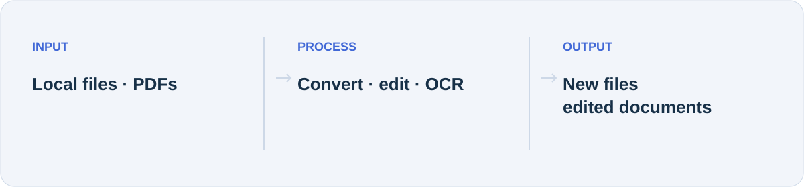
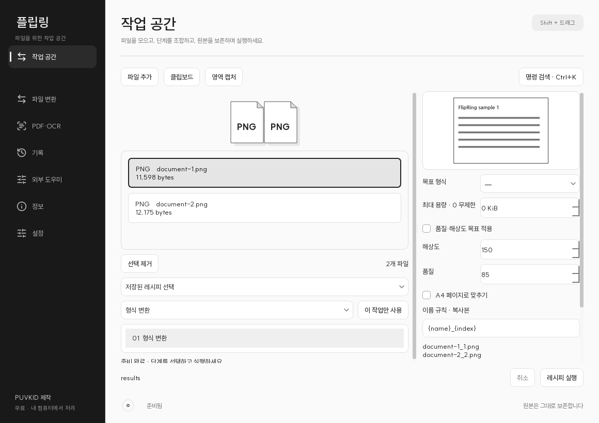
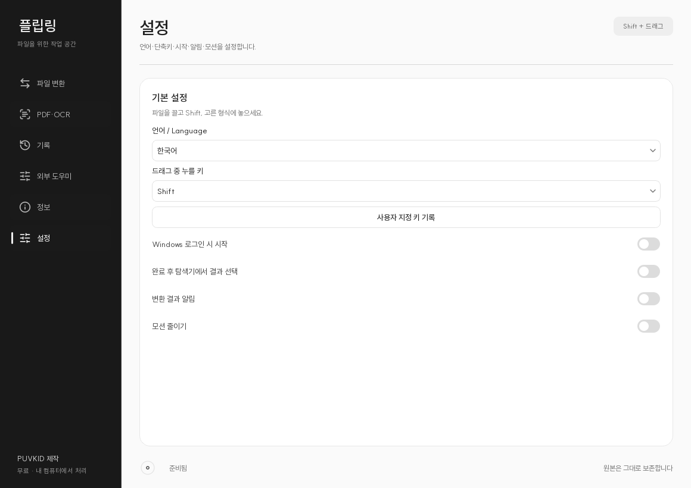

<a name="-flipring-project"></a>
<a id="flipring-project"></a>
<!-- readme-header32:start -->
<p align="center"></p>
<h1 align="center" id="project-title">FlipRing Project</h1>
<p align="center">Local file conversion · PDF editing · OCR</p>
<p align="center">
  <a href="../README.md"></a>
  <a href="README.md"></a>
</p>
<p align="center">
  <a href="../docs/읽기안내/레벨1.md"></a>
  <a href="../docs/읽기안내/레벨2.md"></a>
  <a href="../docs/읽기안내/레벨3.md"></a>
  <a href="../docs/읽기안내/레벨4.md"></a>
  <a href="../docs/읽기안내/레벨5.md"></a>
</p>
<p align="center"><small>LEVEL links open the Korean source at the same reading level.</small></p>
<picture>
  <source media="(max-width: 600px) and (prefers-color-scheme: dark)" srcset="../assets/readme/flow-en-dark-mobile.svg" />
  <source media="(max-width: 600px)" srcset="../assets/readme/flow-en-light-mobile.svg" />
  <source media="(prefers-color-scheme: dark)" srcset="../assets/readme/flow-en-dark.svg" />
  <source media="(prefers-color-scheme: light)" srcset="../assets/readme/flow-en-light.svg" />
  
</picture>
<!-- readme-header32:end -->


A Windows app for file conversion, PDF editing, and OCR in one screen.

<!-- project-levels:start -->
## 1.15.0 · simpler screens and actual conversion previews

Four main destinations and a More tools menu reduce the initial information density. Preview converts one temporary copy (up to 128 MiB) with the same engine, reports actual output bytes and format-loss warnings, and offers a matching recovery action on failure. Existing formats, PDF/OCR, Korean/English, and light/dark/system themes remain available. The 60-second preview limit requests cancellation; temporary files remain until the worker finishes.

[Version details](../docs/versions/1.15.0.md) · [Source](../history/1.15.0/소스/) · [Full comparison](../docs/revision-audit/1.15.0.md) · [Actual deployment checks](../docs/1.15.0_배포확인.md)

## 1.14.0 · consistent spacing and a Rust theme engine

Keeps the existing conversion, PDF, OCR, and history workflows while refining spacing, typography, and control states. A bundled Rust program generates Qt styles at startup and when the theme changes. Source-level Qt checks, actual font checks, icon contrast, and an HWPX-to-PDF sample are documented separately from testing the new executable and installer. The new executable was rebuilt with PyInstaller, and Windows 1.14.0 was freshly installed: all 1,232 distributed installed files matched their build hashes. Actual GUI JPG-to-PNG and installed-app HWPX-to-DOCX conversion preserved the originals; the complete test-document text matched. Hover feedback is quieter, stays inside each cell, and stops after immediate pointer exit. A one-time simultaneous crash of the compiler and app was followed by successful standalone compilation, startup, installation and conversion; its initial cause remains unconfirmed. Physical Explorer Shift-drag was not rerun for this installed build.

[Version details (Korean source)](../docs/versions/1.14.0.md) · [Source](../history/1.14.0/소스/) · [Full comparison with 1.13 (Korean source)](../docs/revision-audit/1.14.0.md) · [Current check scope (Korean source)](../docs/1.14.0_배포확인.md)


<a id="1130--작업-완성도-확장"></a>
## 1.13.0 · more complete workflows

Expands before/after comparison, compatibility guidance, optional metadata cleanup, and task recovery. The executable, installer, and full source ZIP were built and their component files compared. Windows installation, comparison of all installed files, and startup of the new distributed executable were checked. Actual Explorer Shift-drag checks confirmed PNG/PDF creation, original preservation, and center cancellation. The user directly checked light/dark screens and motion in file dialogs, PDF, OCR, and review tools. [Distribution check scope (Korean source)](../docs/1.13.0_배포확인.md) is documented separately.

[Version description (Korean source)](../docs/versions/1.13.0.md) · [Source (Korean source)](../history/1.13.0/소스/) · [Preceding comparison (Korean source)](../docs/revision-audit/1.13.0-직전비교.md) · [Final public-source synchronization comparison (Korean source)](../docs/revision-audit/1.13.0-최종동기화.md)

<a id="1121--문서-입력-보완"></a>
## 1.12.1 · improved document input

Improves ABW/DIF input, HWP/HWPX image boundaries, and preset spacing. Executables, installers, and full source were built, with Windows installation/startup checked. Actual Explorer conversion/cancellation and generated files were compared; remaining checks are recorded in the detailed document.

[Version description (Korean source)](../docs/versions/1.12.1.md) · [Source (Korean source)](../history/1.12.1/소스/) · [Preceding comparison (Korean source)](../docs/revision-audit/1.12.1.md)

Installation and redetection from Pandoc 3.13 to 3.14 were confirmed with exit code 0 through the actual installation backend. This is distinct from testing a click on the app's installation button.

<a id="1120--빠른-작업과-라이트다크-테마"></a>
## 1.12.0 · quick tasks and light/dark themes

Run saved conversion settings directly with Shift-drag. Adds batch conversion retaining folder structure, target sizes, before/after comparison, queues, result cleanup, and undo. Saves light/dark/system theme selection; external tools are installed through the app's installation buttons.

[1.12 usage and 50 improvements (Korean source)](../docs/versions/1.12.0.md) · [Installer and full source](https://github.com/PUVKID/FlipRing-File-Converter-Project/releases/tag/v1.12.0)

<a id="읽는-수준-선택"></a>
## Choose a reading level

| Level | What this guide covers |
| --- | --- |
| [LEVEL 1 - Beginner (Korean source)](../docs/읽기안내/레벨1.md) | Unfamiliar terms explained with actual behavior, examples, and easily misunderstood limits. |
| [LEVEL 2 - Explorer (Korean source)](../docs/읽기안내/레벨2.md) | Inputs, processing, outputs, feature connections, and revision changes. |
| [LEVEL 3 - Practitioner (Korean source)](../docs/읽기안내/레벨3.md) | Prerequisites, usage steps, settings, results, and checking failures. |
| [LEVEL 4 - Advanced (Korean source)](../docs/읽기안내/레벨4.md) | Module design, state transitions, verification boundaries, and implementation choices. |
| [LEVEL 5 - Expert (Korean source)](../docs/읽기안내/레벨5.md) | Actual code, protocols, settings, full comparisons, and measurement evidence. |

All guides cover the same project and all revisions. The existing detailed body remains below.
<!-- project-levels:end -->
<a id="1110--간단한-기본-화면과-문서-변환"></a>
## 1.11.0 · a simple default screen and document conversion

Start with select file → select format → convert; expand advanced options for detailed PDF/OCR settings.

Retains HWP/HWPX reading and conversion to other formats, with limited local conversion from DOCX/TXT/HWP5/HWPX to HWP/HWPX.

Handles simple paragraphs, bold/italic, rectangular tables, and PNG/JPEG images; rejects unsupported structures.

HWP5 writing is experimental; HWP3 output is not provided.

Rejects unsupported complex structures such as merged/nested tables, equations, comments, fields, and floating/rotated images.

Does not guarantee full preservation of all HWPX user parts, fonts, or page layouts, or visual equivalence in external viewers.

Existing HWP/HWPX reading conversions to PDF/Word and Office document conversions require LibreOffice; HWP reading uses H2Orestart and Java.

Early Excel 2007 Beta2 XLSB is unsupported.

Some video/audio/document features require separate helpers such as FFmpeg and Pandoc.

The executable and installer have no code-signing certificate applied.

[1.10 development history (Korean source)](../docs/versions/1.10.0.md) · [1.11 actual checks (Korean source)](../docs/versions/1.11.0.md) · [Full source](https://github.com/PUVKID/FlipRing-File-Converter-Project/releases/download/v1.11.0/FlipRing-1.11.0-Source.zip)

**Technical category:** Desktop software › Qt and document processing › file conversion, PDF, and OCR

`Python`
`PySide6`
`Windows`

[Quick start](#quick-start) · [Repository structure](#repository-structure) · [Input/output configuration](#data-settings)

[Core structure](#input-processing-output)

[All revisions and original comparisons (Korean source)](../docs/REVISION_INDEX.md) · [Publication status recheck (Korean source)](../docs/2026-11-02_공개반영재개검증.md) · [Check execution configuration improvements (Korean source)](../docs/2026-11-02_검사실행구성보완.md)

<a name="implementation-details"></a>
<a name="-파일-선택부터-결과-보존까지"></a>
<a id="파일-선택부터-결과-보존까지"></a>
## From file selection to preserving results

- App and conversion: `app.py` connects windows, tray, and file selection; `engine.py` identifies input types, possible target formats, and external converters.
- PDF and preflight: `pdf_panel.py` and `pdf_tools.py` configure/execute PDF requests; `flipring_workflow.py` handles named presets and per-file preflight.
- Preview and workspace: `preview_panel.py`/`pdf_pages.py` handle previews and page operations; later `workspace_core.py`/`workspace_ui.py` form a workspace centered on recipes, watch folders, and search.

Select files, target formats/tasks, pages, and quality. Check required tools and input/output disk space, process through the task queue, then open results. A successful conversion indicator does not guarantee OCR context or row/column reconstruction quality; inspect the results directly. Input/output paths may remain in task history.

Preset validation conditions preserved since 1.7.0 are:

- Names contain 1–80 characters; case-insensitive duplicate names are rejected. Saves only convert/pdf types and permitted options.
- Validates PDF rotation 90/180/270, quality 20–95, DPI 60–600, PSM 3/6/11, and OCR languages kor+eng/kor/eng.
- Preserves errors in corrupt presets without overwriting them. Only successful saves use flush/fsync and replacement of temporary JSON.

Preflight disk space is a conservative estimate of 4 times the input + 64MiB.

Missing input, unsupported formats, missing helpers, insufficient space, and write failures return distinct codes; do not collapse them into the same error and retry indiscriminately.

Prepare FFmpeg, LibreOffice, Tesseract, and other tools as required by the selected features, preserving originals separately.

1.9.0 expands recipes, Ctrl+K search, user-enabled watch folders, OCR correction, and review of personal-information candidates.

The 249 regression checks and comparison of 626 installed-product files in the verification records cover that historical scope, not conversion-quality measurements for every document.

Partial copies from before screen changes are not independent installers; first check the material type in the revision table.

[Code, conditions, observations, and full comparisons for every revision (Korean source)](../docs/REVISION_INDEX.md)

<a name="overview"></a>
<a name="latest-changes"></a>
<a name="-최신차수에서-달라진-점"></a>
<a id="최신차수에서-달라진-점"></a>
## What changed in the latest revision

Actual 1.11.0 checks and distribution configuration are linked in the new guidance above. Below are screens and usage examples from the earlier 1.9.0 public baseline.

**1.9.0 · file workspace and review tools**

Expands one workspace for collecting files and choosing target formats, sizes, page specifications, and processing order. Defaults to local processing and saving new results while preserving originals.

- Connects Ctrl+K quick commands, copying naming rules, history search/filter/copy, and wheel customization.
- Builds PDF/image combinations and recipes from file cards, applying the same processing order to stable inputs in user-enabled watch folders.
- Provides OCR correction, before/after comparison, blur/duplicate/personal-information candidate review, and masking of user-confirmed regions. Candidate detection does not guarantee finding every problem, nor does OCR guarantee full restoration of original layout.
- Accepts clipboard input and screen-region captures explicitly initiated by the user. Displays actual task waiting/execution/results and retains reduced-motion settings.
- [1.9 implementation, actual checks, and limits (Korean source)](../docs/versions/1.9.0.md) · [User guide (Korean source)](../소스/1.9-확장안내.md) · [Full comparison with 1.8 (Korean source)](../docs/revision-audit/1.9.0.md)

<a name="️-작업-공간과-실제-작업-모션"></a>
<a id="작업-공간과-실제-작업-모션"></a>
### Workspace and actual task motion



The [English workspace (Korean source)](../assets/screenshots/1.9.0/workspace-en.png) offers the same file selection, task stages, and main options. The motion below records a Qt region where file cards and completion indicators change with actual task state. It is not a static image presented as functional UI.



Screen materials are app renders from a Qt virtual screen, distinct from actual monitor-scaling changes, physical Shift-drag, or frame-rate verification. The full rendering scope is 160 images under 5 conditions, with 9 representative images visually reviewed. This landing page uses only Korean/English screens without personal user paths and actual task motion.

<a name="-설치본과-공개-소스"></a>
<a id="설치본과-공개-소스"></a>
### Installers and public source

New executables, installers, full runtime assets, and legal materials are provided in the local 1.9 delivery folder.

This repository preserves product source, testing tools, guides, existing public assets, and licenses; it does not newly upload large executable/installer binaries.

[1.9 detailed records (Korean source)](../docs/versions/1.9.0.md) link actual installer checks, sizes, and hashes. [Existing regression tools (Korean source)](../tools19/regression19.py) and [new check tools (Korean source)](../tools19/new_suites19.py) operate against `소스/` in a repository with the runtime environment prepared.

The automatically generated `FlipRing.spec`/`installer.iss` from earlier versions remaining in current public source are removed after comparison with baseline originals.

The new `build.py` regenerates them for the actual build paths, so separately preserved older settings are not used for the new version.

New generated files in local full source and existing historical originals are preserved.

Deletion of the two public files is included in the full change comparison.

**1.8.0 · fixed window and detailed design**

- Fixes the default window at 1160×820 logical pixels and strengthens the separation of menus, tasks, and original/results.
- Improves file/folder dialogs, PDF page numbers, high-scaling icons/previews, and scroll access on small screens.
- [1.8 actual changes and verification scope (Korean source)](../docs/versions/1.8.0.md) · [Screen guide (Korean source)](../소스/1.8-화면안내.md)
- [163 feature checks and motion-synchronization verification (Korean source)](../docs/2026-11-02_검사실행구성보완.md) are recorded separately. This follow-up record concerns the preserved 1.8.0 product and check execution.
- Preserves the development [output collector (Korean source)](../tools/release_capture.py) and [complete regression-check source (Korean source)](../tools/test_release_capture.py) together.

1.7.0 · per-file workflows and PDF page editing

- Connects original/result image previews, per-file waiting/completed/failed/cancelled states, retrying failures only, and built-in/user presets.
- Adds drag-reordering of actual PDF thumbnails, multi-selection, rotation, deletion, extraction, zoom, and saving new files.
- Provides input/helper/write/space checks, separate settings, and saved reduced-motion selection.
- Retains the Shift radial menu, original preservation, PDF/Korean-English OCR, language settings, and Explorer selection from history.
- [1.7 changes and verification scope (Korean source)](../docs/versions/1.7.0.md) · [Usage and reproducing checks (Korean source)](../소스/1.7-새기능안내.md)

**Basic structure** — radial menu/tray, conversion, and PDF processing

Connects file conversion and PDF processing around a radial menu and task queues.

- app.py watches file dragging while Shift is held and connects the radial menu, tray, and queues. General conversion and PDF tasks each use a single worker thread; the two queues do not run simultaneously.
- engine.convert chooses tools by file type, processes in a temporary folder on the same drive, then moves to a new name. Checks archive parent/absolute paths and links.
- pdf_tools/pdf_panel handle extraction, deletion, rotation, compression, and OCR output options. Exclusive file creation avoids overwriting PDF results; OCR rows/columns are inferred from character positions.
- studio_ui/ui_motion compose screens and finite animations. Recent history retains up to 200 inputs/outputs/errors and may contain operational file paths.

[Latest materials in detail (Korean source)](../docs/versions/%EA%B8%B0%EB%B3%B8.md) · [Semantic comparison of all revisions (Korean source)](../docs/VERSIONS.md)

<a id="확인된-전체-버전과-보존-기준본"></a>
### All confirmed versions and preserved baselines

| Confirmed version/baseline | Preservation scope | Source/description | Comparison |
| --- | --- | --- | --- |
| 1.2.0 | Installer configuration AppVersion =1.2.0 identifies earlier Mono source | [Folder (Korean source)](../history/1.2.0/) · [Description (Korean source)](../docs/versions/1.2.0.md) | No evidence for preceding comparison target/order |
| Before soft-design work | Partial baseline containing only app, PDF screen, and GUI checks | [Folder (Korean source)](../history/부드러운디자인-작업전/) · [Description (Korean source)](../docs/versions/부드러운디자인-작업전.md) | No evidence for preceding comparison target/order |
| Before button-motion work | Partial baseline containing only app and GUI checks | [Folder (Korean source)](../history/버튼모션-작업전/) · [Description (Korean source)](../docs/versions/버튼모션-작업전.md) | No evidence for preceding comparison target/order |
| Before combo work | Partial baseline containing only app and GUI checks | [Folder (Korean source)](../history/콤보-작업전/) · [Description (Korean source)](../docs/versions/콤보-작업전.md) | No evidence for preceding comparison target/order |
| Before tab-afterimage work | Partial baseline containing only app and GUI checks | [Folder (Korean source)](../history/탭잔상-작업전/) · [Description (Korean source)](../docs/versions/탭잔상-작업전.md) | No evidence for preceding comparison target/order |
| Before hover-contrast work | Partial baseline containing only app and GUI checks | [Folder (Korean source)](../history/호버대비-작업전/) · [Description (Korean source)](../docs/versions/호버대비-작업전.md) | No evidence for preceding comparison target/order |
| 1.4.0 | Installer configuration AppVersion =1.4.0 identifies source before the studio redesign | [Folder (Korean source)](../history/1.4.0/) · [Description (Korean source)](../docs/versions/1.4.0.md) | [Full differences from 1.2.0 (Korean source)](../docs/diffs/1.4.0.patch) |
| Before internal-motion work | 11 Python files preserved before internal-motion expansion | [Folder (Korean source)](../history/내부모션-작업전/) · [Description (Korean source)](../docs/versions/내부모션-작업전.md) | [Full differences from 1.4.0 (Korean source)](../docs/diffs/내부모션-작업전.patch) |
| 1.6.0 | Installer configuration AppVersion =1.6.0 identifies source before this work | [Folder (Korean source)](../history/1.6.0/) · [Description (Korean source)](../docs/versions/1.6.0.md) | [Full differences from 1.4.0 (Korean source)](../docs/diffs/1.6.0.patch) |
| 1.7.0 | Source expanding this workflow.<br>Installation/actual interaction results are distinguished in separate verification records | [Folder (Korean source)](../history/1.7.0/) · [Description (Korean source)](../docs/versions/1.7.0.md) | [Full differences from 1.6.0 (Korean source)](../docs/diffs/1.7.0.patch) |
| 1.8.0 | Fixed window, separated areas, and improved scaling renders | [Folder (Korean source)](../history/1.8.0/) · [Description (Korean source)](../docs/versions/1.8.0.md) | [Full differences from 1.7.0 (Korean source)](../docs/diffs/1.8.0.patch) |
| 1.9.0 | Expanded workspace, recipes, OCR review, and actual-state motion | [Folder (Korean source)](../history/1.9.0/) · [Description (Korean source)](../docs/versions/1.9.0.md) | [Full differences from 1.8.0 (Korean source)](../docs/revision-audit/1.9.0.md) |

Correspondence between original revisions 1/2 and preserved files was not confirmed. Complete final sources for 1.3/1.5 were also not confirmed, so numbers are not invented to fill gaps. See [preservation scope and comparison limits (Korean source)](../docs/VERSIONS.md).

<a name="preview"></a>
<a id="이전-18-고정-창-설정-화면"></a>
### Earlier 1.8 fixed-window settings screen



A Qt-native static render generated at 1160×820 logical pixels. Distinct from an actual Windows screenshot, monitor-scaling changes, or frame-rate evidence. The existing configuration materials below also describe earlier preserved versions.

<a name="input-processing-output"></a>
<a name="-입력처리출력"></a>
<a id="입력처리출력"></a>
## Input, processing, and output

| Stage | What this project covers |
| --- | --- |
| Input | Local images, documents, media, and PDFs |
| Processing | PySide6 UI, conversion engine/external tools, page editing, and Tesseract OCR |
| Output | Files in new formats, edited PDFs, and recognized documents |

---

<a name="introduction"></a>
<a name="-프로젝트-소개"></a>
<a id="프로젝트-소개"></a>
## Project introduction

A tool for moving from file conversion to PDF organization in one screen.

FlipRing classifies file formats, shows possible output formats, and processes tasks with Python libraries or external converters. The PDF screen provides page editing and OCR as separate tasks.

| Feature | Implementation |
| --- | --- |
| File conversion | Images, documents, audio, video, tables, subtitles, and archives |
| Radial menu | Windows interface centered on selecting supported formats and the tray |
| PDF editing | Merge, split, extract, delete, rotate, and compress |
| PDF/image conversion | Combine images into PDFs or save PDF pages as images |
| OCR | Korean/English recognition and document output with Tesseract |
| Result preservation | Outputs a new name when an existing name conflicts |

```mermaid
flowchart LR
    A[Selected files] --> B[Format classification and output selection]
    B --> C[Python conversion]
    B --> D[FFmpeg / Pandoc / LibreOffice]
    A --> E[PDF tasks and OCR]
    C --> F[New result files]
    D --> F
    E --> F
```

<a name="repository-structure"></a>
<a name="-저장소-구성"></a>
<a id="저장소-구성"></a>
## Repository structure

```text
.
├── 소스/
│   ├── app.py
│   ├── engine.py
│   ├── pdf_tools.py
│   ├── pdf_panel.py
│   ├── studio_ui.py
│   ├── ui_motion.py
│   ├── i18n.py
│   ├── requirements-lock.txt
│   ├── build.py
│   ├── package.py
│   ├── test_engine.py
│   ├── test_gui.py
│   ├── test_pdf_tools.py
│   └── licenses/
└── docs/VERSIONS.md
```

- [App entry point (Korean source)](../소스/app.py) and [conversion engine (Korean source)](../소스/engine.py).
- [PDF processing (Korean source)](../소스/pdf_tools.py) and [PDF screen (Korean source)](../소스/pdf_panel.py).
- [Pinned dependencies (Korean source)](../소스/requirements-lock.txt), [existing license (Korean source)](../소스/LICENSE.txt), and [version history (Korean source)](../docs/VERSIONS.md).

<a name="implementation"></a>
<a name="-주요-기술과-처리-방식"></a>
<a id="주요-기술과-처리-방식"></a>
## Main technologies and processing

Tools depend on file type. Pillow/pi-heif handle images, pypdfium2/pypdf handle PDF reading/editing, and python-docx/ReportLab generate documents. Tabular OCR infers rows/columns from character positions and does not guarantee full reconstruction of complex tables.

`engine.convert()` converts in a temporary folder on the original's drive, then moves to a new name. Checks parent/absolute paths and links within archives. PDF output uses exclusive creation to avoid overwriting existing results.

<a name="️-트레이와-원형-메뉴"></a>
<a id="트레이와-원형-메뉴"></a>
### Tray and radial menu

The default gesture is dragging a file from Explorer/the desktop while holding Shift. The app checks input state every 30ms and opens the radial menu after movement greater than 10px. It checks the local files actually passed to the menu and accepts drops as copy operations for conversion. The center and unsupported areas do not convert.

Closing the window hides the app in the tray. Exit is selected from the tray menu; pending conversions prompt the user to wait. General conversion and PDF tasks each use one worker thread and their queues do not run together. The helper-tools screen copies installation commands to the clipboard rather than installing automatically.

<a name="-화면과-기록"></a>
<a id="화면과-기록"></a>
### Screens and history

Screens use PySide6/QPainter and load app-specific SUIT Regular/Medium/SemiBold fonts. Button, selection, and status feedback uses finite animations that stop on hidden screens. Tooltips show filenames and errors as plain text.

Recent conversion history holds at most 200 entries including input/output paths and errors. Corrupt history shows an error without overwriting the existing file. Double-clicking a result selects it in Explorer rather than executing it.

<a name="-pdf-작업과-인식-옵션"></a>
<a id="pdf-작업과-인식-옵션"></a>
### PDF tasks and recognition options

| Option | Actual screen values |
| --- | --- |
| Page selection | All or `1,3-5`; deletion requires an explicit range |
| Rotation | 90°/180°/270° |
| Image quality | 20–95, default 80 |
| Resolution | 60–600 DPI, default 200 |
| OCR language | Korean+English, Korean, or English |
| OCR layout | Automatic PSM 3, single block 6, sparse text 11 |
| Recognition output | Searchable PDF, TXT, DOCX, or XLSX |

Searchable PDF reconstructs pages as images and adds a recognized-text layer. Word/Excel infer rows/columns from text coordinates and do not fully restore original layouts or merged cells. Image recompression is lossy; lossless cleanup does not guarantee a smaller file. Cancellation requests are passed to the task, preserving results already completed.

<a name="quick-start"></a>
<a name="-빠른-시작"></a>
<a id="빠른-시작"></a>
## Quick start

Prepare dependencies in a Windows Python environment.

```powershell
cd "소스"
python -m venv .venv
.\.venv\Scripts\python -m pip install -r requirements-lock.txt
```

The selected public source includes legacy SUIT assets, the current NanumGothic Bold 700 font, screen assets, and legal notices. Complete helper runtimes and OCR language data are part of the customer full-source and distribution configuration; they are not all stored in Git.

The `tesseract.exe` and 7-Zip executable binaries required for OCR/archive features are not included.

Prepare the required runtime and feature-specific tools separately; source alone does not guarantee execution or rebuilding identical to the distributed app.

With the required assets obtained from legitimate distributions, build the Rust style generator before starting the app:

```powershell
Push-Location ".\rust\astryx-theme"
$env:RUSTFLAGS = "-C target-feature=+crt-static"
cargo build --release --locked
Pop-Location
New-Item -ItemType Directory -Path ".\vendor\astryx" -Force
Copy-Item -LiteralPath ".\rust\astryx-theme\target\release\astryx-theme.exe" -Destination ".\vendor\astryx\astryx-theme.exe"
```

Then start the development entry point:


```powershell
.\.venv\Scripts\python app.py --settings
```

`--settings` shows the task window. Ordinary execution without arguments stays in the tray. The current UI uses NanumGothic Bold 700 and the bundled Rust style generator. Missing required fonts or theme resources are reported as errors; a source checkout alone is not a complete runtime.

Build scripts use PyInstaller/Inno Setup and stop if the output folder already exists. `build.py` also references additional distribution assets/notices; prepare these inputs before building.

<a name="data-settings"></a>
<a name="-입출력과-도구-구성"></a>
<a id="입출력과-도구-구성"></a>
## Input/output and tool configuration

| Task | Tool or input |
| --- | --- |
| Audio/video | FFmpeg |
| E-books/some documents | Pandoc |
| Office documents/presentations/tables | LibreOffice |
| RAR processing | 7-Zip 26.05 extraction tool bundled with the local distribution |
| OCR | Tesseract and `kor`/`eng` language data |
| PDF page selection | One-based ranges such as `1,3-5` |

PDF tasks reject encrypted PDFs. Image PDFs require OCR to obtain text; ordinary text extraction and OCR are separate paths. Original properties such as layout, equations, and macros may vary with format/tool.

<a name="️-로컬-설정과-검사-코드"></a>
<a id="로컬-설정과-검사-코드"></a>
### Local settings and testing code

Earlier 1.8 settings/history are preserved in `%LOCALAPPDATA%/PUVKID/DragWheel/`.

New 1.9 uses a separate user-data boundary; [version guidance (Korean source)](../docs/versions/1.9.0.md) records actual checked scope. `running.lock` prevents duplicate execution.

If the user enables Windows autostart, it registers in the current user's Run registry key.

These settings/history are personal operational materials and are stored separately from public code.

[Conversion checks (Korean source)](../소스/test_engine.py) cover generated files and available converters. [PDF/OCR checks (Korean source)](../소스/test_pdf_tools.py) check page editing, original hashes, coordinate tables, process timeouts, and cancellation; `--ocr` adds actual Tesseract checks, while `--gui` adds Qt screen/thread/state-recovery checks.

Windows fonts, OS APIs, and executables for selected features are required.

<a name="troubleshooting"></a>
<a name="️-문제-해결"></a>
<a id="문제-해결"></a>
## Troubleshooting

| Symptom | What to check |
| --- | --- |
| Converter not found | FFmpeg/Pandoc/LibreOffice installation and search paths |
| No window after startup | Tray menu or `app.py --settings` |
| Exit refused | Whether general conversion/PDF tasks have completed |
| Missing OCR configuration | Tesseract executable and language data |
| Font/screen asset error | Actual bundled `assets/` font/asset paths and missing required files |
| PDF page-range error | One-based ranges and the actual page count |
| PDF rejected | Encryption, empty document, or corruption |
| Archive conversion rejected | Absolute paths, parent paths, or symbolic links |

The existing MIT license follows the [scope document (Korean source)](../소스/LICENSE.txt). Check separate licenses for external components and fonts as well.

---

<div align="center">

Select, convert, and preserve new results.

</div>

<!-- apps-revision-audit -->
<a name="-모든-차수보관본과-전체-차이"></a>
<a id="모든-차수보관본과-전체-차이"></a>
## All revisions, archives, and full differences

Source, settings, resources, usage instructions, and design are preserved together for every revision. Each description distinguishes partial materials from actual product versions.

| Revision/material | Material folder/original | Detailed description · preceding comparison/scope |
| --- | --- | --- |
| 1.2.0 | [Material folder (Korean source)](../history/1.2.0) | [Detailed description (Korean source)](../docs/versions/1.2.0.md)<br>[Full comparison/scope (Korean source)](../docs/revision-audit/1.2.0.md) |
| Before soft-design work | [Material folder (Korean source)](../history/%EB%B6%80%EB%93%9C%EB%9F%AC%EC%9A%B4%EB%94%94%EC%9E%90%EC%9D%B8-%EC%9E%91%EC%97%85%EC%A0%84) | [Detailed description (Korean source)](../docs/versions/%EB%B6%80%EB%93%9C%EB%9F%AC%EC%9A%B4%EB%94%94%EC%9E%90%EC%9D%B8-%EC%9E%91%EC%97%85%EC%A0%84.md)<br>[Full comparison/scope (Korean source)](../docs/revision-audit/%EB%B6%80%EB%93%9C%EB%9F%AC%EC%9A%B4%EB%94%94%EC%9E%90%EC%9D%B8-%EC%9E%91%EC%97%85%EC%A0%84.md) |
| Before button-motion work | [Material folder (Korean source)](../history/%EB%B2%84%ED%8A%BC%EB%AA%A8%EC%85%98-%EC%9E%91%EC%97%85%EC%A0%84) | [Detailed description (Korean source)](../docs/versions/%EB%B2%84%ED%8A%BC%EB%AA%A8%EC%85%98-%EC%9E%91%EC%97%85%EC%A0%84.md)<br>[Full comparison/scope (Korean source)](../docs/revision-audit/%EB%B2%84%ED%8A%BC%EB%AA%A8%EC%85%98-%EC%9E%91%EC%97%85%EC%A0%84.md) |
| Before combo work | [Material folder (Korean source)](../history/%EC%BD%A4%EB%B3%B4-%EC%9E%91%EC%97%85%EC%A0%84) | [Detailed description (Korean source)](../docs/versions/%EC%BD%A4%EB%B3%B4-%EC%9E%91%EC%97%85%EC%A0%84.md)<br>[Full comparison/scope (Korean source)](../docs/revision-audit/%EC%BD%A4%EB%B3%B4-%EC%9E%91%EC%97%85%EC%A0%84.md) |
| Before tab-afterimage work | [Material folder (Korean source)](../history/%ED%83%AD%EC%9E%94%EC%83%81-%EC%9E%91%EC%97%85%EC%A0%84) | [Detailed description (Korean source)](../docs/versions/%ED%83%AD%EC%9E%94%EC%83%81-%EC%9E%91%EC%97%85%EC%A0%84.md)<br>[Full comparison/scope (Korean source)](../docs/revision-audit/%ED%83%AD%EC%9E%94%EC%83%81-%EC%9E%91%EC%97%85%EC%A0%84.md) |
| Before hover-contrast work | [Material folder (Korean source)](../history/%ED%98%B8%EB%B2%84%EB%8C%80%EB%B9%84-%EC%9E%91%EC%97%85%EC%A0%84) | [Detailed description (Korean source)](../docs/versions/%ED%98%B8%EB%B2%84%EB%8C%80%EB%B9%84-%EC%9E%91%EC%97%85%EC%A0%84.md)<br>[Full comparison/scope (Korean source)](../docs/revision-audit/%ED%98%B8%EB%B2%84%EB%8C%80%EB%B9%84-%EC%9E%91%EC%97%85%EC%A0%84.md) |
| 1.4.0 | [Material folder (Korean source)](../history/1.4.0) | [Detailed description (Korean source)](../docs/versions/1.4.0.md)<br>[Full comparison/scope (Korean source)](../docs/revision-audit/1.4.0.md) |
| Before internal-motion work | [Material folder (Korean source)](../history/%EB%82%B4%EB%B6%80%EB%AA%A8%EC%85%98-%EC%9E%91%EC%97%85%EC%A0%84) | [Detailed description (Korean source)](../docs/versions/%EB%82%B4%EB%B6%80%EB%AA%A8%EC%85%98-%EC%9E%91%EC%97%85%EC%A0%84.md)<br>[Full comparison/scope (Korean source)](../docs/revision-audit/%EB%82%B4%EB%B6%80%EB%AA%A8%EC%85%98-%EC%9E%91%EC%97%85%EC%A0%84.md) |
| 1.6.0 | [Material folder (Korean source)](../history/1.6.0) | [Detailed description (Korean source)](../docs/versions/1.6.0.md)<br>[Full comparison/scope (Korean source)](../docs/revision-audit/1.6.0.md) |
| 1.7.0 | [Material folder (Korean source)](../history/1.7.0) | [Detailed description (Korean source)](../docs/versions/1.7.0.md)<br>[Full comparison/scope (Korean source)](../docs/revision-audit/1.7.0.md) |
| 1.8.0 | [Material folder (Korean source)](../history/1.8.0) | [Detailed description (Korean source)](../docs/versions/1.8.0.md)<br>[Full comparison/scope (Korean source)](../docs/revision-audit/1.8.0.md) |
| 1.9.0 | [Material folder (Korean source)](../history/1.9.0) | [Detailed description (Korean source)](../docs/versions/1.9.0.md)<br>[Full comparison/scope (Korean source)](../docs/revision-audit/1.9.0.md) |
| 1.10.0 | [Folder (Korean source)](../history/1.10.0/) | [Description (Korean source)](../docs/versions/1.10.0.md)<br>[Full comparison (Korean source)](../docs/revision-audit/1.10.0.md) |
| 1.11.0 | [Folder (Korean source)](../history/1.11.0/) | [Description (Korean source)](../docs/versions/1.11.0.md)<br>[Full comparison (Korean source)](../docs/revision-audit/1.11.0.md) |
| 1.12.0 | [Folder (Korean source)](../history/1.12.0/) | [Description (Korean source)](../docs/versions/1.12.0.md)<br>[Full comparison (Korean source)](../docs/revision-audit/1.12.0.md) |
| 1.14.0 | [Folder](../history/1.14.0/) | [Description (Korean source)](../docs/versions/1.14.0.md)<br>[Full comparison (Korean source)](../docs/revision-audit/1.14.0.md) |
| 1.13.0 | [Folder (Korean source)](../history/1.13.0/) | [Description (Korean source)](../docs/versions/1.13.0.md)<br>[Full comparison (Korean source)](../docs/revision-audit/1.13.0-직전비교.md) |
| 1.12.1 | [Folder (Korean source)](../history/1.12.1/) | [Description (Korean source)](../docs/versions/1.12.1.md)<br>[Full comparison (Korean source)](../docs/revision-audit/1.12.1.md) |
| Final | [Folder (Korean source)](../소스/) | [Description (Korean source)](../docs/versions/최종.md)<br>[Full comparison (Korean source)](../docs/revision-audit/최종.md) |
| Current source | Remote 726 baseline: [Material folder (Korean source)](../%EC%86%8C%EC%8A%A4)<br>Current candidate: [Folder (Korean source)](../소스/) | Remote 726 baseline: [Detailed description (Korean source)](../docs/revision-audit/%ED%98%84%ED%96%89%EC%86%8C%EC%8A%A4.md)<br>Current candidate: [Description (Korean source)](../docs/revision-audit/현행소스.md)<br>Remote 726 baseline: [Full comparison/scope (Korean source)](../docs/revision-audit/%ED%98%84%ED%96%89%EC%86%8C%EC%8A%A4.md)<br>Current candidate: [Full comparison (Korean source)](../docs/revision-audit/현행소스.md) |
| Unique working code and documents | [Material folder (Korean source)](../%EB%B3%B4%EC%A1%B4%EC%9E%90%EB%A3%8C/%EC%9E%91%EC%97%85%EC%86%8C%EC%8A%A4) | [Detailed description (Korean source)](../docs/SOURCE_MATERIALS.md)<br>[Full comparison/scope (Korean source)](../docs/2026-11-02_%EA%B3%B5%EA%B0%9C%EB%B0%98%EC%98%81%EC%9E%AC%EA%B0%9C%EA%B2%80%EC%A6%9D.md) |

<!-- flipring-supported-input -->
<a name="-hwphwpx-지원-범위"></a>
<a id="hwphwpx-지원-범위"></a>
## HWP/HWPX support scope

1.11.0 provides conversion paths for representative Office/ODF formats and readable HWP/HWPX inputs.

Reading HWP/HWPX to PDF/Word uses extensions in an isolated profile.

Saving new HWP/HWPX from DOCX/TXT/HWP5/HWPX uses a separate handler bundled with the app, limited to simple paragraphs, bold/italic, unmerged rectangular tables, and PNG/JPEG images.

Unsupported complex structures are rejected rather than discarding content and reporting success.

HWP5 writing is experimental and does not guarantee full font/page-layout reproduction or visual equivalence in independent viewers.

See the [document support guide (Korean source)](../소스/1.10-문서지원안내.md) and [51-document independent-check summary (Korean source)](../docs/검증/문서51_독립검사_요약.json) for actual HWP 5/HWPX checks, unsupported early Excel 2007 Beta2 XLSB, external-tool requirements, passwords, and formatting limits.

<!-- flipring-previous-support-726 -->
<details>
<summary>HWP/HWPX classification records at the earlier public baseline</summary>

The following paragraphs record classification when the [public source at fixed commit 726](https://github.com/PUVKID/FlipRing-File-Converter-Project/blob/7263d0da863ca4cad903130b86dd0446ece2a258/%EC%86%8C%EC%8A%A4/engine.py) was inspected.

“Current” in the quoted record refers to that commit's state.

The current 1.11.0 support scope follows the guidance above.

The `TABLE` in the then-current `소스/engine.py` has no HWP/HWPX entries. `classify()` rejects extensions outside the list as unsupported, so HWP/HWPX → PDF was not supported at that point. Installing LibreOffice alone did not connect these inputs to this app.

This was direct inspection of input-classification code; actual HWP conversion tests were not run.

</details>

<a name="️-차수별-화면과-검증-이미지"></a>
<a id="차수별-화면과-검증-이미지"></a>
### Screens and verification images by revision

[Original images, revision-specific sources, and file hashes (Korean source)](../docs/IMAGE_MATERIALS.md) provide screens and synthetic test inputs.
